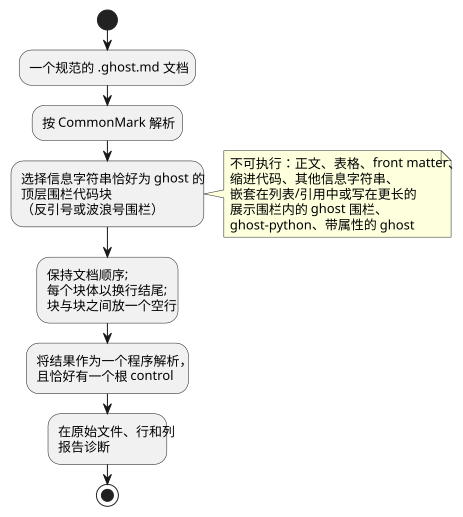
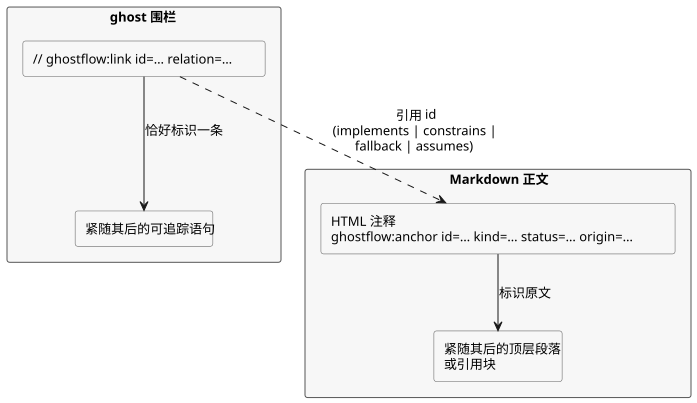

<!-- translation-source: docs/reference/01-source-and-syntax.en.md -->
[英文原文](01-source-and-syntax.en.md)

# 1. 源文件与语法

[完整目录](../LANGUAGE-REFERENCE.zh.md) · [下一章：类型、表达式与状态](02-types-expressions-state.zh.md)

规范的 GhostFlow 程序是单个 `.ghost.md` 文档。它同时包含解释和可执行规则。该语言的代表性表层是 **control 语法**：带有花括号、分号、表达式、显式下一状态和输出连接的 `control Name { ... }`。

本章定义：

- 如何从文档中选出可执行源（§1.1）；
- 如何保留原文、位置和意图链接（§1.2）；
- 词汇：标识符、保留字、注释和符号（§1.3）；
- 语法记法和声明形式（§1.4）；
- 代表性的声明结构和名称解析规则（§1.5）；
- 被拒绝的历史记法（§1.6），以及哪一章负责哪部分语法（§1.7）。

本章中的 `ghost` 片段用于说明语法和语义。

依据：[选定的语法](../LANGUAGE-SURFACE.zh.md)、[通用语言契约](../LANGUAGE.zh.md)、[文学式源文件](../LITERATE.zh.md)、[意图锚点](../INTENT-ANCHOR-MAP.zh.md)、[源保留](../SOURCE-MAP.zh.md)、[设计说明](../DESIGN-NOTES.zh.md)。[完整语言参考](../LANGUAGE-REFERENCE.zh.md)为本章及其他详细章节编制了索引。

**外部输入。** 外部输入的规范声明是 `input`。读取输入得到 `Result<T, SensorFault>`。

**重启输入是唯一的例外。** 精确的保留声明 `restart_reason: RestartReason` 和 `restart_event: Bool` 是由运行时拥有的生命周期输入，而不是从外部采集的输入。它们直接读作 `RestartReason` 和 `Bool`。对它们禁止使用可选标记、调理设置以及调用方提供的值。参见[重启契约](05-settings-and-observation.zh.md)。

本章示例在读取 `start` 失败时显式选择 `false`，在读取 `stop` 失败时显式选择 `true`。这些是用于说明的作者策略，绝不是隐式默认值。

以前的 `sensor` 声明会被拒绝。应保留旧文档，并创建显式的、经过审查的修订版。关于采集和兼容性，参见[迁移契约](../INPUT-MIGRATION.zh.md)。

## 1.1 为什么一个文档就是源

如果只保留控制规则，就会丢失每个条件背后的原因和现场前提。如果只保留解释，就没有人能机械地检查哪些规则实际执行。因此，GhostFlow 把解释、注释、意图和可执行代码放在同一个修订版中。审查只有一个起点。

- 产品输入是一个完整的 `.ghost.md` 文档。
- 普通的 `.ghost` 文件不是可执行输入，也不是替代输入。
- 编辑器、表单和图可以是该文档的不同视图。它们绝不会创建独立的控制源。
- 文档修订版与可执行结构的身份标识是两回事。只编辑解释会产生新的文档修订版。如果可执行 token 结构没有变化，计算的含义保持不变。

### 可执行块提取

按 CommonMark 解析文档。按文档顺序，只提取信息字符串恰好为 `ghost` 的**顶层围栏代码块**。反引号围栏和波浪号围栏都允许。每个块体以换行结尾，块与块之间放一个空行。标题和解释绝不会变成代码注释。

提取步骤概括如下。



下面是一个完整的 `.ghost.md` 文档示例。

````markdown
# 펌프 요청

정지가 시작보다 우선한다.

```ghost
control PumpRequest {
  input start, stop: Bool;
```

두 입력의 판단을 출력에 연결한다.

```ghost
  output pump: Bool;
  pump <- (start |> recover(false)) && !(stop |> recover(true));
}
```
````

这两个 `ghost` 块共同构成一个 `control`。一个块不会产生自己的执行，也不会产生自己的状态提交。缺失的花括号或语句绝不会被自动补上。块边界应放在声明或语句的末尾。绝不能把 token、字符串、注释或表达式拆分到多个块中。

以下内容**不是**可执行代码：

- 普通段落、表格、链接、图片和 front matter
- 缩进代码块，以及信息字符串为其他值（如 `text`）的围栏
- 嵌套在列表或引用中的 `ghost` 围栏
- 作为文本写在更长的展示围栏内的 `ghost` 围栏
- 不完全匹配的标签，例如 `ghost-python` 或带属性的 `ghost`

以下情况会产生诊断：未闭合的可执行围栏、没有任何可执行代码的文档，以及看起来可执行但被排除的嵌套块。实现不得用正则表达式模仿 Markdown 结构，然后执行嵌套块。

### 硬件 front matter

保留的顶层 YAML 字段 `hardware` 为输入驱动程序和输出渲染器声明其固定版本的依赖、配置和逻辑绑定。

- 编译返回一个派生计划，该计划绑定到精确的源 SHA-256 和源位置。可执行的 GFB 字节不变。
- 无效的模式（schema）、重复的键、缺失的引用和角色不匹配，会在其规范位置报错。
- 其他 front matter 与以前一样保持不可执行。

关于结构、示例和提供方校验边界，参见[硬件声明](../HARDWARE-FRONT-MATTER.zh.md)。
原因：安装意图和控制规则在同一个修订版中审查，而开发板行为由 Device 负责。

紧凑的编写形式保留根字段 `profile`、`devices`（可选）和 `bindings`。

- 向 `compileSource`/`compileSourceSync` 提供一个固定版本的 `hardwareProfiles` 闭包。随后编译器会校验继承、显式默认连接、参数、通信条件、地址冲突和通道类型。
- 每个逻辑输入和输出都需要一个绑定。
- 返回的 `hardwarePlan` 格式为 `GhostFlow/profile-resolution-v1`。它是已解析的计划，而不是未解析的声明。
- 缺失的 profile 绝不会被猜测。

请遵循[设计与分阶段范围](../PROFILE-FRONT-MATTER.zh.md)。这种形式的目的在于，客户不必重复开发板和驱动程序已经知道的事实。

## 1.2 原始源、位置和意图链接

原始文档的正文、`//` 注释、Unicode 文本、行尾符和末尾换行都是语言资产，必须被精确保留。语法和类型诊断指向原始 `.ghost.md` 中的文件、行和列，而不是合并后的临时文本。如果跨多个围栏缺少右花括号，诊断必须能够同时指向声明的起点和文档的末尾。

节点身份标识不是从 Markdown 行号派生的。在顶部添加解释可能会移动位置，但相同的可执行结构仍然必须能被识别为同一个计算。位置总是属于某个特定的文档修订版。原始源和可执行制品的摘要可防止混用不同的修订版。这种保留本身并不能证明原始源是真实可信的。

### 意图锚点

该契约的设计记录链接到 [#31](https://github.com/callin2/ghostflow-language/issues/31) 和 [#60](https://github.com/callin2/ghostflow-language/issues/60)。

**锚点**（anchor）是一个不可执行的顶层 Markdown HTML 注释。它把紧随其后的顶层段落或引用块标记为自己的原文。注释与该块之间允许有一个空行。

下图展示锚点与可执行链接（见下文）如何相互引用。



```markdown
<!-- ghostflow:anchor id=GF-INT-PUMP-001 kind=intent status=confirmed origin=user -->
> 급수 요청이 있고 정지가 없을 때 펌프를 요청한다.
```

字段顺序和允许的取值是固定的：

- `id`：`[A-Za-z][A-Za-z0-9._:-]{0,127}`。它在文档内唯一，并且对同一意图保持稳定。
- `kind`：`intent | premise | assumption`
- `status`：`confirmed | unconfirmed | superseded`
- `origin`：`user | operator | engineer | ai | imported`
- `assumption` 不能是 `confirmed`。一旦得到确认，应将其重新归类为 `intent` 或 `premise`。

标题、列表、嵌套块、代码围栏、另一个锚点或文档末尾都不能作为锚点主体。若要为跨越多个块的解释添加锚点，请使用多个锚点。

### 可执行节点链接

在可执行的 `ghost` 围栏内，以下形式的整行注释恰好标识一条可追踪语句：紧随其后的那一条。

```ghost
// ghostflow:link id=GF-INT-PUMP-001 relation=implements
pump <- request;
```

链接规则：

- `relation` 是 `implements | constrains | fallback | assumes` 之一。
- `assumes` 只能引用 `unconfirmed assumption`。其他关系绝不引用假设。
- `superseded` 锚点不能链接到当前节点。
- 多个连续的链接行可以引用同一条后续语句。
- 如果紧随其后的不是目标，而是空行、普通注释、嵌套表达式、`control` 头部或围栏末尾，则该链接是孤立链接。

链接目标包括 `input`、`output`、`state`、`config`、`let`、enum、函数、`sensor`、`signal`、`schedule`、`timer`、`require`、`mutex`、下一状态定义和输出连接。

链接不解释自然语言，也不发掘隐性知识。它们按原样精确保留所写的分类和关系。它们绝不会把未确认的关系变成证明或批准。

## 1.3 词汇

### 标识符与大小写敏感

标识符匹配 `[A-Za-z_][A-Za-z0-9_]*`，并且区分大小写：`start` 和 `Start` 是不同的名称。

- `.` 不是标识符字符。它是既定的路径分隔符，如 `starts.due`、`Alias.name` 和 `instance.port`。
- 输入和前一状态直接按名称读取，如 `start` 和 `running`。旧的别名 `input.start`、`state.running` 和 `next.running` 会被拒绝。
- `'` 也不是标识符字符。它是下一状态记法，如 `running'`。

**保留字。** 以下语言词不能用作用户定义的名称。

```text
control fn input output state config let type sensor signal schedule timer
calendar provider event require mutex if then else case in true false
div ok fault syntax adapt constraints check limit quote instance connect elapsed
```

**已移除的记法。** `purefn`、`enum`、`next`、`ifthenelse`、`not`、`and`、`or`、`is` 和 `isnt` 同样是保留字。它们会因迁移诊断而被拒绝，从而确保已移除的记法绝不会被以不同含义重新解释。

**内置命名空间。** `Bool`、`Int`、`Number`、`Percent`、`Duration`、`Result`、`SensorFault`、`Expr`、`Date`、`TimeOfDay`、`DateTime`、`TimeSlots`、`WorkCalendar`、`HolidayCalendar`、`TidePredictions`、`LunarEphemeris`、`BoolActuator`、`Event`、`ClockFault`、`CalendarFault`、`TemporalContextFault`、`AccountingFault` 以及第 2 章中的物理量类型构成内置类型命名空间。`number`、`int_exact`、`int_floor`、`int_ceil`、`int_trunc`、`int_nearest_even`、`elapsed`、`median`、`hysteresis`、`date`、`time`、`datetime`、`cron5`、`sun`、`tide`、`day`、`moon`、`continuous_true`、`instant`、`civil`、`on_time`、`count_events`、`local_day_is`、`calendar_is`、`tide_is`、`moon_is`、`used`、`rolling`、`local_day` 以及 Result 转换名称构成内置可调用命名空间。用户声明不能遮蔽这些名称。带有内部前缀 `__gf_` 的名称和丢弃模式 `_` 也不能被声明。

**内置投影。** 由调度计划和用量核算提供的 `.due`、`.open`、`.active` 和 `.count` 是这些内置类型的投影。调度计划的 `.missed` 也是一种投影。不要假定其他类型上存在同名成员，也不要把它们重新定义为用户投影。关于 `.missed` 的语义，参见[第 3 章](03-time-and-schedules.zh.md)的 §3.5。

**上下文关键字。** `parameter`、`resource`、`account`、`import`、`from`、`revision`、`sha256`、`timezone`、`selected`、`basis`、`when`、`clock`、`gap`、`recovery`、`fallback`、`dst_missing`、`dst_repeated`、`sample`、`valid`、`filter`、`stale_after`、`recover_after`、`samples`、`min`、`max`、`step`、`access` 和 `label` 是**上下文关键字**：它们只在各自的语法位置上具有特殊含义，在其他位置是普通标识符。`has` 的上下文在[第 4 章](04-sensors-constraints-control.zh.md)中定义。相比之下，`adapt`、`constraints`、`check`、`limit`、`quote`、`instance` 和 `connect` 在所有位置都是保留字。

### 空白、语句结尾和注释

空白和缩进用于分隔 token，并帮助人阅读结构。它们绝不会创建块。在代表性的 control 语法中，制表符和列数没有任何含义。声明和表达式定义通常以 `;` 结尾。换行不能替代它。

**以下内容之后必须有 `;`：** `input`、`output`、`state`、`config`、`let`、下一状态定义、输出连接、`require`、`mutex`、`signal`、`timer`、`type X = ...`，以及设置块中的每个条目。

**以下内容之后可以省略 `;`：** 函数的最终结果表达式、函数的右花括号 `}`，以及 `case` 分支。

代码注释从 `//` 开始，直到行尾。在代表性的 control 语法中，`#` 注释和 `/* ... */` 注释都不是注释。面向读者的解释应写在 Markdown 正文中。

### 符号与分隔符

| 记法 | 作用 |
|---|---|
| `{ }` | control、函数、case、设置块以及 `in` 集合 |
| `( )` | 表达式分组、函数调用、参数 |
| `[ ]` | 选定调度时间的列表；不是通用列表语法 |
| `:` | 名称与类型、具名内置参数 |
| `,` | 分隔名称、参数、元素 |
| `=` | 定义与初始值 |
| `'` | 下一状态定义与引用 |
| `<-` | 输出意图连接 |
| `->` | 函数结果类型 |
| `=>` | `case` 分支或输出约束关系 |
| `?` | 可选传感器能力声明 |
| `..` | 传感器有效范围 |

`=>` 不是逻辑运算符，不能在普通表达式中使用。

## 1.4 语法记法

本参考中的语法摘要使用以下元记法：

- 单引号内的字符是字面 token。
- 非斜体的小写名称（如 `name`）是其他语法项。
- `[ item ]` 表示可选；`{ item }` 表示零次或多次重复。
- `(a | b)` 从备选项中选择一个。GhostFlow 中实际的 `{}`、`[]` 和 `|` token 写在单引号内。

这些摘要无歧义地陈述本章的规则。它们不是完整的生成式文法，也不能替代解析器文法。

```text
document       ::= Markdown containing one or more top-level ghost fences
program        ::= { import_decl | top_level_function | top_level_type | syntax_decl }
                   control_decl
control_decl   ::= 'control' Identifier '{' { control_item } '}'
top_level_function ::= function_decl
top_level_type ::= enum_decl

control_item   ::= declaration | function_decl | next_definition
                 | output_connection | constraint | parameter_decl
                 | instance_decl | connect_decl
declaration    ::= input_decl | output_decl | config_decl
                 | state_decl | let_decl | enum_decl | signal_decl
                 | schedule_decl | timer_decl
```

一个程序恰好有一个 `control` 作为执行根。

- 文档作用域的导入按修订版和摘要固定一个完整的 `.ghost.md` 定义。
- 导入的函数和类型只能以 `Alias.name` 的形式引用。
- 在 control 内部，`instance` 和 `connect` 组合导入的 control。
- 不存在通配符导入、隐式导出或第二个根 control。

import、parameter、instance、connect 和类型化表达式宏的精确语法在[第 6 章](06-composition-and-replay.zh.md)的 §6.4 中定义。

选定语法的声明形式如下所列。`expr`、`type` 和 `pattern` 的详细规则见[下一章](02-types-expressions-state.zh.md)。

```text
input_decl       ::= 'input' input_names ':' payload_type
                     ( ';' | '{' { input_setting ';' } '}' )
input_names      ::= Identifier [ '?' ] { ',' Identifier [ '?' ] }
output_decl      ::= 'output' name_list ':' type ';'
config_decl      ::= 'config' Identifier ':' type '=' expr
                     ( ';' | '{' { config_setting ';' } '}' )
parameter_decl   ::= 'parameter' Identifier ':' type '=' constant_expr ';'
state_decl       ::= 'state' Identifier ':' type '=' constant_expr ';'
let_decl         ::= 'let' Identifier '=' expr ';'
enum_decl        ::= 'type' Identifier '=' Identifier { '|' Identifier } ';'
function_decl    ::= 'fn' Identifier '(' [ parameter_list ] ')' '->' type
                     '{' expr [ ';' ] '}'
next_definition  ::= Identifier "'" '=' expr ';'
output_connection ::= Identifier '<-' expr ';'
signal_decl      ::= 'signal' Identifier '=' expr ';'
timer_decl       ::= 'timer' Identifier '=' ( 'elapsed' '(' Identifier ')'
                     | 'continuous_true' '(' expr ')' ) ';'
constraint       ::= 'require' ( '!' expr | expr '=>' expr ) ';'
                   | 'mutex' '(' name_list ')' ';'
name_list        ::= Identifier { ',' Identifier }
parameter_list   ::= Identifier ':' type { ',' Identifier ':' type }
```

`input` 只声明名称和类型。像 `input x: Bool = false;` 这样的初始化器是编译错误，报告位置是 `=` 的源位置。输入值由宿主提供，该声明不引入任何隐式默认值或回退（fallback）。应声明 `input x: Bool;` 并由宿主提供值。对于需要初始值的程序内部记忆，请使用 `state`。

**原因**：一个永远不会被使用的初始化器，不得看起来像可执行的回退。

`schedule` 不遵循通用的声明结构。每种调度计划类型都有自己的设置块。既定的每日时段形式如下：

```ghost
schedule starts: DailySlots<15min> {
  timezone = "Asia/Seoul";
  selected = [06:00, 18:45];
  basis = pulse;
  when = true;
  clock = trusted_only;
  gap = skip_after(60s);
  recovery = baseline;
  fallback = skip;
  dst_missing = skip;
  dst_repeated = first;
}
```

`timezone`、`selected`、时间字面量和列表是只存在于这个调度计划位置的语法。不要把它们理解为通用字符串、通用列表或任意的泛型类型语法。

## 1.5 代表性的声明结构

```ghost
fn allowed(request: Bool, enabled: Bool) -> Bool {
  request && enabled
}

control Example {
  input start, stop: Bool;
  input moisture?: Percent;
  output pump: Bool;
  config threshold: Percent = 30%;
  type Phase = Idle | Running;
  state phase: Phase = Idle;
  let request = (start |> recover(false)) && !(stop |> recover(true));
  timer age = elapsed(phase);

  phase' = if request then Running else Idle;
  pump <- phase' == Running;
}
```

每种角色都有自己的关键字，因为外部输入、运行设置、记忆、临时计算和输出请求的变化方式与被观测方式各不相同。`let` 不创建记忆。`output` 声明既不创建值，也不创建安全默认值。

### 名称作用域与解析

- 函数参数只存在于其函数内部，并且在其参数列表中必须唯一。纯函数不捕获 control 的值，因此参数可以与某个 control 值同名。它不得遮蔽另一个函数、类型、enum 情形或内置名称。
- 函数通过参数接收它所需的 control 值和状态。它绝不会隐式捕获外部的输入或状态。
- 文档中的 control、函数、类型、enum 情形、导入别名、语法名称和 control 值名称必须没有歧义。
  - `input`、`output`、`state`、`config`、`parameter`、`let`、`sensor`、`signal`、`schedule`、`timer`、函数和实例共享**一个值命名空间**。名称不能重复使用，即使是不同种类的声明也不行。
  - enum 情形在文档内同样唯一。
  - 导入的内部名称保持在 `Alias.name` 之下。
- 每个输出恰好有一个直接连接表达式或一个 `connect`。
- `let` 声明的源顺序不决定依赖顺序。各个 `let` 声明构成一个无环依赖图；相互依赖的环是错误。
- 局部计算不会遮蔽函数名或保留命名空间。

冲突以编译诊断的形式报告。它们绝不会按声明顺序或按种类区分的遮蔽规则来解决。

## 1.6 代表性记法、参考别名与历史备选方案

新文档只使用左列的代表性记法。右列中的旧记法不是语法别名。列出它们是作为历史，以帮助读者并驱动迁移诊断；作为可执行输入时它们会被拒绝。

| 代表性记法 | 被拒绝的旧记法 |
|---|---|
| `fn` | `purefn` |
| `type Mode = Off \| On;` | `enum Mode { Off, On }`, `enum Mode = Off \| On;` |
| `running' = expr;` | `next running = expr;` |
| 输出表达式中的 `running'` | `next.running` |
| `start`, `running` | `input.start`, `state.running` |
| `if c then a else b` | `ifthenelse(c, a, b)` |

编译器不会自动转换右侧的记法，也不会在单独的 profile 下运行它。如果使用转换工具，应显式地把原文修订为新的规范 `.ghost.md` 修订版，并重新审查。

最初的 A/B/C 比较考虑过 YAML 层级记法、CoffeeScript 风格记法（缩进和 `not/and/or`）以及 Cypher 风格记法（`MATCH/WHERE/WITH/NEXT/EMIT`）。这些属于设计历史，而不是选定 control 语法的允许别名。表中列出的个别记法，并不意味着可以混入那些最初备选方案的块结构和运算符。

## 1.7 源规则的章节边界

本章定义规范文档提取、词汇、命名空间和根程序结构。各项特性的详细语法属于本参考的其他章节：

- 值、Result、表达式和状态：[第 2 章](02-types-expressions-state.zh.md)
- 时间值和调度计划：[第 3 章](03-time-and-schedules.zh.md)
- `adapt`、`has`、能力（capability）和约束：[第 4 章](04-sensors-constraints-control.zh.md)
- 不可变的 import、parameter、instance、connect 和类型化表达式宏：[第 6 章](06-composition-and-replay.zh.md)

每一项语法只能出现在其所属章节明确声明的位置。不存在隐式导入、通配符导出、兼容别名回退、运行时宏执行，也不存在在运行时搜索文档之外的文件。
