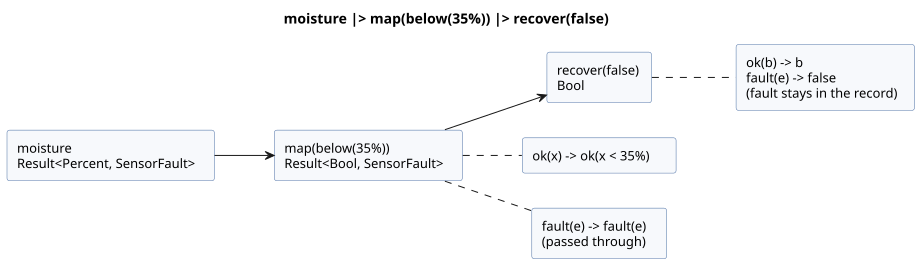
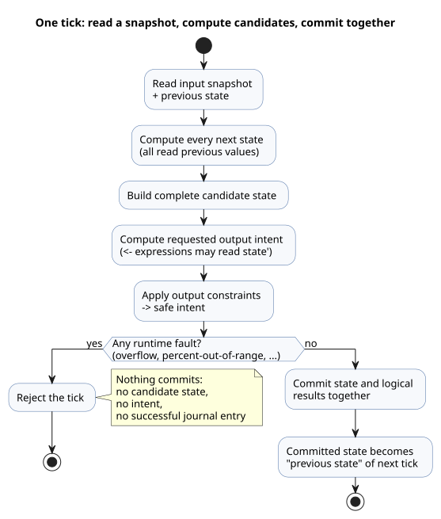
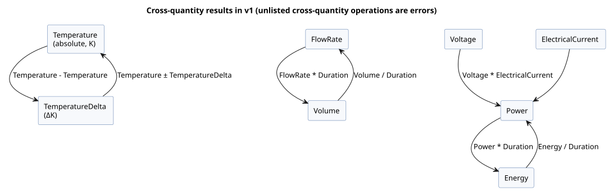

<!-- translation-source: docs/reference/02-types-expressions-state.md -->
[Korean original](02-types-expressions-state.md)

# 2. Types, expressions, and state

[Complete contents](../LANGUAGE-REFERENCE.en.md) · [Previous: Source and syntax](01-source-and-syntax.en.md) · [Next: Time and schedules](03-time-and-schedules.en.md)

GhostFlow types describe what a value *means* for control, not just how it is stored. True/false, approximate measurements, percentages, durations, exact counts, and stage names are different kinds of value, and one is never silently used as another. Because of this, the compiler finds wrong comparisons and unit mix-ups before the program runs. Screens, records, and device boundaries can also rely on the same meaning.

**In this chapter**

| Section | What it defines |
|---|---|
| [2.1](#21-value-kinds) | The value kinds and how literals are spelled |
| [2.2](#22-literals-and-expected-types) | How a literal such as `30` gets its type |
| [2.3](#23-exact-integer-design) | `Int` arithmetic, division, and explicit conversions |
| [2.4](#24-enums-and-exhaustive-branching) | Enums and exhaustive `case` |
| [2.5](#25-sensor-results-and-explicit-error-flow) | `Result<T, E>`, built-in faults, and Result transforms |
| [2.6](#26-expressions-and-operators) | Operator precedence and short-circuit evaluation |
| [2.7](#27-pure-functions-and-computational-composition) | Pure functions and `let` |
| [2.8](#28-tick-and-state-snapshot) | The tick, previous/next state, and timers |
| [2.9](#29-physical-quantities-and-units) | Physical quantities, units, and their operations |
| [2.10](#210-settled-type-boundaries) | A summary of settled boundaries |

The `ghost` fragments in this chapter illustrate the rules.

Rationale: [Selected syntax](../LANGUAGE-SURFACE.md), [Common language contract](../LANGUAGE.md), [Exact integer contract](../EXACT-INTEGER-CONTRACT.md), [Programming in GhostFlow](../ProgrammingInGhostflow.md), [Physical-quantity design issue #93](https://github.com/callin2/ghostflow-language/issues/93). The [complete language reference](../LANGUAGE-REFERENCE.md) indexes this chapter and the other detailed chapters.

## 2.1 Value kinds

| Type | Meaning | Representative literals and values |
|---|---|---|
| `Bool` | True or false | `true`, `false` |
| `Int` | Exact signed 32-bit integer | Counts, repetitions, integer differences |
| `Number` | Finite binary64 approximate number | `3.0`, `0.5`, `-2.5` |
| `Percent` | Percentage from 0 to 100 | `30%` |
| `Duration` | Nonnegative duration with millisecond resolution | `250ms`, `2s`, `5min`, `1h` |
| Named enum | One of the declared finite cases | `Idle`, `Watering` |
| `Result<T, E>` | A normal payload of type `T`, or a fault from a compiler-owned fault enum `E` | `ok(value)`, `fault(reason)` |
| Named physical quantity | Finite number that keeps its unit and agricultural meaning | `25°C`, `1.2kPa`, `70%RH` |

Some consequences of these types:

- **No truthiness.** `Bool` is never derived from a number or a string.
- **Only finite numbers.** NaN and Infinity are not `Number` values.
- **No implicit conversion between kinds.** `30`, `30%`, and `30ms` are different notations. They are never implicitly compared with or converted into one another.
- **No general strings or arrays.** `"Asia/Seoul"` and `06:00` in schedule settings are restricted syntax that has meaning only in those positions. Do not read them as general string operations. Likewise, a schedule's `[06:00, 18:45]` is not a general array value. General dates and times use the explicit `date`, `time`, and `datetime` tagged literals in Chapter 3.
- **`Duration` is not calendar time.** A timer measures monotonic elapsed time. Correcting the wall clock does not rewind it.

The bounds of `Percent` make its meaning visible and prevent accidental numeric connections.

**Percent range rule.** Every arithmetic expression whose result type is `Percent` must stay in the inclusive range `0..100`. Fractional values such as `99.5%` are valid.

- An out-of-range *constant* result is a compile error.
- An out-of-range *dynamic* result, once evaluated, rejects the tick with `percent-out-of-range` through the existing arithmetic error path. The tick commits no candidate state, no outputs, and no successful journal entry.
- The value is not clamped, and the rule does not define a physical output policy.
- If an earlier non-finite Number arithmetic error occurs, that error keeps its existing error code.

The rule applies to every intermediate expression and to function bodies, not only to final results. For a dynamic `p = 90%`, `(p + 20%) - 20%` fails at the addition, even though the final arithmetic value would be `90%`. A branch that is not selected is not evaluated. A ratio such as `p / 0.5%` has type `Number`, so its result `180` is valid. These checks keep the declared value domain meaningful throughout a calculation.

### Literal spelling

- `Bool` is exactly `true` or `false`.
- Ordinary numbers use decimal integer, decimal-point, or exponent notation. A leading `-` makes a number negative. There is no truthiness and no implicit string-to-number conversion.
- `Percent` is a number directly followed by `%`. Example: `30%`.
- `Duration` is a nonnegative integer joined to one of `ms | s | min | h`. Examples: `500ms`, `2s`. Write half a second as `500ms`, not `0.5s`.
- An enum case is an identifier listed in that enum's declaration.

Do not confuse the `Percent` suffix with integer remainder. `%` written *between two operands* is the binary remainder operator (see [2.3](#23-exact-integer-design)); `%` attached to a number is a `Percent` literal.

## 2.2 Literals and expected types

An integer-shaped literal such as `30` could mean an exact count or an approximate measurement. These rules decide which:

- A number with a decimal point or an exponent is `Number`.
- An integer-shaped decimal number is `Int` when there is no *expected numeric type*.
- An expected type can come from a typed declaration, a function parameter, an already-typed operand of the same operation, or the common expected type of the two `if` branches.
- So `30` compared with `input temperature: Number;` is read as a `Number` literal from the start. This is **not** a runtime conversion from `Int` to `Number`.
- The type of an untyped `let count = 30;` is fixed by its initializer. Later uses do not change the initializer's type retroactively.
- Conflicting expected types produce a diagnostic. The compiler does not guess an overload.
- Integer literal ranges are checked against the original decimal digits. `-2147483648` is accepted as a boundary case: the compiler does not first reject positive `2147483648` and then apply unary `-`. Any larger positive or negative magnitude produces a diagnostic.
- Digit separators are not part of the integer literal contract. The `_` characters in the range shown in 2.3 are only for readability.

```ghost
control LiteralContexts {
  input temperature: Number;
  let count = 30;              // Int
  let warm = temperature >= 30; // 이 30은 Number 문맥
  output alarm: Bool;
  alarm <- warm;
}
```

(The comment on the `warm` line says: "this 30 is in a `Number` context".)

Counts and repetitions are exact within the supported range. Loss, wraparound, and saturation never happen silently.

## 2.3 Exact integer design

The minimum semantic model for `Int` is a signed 32-bit integer.

```text
Int = -2_147_483_648 .. 2_147_483_647
```

One signed type covers counts, differences, and offsets. A nonnegative requirement is expressed as a domain bound on a `config` or `state`, not by adding another primitive type. Date-times, monotonic clocks, and identifier widths have their own contracts, separate from this `Int`.

### Operation semantics

| Expression | Result and constraints |
|---|---|
| `a + b`, `a - b`, `a * b` | Exact `Int`; exceeding the range is a fault |
| `-a` | Exact `Int`; negating the minimum value is a fault |
| `a div b` | Quotient truncated toward zero |
| `a % b` | Remainder with the dividend's sign |
| `a / b` (two `Int` values) | Error; use `div` or convert explicitly to `Number` |
| `== != < <= > >=` | Permitted between two `Int` values |
| Mixing `Int` and `Number` | Error until one side is explicitly converted |

Every valid division satisfies `a == (a div b) * b + (a % b)`. Division by zero is a division fault, and `MIN div -1` is an overflow.

### Explicit conversions

| Spelling | Meaning |
|---|---|
| `number(i)` | Converts any i32 into an exact `Number` |
| `int_exact(n)` | Accepts only an integer-valued `Number` within range |
| `int_floor(n)` | Mathematical floor, then range check |
| `int_ceil(n)` | Mathematical ceiling, then range check |
| `int_trunc(n)` | Truncation toward zero, then range check |
| `int_nearest_even(n)` | Round to nearest, exact ties to even, then range check |

There is no generic conversion with a hidden rounding default; you always name the rounding you want.

When a conversion or integer operation fails, what happens depends on whether the value is known at compile time:

| Situation | Result |
|---|---|
| Constant overflow or invalid constant conversion | Compile diagnostic |
| Input-dependent overflow, division by zero, fractional `int_exact`, or out-of-range conversion | The current tick is rejected. New state and intent are not partially committed. |

Runtime faults use these stable reasons: `integer-overflow`, `integer-division-by-zero`, `integer-conversion-fractional`, and `integer-conversion-out-of-range`.

`int_exact` checks the fractional part of a finite input *before* the range. So a value such as `2147483648.5`, which is both fractional and out of range, produces `integer-conversion-fractional`. An integer-valued input outside the range produces `integer-conversion-out-of-range`. Constant diagnostics and runtime faults use the same order. It answers the first question first: can this input become an exact integer at all?

`Int`, `div`, `%`, and the conversion names above are the canonical spellings. There is no generic `int(n)` that hides a rounding policy. `div` and binary `%` have the same precedence as `*` and `/` and are left-associative. `30%`, with `%` attached directly to the number and no whitespace, is a `Percent` literal; `%` between two expressions is `Int` remainder.

### Number operations

`Number` supports `+`, `-`, `*`, `/`, unary `-`, and comparisons, all between operands of the same type. Every result must be finite. If a division by zero or a non-finite result occurs, the tick does not commit state or intent. Mixing `Int` and `Number` cannot be used to bypass this rule.

## 2.4 Enums and exhaustive branching

Enums give sequential stages names instead of hiding them behind numbers.

```ghost
type Phase = Idle | Opening | Watering | Closing;
state phase: Phase = Idle;

phase' = case phase {
  Idle     => if start then Opening else Idle;
  Opening  => Opening;
  Watering => Watering;
  Closing  => Idle;
};
```

Rules for `case` over an enum:

- Every case must be handled. A missing case is an error. As a result, adding a new enum case forces you to review every affected branch.
- Every branch must produce a value of the same type, as required by the context.
- `phase in {Opening, Watering}` tests membership in a finite set of cases of the same enum type. In this position `{...}` is set notation; it does not create a general collection value.

The notations `enum Phase { ... }` and `enum Phase = ...;` appear in older reference material. They are historical and are rejected as executable input.

## 2.5 Sensor results and explicit error flow

The declared type in `input moisture: Percent;` is the type of the *normal payload*. Reading an external input yields either a normal value or a fault, so you cannot compare it directly as if it were the payload. You unwrap it with `case`.

One exception exists: the exact reserved, runtime-owned restart ports read as their declared scalar types, as specified in Chapter 5. This exception does not allow general enum acquisition inputs.

```ghost
let dry = case moisture {
  ok(value) => value < 30%;
  fault(_)  => false;
};
```

`_` is a pattern meaning "this expression does not use the fault's detail". Choosing `false` here does not turn the fault into a normal value: the original fault remains in the record. `SensorFault` is a built-in enum with the members `Disconnected | Stale | Invalid | NotReady`. You can branch exhaustively on a fault binding with another `case`:

```ghost
let available = case moisture {
  ok(_) => true;
  fault(reason) => case reason {
    Disconnected => false;
    Stale => false;
    Invalid => false;
    NotReady => false;
  };
};
```

**What `Result<T, E>` can and cannot do**

- `Result<T, E>` may be used as a function parameter type and result type.
- `E` must be a compiler-defined finite fault enum. v1 has `SensorFault`, `ClockFault`, `CalendarFault`, `TemporalContextFault`, `AccountingFault`, and `SettingsFault`.
- `ok(expr)` and `fault(reason)` are the constructors of this built-in Result.
- There is no general syntax for users to declare new ADTs, new Result error types, or new constructors.
- A Result is never stored as a scalar `state`, `config`, `input`, or `output` value, and it is never exposed to installation bindings.

**Settings are Result streams.** `config x: T = initial` does not declare scalar storage for a Result. It declares a *settings stream* with payload `T`. When an expression reads `x`, its type is `Result<T, SettingsFault>`, and the stream's initial emission is `ok(initial)`. Do not replace the current error rail with the source default or the previous successful value. Follow the stream rules in [§5.2](05-settings-and-observation.md#설정-stream과-현재-observation).

The members of the built-in fault enums are fixed as follows. The names for time, calendars, and natural events match the [Unknown causes in Chapter 3](03-time-and-schedules.md#자연-기준의-fallback과-회복).

| Error type | Members |
|---|---|
| `SensorFault` | `Disconnected`, `Stale`, `Invalid`, `NotReady` |
| `ClockFault` | `ClockUnknown`, `ZoneUnsupported` |
| `CalendarFault` | `ClockUnknown`, `CalendarMissing`, `CalendarOutOfRange`, `ZoneUnsupported` |
| `TemporalContextFault` | `ClockUnknown`, `LocationUnknown`, `EventUnavailable`, `PredictionMissing`, `PredictionStale`, `ZoneUnsupported` |
| `AccountingFault` | `ClockUnknown`, `LedgerMissing`, `LedgerCorrupt`, `LedgerIncomplete`, `CountOverflow` |
| `SettingsFault` | `SettingsInvalid`, `SettingsUnavailable` |

Some member names, such as `ClockUnknown`, belong to several fault enums. The compiler resolves them from context:

- In `fault(reason)`, the member is resolved through the *expected* Result error type.
- In `case reason`, the member is resolved through the error type of the value *being inspected*.
- A member reference that cannot be resolved to exactly one type from context is an error.

User declarations cannot shadow these members or add new ones. A wrong provider kind or binding is an activation error; it is never reported by inventing a new member of these enums.

**Why:** Causes that need different responses, such as a missing clock and a missing prediction, must not collapse into one generic failure value. At the same time, limiting each Result to a finite set of possibilities lets the compiler check that branches are exhaustive.

**Optional capabilities are not faults.** The `?` in `sensor moisture?: Percent;` means the installation capability is optional. A sensor that is not installed is different from a fault in an installed sensor. `?` by itself creates neither a fallback strategy nor an arbitrary default.

Stateful sensor processing also declares its meaning explicitly:

```ghost
sensor moisture: Percent {
  sample = 1s;
  valid = 0% .. 100%;
  filter = median(3);
  stale_after = 3s;
  recover_after = 1 samples;
}
signal dry = hysteresis(moisture,
  on_below: 30%, off_above: 35%, initial: false);
```

- The `n` in `median(n)` is an odd number in `1..31`.
- `hysteresis` keeps its previous decision while the value is between its two boundaries.
- `sample` describes the measurement interval. It is not a command that starts a separate thread.
- Filter and hysteresis memory are explicit control state. They are included in checkpoints and replay.

### Static Result transformations and composition

Result values can flow through the following compiler-known static transformations.

| Notation | Value meaning |
|---|---|
| `ok(value)` / `fault(reason)` | Normal-payload or built-in fault constructor of the corresponding Result |
| `below(limit)` | Static transformation that takes a compatible ordered payload and returns `value < limit` |
| `map(f)` | Unary function mapping `ok(x)` to `ok(f(x))` and passing `fault(e)` through unchanged |
| `and_then(f)` | Feeds `ok(x)` to the Result-returning `f(x)` and passes `fault(e)` through |
| `recover(default)` | Turns `ok(x)` into `x` and `fault(e)` into a default of the same type |
| `x \|> f` | Passes a value to a function: `f(x)` |
| `f >> g` | Left-to-right composition: `(x) -> g(f(x))` |

```text
is_dry = map(below(35%)) >> recover(false)
dry = moisture |> map(below(35%)) |> recover(false)
```

The diagram below traces the second line: the fault path passes through `map` untouched and is only replaced by a value at `recover`.



Restrictions on these transforms:

- The argument to `map` or `and_then` must be either a statically resolved named `fn` or a compiler-known bounded transform such as `below(limit)`.
- They do not create function values, lambdas, closures, or runtime function selection. `>>` also composes only these static transform chains.
- `|>` and `>>` are left-associative and bind more tightly than `if/then/else`.
- They are pure value transformations. They create neither state nor a stream scheduler.
- `recover` does not erase the original sensor fault or the record of which fallback was selected.
- Uppercase `Ok`/`Err`, and `not`, `and`, `or`, `is`, `isnt`, are not canonical aliases.

## 2.6 Expressions and operators

Operators in the selected control syntax bind in this order, strongest first.

| Rank | Operation |
|---:|---|
| 1 | Parentheses, function calls, member and next-state references |
| 2 | Unary `!`, unary `-` |
| 3 | `*`, `/`, `div`, binary `%` |
| 4 | `+`, `-` |
| 5 | `in { ... }` |
| 6 | `==`, `!=`, `<`, `<=`, `>`, `>=` |
| 7 | `&&` |
| 8 | `\|\|` |
| 9 | Static transform composition `>>` |
| 10 | Static value piping `\|>` |

- Binary operators of the same rank are left-associative: `6 - 2 - 1` means `(6 - 2) - 1`.
- Chained comparisons are not allowed. Write `a < b && b < c`, not `a < b < c`.
- Equality and ordering comparisons are allowed only between compatible values of the same type.
- Use parentheses and named `let` bindings to make the intent of complex decisions visible.

`|>` and `>>` are used only for statically resolved Result transform chains. The words `not`, `and`, `or`, `is`, and `isnt` from early A/B/C design material are not aliases for these control operators.

### Conditional expressions

`if condition then a else b` is an expression that produces a value. The condition must be `Bool`, and both branches must have the same type. As with `case`, the branch that is not selected is still type-checked statically.

```ghost
let denominator = if b == 0 then 1.0 else b;
let result = if b == 0 then 0.0 else a / denominator;
```

`if`, `&&`, and `||` short-circuit deterministically from left to right:

| Expression | What is evaluated at runtime |
|---|---|
| `if c then a else b` | `c`, then only the selected branch |
| `x && y` | `y` only when `x` is true |
| `x \|\| y` | `y` only when `x` is false |

Static checking is not short-circuited. Every branch and operand still undergoes name and type checking, so compile-time errors are reported even in unreachable branches. Runtime faults, however, cannot occur in a branch that is not selected. Constant folding and function inlining preserve this fault reachability and evaluation order.

## 2.7 Pure functions and computational composition

```ghost
fn hold(start: Bool, stop: Bool, previous: Bool) -> Bool {
  !stop && (start || previous)
}
```

A function declares its parameter types and result type, and returns the value of its final expression. There is no `return` statement.

Functions are *pure*: the same arguments always produce the same value.

- A function does not implicitly capture the control's inputs, state, or settings. Pass every value it needs as an argument.
- A function has no mutable local state, no waits, and no I/O effects.
- Calls must resolve statically. Recursion and cyclic calls are prohibited.
- Splitting or rearranging functions and `let` bindings does not change results as long as the dependency graph stays the same.
- Function names are not ordinary values. They cannot be stored, returned, selected dynamically, or passed as general function parameters.
- Result's `map(fnName)`, `and_then(fnName)`, and `>>` are the only restricted positions where the compiler specializes a function name statically. There are no general higher-order functions or closures.

Typed expression macros are a compile-time feature, distinct from runtime functions. See [Chapter 6](06-composition-and-replay.md#610-syntax-quote-splice의-문법).

`let name = expression;` only gives an expression a name. It creates no memory between ticks. `let` bindings are computed as an acyclic graph, independent of declaration order. When you need memory, use `state`.

## 2.8 Tick and state snapshot

A *tick* is the logical unit in which one decision is computed from one input snapshot and committed.

```text
Input snapshot + previous state
  → compute all next states
  → construct complete candidate state
  → compute requested output intent
  → compute safe intent with constraints applied
  → commit successful results together
```

The diagram shows the same cycle, including what happens when a runtime fault occurs.



```ghost
control SnapshotPair {
  input swap: Bool;
  state left: Bool = true;
  state right: Bool = false;
  output lamp: Bool;

  left'  = if swap then right else left;
  right' = if swap then left else right;
  lamp <- left';
}
```

**Previous state and next state.** Inside the tick, `left` and `right` are the values from the *previous* tick, and `left'` and `right'` are the *next* (candidate) values.

- Every next-state expression reads the same previous state and inputs. Reordering the source therefore does not change the result; this example swaps the pair correctly in either order.
- A state transition must not read another next state. `right' = left';` is an error.
- Next-state references are allowed only in output expressions. A `let` cannot reference next state either.

**Outputs.** An output connection may read the current tick's candidate state (such as `left'`), but an unprimed state name still means the previous value. A value written with `<-` is *requested intent*. Output constraints narrow it to *safe intent*, and then state and logical results commit together. Neither an output declaration's omitted initial value nor `<-` defines a physical safe value for device startup or failure.

**Commit rules.**

- A state with no next-state definition keeps its previous value.
- A state cannot have more than one next-state definition.
- If computation fails during a tick, for example because of a numeric fault, candidate state and intent are not partially committed.
- This logical atomicity does not guarantee that several physical outputs change at the same instant.

**Initial values.** The initial value in `state name: Type = value;` must be a constant of the declared type. It is never computed by reading inputs or other state. This explicit starting value gives the first tick a reproducible previous state.

**Design rationale and origin:** In [#149](https://github.com/callin2/ghostflow-language/issues/149),
the user described the React/ObservableHQ influence as evaluating control within an
event stream and explicitly returning the next state. The user's educational premise
was that electricians may find recursive or loop-shaped control difficult to trace.
Writing the previous state and the candidate next state separately makes the time boundary
visible: `left' = right; right' = left;` reads the previous pair and describes the next
pair. That premise guides readability; it is not a claim about every electrician.
The executable notation is the ASCII apostrophe (`'`). The user's conversational
backtick spelling and the later assistant discussion of general cycle rules,
time travel, and causal explanations do not establish additional syntax or features.
The snapshot, transition, and output rules above define execution.

### Timers are state too

`timer age = elapsed(phase);` is the monotonic time elapsed since the last *committed* change to `phase`.

- It resets to 0 when the change commits, and later ticks read the new value. Its initial value is also 0.
- For a `Bool` target, a change in either direction (to true or to false) starts a new interval.
- A timer is neither `sleep` nor a separate execution thread. It never blocks the processing of other inputs.

A stage transition happens once, on the first tick that satisfies its condition. One long tick does not pass through several state stages in a row. The actual delay is at least the requested duration, and during normal operation it may be late by up to the tick resolution.

## 2.9 Physical quantities and units

A plain `Number` cannot distinguish the physical meanings of `25°C`, `800ppm`, `1.2kPa`, `5L/min`, and `70%RH`. GhostFlow therefore provides named physical quantity types. The following names and suffixes are the approved, fixed catalog.

- Suffixes are case-sensitive.
- A suffix attaches directly after the numeric token, with no space.
- The lexer recognizes the longest matching suffix first.

| Type | Permitted suffixes | Canonical unit |
|---|---|---|
| `Temperature` | `°C`, `K`, `°F` | `K` |
| `TemperatureDelta` | `Δ°C`, `ΔK`, `Δ°F` | `ΔK` |
| `RelativeHumidity` | `%RH` | ratio `0..1` |
| `Pressure` | `Pa`, `kPa`, `bar` | `Pa` |
| `VaporPressureDeficit` | `PaVPD`, `kPaVPD` | `PaVPD` |
| `CO2Concentration` | `ppm` | molar ratio |
| `FlowRate` | `m3/s`, `L/min`, `mL/min` | `m3/s` |
| `Volume` | `m3`, `L`, `mL` | `m3` |
| `Length` | `m`, `cm`, `mm` | `m` |
| `Irradiance` | `W/m2` | `W/m2` |
| `PPFD` | `mol/m2/s`, `umol/m2/s` | `mol/m2/s` |
| `Energy` | `J`, `kJ`, `Wh`, `kWh` | `J` |
| `Power` | `W`, `kW` | `W` |
| `ElectricalCurrent` | `A`, `mA` | `A` |
| `Voltage` | `V`, `mV` | `V` |
| `Conductivity` | `S/m`, `mS/cm`, `uS/cm` | `S/m` |
| `Acidity` | `pH` | `pH` |

**Rates: `Rate<Q>`.** `Rate<Q>` is an expression-only type produced by `window_rate` (Chapter 4). It means "change in Q per second".

- The numerator of `Rate<Temperature>` is `ΔK`, the same as `TemperatureDelta`. For every other permitted linear Q, the numerator is the canonical difference of that same nominal quantity.
- You can refer to a result through the name of the `signal` that declares the `window_rate`.
- A `Rate<Q>` cannot be written as a direct literal, and it cannot be the type of a general value binding, a function parameter or result, `state`, `config`, `input`, or `output`.
- Thresholds are created with `rate(delta: difference, time: Duration)`. Only rates of the same Q can be compared.
- The constructor's Q is determined by the other operand of the comparison or by an explicit expected `Rate<Q>`. If a `TemperatureDelta` alone does not determine Q uniquely, the compiler rejects it instead of guessing.
- In v1, the Q of `window_rate` is one of `Temperature`, `TemperatureDelta`, `Pressure`, `VaporPressureDeficit`, `FlowRate`, `Volume`, `Length`, `Irradiance`, `PPFD`, `Energy`, `Power`, `ElectricalCurrent`, `Voltage`, or `Conductivity`. It does not apply to `Int`, `Number`, `Percent`, `RelativeHumidity`, `CO2Concentration`, or `Acidity`.

```ghost
signal warming = window_rate(temperature, over: 10min,
  quality: measured, max_age: 2min);
output warming_slowly: Bool;
warming_slowly <- warming |> map(below(rate(delta: 1ΔK, time: 1s))) |> recover(false);
```

In this fragment, `temperature` is a `Temperature` sensor. The comparison's expected type is `Rate<Temperature>`, so the threshold is 1 ΔK/s. `time` must be a positive `Duration`: a constant 0 is rejected statically, and a runtime value of 0 fails the tick with an arithmetic error.

**Why:** A temperature rate and a temperature-difference rate both use ΔK/s, but they describe different control subjects. Resolving the subject from the expected type, and not allowing rates to be stored as general values, prevents mixing different rates just because their units match. Assigning an arbitrary rate to a zero-length interval would produce a control decision that no actual measurement supports.

**Quantities that look alike are still distinct.** `Percent` is a `0..100` value (including actuator positions) and is not `RelativeHumidity`. `Temperature` is an absolute temperature, while `TemperatureDelta` is a difference. A temperature setting's `step` therefore uses a delta such as `0.5Δ°C`:

```ghost
control ClimateTarget {
  input inside_temperature: Temperature;
  config target_temperature: Temperature = 25°C {
    min = 18°C;
    max = 32°C;
    step = 0.5Δ°C;
    access = operator;
  }
  output heat: Bool;
  heat <- case target_temperature {
    ok(target) => inside_temperature < target;
    fault(reason) => false;
  };
}
```

**Conversion and display.**

- A decimal literal is converted to the canonical unit as an exact decimal rational, then rounded once to binary64 (ties to even) at the canonical value.
- Different units of the same physical quantity compare as the same semantic value after conversion.
- Artifact metadata preserves the nominal quantity identity and the canonical unit.
- Display units and locale formatting are UI metadata. They do not change control meaning.
- `Temperature` operating settings must preserve the author's chosen `°C` or `K` as separate `displayUnit` metadata. Internal values and comparisons still use canonical `K`. Missing or ambiguous `displayUnit` metadata is an error: never infer the display unit from the value's magnitude or the canonical unit, and never default to `°C`.

**Permitted operations.** The set of operations is closed; anything not listed here is an error.

- Compare values of the same nominal quantity.
- Linear physical quantities support same-type `+`, `-`, and unary `-`, and multiplication or division by `Number`. Dividing two values of the same type produces `Number`.
- `Temperature - Temperature` produces `TemperatureDelta`; `Temperature + TemperatureDelta` and `Temperature - TemperatureDelta` produce `Temperature`. Two absolute temperatures cannot be added.
- `RelativeHumidity` supports same-type comparisons and the explicit `RelativeHumidity / RelativeHumidity -> Number`. For example, `60%RH / 100%RH` is `0.6`. All other arithmetic and implicit numeric conversion remain forbidden. A zero divisor follows the ordinary rules (constant diagnostic or dynamic tick rejection); normalizing does not erase sensor quality.
- `CO2Concentration` and `Acidity` support only same-type comparisons.
- `FlowRate * Duration` produces `Volume`; `Volume / Duration` produces `FlowRate`; `Power * Duration` produces `Energy`; `Energy / Duration` produces `Power`; `Voltage * ElectricalCurrent` produces `Power`. Multiplication accepts either operand order.
- `VaporPressureDeficit` is a nominal type distinct from `Pressure`, even though its canonical scale matches pressure. Unspecified cross-quantity operations and numeric-type conversions are errors.

The diagram summarizes the cross-quantity results from this list.



**PID gains.** PID gains do not use unrestricted dimensional algebra. They use the bounded constructors in Chapter 4: `proportional_gain(output: 2%, error: 1Δ°C)`, `integral_gain(output: 0.1%, error: 1Δ°C, time: 1s)`, and `derivative_gain(output: 1%, time: 1s, error: 1Δ°C)`.

**Bindings.** Bindings must specify quantity and unit. A unitless number read by OCR is not an authoritative quantity and is not promoted to one without a user-confirmed binding.

**Filters on temperature.** When `moving_average` and `ema` process an absolute `Temperature`, they compute an affine weighted mean in canonical K. This is part of the filters' closed semantics; it does not make `Temperature + Temperature` legal in source.

## 2.10 Settled type boundaries

- `Int` is signed 32-bit and uses `div`, `%`, and named conversions.
- `if`, `&&`, and `||` short-circuit from left to right.
- Removed function, enum, next, and qualified-value aliases are rejected with migration diagnostics.
- Only the built-in `Result<T, E>` over compiler-owned fault enums, together with static transforms, is provided. There are no general ADTs, user-defined Result error types, function values, or general higher-order functions.
- Physical quantities use only the fixed catalog and closed operations in 2.9.
- General dates and times use Chapter 3's tagged literals: ``date`YYYY-MM-DD` ``, ``time`HH:MM[:SS[.f|.ff|.fff]]` ``, and ``datetime`YYYY-MM-DDTHH:MM:SS[.f|.ff|.fff](Z|±HH:MM)` ``. A `DateTime` must have an offset. Time offsets use only `Duration`.

Spellings, implicit conversions, unit guesses, user constructors, and runtime function selection outside these boundaries produce diagnostics. They are never inferred as separate language features.
