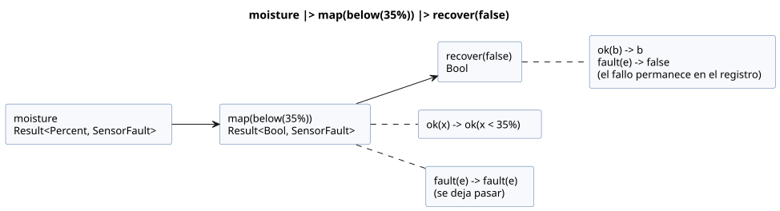
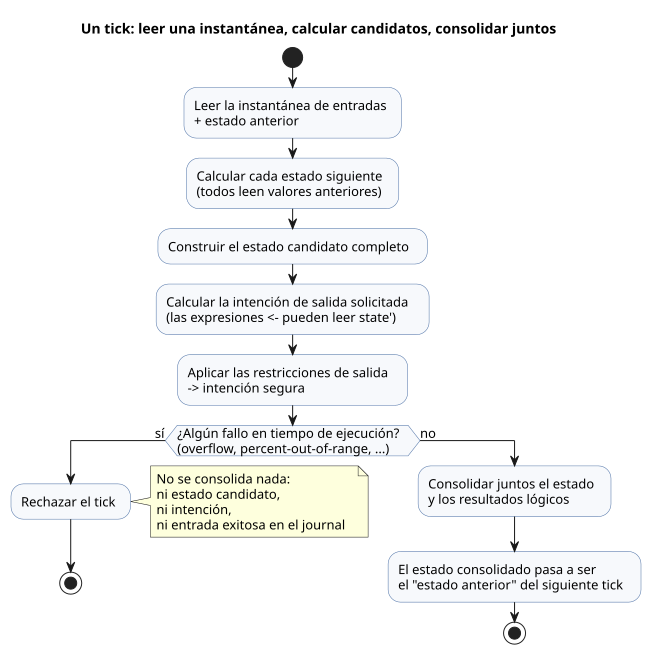
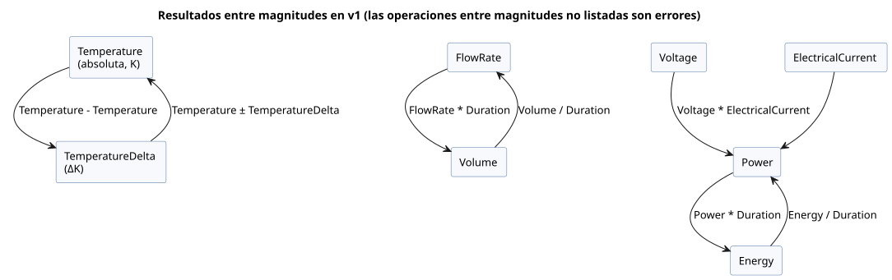

<!-- translation-source: docs/reference/02-types-expressions-state.en.md -->
[Original en inglés](02-types-expressions-state.en.md)

# 2. Tipos, expresiones y estado

[Contenido completo](../LANGUAGE-REFERENCE.es.md) · [Anterior: Fuente y sintaxis](01-source-and-syntax.es.md) · [Siguiente: Tiempo y programaciones](03-time-and-schedules.es.md)

Los tipos de GhostFlow describen lo que un valor *significa* para el control, no solo cómo se almacena. Verdadero/falso, mediciones aproximadas, porcentajes, duraciones, conteos exactos y nombres de etapas son clases de valor distintas, y nunca se usa una en lugar de otra de forma silenciosa. Gracias a esto, el compilador detecta comparaciones incorrectas y confusiones de unidades antes de que el programa se ejecute. Las pantallas, los registros y los límites con los dispositivos también pueden apoyarse en el mismo significado.

**En este capítulo**

| Sección | Qué define |
|---|---|
| [2.1](#21-tipos-de-valor) | Los tipos de valor y cómo se escriben los literales |
| [2.2](#22-literales-y-tipos-esperados) | Cómo un literal como `30` obtiene su tipo |
| [2.3](#23-diseño-de-enteros-exactos) | Aritmética de `Int`, división y conversiones explícitas |
| [2.4](#24-enumeraciones-y-ramificación-exhaustiva) | Enumeraciones y `case` exhaustivo |
| [2.5](#25-resultados-de-sensores-y-flujo-explícito-de-errores) | `Result<T, E>`, fallos integrados y transformaciones de Result |
| [2.6](#26-expresiones-y-operadores) | Precedencia de operadores y evaluación en cortocircuito |
| [2.7](#27-funciones-puras-y-composición-de-cálculos) | Funciones puras y `let` |
| [2.8](#28-tick-e-instantánea-de-estado) | El tick, el estado anterior/siguiente y los temporizadores |
| [2.9](#29-magnitudes-físicas-y-unidades) | Magnitudes físicas, unidades y sus operaciones |
| [2.10](#210-límites-de-tipos-establecidos) | Un resumen de los límites establecidos |

Los fragmentos `ghost` de este capítulo ilustran las reglas.

Fundamento: [Sintaxis seleccionada](../LANGUAGE-SURFACE.es.md), [Contrato común del lenguaje](../LANGUAGE.es.md), [Contrato de enteros exactos](../EXACT-INTEGER-CONTRACT.es.md), [Programar en GhostFlow](../ProgrammingInGhostflow.es.md), [Issue de diseño de magnitudes físicas #93](https://github.com/callin2/ghostflow-language/issues/93). La [referencia completa del lenguaje](../LANGUAGE-REFERENCE.es.md) indexa este capítulo y los demás capítulos detallados.

## 2.1 Tipos de valor

| Tipo | Significado | Literales y valores representativos |
|---|---|---|
| `Bool` | Verdadero o falso | `true`, `false` |
| `Int` | Entero exacto con signo de 32 bits | Conteos, repeticiones, diferencias enteras |
| `Number` | Número aproximado binary64 finito | `3.0`, `0.5`, `-2.5` |
| `Percent` | Porcentaje de 0 a 100 | `30%` |
| `Duration` | Duración no negativa con resolución de milisegundos | `250ms`, `2s`, `5min`, `1h` |
| Enumeración con nombre | Uno de los casos finitos declarados | `Idle`, `Watering` |
| `Result<T, E>` | Una carga útil normal de tipo `T`, o un fallo de una enumeración de fallos `E` propiedad del compilador | `ok(value)`, `fault(reason)` |
| Magnitud física con nombre | Número finito que conserva su unidad y su significado agrícola | `25°C`, `1.2kPa`, `70%RH` |

Algunas consecuencias de estos tipos:

- **No hay valores «verdaderos» implícitos (truthiness).** Un `Bool` nunca se deriva de un número ni de una cadena.
- **Solo números finitos.** NaN e Infinity no son valores `Number`.
- **No hay conversión implícita entre clases de valor.** `30`, `30%` y `30ms` son notaciones distintas. Nunca se comparan entre sí ni se convierten unas en otras de forma implícita.
- **No hay cadenas ni arreglos generales.** `"Asia/Seoul"` y `06:00` en los ajustes de una programación son sintaxis restringida que solo tiene significado en esas posiciones. No deben leerse como operaciones generales con cadenas. Del mismo modo, el `[06:00, 18:45]` de una programación no es un valor de arreglo general. Las fechas y horas generales usan los literales etiquetados explícitos `date`, `time` y `datetime` del capítulo 3.
- **`Duration` no es tiempo de calendario.** Un temporizador mide el tiempo transcurrido monotónico. Corregir el reloj de pared no lo hace retroceder.

Los límites de `Percent` hacen visible su significado y evitan conexiones numéricas accidentales.

**Regla de rango de Percent.** Toda expresión aritmética cuyo tipo de resultado sea `Percent` debe permanecer en el rango inclusivo `0..100`. Los valores fraccionarios como `99.5%` son válidos.

- Un resultado *constante* fuera de rango es un error de compilación.
- Un resultado *dinámico* fuera de rango, una vez evaluado, rechaza el tick con `percent-out-of-range` por la ruta de error aritmético existente. El tick no consolida ningún estado candidato, ninguna salida ni ninguna entrada exitosa en el registro (journal).
- El valor no se recorta, y la regla no define una política de salida física.
- Si antes se produce un error aritmético de Number no finito, ese error conserva su código de error existente.

La regla se aplica a toda expresión intermedia y a los cuerpos de las funciones, no solo a los resultados finales. Para un `p = 90%` dinámico, `(p + 20%) - 20%` falla en la suma, aunque el valor aritmético final sería `90%`. Una rama que no se selecciona no se evalúa. Una razón como `p / 0.5%` tiene tipo `Number`, de modo que su resultado `180` es válido. Estas comprobaciones mantienen significativo el dominio de valores declarado durante todo el cálculo.

### Escritura de literales

- `Bool` es exactamente `true` o `false`.
- Los números ordinarios usan notación de entero decimal, de punto decimal o de exponente. Un `-` inicial hace negativo el número. No hay truthiness ni conversión implícita de cadena a número.
- `Percent` es un número seguido directamente de `%`. Ejemplo: `30%`.
- `Duration` es un entero no negativo unido a uno de `ms | s | min | h`. Ejemplos: `500ms`, `2s`. Medio segundo se escribe `500ms`, no `0.5s`.
- Un caso de enumeración es un identificador listado en la declaración de esa enumeración.

No confunda el sufijo de `Percent` con el resto entero. Un `%` escrito *entre dos operandos* es el operador binario de resto (véase [2.3](#23-diseño-de-enteros-exactos)); un `%` unido a un número es un literal `Percent`.

## 2.2 Literales y tipos esperados

Un literal con forma de entero como `30` podría significar un conteo exacto o una medición aproximada. Estas reglas deciden cuál:

- Un número con punto decimal o exponente es `Number`.
- Un número decimal con forma de entero es `Int` cuando no hay un *tipo numérico esperado*.
- Un tipo esperado puede provenir de una declaración con tipo, de un parámetro de función, de un operando ya tipado de la misma operación o del tipo esperado común de las dos ramas de un `if`.
- Así, `30` comparado con `input temperature: Number;` se lee como literal `Number` desde el principio. Esto **no** es una conversión en tiempo de ejecución de `Int` a `Number`.
- El tipo de un `let count = 30;` sin tipo queda fijado por su inicializador. Los usos posteriores no cambian retroactivamente el tipo del inicializador.
- Los tipos esperados en conflicto producen un diagnóstico. El compilador no adivina una sobrecarga.
- Los rangos de los literales enteros se comprueban sobre los dígitos decimales originales. `-2147483648` se acepta como caso límite: el compilador no rechaza primero el positivo `2147483648` para luego aplicar el `-` unario. Cualquier magnitud mayor, positiva o negativa, produce un diagnóstico.
- Los separadores de dígitos no forman parte del contrato de literales enteros. Los caracteres `_` del rango mostrado en 2.3 son solo para facilitar la lectura.

```ghost
control LiteralContexts {
  input temperature: Number;
  let count = 30;              // Int
  let warm = temperature >= 30; // 이 30은 Number 문맥
  output alarm: Bool;
  alarm <- warm;
}
```

(El comentario de la línea `warm` dice: «este 30 está en un contexto `Number`».)

Los conteos y las repeticiones son exactos dentro del rango admitido. La pérdida, el desbordamiento circular y la saturación nunca ocurren de forma silenciosa.

## 2.3 Diseño de enteros exactos

El modelo semántico mínimo de `Int` es un entero con signo de 32 bits.

```text
Int = -2_147_483_648 .. 2_147_483_647
```

Un único tipo con signo cubre conteos, diferencias y desplazamientos. Un requisito de no negatividad se expresa como un límite de dominio en un `config` o un `state`, no añadiendo otro tipo primitivo. Las fechas-hora, los relojes monotónicos y los anchos de identificadores tienen sus propios contratos, separados de este `Int`.

### Semántica de las operaciones

| Expresión | Resultado y restricciones |
|---|---|
| `a + b`, `a - b`, `a * b` | `Int` exacto; salirse del rango es un fallo |
| `-a` | `Int` exacto; negar el valor mínimo es un fallo |
| `a div b` | Cociente truncado hacia cero |
| `a % b` | Resto con el signo del dividendo |
| `a / b` (dos valores `Int`) | Error; use `div` o convierta explícitamente a `Number` |
| `== != < <= > >=` | Permitidos entre dos valores `Int` |
| Mezclar `Int` y `Number` | Error hasta que uno de los lados se convierta explícitamente |

Toda división válida cumple `a == (a div b) * b + (a % b)`. La división por cero es un fallo de división, y `MIN div -1` es un desbordamiento.

### Conversiones explícitas

| Escritura | Significado |
|---|---|
| `number(i)` | Convierte cualquier i32 en un `Number` exacto |
| `int_exact(n)` | Acepta solo un `Number` de valor entero dentro del rango |
| `int_floor(n)` | Piso matemático y luego comprobación de rango |
| `int_ceil(n)` | Techo matemático y luego comprobación de rango |
| `int_trunc(n)` | Truncamiento hacia cero y luego comprobación de rango |
| `int_nearest_even(n)` | Redondeo al más cercano, empates exactos hacia el par, y luego comprobación de rango |

No existe una conversión genérica con un redondeo predeterminado oculto; siempre se nombra el redondeo que se desea.

Cuando una conversión o una operación entera falla, lo que ocurre depende de si el valor se conoce en tiempo de compilación:

| Situación | Resultado |
|---|---|
| Desbordamiento constante o conversión constante no válida | Diagnóstico de compilación |
| Desbordamiento dependiente de la entrada, división por cero, `int_exact` fraccionario o conversión fuera de rango | Se rechaza el tick actual. El nuevo estado y la intención no se consolidan parcialmente. |

Los fallos en tiempo de ejecución usan estas razones estables: `integer-overflow`, `integer-division-by-zero`, `integer-conversion-fractional` e `integer-conversion-out-of-range`.

`int_exact` comprueba la parte fraccionaria de una entrada finita *antes* que el rango. Así, un valor como `2147483648.5`, que es a la vez fraccionario y fuera de rango, produce `integer-conversion-fractional`. Una entrada de valor entero fuera del rango produce `integer-conversion-out-of-range`. Los diagnósticos constantes y los fallos en tiempo de ejecución siguen el mismo orden. Primero se responde la primera pregunta: ¿puede esta entrada convertirse en un entero exacto?

`Int`, `div`, `%` y los nombres de conversión anteriores son las escrituras canónicas. No existe un `int(n)` genérico que oculte una política de redondeo. `div` y el `%` binario tienen la misma precedencia que `*` y `/` y son asociativos por la izquierda. `30%`, con el `%` unido directamente al número y sin espacios, es un literal `Percent`; un `%` entre dos expresiones es el resto de `Int`.

### Operaciones con Number

`Number` admite `+`, `-`, `*`, `/`, `-` unario y comparaciones, todos entre operandos del mismo tipo. Todo resultado debe ser finito. Si se produce una división por cero o un resultado no finito, el tick no consolida el estado ni la intención. Mezclar `Int` y `Number` no sirve para eludir esta regla.

## 2.4 Enumeraciones y ramificación exhaustiva

Las enumeraciones (enum) dan nombre a las etapas secuenciales en lugar de ocultarlas tras números.

```ghost
type Phase = Idle | Opening | Watering | Closing;
state phase: Phase = Idle;

phase' = case phase {
  Idle     => if start then Opening else Idle;
  Opening  => Opening;
  Watering => Watering;
  Closing  => Idle;
};
```

Reglas para `case` sobre una enumeración:

- Se debe tratar cada caso. Un caso que falta es un error. En consecuencia, añadir un nuevo caso a una enumeración obliga a revisar todas las ramas afectadas.
- Cada rama debe producir un valor del mismo tipo, según lo exija el contexto.
- `phase in {Opening, Watering}` comprueba la pertenencia a un conjunto finito de casos del mismo tipo de enumeración. En esta posición, `{...}` es notación de conjunto; no crea un valor de colección general.

Las notaciones `enum Phase { ... }` y `enum Phase = ...;` aparecen en material de referencia antiguo. Son históricas y se rechazan como entrada ejecutable.

## 2.5 Resultados de sensores y flujo explícito de errores

El tipo declarado en `input moisture: Percent;` es el tipo de la *carga útil normal*. Leer una entrada externa produce un valor normal o un fallo, por lo que no se puede comparar directamente como si fuera la carga útil. Se desenvuelve con `case`.

Existe una excepción: los puertos de reinicio exactos, reservados y propiedad del runtime, se leen con sus tipos escalares declarados, como se especifica en el capítulo 5. Esta excepción no permite entradas generales de adquisición de tipo enumeración.

```ghost
let dry = case moisture {
  ok(value) => value < 30%;
  fault(_)  => false;
};
```

`_` es un patrón que significa «esta expresión no usa el detalle del fallo». Elegir `false` aquí no convierte el fallo en un valor normal: el fallo original permanece en el registro. `SensorFault` es una enumeración integrada con los miembros `Disconnected | Stale | Invalid | NotReady`. Se puede ramificar de forma exhaustiva sobre una vinculación de fallo con otro `case`:

```ghost
let available = case moisture {
  ok(_) => true;
  fault(reason) => case reason {
    Disconnected => false;
    Stale => false;
    Invalid => false;
    NotReady => false;
  };
};
```

**Qué puede y qué no puede hacer `Result<T, E>`**

- `Result<T, E>` puede usarse como tipo de parámetro y como tipo de resultado de una función.
- `E` debe ser una enumeración de fallos finita definida por el compilador. La v1 tiene `SensorFault`, `ClockFault`, `CalendarFault`, `TemporalContextFault`, `AccountingFault` y `SettingsFault`.
- `ok(expr)` y `fault(reason)` son los constructores de este Result integrado.
- No existe una sintaxis general para que los usuarios declaren nuevos ADT, nuevos tipos de error de Result ni nuevos constructores.
- Un Result nunca se almacena como valor escalar de `state`, `config`, `input` u `output`, y nunca se expone a las vinculaciones (bindings) de la instalación.

**Los ajustes son flujos de Result.** `config x: T = initial` no declara un almacenamiento escalar para un Result. Declara un *flujo de ajustes* con carga útil `T`. Cuando una expresión lee `x`, su tipo es `Result<T, SettingsFault>`, y la emisión inicial del flujo es `ok(initial)`. No sustituya el carril de error actual por el valor predeterminado de la fuente ni por el valor exitoso anterior. Siga las reglas de flujos de [§5.2](05-settings-and-observation.es.md).

Los miembros de las enumeraciones de fallos integradas están fijados como sigue. Los nombres para el tiempo, los calendarios y los eventos naturales coinciden con las [causas de lo desconocido del capítulo 3](03-time-and-schedules.es.md).

| Tipo de error | Miembros |
|---|---|
| `SensorFault` | `Disconnected`, `Stale`, `Invalid`, `NotReady` |
| `ClockFault` | `ClockUnknown`, `ZoneUnsupported` |
| `CalendarFault` | `ClockUnknown`, `CalendarMissing`, `CalendarOutOfRange`, `ZoneUnsupported` |
| `TemporalContextFault` | `ClockUnknown`, `LocationUnknown`, `EventUnavailable`, `PredictionMissing`, `PredictionStale`, `ZoneUnsupported` |
| `AccountingFault` | `ClockUnknown`, `LedgerMissing`, `LedgerCorrupt`, `LedgerIncomplete`, `CountOverflow` |
| `SettingsFault` | `SettingsInvalid`, `SettingsUnavailable` |

Algunos nombres de miembros, como `ClockUnknown`, pertenecen a varias enumeraciones de fallos. El compilador los resuelve a partir del contexto:

- En `fault(reason)`, el miembro se resuelve mediante el tipo de error de Result *esperado*.
- En `case reason`, el miembro se resuelve mediante el tipo de error del valor *que se inspecciona*.
- Una referencia a un miembro que no puede resolverse a exactamente un tipo a partir del contexto es un error.

Las declaraciones de usuario no pueden ocultar estos miembros ni añadir otros nuevos. Un tipo de proveedor o una vinculación incorrectos son un error de activación; nunca se notifican inventando un nuevo miembro de estas enumeraciones.

**Por qué:** las causas que requieren respuestas diferentes, como un reloj ausente y una predicción ausente, no deben fundirse en un único valor de fallo genérico. Al mismo tiempo, limitar cada Result a un conjunto finito de posibilidades permite al compilador comprobar que las ramas son exhaustivas.

**Las capacidades opcionales no son fallos.** El `?` de `sensor moisture?: Percent;` significa que la capacidad (capability) de la instalación es opcional. Un sensor que no está instalado es distinto de un fallo en un sensor instalado. El `?` por sí solo no crea ni una estrategia de respaldo (fallback) ni un valor predeterminado arbitrario.

El procesamiento de sensores con estado también declara su significado de forma explícita:

```ghost
sensor moisture: Percent {
  sample = 1s;
  valid = 0% .. 100%;
  filter = median(3);
  stale_after = 3s;
  recover_after = 1 samples;
}
signal dry = hysteresis(moisture,
  on_below: 30%, off_above: 35%, initial: false);
```

- La `n` de `median(n)` es un número impar en `1..31`.
- `hysteresis` mantiene su decisión anterior mientras el valor está entre sus dos límites.
- `sample` describe el intervalo de medición. No es una orden que inicie un hilo independiente.
- La memoria del filtro y de la histéresis es estado de control explícito. Se incluye en los puntos de control (checkpoints) y en la reproducción (replay).

### Transformaciones estáticas de Result y composición

Los valores Result pueden fluir a través de las siguientes transformaciones estáticas conocidas por el compilador.

| Notación | Significado del valor |
|---|---|
| `ok(value)` / `fault(reason)` | Constructor de carga útil normal o de fallo integrado del Result correspondiente |
| `below(limit)` | Transformación estática que toma una carga útil ordenada compatible y devuelve `value < limit` |
| `map(f)` | Función unaria que convierte `ok(x)` en `ok(f(x))` y deja pasar `fault(e)` sin cambios |
| `and_then(f)` | Entrega `ok(x)` a la `f(x)` que devuelve un Result y deja pasar `fault(e)` |
| `recover(default)` | Convierte `ok(x)` en `x` y `fault(e)` en un valor predeterminado del mismo tipo |
| `x \|> f` | Pasa un valor a una función: `f(x)` |
| `f >> g` | Composición de izquierda a derecha: `(x) -> g(f(x))` |

```text
is_dry = map(below(35%)) >> recover(false)
dry = moisture |> map(below(35%)) |> recover(false)
```

El diagrama siguiente recorre la segunda línea: la ruta de fallo atraviesa `map` sin cambios y solo se sustituye por un valor en `recover`.



Restricciones de estas transformaciones:

- El argumento de `map` o `and_then` debe ser una `fn` con nombre resuelta estáticamente o una transformación acotada conocida por el compilador, como `below(limit)`.
- No crean valores de función, lambdas, clausuras ni selección de funciones en tiempo de ejecución. `>>` también compone solo estas cadenas de transformaciones estáticas.
- `|>` y `>>` son asociativos por la izquierda y se enlazan con más fuerza que `if/then/else`.
- Son transformaciones de valores puras. No crean estado ni un planificador de flujos.
- `recover` no borra el fallo original del sensor ni el registro de qué respaldo se seleccionó.
- `Ok`/`Err` en mayúsculas, así como `not`, `and`, `or`, `is` e `isnt`, no son alias canónicos.

## 2.6 Expresiones y operadores

Los operadores de la sintaxis de control seleccionada se enlazan en este orden, del más fuerte al más débil.

| Rango | Operación |
|---:|---|
| 1 | Paréntesis, llamadas a funciones, referencias a miembros y al estado siguiente |
| 2 | `!` unario, `-` unario |
| 3 | `*`, `/`, `div`, `%` binario |
| 4 | `+`, `-` |
| 5 | `in { ... }` |
| 6 | `==`, `!=`, `<`, `<=`, `>`, `>=` |
| 7 | `&&` |
| 8 | `\|\|` |
| 9 | Composición de transformaciones estáticas `>>` |
| 10 | Canalización estática de valores `\|>` |

- Los operadores binarios del mismo rango son asociativos por la izquierda: `6 - 2 - 1` significa `(6 - 2) - 1`.
- No se permiten comparaciones encadenadas. Escriba `a < b && b < c`, no `a < b < c`.
- Las comparaciones de igualdad y de orden solo se permiten entre valores compatibles del mismo tipo.
- Use paréntesis y vinculaciones `let` con nombre para hacer visible la intención de las decisiones complejas.

`|>` y `>>` se usan solo para cadenas de transformaciones de Result resueltas estáticamente. Las palabras `not`, `and`, `or`, `is` e `isnt` del material de diseño inicial A/B/C no son alias de estos operadores de control.

### Expresiones condicionales

`if condition then a else b` es una expresión que produce un valor. La condición debe ser `Bool`, y ambas ramas deben tener el mismo tipo. Igual que con `case`, la rama que no se selecciona se comprueba igualmente de forma estática en cuanto a tipos.

```ghost
let denominator = if b == 0 then 1.0 else b;
let result = if b == 0 then 0.0 else a / denominator;
```

`if`, `&&` y `||` se evalúan en cortocircuito de forma determinista de izquierda a derecha:

| Expresión | Qué se evalúa en tiempo de ejecución |
|---|---|
| `if c then a else b` | `c` y después solo la rama seleccionada |
| `x && y` | `y` solo cuando `x` es verdadero |
| `x \|\| y` | `y` solo cuando `x` es falso |

La comprobación estática no se hace en cortocircuito. Toda rama y todo operando pasan igualmente por la comprobación de nombres y tipos, de modo que los errores de compilación se notifican incluso en ramas inalcanzables. Sin embargo, los fallos en tiempo de ejecución no pueden producirse en una rama que no se selecciona. El plegado de constantes y la expansión en línea de funciones preservan esta alcanzabilidad de los fallos y el orden de evaluación.

## 2.7 Funciones puras y composición de cálculos

```ghost
fn hold(start: Bool, stop: Bool, previous: Bool) -> Bool {
  !stop && (start || previous)
}
```

Una función declara los tipos de sus parámetros y el tipo de su resultado, y devuelve el valor de su expresión final. No existe una sentencia `return`.

Las funciones son *puras*: los mismos argumentos producen siempre el mismo valor.

- Una función no captura implícitamente las entradas, el estado ni los ajustes del control. Pase como argumento todo valor que necesite.
- Una función no tiene estado local mutable, esperas ni efectos de E/S.
- Las llamadas deben resolverse estáticamente. La recursión y las llamadas cíclicas están prohibidas.
- Dividir o reorganizar funciones y vinculaciones `let` no cambia los resultados mientras el grafo de dependencias siga siendo el mismo.
- Los nombres de funciones no son valores ordinarios. No pueden almacenarse, devolverse, seleccionarse dinámicamente ni pasarse como parámetros de función generales.
- `map(fnName)`, `and_then(fnName)` y `>>` de Result son las únicas posiciones restringidas en las que el compilador especializa estáticamente un nombre de función. No hay funciones de orden superior generales ni clausuras.

Las macros de expresiones tipadas son una característica de tiempo de compilación, distinta de las funciones de tiempo de ejecución. Véase el [capítulo 6](06-composition-and-replay.es.md).

`let name = expression;` solo da nombre a una expresión. No crea memoria entre ticks. Las vinculaciones `let` se calculan como un grafo acíclico, independientemente del orden de declaración. Cuando necesite memoria, use `state`.

## 2.8 Tick e instantánea de estado

Un *tick* (paso de decisión lógica) es la unidad lógica en la que se calcula una decisión a partir de una instantánea (snapshot) de entradas y se consolida.

```text
Instantánea de entradas + estado anterior
  → calcular todos los estados siguientes
  → construir el estado candidato completo
  → calcular la intención de salida solicitada
  → calcular la intención segura con las restricciones aplicadas
  → consolidar juntos los resultados exitosos
```

El diagrama muestra el mismo ciclo, incluido lo que ocurre cuando se produce un fallo en tiempo de ejecución.



```ghost
control SnapshotPair {
  input swap: Bool;
  state left: Bool = true;
  state right: Bool = false;
  output lamp: Bool;

  left'  = if swap then right else left;
  right' = if swap then left else right;
  lamp <- left';
}
```

**Estado anterior y estado siguiente.** Dentro del tick, `left` y `right` son los valores del tick *anterior*, y `left'` y `right'` son los valores *siguientes* (candidatos).

- Toda expresión de estado siguiente lee el mismo estado anterior y las mismas entradas. Por tanto, reordenar la fuente no cambia el resultado; este ejemplo intercambia correctamente el par en cualquier orden.
- Una transición de estado no debe leer otro estado siguiente. `right' = left';` es un error.
- Las referencias al estado siguiente solo se permiten en expresiones de salida. Un `let` tampoco puede hacer referencia al estado siguiente.

**Salidas.** Una conexión de salida puede leer el estado candidato del tick actual (como `left'`), pero un nombre de estado sin apóstrofo sigue significando el valor anterior. Un valor escrito con `<-` es la *intención solicitada*. Las restricciones de salida la reducen a la *intención segura*, y después el estado y los resultados lógicos se consolidan juntos. Ni el valor inicial omitido de una declaración de salida ni `<-` definen un valor físico seguro para el arranque o el fallo del dispositivo.

**Reglas de consolidación.**

- Un estado sin definición de estado siguiente conserva su valor anterior.
- Un estado no puede tener más de una definición de estado siguiente.
- Si el cálculo falla durante un tick, por ejemplo por un fallo numérico, el estado candidato y la intención no se consolidan parcialmente.
- Esta atomicidad lógica no garantiza que varias salidas físicas cambien en el mismo instante.

**Valores iniciales.** El valor inicial en `state name: Type = value;` debe ser una constante del tipo declarado. Nunca se calcula leyendo entradas ni otro estado. Este valor de partida explícito da al primer tick un estado anterior reproducible.

**Fundamento de diseño y origen:** en [#149](https://github.com/callin2/ghostflow-language/issues/149),
el usuario describió la influencia de React/ObservableHQ como evaluar el control dentro de un
flujo de eventos y devolver explícitamente el estado siguiente. La premisa educativa del usuario
era que a los electricistas les puede resultar difícil seguir un control recursivo o con forma de bucle.
Escribir por separado el estado anterior y el estado siguiente candidato hace visible el límite
temporal: `left' = right; right' = left;` lee el par anterior y describe el par
siguiente. Esa premisa orienta la legibilidad; no es una afirmación sobre todos los electricistas.
La notación ejecutable es el apóstrofo ASCII (`'`). La escritura conversacional del usuario
con comillas invertidas y la posterior discusión del asistente sobre reglas generales de ciclos,
viajes en el tiempo y explicaciones causales no establecen sintaxis ni características adicionales.
Las reglas de instantánea, transición y salida anteriores definen la ejecución.

### Los temporizadores también son estado

`timer age = elapsed(phase);` es el tiempo monotónico transcurrido desde el último cambio *consolidado* de `phase`.

- Se reinicia a 0 cuando el cambio se consolida, y los ticks posteriores leen el nuevo valor. Su valor inicial también es 0.
- Para un objetivo `Bool`, un cambio en cualquier dirección (a verdadero o a falso) inicia un nuevo intervalo.
- Un temporizador no es un `sleep` ni un hilo de ejecución independiente. Nunca bloquea el procesamiento de otras entradas.

Una transición de etapa ocurre una sola vez, en el primer tick que cumple su condición. Un tick largo no recorre varias etapas de estado seguidas. El retardo real es al menos la duración solicitada y, durante el funcionamiento normal, puede llegar tarde como mucho en la resolución de un tick.

## 2.9 Magnitudes físicas y unidades

Un `Number` simple no puede distinguir los significados físicos de `25°C`, `800ppm`, `1.2kPa`, `5L/min` y `70%RH`. Por eso GhostFlow proporciona tipos de magnitudes físicas con nombre. Los siguientes nombres y sufijos forman el catálogo aprobado y fijo.

- Los sufijos distinguen mayúsculas de minúsculas.
- Un sufijo se une directamente tras el token numérico, sin espacios.
- El analizador léxico reconoce primero el sufijo coincidente más largo.

| Tipo | Sufijos permitidos | Unidad canónica |
|---|---|---|
| `Temperature` | `°C`, `K`, `°F` | `K` |
| `TemperatureDelta` | `Δ°C`, `ΔK`, `Δ°F` | `ΔK` |
| `RelativeHumidity` | `%RH` | razón `0..1` |
| `Pressure` | `Pa`, `kPa`, `bar` | `Pa` |
| `VaporPressureDeficit` | `PaVPD`, `kPaVPD` | `PaVPD` |
| `CO2Concentration` | `ppm` | razón molar |
| `FlowRate` | `m3/s`, `L/min`, `mL/min` | `m3/s` |
| `Volume` | `m3`, `L`, `mL` | `m3` |
| `Length` | `m`, `cm`, `mm` | `m` |
| `Irradiance` | `W/m2` | `W/m2` |
| `PPFD` | `mol/m2/s`, `umol/m2/s` | `mol/m2/s` |
| `Energy` | `J`, `kJ`, `Wh`, `kWh` | `J` |
| `Power` | `W`, `kW` | `W` |
| `ElectricalCurrent` | `A`, `mA` | `A` |
| `Voltage` | `V`, `mV` | `V` |
| `Conductivity` | `S/m`, `mS/cm`, `uS/cm` | `S/m` |
| `Acidity` | `pH` | `pH` |

**Tasas: `Rate<Q>`.** `Rate<Q>` es un tipo exclusivo de expresiones producido por `window_rate` (capítulo 4). Significa «cambio de Q por segundo».

- El numerador de `Rate<Temperature>` es `ΔK`, igual que `TemperatureDelta`. Para cualquier otra Q lineal permitida, el numerador es la diferencia canónica de esa misma magnitud nominal.
- Se puede hacer referencia a un resultado mediante el nombre de la `signal` que declara el `window_rate`.
- Un `Rate<Q>` no puede escribirse como literal directo, y no puede ser el tipo de una vinculación de valor general, de un parámetro o resultado de función, de `state`, `config`, `input` u `output`.
- Los umbrales se crean con `rate(delta: difference, time: Duration)`. Solo pueden compararse tasas de la misma Q.
- La Q del constructor se determina por el otro operando de la comparación o por un `Rate<Q>` esperado explícito. Si un `TemperatureDelta` por sí solo no determina Q de forma única, el compilador lo rechaza en lugar de adivinar.
- En la v1, la Q de `window_rate` es una de `Temperature`, `TemperatureDelta`, `Pressure`, `VaporPressureDeficit`, `FlowRate`, `Volume`, `Length`, `Irradiance`, `PPFD`, `Energy`, `Power`, `ElectricalCurrent`, `Voltage` o `Conductivity`. No se aplica a `Int`, `Number`, `Percent`, `RelativeHumidity`, `CO2Concentration` ni `Acidity`.

```ghost
signal warming = window_rate(temperature, over: 10min,
  quality: measured, max_age: 2min);
output warming_slowly: Bool;
warming_slowly <- warming |> map(below(rate(delta: 1ΔK, time: 1s))) |> recover(false);
```

En este fragmento, `temperature` es un sensor `Temperature`. El tipo esperado de la comparación es `Rate<Temperature>`, por lo que el umbral es 1 ΔK/s. `time` debe ser una `Duration` positiva: un 0 constante se rechaza estáticamente, y un valor 0 en tiempo de ejecución hace fallar el tick con un error aritmético.

**Por qué:** una tasa de temperatura y una tasa de diferencia de temperatura usan ambas ΔK/s, pero describen sujetos de control diferentes. Resolver el sujeto a partir del tipo esperado, y no permitir que las tasas se almacenen como valores generales, evita mezclar tasas distintas solo porque sus unidades coinciden. Asignar una tasa arbitraria a un intervalo de longitud cero produciría una decisión de control que ninguna medición real respalda.

**Las magnitudes que se parecen siguen siendo distintas.** `Percent` es un valor `0..100` (incluidas las posiciones de actuadores) y no es `RelativeHumidity`. `Temperature` es una temperatura absoluta, mientras que `TemperatureDelta` es una diferencia. Por eso el `step` de un ajuste de temperatura usa una diferencia como `0.5Δ°C`:

```ghost
control ClimateTarget {
  input inside_temperature: Temperature;
  config target_temperature: Temperature = 25°C {
    min = 18°C;
    max = 32°C;
    step = 0.5Δ°C;
    access = operator;
  }
  output heat: Bool;
  heat <- case target_temperature {
    ok(target) => inside_temperature < target;
    fault(reason) => false;
  };
}
```

**Conversión y visualización.**

- Un literal decimal se convierte a la unidad canónica como racional decimal exacto y luego se redondea una sola vez a binary64 (empates hacia el par) en el valor canónico.
- Unidades distintas de la misma magnitud física se comparan como el mismo valor semántico tras la conversión.
- Los metadatos del artefacto conservan la identidad de la magnitud nominal y la unidad canónica.
- Las unidades de visualización y el formato regional son metadatos de la interfaz de usuario. No cambian el significado del control.
- Los ajustes operativos de `Temperature` deben conservar el `°C` o `K` elegido por el autor como metadato `displayUnit` independiente. Los valores internos y las comparaciones siguen usando `K` canónico. Un metadato `displayUnit` ausente o ambiguo es un error: nunca infiera la unidad de visualización a partir de la magnitud del valor ni de la unidad canónica, y nunca use `°C` como valor predeterminado.

**Operaciones permitidas.** El conjunto de operaciones es cerrado; todo lo que no figure aquí es un error.

- Comparar valores de la misma magnitud nominal.
- Las magnitudes físicas lineales admiten `+`, `-` y `-` unario entre valores del mismo tipo, y la multiplicación o división por `Number`. Dividir dos valores del mismo tipo produce `Number`.
- `Temperature - Temperature` produce `TemperatureDelta`; `Temperature + TemperatureDelta` y `Temperature - TemperatureDelta` producen `Temperature`. No se pueden sumar dos temperaturas absolutas.
- `RelativeHumidity` admite comparaciones del mismo tipo y la operación explícita `RelativeHumidity / RelativeHumidity -> Number`. Por ejemplo, `60%RH / 100%RH` es `0.6`. Toda otra aritmética y la conversión numérica implícita siguen prohibidas. Un divisor cero sigue las reglas ordinarias (diagnóstico constante o rechazo dinámico del tick); normalizar no borra la calidad del sensor.
- `CO2Concentration` y `Acidity` admiten solo comparaciones del mismo tipo.
- `FlowRate * Duration` produce `Volume`; `Volume / Duration` produce `FlowRate`; `Power * Duration` produce `Energy`; `Energy / Duration` produce `Power`; `Voltage * ElectricalCurrent` produce `Power`. La multiplicación acepta cualquier orden de los operandos.
- `VaporPressureDeficit` es un tipo nominal distinto de `Pressure`, aunque su escala canónica coincida con la de la presión. Las operaciones entre magnitudes no especificadas y las conversiones de tipo numérico son errores.

El diagrama resume los resultados entre magnitudes de esta lista.



**Ganancias PID.** Las ganancias PID no usan un álgebra dimensional sin restricciones. Usan los constructores acotados del capítulo 4: `proportional_gain(output: 2%, error: 1Δ°C)`, `integral_gain(output: 0.1%, error: 1Δ°C, time: 1s)` y `derivative_gain(output: 1%, time: 1s, error: 1Δ°C)`.

**Vinculaciones.** Las vinculaciones deben especificar la magnitud y la unidad. Un número sin unidad leído por OCR no es una magnitud autorizada y no se promueve a una sin una vinculación confirmada por el usuario.

**Filtros sobre la temperatura.** Cuando `moving_average` y `ema` procesan una `Temperature` absoluta, calculan una media ponderada afín en K canónico. Esto forma parte de la semántica cerrada de los filtros; no hace que `Temperature + Temperature` sea válido en la fuente.

## 2.10 Límites de tipos establecidos

- `Int` es de 32 bits con signo y usa `div`, `%` y conversiones con nombre.
- `if`, `&&` y `||` se evalúan en cortocircuito de izquierda a derecha.
- Los alias eliminados de funciones, enumeraciones, next y valores cualificados se rechazan con diagnósticos de migración.
- Solo se proporcionan el `Result<T, E>` integrado sobre enumeraciones de fallos propiedad del compilador y las transformaciones estáticas. No hay ADT generales, tipos de error de Result definidos por el usuario, valores de función ni funciones de orden superior generales.
- Las magnitudes físicas usan solo el catálogo fijo y las operaciones cerradas de 2.9.
- Las fechas y horas generales usan los literales etiquetados del capítulo 3: ``date`YYYY-MM-DD` ``, ``time`HH:MM[:SS[.f|.ff|.fff]]` `` y ``datetime`YYYY-MM-DDTHH:MM:SS[.f|.ff|.fff](Z|±HH:MM)` ``. Un `DateTime` debe tener un desfase horario. Los desfases de tiempo usan solo `Duration`.

Las escrituras, conversiones implícitas, suposiciones de unidades, constructores de usuario y selección de funciones en tiempo de ejecución fuera de estos límites producen diagnósticos. Nunca se infieren como características separadas del lenguaje.
