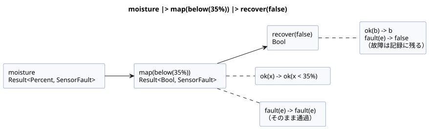
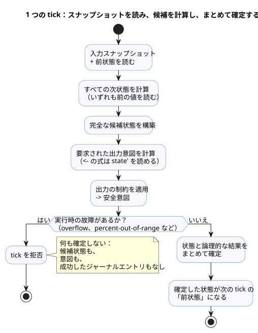
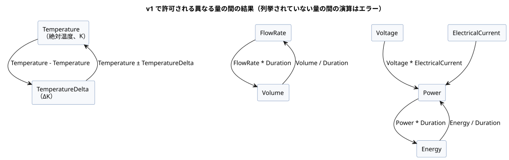

<!-- translation-source: docs/reference/02-types-expressions-state.en.md -->
[英語の原文](02-types-expressions-state.en.md)

# 2. 型、式、状態

[全体の目次](../LANGUAGE-REFERENCE.ja.md) · [前へ：ソースと構文](01-source-and-syntax.ja.md) · [次へ：時間とスケジュール](03-time-and-schedules.ja.md)

GhostFlowの型は、値がどう格納されるかだけでなく、その値が制御にとって何を*意味する*かを表します。真偽、近似的な測定値、百分率、継続時間、厳密な個数、段階の名前はそれぞれ異なる種類の値であり、ある種類が別の種類として暗黙に使われることは決してありません。そのため、コンパイラは誤った比較や単位の取り違えをプログラムの実行前に検出します。画面、記録、デバイスの境界も同じ意味に依拠できます。

**この章の内容**

| 節 | 定義する内容 |
|---|---|
| [2.1](#21-値の種類) | 値の種類とリテラルの書き方 |
| [2.2](#22-リテラルと期待される型) | `30`のようなリテラルがどのように型を得るか |
| [2.3](#23-厳密な整数の設計) | `Int`の算術、除算、明示的な変換 |
| [2.4](#24-列挙型と網羅的な分岐) | 列挙型と網羅的な`case` |
| [2.5](#25-センサの結果と明示的なエラーフロー) | `Result<T, E>`、組み込みの故障、Resultの変換 |
| [2.6](#26-式と演算子) | 演算子の優先順位と短絡評価 |
| [2.7](#27-純粋関数と計算の合成) | 純粋関数と`let` |
| [2.8](#28-tickと状態スナップショット) | tick、前状態/次状態、タイマー |
| [2.9](#29-物理量と単位) | 物理量、単位、およびその演算 |
| [2.10](#210-確定した型の境界) | 確定した境界のまとめ |

この章の`ghost`断片は、規則を説明するための例です。

根拠：[選定された構文](../LANGUAGE-SURFACE.ja.md)、[共通言語契約](../LANGUAGE.ja.md)、[厳密な整数の契約](../EXACT-INTEGER-CONTRACT.ja.md)、[Programming in GhostFlow](../ProgrammingInGhostflow.ja.md)、[物理量の設計issue #93](https://github.com/callin2/ghostflow-language/issues/93)。[言語リファレンス全体](../LANGUAGE-REFERENCE.ja.md)が、この章とほかの詳細な章を索引しています。

## 2.1 値の種類

| 型 | 意味 | 代表的なリテラルと値 |
|---|---|---|
| `Bool` | 真または偽 | `true`、`false` |
| `Int` | 符号付き32ビットの厳密な整数 | 個数、繰り返し回数、整数の差 |
| `Number` | 有限のbinary64近似数 | `3.0`、`0.5`、`-2.5` |
| `Percent` | 0から100までの百分率 | `30%` |
| `Duration` | ミリ秒分解能の非負の継続時間 | `250ms`、`2s`、`5min`、`1h` |
| 名前付き列挙型 | 宣言された有限個のケースのいずれか | `Idle`、`Watering` |
| `Result<T, E>` | 型`T`の正常なペイロード、またはコンパイラが所有する故障列挙型`E`の故障 | `ok(value)`、`fault(reason)` |
| 名前付き物理量 | 単位と農業上の意味を保持する有限の数 | `25°C`、`1.2kPa`、`70%RH` |

これらの型から導かれる帰結は次のとおりです。

- **真偽性（truthiness）はありません。**`Bool`が数値や文字列から導かれることは決してありません。
- **有限の数だけです。**NaNとInfinityは`Number`の値ではありません。
- **種類間の暗黙の変換はありません。**`30`、`30%`、`30ms`は異なる表記です。互いに暗黙に比較されたり変換されたりすることは決してありません。
- **汎用の文字列や配列はありません。**スケジュール設定の`"Asia/Seoul"`や`06:00`は、その位置でのみ意味を持つ限定的な構文です。汎用の文字列操作として読まないでください。同様に、スケジュールの`[06:00, 18:45]`も汎用の配列値ではありません。汎用の日付と時刻には、第3章の明示的な`date`、`time`、`datetime`タグ付きリテラルを使います。
- **`Duration`は暦の時刻ではありません。**タイマーは単調時間で経過時間を測ります。壁時計を補正しても巻き戻りません。

`Percent`の範囲は、その意味を目に見える形にし、数値を誤ってつなぐことを防ぎます。

**Percentの範囲規則。**結果の型が`Percent`であるすべての算術式は、両端を含む範囲`0..100`に収まっていなければなりません。`99.5%`のような小数値は有効です。

- 範囲外の*定数*の結果はコンパイルエラーです。
- 範囲外の*動的*な結果は、評価された時点で、既存の算術エラー経路を通じて`percent-out-of-range`によりtickを拒否します。そのtickは候補状態も、出力も、成功したジャーナルエントリも確定しません。
- 値はクランプされず、この規則は物理的な出力ポリシーを定義しません。
- それより前に非有限のNumber算術エラーが発生した場合、そのエラーは既存のエラーコードを保ちます。

この規則は最終結果だけでなく、すべての中間式と関数本体に適用されます。動的な`p = 90%`に対して`(p + 20%) - 20%`は、最終的な算術値が`90%`になるとしても、加算の時点で失敗します。選択されなかった分岐は評価されません。`p / 0.5%`のような比率は型が`Number`なので、その結果`180`は有効です。これらの検査により、宣言された値の領域が計算全体を通じて意味を保ちます。

### リテラルの書き方

- `Bool`は厳密に`true`または`false`です。
- 通常の数値は、10進整数、小数点、または指数表記を使います。先頭の`-`で負の数になります。真偽性も、文字列から数値への暗黙の変換もありません。
- `Percent`は数値の直後に`%`を続けたものです。例：`30%`。
- `Duration`は非負の整数に`ms | s | min | h`のいずれかを続けたものです。例：`500ms`、`2s`。0.5秒は`0.5s`ではなく`500ms`と書きます。
- 列挙型のケースは、その列挙型の宣言に並べられた識別子です。

`Percent`の接尾辞を整数の剰余と混同しないでください。*2つのオペランドの間*に書かれた`%`は2項の剰余演算子です（[2.3](#23-厳密な整数の設計)を参照）。数値に付いた`%`は`Percent`リテラルです。

## 2.2 リテラルと期待される型

`30`のような整数の形をしたリテラルは、厳密な個数とも近似的な測定値とも解釈できます。どちらになるかは次の規則で決まります。

- 小数点または指数を含む数値は`Number`です。
- 整数の形をした10進数は、*期待される数値型*がない場合は`Int`です。
- 期待される型は、型付きの宣言、関数のパラメータ、同じ演算のすでに型が決まったオペランド、または`if`の2つの分岐に共通する期待型から得られます。
- したがって、`input temperature: Number;`と比較される`30`は、最初から`Number`リテラルとして読まれます。これは`Int`から`Number`への実行時の変換**ではありません**。
- 型注釈のない`let count = 30;`の型は、その初期化式で決まります。後の使用が初期化式の型を遡って変えることはありません。
- 期待される型が衝突すると診断が出ます。コンパイラはオーバーロードを推測しません。
- 整数リテラルの範囲は、元の10進の桁に対して検査されます。`-2147483648`は境界値として受け入れられます。コンパイラは正の`2147483648`を先に拒否してから単項`-`を適用するわけではありません。それより大きい正または負の大きさは診断になります。
- 桁区切りは整数リテラルの契約に含まれません。2.3に示す範囲中の`_`は読みやすさのためだけのものです。

```ghost
control LiteralContexts {
  input temperature: Number;
  let count = 30;              // Int
  let warm = temperature >= 30; // 이 30은 Number 문맥
  output alarm: Bool;
  alarm <- warm;
}
```

（`warm`の行のコメントは「この30は`Number`の文脈にある」という意味です。）

個数と繰り返し回数は、サポートされる範囲内で厳密です。値の欠損、ラップアラウンド、飽和が暗黙に起こることは決してありません。

## 2.3 厳密な整数の設計

`Int`の最小の意味モデルは、符号付き32ビット整数です。

```text
Int = -2_147_483_648 .. 2_147_483_647
```

1つの符号付き型で、個数、差、オフセットを扱います。非負であるという要件は、別のプリミティブ型を追加するのではなく、`config`や`state`の領域の境界として表現します。日時、単調クロック、識別子の幅には、この`Int`とは別の独自の契約があります。

### 演算の意味

| 式 | 結果と制約 |
|---|---|
| `a + b`, `a - b`, `a * b` | 厳密な`Int`。範囲を超えると故障 |
| `-a` | 厳密な`Int`。最小値の符号反転は故障 |
| `a div b` | ゼロ方向に切り捨てた商 |
| `a % b` | 被除数の符号を持つ剰余 |
| `a / b`（2つの`Int`値） | エラー。`div`を使うか、明示的に`Number`へ変換します |
| `== != < <= > >=` | 2つの`Int`値の間で許可されます |
| `Int`と`Number`の混在 | 一方を明示的に変換するまでエラー |

有効な除算はすべて`a == (a div b) * b + (a % b)`を満たします。ゼロ除算は除算の故障であり、`MIN div -1`はオーバーフローです。

### 明示的な変換

| 表記 | 意味 |
|---|---|
| `number(i)` | 任意のi32を厳密な`Number`に変換します |
| `int_exact(n)` | 範囲内の整数値の`Number`だけを受け入れます |
| `int_floor(n)` | 数学的な床関数のあと、範囲を検査します |
| `int_ceil(n)` | 数学的な天井関数のあと、範囲を検査します |
| `int_trunc(n)` | ゼロ方向への切り捨てのあと、範囲を検査します |
| `int_nearest_even(n)` | 最近接への丸め（ちょうど中間は偶数へ）のあと、範囲を検査します |

丸め方の既定値を隠し持つ汎用の変換はありません。必要な丸め方は常に名前で指定します。

変換や整数演算が失敗したときに何が起こるかは、その値がコンパイル時にわかるかどうかによります。

| 状況 | 結果 |
|---|---|
| 定数のオーバーフロー、または無効な定数変換 | コンパイル時の診断 |
| 入力に依存するオーバーフロー、ゼロ除算、小数部のある`int_exact`、または範囲外の変換 | 現在のtickが拒否されます。新しい状態と意図が部分的に確定されることはありません。 |

実行時の故障には、次の安定した理由を使います：`integer-overflow`、`integer-division-by-zero`、`integer-conversion-fractional`、`integer-conversion-out-of-range`。

`int_exact`は、有限の入力の小数部を範囲*より先に*検査します。そのため、`2147483648.5`のように小数部があり、しかも範囲外でもある値は`integer-conversion-fractional`になります。範囲外の整数値の入力は`integer-conversion-out-of-range`になります。定数の診断と実行時の故障は同じ順序を使います。つまり、「この入力はそもそも厳密な整数になれるか」という最初の問いに最初に答えます。

`Int`、`div`、`%`、および上記の変換名が正準表記です。丸めポリシーを隠す汎用の`int(n)`はありません。`div`と2項の`%`は`*`や`/`と同じ優先順位を持ち、左結合です。空白を挟まず数値に直接`%`を付けた`30%`は`Percent`リテラルであり、2つの式の間の`%`は`Int`の剰余です。

### Numberの演算

`Number`は`+`、`-`、`*`、`/`、単項`-`、および比較をサポートし、いずれも同じ型のオペランドどうしで行います。すべての結果は有限でなければなりません。ゼロ除算や非有限の結果が発生すると、そのtickは状態も意図も確定しません。`Int`と`Number`を混在させてこの規則を回避することはできません。

## 2.4 列挙型と網羅的な分岐

列挙型は、順を追って進む段階を数値の陰に隠さず、名前で表します。

```ghost
type Phase = Idle | Opening | Watering | Closing;
state phase: Phase = Idle;

phase' = case phase {
  Idle     => if start then Opening else Idle;
  Opening  => Opening;
  Watering => Watering;
  Closing  => Idle;
};
```

列挙型に対する`case`の規則：

- すべてのケースを扱わなければなりません。ケースの漏れはエラーです。その結果、列挙型に新しいケースを追加すると、影響を受けるすべての分岐を見直すことになります。
- すべての分岐は、文脈が要求する同じ型の値を生成しなければなりません。
- `phase in {Opening, Watering}`は、同じ列挙型のケースからなる有限集合への所属を判定します。この位置での`{...}`は集合の表記であり、汎用のコレクション値を作るものではありません。

`enum Phase { ... }`や`enum Phase = ...;`という表記は、古い参考資料に登場します。これらは過去の表記であり、実行可能な入力としては拒否されます。

## 2.5 センサの結果と明示的なエラーフロー

`input moisture: Percent;`で宣言された型は、*正常なペイロード*の型です。外部入力を読むと、正常な値または故障のいずれかが得られるため、それをペイロードであるかのように直接比較することはできません。`case`で取り出します。

例外が1つあります。第5章で規定される、予約済みでランタイムが所有する厳密な再起動ポートは、宣言されたスカラー型として読まれます。この例外は、一般的な列挙型の取得入力を許可するものではありません。

```ghost
let dry = case moisture {
  ok(value) => value < 30%;
  fault(_)  => false;
};
```

`_`は「この式では故障の詳細を使わない」ことを意味するパターンです。ここで`false`を選んでも、故障が正常な値に変わるわけではありません。元の故障は記録に残ります。`SensorFault`は、メンバー`Disconnected | Stale | Invalid | NotReady`を持つ組み込みの列挙型です。故障の束縛に対して、もう1つの`case`で網羅的に分岐できます。

```ghost
let available = case moisture {
  ok(_) => true;
  fault(reason) => case reason {
    Disconnected => false;
    Stale => false;
    Invalid => false;
    NotReady => false;
  };
};
```

**`Result<T, E>`でできることとできないこと**

- `Result<T, E>`は、関数のパラメータ型と結果型として使えます。
- `E`は、コンパイラが定義する有限の故障列挙型でなければなりません。v1には`SensorFault`、`ClockFault`、`CalendarFault`、`TemporalContextFault`、`AccountingFault`、`SettingsFault`があります。
- `ok(expr)`と`fault(reason)`が、この組み込みResultのコンストラクタです。
- ユーザーが新しいADT、新しいResultのエラー型、新しいコンストラクタを宣言するための汎用の構文はありません。
- Resultがスカラーの`state`、`config`、`input`、`output`の値として格納されることは決してなく、設備のバインディングに公開されることも決してありません。

**設定はResultのストリームです。**`config x: T = initial`は、Resultのためのスカラー格納領域を宣言するものではありません。ペイロード`T`を持つ*設定ストリーム*を宣言します。式が`x`を読むとき、その型は`Result<T, SettingsFault>`であり、ストリームの最初の送出値は`ok(initial)`です。現在のエラーレールを、ソースの既定値や以前に成功した値で置き換えてはなりません。[§5.2](05-settings-and-observation.ja.md)のストリーム規則に従ってください。

組み込みの故障列挙型のメンバーは、次のように固定されています。時間、カレンダー、自然現象に関する名前は、[第3章のUnknownの原因](03-time-and-schedules.ja.md)と一致します。

| エラー型 | メンバー |
|---|---|
| `SensorFault` | `Disconnected`, `Stale`, `Invalid`, `NotReady` |
| `ClockFault` | `ClockUnknown`, `ZoneUnsupported` |
| `CalendarFault` | `ClockUnknown`, `CalendarMissing`, `CalendarOutOfRange`, `ZoneUnsupported` |
| `TemporalContextFault` | `ClockUnknown`, `LocationUnknown`, `EventUnavailable`, `PredictionMissing`, `PredictionStale`, `ZoneUnsupported` |
| `AccountingFault` | `ClockUnknown`, `LedgerMissing`, `LedgerCorrupt`, `LedgerIncomplete`, `CountOverflow` |
| `SettingsFault` | `SettingsInvalid`, `SettingsUnavailable` |

`ClockUnknown`のように、いくつかのメンバー名は複数の故障列挙型に属します。コンパイラは文脈からそれらを解決します。

- `fault(reason)`では、メンバーは*期待される*Resultのエラー型を通じて解決されます。
- `case reason`では、メンバーは*検査対象の*値のエラー型を通じて解決されます。
- 文脈からちょうど1つの型に解決できないメンバー参照はエラーです。

ユーザーの宣言は、これらのメンバーを隠したり、新しいメンバーを追加したりできません。誤ったプロバイダの種類やバインディングはアクティベーションエラーであり、これらの列挙型の新しいメンバーを作り出して報告されることは決してありません。

**理由：**時計の欠落と予測の欠落のように、異なる対応が必要な原因を、1つの汎用的な失敗値にまとめてはなりません。同時に、各Resultを有限個の可能性に限定することで、コンパイラは分岐が網羅的であることを検査できます。

**オプションのケイパビリティは故障ではありません。**`sensor moisture?: Percent;`の`?`は、設備のケイパビリティがオプションであることを意味します。設置されていないセンサは、設置されたセンサの故障とは異なります。`?`だけでは、フォールバック戦略も任意の既定値も作られません。

状態を持つセンサ処理も、その意味を明示的に宣言します。

```ghost
sensor moisture: Percent {
  sample = 1s;
  valid = 0% .. 100%;
  filter = median(3);
  stale_after = 3s;
  recover_after = 1 samples;
}
signal dry = hysteresis(moisture,
  on_below: 30%, off_above: 35%, initial: false);
```

- `median(n)`の`n`は`1..31`の奇数です。
- `hysteresis`は、値が2つの境界の間にある間、前の判断を保ちます。
- `sample`は測定間隔を表します。別のスレッドを開始する命令ではありません。
- フィルタとヒステリシスの記憶は、明示的な制御状態です。チェックポイントとリプレイに含まれます。

### 静的なResult変換と合成

Resultの値は、コンパイラが知っている次の静的な変換を通って流れることができます。

| 表記 | 値の意味 |
|---|---|
| `ok(value)` / `fault(reason)` | 対応するResultの正常ペイロードまたは組み込み故障のコンストラクタ |
| `below(limit)` | 互換性のある順序付きペイロードを受け取り、`value < limit`を返す静的な変換 |
| `map(f)` | `ok(x)`を`ok(f(x))`に写し、`fault(e)`はそのまま通す単項関数 |
| `and_then(f)` | `ok(x)`をResultを返す`f(x)`に渡し、`fault(e)`はそのまま通します |
| `recover(default)` | `ok(x)`を`x`に、`fault(e)`を同じ型の既定値に変えます |
| `x \|> f` | 値を関数に渡します：`f(x)` |
| `f >> g` | 左から右への合成：`(x) -> g(f(x))` |

```text
is_dry = map(below(35%)) >> recover(false)
dry = moisture |> map(below(35%)) |> recover(false)
```

次の図は2行目をたどったものです。故障の経路は`map`を変更されずに通過し、`recover`で初めて値に置き換えられます。



これらの変換の制限：

- `map`や`and_then`の引数は、静的に解決される名前付きの`fn`、または`below(limit)`のようなコンパイラが知っている有界の変換でなければなりません。
- これらは関数値、ラムダ、クロージャ、実行時の関数選択を作りません。`>>`も、これらの静的な変換の連鎖だけを合成します。
- `|>`と`>>`は左結合であり、`if/then/else`よりも強く結合します。
- これらは純粋な値の変換です。状態もストリームスケジューラも作りません。
- `recover`は、元のセンサの故障も、どのフォールバックが選ばれたかの記録も消去しません。
- 大文字の`Ok`/`Err`、および`not`、`and`、`or`、`is`、`isnt`は正準の別名ではありません。

## 2.6 式と演算子

選定された制御構文の演算子は、結合の強い順に次のとおりです。

| 順位 | 演算 |
|---:|---|
| 1 | 括弧、関数呼び出し、メンバー参照と次状態の参照 |
| 2 | 単項`!`、単項`-` |
| 3 | `*`、`/`、`div`、2項`%` |
| 4 | `+`、`-` |
| 5 | `in { ... }` |
| 6 | `==`、`!=`、`<`、`<=`、`>`、`>=` |
| 7 | `&&` |
| 8 | `\|\|` |
| 9 | 静的な変換の合成`>>` |
| 10 | 静的な値のパイプ`\|>` |

- 同じ順位の2項演算子は左結合です：`6 - 2 - 1`は`(6 - 2) - 1`を意味します。
- 比較の連鎖は許可されません。`a < b < c`ではなく`a < b && b < c`と書きます。
- 等価比較と順序比較は、同じ型の互換性のある値どうしでのみ許可されます。
- 複雑な判断の意図を見えるようにするには、括弧と名前付きの`let`束縛を使います。

`|>`と`>>`は、静的に解決されるResultの変換の連鎖にのみ使います。初期のA/B/C設計資料にある`not`、`and`、`or`、`is`、`isnt`という語は、これらの制御演算子の別名ではありません。

### 条件式

`if condition then a else b`は値を生成する式です。条件は`Bool`でなければならず、2つの分岐は同じ型でなければなりません。`case`と同様に、選択されない分岐も静的に型検査されます。

```ghost
let denominator = if b == 0 then 1.0 else b;
let result = if b == 0 then 0.0 else a / denominator;
```

`if`、`&&`、`||`は、左から右へ決定的に短絡評価します。

| 式 | 実行時に評価されるもの |
|---|---|
| `if c then a else b` | `c`、次に選択された分岐だけ |
| `x && y` | `x`が真のときだけ`y` |
| `x \|\| y` | `x`が偽のときだけ`y` |

静的な検査は短絡されません。すべての分岐とオペランドが名前と型の検査を受けるため、到達しない分岐にあってもコンパイル時のエラーは報告されます。一方、実行時の故障は、選択されない分岐では発生しません。定数畳み込みと関数のインライン展開は、この故障の到達可能性と評価順序を保ちます。

## 2.7 純粋関数と計算の合成

```ghost
fn hold(start: Bool, stop: Bool, previous: Bool) -> Bool {
  !stop && (start || previous)
}
```

関数はパラメータの型と結果の型を宣言し、最後の式の値を返します。`return`文はありません。

関数は*純粋*です。同じ引数は常に同じ値を生成します。

- 関数は、制御の入力、状態、設定を暗黙に捕捉しません。必要な値はすべて引数として渡します。
- 関数には、変更可能なローカル状態も、待機も、I/Oの作用もありません。
- 呼び出しは静的に解決されなければなりません。再帰と循環する呼び出しは禁止されています。
- 依存グラフが変わらない限り、関数や`let`束縛を分割したり並べ替えたりしても結果は変わりません。
- 関数名は通常の値ではありません。格納すること、返すこと、動的に選択すること、汎用の関数パラメータとして渡すことはできません。
- Resultの`map(fnName)`、`and_then(fnName)`、`>>`だけが、コンパイラが関数名を静的に特殊化する限定的な位置です。汎用の高階関数やクロージャはありません。

型付きの式マクロは、実行時の関数とは別の、コンパイル時の機能です。[第6章](06-composition-and-replay.ja.md)を参照してください。

`let name = expression;`は式に名前を付けるだけです。tickの間をまたぐ記憶は作りません。`let`束縛は、宣言の順序に関係なく、非巡回グラフとして計算されます。記憶が必要な場合は`state`を使います。

## 2.8 tickと状態スナップショット

*tick*（論理判断の単位）とは、1つの入力スナップショットから1つの判断を計算して確定する論理的な単位です。

```text
入力スナップショット + 前状態
  → すべての次状態を計算
  → 完全な候補状態を構築
  → 要求された出力意図を計算
  → 制約を適用した安全意図を計算
  → 成功した結果をまとめて確定
```

次の図は、実行時の故障が発生した場合も含めて、同じサイクルを示しています。



```ghost
control SnapshotPair {
  input swap: Bool;
  state left: Bool = true;
  state right: Bool = false;
  output lamp: Bool;

  left'  = if swap then right else left;
  right' = if swap then left else right;
  lamp <- left';
}
```

**前状態と次状態。**tickの中で、`left`と`right`は*前の* tickの値であり、`left'`と`right'`は*次の*（候補の）値です。

- すべての次状態の式は、同じ前状態と入力を読みます。そのため、ソースの順序を入れ替えても結果は変わりません。この例は、どちらの順序でも2つの値を正しく入れ替えます。
- 状態遷移が別の次状態を読んではなりません。`right' = left';`はエラーです。
- 次状態の参照は、出力の式でのみ許可されます。`let`も次状態を参照できません。

**出力。**出力接続は、現在のtickの候補状態（`left'`など）を読むことができますが、プライムの付かない状態名は依然として前の値を意味します。`<-`で書かれた値は*要求意図（requested）*です。出力の制約がそれを*安全意図（safe）*に絞り込み、その後、状態と論理的な結果がまとめて確定されます。出力宣言で省略された初期値も`<-`も、デバイスの起動時や故障時の物理的な安全値を定義するものではありません。

**確定の規則。**

- 次状態の定義がない状態は、前の値を保ちます。
- 1つの状態に、次状態の定義を2つ以上持たせることはできません。
- tickの途中で計算が失敗した場合（たとえば数値の故障によって）、候補状態と意図が部分的に確定されることはありません。
- この論理的な原子性は、複数の物理出力が同じ瞬間に変化することを保証するものではありません。

**初期値。**`state name: Type = value;`の初期値は、宣言された型の定数でなければなりません。入力やほかの状態を読んで計算されることは決してありません。この明示的な開始値によって、最初のtickに再現可能な前状態が与えられます。

**設計の根拠と由来：**[#149](https://github.com/callin2/ghostflow-language/issues/149)で、ユーザーはReact/ObservableHQからの影響を、イベントストリームの中で制御を評価し、次状態を明示的に返すことだと説明しました。ユーザーの教育上の前提は、電気技術者にとって再帰やループの形をした制御は追跡しにくいかもしれない、というものでした。前状態と候補の次状態を分けて書くことで、時間の境界が目に見えるようになります。`left' = right; right' = left;`は前の組を読み、次の組を記述します。この前提は読みやすさの指針であり、すべての電気技術者についての主張ではありません。実行可能な表記はASCIIのアポストロフィ（`'`）です。ユーザーが会話の中で使ったバッククォートの書き方や、その後のアシスタントによる一般的な循環規則、タイムトラベル、因果的な説明についての議論は、追加の構文や機能を定めるものではありません。実行を定義するのは、上記のスナップショット、遷移、出力の規則です。

### タイマーも状態である

`timer age = elapsed(phase);`は、`phase`の最後の*確定された*変化からの単調な経過時間です。

- 変化が確定すると0にリセットされ、後続のtickは新しい値を読みます。初期値も0です。
- `Bool`の対象では、どちらの方向の変化（真への変化でも偽への変化でも）も新しい区間を開始します。
- タイマーは`sleep`でも、別の実行スレッドでもありません。ほかの入力の処理をブロックすることは決してありません。

段階の遷移は、その条件を満たす最初のtickで1回だけ起こります。1つの長いtickが、複数の状態段階を続けて通過することはありません。実際の遅延は要求された継続時間以上であり、通常の動作中は最大でtickの分解能だけ遅れることがあります。

## 2.9 物理量と単位

単なる`Number`では、`25°C`、`800ppm`、`1.2kPa`、`5L/min`、`70%RH`の物理的な意味を区別できません。そのためGhostFlowは、名前付きの物理量型を提供します。次の名前と接尾辞が、承認済みの固定カタログです。

- 接尾辞は大文字と小文字を区別します。
- 接尾辞は、空白を挟まず数値トークンの直後に付けます。
- 字句解析器は、一致する最長の接尾辞を優先して認識します。

| 型 | 許可される接尾辞 | 正準単位 |
|---|---|---|
| `Temperature` | `°C`, `K`, `°F` | `K` |
| `TemperatureDelta` | `Δ°C`, `ΔK`, `Δ°F` | `ΔK` |
| `RelativeHumidity` | `%RH` | 比率`0..1` |
| `Pressure` | `Pa`, `kPa`, `bar` | `Pa` |
| `VaporPressureDeficit` | `PaVPD`, `kPaVPD` | `PaVPD` |
| `CO2Concentration` | `ppm` | モル比 |
| `FlowRate` | `m3/s`, `L/min`, `mL/min` | `m3/s` |
| `Volume` | `m3`, `L`, `mL` | `m3` |
| `Length` | `m`, `cm`, `mm` | `m` |
| `Irradiance` | `W/m2` | `W/m2` |
| `PPFD` | `mol/m2/s`, `umol/m2/s` | `mol/m2/s` |
| `Energy` | `J`, `kJ`, `Wh`, `kWh` | `J` |
| `Power` | `W`, `kW` | `W` |
| `ElectricalCurrent` | `A`, `mA` | `A` |
| `Voltage` | `V`, `mV` | `V` |
| `Conductivity` | `S/m`, `mS/cm`, `uS/cm` | `S/m` |
| `Acidity` | `pH` | `pH` |

**変化率：`Rate<Q>`。**`Rate<Q>`は、`window_rate`（第4章）が生成する、式の中でのみ使える型です。「1秒あたりのQの変化」を意味します。

- `Rate<Temperature>`の分子は、`TemperatureDelta`と同じ`ΔK`です。そのほかの許可された線形のQでは、分子はその同じ名目量の正準の差です。
- 結果は、その`window_rate`を宣言する`signal`の名前で参照できます。
- `Rate<Q>`を直接のリテラルとして書くことはできず、汎用の値の束縛、関数のパラメータや結果、`state`、`config`、`input`、`output`の型にすることもできません。
- しきい値は`rate(delta: difference, time: Duration)`で作ります。比較できるのは同じQの変化率どうしだけです。
- コンストラクタのQは、比較のもう一方のオペランド、または明示的に期待される`Rate<Q>`によって決まります。`TemperatureDelta`だけではQが一意に決まらない場合、コンパイラは推測せずに拒否します。
- v1では、`window_rate`のQは`Temperature`、`TemperatureDelta`、`Pressure`、`VaporPressureDeficit`、`FlowRate`、`Volume`、`Length`、`Irradiance`、`PPFD`、`Energy`、`Power`、`ElectricalCurrent`、`Voltage`、`Conductivity`のいずれかです。`Int`、`Number`、`Percent`、`RelativeHumidity`、`CO2Concentration`、`Acidity`には適用されません。

```ghost
signal warming = window_rate(temperature, over: 10min,
  quality: measured, max_age: 2min);
output warming_slowly: Bool;
warming_slowly <- warming |> map(below(rate(delta: 1ΔK, time: 1s))) |> recover(false);
```

この断片で、`temperature`は`Temperature`のセンサです。比較の期待型は`Rate<Temperature>`なので、しきい値は1 ΔK/sです。`time`は正の`Duration`でなければなりません。定数の0は静的に拒否され、実行時の値が0の場合は算術エラーでtickが失敗します。

**理由：**温度の変化率と温度差の変化率はどちらもΔK/sを使いますが、異なる制御対象を表します。対象を期待型から解決し、変化率を汎用の値として格納することを許さないことで、単位が一致するというだけで異なる変化率が混ざることを防ぎます。長さ0の区間に任意の変化率を割り当てると、実際のどの測定にも裏付けられない制御判断が生まれてしまいます。

**似て見える量も別物です。**`Percent`は`0..100`の値（アクチュエータの開度を含む）であり、`RelativeHumidity`ではありません。`Temperature`は絶対温度であり、`TemperatureDelta`は差です。そのため、温度設定の`step`には`0.5Δ°C`のような差を使います。

```ghost
control ClimateTarget {
  input inside_temperature: Temperature;
  config target_temperature: Temperature = 25°C {
    min = 18°C;
    max = 32°C;
    step = 0.5Δ°C;
    access = operator;
  }
  output heat: Bool;
  heat <- case target_temperature {
    ok(target) => inside_temperature < target;
    fault(reason) => false;
  };
}
```

**変換と表示。**

- 10進のリテラルは、厳密な10進の有理数として正準単位に変換され、その正準値で一度だけbinary64に丸められます（ちょうど中間は偶数へ）。
- 同じ物理量の異なる単位は、変換後に同じ意味の値として比較されます。
- 成果物のメタデータは、名目量の同一性と正準単位を保持します。
- 表示単位とロケールの書式はUIのメタデータです。制御上の意味は変えません。
- `Temperature`の運用設定は、作成者が選んだ`°C`または`K`を、別個の`displayUnit`メタデータとして保持しなければなりません。内部の値と比較には、引き続き正準の`K`を使います。`displayUnit`メタデータの欠落や曖昧さはエラーです。表示単位を値の大きさや正準単位から推測してはならず、`°C`を既定にしてもなりません。

**許可される演算。**演算の集合は閉じています。ここに挙げていないものはすべてエラーです。

- 同じ名目量の値どうしを比較します。
- 線形の物理量は、同じ型どうしの`+`、`-`、単項`-`、および`Number`との乗算・除算をサポートします。同じ型の2つの値の除算は`Number`を生成します。
- `Temperature - Temperature`は`TemperatureDelta`を生成し、`Temperature + TemperatureDelta`と`Temperature - TemperatureDelta`は`Temperature`を生成します。2つの絶対温度を加算することはできません。
- `RelativeHumidity`は、同じ型どうしの比較と、明示的な`RelativeHumidity / RelativeHumidity -> Number`をサポートします。たとえば`60%RH / 100%RH`は`0.6`です。そのほかの算術と暗黙の数値変換は引き続き禁止されています。除数が0の場合は通常の規則（定数なら診断、動的ならtickの拒否）に従います。正規化してもセンサの品質は消えません。
- `CO2Concentration`と`Acidity`は、同じ型どうしの比較だけをサポートします。
- `FlowRate * Duration`は`Volume`を、`Volume / Duration`は`FlowRate`を、`Power * Duration`は`Energy`を、`Energy / Duration`は`Power`を、`Voltage * ElectricalCurrent`は`Power`を生成します。乗算はオペランドの順序を問いません。
- `VaporPressureDeficit`は、正準のスケールが圧力と一致していても、`Pressure`とは異なる名目型です。規定されていない量の間の演算と数値型への変換はエラーです。

次の図は、このリストにある異なる量の間の結果をまとめたものです。



**PIDゲイン。**PIDのゲインは、制限のない次元の代数を使いません。第4章の有界なコンストラクタを使います：`proportional_gain(output: 2%, error: 1Δ°C)`、`integral_gain(output: 0.1%, error: 1Δ°C, time: 1s)`、`derivative_gain(output: 1%, time: 1s, error: 1Δ°C)`。

**バインディング。**バインディングは、量と単位を指定しなければなりません。OCRで読み取られた単位のない数値は、権威ある量ではなく、ユーザーが確認したバインディングなしに量へ昇格されることはありません。

**温度に対するフィルタ。**`moving_average`と`ema`が絶対温度の`Temperature`を処理するとき、正準のKでアフィンな加重平均を計算します。これはフィルタの閉じた意味の一部であり、ソースで`Temperature + Temperature`を合法にするものではありません。

## 2.10 確定した型の境界

- `Int`は符号付き32ビットであり、`div`、`%`、および名前付きの変換を使います。
- `if`、`&&`、`||`は左から右へ短絡評価します。
- 削除された関数、列挙型、次状態、修飾値の別名は、移行のための診断とともに拒否されます。
- 提供されるのは、コンパイラが所有する故障列挙型に対する組み込みの`Result<T, E>`と静的な変換だけです。汎用のADT、ユーザー定義のResultエラー型、関数値、汎用の高階関数はありません。
- 物理量は、2.9の固定カタログと閉じた演算だけを使います。
- 汎用の日付と時刻には、第3章のタグ付きリテラルを使います：``date`YYYY-MM-DD` ``、``time`HH:MM[:SS[.f|.ff|.fff]]` ``、``datetime`YYYY-MM-DDTHH:MM:SS[.f|.ff|.fff](Z|±HH:MM)` ``。`DateTime`はオフセットを持たなければなりません。時間のオフセットには`Duration`だけを使います。

これらの境界の外にある表記、暗黙の変換、単位の推測、ユーザー定義のコンストラクタ、実行時の関数選択は診断になります。別の言語機能として推論されることは決してありません。
