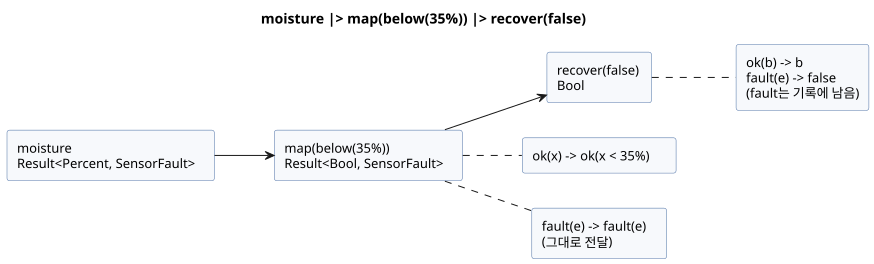
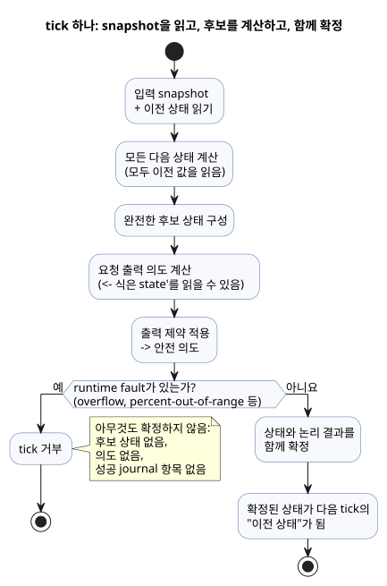
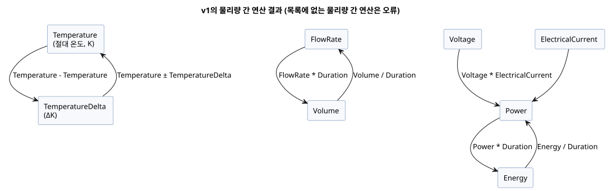

<!-- translation-source: docs/reference/02-types-expressions-state.en.md -->
[영문 원문](02-types-expressions-state.en.md)

# 2. 타입, 표현식과 상태

[전체 목차](../LANGUAGE-REFERENCE.md) · [이전: 소스와 문법](01-source-and-syntax.md) · [다음: 시간과 예약](03-time-and-schedules.md)

GhostFlow의 타입은 값이 어떻게 저장되는지보다 제어에서 무엇을 *뜻하는지*를 기술합니다. 참·거짓, 근사 측정값, 백분율, 시간 길이, 정확한 개수, 단계 이름은 서로 다른 종류의 값이며, 한 종류를 다른 종류처럼 조용히 바꾸어 쓰지 않습니다. 그래서 컴파일러는 잘못된 비교와 단위 혼동을 프로그램 실행 전에 찾아냅니다. 화면·기록·장치 경계도 같은 의미에 기댈 수 있습니다.

**이 장의 내용**

| 절 | 정의하는 내용 |
|---|---|
| [2.1](#21-값-종류) | 값 종류와 리터럴 표기 |
| [2.2](#22-리터럴과-기대-타입) | `30` 같은 리터럴이 타입을 얻는 방법 |
| [2.3](#23-정확한-정수-설계) | `Int` 산술, 나눗셈, 명시적 변환 |
| [2.4](#24-enum과-빠짐없는-분기) | enum과 빠짐없는 `case` |
| [2.5](#25-sensor-결과와-명시적-오류-흐름) | `Result<T, E>`, 내장 fault, Result 변환 |
| [2.6](#26-표현식과-연산자) | 연산자 우선순위와 단락 평가 |
| [2.7](#27-순수-함수와-계산-조합) | 순수 함수와 `let` |
| [2.8](#28-tick과-상태-snapshot) | tick, 이전·다음 상태, 타이머 |
| [2.9](#29-물리량과-단위) | 물리량, 단위와 그 연산 |
| [2.10](#210-확정된-타입-경계) | 확정된 경계 요약 |

이 장의 `ghost` 조각은 규칙을 설명하는 예시입니다.

근거: [선택 문법](../LANGUAGE-SURFACE.md), [공통 언어 계약](../LANGUAGE.md), [정확한 정수 계약](../EXACT-INTEGER-CONTRACT.ko.md), [Programming in GhostFlow](../ProgrammingInGhostflow.md), [물리량 설계 이슈 #93](https://github.com/callin2/ghostflow-language/issues/93). [전체 언어 reference](../LANGUAGE-REFERENCE.md)는 이 장과 나머지 상세 장의 색인입니다.

## 2.1 값 종류

| 타입 | 의미 | 대표 리터럴·값 |
|---|---|---|
| `Bool` | 참 또는 거짓 | `true`, `false` |
| `Int` | 정확한 signed 32-bit 정수 | 개수, 반복 횟수, 정수 차이 |
| `Number` | 유한한 binary64 근사 수치 | `3.0`, `0.5`, `-2.5` |
| `Percent` | 0부터 100까지의 백분율 | `30%` |
| `Duration` | 밀리초 해상도의 비음수 지속 시간 | `250ms`, `2s`, `5min`, `1h` |
| 이름 있는 enum | 선언한 유한 case 중 하나 | `Idle`, `Watering` |
| `Result<T, E>` | `T` 타입의 정상 payload, 또는 compiler-owned fault enum `E`의 fault | `ok(value)`, `fault(reason)` |
| 이름 있는 물리량 | 단위와 농업 의미를 보존하는 유한 수치 | `25°C`, `1.2kPa`, `70%RH` |

이 타입들에서 다음이 따라 나옵니다.

- **truthiness가 없습니다.** `Bool`은 숫자나 문자열에서 만들어지지 않습니다.
- **유한한 수만 있습니다.** NaN과 Infinity는 `Number` 값이 아닙니다.
- **종류 사이의 암묵 변환이 없습니다.** `30`, `30%`, `30ms`는 서로 다른 표기입니다. 서로 암묵적으로 비교하거나 변환하지 않습니다.
- **범용 문자열이나 배열이 없습니다.** `"Asia/Seoul"`과 schedule 설정의 `06:00`은 그 위치에서만 의미를 갖는 제한된 문법입니다. 이를 일반 문자열 연산으로 읽어서는 안 됩니다. 마찬가지로 schedule의 `[06:00, 18:45]`도 범용 배열 값이 아닙니다. 범용 날짜와 시각에는 3장의 명시적인 `date`, `time`, `datetime` tagged literal을 사용합니다.
- **`Duration`은 달력 시각이 아닙니다.** 타이머는 단조 경과 시간을 잽니다. 벽시계를 보정해도 타이머가 되감기지 않습니다.

`Percent`의 경계는 의미를 드러내고 잘못된 수치 연결을 막습니다.

**Percent 범위 규칙.** 결과 타입이 `Percent`인 모든 산술 표현식은 양 끝을 포함한 `0..100` 범위를 유지해야 합니다. `99.5%` 같은 소수 값도 유효합니다.

- 범위를 벗어난 *상수* 결과는 컴파일 오류입니다.
- 범위를 벗어난 *동적* 결과는 실제로 평가되면 기존 산술 오류 경로를 통해 `percent-out-of-range`로 tick을 거부합니다. 이 tick은 후보 상태, 출력, 성공 journal 항목을 하나도 확정하지 않습니다.
- 값을 경계로 잘라 맞추지 않으며, 이 규칙이 물리 출력 정책을 정하지도 않습니다.
- 그보다 먼저 비유한 Number 산술 오류가 발생하면 그 오류는 기존 오류 코드를 유지합니다.

이 규칙은 최종 결과뿐 아니라 모든 중간 표현식과 함수 본문에도 적용됩니다. 동적인 `p = 90%`에서 `(p + 20%) - 20%`는 최종 산술값이 `90%`가 되더라도 덧셈 단계에서 실패합니다. 선택되지 않은 분기는 평가하지 않습니다. `p / 0.5%` 같은 비율의 타입은 `Number`이므로 결과 `180`은 유효합니다. 이 검사는 계산 내내 선언한 값의 범위가 의미를 유지하게 합니다.

### 리터럴 spelling

- `Bool`은 정확히 `true` 또는 `false`입니다.
- 일반 수치는 십진 정수, 소수점, 지수 표기를 사용합니다. 앞의 `-`는 음수를 나타냅니다. truthiness도, 문자열을 수로 바꾸는 암묵 변환도 없습니다.
- `Percent`는 수치 바로 뒤에 `%`를 붙입니다. 예: `30%`.
- `Duration`은 비음수 정수에 `ms | s | min | h` 중 하나를 붙입니다. 예: `500ms`, `2s`. 반 초는 `0.5s`가 아니라 `500ms`로 씁니다.
- enum case는 해당 enum 선언에 나열된 식별자입니다.

`Percent` suffix와 정수 나머지를 혼동하지 마십시오. *두 operand 사이에* 쓴 `%`는 이항 나머지 연산자이고([2.3](#23-정확한-정수-설계) 참고), 수치에 붙은 `%`는 `Percent` 리터럴입니다.

## 2.2 리터럴과 기대 타입

`30` 같은 정수 모양 리터럴은 정확한 개수일 수도, 근사 측정값일 수도 있습니다. 다음 규칙이 어느 쪽인지 정합니다.

- 소수점이나 지수가 있는 수는 `Number`입니다.
- 정수 모양의 십진수는 *기대 numeric 타입*이 없으면 `Int`입니다.
- 기대 타입은 typed declaration, 함수 매개변수, 같은 연산에서 이미 타입이 정해진 다른 operand, 또는 두 `if` branch의 공통 기대 타입에서 올 수 있습니다.
- 따라서 `input temperature: Number;`와 비교하는 `30`은 처음부터 `Number` 리터럴로 읽습니다. 이는 실행 중 `Int`를 `Number`로 바꾸는 변환이 **아닙니다**.
- untyped `let count = 30;`의 타입은 initializer에서 고정됩니다. 나중 사용처가 initializer의 타입을 거꾸로 바꾸지 않습니다.
- 충돌하는 기대 타입은 진단을 냅니다. 컴파일러는 overload를 추측하지 않습니다.
- 정수 리터럴 범위는 원래 십진 digit을 기준으로 검사합니다. `-2147483648`은 경계 사례로 허용합니다. 컴파일러는 먼저 양수 `2147483648`을 거부한 뒤 단항 `-`를 적용하는 식으로 처리하지 않습니다. 이보다 큰 양·음 크기는 진단을 냅니다.
- digit separator는 정수 리터럴 계약에 포함되지 않습니다. 2.3의 범위 표기에 있는 `_`는 읽기 쉽게 하기 위한 것일 뿐입니다.

```ghost
control LiteralContexts {
  input temperature: Number;
  let count = 30;              // Int
  let warm = temperature >= 30; // 이 30은 Number 문맥
  output alarm: Bool;
  alarm <- warm;
}
```

(`warm` 줄의 주석은 "이 30은 `Number` 문맥"이라는 뜻입니다.)

개수와 반복 횟수는 지원 범위 안에서 정확합니다. 손실·wraparound·saturation은 결코 조용히 일어나지 않습니다.

## 2.3 정확한 정수 설계

`Int`의 최소 의미 모델은 signed 32-bit 정수입니다.

```text
Int = -2_147_483_648 .. 2_147_483_647
```

부호 있는 타입 하나로 개수, 차이, offset을 모두 표현합니다. 비음수 요구는 별도 primitive 타입을 늘리지 않고 `config`나 `state`의 domain bound로 표현합니다. 날짜시각, 단조 시계, 식별자 폭은 이 `Int`와 별개의 계약을 가집니다.

### 연산 의미

| 식 | 결과와 제약 |
|---|---|
| `a + b`, `a - b`, `a * b` | 정확한 `Int`; 범위 초과는 fault |
| `-a` | 정확한 `Int`; 최솟값의 부호 반전은 fault |
| `a div b` | 0 방향으로 자른 몫 |
| `a % b` | 피제수와 같은 부호의 나머지 |
| `a / b` (두 `Int` 값) | 오류; `div`를 쓰거나 `Number`로 명시적 변환 |
| `== != < <= > >=` | 두 `Int` 값 사이에서 허용 |
| `Int`와 `Number` 혼합 | 한쪽을 명시적으로 변환하기 전에는 오류 |

유효한 나눗셈은 항상 `a == (a div b) * b + (a % b)`를 만족합니다. 0으로 나누기는 division fault이고, `MIN div -1`은 overflow입니다.

### 명시적 변환

| spelling | 의미 |
|---|---|
| `number(i)` | 모든 i32를 정확한 `Number`로 변환 |
| `int_exact(n)` | 범위 안의 정수값인 `Number`만 허용 |
| `int_floor(n)` | 수학적 내림 뒤 범위 검사 |
| `int_ceil(n)` | 수학적 올림 뒤 범위 검사 |
| `int_trunc(n)` | 0 방향 절삭 뒤 범위 검사 |
| `int_nearest_even(n)` | 최근접 반올림, 정확한 중간값은 짝수 쪽, 이후 범위 검사 |

숨은 반올림 기본값을 가진 일반 변환은 없습니다. 원하는 반올림을 항상 이름으로 지정합니다.

변환이나 정수 연산이 실패했을 때 일어나는 일은 값이 컴파일 시점에 알려져 있는지에 따라 다릅니다.

| 상황 | 결과 |
|---|---|
| 상수 overflow 또는 상수의 잘못된 변환 | 컴파일 진단 |
| 입력에 따라 발생한 overflow, 0 나눗셈, 소수부가 있는 `int_exact`, 범위 초과 변환 | 현재 tick을 거부합니다. 새 상태와 의도는 일부만 확정되지 않습니다. |

runtime fault는 다음 안정적인 이유를 사용합니다: `integer-overflow`, `integer-division-by-zero`, `integer-conversion-fractional`, `integer-conversion-out-of-range`.

`int_exact`는 유한 입력의 소수부를 범위보다 *먼저* 검사합니다. 따라서 `2147483648.5`처럼 소수이면서 범위도 벗어난 값은 `integer-conversion-fractional`을 냅니다. 범위를 벗어난 정수값 입력은 `integer-conversion-out-of-range`를 냅니다. 상수 진단과 runtime fault는 같은 순서를 따릅니다. 이 순서는 "이 입력이 애초에 정확한 정수가 될 수 있는가?"라는 첫 질문에 먼저 답합니다.

`Int`, `div`, `%`와 위 변환 이름이 대표 표기입니다. 반올림 정책을 숨기는 일반 `int(n)`은 없습니다. `div`와 이항 `%`는 `*`, `/`와 같은 우선순위이며 왼쪽 결합입니다. 공백 없이 수치 바로 뒤에 `%`를 붙인 `30%`는 `Percent` 리터럴이고, 두 식 사이의 `%`는 `Int` 나머지입니다.

### Number 연산

`Number`는 같은 타입 operand 사이의 `+`, `-`, `*`, `/`, 단항 `-`와 비교를 지원합니다. 모든 결과는 유한해야 합니다. 0 나눗셈이나 비유한 결과가 생기면 그 tick은 상태와 의도를 확정하지 않습니다. `Int`와 `Number`를 섞어 이 규칙을 우회할 수 없습니다.

## 2.4 enum과 빠짐없는 분기

enum은 순차 단계를 숫자 뒤에 숨기지 않고 이름으로 나타냅니다.

```ghost
type Phase = Idle | Opening | Watering | Closing;
state phase: Phase = Idle;

phase' = case phase {
  Idle     => if start then Opening else Idle;
  Opening  => Opening;
  Watering => Watering;
  Closing  => Idle;
};
```

enum에 대한 `case` 규칙은 다음과 같습니다.

- 모든 case를 다뤄야 합니다. 빠진 case는 오류입니다. 그 결과 새 enum case를 추가하면 영향받는 모든 분기를 다시 검토하게 됩니다.
- 모든 branch는 문맥이 요구하는 같은 타입의 값을 내야 합니다.
- `phase in {Opening, Watering}`은 같은 enum 타입의 유한한 case 집합에 대한 포함 검사입니다. 이 위치의 `{...}`는 집합 표기이며 범용 collection 값을 만들지 않습니다.

`enum Phase { ... }`와 `enum Phase = ...;` 표기는 예전 참고 자료에 나옵니다. 이는 역사적 표기이며 실행 입력으로는 거부됩니다.

## 2.5 sensor 결과와 명시적 오류 흐름

`input moisture: Percent;`의 선언 타입은 *정상 payload*의 타입입니다. 외부 입력을 읽으면 정상값 또는 fault가 나오므로, payload인 것처럼 바로 비교할 수 없습니다. `case`로 풀어서 사용합니다.

예외가 하나 있습니다. 정확히 지정된 reserved runtime 소유 재시작 port는 5장에 정한 대로 선언한 scalar 타입으로 읽습니다. 이 예외가 일반 enum 취득 입력을 허용하지는 않습니다.

```ghost
let dry = case moisture {
  ok(value) => value < 30%;
  fault(_)  => false;
};
```

`_`는 "이 식은 fault의 세부 내용을 쓰지 않는다"는 뜻의 pattern입니다. 여기서 `false`를 고른다고 fault가 정상값으로 바뀌지는 않습니다. 원래 fault는 기록에 남습니다. `SensorFault`는 `Disconnected | Stale | Invalid | NotReady` member를 가진 내장 enum입니다. fault binding은 다시 `case`로 빠짐없이 분기할 수 있습니다.

```ghost
let available = case moisture {
  ok(_) => true;
  fault(reason) => case reason {
    Disconnected => false;
    Stale => false;
    Invalid => false;
    NotReady => false;
  };
};
```

**`Result<T, E>`로 할 수 있는 것과 없는 것**

- `Result<T, E>`는 함수 parameter 타입과 결과 타입으로 쓸 수 있습니다.
- `E`는 compiler가 정의한 유한 fault enum이어야 합니다. v1에는 `SensorFault`, `ClockFault`, `CalendarFault`, `TemporalContextFault`, `AccountingFault`, `SettingsFault`가 있습니다.
- `ok(expr)`와 `fault(reason)`은 이 내장 Result의 constructor입니다.
- 사용자가 새 ADT, 새 Result error 타입, 새 constructor를 선언하는 일반 문법은 없습니다.
- Result는 scalar `state`, `config`, `input`, `output` 값으로 저장되지 않으며, installation binding에 노출되지도 않습니다.

**설정은 Result stream입니다.** `config x: T = initial`은 Result를 위한 scalar 저장소를 선언하지 않습니다. payload가 `T`인 *설정 stream*을 선언합니다. 식에서 `x`를 읽으면 그 타입은 `Result<T, SettingsFault>`이고, stream의 초기 emission은 `ok(initial)`입니다. 현재 error rail을 소스 기본값이나 이전 성공값으로 바꾸어서는 안 됩니다. [§5.2](05-settings-and-observation.md#설정-stream과-현재-observation)의 stream 규칙을 따릅니다.

내장 fault enum의 member는 다음과 같이 고정됩니다. 시간·달력·자연 사건에 대한 이름은 [3장의 Unknown 원인](03-time-and-schedules.md#자연-기준의-fallback과-회복)과 같습니다.

| 오류 타입 | member |
|---|---|
| `SensorFault` | `Disconnected`, `Stale`, `Invalid`, `NotReady` |
| `ClockFault` | `ClockUnknown`, `ZoneUnsupported` |
| `CalendarFault` | `ClockUnknown`, `CalendarMissing`, `CalendarOutOfRange`, `ZoneUnsupported` |
| `TemporalContextFault` | `ClockUnknown`, `LocationUnknown`, `EventUnavailable`, `PredictionMissing`, `PredictionStale`, `ZoneUnsupported` |
| `AccountingFault` | `ClockUnknown`, `LedgerMissing`, `LedgerCorrupt`, `LedgerIncomplete`, `CountOverflow` |
| `SettingsFault` | `SettingsInvalid`, `SettingsUnavailable` |

`ClockUnknown`처럼 일부 member 이름은 여러 fault enum에 속합니다. 컴파일러는 문맥으로 이를 결정합니다.

- `fault(reason)`에서는 *기대하는* Result의 오류 타입으로 member를 결정합니다.
- `case reason`에서는 *검사 대상* 값의 오류 타입으로 member를 결정합니다.
- 문맥에서 정확히 한 타입으로 정할 수 없는 member 참조는 오류입니다.

사용자 선언으로 이 member를 가리거나 새 member를 추가할 수 없습니다. 잘못된 provider 종류나 binding은 activation 오류이며, 이 enum에 새 member를 지어내어 보고하지 않습니다.

**왜:** clock 부재와 예측 부재처럼 대응이 달라야 하는 원인을 하나의 일반 실패값으로 뭉뚱그려서는 안 됩니다. 동시에 각 Result의 가능한 경우를 유한 집합으로 한정하면 컴파일러가 분기가 빠짐없는지 검사할 수 있습니다.

**선택적 capability는 fault가 아닙니다.** `sensor moisture?: Percent;`의 `?`는 설치 capability가 선택적이라는 뜻입니다. 설치되지 않은 sensor는 설치된 sensor의 fault와 다릅니다. `?`만으로는 fallback 전략도, 임의의 기본값도 생기지 않습니다.

상태가 있는 sensor 처리도 의미를 명시적으로 선언합니다.

```ghost
sensor moisture: Percent {
  sample = 1s;
  valid = 0% .. 100%;
  filter = median(3);
  stale_after = 3s;
  recover_after = 1 samples;
}
signal dry = hysteresis(moisture,
  on_below: 30%, off_above: 35%, initial: false);
```

- `median(n)`의 `n`은 `1..31` 범위의 홀수입니다.
- `hysteresis`는 값이 두 경계 사이에 있는 동안 이전 판단을 유지합니다.
- `sample`은 측정 간격을 기술합니다. 별도 thread를 시작하는 명령이 아닙니다.
- filter와 hysteresis의 기억은 명시적 제어 상태입니다. checkpoint와 replay에 포함됩니다.

### 정적인 Result 변환과 합성

Result 값은 다음 compiler-known 정적 변환을 거쳐 흐를 수 있습니다.

| 표기 | 값 의미 |
|---|---|
| `ok(value)` / `fault(reason)` | 해당 Result의 정상 payload 또는 내장 fault constructor |
| `below(limit)` | 호환되는 ordered payload를 받아 `value < limit`을 반환하는 정적 변환 |
| `map(f)` | `ok(x)`를 `ok(f(x))`로 바꾸고 `fault(e)`는 그대로 전달하는 단항 함수 |
| `and_then(f)` | `ok(x)`를 Result를 반환하는 `f(x)`에 넘기고 `fault(e)`는 그대로 전달 |
| `recover(default)` | `ok(x)`는 `x`로, `fault(e)`는 같은 타입의 default로 바꿈 |
| `x \|> f` | 값을 함수에 전달: `f(x)` |
| `f >> g` | 왼쪽부터 합성: `(x) -> g(f(x))` |

```text
is_dry = map(below(35%)) >> recover(false)
dry = moisture |> map(below(35%)) |> recover(false)
```

아래 그림은 두 번째 줄을 따라갑니다. fault 경로는 `map`을 건드리지 않고 통과하며, `recover`에서만 값으로 대체됩니다.



이 변환에는 다음 제한이 있습니다.

- `map`이나 `and_then`의 인수는 정적으로 해석되는 이름 있는 `fn`이거나 `below(limit)`처럼 compiler가 아는 bounded transform이어야 합니다.
- 함수값, lambda, closure, runtime 함수 선택을 만들지 않습니다. `>>`도 이런 정적 transform chain만 합성합니다.
- `|>`와 `>>`는 왼쪽 결합이며 `if/then/else`보다 강하게 묶입니다.
- 순수한 값 변환입니다. 상태도, stream scheduler도 만들지 않습니다.
- `recover`는 원래 sensor fault나 어떤 fallback이 선택되었는지에 대한 기록을 지우지 않습니다.
- 대문자 `Ok`/`Err`와 `not`, `and`, `or`, `is`, `isnt`는 대표 표기의 별칭이 아닙니다.

## 2.6 표현식과 연산자

선택된 control 문법의 연산자는 강한 것부터 다음 순서로 묶입니다.

| 순위 | 연산 |
|---:|---|
| 1 | 괄호, 함수 호출, member와 다음 상태 참조 |
| 2 | 단항 `!`, 단항 `-` |
| 3 | `*`, `/`, `div`, 이항 `%` |
| 4 | `+`, `-` |
| 5 | `in { ... }` |
| 6 | `==`, `!=`, `<`, `<=`, `>`, `>=` |
| 7 | `&&` |
| 8 | `\|\|` |
| 9 | 정적 transform 합성 `>>` |
| 10 | 정적 값 전달 `\|>` |

- 같은 순위의 이항 연산자는 왼쪽 결합입니다. `6 - 2 - 1`은 `(6 - 2) - 1`을 뜻합니다.
- 비교 연쇄는 허용하지 않습니다. `a < b < c`가 아니라 `a < b && b < c`로 씁니다.
- 동등 비교와 순서 비교는 호환되는 같은 타입의 값 사이에서만 허용합니다.
- 괄호와 이름 있는 `let` binding을 사용해 복잡한 판단의 의도를 드러냅니다.

`|>`와 `>>`는 정적으로 해석되는 Result transform chain에만 씁니다. 초기 A/B/C 설계 자료의 `not`, `and`, `or`, `is`, `isnt`는 이 control 연산자의 별칭이 아닙니다.

### 조건식

`if condition then a else b`는 값을 만드는 식입니다. condition은 `Bool`이어야 하고 두 branch는 같은 타입이어야 합니다. `case`와 마찬가지로 선택되지 않은 branch도 정적으로 타입 검사를 받습니다.

```ghost
let denominator = if b == 0 then 1.0 else b;
let result = if b == 0 then 0.0 else a / denominator;
```

`if`, `&&`, `||`는 왼쪽부터 결정적으로 단락 평가합니다.

| 식 | 실행 중 평가되는 것 |
|---|---|
| `if c then a else b` | `c`, 그다음 선택된 branch만 |
| `x && y` | `x`가 true일 때만 `y` |
| `x \|\| y` | `x`가 false일 때만 `y` |

정적 검사는 단락되지 않습니다. 모든 branch와 operand는 여전히 이름·타입 검사를 받으므로, 도달하지 않는 branch의 컴파일 오류도 보고됩니다. 그러나 선택되지 않은 branch에서는 runtime fault가 발생할 수 없습니다. constant folding과 함수 inline도 이 fault 도달성과 평가 순서를 보존합니다.

## 2.7 순수 함수와 계산 조합

```ghost
fn hold(start: Bool, stop: Bool, previous: Bool) -> Bool {
  !stop && (start || previous)
}
```

함수는 매개변수 타입과 결과 타입을 선언하고, 마지막 식의 값을 반환합니다. `return` 문은 없습니다.

함수는 *순수*합니다. 같은 인자는 항상 같은 값을 냅니다.

- 함수는 control의 입력·상태·설정을 암묵적으로 포획하지 않습니다. 필요한 값은 모두 인자로 전달합니다.
- 함수에는 가변 지역 상태, 대기, I/O 효과가 없습니다.
- 호출은 정적으로 해석되어야 합니다. 재귀와 순환 호출은 금지됩니다.
- 의존 그래프가 같다면 함수와 `let` binding을 나누거나 재배치해도 결과가 바뀌지 않습니다.
- 함수 이름은 일반 값이 아닙니다. 저장·반환·동적 선택할 수 없고, 일반 함수 parameter로 넘길 수도 없습니다.
- Result의 `map(fnName)`, `and_then(fnName)`과 `>>`만이 컴파일러가 함수 이름을 정적으로 특수화하는 제한된 자리입니다. 일반 고차 함수와 closure는 없습니다.

typed expression macro는 runtime 함수와 구별되는 compile-time 기능입니다. [6장](06-composition-and-replay.md#610-syntax-quote-splice의-문법)을 참고하십시오.

`let name = expression;`은 식에 이름을 붙일 뿐입니다. tick 사이의 기억을 만들지 않습니다. `let` binding은 선언 순서와 무관한 비순환 그래프로 계산됩니다. 기억이 필요하면 `state`를 사용합니다.

## 2.8 tick과 상태 snapshot

*tick*(논리 판단 단위)은 하나의 입력 snapshot에서 한 번의 판단을 계산하고 확정하는 논리 단위입니다.

```text
입력 snapshot + 이전 상태
  → 모든 다음 상태 계산
  → 완전한 후보 상태(candidate state) 구성
  → requested output intent 계산
  → 제약을 적용한 safe intent 계산
  → 성공한 결과를 함께 확정
```

아래 그림은 같은 주기를 runtime fault가 발생하는 경우까지 포함해 보여 줍니다.



```ghost
control SnapshotPair {
  input swap: Bool;
  state left: Bool = true;
  state right: Bool = false;
  output lamp: Bool;

  left'  = if swap then right else left;
  right' = if swap then left else right;
  lamp <- left';
}
```

**이전 상태와 다음 상태.** tick 안에서 `left`와 `right`는 *이전* tick의 값이고, `left'`와 `right'`는 *다음*(후보) 값입니다.

- 모든 다음 상태 식은 같은 이전 상태와 입력을 읽습니다. 따라서 소스 순서를 바꾸어도 결과가 같습니다. 이 예시는 어느 순서로 써도 두 값을 올바르게 맞바꿉니다.
- 상태 전이에서 다른 다음 상태를 읽어서는 안 됩니다. `right' = left';`는 오류입니다.
- 다음 상태 참조는 출력식에서만 허용합니다. `let`도 다음 상태를 참조할 수 없습니다.

**출력.** 출력 연결은 이번 tick의 후보 상태(예: `left'`)를 읽을 수 있지만, prime이 없는 state 이름은 여전히 이전 값을 뜻합니다. `<-`로 만든 값은 requested intent다. 출력 제약이 이를
safe intent로 제한한 뒤 상태와 논리 결과를 함께 확정한다. 출력 선언의 생략된 초기값도, `<-`도 장치 시작이나 장애 시의 물리적 안전값을 정의하지 않습니다.

**확정 규칙.**

- 다음 상태 정의가 없는 state는 이전 값을 유지합니다.
- 하나의 state에 둘 이상의 다음 상태 정의를 둘 수 없습니다.
- tick 중에 수치 fault 등으로 계산이 실패하면 후보 상태와 의도는 일부만 확정되지 않습니다.
- 이 논리적 원자성이 여러 물리 출력이 같은 순간에 바뀐다는 것을 보장하지는 않습니다.

**초기값.** `state name: Type = value;`의 초기값은 선언 타입의 상수여야 합니다. 입력이나 다른 상태를 읽어 계산하지 않습니다. 이 명시적 시작값이 첫 tick에 재현 가능한 이전 상태를 줍니다.

**설계 이유와 출처:** [#149](https://github.com/callin2/ghostflow-language/issues/149)에서
사용자는 React/ObservableHQ의 영향을 event stream 안에서 제어를 평가하고
next state를 명시적으로 반환하는 방식이라고 설명했습니다. 사용자의 교육적 전제는
전기 기술자가 recursive 또는 loop 형태의 제어를 추적하기 어려울 수 있다는 것입니다.
이전 상태와 후보 next state를 분리해 쓰면 시간 경계가 보입니다.
`left' = right; right' = left;`는 이전 값 쌍을 읽고 다음 값 쌍을 기술합니다.
이 전제는 가독성의 기준이며 모든 전기 기술자에 대한 주장이 아닙니다.
실행 가능한 표기는 ASCII apostrophe (`'`)입니다. 대화에서 사용자가 쓴 backtick 표기와
뒤이은 assistant의 일반 cycle 규칙, time travel, 인과 설명 논의는
추가 문법이나 기능을 확정하지 않습니다.
실행 의미는 위의 snapshot, 상태 전이, 출력 규칙이 정의합니다.

### 타이머도 상태다

`timer age = elapsed(phase);`는 `phase`가 마지막으로 *확정* 변경된 뒤의 단조 경과 시간입니다.

- 변경이 확정되면 0으로 재설정되고, 이후 tick이 새 값을 읽습니다. 초기값도 0입니다.
- `Bool` 대상이면 어느 방향의 변화(true로든 false로든)도 새 구간을 시작합니다.
- 타이머는 `sleep`도 아니고 별도 실행 thread도 아닙니다. 다른 입력의 처리를 결코 막지 않습니다.

단계 전이는 조건을 처음 만족한 tick에서 한 번 일어납니다. 긴 tick 하나가 여러 상태 단계를 연속으로 통과하지 않습니다. 실제 지연은 요청한 지속 시간 이상이며, 정상 운전 중에는 tick 해상도만큼 늦을 수 있습니다.

## 2.9 물리량과 단위

일반 `Number`만으로는 `25°C`, `800ppm`, `1.2kPa`, `5L/min`, `70%RH`의 물리적 의미를 구분할 수 없습니다. 그래서 GhostFlow는 이름 있는 물리량 타입을 제공합니다. 다음 이름과 suffix가 승인된 고정 catalog입니다.

- suffix는 대소문자를 구별합니다.
- suffix는 공백 없이 수치 token 바로 뒤에 붙입니다.
- lexer는 일치하는 가장 긴 suffix를 먼저 인식합니다.

| 타입 | 허용 suffix | canonical unit |
|---|---|---|
| `Temperature` | `°C`, `K`, `°F` | `K` |
| `TemperatureDelta` | `Δ°C`, `ΔK`, `Δ°F` | `ΔK` |
| `RelativeHumidity` | `%RH` | ratio `0..1` |
| `Pressure` | `Pa`, `kPa`, `bar` | `Pa` |
| `VaporPressureDeficit` | `PaVPD`, `kPaVPD` | `PaVPD` |
| `CO2Concentration` | `ppm` | molar ratio |
| `FlowRate` | `m3/s`, `L/min`, `mL/min` | `m3/s` |
| `Volume` | `m3`, `L`, `mL` | `m3` |
| `Length` | `m`, `cm`, `mm` | `m` |
| `Irradiance` | `W/m2` | `W/m2` |
| `PPFD` | `mol/m2/s`, `umol/m2/s` | `mol/m2/s` |
| `Energy` | `J`, `kJ`, `Wh`, `kWh` | `J` |
| `Power` | `W`, `kW` | `W` |
| `ElectricalCurrent` | `A`, `mA` | `A` |
| `Voltage` | `V`, `mV` | `V` |
| `Conductivity` | `S/m`, `mS/cm`, `uS/cm` | `S/m` |
| `Acidity` | `pH` | `pH` |

**변화율: `Rate<Q>`.** `Rate<Q>`는 `window_rate`(4장)가 만드는 expression-only 타입입니다. "초당 Q의 변화량"을 뜻합니다.

- `Rate<Temperature>`의 분자는 `TemperatureDelta`와 같은 `ΔK`입니다. 그 밖의 허용된 선형 Q에서 분자는 같은 nominal quantity의 canonical 차이입니다.
- `window_rate`를 선언한 `signal`의 이름으로 결과를 참조할 수 있습니다.
- `Rate<Q>`는 직접 리터럴로 쓸 수 없고, 일반 값 binding, 함수 parameter나 결과, `state`, `config`, `input`, `output`의 타입이 될 수 없습니다.
- 임계값은 `rate(delta: difference, time: Duration)`로 만듭니다. 같은 Q의 rate끼리만 비교할 수 있습니다.
- 생성자의 Q는 비교의 다른 operand나 명시적으로 기대된 `Rate<Q>`로 정해집니다. `TemperatureDelta`만으로 Q가 하나로 정해지지 않으면 컴파일러는 추측하지 않고 거부합니다.
- v1에서 `window_rate`의 Q는 `Temperature`, `TemperatureDelta`, `Pressure`, `VaporPressureDeficit`, `FlowRate`, `Volume`, `Length`, `Irradiance`, `PPFD`, `Energy`, `Power`, `ElectricalCurrent`, `Voltage`, `Conductivity` 중 하나입니다. `Int`, `Number`, `Percent`, `RelativeHumidity`, `CO2Concentration`, `Acidity`에는 적용되지 않습니다.

```ghost
signal warming = window_rate(temperature, over: 10min,
  quality: measured, max_age: 2min);
output warming_slowly: Bool;
warming_slowly <- warming |> map(below(rate(delta: 1ΔK, time: 1s))) |> recover(false);
```

이 조각에서 `temperature`는 `Temperature` sensor입니다. 비교의 기대 타입이 `Rate<Temperature>`이므로 임계값은 1 ΔK/s입니다. `time`은 양의 `Duration`이어야 합니다. 상수 0은 정적으로 거부되고, 실행 중 값이 0이면 산술 오류로 그 tick이 실패합니다.

**왜:** 온도 변화율과 온도차 변화율은 둘 다 ΔK/s를 쓰지만 서로 다른 제어 대상을 기술합니다. 기대 타입으로 대상을 정하고 rate를 일반 값으로 저장하지 못하게 하면, 단위가 같다는 이유만으로 서로 다른 변화율을 섞는 일을 막을 수 있습니다. 길이가 0인 구간에 임의의 변화율을 부여하면 실제 측정이 뒷받침하지 않는 제어 판단을 만들게 됩니다.

**비슷해 보이는 물리량도 서로 다릅니다.** `Percent`는 (actuator position을 포함한) `0..100` 값이며 `RelativeHumidity`가 아닙니다. `Temperature`는 절대 온도이고 `TemperatureDelta`는 차이입니다. 따라서 온도 설정의 `step`에는 `0.5Δ°C`처럼 delta를 씁니다.

```ghost
control ClimateTarget {
  input inside_temperature: Temperature;
  config target_temperature: Temperature = 25°C {
    min = 18°C;
    max = 32°C;
    step = 0.5Δ°C;
    access = operator;
  }
  output heat: Bool;
  heat <- case target_temperature {
    ok(target) => inside_temperature < target;
    fault(reason) => false;
  };
}
```

**변환과 표시.**

- 십진 리터럴은 정확한 십진 유리수로 canonical unit에 변환된 뒤, canonical 값에서 binary64로 한 번만 반올림됩니다(ties to even).
- 같은 물리량의 다른 단위는 변환 후 같은 의미값으로 비교됩니다.
- artifact metadata는 nominal quantity identity와 canonical unit을 보존합니다.
- 표시 단위와 locale formatting은 UI metadata입니다. 제어 의미를 바꾸지 않습니다.
- `Temperature` 운영 설정은 작성자가 고른 `°C` 또는 `K`를 별도 `displayUnit` metadata로 보존해야 합니다. 내부 값과 비교는 계속 canonical `K`를 사용합니다. `displayUnit` metadata가 없거나 모호하면 오류입니다. 값의 크기나 canonical unit에서 표시 단위를 추론해서는 안 되며, `°C`를 기본값으로 삼아서도 안 됩니다.

**허용 연산.** 연산 집합은 닫혀 있습니다. 여기에 없는 것은 모두 오류입니다.

- 같은 nominal quantity의 값끼리 비교합니다.
- 선형 물리량은 같은 타입끼리의 `+`, `-`, 단항 `-`와 `Number`에 의한 곱셈·나눗셈을 지원합니다. 같은 타입의 두 값을 나누면 `Number`가 됩니다.
- `Temperature - Temperature`는 `TemperatureDelta`가 되고, `Temperature + TemperatureDelta`와 `Temperature - TemperatureDelta`는 `Temperature`가 됩니다. 두 절대 온도는 더할 수 없습니다.
- `RelativeHumidity`는 같은 타입끼리의 비교와 명시적 `RelativeHumidity / RelativeHumidity -> Number`를 지원합니다. 예를 들어 `60%RH / 100%RH`는 `0.6`입니다. 그 밖의 산술과 암묵적 숫자 변환은 여전히 금지됩니다. 0으로 나누면 일반 규칙(상수 진단 또는 동적 tick 거부)을 따르며, 정규화가 sensor 품질을 지우지는 않습니다.
- `CO2Concentration`과 `Acidity`는 같은 타입끼리의 비교만 지원합니다.
- `FlowRate * Duration`은 `Volume`, `Volume / Duration`은 `FlowRate`, `Power * Duration`은 `Energy`, `Energy / Duration`은 `Power`, `Voltage * ElectricalCurrent`는 `Power`가 됩니다. 곱셈은 operand 순서와 관계없이 허용됩니다.
- `VaporPressureDeficit`는 canonical 규모가 압력과 같더라도 `Pressure`와 다른 nominal 타입입니다. 명시되지 않은 물리량 간 연산과 numeric 타입 변환은 오류입니다.

아래 그림은 이 목록의 물리량 간 연산 결과를 요약합니다.



**PID gain.** PID gain은 제한 없는 차원 대수를 쓰지 않습니다. 4장의 bounded constructor를 사용합니다: `proportional_gain(output: 2%, error: 1Δ°C)`, `integral_gain(output: 0.1%, error: 1Δ°C, time: 1s)`, `derivative_gain(output: 1%, time: 1s, error: 1Δ°C)`.

**Binding.** binding은 quantity와 unit을 명시해야 합니다. OCR로 읽은 단위 없는 숫자는 authoritative quantity가 아니며, 사용자가 확인한 binding 없이 quantity로 승격되지 않습니다.

**온도에 대한 filter.** `moving_average`와 `ema`가 절대 `Temperature`를 처리할 때는 canonical K에서 affine weighted mean을 계산합니다. 이는 filter의 닫힌 의미의 일부이며, 소스에서 `Temperature + Temperature`를 허용하게 만들지 않습니다.

## 2.10 확정된 타입 경계

- `Int`는 signed 32-bit이며 `div`, `%`와 이름 있는 변환을 사용합니다.
- `if`, `&&`, `||`는 왼쪽부터 단락 평가합니다.
- 제거된 함수·enum·next·qualified-value 별칭은 migration 진단과 함께 거부됩니다.
- compiler-owned fault enum 위의 내장 `Result<T, E>`와 정적 transform만 제공합니다. 일반 ADT, 사용자 정의 Result error 타입, 함수값, 일반 고차 함수는 없습니다.
- 물리량은 2.9의 고정 catalog와 닫힌 연산만 사용합니다.
- 범용 날짜와 시각에는 3장의 tagged literal ``date`YYYY-MM-DD` ``, ``time`HH:MM[:SS[.f|.ff|.fff]]` ``, ``datetime`YYYY-MM-DDTHH:MM:SS[.f|.ff|.fff](Z|±HH:MM)` ``를 사용합니다. `DateTime`은 offset을 반드시 가져야 합니다. 시간 offset에는 `Duration`만 사용합니다.

이 경계 밖의 spelling, 암묵 변환, 단위 추측, 사용자 constructor, runtime 함수 선택은 진단을 냅니다. 별도 언어 기능으로 추측하지 않습니다.
