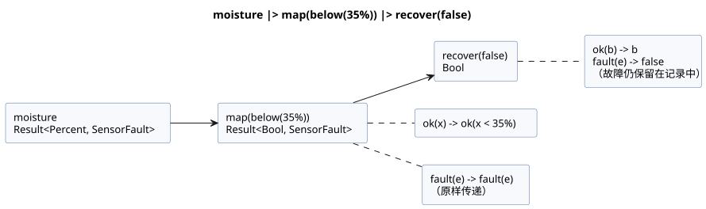
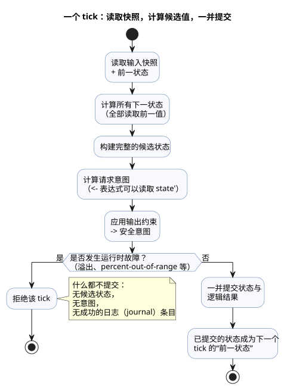
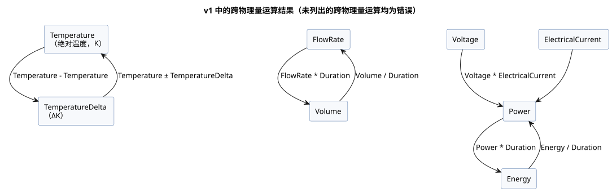

<!-- translation-source: docs/reference/02-types-expressions-state.en.md -->
[英文原文](02-types-expressions-state.en.md)

# 2. 类型、表达式与状态

[完整目录](../LANGUAGE-REFERENCE.zh.md) · [上一章：源代码与语法](01-source-and-syntax.zh.md) · [下一章：时间与调度计划](03-time-and-schedules.zh.md)

GhostFlow 的类型描述的是一个值对控制而言*意味着什么*，而不仅仅是它如何存储。真/假、近似测量值、百分比、持续时间、精确计数和阶段名称是不同种类的值，一种值绝不会被悄悄当作另一种值使用。因此，编译器能在程序运行之前发现错误的比较和单位混用。界面、记录和设备边界也可以依赖同一套含义。

**本章内容**

| 节 | 定义内容 |
|---|---|
| [2.1](#21-值的种类) | 值的种类及字面量的写法 |
| [2.2](#22-字面量与期望类型) | `30` 这样的字面量如何获得类型 |
| [2.3](#23-精确整数设计) | `Int` 算术、除法和显式转换 |
| [2.4](#24-枚举与穷尽分支) | 枚举（enum）与穷尽的 `case` |
| [2.5](#25-传感器结果与显式错误流) | `Result<T, E>`、内置故障和 Result 变换 |
| [2.6](#26-表达式与运算符) | 运算符优先级与短路求值 |
| [2.7](#27-纯函数与计算组合) | 纯函数与 `let` |
| [2.8](#28-tick-与状态快照) | tick、前一状态/下一状态和定时器 |
| [2.9](#29-物理量与单位) | 物理量、单位及其运算 |
| [2.10](#210-已确定的类型边界) | 已确定边界的汇总 |

本章中的 `ghost` 片段用于说明这些规则。

设计依据：[选定语法](../LANGUAGE-SURFACE.zh.md)、[通用语言契约](../LANGUAGE.zh.md)、[精确整数契约](../EXACT-INTEGER-CONTRACT.zh.md)、[GhostFlow 编程](../ProgrammingInGhostflow.zh.md)、[物理量设计 issue #93](https://github.com/callin2/ghostflow-language/issues/93)。[完整语言参考](../LANGUAGE-REFERENCE.zh.md)为本章及其他详细章节提供索引。

## 2.1 值的种类

| 类型 | 含义 | 代表性的字面量和值 |
|---|---|---|
| `Bool` | 真或假 | `true`、`false` |
| `Int` | 精确的有符号 32 位整数 | 计数、重复次数、整数差值 |
| `Number` | 有限的 binary64 近似数 | `3.0`、`0.5`、`-2.5` |
| `Percent` | 0 到 100 的百分比 | `30%` |
| `Duration` | 毫秒分辨率的非负持续时间 | `250ms`、`2s`、`5min`、`1h` |
| 具名枚举 | 已声明的有限个 case 之一 | `Idle`、`Watering` |
| `Result<T, E>` | 类型为 `T` 的正常载荷，或来自编译器所有的故障枚举 `E` 的故障 | `ok(value)`、`fault(reason)` |
| 具名物理量 | 保留其单位和农业含义的有限数 | `25°C`、`1.2kPa`、`70%RH` |

这些类型带来以下结果：

- **没有真值性（truthiness）。** `Bool` 绝不会从数字或字符串推导出来。
- **只有有限数。** NaN 和 Infinity 不是 `Number` 值。
- **不同种类之间没有隐式转换。** `30`、`30%` 和 `30ms` 是不同的写法，它们之间绝不会被隐式比较或相互转换。
- **没有通用字符串或数组。** 调度计划设置中的 `"Asia/Seoul"` 和 `06:00` 是受限语法，只在这些位置上有意义，不要把它们理解为通用的字符串运算。同样，调度计划中的 `[06:00, 18:45]` 也不是通用的数组值。通用的日期和时间使用第 3 章中显式的 `date`、`time` 和 `datetime` 标记字面量。
- **`Duration` 不是日历时间。** 定时器测量的是单调的经过时间。校正墙钟不会使它倒退。

`Percent` 的取值边界让它的含义清晰可见，并防止意外的数值连接。

**Percent 范围规则。** 每个结果类型为 `Percent` 的算术表达式都必须保持在闭区间 `0..100` 内。`99.5%` 这样的小数值是有效的。

- 超出范围的*常量*结果是编译错误。
- 超出范围的*动态*结果一经求值，就通过现有的算术错误路径以 `percent-out-of-range` 拒绝该 tick（逻辑决策步）。该 tick 不提交任何候选状态、输出或成功的日志（journal）条目。
- 该值不会被钳位（clamp），此规则也不定义物理输出策略。
- 如果之前已经发生非有限 Number 算术错误，该错误保留其原有错误代码。

此规则适用于每个中间表达式和函数体，而不仅仅是最终结果。对于动态的 `p = 90%`，`(p + 20%) - 20%` 会在加法处失败，即使最终的算术值是 `90%`。未被选中的分支不会被求值。`p / 0.5%` 这样的比值类型为 `Number`，所以其结果 `180` 是有效的。这些检查使声明的值域在整个计算过程中都保持有意义。

### 字面量写法

- `Bool` 只能是 `true` 或 `false`。
- 普通数字使用十进制整数、小数点或指数写法。前导 `-` 使数字为负。没有真值性，也没有从字符串到数字的隐式转换。
- `Percent` 是数字后紧跟 `%`。例如：`30%`。
- `Duration` 是非负整数与 `ms | s | min | h` 之一直接相连。例如：`500ms`、`2s`。半秒应写作 `500ms`，而不是 `0.5s`。
- 枚举 case 是该枚举声明中列出的标识符。

不要把 `Percent` 后缀与整数取余混淆。写在*两个操作数之间*的 `%` 是二元取余运算符（参见 [2.3](#23-精确整数设计)）；紧贴在数字后面的 `%` 是 `Percent` 字面量。

## 2.2 字面量与期望类型

`30` 这样的整数形式字面量既可能表示精确计数，也可能表示近似测量值。以下规则决定其含义：

- 带小数点或指数的数字是 `Number`。
- 在没有*期望数值类型*时，整数形式的十进制数是 `Int`。
- 期望类型可以来自带类型的声明、函数参数、同一运算中已确定类型的另一个操作数，或 `if` 两个分支的共同期望类型。
- 因此，与 `input temperature: Number;` 比较的 `30` 从一开始就被读作 `Number` 字面量。这**不是**从 `Int` 到 `Number` 的运行时转换。
- 未标注类型的 `let count = 30;` 的类型由其初始化表达式确定。后续的使用不会回溯改变初始化表达式的类型。
- 相互冲突的期望类型会产生诊断。编译器不会猜测重载。
- 整数字面量的范围依据原始十进制数字进行检查。`-2147483648` 作为边界情况被接受：编译器不会先拒绝正数 `2147483648` 再应用一元 `-`。任何更大的正数或负数绝对值都会产生诊断。
- 数字分隔符不属于整数字面量契约。2.3 中所示范围里的 `_` 字符仅用于提高可读性。

```ghost
control LiteralContexts {
  input temperature: Number;
  let count = 30;              // Int
  let warm = temperature >= 30; // 이 30은 Number 문맥
  output alarm: Bool;
  alarm <- warm;
}
```

（`warm` 那一行的注释意为：“这个 30 处于 `Number` 上下文中”。）

计数和重复次数在支持的范围内是精确的。丢失精度、回绕和饱和绝不会悄悄发生。

## 2.3 精确整数设计

`Int` 的最小语义模型是有符号 32 位整数。

```text
Int = -2_147_483_648 .. 2_147_483_647
```

一个有符号类型同时涵盖计数、差值和偏移量。非负要求通过 `config` 或 `state` 上的值域边界来表达，而不是增加另一种基本类型。日期时间、单调时钟和标识符宽度各有其独立的契约，与这里的 `Int` 分开。

### 运算语义

| 表达式 | 结果与约束 |
|---|---|
| `a + b`、`a - b`、`a * b` | 精确的 `Int`；超出范围即为故障 |
| `-a` | 精确的 `Int`；对最小值取负即为故障 |
| `a div b` | 向零截断的商 |
| `a % b` | 符号与被除数相同的余数 |
| `a / b`（两个 `Int` 值） | 错误；使用 `div` 或显式转换为 `Number` |
| `== != < <= > >=` | 允许在两个 `Int` 值之间使用 |
| 混用 `Int` 和 `Number` | 在一方被显式转换之前均为错误 |

每个有效的除法都满足 `a == (a div b) * b + (a % b)`。除以零是除法故障，`MIN div -1` 是溢出。

### 显式转换

| 写法 | 含义 |
|---|---|
| `number(i)` | 将任意 i32 转换为精确的 `Number` |
| `int_exact(n)` | 只接受范围内的整数值 `Number` |
| `int_floor(n)` | 数学向下取整，然后检查范围 |
| `int_ceil(n)` | 数学向上取整，然后检查范围 |
| `int_trunc(n)` | 向零截断，然后检查范围 |
| `int_nearest_even(n)` | 四舍五入到最近值，恰好居中时取偶数，然后检查范围 |

不存在带有隐藏默认舍入方式的通用转换；你总是要指明所需的舍入方式。

当转换或整数运算失败时，结果取决于该值是否在编译时已知：

| 情形 | 结果 |
|---|---|
| 常量溢出或无效的常量转换 | 编译诊断 |
| 依赖输入的溢出、除以零、`int_exact` 遇到小数，或超出范围的转换 | 拒绝当前 tick。新的状态和意图不会被部分提交。 |

运行时故障使用以下稳定的原因：`integer-overflow`、`integer-division-by-zero`、`integer-conversion-fractional` 和 `integer-conversion-out-of-range`。

`int_exact` 对有限输入*先*检查小数部分，*再*检查范围。因此，像 `2147483648.5` 这样既有小数部分又超出范围的值会产生 `integer-conversion-fractional`。超出范围的整数值输入会产生 `integer-conversion-out-of-range`。常量诊断与运行时故障采用相同的顺序。它首先回答第一个问题：这个输入究竟能否成为精确整数？

`Int`、`div`、`%` 以及上述转换名称是规范写法。不存在隐藏舍入策略的通用 `int(n)`。`div` 和二元 `%` 与 `*`、`/` 优先级相同，并且是左结合的。`30%`（`%` 直接紧贴数字、中间没有空白）是 `Percent` 字面量；位于两个表达式之间的 `%` 是 `Int` 取余。

### Number 运算

`Number` 支持 `+`、`-`、`*`、`/`、一元 `-` 和比较，全部在相同类型的操作数之间进行。每个结果都必须是有限的。如果发生除以零或产生非有限结果，该 tick 不提交状态或意图。不能通过混用 `Int` 和 `Number` 来绕过此规则。

## 2.4 枚举与穷尽分支

枚举为顺序阶段赋予名称，而不是把它们隐藏在数字背后。

```ghost
type Phase = Idle | Opening | Watering | Closing;
state phase: Phase = Idle;

phase' = case phase {
  Idle     => if start then Opening else Idle;
  Opening  => Opening;
  Watering => Watering;
  Closing  => Idle;
};
```

对枚举使用 `case` 的规则：

- 每个 case 都必须被处理。缺少 case 是错误。因此，新增枚举 case 会迫使你检查所有受影响的分支。
- 每个分支都必须按上下文要求产生相同类型的值。
- `phase in {Opening, Watering}` 测试是否属于同一枚举类型的有限 case 集合。在此位置上，`{...}` 是集合写法，它不会创建通用的集合值。

旧的参考资料中出现过 `enum Phase { ... }` 和 `enum Phase = ...;` 写法。它们是历史写法，作为可执行输入会被拒绝。

## 2.5 传感器结果与显式错误流

`input moisture: Percent;` 中声明的类型是*正常载荷*的类型。读取外部输入得到的是正常值或故障，因此不能把它当作载荷直接比较，而要用 `case` 解包。

存在一个例外：由运行时拥有的、确切保留的重启端口按其声明的标量类型读取，详见第 5 章。这个例外并不允许通用的枚举采集输入。

```ghost
let dry = case moisture {
  ok(value) => value < 30%;
  fault(_)  => false;
};
```

`_` 是一个模式，表示“此表达式不使用故障的细节”。这里选择 `false` 并不会把故障变成正常值：原始故障仍保留在记录中。`SensorFault` 是内置枚举，其成员为 `Disconnected | Stale | Invalid | NotReady`。你可以用另一个 `case` 对故障绑定进行穷尽分支：

```ghost
let available = case moisture {
  ok(_) => true;
  fault(reason) => case reason {
    Disconnected => false;
    Stale => false;
    Invalid => false;
    NotReady => false;
  };
};
```

**`Result<T, E>` 能做什么、不能做什么**

- `Result<T, E>` 可以用作函数的参数类型和结果类型。
- `E` 必须是编译器定义的有限故障枚举。v1 中有 `SensorFault`、`ClockFault`、`CalendarFault`、`TemporalContextFault`、`AccountingFault` 和 `SettingsFault`。
- `ok(expr)` 和 `fault(reason)` 是这个内置 Result 的构造器。
- 不存在供用户声明新 ADT、新 Result 错误类型或新构造器的通用语法。
- Result 绝不会作为标量 `state`、`config`、`input` 或 `output` 值存储，也绝不会暴露给设施绑定。

**设置是 Result 流。** `config x: T = initial` 并不是为 Result 声明标量存储，而是声明一个载荷为 `T` 的*设置流*。当表达式读取 `x` 时，其类型为 `Result<T, SettingsFault>`，该流的初始发出值为 `ok(initial)`。不要用源代码中的默认值或上一次成功的值来替换当前的错误通道。请遵循 [§5.2](05-settings-and-observation.zh.md) 中的流规则。

内置故障枚举的成员固定如下。时间、日历和自然事件相关的名称与[第 3 章中的 Unknown 原因](03-time-and-schedules.zh.md)一致。

| 错误类型 | 成员 |
|---|---|
| `SensorFault` | `Disconnected`、`Stale`、`Invalid`、`NotReady` |
| `ClockFault` | `ClockUnknown`、`ZoneUnsupported` |
| `CalendarFault` | `ClockUnknown`、`CalendarMissing`、`CalendarOutOfRange`、`ZoneUnsupported` |
| `TemporalContextFault` | `ClockUnknown`、`LocationUnknown`、`EventUnavailable`、`PredictionMissing`、`PredictionStale`、`ZoneUnsupported` |
| `AccountingFault` | `ClockUnknown`、`LedgerMissing`、`LedgerCorrupt`、`LedgerIncomplete`、`CountOverflow` |
| `SettingsFault` | `SettingsInvalid`、`SettingsUnavailable` |

有些成员名称（例如 `ClockUnknown`）属于多个故障枚举。编译器根据上下文解析它们：

- 在 `fault(reason)` 中，成员通过*期望的* Result 错误类型来解析。
- 在 `case reason` 中，成员通过*被检查值*的错误类型来解析。
- 无法根据上下文解析为唯一类型的成员引用是错误。

用户声明不能遮蔽这些成员，也不能添加新成员。错误的提供者（provider）种类或绑定属于激活错误；绝不会通过虚构这些枚举的新成员来报告。

**原因：** 需要不同应对措施的原因（例如缺少时钟和缺少预测）不得合并为一个笼统的失败值。同时，将每个 Result 限制在有限的可能性集合内，使编译器能够检查分支是否穷尽。

**可选能力不是故障。** `sensor moisture?: Percent;` 中的 `?` 表示该设施能力是可选的。未安装的传感器不同于已安装传感器中的故障。`?` 本身既不创建回退（fallback）策略，也不创建任意的默认值。

有状态的传感器处理同样显式声明其含义：

```ghost
sensor moisture: Percent {
  sample = 1s;
  valid = 0% .. 100%;
  filter = median(3);
  stale_after = 3s;
  recover_after = 1 samples;
}
signal dry = hysteresis(moisture,
  on_below: 30%, off_above: 35%, initial: false);
```

- `median(n)` 中的 `n` 是 `1..31` 范围内的奇数。
- 当值位于两个边界之间时，`hysteresis` 保持其上一次的判定。
- `sample` 描述测量间隔，它不是启动独立线程的命令。
- 滤波和迟滞的记忆是显式的控制状态，会被包含在检查点和重放中。

### 静态 Result 变换与组合

Result 值可以流经以下编译器已知的静态变换。

| 写法 | 值的含义 |
|---|---|
| `ok(value)` / `fault(reason)` | 对应 Result 的正常载荷构造器或内置故障构造器 |
| `below(limit)` | 接受兼容的有序载荷并返回 `value < limit` 的静态变换 |
| `map(f)` | 将 `ok(x)` 映射为 `ok(f(x))`、并原样传递 `fault(e)` 的一元函数 |
| `and_then(f)` | 将 `ok(x)` 交给返回 Result 的 `f(x)`，并原样传递 `fault(e)` |
| `recover(default)` | 将 `ok(x)` 变为 `x`，将 `fault(e)` 变为相同类型的默认值 |
| `x \|> f` | 将值传给函数：`f(x)` |
| `f >> g` | 从左到右的组合：`(x) -> g(f(x))` |

```text
is_dry = map(below(35%)) >> recover(false)
dry = moisture |> map(below(35%)) |> recover(false)
```

下图追踪第二行：故障路径原封不动地经过 `map`，直到 `recover` 处才被替换为一个值。



这些变换的限制：

- `map` 或 `and_then` 的参数必须是静态解析的具名 `fn`，或 `below(limit)` 这样编译器已知的有界变换。
- 它们不会创建函数值、lambda、闭包或运行时函数选择。`>>` 也只组合这些静态变换链。
- `|>` 和 `>>` 是左结合的，并且比 `if/then/else` 结合得更紧。
- 它们是纯粹的值变换，既不创建状态，也不创建流调度器。
- `recover` 不会抹去原始的传感器故障，也不会抹去选择了哪个回退的记录。
- 大写的 `Ok`/`Err`，以及 `not`、`and`、`or`、`is`、`isnt`，都不是规范别名。

## 2.6 表达式与运算符

在选定的控制语法中，运算符按以下顺序结合，从强到弱。

| 等级 | 运算 |
|---:|---|
| 1 | 括号、函数调用、成员引用和下一状态引用 |
| 2 | 一元 `!`、一元 `-` |
| 3 | `*`、`/`、`div`、二元 `%` |
| 4 | `+`、`-` |
| 5 | `in { ... }` |
| 6 | `==`、`!=`、`<`、`<=`、`>`、`>=` |
| 7 | `&&` |
| 8 | `\|\|` |
| 9 | 静态变换组合 `>>` |
| 10 | 静态值管道 `\|>` |

- 同一等级的二元运算符是左结合的：`6 - 2 - 1` 表示 `(6 - 2) - 1`。
- 不允许链式比较。应写作 `a < b && b < c`，而不是 `a < b < c`。
- 相等比较和大小比较只允许在相同类型的兼容值之间进行。
- 使用括号和具名的 `let` 绑定，使复杂判定的意图清晰可见。

`|>` 和 `>>` 仅用于静态解析的 Result 变换链。早期 A/B/C 设计资料中的 `not`、`and`、`or`、`is` 和 `isnt` 不是这些控制运算符的别名。

### 条件表达式

`if condition then a else b` 是产生值的表达式。条件必须是 `Bool`，两个分支必须具有相同类型。与 `case` 一样，未被选中的分支仍会进行静态类型检查。

```ghost
let denominator = if b == 0 then 1.0 else b;
let result = if b == 0 then 0.0 else a / denominator;
```

`if`、`&&` 和 `||` 从左到右进行确定性的短路求值：

| 表达式 | 运行时求值的内容 |
|---|---|
| `if c then a else b` | `c`，然后只求值被选中的分支 |
| `x && y` | 仅当 `x` 为真时求值 `y` |
| `x \|\| y` | 仅当 `x` 为假时求值 `y` |

静态检查不会短路。每个分支和操作数仍要经过名称和类型检查，因此即使在不可达的分支中，编译时错误也会被报告。但是，运行时故障不可能发生在未被选中的分支中。常量折叠和函数内联会保持这种故障可达性和求值顺序。

## 2.7 纯函数与计算组合

```ghost
fn hold(start: Bool, stop: Bool, previous: Bool) -> Bool {
  !stop && (start || previous)
}
```

函数声明其参数类型和结果类型，并返回最后一个表达式的值。没有 `return` 语句。

函数是*纯*的：相同的参数总是产生相同的值。

- 函数不会隐式捕获控制的输入、状态或设置。它需要的每个值都要作为参数传入。
- 函数没有可变的局部状态，没有等待，也没有 I/O 副作用。
- 调用必须静态解析。禁止递归和循环调用。
- 只要依赖图保持不变，拆分或重新排列函数和 `let` 绑定都不会改变结果。
- 函数名不是普通的值。它们不能被存储、返回、动态选择，也不能作为通用函数参数传递。
- Result 的 `map(fnName)`、`and_then(fnName)` 和 `>>` 是仅有的几个受限位置，编译器在这些位置对函数名进行静态特化。不存在通用的高阶函数或闭包。

带类型的表达式宏是编译时特性，有别于运行时函数。参见[第 6 章](06-composition-and-replay.zh.md)。

`let name = expression;` 只是为表达式命名，它不会在 tick 之间创建任何记忆。`let` 绑定按无环图计算，与声明顺序无关。需要记忆时，请使用 `state`。

## 2.8 tick 与状态快照

*tick* 是一个逻辑单位：在其中根据一个输入快照计算出一个判定并提交。

```text
输入快照 + 前一状态
  → 计算所有下一状态
  → 构建完整的候选状态
  → 计算请求意图（requested）
  → 计算应用约束后的安全意图（safe）
  → 一并提交成功的结果
```

下图展示同一个周期，包括发生运行时故障时的情形。



```ghost
control SnapshotPair {
  input swap: Bool;
  state left: Bool = true;
  state right: Bool = false;
  output lamp: Bool;

  left'  = if swap then right else left;
  right' = if swap then left else right;
  lamp <- left';
}
```

**前一状态与下一状态。** 在 tick 内部，`left` 和 `right` 是*前一个* tick 的值，`left'` 和 `right'` 是*下一个*（候选）值。

- 每个下一状态表达式都读取相同的前一状态和输入。因此，调整源代码顺序不会改变结果；无论顺序如何，这个示例都能正确交换这一对值。
- 状态转移不得读取另一个下一状态。`right' = left';` 是错误。
- 下一状态引用只允许出现在输出表达式中。`let` 也不能引用下一状态。

**输出。** 输出连接可以读取当前 tick 的候选状态（例如 `left'`），但不带撇号的状态名仍表示前一个值。用 `<-` 写入的值是*请求意图*。输出约束将其收窄为*安全意图*，然后状态和逻辑结果一并提交。无论是输出声明中省略的初始值，还是 `<-`，都不会为设备启动或故障定义物理上的安全值。

**提交规则。**

- 没有下一状态定义的状态保持其前一个值。
- 一个状态不能有多个下一状态定义。
- 如果 tick 期间的计算失败（例如由于数值故障），候选状态和意图不会被部分提交。
- 这种逻辑原子性并不保证多个物理输出在同一瞬间改变。

**初始值。** `state name: Type = value;` 中的初始值必须是声明类型的常量。它绝不会通过读取输入或其他状态来计算。这个显式的起始值为第一个 tick 提供了可复现的前一状态。

**设计依据与由来：** 在 [#149](https://github.com/callin2/ghostflow-language/issues/149) 中，
用户将 React/ObservableHQ 的影响描述为：在事件流中对控制进行求值，
并显式返回下一状态。用户的教学前提是：
电工可能难以追踪递归或循环形式的控制。
分别写出前一状态和候选的下一状态，可以使时间边界
清晰可见：`left' = right; right' = left;` 读取的是前一对值，描述的是下一对
值。这个前提用于指导可读性，并不是对所有电工的断言。
可执行的写法是 ASCII 撇号（`'`）。用户在对话中使用的
反引号写法，以及后来助手对一般循环规则、
时间旅行和因果解释的讨论，都不构成额外的语法或特性。
执行由上述快照、转移和输出规则定义。

### 定时器也是状态

`timer age = elapsed(phase);` 是自 `phase` 上一次*已提交*的变化以来经过的单调时间。

- 当变化提交时它重置为 0，之后的 tick 读取新值。它的初始值也是 0。
- 对于 `Bool` 目标，任一方向的变化（变为 true 或变为 false）都会开始一个新的区间。
- 定时器既不是 `sleep`，也不是独立的执行线程。它绝不会阻塞其他输入的处理。

阶段转移只发生一次，即在第一个满足条件的 tick 上。一个较长的 tick 不会连续经过多个状态阶段。实际延迟至少等于请求的持续时间，在正常运行期间最多可能延迟一个 tick 分辨率。

## 2.9 物理量与单位

普通的 `Number` 无法区分 `25°C`、`800ppm`、`1.2kPa`、`5L/min` 和 `70%RH` 的物理含义。因此，GhostFlow 提供具名的物理量类型。以下名称和后缀构成经批准的固定目录。

- 后缀区分大小写。
- 后缀直接紧贴在数字记号之后，中间没有空格。
- 词法分析器优先识别最长的匹配后缀。

| 类型 | 允许的后缀 | 规范单位 |
|---|---|---|
| `Temperature` | `°C`、`K`、`°F` | `K` |
| `TemperatureDelta` | `Δ°C`、`ΔK`、`Δ°F` | `ΔK` |
| `RelativeHumidity` | `%RH` | 比值 `0..1` |
| `Pressure` | `Pa`、`kPa`、`bar` | `Pa` |
| `VaporPressureDeficit` | `PaVPD`、`kPaVPD` | `PaVPD` |
| `CO2Concentration` | `ppm` | 摩尔比 |
| `FlowRate` | `m3/s`、`L/min`、`mL/min` | `m3/s` |
| `Volume` | `m3`、`L`、`mL` | `m3` |
| `Length` | `m`、`cm`、`mm` | `m` |
| `Irradiance` | `W/m2` | `W/m2` |
| `PPFD` | `mol/m2/s`、`umol/m2/s` | `mol/m2/s` |
| `Energy` | `J`、`kJ`、`Wh`、`kWh` | `J` |
| `Power` | `W`、`kW` | `W` |
| `ElectricalCurrent` | `A`、`mA` | `A` |
| `Voltage` | `V`、`mV` | `V` |
| `Conductivity` | `S/m`、`mS/cm`、`uS/cm` | `S/m` |
| `Acidity` | `pH` | `pH` |

**变化率：`Rate<Q>`。** `Rate<Q>` 是由 `window_rate`（第 4 章）产生的仅限表达式使用的类型，表示“每秒 Q 的变化量”。

- `Rate<Temperature>` 的分子是 `ΔK`，与 `TemperatureDelta` 相同。对于其他每个允许的线性 Q，分子是同一名义量的规范差值。
- 可以通过声明 `window_rate` 的 `signal` 的名称来引用结果。
- `Rate<Q>` 不能写成直接字面量，也不能作为通用值绑定、函数参数或结果、`state`、`config`、`input` 或 `output` 的类型。
- 阈值用 `rate(delta: difference, time: Duration)` 创建。只有相同 Q 的变化率才能比较。
- 构造器的 Q 由比较的另一个操作数或显式期望的 `Rate<Q>` 确定。如果单凭 `TemperatureDelta` 无法唯一确定 Q，编译器会拒绝它，而不是猜测。
- 在 v1 中，`window_rate` 的 Q 是 `Temperature`、`TemperatureDelta`、`Pressure`、`VaporPressureDeficit`、`FlowRate`、`Volume`、`Length`、`Irradiance`、`PPFD`、`Energy`、`Power`、`ElectricalCurrent`、`Voltage` 或 `Conductivity` 之一。它不适用于 `Int`、`Number`、`Percent`、`RelativeHumidity`、`CO2Concentration` 或 `Acidity`。

```ghost
signal warming = window_rate(temperature, over: 10min,
  quality: measured, max_age: 2min);
output warming_slowly: Bool;
warming_slowly <- warming |> map(below(rate(delta: 1ΔK, time: 1s))) |> recover(false);
```

在这个片段中，`temperature` 是 `Temperature` 传感器。比较的期望类型是 `Rate<Temperature>`，因此阈值为 1 ΔK/s。`time` 必须是正的 `Duration`：常量 0 会被静态拒绝，运行时值为 0 则会以算术错误使该 tick 失败。

**原因：** 温度变化率和温差变化率都使用 ΔK/s，但它们描述的是不同的控制对象。根据期望类型解析对象，并且不允许将变化率作为通用值存储，可以防止仅仅因为单位相同就混用不同的变化率。为零长度区间指定任意变化率，会产生没有任何实际测量支持的控制判定。

**看起来相似的量仍然是不同的。** `Percent` 是 `0..100` 的值（包括执行器位置），不是 `RelativeHumidity`。`Temperature` 是绝对温度，而 `TemperatureDelta` 是温差。因此，温度设置的 `step` 使用 `0.5Δ°C` 这样的差值：

```ghost
control ClimateTarget {
  input inside_temperature: Temperature;
  config target_temperature: Temperature = 25°C {
    min = 18°C;
    max = 32°C;
    step = 0.5Δ°C;
    access = operator;
  }
  output heat: Bool;
  heat <- case target_temperature {
    ok(target) => inside_temperature < target;
    fault(reason) => false;
  };
}
```

**转换与显示。**

- 十进制字面量先作为精确的十进制有理数转换到规范单位，然后在规范值处一次性舍入为 binary64（恰好居中时取偶数）。
- 同一物理量的不同单位在转换后作为相同的语义值进行比较。
- 构件（artifact）元数据保留名义量的身份标识和规范单位。
- 显示单位和区域格式是 UI 元数据，它们不改变控制含义。
- `Temperature` 运行设置必须将作者选择的 `°C` 或 `K` 作为单独的 `displayUnit` 元数据保留。内部值和比较仍使用规范的 `K`。缺失或有歧义的 `displayUnit` 元数据是错误：绝不能根据值的大小或规范单位推断显示单位，也绝不能默认使用 `°C`。

**允许的运算。** 运算集合是封闭的；此处未列出的任何运算都是错误。

- 比较同一名义量的值。
- 线性物理量支持同类型的 `+`、`-` 和一元 `-`，以及与 `Number` 的乘法或除法。两个同类型值相除得到 `Number`。
- `Temperature - Temperature` 得到 `TemperatureDelta`；`Temperature + TemperatureDelta` 和 `Temperature - TemperatureDelta` 得到 `Temperature`。两个绝对温度不能相加。
- `RelativeHumidity` 支持同类型比较和显式的 `RelativeHumidity / RelativeHumidity -> Number`。例如，`60%RH / 100%RH` 为 `0.6`。所有其他算术和隐式数值转换仍被禁止。除数为零时遵循普通规则（常量诊断或动态拒绝 tick）；归一化不会抹去传感器质量。
- `CO2Concentration` 和 `Acidity` 只支持同类型比较。
- `FlowRate * Duration` 得到 `Volume`；`Volume / Duration` 得到 `FlowRate`；`Power * Duration` 得到 `Energy`；`Energy / Duration` 得到 `Power`；`Voltage * ElectricalCurrent` 得到 `Power`。乘法接受任一操作数顺序。
- `VaporPressureDeficit` 是有别于 `Pressure` 的名义类型，即使其规范刻度与压力相同。未规定的跨物理量运算和数值类型转换都是错误。

下图汇总了上述列表中的跨物理量运算结果。



**PID 增益。** PID 增益不使用不受限制的量纲代数，而是使用第 4 章中的有界构造器：`proportional_gain(output: 2%, error: 1Δ°C)`、`integral_gain(output: 0.1%, error: 1Δ°C, time: 1s)` 和 `derivative_gain(output: 1%, time: 1s, error: 1Δ°C)`。

**绑定。** 绑定必须指定物理量和单位。通过 OCR 读取的无单位数字不是权威的物理量，在没有经用户确认的绑定之前不会被提升为物理量。

**温度上的滤波。** 当 `moving_average` 和 `ema` 处理绝对 `Temperature` 时，它们在规范 K 下计算仿射加权平均。这是滤波器封闭语义的一部分；它并不会使源代码中的 `Temperature + Temperature` 变得合法。

## 2.10 已确定的类型边界

- `Int` 是有符号 32 位整数，使用 `div`、`%` 和具名转换。
- `if`、`&&` 和 `||` 从左到右短路求值。
- 已移除的函数、枚举、next 和限定值别名会被拒绝，并给出迁移诊断。
- 只提供基于编译器所有故障枚举的内置 `Result<T, E>` 以及静态变换。不存在通用 ADT、用户定义的 Result 错误类型、函数值或通用高阶函数。
- 物理量只使用 2.9 中的固定目录和封闭运算。
- 通用的日期和时间使用第 3 章的标记字面量：``date`YYYY-MM-DD` ``、``time`HH:MM[:SS[.f|.ff|.fff]]` `` 和 ``datetime`YYYY-MM-DDTHH:MM:SS[.f|.ff|.fff](Z|±HH:MM)` ``。`DateTime` 必须带有偏移量。时间偏移量只使用 `Duration`。

超出这些边界的写法、隐式转换、单位猜测、用户构造器和运行时函数选择都会产生诊断。它们绝不会被推断为单独的语言特性。
