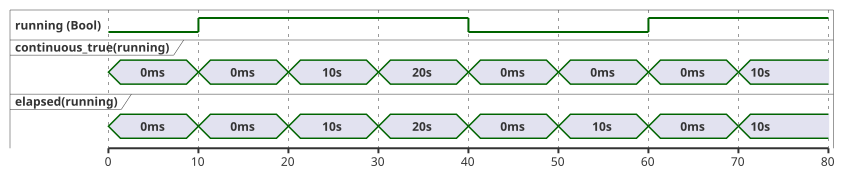
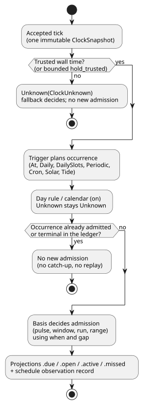
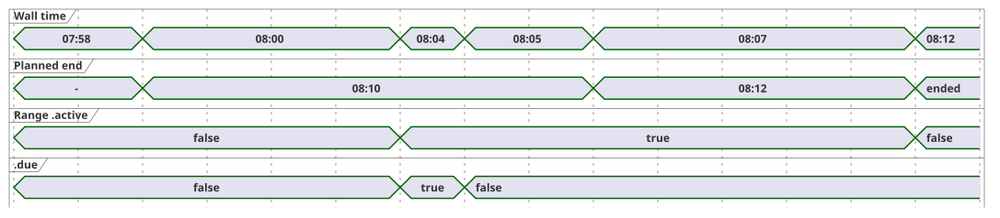

# 3. Time and schedules

[Full contents](../LANGUAGE-REFERENCE.en.md) · [Previous: 2. Types, expressions and state](02-types-expressions-state.en.md) ·
[Next: 4. Sensors, constraints and control](04-sensors-constraints-control.en.md)

GhostFlow does not treat time as a single number. It separates two kinds of time:

- **Elapsed time.** The "five minutes" in "turn on for five minutes" is measured on a *monotonic* clock, which only moves forward.
- **Calendar time.** The "6 a.m." in "start at 6 a.m." is a calendar time interpreted in a timezone.

Two rules follow from this split. Correcting the wall clock must not rewind or extend an operation that is already running. A reboot must not silently move the reference point of a schedule. This chapter builds on that distinction to define time values, timers, recurring schedules, work calendars and natural events (sunrise, tides).

**How to read this chapter.**

- `ghost` code blocks and grammar blocks are the selected public language contract.
- Where the current compiler validates or executes a narrower subset, the section says so explicitly.
- Blocks marked `text` (for example ClockSnapshot, manifests and provider records) are contracts with the execution environment. They are not GhostFlow source.
- Clock, calendar and prediction data may come from a local device or from an optional gateway. Neither a network nor any particular gateway is a language requirement.

**In this chapter**

| Section | Topic |
|---|---|
| §3.1 | Time value types (`Duration`, `Date`, `TimeOfDay`, `DateTime`) and the two clocks |
| §3.2–§3.4 | Timers: `elapsed`, `continuous_true`, cumulative and rolling usage |
| §3.5 | Common Schedule semantics: policies, bases, projections, misses, identity, gaps |
| §3.6–§3.7 | `DailySlots`, `Periodic` and `cron5` |
| §3.8 | DST, midnight and work calendars |
| §3.9 | Solar, moon and tide schedules |
| §3.10 | Time-based usage limits (daily and rolling budgets, event counts) |
| §3.11 | Summary of established syntax and boundaries |

This chapter is based on the [time and schedule contract](../TIME-AND-SCHEDULE-CONTRACT.md),
[continuous Bool timer contract](../CONTINUOUS-BOOL-TIMER-CONTRACT.md),
[Solar schedule contract](../SOLAR-SCHEDULE.md), [selected syntax](../LANGUAGE-SURFACE.md),
[Programming in GhostFlow chapters 6–7](../ProgrammingInGhostflow.md),
[2026-09-24 fixed planned time range decision](../2026-09-24-fixed-planned-time-range-decision.md),
[#23](https://github.com/callin2/ghostflow-language/issues/23),
[#46](https://github.com/callin2/ghostflow-language/issues/46),
[#90](https://github.com/callin2/ghostflow-language/issues/90) and
[#96](https://github.com/callin2/ghostflow-language/issues/96).

## 3.1 Time values and clock domains

### Duration

`Duration` is a length of time, not a calendar date. A selected literal is a nonnegative integer followed by one of the units `ms`, `s`, `min` or `h`.

```ghost
config open_delay: Duration = 2s;
config watering_time: Duration = 5min;
```

**Value domain.** A Duration is an exact integer number of milliseconds in `0..2^53-1`. All arithmetic is checked against this range.

The following are forbidden, both as final results and as any intermediate result of dynamic arithmetic:

- negative Durations;
- fractional milliseconds;
- NaN and Infinity;
- values outside the range.

A violation rejects the current tick with `duration-out-of-range`. No new state or intent is partially committed.

An operation that needs a "positive delay" may reject `0ms` for that argument. That restriction belongs to the operation; zero remains a valid `Duration` value.

**Arithmetic.**

- `Duration + Duration` returns a checked sum.
- `Duration - Duration` returns a `Duration` only when the result is nonnegative.

Months, years and calendar dates are not Duration units, because their length is not a fixed number of milliseconds. "One month later" needs separate calendar-operation semantics.

### Date, TimeOfDay, DateTime

Time-type literals use a tagged form: a tag (`date`, `time`, `datetime`) followed by a backquoted string.

| Type | Value domain | Rule |
|---|---|---|
| `Date` | Gregorian `1970-01-01..9999-12-31` | Contains no time or timezone. |
| `TimeOfDay` | `00:00:00.000..23:59:59.999` | Has no date, UTC offset or recurrence rule. |
| `DateTime` | Exact UTC instant from the Unix epoch through `9999-12-31T23:59:59.999Z` | A literal requires `Z` or a numeric UTC offset. The value does not retain an IANA zone. |

```ghost
date`2026-09-22`
time`06:30`
datetime`2026-09-22T06:30:00+09:00`
```

The exact spellings are:

```text
Date       := date`YYYY-MM-DD`
TimeOfDay  := time`HH:MM[:SS[.f|.ff|.fff]]`
DateTime   := datetime`YYYY-MM-DDTHH:MM:SS[.f|.ff|.fff](Z|+HH:MM|-HH:MM)`
```

**Lexical rules.**

- Every field is zero-padded ASCII decimal digits.
- Fractional seconds have one to three digits. They are padded on the right with zeroes to give exact milliseconds. Four or more digits produce a diagnostic; they are never rounded.
- Numeric offsets range over `00:00..14:00`. At hour 14, only `14:00` is allowed.
- `+00:00` normalizes to the same instant as `Z`. `-00:00` (which conventionally means "UTC offset unknown") is rejected.

**Diagnostics.** Nonexistent dates, `24:00`, leap-second `:60` and a DateTime without an offset all produce diagnostics.

**What a DateTime value is.** A DateTime value is an exact UTC millisecond instant. The original spelling and offset are kept only in source metadata. An IANA timezone is context for interpreting *recurring* schedules in civil time; it is not part of a DateTime instant that has already been resolved.

There are no implicit conversions between strings and time types, or among `Date`, `TimeOfDay` and `DateTime`.

The minimum time arithmetic is:

- `DateTime ± Duration -> DateTime`: a range-checked shift of the instant.
- Comparison of two values of the same type (DateTime with DateTime, TimeOfDay with TimeOfDay).
- `TimeOfDay + Duration` does **not** wrap at midnight automatically. Interpret it inside a Schedule context that supplies a Date and a timezone.
- `DateTime - DateTime` is not a basic `Duration` operation, because the result may need to be negative. Compare the instants, or use monotonic `elapsed`.

### Calendar clock and monotonic clock

Each tick uses one immutable *clock snapshot*. The snapshot carries two clocks with different jobs:

| Clock | Used for |
|---|---|
| Calendar (wall) clock | Interpreting schedules, dates, timezones and natural events. |
| Monotonic clock | Measuring how long an operation has run and how long a condition has held. |

```text
// Structure illustrating the contract
ClockSnapshot {
  monotonicMs
  bootEpoch
  wallMs?
  wallQuality: Trusted | Unknown(reason)
  uncertaintyMs?
  sourceRevision?
}
```

Rules for the snapshot:

- `monotonicMs` never decreases within one run. A snapshot whose monotonic time decreases, or that fails the integer/range requirements, is rejected before any state changes.
- `wallMs` may be present but still unusable: schedule decisions use it only when `wallQuality` is `Trusted`.
- Running timers stay on the monotonic clock, even when the wall clock is corrected forward or backward.

The host decides which time source to trust (NTP, RTC, platform time). Control expressions never read the network or the machine clock directly. A policy that temporarily holds the last trusted time must state how long the hold lasts and what terminal fallback applies. There is no hidden grace period.

**Why:** If wall time and elapsed time share the single word "time", then clock correction, timezone changes, DST and reboots can also change how long an operation runs.

## 3.2 Elapsed time after a state change

`elapsed(state)` returns the monotonic time since the referenced state last **committed a change**.

```ghost
type Phase = Idle | Watering;
state phase: Phase = Idle;
timer age = elapsed(phase);

phase' = case phase {
  Idle => if start then Watering else Idle;
  Watering => if stop || age >= watering_time then Idle else Watering;
};
```

The exact rules are:

- Expression evaluation on the first accepted tick reads `0ms`.
- Under the snapshot rule in §2.8, transitions and outputs read the interval from
  the beginning of the tick. If the state changes in this tick, its evaluated
  `elapsed` output still uses the previous interval.
- Committing the change starts a new interval at the current monotonic time.
  The post-commit timer observation in the same result is `0ms`. Source traces
  display this post-commit value; already evaluated outputs are not recalculated.
- The next accepted tick reads the new interval. The same timestamp gives `0ms`;
  an unchanged state keeps its interval start.
- For a Bool state, both false→true and true→false are changes. So `elapsed(running)` means "how long the current value has been held", **not** total ON time.
- Stages do not cascade within one tick. A transition happens on the first tick that satisfies its condition. The actual delay is therefore at least the requested Duration, and usually longer by up to one tick interval.
- A rejected tick does not change timer state.

A timer is not `sleep` and not a background task. While a timer is running, every tick still evaluates stop requests, sensor faults and global constraints.

## 3.3 Time for which a Bool is continuously true

"Temperature stayed above the threshold for five minutes" is a different question from "when did this state last change". A *continuous-true timer* measures only the current unbroken stretch in which a condition is true. It returns `0ms` immediately on any tick where the condition is false.

```ghost
timer hot_for = continuous_true(temperature_high);
```

Let `c` be the condition, `wasTrue` its value on the previous accepted tick, `since` the start of the current stretch, and `now` the current monotonic time. Then:

```text
value    = if c && wasTrue then now - since else 0ms
wasTrue' = c
since'   = if !c then now
           else if !wasTrue then now
           else since
```

Consequences:

- The first true tick returns zero. Repeated ticks with the same timestamp also return zero. A nonzero value appears from the next timestamp onward.
- A false tick returns zero at once, and the next true tick starts a new stretch.
- Each timer has its own internal state; timers never share it.

The timeline below compares `continuous_true` and `elapsed` for a Bool state sampled every 10 seconds. They differ while the value is false: `elapsed` measures how long *false* has been held, but `continuous_true` stays at zero.



`continuous_true` takes exactly one Bool expression. It does not implicitly convert `Result<Bool, SensorFault>` to Bool. To treat a fault conservatively as false, write that choice explicitly with `case`:

```ghost
let safe_high = case high_temperature {
  ok(value) => value;
  fault(_)  => false;
};
```

Continuous-true is neither a pause/resume accumulator nor a sum of separate ON segments. Those are different time operations (see §3.4).

## 3.4 Cumulative time and rolling budget

Different questions about "how long" need different time semantics:

| Question | Required time semantics |
|---|---|
| How long has the current stage been held? | `elapsed(state)` |
| How long has the condition been true without interruption? | continuous-true |
| How many total ON minutes were used in this job? | Cumulative ON time scoped to the job |
| How many total ON seconds occurred in the last 60 seconds? | Sliding-window ON integration |
| How many total minutes was the physical pump on today? | Equipment accounting by calendar date |

Rolling accounting has two steps. First declare a *ledger* (an `account`) tied to a stable physical resource and an accounting stage. Then query that ledger over a time basis.

```ghost
resource pump1: BoolActuator;
account pump_applied = on_time(pump1,
  stage: applied,
  persistence: durable);
constraints PumpBudget {
  limit used(pump_applied, rolling(60s)) <= 30s {
    reserve = 1s;
    on_unknown = block;
  }
}
```

This is a fragment of accounting declarations inside a control. The current compiler validates a well-formed `limit used(...)` and emits an accounting descriptor. Running it also requires a separate resource binding and ledger enforcement.

```text
used(t) = ON duration of x over (t - 60s, t]
```

How the budget behaves:

- When `used + reserve` reaches 30 seconds, further ON is forbidden.
- As part of an old ON interval slides out of the window, exactly that amount of budget returns immediately.
- Do not approximate this with fixed one-minute buckets, or by measuring only the current continuous interval.
- Sum partial overlaps of multiple intervals. The same logical-time trace must give the same result even when scans are irregular.

The accounting **stage** must be explicit:

| Stage | Counts |
|---|---|
| requested | ON time requested by control. |
| admitted/safe | Logical ON time that passed constraints. |
| applied | Command time the renderer reports as applied. |
| confirmed | Physical operation time verified by feedback. |

Examples of why the stage matters:

- If `manual_request` is true but a low-water constraint makes safe output false, no admitted/safe budget is consumed.
- Without feedback, safe ON time must not be presented as actual flow.

Further requirements:

- The window and the maximum ON must be finite, so that an upper bound on state memory can be computed.
- A reboot must not implicitly reset a protective budget. Choose one contract: restore from a checkpoint, block conservatively for the window length, or declare an explicit non-durable policy.

**Why:** "30 seconds at a time" and "30 seconds total in the last minute" are different safety rules. If both were the same timer, many short activations could bypass the limit.

## 3.5 Common Schedule semantics

A **Schedule** is a typed reactive value that is evaluated continuously. It is not a delayed call and not a background thread. On every accepted tick, the schedule looks at the current time and evaluates its trigger, day rule, predicate and context. From these it decides whether to **admit** an occurrence, that is, accept one planned occurrence as started. A pulse whose conditions are not met is never queued for later.

The diagram below shows the order of that per-tick decision. Each step is defined in the rest of this section.



The selected trigger types are `At`, `Daily`, `DailySlots<G>`, `Periodic`, `Cron`, `Solar` and `Tide`. The current compiler accepts one-shot `At` (pulse and Window) and, for slots, only `DailySlots<15min>`. Each trigger type has its own trigger fields plus the common policy fields below.

```ghost
schedule name: TriggerType {
  // trigger별 field
  basis = pulse;
  when = true;
  clock = trusted_only;
  gap = skip_after(60s);
  recovery = baseline;
  fallback = skip;
}
```

```text
basis       := pulse
             | window(positive Duration)
             | run(positive Duration, on_time)
             | run(positive Duration, within(positive Duration))
             | range(positive Duration)
when        := Bool
clock       := trusted_only
             | hold_trusted(positive Duration, terminal: skip)
gap         := skip_after(positive Duration)
recovery    := baseline
fallback    := skip
             | fixed_time(TimeOfDay, terminal: skip)  // Solar only
cancel_when := Bool                                   // Required for current civil range; optional for Tide run
```

The common policy fields mean:

| Field | Meaning |
|---|---|
| `basis` | How an occurrence is admitted and how long it lasts around the planned instant (see "Pulse, Window, Run, Range"). |
| `when` | Admission predicate. Write `when = true` for unconditional admission. |
| `clock` | Which wall time may be used: only trusted time, or a bounded hold of the last trusted time. |
| `gap` | Longest tolerated observation gap before occurrences are treated as missed. |
| `recovery` | What happens at boot or when clock trust returns. `baseline` sets a baseline without replay. |
| `fallback` | What to do when the decision is Unknown. |
| `cancel_when` | Language-level cancellation of a Run or Range. |

Rules for the common fields:

- All common fields are required.
- A Run or Range without language-level cancellation can state `cancel_when = false`.
- In the current compiler, `cancel_when` is allowed for `Tide` Run and for civil `range`; it is **required** for `range` and **forbidden** for `pulse`.

**Clock hold.** `hold_trusted(d, terminal: skip)` takes the last trusted wall instant, adds the monotonic time elapsed since then, and uses the result for at most `d`. Uncertainty is held the same way: the last uncertainty plus the same monotonic elapsed time. Held values carry `HeldClock` provenance. When the hold reaches its bound, the clock becomes `ClockUnknown` and the terminal `skip` applies to new admission decisions. A Range that was already admitted keeps its monotonic end time. High-water (the latest wall instant already observed) does not change.

**Current compiler support for policies and bases.**

| Feature | Current status |
|---|---|
| `clock = hold_trusted(positive constant Duration, terminal: skip)` | Accepted for Solar and Tide. |
| `fallback = fixed_time(TimeOfDay literal, terminal: skip)` | Accepted for Solar. |
| Tide fallback | Only `fallback = skip`. |
| Other triggers | Keep trusted-only clock and skip fallback. |
| `At` Window | The bounded executable Window profile. |
| Window on other triggers; `run(_, on_time)` | Outside current support. |
| Immutable UTC Daily and nonempty static DailySlots Range | Static non-overlap is proved; executes as GFB12. |
| Immutable non-UTC `DailySlots<15min>` Range | GFB21 profile (see "Immutable non-UTC DailySlots Range"): compile-time nominal slot-spacing checks plus Rust validation of actual occurrence intervals supplied by the host. |
| Other accepted Range recurrences | Remain non-executable descriptors. |
| Range duration from an operator `Duration` config (supported UTC profiles) | Allowed when the initial value proves non-overlap. An accepted live setting event recomputes the current occurrence from its frozen planned start, without a new due pulse or occurrence identity. |
| Tide `run(_, within(_))` | Supported. |

**Bounded admission for natural events.** These rules keep missing predictions or an uncertain clock from silently creating occurrences:

- Held time is used only while the monotonic elapsed time is *strictly less* than the hold duration.
- A missing trusted anchor, missing uncertainty, or overflow in checked addition fails closed.
- Held wall time and uncertainty are the last trusted values plus elapsed time, with `HeldClock` provenance.
- Expiry terminal-skips new admission, preserves high-water and does not extend an active Run.
- Recovery establishes a baseline. A restart begins with a new clock.
- The facts provider owns IANA conversion. It supplies a known source local date and a fallback instant that matches the authored time and timezone on that date.
- Ambiguous or nonexistent civil times terminal-skip. No fold is invented.
- The core owns admission and the generated due inputs.
- A fallback occurrence and a recovered Solar event on the same source local date share one consumed identity and terminal checkpoint.

`fixed_time` is available only for Solar. Once a fallback occurrence is admitted for a source local date, the same occurrence ledger consumes that date's Solar event. So the event is not duplicated even if the provider recovers. Tide allows only `fallback = skip`, because without predictions the number and identity of tide events are unknown.

Extended Solar policies execute only in the bounded Solar profile. Combining them with non-Solar schedules, provider/config execution or unsupported features is rejected. Legacy Solar combinations keep their existing profile.

**Solar and settings faults.** When Solar `when` reads a config Result, that config becomes an *admission dependency*:

- A current fault in a dependent config keeps the decision `Unknown(SettingsFault)` and admits no new occurrence, even if the authored fault branch returns true.
- A fault in an unrelated config does not suppress Solar.
- Solar and ordinary control read the current Results at the same evaluation position.
- A successful recovery observation establishes a baseline; it does not catch up past events.
- Settings observations, Solar decisions and VM transitions commit together. A failed evaluation therefore consumes neither events nor occurrences.
- Coordinates, timezone, event and offset are immutable program definitions. Live settings never replace them implicitly.

**Why:** If a schedule started work from an old successful value while ordinary control saw a settings error, one program would make contradictory decisions. Preserve the cause, and decide admission from the observation that actually took effect.

**One-shot `At` (pulse).** `At` uses a constant typed DateTime. It has no timezone or DST fields.

```ghost
schedule appointment: At {
  at = datetime`2026-01-01T08:00:00Z`;
  basis = pulse;
  when = true;
  clock = trusted_only;
  gap = skip_after(60s);
  recovery = baseline;
  fallback = skip;
}
```

- The absolute instant is normalized from its explicit offset. Different offset spellings of the same instant plan the same occurrence.
- This bounded Pulse profile accepts only trusted-only clock, baseline recovery, skip fallback and a positive constant gap.
- Diagnostics: missing fields, an `at` that is not a DateTime or not constant, timezone/DST/cancellation fields, and any other basis.
- It exposes `.due` and `.missed`.
- It cannot be mixed with provider, config, sensor, resource, objective or other schedule profiles.
- GFB14 and control-v13 identify this execution profile; the framed clock/scan transport is unchanged. Older loaders reject GFB14. Signed portable packages do not yet accept this profile.

**`At` with a Window.** `At` also accepts a positive constant `window(Duration)`, under the same policy restrictions:

```ghost
schedule appointment: At {
  at = datetime`2026-01-01T08:00:00Z`;
  basis = window(5min);
  when = ready;
  clock = trusted_only;
  gap = skip_after(60s);
  recovery = baseline;
  fallback = skip;
}
output start_once: Bool;
start_once <- appointment.due;
```

The planned interval is half-open: `[at, at + duration)`. The two projections behave differently:

| Projection | Kind | Meaning |
|---|---|---|
| `.open` | Level | With a trusted clock: inside the **current** interval *and* `when` is true. It can go false and true again as `when` changes. |
| `.due` | Pulse | True once, at the first eligible accepted scan inside the interval. |

A terminal miss or an earlier admission prevents any further `.due`. It does **not** force the current `.open` level to false. Use `.due` for work that must start only once.

Example: with `window(5min)` at 08:00, an observation gap from 07:59:50 to 08:02:00 terminally misses the occurrence. At 08:02, `.missed` is true and `.due` is false, while `.open` can be true if `when` is true. At or after 08:05, `.open` is false.

Further rules:

- Unknown or untrusted wall time can never produce a known-open interval.
- `At` Window has no cancellation field and accepts no host occurrence rows.
- GFB23 and control-v23 identify this distinct execution profile. Older loaders reject it, and a manifest/profile mismatch is rejected before activation. Signed portable packages do not yet accept this profile.

**How the core admits an `At` occurrence.** The Rust core computes the single occurrence from the compiled schedule site and instant. It needs no host-supplied occurrence rows.

- Pulse admission requires an accepted trusted scan with no observation gap, `previous < planned <= current`, and `when = true`. If `when` is false at the crossing, the occurrence is consumed as a terminal miss.
- Window may admit at the first eligible scan before the window ends, even if `when` was false at the crossing.
- For both forms, an overlapping observation gap is a terminal miss.
- A boot or recovery baseline at or after the instant consumes the occurrence as `BaselinePastMissed`, without catch-up.
- Reobserving, wall-clock rollback and recrossing never create another admission. A new clock source or boot revision does not create a new identity.
- A rejected scan commits neither the clock baseline, nor terminal identity, nor projections.

**Restarts.** Deduplication across restarts requires restoring the same program's terminal checkpoint:

- An identity that was consumed or missed stays consumed, even if the new boot's wall clock is before the instant.
- A checkpoint taken before the occurrence may still admit a future crossing.
- A fresh activation has no durable history.
- A crash after admission but before the durable checkpoint is published is outside the VM's once-only guarantee. Host persistence and dispatch must handle that boundary.
- Admission is logical evidence. It does not prove physical execution or acknowledgement.

**`Daily`.** `Daily` plans one time each day. It requires `timezone`, ``at = time`...`;``, `dst_missing` and `dst_repeated`. For example:

```ghost
schedule morning: Daily {
  timezone = "Asia/Seoul";
  at = time`06:30`;
  dst_missing = skip;
  dst_repeated = first;
  basis = pulse;
  when = true;
  clock = trusted_only;
  gap = skip_after(60s);
  recovery = baseline;
  fallback = skip;
}
```

**Trigger and basis are independent axes.** Do not list Cron, Window, Run and Range as alternatives of the same kind:

- A trigger (for example Cron) decides **when** an occurrence is planned.
- A basis (Window, Run, Range) decides admission and duration **around** the planned instant.

Reading a Schedule never turns a device on.

**Decisions and Unknown.** A schedule decision is `True`, `False` or `Unknown(reason)`, together with the revisions used. `fallback = skip` resolves Unknown to `.due = false` for new admission, but keeps the reason. Negating Unknown must never turn it into permission.

**Projections.**

| Projection | Meaning |
|---|---|
| `.due` | Pulse: true only on the accepted tick that admits one occurrence. |
| Window `.open` | Level: inside `[planned, planned + length)` **and** the current predicate is true. |
| Run `.active` | The operating interval after admission, expressed with explicit state and a monotonic timer. |
| Range `.active` | The remaining part of the current occurrence's interval, anchored to the planned start. After admission its end is judged on the monotonic clock. The interval keeps running even if safety constraints block output. |

**Run duration and cancellation.**

- Run duration is measured in monotonic time from the actual admission.
- On an accepted tick where `cancel_when` is true, Run and Range end `.active`. The occurrence is not rearmed.
- Run and Range never pause silently when the requested output is false or a global constraint blocks safe output.
- To measure requested ON, safe ON or continuous safe ON time, use separate explicit operations.

**Schedule observations.** Each decision also leaves a *schedule observation*, separate from the Bool projection. It records:

- stable schedule ID and definition revision;
- the decision `False | Due | Unknown(reason)` and its disposition;
- occurrence ID and planned wall instant;
- source and scheduled local date;
- provider and context revisions.

Typical dispositions are `Before`, `PredicateFalse`, `AlreadyAdmitted` and these missed reasons:

| Missed reason | Meaning |
|---|---|
| `ConditionsFalseAtPulse` | Conditions were false at the pulse crossing. |
| `ObservationGap` | An untrustworthy observation gap overlapped the admission interval. For Range this is nonterminal evidence about an open interval, handled by the recovery rules below. |
| `LateStartExpired` | The late-admission interval ended. |
| `CorrectionPastHighWater` | A corrected event time moved behind the high-water that had already passed. |
| `EventWithdrawn` | The provider withdrew an event that was not yet admitted. |

`.due = false` alone cannot tell apart an ordinary false, an Unknown fallback, an already admitted event and a missed event. That is why this evidence is bound to the same accepted scan.

### Source response to missed occurrences

`schedule_name.missed` is a `Bool` projection that lets source code react to misses.

**Availability.** The current compiler provides `.missed` for At pulse and Window, Solar, and executable `pulse` civil schedules. It is not yet an execution projection for Range, including executable UTC Range controls.

**Semantics.**

- It is true only when one or more occurrences of that schedule become **terminal missed** in this accepted scan.
- If several occurrences are missed in one scan, it is still true just once. It is false in the next accepted scan unless there is a new terminal miss.
- A control action evaluates it exactly once, in that accepted scan's immutable snapshot.
- Reobserving an occurrence already recorded as terminal missed, or restoring a checkpoint, does not make it true again.
- A rejected scan commits neither this pulse nor any state transition.

```ghost
state missed_scans: Int = 0;
missed_scans' = if morning.missed then missed_scans + 1 else missed_scans;
output missed_alarm: Bool;
missed_alarm <- morning.missed;
```

Because `.missed` is an ordinary `Bool` expression, the author writes responses with `if`, `case`, state transitions and output expressions. Schedule declarations have no callbacks, per-occurrence handlers or automatic replay. To respond once per scan to misses from several schedules, evaluate one expression such as `morning.missed || evening.missed`.

**Per-occurrence records.** The Bool pulse carries neither a count nor a reason. Instead, the same accepted scan's **ordered schedule observations** contain one record for every terminal missed occurrence. Each record keeps:

- stable schedule ID and occurrence ID;
- planned instant;
- terminal miss reason (whichever of `ConditionsFalseAtPulse`, `ObservationGap`, `LateStartExpired`, `CorrectionPastHighWater`, `EventWithdrawn` applies);
- definition, context and provider revisions.

Rules for these records:

- When several records commit in one scan, they are not merged or summarized under one reason.
- A terminal ledger restored after reboot does not create duplicate records or pulses.
- `Unknown`, and nonterminal `ObservationGap` for a Range that is still open, do not make `.missed` true.
- Missed occurrences are never admitted or executed automatically when conditions later become true.

### Pulse, Window, Run, Range

The `basis` field selects one of four admission shapes:

| basis | Admission semantics |
|---|---|
| `pulse` | Admit only if all conditions are true on the crossing tick. Becoming true later still means missed. |
| `window(5min)` (`At` execution) | Admit once at the first true condition within `[planned, planned+5min)`. Repeated false→true changes in the same occurrence do not rearm it. Other trigger combinations remain design. |
| `run(5min, on_time)` (design) | Admit only at observed crossing and run for five minutes from admission. |
| `run(5min, within(10min))` (Tide) | Allow first admission within `[planned, planned+10min)`. Ten minutes are grace; run length is five minutes. |
| `range(10min)` (civil contract) | If trusted current time is within `[planned, planned+10min)` and `when` is true, admit once even after late first observation, boot or recovery. End is planned start + ten minutes. Immutable UTC Daily/DailySlots uses GFB12; immutable non-UTC DailySlots below uses GFB21. |

```ghost
schedule morning_watering: Daily {
  timezone = "UTC";
  at = time`08:00`;
  dst_missing = skip;
  dst_repeated = first;
  basis = range(10min);
  when = true;
  cancel_when = false;
  clock = trusted_only;
  gap = skip_after(60s);
  recovery = baseline;
  fallback = skip;
}
```

**Executable Range scope.** This immutable UTC `range` example is executable GFB12 control bytecode.

- The bounded execution slice supports Daily without a work calendar and nonempty static DailySlots, with `trusted_only`, `baseline` and `skip`.
- Immutable UTC Daily with a `workday` or `offday` selector and a typed WorkCalendar uses GFB18. Its start plus duration must not go past local midnight; split an overnight work interval into separate explicit Daily ranges. A range ending exactly at midnight is valid, because the end is exclusive. Ordinary ranges without a work calendar keep their existing midnight behavior.
- Live duration settings lower only for UTC Daily/DailySlots without a work calendar.
- Live scalar start settings lower only for a single UTC Daily Range with a fixed Duration.
- These are rejected statically, instead of silently falling back to static Range metadata: work-calendar Range with live duration/start config; combined live start + Duration; Periodic Range; non-UTC Daily Range; non-UTC settings-based Range.
- Immutable non-UTC DailySlots follows the separate profile in the next subsection.
- Unsupported variants never infer a timezone or DST policy.

**Range checkpoints.** A Range context checkpoint stores consumed occurrence identities and, when present, the effective live duration or live scalar start setting. It does not store an active monotonic timer.

- Restoring into a fresh boot does not resume or readmit an occurrence that was already consumed. The next occurrence uses the restored duration or start.
- An unconsumed interval that is still open may admit only its remaining time.
- Running out of terminal capacity rejects the scan atomically. Identities are never pruned silently.

**Late admission for Run.** The late-admission interval is half-open, so no new admission happens at its end boundary. For a planned time of 08:00, `run(5min, within(10min))` admitted at 08:02 runs on the monotonic clock until 08:07.

**Range is a fixed planned interval.** `range(duration)` is anchored to the planned time, not to the admission time:

- An 08:00 `range(10min)` first observed at trusted 08:04 requests only the six minutes left until 08:10.
- First observed at or after 08:10, it does not start, and `LateStartExpired` is recorded.
- If `when` becomes true late but before the end, only the remaining time is requested.
- The same holds at startup, at reboot, when clock trust recovers and after observation gaps.

This partial-interval admission applies **only** to Range. It does not change `gap = skip_after(...)` or `recovery = baseline` for the other bases.

**Range and clock trust.**

- Without trusted current time, the decision is `Unknown(ClockUnknown)`. Estimated time never admits a new Range.
- An explicit `clock = hold_trusted(...)` uses the time and uncertainty held under that contract.
- A Range already running continues until its existing monotonic end, even if wall trust or the hold expires afterwards.
- Re-entering the same occurrence after its start was moved into the future requires trusted time, just like a new admission. Even after trust recovers, there is no re-entry if the current interval has ended.

**Range occurrences must not overlap.** Two Range occurrences of the same schedule must not overlap:

- A nonempty intersection of two half-open intervals is an error. Intervals that exactly touch are allowed.
- Example: `DailySlots` with `selected = [08:00, 08:15]` and `basis = range(30min)` is a compile error, because 08:00–08:30 and 08:15–08:45 overlap.
- The compiler proves non-overlap from the trigger definition and the effective settings.
- The immutable non-UTC DailySlots profile checks nominal slot spacing at compile time and completes validation of actual intervals with the Rust fact checks described below.
- Outside that explicit profile, if provider or dynamic recurrence spacing cannot be proved, the `range` declaration is rejected with a compile diagnostic. The compiler never guesses or picks one interval.
- Static defaults are checked at compile time. Effective values, including restored settings, are checked before activation. Overlapping effective values reject activation.
- A live settings change that would cause overlap rejects the whole event atomically.
- Both checks cover the currently admitted interval as well as newly planned intervals.

**Fixing the end at admission.** At Range admission, the planned end is fixed from the occurrence's planned start and the Duration effective at that moment. The part already elapsed is converted to remaining time on the monotonic clock. After admission:

- RTC/NTP wall-clock correction neither advances nor delays the ongoing end.
- A corrected wall clock applies to later occurrence decisions, after the current occurrence ends.
- Trusted time, planned start and the monotonic elapsed reference are kept together for the occurrence, so the end is not recalculated during a correction.

**Live start or Duration changes.** If the scalar start-time setting of a single-start trigger, or its Duration, is an operational setting, an accepted atomic live event also applies to the current occurrence, from the event's application position:

- The current interval and its end are recalculated from the changed start and Duration.
- The occurrence ID and the already admitted ledger survive the settings revision change.
- After admission, the stable pre-correction time reference is advanced by monotonic elapsed time to find the current position and remaining time.
- The late admission time is never used as the new planned start. Even when wall correction or ClockUnknown prevents using the current-date key, retime from the original local date and the effective TimeOfDay.
- If a settings event and a scan fall on the same position, first apply the event order from §5.2, then decide using the settings effective at that position.

Worked examples for an 08:00-planned `range(10min)` admitted at 08:04:

| Change | Result |
|---|---|
| Duration → 12 minutes at 08:07 | Ends at 08:12. |
| Duration → 5 minutes | Ends at the decision that applies the event, because the new 08:05 end has passed. |
| Start → 08:08 | Immediately inactive; active again at trusted 08:08; ends at 08:18. |
| Start → 08:02 (Duration stays 10 minutes) | Ends at 08:12. |

The timeline below shows the first row: late admission at 08:04, then a live Duration change at 08:07 that moves the planned end from 08:10 to 08:12. `.due` fires only once, at admission.



**Safety blocking does not stop the Range clock.**

- When global safety constraints block output, safe output becomes false immediately, but the Range occurrence and its monotonic end remain.
- If the constraint clears before the end, only the interval remaining at that point may be requested. Blocked time is not added at the end.
- `cancel_when = true` terminates the occurrence. Renewed permission does not restart it.
- `.active` and requested/safe/applied/confirmed output are different observations.

**Start moved later than the current position.**

- If a start-time change puts the current position before the new planned start, the occurrence stops with `.active = false` in that decision.
- On the accepted tick that reaches the new start, the same occurrence is reassessed against its changed interval. If `when` is true, requests resume only until the current planned end. Safe output is produced only when safety constraints allow it.
- This is not a new admission: `.due` is not emitted again, and the occurrence ID and ledger stay the same.
- If the changed end is at or before the current position, the occurrence ends immediately, without resuming or readmitting.

For `DailySlots` `TimeSlots` changes, §3.6 stable slot keys distinguish a retime from a removal/addition. The Range recalculation rules above apply to a retime that keeps a key; the new-item baseline rule applies to removal/addition.

### Immutable non-UTC DailySlots Range

**Profile.** A nonempty literal `DailySlots<15min>` in a non-UTC IANA timezone, with a positive fixed Duration, executes as GFB21. It uses a `civil-range` prelude (tag 19) and `GhostFlow/control-v21`.

- It **may** combine several such Ranges, ordinary temporal windows, and timers lowered to ordinary state, such as `elapsed(state)`.
- It **does not** combine with the separate `true-for` prelude, other schedule/provider/config profiles, work calendars, or live start/Duration/TimeSlots.
- Existing UTC profiles and the GFSF civil occurrence row are unchanged. That row has existed since GFSF4; this does not mean the current context encoder emits a GFSF4 envelope.
- Older loaders reject GFB21; they do not substitute another profile.

```ghost
schedule night: DailySlots<15min> {
  timezone = "Asia/Seoul";
  selected = [22:00];
  dst_missing = skip;
  dst_repeated = first;
  basis = range(7h);
  when = true;
  cancel_when = false;
  clock = trusted_only;
  gap = skip_after(60s);
  recovery = baseline;
  fallback = skip;
}
```

A second schedule with the same policies, `selected = [05:00]` and `basis = range(17h)`, defines the day interval. In Seoul:

- 22:00 + seven hours ends at 05:00 the next day.
- 05:00 + seventeen hours ends at 22:00.

End boundaries are exclusive. Midnight is inside the night interval; 05:00 and 22:00 each start the next interval. The operation adds a fixed elapsed time to the planned start instant. It is **not** an operation that runs until an arbitrary local end time in a region with DST.

**Host responsibilities.** The host owns timezone conversion and tzdb completeness. For each schedule it supplies a coverage interval `[coverageStartMs, coverageEndMs)` that:

- reaches back by the duration from the trusted current wall instant: `coverageStartMs <= max(0, wallMs - durationMs)`;
- ends after now: `coverageEndMs > wallMs`.

The host must supply **every** occurrence in that coverage, including a previous-day occurrence whose interval is still open after midnight. Sending only today's rows after the date changes is not enough. The existing GFSF schedule evidence has `provider: null` and `calendar: null`. JavaScript rows use the existing fields:

```text
{ sourceDay, slotKey, minuteOfDay, fold, eventId, eventKind: "civil",
  instantMs, withdrawn, providerRevision, contextRevision }
```

| Field | Rule |
|---|---|
| `sourceDay` | Day number of the original local date, counted from the Unix epoch. |
| `slotKey` | One-based ordinal after sorting the immutable literal list by time. |
| `minuteOfDay` | The declared slot's exact minute. |
| `eventId` | Empty. |
| `withdrawn` | Withdrawal is forbidden. |
| `fold` | DST fold selection follows the authored `dst_repeated`. |

Identity is `site:sourceDay:slotKey:fold`. Revisions and the planned instant do not change it.

**Null facts (DST skips).**

- A host-resolved nonexistent local slot with `dst_missing = skip` may be sent as a fact with `instantMs = null`, or omitted as a known skipped occurrence. Absent evidence alone does not establish a DST gap.
- A host-resolved repeated slot with `dst_repeated = skip` may also use a null fact with `fold = 0`, including when `dst_missing = next_valid`.
- Null facts require `fold = 0` and at least one authored skip policy. They create no interval.
- The host remains responsible for telling a gap from a repeated slot.
- Do not replace this null with healthy OFF, and do not invent a planned instant.

**Rust validation.** Rust checks:

- field ranges, the declared slot key and minute, and DST fold selection;
- whether a null skip marker is permitted;
- duplicate or conflicting identities and revisions;
- that row instants lie within coverage;
- non-overlap of the actual half-open intervals, including the frozen interval currently admitted;
- that a previously observed resolved-instant fact does not disappear or conflict where successive coverages overlap.

Insufficient coverage and malformed facts never lead to new admission. A failed scan commits neither partial state nor occurrence history. Rust has no IANA tzdb, so it cannot prove that IANA occurrences omitted entirely from the host's initial evidence are complete.

**Execution.** Validated facts run in the existing RangeEngine:

- Late first observation, boot, or recovery of clock trust may admit only the remaining part of an open interval.
- `gap` is a clock-observation policy. It does not shorten fact coverage, and it does not discard an open Range as if it were a pulse.
- Once admitted, a timer keeps its fixed monotonic deadline across loss of wall trust or wall correction.
- Checkpoints keep consumed identities for restart deduplication and never resume an admitted timer. Only an unconsumed open occurrence may admit a partial interval.

**Why:** The interval that is current after midnight may come from yesterday's plan. Keeping host IANA conversion separate from Rust fact validation and admission lets validated occurrences run with the same Range semantics. This contract supports deterministic simulation of compiled GhostFlow. It does not define public-road signal compliance and does not validate physical control.

### Occurrence identity and duplicate suppression

Each planned occurrence is identified by the schedule's stable declaration ID plus a source occurrence key:

| Trigger family | Source occurrence key includes |
|---|---|
| Local daily / Cron slots | DST fold |
| Solar | Event kind and source date |
| Tide | Station and event IDs guaranteed by the provider |

Definition revision and a corrected planned time are metadata. They do not turn the same event into a new one.

An occurrence is admitted at most once:

- A condition that stays true does not create a new run on every tick.
- A new provider revision of an already admitted occurrence does not create a duplicate run.
- A genuinely different schedule needs a new schedule ID.

### Observation gaps and recovery

**Detecting a gap.** Schedules check the monotonic delta and the positive wall delta between consecutive accepted snapshots. With `gap = skip_after(d)`, a delta larger than `d` is an `ObservationGap`.

**Effect on Pulse, Window and Run.** When a gap overlaps an occurrence's admission interval, the occurrence ends as missed:

- It is not revived later, even if the Window or `within(...)` grace is still open.
- A terminal Window miss stops `.due` admission. The current trusted interval and predicate may still make `.open` true.

**Effect on Range.** A gap during the interval is evidence of the gap, not a terminal miss of the occurrence:

- If trusted current time is still inside the planned interval, a first admission may request only the remaining time.
- Reaching the end boundary records a terminal miss with `LateStartExpired`, without execution.
- An occurrence that is already terminal missed or withdrawn is not revived just because the time is inside its interval. In particular, Tide `CorrectionPastHighWater` and `EventWithdrawn` are terminal for Range too.

**Recovery.** `recovery = baseline` sets only a baseline at initial boot and when clock trust recovers. It never executes past occurrences in a batch.

- Range may admit only the remaining time of a current interval that is still open.
- Wall rollback is deduplicated using high-water and the admission ledger.
- There is no catch-up, retry or replay syntax.

**Several occurrences crossed in one step.** If two or more occurrences of the same schedule are crossed between consecutive accepted scans:

- New Pulse, Window and Run occurrences are all recorded as missed; none is admitted or executed.
- Range does not execute occurrences that have already ended or are recorded terminal missed/withdrawn. It admits the occurrence whose interval is open at trusted current time, for its remaining duration.
- Two simultaneously open Range intervals of the same schedule are forbidden. They are rejected by the profile's compile/live-settings checks or by Rust fact validation.

If exactly one occurrence is crossed, the ordinary admission rules for each basis apply.

## 3.6 Selected DailySlots

`DailySlots<15min>` selects specific times on a 15-minute grid of the local date.

```ghost
schedule starts: DailySlots<15min> {
  timezone = "Asia/Seoul";
  selected = [06:00, 18:45];
  dst_missing = skip;
  dst_repeated = first;
  basis = pulse;
  when = true;
  clock = trusted_only;
  gap = skip_after(60s);
  recovery = baseline;
  fallback = skip;
}
```

- `timezone` is the IANA zone used to interpret the schedule.
- `selected` contains 15-minute grid times within a day's `00:00..23:45`.
- Duplicate slots and off-grid times are forbidden.
- `starts.due` is true once, on the first tick that observes a slot crossing.
- Slots before boot, slots missed in an observation gap, and occurrences before recovery are not caught up implicitly.
- After a wall-clock rollback, the same local date/slot is not executed again.

**Operator-editable slots.** To let an operator change the slot set within the same Program and run, use a finite settings type:

```ghost
config watering_slots: TimeSlots<15min, 8> = [
  time`06:00`, time`18:45`
] {
  access = operator;
  label = "관수 시작 시각";
}
```

`TimeSlots<G,N>` is a nominal finite set of TimeOfDay values:

- `G` is a positive Duration grid that divides 24 hours exactly. `N` is the compile-time maximum number of items.
- An empty set is a valid value with no occurrences.
- Values must be unique and on the grid, measured from local midnight. They are sorted after validation.
- They do not implicitly convert to a list of Durations.
- With `selected = watering_slots`, the schedule and the setting must have exactly the same `G`.
- Literal `selected` uses the concise `HH:MM`; settings values use ordinary `time` literals.

**Settings faults.** `selected = watering_slots` consumes the `Result<TimeSlots<G,N>, SettingsFault>` stream from §5.2.

- A fault in the current observation gives `Unknown` with the same cause and admits no new occurrence.
- Do not substitute the previous successful list or an empty list.
- The next `ok` emission applies under the identity, retime and baseline rules below.
- A fault does not by itself cancel an already admitted Run or replace a separately specified cancellation rule.

**Accepted live edits.** An accepted live edit has these semantics:

- **Atomic validation.** The whole event is validated at once: type, grid, duplicates, `N`, permissions and Program identity.
- **Slot keys.** Approved runtime settings state keeps an opaque `slot key` for each item, independent of its displayed time. This key is not GhostFlow source syntax, and the author does not choose it. A settings event has a unique event identity and a base settings revision; a retime names both the existing `slot key` and the new `TimeOfDay`. UI and storage must not use ordering or displayed time as item identity.
- **Retime.** A retime changes only the displayed time of the same item. The occurrence identity `(schedule ID, local date, slot key, DST fold)` and the admission/terminal ledger are kept. The new `TimeOfDay` is planned-time metadata. Moving an already admitted Range into the future stops it immediately with `.active = false`. When trusted time reaches the new start, the same occurrence is reevaluated in its changed half-open interval. `.due` is not emitted again and no second admission is created.
- **Retime example.** With `TimeSlots<1min,N>`, suppose an 08:00 `range(10min)` occurrence was admitted at 08:04. Retiming its item to 08:07 stops it at the event's application position. The accepted 08:07 decision reevaluates the same occurrence and, if `when` is true, requests through 08:17. Occurrence ID, slot key and ledger are unchanged. If the event applies at the 08:07 decision position, the §5.2 order first applies the new value and then immediately evaluates the same occurrence.
- **Addition.** A newly added item gets a new `slot key` and sets a baseline at the event's effective position. Same-day slots at or before that position are not emitted; only future slots are planned.
- **Removal.** Removal deletes only future plans for that `slot key`. Removing a displayed time and adding the same time back creates a new key and occurrence; it is not a retime. Removal does not cancel an admitted Run. To retime an admitted Range, send a retime event naming its existing key, not a removal plus addition.
- **Ordering.** Settings events and schedule scans follow the total order of effective positions. An item is not due at the exact position where it is first added.
- **Restart.** A restart may restore approved settings values but does not create a pending queue. The occurrence ledger's lifetime is separate from ordinary config. Restored state must include slot keys as well as displayed times.

A retime result is validated as a complete `TimeSlots<G,N>` value: grid, duplicates, `N`, and Range non-overlap within the same schedule. If the new time would overlap another item's Range, the whole event is rejected. Existing values, slot keys, settings revision, active occurrence and ledger are kept.

This type does **not** mean "every 15 minutes". It represents specific local clock slots such as `[06:00, 18:45]`. That is different from Periodic, whose period is what a setting changes.

**Executable keyed Range profile (GFB20).** The bounded executable profile:

- uses UTC `DailySlots<G>` selected by `TimeSlots<G,N>`, a positive fixed Duration, no work calendar, and a whole-minute grid that divides 24 hours;
- uses GFB20/control-v20;
- rejects combining live TimeSlots with live Duration or with a non-UTC zone.

Example: while an 08:00 `range(20min)` is admitted, the list cannot be changed to `[08:00, 08:15]`. `[08:00, 08:20]` is valid, because the half-open intervals only touch. Preflight also includes an admitted interval whose key is removed from the proposed future list. A rejection commits neither the other settings in the event nor the clock, allocator, revision or occurrence history. **Why:** a settings revision must not introduce overlapping work or change only part of the control snapshot.

Further rules of this profile:

- An edit that adds or retimes a key requires a trusted wall baseline. While wall trust is unknown, it is rejected atomically.
- Unchanged keys and accepted settings-fault emissions keep their existing behavior. This restriction does not change the separate live scalar start/Duration Range profiles.
- Fault emissions keep historical key identity but produce Unknown, with no new effective plan.
- The GFRG4 checkpoint persists the accepted keyed list, the allocator, addition baselines and consumed history. That includes an empty list and retained keys whose displayed time order changed.
- Restore validates that metadata and never resumes an active timer.
- Existing GFRG1/2/3 profiles keep their own formats. Older loaders reject GFB20 instead of running a static fallback.
- This profile does not choose a timezone/DST policy or a Run cancellation policy.

## 3.7 Periodic and Cron

### Periodic

Periodic is an occurrence stream with a repeat interval and a deterministic anchor (phase).

```ghost
schedule watering: Periodic {
  every = irrigation_interval;
  anchor = instant(datetime`2026-10-01T00:00:00Z`);
  interval_change = preserve_anchor;
  basis = pulse;
  when = true;
  clock = trusted_only;
  gap = skip_after(60s);
  recovery = baseline;
  fallback = skip;
}
```

**`every`.** The successful payload of `every` must be a positive `Duration`. A config reference must also declare `Duration` as its payload type; Bool, Percent and unitless Number are type errors.

**`anchor`.** Runtime boot time is never used as a hidden anchor. The anchor is one of:

| Anchor | Meaning |
|---|---|
| `instant(DateTime)` | Add `n*every` to an exact UTC instant. |
| `civil(Date, TimeOfDay)` | Add `n*every` on the local civil timeline, then interpret each local timestamp with the required timezone and DST policy. This does not add general TimeOfDay arithmetic. |
| `persisted_epoch` | Activation requires an activation record giving an exact epoch instant and a stable epoch ID. It is preserved across reboot; boot time is never substituted. |

**Operator interval changes.** These follow the latest decisions in #105/#110:

- One settings action is one atomic stream emission within the same program and run. Success/fault rails and batch validation of settings streams follow §5.2.
- `every = irrigation_interval` is dedicated syntax that consumes that config's `Result<Duration, SettingsFault>`.
- With `ok(interval)`, the new interval is used under the phase policy below.
- With `fault(reason)`, the decision stays `Unknown(reason)` and no new occurrence is admitted. Do not keep running on the last successful interval, and do not revert to the initial value.
- Recovery to `ok` applies the phase policy from that effective position, without catching up occurrences missed during the fault.
- Identity and execution of already admitted occurrences are never changed retroactively.
- Settings revision and effective event position identify both successful and fault observations. Source and bytecode are not rewritten, and no new run is created.
- `interval_change` must always be specified when `every` is a setting.

| `interval_change` | Behavior |
|---|---|
| `preserve_anchor` | Create a new phase revision from the same anchor, and plan only instants after the effective position. |
| `preserve_next` | Keep the one next occurrence already planned by the previous phase; start the new interval after it is admitted or missed. |
| `restart_after_change` | Use the effective position as the new anchor; the first occurrence comes one new `every` later. The settings event itself is not due. |

Each accepted successful change creates a durable phase revision. Future occurrences of the previous phase are withdrawn; already admitted ones are kept. The source occurrence key is `(periodic epoch ID, phase revision, ordinal)`. Past occurrences are not caught up.

After an actual device restart, settings values persist but the run identity is new. Do not generalize these live-settings rules to program replacement, physical binding changes, or Auto↔Manual mode switching.

### cron5

Cron uses this public syntax:

```ghost
schedule weekday_morning: Cron {
  timezone = "Asia/Seoul";
  at = cron5`0 6 * * 1-5`;
  dst_missing = skip;
  dst_repeated = first;
  basis = pulse;
  when = true;
  clock = trusted_only;
  gap = skip_after(60s);
  recovery = baseline;
  fallback = skip;
}
```

`cron5` has five fields, with no seconds field:

| Position | Field | Range |
|---|---|---|
| 1 | minute | `0..59` |
| 2 | hour | `0..23` |
| 3 | day-of-month | `1..31` |
| 4 | month | `1..12` |
| 5 | day-of-week | `0..6` (0 is Sunday) |

- Each field accepts `*`, integers, comma lists, ranges, `*/step` and `range/step`.
- Names and the Sunday alias 7 are rejected.
- Restricting both day-of-month and day-of-week (anything other than `*`) produces a diagnostic. GhostFlow does not pick traditional Cron's hidden OR/AND rule.
- A nonexistent civil date produces no occurrence; it is not shifted to another date.

Cron defines only *when* an occurrence happens. It does not decide run length, retry, late admission or output. Combine those through Window/Run, fallback and control state.

## 3.8 DST, midnight and work calendars

**DST policies.** Civil recurrences must state DST policies even if the current installation region has no DST.

- `dst_missing = skip | next_valid` decides what happens to a local time that does not exist (spring forward).
- `dst_repeated = first | second | both | skip` decides what happens to a local time that occurs twice (fall back).
- `both` gives the two folds different occurrence keys.

These two fields are required for `Daily`, `DailySlots`, `Cron` and civil `Periodic`. A fixed DateTime in `At`, or an instant supplied by a provider, has no DST ambiguity.

**Midnight and natural-event offsets.** When a natural-event offset crosses midnight, the day filter applies to the calculated **scheduled start local Date**. The trace also keeps the original natural event's source date. An already admitted Run is not stopped just because the day changed.

**Executable `on = day` for Solar and Tide.**

- Accepted: weekdays from `sun` through `sat`, contiguous ranges such as `mon..fri`, and comma lists.
- Not yet accepted for natural events: `holiday`, `workday` and `offday`.

Example: a Monday 00:10 tide event in `Asia/Seoul` with a `high - 30min` offset plans a Sunday 23:40 start.

- A Sunday filter is eligible.
- A Monday filter ends the occurrence as `DayIneligible`, without a terminal miss or `.due`. Solar exposes this as `.missed = false`; Tide does not yet expose a `.missed` source projection.
- An admitted Tide Run continues across midnight until its original end.

**Host facts for civil dates.** The host resolves the selected offset or Solar fallback instant in the IANA timezone. It sends a fact that binds `sourceDay`, `scheduledDay`, timezone, planned instant, and provider, context and resolver revisions.

- `sourceDay` keeps the provider's original event identity. It is never recomputed from the offset.
- The core cannot independently verify external timezone data, so the host conversion and its revisions form a trust boundary.
- A missing or conflicting required fact rejects the entire scan.
- An unavailable conversion produces `Unknown(CivilDateUnavailable)`. That conversion failure alone causes neither admission nor terminalization.
- Later facts do not catch up a past Solar pulse.
- A Tide crossing keeps its authored `within(...)` grace: if conversion recovers and the day is eligible before the exclusive end of the grace, it may admit once.
- Cancellation, observation gaps and grace expiry still terminate the pending occurrence; recovery of conversion does not revive it.
- Traces show both dates. Checkpoints keep terminal and deduplication history, but do not resume an active Run.

**Calendars.** Weekdays, public holidays and site workdays are different rules. Declare calendars as logical providers; the installation profile binds them to actual data.

```ghost
calendar holidays: HolidayCalendar;
calendar workers: WorkCalendar;

// schedule 내부의 예
on = day`mon..fri`;
on = day`mon,wed,fri`;
on = day`holiday`;
calendar = holidays;
on = day`workday`;
calendar = workers;
on = day`offday`;
calendar = workers;
```

| Day tag | Requires |
|---|---|
| Weekday tags (`mon..fri`, `mon,wed,fri`, …) | No calendar. |
| `holiday` | `HolidayCalendar` |
| `workday`, `offday` | `WorkCalendar` |

An incompatible calendar kind or a missing binding is an activation error. The calendar snapshot's timezone must equal the schedule's timezone.

**`holiday` semantics.**

- `holiday` means membership in the public-holiday date list.
- A `work` exception for the same date keeps the holiday fact. The weekly pattern and the holiday work policy do not affect it.
- Daily pulses for `holiday`, `workday` and `offday` use typed calendars and explicit common/DST policies. A Daily pulse with ``on = day`mon..fri` `` uses the scheduled local date and needs no calendar. The weekday filter preserves the declared time precision and DST policy.
- Ordinary `calendar_is` with a `workday`, `offday` or `holiday` selector returns the typed Result shown below. Its bounded executable profile requires an explicit UTC calendar binding. Other timezone profiles are rejected at activation, and the host does not supply a precomputed eligibility value.

**Composing and versioning calendars.**

- Explicitly composing a calendar base with overrides creates a new ID/revision. The original stays immutable.
- A timezone mismatch, or duplicate dates within one overlay layer, is rejected.
- Schedules that share a binding see equal snapshots, or all see absent data, within one tick.
- A calendar ID/revision must never be reused with changed contents.
- Accepted contents stay recorded across new revisions and checkpoints. Exceeding storage bounds fails closed.
- GFCXv3 preserves this history and rejects v1/v2 checkpoints.

See the [calendar provider guide](../CALENDAR-PROVIDERS.md) for fact assembly and installation.

**Work-calendar decisions.** A work-calendar snapshot has a calendar ID, revision, timezone and coverage range.

- Precedence: explicit exceptions for that date, then the declared holiday policy, then the weekly pattern.
- Conflicting exceptions for one date are invalid.
- A workday is a *planned* working day, not confirmation that people are actually present.
- Without a snapshot, outside coverage, or after expiry, both `workday` and `offday` are Unknown. The same rules apply to holiday decisions.
- `!workday` must not turn Unknown into permission for an offday.
- `fallback = skip` creates no new admission.

The day tag does not decide which business date owns an overnight shift. Until there is a separate shift contract, reject work intervals that cross midnight and split them into explicit intervals.

**Day decisions in ordinary expressions.** To use the same typed decisions in control expressions, handle the Result explicitly:

```ghost
let weekday = local_day_is(day`mon..fri`, timezone: "Asia/Seoul");
let weekday_start = case weekday { ok(value) => value; fault(_) => false; };
let working = calendar_is(workers, day`workday`);
let can_start = case working { ok(value) => value; fault(_) => false; };
```

- `local_day_is` returns `Result<Bool, ClockFault>`.
- `calendar_is` returns `Result<Bool, CalendarFault>`.
- Schedule `on` keeps the same fault as Unknown and hands it to the explicit fallback. Ordinary expressions never convert it to Bool without `case`.

Calendar and timezone profiles may come from local device storage, removable storage or an optional gateway. The language requires a data ID, revision, coverage and expiry — not the internet.

## 3.9 Solar, moon and tides

### Selected Solar notation

A Solar schedule interprets sunrise/sunset occurrences using a location and a timezone.

```ghost
schedule morning: Solar {
  timezone = "Asia/Seoul";
  latitude = 37.5665;
  longitude = 126.9780;
  at = sun`rise + 30min`;
  basis = pulse;
  when = true;
  clock = trusted_only;
  gap = skip_after(60s);
  recovery = baseline;
  fallback = skip;
}
```

Each declaration requires exactly one of each trigger field and each §3.5 common policy field.

- Latitude is a finite literal in `-90..90`; longitude is a finite literal in `-180..180`.
- Solar `at` has only these forms:
  - ``sun`rise` `` or ``sun`set` ``;
  - one of those events combined with `+` or `-` and an exact whole-number Duration offset;
  - the offset magnitude is at most 24 hours; zero is allowed.
- This tagged form is exclusive to Solar `at`. It is not interpolation and not an arbitrary expression.

No new occurrence is created, and the reason is preserved, when the location is missing or invalid, the clock is untrusted, there is no event for that date and region, or the provider is unsupported. `fallback = skip` does not turn off runs or monotonic timers that were already admitted.

Solar rise/set are sea-level astronomical events. Terrain, altitude and observed weather are not automatic inputs. An installation that needs such corrections must provide separate provider context and provenance explicitly.

### Moon and tides

**What is an event.**

- High and low tides are predicted `DateTime` occurrences. A Duration offset before or after them can define a start point.
- Spring and neap tides are classifications of tidal range over a period, not particular instants, so they cannot be event-offset operands.
- Lunar phase is not the same thing as a site tide prediction. Never infer high-tide time or the number of daily events from lunar phase alone.

Declare a tide provider as a logical capability. The installation profile binds it to a station/model.

```ghost
provider harbor_tides: TidePredictions;

schedule pre_high_tide: Tide {
  source = harbor_tides;
  timezone = "Asia/Seoul";
  at = tide`high - 30min`;
  basis = run(10min, within(5min));
  when = true;
  cancel_when = stop || unsafe_level;
  clock = trusted_only;
  gap = skip_after(60s);
  recovery = baseline;
  fallback = skip;
}
```

Tide `at` accepts only ``tide`high` `` or ``tide`low` ``, with an exact whole-number Duration offset of at most 24 hours. `spring`, `neap` and lunar phases are not event operands.

**Tide identity and corrections.** Tide context includes provider namespace, stable station ID, station/model, prediction revision, coverage and expiry.

- A provider must supply opaque event IDs that stay unique and stable within the station across correction revisions.
- The source occurrence key is (provider namespace, station ID, opaque event ID). Never use time or ordinals such as "today's second high tide" as identity.
- Before admission, a correction may move an event to a new time. If the new time is earlier than the observation high-water, the event is marked missed with `CorrectionPastHighWater`.
- A provider withdrawal is `EventWithdrawn`.
- Revisions or withdrawals after admission create neither duplicate runs nor hidden cancellation.
- A provider that cannot guarantee stable IDs may be bound only as an immutable snapshot, and cannot publish corrections to existing events.
- Provider revision, model/binding revision and corrected planned instant are metadata, not identity.

**Spring/neap and lunar phase as conditions.** These are quality-aware conditions:

```ghost
provider moon: LunarEphemeris;
let neap = tide_is(harbor_tides, tide`neap`);
let full = moon_is(moon, moon`full`);
let use_short_run = case neap { ok(value) => value; fault(_) => false; };
```

- `tide_is` accepts `spring | neap`.
- `moon_is` accepts `new | waxing_crescent | first_quarter | waxing_gibbous | full | waning_gibbous | last_quarter | waning_crescent`.
- Both return `Result<Bool, TemporalContextFault>`. Ordinary expressions require an explicit `case`.
- Schedule `when` accepts these quality-aware predicates, keeps faults as Unknown and hands them to fallback.
- The provider supplies classification criteria, region/timezone, revision, coverage, expiry and uncertainty.

Lunar phase does not predict site tides, and tidal classification does not prove the actual water level.

### Fallback and recovery for natural references

New natural/calendar schedules require a fallback; the minimum is `skip`. Unknown reasons are kept distinct, for example `ClockUnknown`, `LocationUnknown`, `EventUnavailable`, `PredictionMissing`, `PredictionStale`, `CalendarMissing`, `CalendarOutOfRange` and `ZoneUnsupported`.

| Trigger | Allowed fallback |
|---|---|
| Solar | `skip`, or ``fixed_time(time`06:00`, terminal: skip)`` when a trusted civil clock exists. A recovered Solar event is not admitted again on a source local date whose fallback occurrence was admitted. |
| Tide | Only `skip`: without predictions, the number and identity of events are unknown. |

Network disconnection and loss of clock trust are different conditions. For a bounded clock hold, state `clock = hold_trusted(d, terminal: skip)` explicitly.

On recovery, a baseline is set and missed events are not replayed. High-water and the occurrence ledger prevent duplicates. Fallback never bypasses sensor validation, modes, resource arbitration or output safety constraints.

## 3.10 Time-based usage constraints

A fixed local-day budget is different from a rolling-window budget (§3.4).

```ghost
resource pump1: BoolActuator;
account pump_applied = on_time(pump1,
  stage: applied,
  persistence: durable);

constraints PumpBudgets {
  limit used(pump_applied, local_day("Asia/Seoul")) <= 1h {
    reserve = worst_case_on + stop_delay;
    on_unknown = block;
  }
}
```

**Stage.** `stage` is one of `requested | safe | applied | confirmed`. `confirmed` requires a compatible feedback binding and quality contract. After the stage is chosen, aliases of the same physical resource and overlapping control requests are merged into one interval.

**Persistence.** Choose exactly one ledger persistence policy:

| Policy | Use |
|---|---|
| `durable` | Ledger survives restart. |
| `block_after_restart(d)` | Rolling basis. `d` must be at least the protective window. |
| `block_until_day_boundary` | Local-day basis. |
| `volatile` | Observation only; rejected in `limit`. |

If durable state is missing or corrupt, `used` is Unknown. An observation may display Unknown, but a protective limit explicitly states `on_unknown = block`.

**Day budgets.**

- A day budget counts the final applied ON intervals of the same physical equipment once, across automatic and manual operation and across multiple controls.
- Intervals that cross midnight are split at trusted local-date boundaries.
- Wall-clock correction does not move already committed usage to another date or reset it to zero.
- A rolling 24h limit is a separate rule that needs recent interval history.

**Time boundaries.**

- Requested/safe values selected at accepted scan t_i apply to `[t_i,t_(i+1))`.
- Zero usage is Known only with observation evidence covering the whole query interval. Missing coverage is never filled with false.
- A new run restored from a snapshot does not stretch the previous run's last value up to the new timestamp. Historical intervals keep their original run identity; the new run has its own observation coverage.
- Applied/confirmed use `[start,end)` of monotonic event timestamps, validated by renderer application evidence and input-driver confirmation evidence.
- At t, `rolling(d)` integrates interval overlap with `(t-d,t]`. A new value selected at t has not yet consumed any usage time at t.
- When used equals the limit exactly, further ON is blocked. Old partial intervals leave exactly according to logical time; fixed buckets are not used.
- `local_day(zone)` is `[start,next)` between resolved local midnights. Under DST it may last 23 or 25 hours. Intervals crossing the boundary are split.
- Intervals committed to a date under a trusted profile are not moved or deleted by wall correction. An untrustworthy boundary is Unknown.

**Reservation and settlement.**

- Before a job starts, reserve budget for its full ON upper bound plus stop delay.
- Manual operation with no end time may have a finite lease and a cutoff within the remaining budget.
- After interruption or completion, settle against the actual applied intervals. Handle uncertain usage conservatively.
- Reboot, program revision, a new schedule ID and clock rollback never reset the equipment ledger.

`reserve` is a bounded Duration expression, required for start-admission limits. For manual operation, the author states a finite lease/cutoff and includes its maximum in `reserve`. After use, settle against observed intervals at the declared stage. A reservation whose outcome is unknown after power loss is not released unless the selected persistence policy allows it.

A daily limit is not occurrence deduplication: running the same five-minute job twice may still stay under one hour. `once ... per occurrence` and a stable occurrence ledger are needed separately.

**Daily counts.** Do not use a time ledger to count jobs. Aggregate typed Events with stable identities separately:

```ghost
event normal_run_started: Event;
account normal_starts = count_events(normal_run_started,
  over: local_day("Asia/Seoul"),
  persistence: durable);
let under_daily_start_limit = case normal_starts.count {
  ok(count) => count < 4;
  fault(_) => false;
};
```

The user program and its policy decide which events to produce (requested/admitted/applied/confirmed start or completion), whether cleaning events are included, whether cleaning happens once a day or every N operations, cleaning order, and restart behavior.

`.count` has type `Result<Int, AccountingFault>`:

| Condition | Result |
|---|---|
| Same event ID delivered again | Counted once. |
| Untrustworthy local-day boundary | `ClockUnknown` |
| Missing ledger | `LedgerMissing` |
| Corrupt ledger | `LedgerCorrupt` |
| Incomplete ledger whose exact count is unknown | `LedgerIncomplete` |
| Internal u64 count above the maximum `Int` | `CountOverflow` |

Never substitute zero and never wrap within the integer range. The `case` above explicitly separates a successful count from faults to produce a control `Bool`. **Why:** treating an unknown count as zero could exceed the daily job limit. Unknown usage in a protective `limit` blocks execution through `on_unknown = block`.

## 3.11 Established time syntax and boundaries

The public notations established in this chapter are:

- `date`, `time`, `datetime` tagged literals and `continuous_true`.
- Common schedule policies, `pulse/window/run/range`, `At`, `Daily`, `DailySlots`, `Periodic`, `Cron`, `Solar`, `Tide`.
- `TimeSlots<G,N>` live settings, Periodic phase changes, `cron5`, day/calendar/DST.
- Bounded `hold_trusted`, terminal fallback and stable natural-event provider identity.
- `on_time`, `used`, `rolling`, `local_day`, limit reservation and persistence.

This list is the selected language contract. Current compiler support and executable bytecode scope follow the distinctions in §3.5 and §3.6.

**What the author must state.** Schedule start predicate, basis and duration, Run cancellation, DST choices, Periodic anchor and change policy, natural-event fallback, accounting stage/resource/reservation, manual lease, and cleaning policy.

**What the language never adds implicitly.** Catch-up, retry, cancellation, restart, or a gateway requirement.

Compiler acceptance is not evidence of clock or provider data, of driver/renderer behavior, or of physical operation.

[Full contents](../LANGUAGE-REFERENCE.en.md) · [Previous chapter](02-types-expressions-state.en.md) ·
[Next chapter](04-sensors-constraints-control.en.md)
