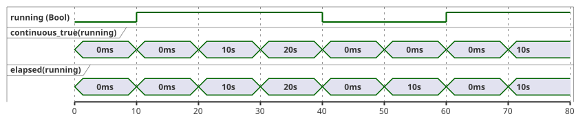
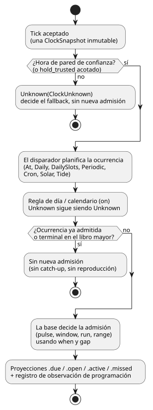
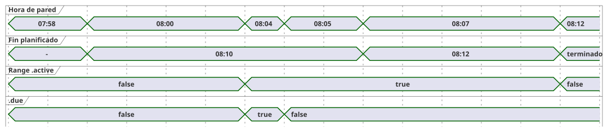

<!-- translation-source: docs/reference/03-time-and-schedules.en.md -->
[Original en inglés](03-time-and-schedules.en.md)

# 3. Tiempo y programaciones

[Índice completo](../LANGUAGE-REFERENCE.es.md) · [Anterior: 2. Tipos, expresiones y estado](02-types-expressions-state.es.md) ·
[Siguiente: 4. Sensores, restricciones y control](04-sensors-constraints-control.es.md)

GhostFlow no trata el tiempo como un único número. Distingue dos clases de tiempo:

- **Tiempo transcurrido.** Los «cinco minutos» de «encender durante cinco minutos» se miden con un reloj *monotónico*, que solo avanza.
- **Tiempo de calendario.** Las «6 de la mañana» de «arrancar a las 6 de la mañana» son una hora de calendario interpretada en una zona horaria.

De esta separación se derivan dos reglas. Corregir el reloj de pared no debe rebobinar ni prolongar una operación que ya está en marcha. Un reinicio no debe desplazar en silencio el punto de referencia de una programación. Este capítulo se apoya en esa distinción para definir los valores de tiempo, los temporizadores, las programaciones recurrentes, los calendarios laborales y los eventos naturales (amanecer, mareas).

**Cómo leer este capítulo.**

- Los bloques de código `ghost` y los bloques de gramática constituyen el contrato público seleccionado del lenguaje.
- Cuando el compilador actual valida o ejecuta un subconjunto más reducido, la sección lo indica de forma explícita.
- Los bloques marcados como `text` (por ejemplo ClockSnapshot, manifiestos y registros de proveedores) son contratos con el entorno de ejecución. No son código fuente de GhostFlow.
- Los datos de reloj, calendario y predicciones pueden provenir de un dispositivo local o de una pasarela opcional. Ni la red ni ninguna pasarela concreta son un requisito del lenguaje.

**En este capítulo**

| Sección | Tema |
|---|---|
| §3.1 | Tipos de valores de tiempo (`Duration`, `Date`, `TimeOfDay`, `DateTime`) y los dos relojes |
| §3.2–§3.4 | Temporizadores: `elapsed`, `continuous_true`, uso acumulado y en ventana móvil |
| §3.5 | Semántica común de Schedule: políticas, bases, proyecciones, omisiones, identidad, brechas |
| §3.6–§3.7 | `DailySlots`, `Periodic` y `cron5` |
| §3.8 | DST, medianoche y calendarios laborales |
| §3.9 | Programaciones solares, lunares y de mareas |
| §3.10 | Límites de uso basados en el tiempo (presupuestos diarios y en ventana móvil, recuento de eventos) |
| §3.11 | Resumen de la sintaxis establecida y sus límites |

Este capítulo se basa en el [contrato de tiempo y programaciones](../TIME-AND-SCHEDULE-CONTRACT.es.md),
el [contrato del temporizador Bool continuo](../CONTINUOUS-BOOL-TIMER-CONTRACT.es.md),
el [contrato de programación solar](../SOLAR-SCHEDULE.es.md), la [sintaxis seleccionada](../LANGUAGE-SURFACE.es.md),
los [capítulos 6–7 de Programming in GhostFlow](../ProgrammingInGhostflow.es.md),
la [decisión del 2026-09-24 sobre el rango horario planificado fijo](../2026-09-24-fixed-planned-time-range-decision.es.md),
[#23](https://github.com/callin2/ghostflow-language/issues/23),
[#46](https://github.com/callin2/ghostflow-language/issues/46),
[#90](https://github.com/callin2/ghostflow-language/issues/90) y
[#96](https://github.com/callin2/ghostflow-language/issues/96).

## 3.1 Valores de tiempo y dominios de reloj

### Duration

`Duration` es una duración, no una fecha de calendario. Un literal seleccionado es un entero no negativo seguido de una de las unidades `ms`, `s`, `min` o `h`.

```ghost
config open_delay: Duration = 2s;
config watering_time: Duration = 5min;
```

**Dominio de valores.** Un Duration es un número entero exacto de milisegundos en `0..2^53-1`. Toda la aritmética se comprueba contra este rango.

Están prohibidos, tanto como resultado final como en cualquier resultado intermedio de la aritmética dinámica:

- los Duration negativos;
- las fracciones de milisegundo;
- NaN e Infinity;
- los valores fuera del rango.

Una infracción rechaza el tick actual con `duration-out-of-range`. No se consolida parcialmente ningún estado ni intención nuevos.

Una operación que necesite un «retardo positivo» puede rechazar `0ms` para ese argumento. Esa restricción pertenece a la operación; cero sigue siendo un valor `Duration` válido.

**Aritmética.**

- `Duration + Duration` devuelve una suma comprobada.
- `Duration - Duration` devuelve un `Duration` solo cuando el resultado no es negativo.

Los meses, los años y las fechas de calendario no son unidades de Duration, porque su longitud no es un número fijo de milisegundos. «Un mes después» necesita una semántica aparte de operaciones de calendario.

### Date, TimeOfDay, DateTime

Los literales de tipos de tiempo usan una forma etiquetada: una etiqueta (`date`, `time`, `datetime`) seguida de una cadena entre comillas invertidas.

| Tipo | Dominio de valores | Regla |
|---|---|---|
| `Date` | Gregoriano `1970-01-01..9999-12-31` | No contiene hora ni zona horaria. |
| `TimeOfDay` | `00:00:00.000..23:59:59.999` | No tiene fecha, desfase UTC ni regla de recurrencia. |
| `DateTime` | Instante UTC exacto desde la época Unix hasta `9999-12-31T23:59:59.999Z` | Un literal requiere `Z` o un desfase UTC numérico. El valor no conserva una zona IANA. |

```ghost
date`2026-09-22`
time`06:30`
datetime`2026-09-22T06:30:00+09:00`
```

Las grafías exactas son:

```text
Date       := date`YYYY-MM-DD`
TimeOfDay  := time`HH:MM[:SS[.f|.ff|.fff]]`
DateTime   := datetime`YYYY-MM-DDTHH:MM:SS[.f|.ff|.fff](Z|+HH:MM|-HH:MM)`
```

**Reglas léxicas.**

- Todos los campos son dígitos decimales ASCII rellenados con ceros a la izquierda.
- Las fracciones de segundo tienen de uno a tres dígitos. Se rellenan con ceros a la derecha para obtener milisegundos exactos. Cuatro o más dígitos producen un diagnóstico; nunca se redondean.
- Los desfases numéricos van de `00:00` a `14:00`. En la hora 14 solo se permite `14:00`.
- `+00:00` se normaliza al mismo instante que `Z`. `-00:00` (que por convención significa «desfase UTC desconocido») se rechaza.

**Diagnósticos.** Las fechas inexistentes, `24:00`, el segundo intercalar `:60` y un DateTime sin desfase producen diagnósticos.

**Qué es un valor DateTime.** Un valor DateTime es un instante UTC exacto con precisión de milisegundos. La grafía y el desfase originales solo se conservan en los metadatos del código fuente. Una zona horaria IANA es contexto para interpretar programaciones *recurrentes* en hora civil; no forma parte de un instante DateTime que ya se ha resuelto.

No hay conversiones implícitas entre cadenas y tipos de tiempo, ni entre `Date`, `TimeOfDay` y `DateTime`.

La aritmética mínima de tiempo es:

- `DateTime ± Duration -> DateTime`: un desplazamiento del instante con comprobación de rango.
- Comparación de dos valores del mismo tipo (DateTime con DateTime, TimeOfDay con TimeOfDay).
- `TimeOfDay + Duration` **no** da la vuelta automáticamente a medianoche. Interprételo dentro de un contexto de Schedule que aporte una Date y una zona horaria.
- `DateTime - DateTime` no es una operación básica de `Duration`, porque el resultado podría tener que ser negativo. Compare los instantes o use el `elapsed` monotónico.

### Reloj de calendario y reloj monotónico

Cada tick usa una única *instantánea de reloj* inmutable. La instantánea lleva dos relojes con funciones distintas:

| Reloj | Se usa para |
|---|---|
| Reloj de calendario (de pared) | Interpretar programaciones, fechas, zonas horarias y eventos naturales. |
| Reloj monotónico | Medir cuánto tiempo lleva en marcha una operación y cuánto tiempo se ha mantenido una condición. |

```text
// Estructura que ilustra el contrato
ClockSnapshot {
  monotonicMs
  bootEpoch
  wallMs?
  wallQuality: Trusted | Unknown(reason)
  uncertaintyMs?
  sourceRevision?
}
```

Reglas de la instantánea:

- `monotonicMs` nunca disminuye dentro de una misma ejecución. Una instantánea cuyo tiempo monotónico disminuye, o que no cumple los requisitos de entero/rango, se rechaza antes de que cambie ningún estado.
- `wallMs` puede estar presente y aun así no ser utilizable: las decisiones de programación solo lo usan cuando `wallQuality` es `Trusted`.
- Los temporizadores en marcha siguen en el reloj monotónico, aunque el reloj de pared se corrija hacia adelante o hacia atrás.

El host decide en qué fuente de tiempo confiar (NTP, RTC, hora de la plataforma). Las expresiones de control nunca leen directamente la red ni el reloj de la máquina. Una política que mantiene temporalmente la última hora de confianza debe indicar cuánto dura esa retención y qué respaldo terminal se aplica. No existe ningún periodo de gracia oculto.

**Por qué:** si el tiempo de pared y el tiempo transcurrido comparten la única palabra «tiempo», la corrección del reloj, los cambios de zona horaria, el DST y los reinicios también pueden cambiar cuánto dura una operación.

## 3.2 Tiempo transcurrido tras un cambio de estado

`elapsed(state)` devuelve el tiempo monotónico desde que el estado referenciado **consolidó un cambio** por última vez.

```ghost
type Phase = Idle | Watering;
state phase: Phase = Idle;
timer age = elapsed(phase);

phase' = case phase {
  Idle => if start then Watering else Idle;
  Watering => if stop || age >= watering_time then Idle else Watering;
};
```

Las reglas exactas son:

- La evaluación del primer tick aceptado lee `0ms`.
- Según la regla de snapshot de §2.8, las transiciones y salidas leen el intervalo
  del inicio del tick. Aunque cambie el estado, la salida `elapsed` ya evaluada
  sigue usando el intervalo anterior.
- Al consolidar el cambio se inicia otro intervalo en el tiempo monotónico actual.
  La observación del temporizador posterior a la consolidación es `0ms` en ese
  mismo resultado. El trace muestra ese valor; no se recalculan las salidas.
- El siguiente tick aceptado lee el intervalo nuevo. Con el mismo timestamp lee
  `0ms`; si el estado no cambia se conserva el inicio del intervalo.
- Para un estado Bool, tanto false→true como true→false son cambios. Por tanto, `elapsed(running)` significa «cuánto tiempo se ha mantenido el valor actual», **no** el tiempo total en ON.
- Las etapas no se encadenan dentro de un mismo tick. Una transición ocurre en el primer tick que cumple su condición. El retardo real es, por tanto, al menos el Duration solicitado y normalmente más largo, hasta en un intervalo de tick.
- Un tick rechazado no cambia el estado del temporizador.

Un temporizador no es `sleep` ni una tarea en segundo plano. Mientras un temporizador está en marcha, cada tick sigue evaluando las solicitudes de paro, los fallos de sensor y las restricciones globales.

## 3.3 Tiempo durante el cual un Bool es continuamente verdadero

«La temperatura se mantuvo por encima del umbral durante cinco minutos» es una pregunta distinta de «¿cuándo cambió este estado por última vez?». Un *temporizador de verdad continua* mide solo el tramo actual ininterrumpido en el que una condición es verdadera. Devuelve `0ms` inmediatamente en cualquier tick en el que la condición sea falsa.

```ghost
timer hot_for = continuous_true(temperature_high);
```

Sea `c` la condición, `wasTrue` su valor en el tick aceptado anterior, `since` el inicio del tramo actual y `now` el tiempo monotónico actual. Entonces:

```text
value    = if c && wasTrue then now - since else 0ms
wasTrue' = c
since'   = if !c then now
           else if !wasTrue then now
           else since
```

Consecuencias:

- El primer tick verdadero devuelve cero. Los ticks repetidos con la misma marca de tiempo también devuelven cero. Un valor distinto de cero aparece a partir de la siguiente marca de tiempo.
- Un tick falso devuelve cero de inmediato, y el siguiente tick verdadero inicia un tramo nuevo.
- Cada temporizador tiene su propio estado interno; los temporizadores nunca lo comparten.

La línea de tiempo siguiente compara `continuous_true` y `elapsed` para un estado Bool muestreado cada 10 segundos. Difieren mientras el valor es falso: `elapsed` mide cuánto tiempo se ha mantenido *false*, pero `continuous_true` permanece en cero.



`continuous_true` recibe exactamente una expresión Bool. No convierte implícitamente `Result<Bool, SensorFault>` en Bool. Para tratar un fallo de forma conservadora como falso, escriba esa elección explícitamente con `case`:

```ghost
let safe_high = case high_temperature {
  ok(value) => value;
  fault(_)  => false;
};
```

La verdad continua no es un acumulador con pausa/reanudación ni una suma de tramos ON separados. Esas son operaciones de tiempo distintas (véase §3.4).

## 3.4 Tiempo acumulado y presupuesto en ventana móvil

Las distintas preguntas sobre «cuánto tiempo» necesitan semánticas de tiempo distintas:

| Pregunta | Semántica de tiempo requerida |
|---|---|
| ¿Cuánto tiempo se ha mantenido la etapa actual? | `elapsed(state)` |
| ¿Cuánto tiempo ha sido verdadera la condición sin interrupción? | verdad continua (continuous-true) |
| ¿Cuántos minutos totales en ON se usaron en este trabajo? | Tiempo ON acumulado con ámbito en el trabajo |
| ¿Cuántos segundos totales en ON hubo en los últimos 60 segundos? | Integración del tiempo ON en ventana deslizante |
| ¿Cuántos minutos en total estuvo encendida hoy la bomba física? | Contabilización de uso del equipo por fecha de calendario |

La contabilización en ventana móvil tiene dos pasos. Primero, declare un *libro mayor (ledger)* (un `account`) vinculado a un recurso físico estable y a una etapa de contabilización. Después, consulte ese libro mayor sobre una base temporal.

```ghost
resource pump1: BoolActuator;
account pump_applied = on_time(pump1,
  stage: applied,
  persistence: durable);
constraints PumpBudget {
  limit used(pump_applied, rolling(60s)) <= 30s {
    reserve = 1s;
    on_unknown = block;
  }
}
```

Esto es un fragmento de declaraciones de contabilización dentro de un control. El compilador actual valida un `limit used(...)` bien formado y emite un descriptor de contabilización. Ejecutarlo requiere además una vinculación de recurso aparte y la aplicación del libro mayor.

```text
used(t) = ON duration of x over (t - 60s, t]
```

Cómo se comporta el presupuesto:

- Cuando `used + reserve` alcanza 30 segundos, se prohíbe seguir en ON.
- A medida que una parte de un intervalo ON antiguo sale de la ventana, exactamente esa cantidad de presupuesto se devuelve de inmediato.
- No lo aproxime con cubetas fijas de un minuto ni midiendo solo el intervalo continuo actual.
- Sume los solapamientos parciales de varios intervalos. La misma traza de tiempo lógico debe dar el mismo resultado aunque los escaneos sean irregulares.

La **etapa** de contabilización debe ser explícita:

| Etapa | Cuenta |
|---|---|
| requested | Tiempo ON solicitado por el control. |
| admitted/safe | Tiempo ON lógico que superó las restricciones. |
| applied | Tiempo de comando que el renderizador informa como aplicado. |
| confirmed | Tiempo de operación física verificado mediante retroalimentación. |

Ejemplos de por qué importa la etapa:

- Si `manual_request` es verdadero pero una restricción de nivel bajo de agua hace que la salida segura sea falsa, no se consume presupuesto admitted/safe.
- Sin retroalimentación, el tiempo ON seguro no debe presentarse como caudal real.

Requisitos adicionales:

- La ventana y el ON máximo deben ser finitos, para que se pueda calcular una cota superior de la memoria de estado.
- Un reinicio no debe restablecer implícitamente un presupuesto de protección. Elija un contrato: restaurar desde un punto de control (checkpoint), bloquear de forma conservadora durante la longitud de la ventana o declarar una política explícita no persistente.

**Por qué:** «30 segundos cada vez» y «30 segundos en total durante el último minuto» son reglas de seguridad distintas. Si ambas fueran el mismo temporizador, muchas activaciones cortas podrían eludir el límite.

## 3.5 Semántica común de Schedule

Un **Schedule** es un valor reactivo tipado que se evalúa continuamente. No es una llamada diferida ni un hilo en segundo plano. En cada tick aceptado, la programación observa la hora actual y evalúa su disparador, su regla de día, su predicado y su contexto. A partir de ellos decide si **admitir** una ocurrencia, es decir, aceptar como iniciada una ocurrencia planificada. Un pulso cuyas condiciones no se cumplen nunca se pone en cola para más tarde.

El diagrama siguiente muestra el orden de esa decisión por tick. Cada paso se define en el resto de esta sección.



Los tipos de disparador seleccionados son `At`, `Daily`, `DailySlots<G>`, `Periodic`, `Cron`, `Solar` y `Tide`. El compilador actual acepta `At` de un solo disparo (pulse y Window) y, para franjas, solo `DailySlots<15min>`. Cada tipo de disparador tiene sus propios campos de disparador más los campos de política comunes que se indican a continuación.

```ghost
schedule name: TriggerType {
  // trigger별 field
  basis = pulse;
  when = true;
  clock = trusted_only;
  gap = skip_after(60s);
  recovery = baseline;
  fallback = skip;
}
```

```text
basis       := pulse
             | window(positive Duration)
             | run(positive Duration, on_time)
             | run(positive Duration, within(positive Duration))
             | range(positive Duration)
when        := Bool
clock       := trusted_only
             | hold_trusted(positive Duration, terminal: skip)
gap         := skip_after(positive Duration)
recovery    := baseline
fallback    := skip
             | fixed_time(TimeOfDay, terminal: skip)  // solo Solar
cancel_when := Bool                                   // obligatorio para el range civil actual; opcional para el run de Tide
```

Los campos de política comunes significan:

| Campo | Significado |
|---|---|
| `basis` | Cómo se admite una ocurrencia y cuánto dura en torno al instante planificado (véase «Pulse, Window, Run, Range»). |
| `when` | Predicado de admisión. Escriba `when = true` para una admisión incondicional. |
| `clock` | Qué hora de pared se puede usar: solo la hora de confianza o una retención acotada de la última hora de confianza. |
| `gap` | Brecha de observación más larga tolerada antes de que las ocurrencias se traten como omitidas. |
| `recovery` | Qué ocurre al arrancar o cuando se recupera la confianza en el reloj. `baseline` fija una línea base sin reproducir lo pasado. |
| `fallback` | Qué hacer cuando la decisión es Unknown. |
| `cancel_when` | Cancelación de un Run o un Range a nivel de lenguaje. |

Reglas de los campos comunes:

- Todos los campos comunes son obligatorios.
- Un Run o un Range sin cancelación a nivel de lenguaje puede indicar `cancel_when = false`.
- En el compilador actual, `cancel_when` se permite para el Run de `Tide` y para el `range` civil; es **obligatorio** para `range` y está **prohibido** para `pulse`.

**Retención del reloj.** `hold_trusted(d, terminal: skip)` toma el último instante de pared de confianza, le suma el tiempo monotónico transcurrido desde entonces y usa el resultado como máximo durante `d`. La incertidumbre se retiene del mismo modo: la última incertidumbre más el mismo tiempo monotónico transcurrido. Los valores retenidos llevan la procedencia `HeldClock`. Cuando la retención alcanza su límite, el reloj pasa a `ClockUnknown` y el `skip` terminal se aplica a las nuevas decisiones de admisión. Un Range que ya se había admitido conserva su hora de fin monotónica. La marca de máximo (high-water, el instante de pared más reciente ya observado) no cambia.

**Soporte actual del compilador para políticas y bases.**

| Característica | Estado actual |
|---|---|
| `clock = hold_trusted(positive constant Duration, terminal: skip)` | Se acepta para Solar y Tide. |
| `fallback = fixed_time(TimeOfDay literal, terminal: skip)` | Se acepta para Solar. |
| Respaldo de Tide | Solo `fallback = skip`. |
| Otros disparadores | Mantienen el reloj solo de confianza y el respaldo skip. |
| Window de `At` | El perfil Window ejecutable acotado. |
| Window en otros disparadores; `run(_, on_time)` | Fuera del soporte actual. |
| Range de Daily UTC inmutable y de DailySlots estático no vacío | Se demuestra estáticamente la ausencia de solapamiento; se ejecuta como GFB12. |
| Range de `DailySlots<15min>` no UTC inmutable | Perfil GFB21 (véase «Range de DailySlots no UTC inmutable»): comprobaciones en tiempo de compilación del espaciado nominal de las franjas, más validación en Rust de los intervalos reales de las ocurrencias que aporta el host. |
| Otras recurrencias Range aceptadas | Siguen siendo descriptores no ejecutables. |
| Duración del Range a partir de un `Duration` config de operador (perfiles UTC admitidos) | Se permite cuando el valor inicial demuestra la ausencia de solapamiento. Un evento aceptado de ajuste en vivo recalcula la ocurrencia actual a partir de su inicio planificado congelado, sin un nuevo pulso due ni una nueva identidad de ocurrencia. |
| `run(_, within(_))` de Tide | Admitido. |

**Admisión acotada para eventos naturales.** Estas reglas evitan que las predicciones ausentes o un reloj incierto creen ocurrencias en silencio:

- La hora retenida solo se usa mientras el tiempo monotónico transcurrido es *estrictamente menor* que la duración de la retención.
- La ausencia de un ancla de confianza, la ausencia de incertidumbre o un desbordamiento en la suma comprobada fallan en modo cerrado.
- La hora de pared retenida y la incertidumbre son los últimos valores de confianza más el tiempo transcurrido, con procedencia `HeldClock`.
- El vencimiento aplica skip terminal a la nueva admisión, preserva la marca de máximo y no prolonga un Run activo.
- La recuperación establece una línea base. Un reinicio comienza con un reloj nuevo.
- El proveedor de datos se encarga de la conversión IANA. Aporta una fecha local de origen conocida y un instante de respaldo que coincide con la hora y la zona horaria escritas por el autor en esa fecha.
- Las horas civiles ambiguas o inexistentes aplican skip terminal. No se inventa ningún pliegue (fold).
- El núcleo se encarga de la admisión y de las entradas due generadas.
- Una ocurrencia de respaldo y un evento Solar recuperado en la misma fecha local de origen comparten una única identidad consumida y un punto de control terminal.

`fixed_time` solo está disponible para Solar. Una vez admitida una ocurrencia de respaldo para una fecha local de origen, el mismo libro mayor de ocurrencias consume el evento Solar de esa fecha. Así, el evento no se duplica aunque el proveedor se recupere. Tide solo permite `fallback = skip`, porque sin predicciones se desconocen el número y la identidad de los eventos de marea.

Las políticas Solar extendidas solo se ejecutan en el perfil Solar acotado. Se rechaza combinarlas con programaciones no Solar, con ejecución de proveedor/config o con características no admitidas. Las combinaciones Solar heredadas conservan su perfil existente.

**Solar y fallos de ajustes.** Cuando el `when` de Solar lee un Result de config, ese config se convierte en una *dependencia de admisión*:

- Un fallo actual en un config dependiente mantiene la decisión en `Unknown(SettingsFault)` y no admite ninguna ocurrencia nueva, aunque la rama de fallo escrita por el autor devuelva true.
- Un fallo en un config no relacionado no suprime Solar.
- Solar y el control ordinario leen los Results actuales en la misma posición de evaluación.
- Una observación de recuperación correcta establece una línea base; no recupera eventos pasados.
- Las observaciones de ajustes, las decisiones Solar y las transiciones de la VM se consolidan juntas. Por tanto, una evaluación fallida no consume ni eventos ni ocurrencias.
- Las coordenadas, la zona horaria, el evento y el desfase son definiciones inmutables del programa. Los ajustes en vivo nunca los sustituyen implícitamente.

**Por qué:** si una programación iniciara un trabajo a partir de un valor correcto antiguo mientras el control ordinario ve un error de ajustes, un mismo programa tomaría decisiones contradictorias. Conserve la causa y decida la admisión a partir de la observación que realmente entró en vigor.

**`At` de un solo disparo (pulse).** `At` usa un DateTime tipado constante. No tiene campos de zona horaria ni de DST.

```ghost
schedule appointment: At {
  at = datetime`2026-01-01T08:00:00Z`;
  basis = pulse;
  when = true;
  clock = trusted_only;
  gap = skip_after(60s);
  recovery = baseline;
  fallback = skip;
}
```

- El instante absoluto se normaliza a partir de su desfase explícito. Distintas grafías de desfase del mismo instante planifican la misma ocurrencia.
- Este perfil Pulse acotado solo acepta reloj solo de confianza, recuperación baseline, respaldo skip y un gap constante positivo.
- Diagnósticos: campos ausentes, un `at` que no es un DateTime o no es constante, campos de zona horaria/DST/cancelación y cualquier otra base.
- Expone `.due` y `.missed`.
- No se puede mezclar con perfiles de proveedor, config, sensor, recurso, objetivo ni de otras programaciones.
- GFB14 y control-v13 identifican este perfil de ejecución; el transporte enmarcado de reloj/escaneo no cambia. Los cargadores más antiguos rechazan GFB14. Los paquetes portables firmados aún no aceptan este perfil.

**`At` con un Window.** `At` también acepta un `window(Duration)` constante positivo, con las mismas restricciones de política:

```ghost
schedule appointment: At {
  at = datetime`2026-01-01T08:00:00Z`;
  basis = window(5min);
  when = ready;
  clock = trusted_only;
  gap = skip_after(60s);
  recovery = baseline;
  fallback = skip;
}
output start_once: Bool;
start_once <- appointment.due;
```

El intervalo planificado es semiabierto: `[at, at + duration)`. Las dos proyecciones se comportan de forma distinta:

| Proyección | Clase | Significado |
|---|---|---|
| `.open` | Nivel | Con un reloj de confianza: dentro del intervalo **actual** *y* `when` es verdadero. Puede pasar a falso y de nuevo a verdadero según cambie `when`. |
| `.due` | Pulso | Verdadero una sola vez, en el primer escaneo aceptado elegible dentro del intervalo. |

Una omisión terminal o una admisión anterior impiden cualquier `.due` posterior. **No** fuerza a falso el nivel `.open` actual. Use `.due` para un trabajo que debe iniciarse una sola vez.

Ejemplo: con `window(5min)` a las 08:00, una brecha de observación de 07:59:50 a 08:02:00 omite la ocurrencia de forma terminal. A las 08:02, `.missed` es verdadero y `.due` es falso, mientras que `.open` puede ser verdadero si `when` es verdadero. A partir de las 08:05, `.open` es falso.

Reglas adicionales:

- Una hora de pared Unknown o no de confianza nunca puede producir un intervalo conocido como abierto.
- El Window de `At` no tiene campo de cancelación y no acepta filas de ocurrencias del host.
- GFB23 y control-v23 identifican este perfil de ejecución distinto. Los cargadores más antiguos lo rechazan, y una discrepancia entre manifiesto y perfil se rechaza antes de la activación. Los paquetes portables firmados aún no aceptan este perfil.

**Cómo admite el núcleo una ocurrencia `At`.** El núcleo de Rust calcula la ocurrencia única a partir del sitio compilado de la programación y del instante. No necesita filas de ocurrencias aportadas por el host.

- La admisión Pulse requiere un escaneo de confianza aceptado sin brecha de observación, `previous < planned <= current` y `when = true`. Si `when` es falso en el cruce, la ocurrencia se consume como omisión terminal.
- Window puede admitir en el primer escaneo elegible antes de que termine la ventana, aunque `when` fuera falso en el cruce.
- En ambas formas, una brecha de observación que se solape es una omisión terminal.
- Una línea base de arranque o de recuperación en el instante o después de él consume la ocurrencia como `BaselinePastMissed`, sin recuperación de lo pasado.
- Volver a observar, retroceder el reloj de pared y volver a cruzar nunca crean otra admisión. Una nueva fuente de reloj o una nueva revisión de arranque no crean una nueva identidad.
- Un escaneo rechazado no consolida ni la línea base del reloj, ni la identidad terminal, ni las proyecciones.

**Reinicios.** La deduplicación entre reinicios requiere restaurar el punto de control terminal del mismo programa:

- Una identidad que se consumió u omitió sigue consumida, aunque el reloj de pared del nuevo arranque sea anterior al instante.
- Un punto de control tomado antes de la ocurrencia todavía puede admitir un cruce futuro.
- Una activación nueva no tiene historial persistente.
- Un fallo tras la admisión pero antes de publicar el punto de control persistente queda fuera de la garantía de una sola vez de la VM. La persistencia y el despacho del host deben gestionar ese límite.
- La admisión es evidencia lógica. No demuestra la ejecución física ni el acuse de recibo.

**`Daily`.** `Daily` planifica una hora cada día. Requiere `timezone`, ``at = time`...`;``, `dst_missing` y `dst_repeated`. Por ejemplo:

```ghost
schedule morning: Daily {
  timezone = "Asia/Seoul";
  at = time`06:30`;
  dst_missing = skip;
  dst_repeated = first;
  basis = pulse;
  when = true;
  clock = trusted_only;
  gap = skip_after(60s);
  recovery = baseline;
  fallback = skip;
}
```

**El disparador y la base son ejes independientes.** No enumere Cron, Window, Run y Range como alternativas de la misma clase:

- Un disparador (por ejemplo Cron) decide **cuándo** se planifica una ocurrencia.
- Una base (Window, Run, Range) decide la admisión y la duración **en torno al** instante planificado.

Leer un Schedule nunca enciende un dispositivo.

**Decisiones y Unknown.** Una decisión de programación es `True`, `False` o `Unknown(reason)`, junto con las revisiones usadas. `fallback = skip` resuelve Unknown como `.due = false` para la nueva admisión, pero conserva el motivo. Negar Unknown nunca debe convertirlo en permiso.

**Proyecciones.**

| Proyección | Significado |
|---|---|
| `.due` | Pulso: verdadero solo en el tick aceptado que admite una ocurrencia. |
| `.open` de Window | Nivel: dentro de `[planned, planned + length)` **y** el predicado actual es verdadero. |
| `.active` de Run | El intervalo de operación tras la admisión, expresado con estado explícito y un temporizador monotónico. |
| `.active` de Range | La parte restante del intervalo de la ocurrencia actual, anclada al inicio planificado. Tras la admisión, su fin se juzga con el reloj monotónico. El intervalo sigue en marcha aunque las restricciones de seguridad bloqueen la salida. |

**Duración y cancelación de Run.**

- La duración de Run se mide en tiempo monotónico desde la admisión real.
- En un tick aceptado en el que `cancel_when` es verdadero, Run y Range terminan `.active`. La ocurrencia no se rearma.
- Run y Range nunca se pausan en silencio cuando la salida solicitada es falsa o una restricción global bloquea la salida segura.
- Para medir el tiempo ON solicitado, el tiempo ON seguro o el tiempo ON seguro continuo, use operaciones explícitas separadas.

**Observaciones de programación.** Cada decisión deja además una *observación de programación*, separada de la proyección Bool. Registra:

- el ID estable de la programación y la revisión de la definición;
- la decisión `False | Due | Unknown(reason)` y su disposición;
- el ID de la ocurrencia y el instante de pared planificado;
- la fecha local de origen y la fecha local programada;
- las revisiones del proveedor y del contexto.

Las disposiciones típicas son `Before`, `PredicateFalse`, `AlreadyAdmitted` y estos motivos de omisión:

| Motivo de omisión | Significado |
|---|---|
| `ConditionsFalseAtPulse` | Las condiciones eran falsas en el cruce del pulso. |
| `ObservationGap` | Una brecha de observación no fiable se solapó con el intervalo de admisión. Para Range es evidencia no terminal sobre un intervalo abierto, que se trata con las reglas de recuperación descritas más abajo. |
| `LateStartExpired` | Terminó el intervalo de admisión tardía. |
| `CorrectionPastHighWater` | Una hora de evento corregida quedó por detrás de la marca de máximo que ya se había superado. |
| `EventWithdrawn` | El proveedor retiró un evento que aún no se había admitido. |

`.due = false` por sí solo no permite distinguir entre un falso ordinario, un respaldo Unknown, un evento ya admitido y un evento omitido. Por eso esta evidencia se vincula al mismo escaneo aceptado.

### Respuesta del código fuente a las ocurrencias omitidas

`schedule_name.missed` es una proyección `Bool` que permite al código fuente reaccionar a las omisiones.

**Disponibilidad.** El compilador actual proporciona `.missed` para pulse y Window de At, para Solar y para las programaciones civiles `pulse` ejecutables. Todavía no es una proyección de ejecución para Range, incluidos los controles Range UTC ejecutables.

**Semántica.**

- Es verdadera solo cuando una o más ocurrencias de esa programación pasan a **omitidas de forma terminal** en este escaneo aceptado.
- Si se omiten varias ocurrencias en un mismo escaneo, sigue siendo verdadera una sola vez. Es falsa en el siguiente escaneo aceptado salvo que haya una nueva omisión terminal.
- Una acción de control la evalúa exactamente una vez, en la instantánea inmutable de ese escaneo aceptado.
- Volver a observar una ocurrencia ya registrada como omitida de forma terminal, o restaurar un punto de control, no la vuelve verdadera otra vez.
- Un escaneo rechazado no consolida ni este pulso ni ninguna transición de estado.

```ghost
state missed_scans: Int = 0;
missed_scans' = if morning.missed then missed_scans + 1 else missed_scans;
output missed_alarm: Bool;
missed_alarm <- morning.missed;
```

Como `.missed` es una expresión `Bool` ordinaria, el autor escribe las respuestas con `if`, `case`, transiciones de estado y expresiones de salida. Las declaraciones de programación no tienen callbacks, manejadores por ocurrencia ni reproducción automática. Para responder una vez por escaneo a las omisiones de varias programaciones, evalúe una sola expresión como `morning.missed || evening.missed`.

**Registros por ocurrencia.** El pulso Bool no lleva ni un recuento ni un motivo. En su lugar, las **observaciones de programación ordenadas** del mismo escaneo aceptado contienen un registro por cada ocurrencia omitida de forma terminal. Cada registro conserva:

- el ID estable de la programación y el ID de la ocurrencia;
- el instante planificado;
- el motivo de omisión terminal (el que corresponda de `ConditionsFalseAtPulse`, `ObservationGap`, `LateStartExpired`, `CorrectionPastHighWater`, `EventWithdrawn`);
- las revisiones de la definición, del contexto y del proveedor.

Reglas de estos registros:

- Cuando se consolidan varios registros en un mismo escaneo, no se fusionan ni se resumen bajo un único motivo.
- Un libro mayor terminal restaurado tras un reinicio no crea registros ni pulsos duplicados.
- `Unknown`, y el `ObservationGap` no terminal de un Range que sigue abierto, no hacen verdadero `.missed`.
- Las ocurrencias omitidas nunca se admiten ni se ejecutan automáticamente cuando más tarde las condiciones pasan a ser verdaderas.

### Pulse, Window, Run, Range

El campo `basis` selecciona una de cuatro formas de admisión:

| basis | Semántica de admisión |
|---|---|
| `pulse` | Admite solo si todas las condiciones son verdaderas en el tick del cruce. Pasar a verdadero más tarde sigue significando omitida. |
| `window(5min)` (ejecución de `At`) | Admite una vez en la primera condición verdadera dentro de `[planned, planned+5min)`. Los cambios false→true repetidos en la misma ocurrencia no la rearman. Las demás combinaciones de disparador siguen en diseño. |
| `run(5min, on_time)` (diseño) | Admite solo en el cruce observado y funciona cinco minutos desde la admisión. |
| `run(5min, within(10min))` (Tide) | Permite la primera admisión dentro de `[planned, planned+10min)`. Los diez minutos son de gracia; la duración del run es de cinco minutos. |
| `range(10min)` (contrato civil) | Si la hora actual de confianza está dentro de `[planned, planned+10min)` y `when` es verdadero, admite una vez incluso tras una primera observación tardía, un arranque o una recuperación. El fin es el inicio planificado + diez minutos. Daily/DailySlots UTC inmutable usa GFB12; el DailySlots no UTC inmutable descrito más abajo usa GFB21. |

```ghost
schedule morning_watering: Daily {
  timezone = "UTC";
  at = time`08:00`;
  dst_missing = skip;
  dst_repeated = first;
  basis = range(10min);
  when = true;
  cancel_when = false;
  clock = trusted_only;
  gap = skip_after(60s);
  recovery = baseline;
  fallback = skip;
}
```

**Alcance ejecutable de Range.** Este ejemplo de `range` UTC inmutable es bytecode de control GFB12 ejecutable.

- El segmento de ejecución acotado admite Daily sin calendario laboral y DailySlots estático no vacío, con `trusted_only`, `baseline` y `skip`.
- Daily UTC inmutable con un selector `workday` u `offday` y un WorkCalendar tipado usa GFB18. Su inicio más la duración no debe sobrepasar la medianoche local; divida un intervalo de trabajo nocturno en rangos Daily explícitos separados. Un rango que termina exactamente a medianoche es válido, porque el fin es exclusivo. Los rangos ordinarios sin calendario laboral conservan su comportamiento actual a medianoche.
- Los ajustes de duración en vivo solo se reducen (lowering) para Daily/DailySlots UTC sin calendario laboral.
- Los ajustes escalares de inicio en vivo solo se reducen para un único Range Daily UTC con un Duration fijo.
- Se rechazan estáticamente, en lugar de recurrir en silencio a los metadatos estáticos de Range: el Range con calendario laboral con config de duración/inicio en vivo; la combinación de inicio + Duration en vivo; el Range Periodic; el Range Daily no UTC; el Range no UTC basado en ajustes.
- El DailySlots no UTC inmutable sigue el perfil aparte de la subsección siguiente.
- Las variantes no admitidas nunca infieren una zona horaria ni una política de DST.

**Puntos de control de Range.** Un punto de control del contexto de Range almacena las identidades de ocurrencias consumidas y, cuando existe, la duración en vivo efectiva o el ajuste escalar de inicio en vivo. No almacena un temporizador monotónico activo.

- Restaurar en un arranque nuevo no reanuda ni vuelve a admitir una ocurrencia que ya se consumió. La ocurrencia siguiente usa la duración o el inicio restaurados.
- Un intervalo no consumido que sigue abierto solo puede admitir su tiempo restante.
- Agotar la capacidad terminal rechaza el escaneo de forma atómica. Las identidades nunca se podan en silencio.

**Admisión tardía para Run.** El intervalo de admisión tardía es semiabierto, por lo que no se produce ninguna admisión nueva en su límite final. Para una hora planificada de las 08:00, `run(5min, within(10min))` admitido a las 08:02 funciona con el reloj monotónico hasta las 08:07.

**Range es un intervalo planificado fijo.** `range(duration)` se ancla a la hora planificada, no a la hora de admisión:

- Un `range(10min)` de las 08:00 observado por primera vez a las 08:04 de confianza solicita solo los seis minutos que quedan hasta las 08:10.
- Si se observa por primera vez a las 08:10 o después, no se inicia y se registra `LateStartExpired`.
- Si `when` pasa a verdadero tarde pero antes del fin, solo se solicita el tiempo restante.
- Lo mismo se aplica al iniciar, al reiniciar, cuando se recupera la confianza en el reloj y tras brechas de observación.

Esta admisión de intervalo parcial se aplica **solo** a Range. No cambia `gap = skip_after(...)` ni `recovery = baseline` para las demás bases.

**Range y confianza en el reloj.**

- Sin hora actual de confianza, la decisión es `Unknown(ClockUnknown)`. Una hora estimada nunca admite un Range nuevo.
- Un `clock = hold_trusted(...)` explícito usa la hora y la incertidumbre retenidas según ese contrato.
- Un Range que ya está en marcha continúa hasta su fin monotónico existente, aunque después venza la confianza en la hora de pared o la retención.
- Volver a entrar en la misma ocurrencia después de que su inicio se haya movido al futuro requiere hora de confianza, igual que una nueva admisión. Incluso tras recuperar la confianza, no hay reentrada si el intervalo actual ha terminado.

**Las ocurrencias de Range no deben solaparse.** Dos ocurrencias Range de la misma programación no deben solaparse:

- Una intersección no vacía de dos intervalos semiabiertos es un error. Se permiten los intervalos que se tocan exactamente.
- Ejemplo: `DailySlots` con `selected = [08:00, 08:15]` y `basis = range(30min)` es un error de compilación, porque 08:00–08:30 y 08:15–08:45 se solapan.
- El compilador demuestra la ausencia de solapamiento a partir de la definición del disparador y de los ajustes efectivos.
- El perfil DailySlots no UTC inmutable comprueba en tiempo de compilación el espaciado nominal de las franjas y completa la validación de los intervalos reales con las comprobaciones de datos en Rust descritas más abajo.
- Fuera de ese perfil explícito, si no se puede demostrar el espaciado de una recurrencia de proveedor o dinámica, la declaración `range` se rechaza con un diagnóstico de compilación. El compilador nunca adivina ni elige un intervalo.
- Los valores predeterminados estáticos se comprueban en tiempo de compilación. Los valores efectivos, incluidos los ajustes restaurados, se comprueban antes de la activación. Los valores efectivos que se solapan rechazan la activación.
- Un cambio de ajustes en vivo que provocaría un solapamiento rechaza todo el evento de forma atómica.
- Ambas comprobaciones abarcan tanto el intervalo admitido actualmente como los intervalos recién planificados.

**Fijación del fin en la admisión.** En la admisión de Range, el fin planificado se fija a partir del inicio planificado de la ocurrencia y del Duration vigente en ese momento. La parte ya transcurrida se convierte en tiempo restante en el reloj monotónico. Tras la admisión:

- La corrección del reloj de pared por RTC/NTP ni adelanta ni retrasa el fin en curso.
- Un reloj de pared corregido se aplica a las decisiones de ocurrencias posteriores, después de que termine la ocurrencia actual.
- La hora de confianza, el inicio planificado y la referencia monotónica de tiempo transcurrido se conservan juntos para la ocurrencia, de modo que el fin no se recalcula durante una corrección.

**Cambios en vivo del inicio o del Duration.** Si el ajuste escalar de hora de inicio de un disparador de inicio único, o su Duration, es un ajuste operativo, un evento en vivo atómico aceptado también se aplica a la ocurrencia actual, a partir de la posición de aplicación del evento:

- El intervalo actual y su fin se recalculan a partir del inicio y el Duration modificados.
- El ID de la ocurrencia y el libro mayor ya admitido sobreviven al cambio de revisión de los ajustes.
- Tras la admisión, la referencia de tiempo estable anterior a la corrección se avanza con el tiempo monotónico transcurrido para hallar la posición actual y el tiempo restante.
- La hora de admisión tardía nunca se usa como nuevo inicio planificado. Incluso cuando la corrección del reloj de pared o ClockUnknown impiden usar la clave de la fecha actual, se vuelve a calcular la hora a partir de la fecha local original y del TimeOfDay efectivo.
- Si un evento de ajustes y un escaneo caen en la misma posición, aplique primero el orden de eventos de §5.2 y luego decida usando los ajustes vigentes en esa posición.

Ejemplos desarrollados para un `range(10min)` planificado a las 08:00 y admitido a las 08:04:

| Cambio | Resultado |
|---|---|
| Duration → 12 minutos a las 08:07 | Termina a las 08:12. |
| Duration → 5 minutos | Termina en la decisión que aplica el evento, porque el nuevo fin de las 08:05 ya ha pasado. |
| Inicio → 08:08 | Inactivo de inmediato; activo de nuevo a las 08:08 de confianza; termina a las 08:18. |
| Inicio → 08:02 (Duration sigue en 10 minutos) | Termina a las 08:12. |

La línea de tiempo siguiente muestra la primera fila: admisión tardía a las 08:04 y, después, un cambio en vivo del Duration a las 08:07 que mueve el fin planificado de las 08:10 a las 08:12. `.due` se activa una sola vez, en la admisión.



**El bloqueo de seguridad no detiene el reloj de Range.**

- Cuando las restricciones de seguridad globales bloquean la salida, la salida segura pasa a falsa de inmediato, pero la ocurrencia Range y su fin monotónico se mantienen.
- Si la restricción se libera antes del fin, solo se puede solicitar el intervalo que quede en ese momento. El tiempo bloqueado no se añade al final.
- `cancel_when = true` termina la ocurrencia. Un nuevo permiso no la reinicia.
- `.active` y la salida requested/safe/applied/confirmed son observaciones distintas.

**Inicio movido a un momento posterior a la posición actual.**

- Si un cambio de hora de inicio sitúa la posición actual antes del nuevo inicio planificado, la ocurrencia se detiene con `.active = false` en esa decisión.
- En el tick aceptado que alcanza el nuevo inicio, la misma ocurrencia se reevalúa frente a su intervalo modificado. Si `when` es verdadero, las solicitudes se reanudan solo hasta el fin planificado actual. La salida segura solo se produce cuando las restricciones de seguridad lo permiten.
- Esto no es una nueva admisión: `.due` no se emite de nuevo, y el ID de la ocurrencia y el libro mayor siguen siendo los mismos.
- Si el fin modificado está en la posición actual o antes de ella, la ocurrencia termina de inmediato, sin reanudarse ni volver a admitirse.

Para los cambios de `TimeSlots` de `DailySlots`, las claves de franja estables de §3.6 distinguen un cambio de hora (retime) de una eliminación/adición. Las reglas de recálculo de Range anteriores se aplican a un cambio de hora que conserva una clave; la regla de línea base para elementos nuevos se aplica a la eliminación/adición.

### Range de DailySlots no UTC inmutable

**Perfil.** Un `DailySlots<15min>` literal no vacío en una zona horaria IANA no UTC, con un Duration fijo positivo, se ejecuta como GFB21. Usa un preludio `civil-range` (etiqueta 19) y `GhostFlow/control-v21`.

- **Puede** combinar varios Range de este tipo, ventanas temporales ordinarias y temporizadores reducidos a estado ordinario, como `elapsed(state)`.
- **No** se combina con el preludio `true-for` aparte, con otros perfiles de programación/proveedor/config, con calendarios laborales ni con inicio/Duration/TimeSlots en vivo.
- Los perfiles UTC existentes y la fila de ocurrencia civil GFSF no cambian. Esa fila existe desde GFSF4; esto no significa que el codificador de contexto actual emita un sobre GFSF4.
- Los cargadores más antiguos rechazan GFB21; no lo sustituyen por otro perfil.

```ghost
schedule night: DailySlots<15min> {
  timezone = "Asia/Seoul";
  selected = [22:00];
  dst_missing = skip;
  dst_repeated = first;
  basis = range(7h);
  when = true;
  cancel_when = false;
  clock = trusted_only;
  gap = skip_after(60s);
  recovery = baseline;
  fallback = skip;
}
```

Una segunda programación con las mismas políticas, `selected = [05:00]` y `basis = range(17h)`, define el intervalo diurno. En Seúl:

- 22:00 + siete horas termina a las 05:00 del día siguiente.
- 05:00 + diecisiete horas termina a las 22:00.

Los límites finales son exclusivos. La medianoche está dentro del intervalo nocturno; las 05:00 y las 22:00 inician cada una el intervalo siguiente. La operación suma un tiempo transcurrido fijo al instante de inicio planificado. **No** es una operación que funcione hasta una hora local de fin arbitraria en una región con DST.

**Responsabilidades del host.** El host se encarga de la conversión de zona horaria y de la completitud de tzdb. Para cada programación aporta un intervalo de cobertura `[coverageStartMs, coverageEndMs)` que:

- retrocede la duración desde el instante de pared actual de confianza: `coverageStartMs <= max(0, wallMs - durationMs)`;
- termina después del momento actual: `coverageEndMs > wallMs`.

El host debe aportar **todas** las ocurrencias de esa cobertura, incluida una ocurrencia del día anterior cuyo intervalo sigue abierto después de medianoche. No basta con enviar solo las filas del día actual tras el cambio de fecha. La evidencia de programación GFSF existente tiene `provider: null` y `calendar: null`. Las filas de JavaScript usan los campos existentes:

```text
{ sourceDay, slotKey, minuteOfDay, fold, eventId, eventKind: "civil",
  instantMs, withdrawn, providerRevision, contextRevision }
```

| Campo | Regla |
|---|---|
| `sourceDay` | Número de día de la fecha local original, contado desde la época Unix. |
| `slotKey` | Ordinal con base uno tras ordenar por hora la lista literal inmutable. |
| `minuteOfDay` | El minuto exacto de la franja declarada. |
| `eventId` | Vacío. |
| `withdrawn` | Se prohíbe la retirada. |
| `fold` | La selección del pliegue de DST sigue el `dst_repeated` escrito por el autor. |

La identidad es `site:sourceDay:slotKey:fold`. Las revisiones y el instante planificado no la cambian.

**Datos nulos (omisiones por DST).**

- Una franja local inexistente resuelta por el host con `dst_missing = skip` puede enviarse como un dato con `instantMs = null`, u omitirse como ocurrencia omitida conocida. La sola ausencia de evidencia no establece una brecha de DST.
- Una franja repetida resuelta por el host con `dst_repeated = skip` también puede usar un dato nulo con `fold = 0`, incluso cuando `dst_missing = next_valid`.
- Los datos nulos requieren `fold = 0` y al menos una política skip escrita por el autor. No crean ningún intervalo.
- El host sigue siendo responsable de distinguir una brecha de una franja repetida.
- No sustituya este nulo por un OFF sano ni invente un instante planificado.

**Validación en Rust.** Rust comprueba:

- los rangos de los campos, la clave y el minuto de la franja declarada y la selección del pliegue de DST;
- si se permite un marcador skip nulo;
- las identidades y revisiones duplicadas o en conflicto;
- que los instantes de las filas estén dentro de la cobertura;
- la ausencia de solapamiento de los intervalos semiabiertos reales, incluido el intervalo congelado admitido actualmente;
- que un dato de instante resuelto observado previamente no desaparezca ni entre en conflicto donde se solapan coberturas sucesivas.

Una cobertura insuficiente y los datos mal formados nunca conducen a una nueva admisión. Un escaneo fallido no consolida ni estado parcial ni historial de ocurrencias. Rust no tiene tzdb de IANA, por lo que no puede demostrar que estén completas las ocurrencias IANA omitidas por completo de la evidencia inicial del host.

**Ejecución.** Los datos validados se ejecutan en el RangeEngine existente:

- Una primera observación tardía, un arranque o la recuperación de la confianza en el reloj solo pueden admitir la parte restante de un intervalo abierto.
- `gap` es una política de observación del reloj. No acorta la cobertura de datos ni descarta un Range abierto como si fuera un pulso.
- Una vez admitido, un temporizador conserva su plazo monotónico fijo aunque se pierda la confianza en la hora de pared o esta se corrija.
- Los puntos de control conservan las identidades consumidas para la deduplicación al reiniciar y nunca reanudan un temporizador admitido. Solo una ocurrencia abierta no consumida puede admitir un intervalo parcial.

**Por qué:** el intervalo vigente después de medianoche puede provenir del plan de ayer. Mantener la conversión IANA del host separada de la validación de datos y la admisión en Rust permite que las ocurrencias validadas se ejecuten con la misma semántica de Range. Este contrato admite la simulación determinista de GhostFlow compilado. No define el cumplimiento normativo de semáforos en vías públicas ni valida el control físico.

### Identidad de ocurrencia y supresión de duplicados

Cada ocurrencia planificada se identifica mediante el ID de declaración estable de la programación más una clave de ocurrencia de origen:

| Familia de disparador | La clave de ocurrencia de origen incluye |
|---|---|
| Franjas locales diarias / Cron | Pliegue de DST |
| Solar | Tipo de evento y fecha de origen |
| Tide | IDs de estación y de evento garantizados por el proveedor |

La revisión de la definición y una hora planificada corregida son metadatos. No convierten el mismo evento en uno nuevo.

Una ocurrencia se admite como máximo una vez:

- Una condición que sigue siendo verdadera no crea una nueva ejecución en cada tick.
- Una nueva revisión del proveedor de una ocurrencia ya admitida no crea una ejecución duplicada.
- Una programación realmente distinta necesita un nuevo ID de programación.

### Brechas de observación y recuperación

**Detección de una brecha.** Las programaciones comprueban el delta monotónico y el delta positivo de pared entre instantáneas aceptadas consecutivas. Con `gap = skip_after(d)`, un delta mayor que `d` es un `ObservationGap`.

**Efecto sobre Pulse, Window y Run.** Cuando una brecha se solapa con el intervalo de admisión de una ocurrencia, la ocurrencia termina como omitida:

- No se reactiva más tarde, aunque la gracia de Window o de `within(...)` siga abierta.
- Una omisión terminal de Window detiene la admisión `.due`. El intervalo de confianza actual y el predicado todavía pueden hacer verdadero `.open`.

**Efecto sobre Range.** Una brecha durante el intervalo es evidencia de la brecha, no una omisión terminal de la ocurrencia:

- Si la hora actual de confianza sigue dentro del intervalo planificado, una primera admisión solo puede solicitar el tiempo restante.
- Al alcanzar el límite final se registra una omisión terminal con `LateStartExpired`, sin ejecución.
- Una ocurrencia que ya está omitida de forma terminal o retirada no se reactiva solo porque la hora esté dentro de su intervalo. En particular, `CorrectionPastHighWater` y `EventWithdrawn` de Tide también son terminales para Range.

**Recuperación.** `recovery = baseline` solo fija una línea base en el arranque inicial y cuando se recupera la confianza en el reloj. Nunca ejecuta en lote ocurrencias pasadas.

- Range solo puede admitir el tiempo restante de un intervalo actual que sigue abierto.
- El retroceso del reloj de pared se deduplica usando la marca de máximo y el libro mayor de admisiones.
- No existe sintaxis de recuperación de lo pasado (catch-up), reintento ni reproducción.

**Varias ocurrencias cruzadas en un solo paso.** Si se cruzan dos o más ocurrencias de la misma programación entre escaneos aceptados consecutivos:

- Las nuevas ocurrencias Pulse, Window y Run se registran todas como omitidas; ninguna se admite ni se ejecuta.
- Range no ejecuta ocurrencias que ya han terminado o que están registradas como omitidas de forma terminal/retiradas. Admite la ocurrencia cuyo intervalo está abierto en la hora actual de confianza, por su duración restante.
- Se prohíben dos intervalos Range abiertos simultáneamente de la misma programación. Se rechazan mediante las comprobaciones de compilación/ajustes en vivo del perfil o mediante la validación de datos en Rust.

Si se cruza exactamente una ocurrencia, se aplican las reglas de admisión ordinarias de cada base.

## 3.6 DailySlots seleccionado

`DailySlots<15min>` selecciona horas concretas en una cuadrícula de 15 minutos de la fecha local.

```ghost
schedule starts: DailySlots<15min> {
  timezone = "Asia/Seoul";
  selected = [06:00, 18:45];
  dst_missing = skip;
  dst_repeated = first;
  basis = pulse;
  when = true;
  clock = trusted_only;
  gap = skip_after(60s);
  recovery = baseline;
  fallback = skip;
}
```

- `timezone` es la zona IANA usada para interpretar la programación.
- `selected` contiene horas de la cuadrícula de 15 minutos dentro de `00:00..23:45` de un día.
- Se prohíben las franjas duplicadas y las horas fuera de la cuadrícula.
- `starts.due` es verdadero una vez, en el primer tick que observa el cruce de una franja.
- Las franjas anteriores al arranque, las franjas omitidas en una brecha de observación y las ocurrencias anteriores a la recuperación no se recuperan implícitamente.
- Tras un retroceso del reloj de pared, la misma fecha local/franja no se vuelve a ejecutar.

**Franjas editables por el operador.** Para que un operador pueda cambiar el conjunto de franjas dentro del mismo programa y la misma ejecución, use un tipo de ajuste finito:

```ghost
config watering_slots: TimeSlots<15min, 8> = [
  time`06:00`, time`18:45`
] {
  access = operator;
  label = "관수 시작 시각";
}
```

`TimeSlots<G,N>` es un conjunto finito nominal de valores TimeOfDay:

- `G` es una cuadrícula Duration positiva que divide exactamente 24 horas. `N` es el número máximo de elementos en tiempo de compilación.
- Un conjunto vacío es un valor válido sin ocurrencias.
- Los valores deben ser únicos y estar en la cuadrícula, medidos desde la medianoche local. Se ordenan tras la validación.
- No se convierten implícitamente en una lista de Durations.
- Con `selected = watering_slots`, la programación y el ajuste deben tener exactamente el mismo `G`.
- El `selected` literal usa el formato conciso `HH:MM`; los valores de ajuste usan literales `time` ordinarios.

**Fallos de ajustes.** `selected = watering_slots` consume el flujo `Result<TimeSlots<G,N>, SettingsFault>` de §5.2.

- Un fallo en la observación actual da `Unknown` con la misma causa y no admite ninguna ocurrencia nueva.
- No lo sustituya por la lista correcta anterior ni por una lista vacía.
- La siguiente emisión `ok` se aplica según las reglas de identidad, cambio de hora y línea base descritas más abajo.
- Un fallo no cancela por sí solo un Run ya admitido ni sustituye una regla de cancelación especificada por separado.

**Ediciones en vivo aceptadas.** Una edición en vivo aceptada tiene esta semántica:

- **Validación atómica.** Todo el evento se valida de una vez: tipo, cuadrícula, duplicados, `N`, permisos e identidad del programa.
- **Claves de franja.** El estado de ajustes en tiempo de ejecución aprobado conserva una `slot key` opaca para cada elemento, independiente de su hora mostrada. Esta clave no es sintaxis de código fuente de GhostFlow y el autor no la elige. Un evento de ajustes tiene una identidad de evento única y una revisión de ajustes base; un cambio de hora nombra tanto la `slot key` existente como el nuevo `TimeOfDay`. La interfaz y el almacenamiento no deben usar el orden ni la hora mostrada como identidad del elemento.
- **Cambio de hora.** Un cambio de hora solo modifica la hora mostrada del mismo elemento. Se conservan la identidad de la ocurrencia `(schedule ID, local date, slot key, DST fold)` y el libro mayor de admisiones/terminal. El nuevo `TimeOfDay` es metadato de hora planificada. Mover al futuro un Range ya admitido lo detiene de inmediato con `.active = false`. Cuando la hora de confianza alcanza el nuevo inicio, la misma ocurrencia se reevalúa en su intervalo semiabierto modificado. `.due` no se emite de nuevo y no se crea una segunda admisión.
- **Ejemplo de cambio de hora.** Con `TimeSlots<1min,N>`, suponga que se admitió a las 08:04 una ocurrencia `range(10min)` de las 08:00. Cambiar la hora de su elemento a las 08:07 la detiene en la posición de aplicación del evento. La decisión aceptada de las 08:07 reevalúa la misma ocurrencia y, si `when` es verdadero, solicita hasta las 08:17. El ID de la ocurrencia, la clave de franja y el libro mayor no cambian. Si el evento se aplica en la posición de decisión de las 08:07, el orden de §5.2 aplica primero el nuevo valor y después evalúa de inmediato la misma ocurrencia.
- **Adición.** Un elemento recién añadido obtiene una nueva `slot key` y fija una línea base en la posición efectiva del evento. Las franjas del mismo día en esa posición o antes no se emiten; solo se planifican las franjas futuras.
- **Eliminación.** La eliminación borra solo los planes futuros de esa `slot key`. Eliminar una hora mostrada y volver a añadir la misma hora crea una nueva clave y una nueva ocurrencia; no es un cambio de hora. La eliminación no cancela un Run admitido. Para cambiar la hora de un Range admitido, envíe un evento de cambio de hora que nombre su clave existente, no una eliminación más una adición.
- **Orden.** Los eventos de ajustes y los escaneos de programación siguen el orden total de las posiciones efectivas. Un elemento no está due en la posición exacta en la que se añade por primera vez.
- **Reinicio.** Un reinicio puede restaurar los valores de ajustes aprobados, pero no crea una cola de pendientes. La vida útil del libro mayor de ocurrencias es independiente de la del config ordinario. El estado restaurado debe incluir las claves de franja además de las horas mostradas.

El resultado de un cambio de hora se valida como un valor `TimeSlots<G,N>` completo: cuadrícula, duplicados, `N` y ausencia de solapamiento de Range dentro de la misma programación. Si la nueva hora se solapara con el Range de otro elemento, se rechaza todo el evento. Se conservan los valores existentes, las claves de franja, la revisión de ajustes, la ocurrencia activa y el libro mayor.

Este tipo **no** significa «cada 15 minutos». Representa franjas concretas del reloj local, como `[06:00, 18:45]`. Eso es distinto de Periodic, cuyo periodo es lo que cambia un ajuste.

**Perfil ejecutable de Range con claves (GFB20).** El perfil ejecutable acotado:

- usa `DailySlots<G>` UTC seleccionado mediante `TimeSlots<G,N>`, un Duration fijo positivo, sin calendario laboral, y una cuadrícula de minutos enteros que divide 24 horas;
- usa GFB20/control-v20;
- rechaza combinar TimeSlots en vivo con Duration en vivo o con una zona no UTC.

Ejemplo: mientras está admitido un `range(20min)` de las 08:00, la lista no puede cambiarse a `[08:00, 08:15]`. `[08:00, 08:20]` es válido, porque los intervalos semiabiertos solo se tocan. La comprobación previa también incluye un intervalo admitido cuya clave se elimina de la lista futura propuesta. Un rechazo no consolida ni los demás ajustes del evento ni el reloj, el asignador, la revisión o el historial de ocurrencias. **Por qué:** una revisión de ajustes no debe introducir trabajos solapados ni cambiar solo una parte de la instantánea de control.

Reglas adicionales de este perfil:

- Una edición que añade una clave o cambia su hora requiere una línea base de pared de confianza. Mientras la confianza en la hora de pared sea desconocida, se rechaza de forma atómica.
- Las claves sin cambios y las emisiones de fallo de ajustes aceptadas conservan su comportamiento existente. Esta restricción no cambia los perfiles aparte de Range con inicio/Duration escalar en vivo.
- Las emisiones de fallo conservan la identidad histórica de las claves, pero producen Unknown, sin un nuevo plan efectivo.
- El punto de control GFRG4 persiste la lista con claves aceptada, el asignador, las líneas base de adición y el historial consumido. Eso incluye una lista vacía y las claves conservadas cuyo orden de hora mostrada cambió.
- La restauración valida esos metadatos y nunca reanuda un temporizador activo.
- Los perfiles GFRG1/2/3 existentes conservan sus propios formatos. Los cargadores más antiguos rechazan GFB20 en lugar de ejecutar un respaldo estático.
- Este perfil no elige una política de zona horaria/DST ni una política de cancelación de Run.

## 3.7 Periodic y Cron

### Periodic

Periodic es un flujo de ocurrencias con un intervalo de repetición y un ancla (fase) determinista.

```ghost
schedule watering: Periodic {
  every = irrigation_interval;
  anchor = instant(datetime`2026-10-01T00:00:00Z`);
  interval_change = preserve_anchor;
  basis = pulse;
  when = true;
  clock = trusted_only;
  gap = skip_after(60s);
  recovery = baseline;
  fallback = skip;
}
```

**`every`.** La carga útil correcta de `every` debe ser un `Duration` positivo. Una referencia a config también debe declarar `Duration` como tipo de carga útil; Bool, Percent y Number sin unidad son errores de tipo.

**`anchor`.** La hora de arranque del runtime nunca se usa como ancla oculta. El ancla es una de las siguientes:

| Ancla | Significado |
|---|---|
| `instant(DateTime)` | Suma `n*every` a un instante UTC exacto. |
| `civil(Date, TimeOfDay)` | Suma `n*every` en la línea de tiempo civil local y luego interpreta cada marca de tiempo local con la zona horaria y la política de DST requeridas. Esto no añade aritmética general de TimeOfDay. |
| `persisted_epoch` | La activación requiere un registro de activación que indique un instante de época exacto y un ID de época estable. Se conserva entre reinicios; nunca se sustituye por la hora de arranque. |

**Cambios de intervalo por el operador.** Siguen las decisiones más recientes de #105/#110:

- Una acción de ajustes es una emisión atómica del flujo dentro del mismo programa y la misma ejecución. Los carriles de éxito/fallo y la validación por lotes de los flujos de ajustes siguen §5.2.
- `every = irrigation_interval` es una sintaxis dedicada que consume el `Result<Duration, SettingsFault>` de ese config.
- Con `ok(interval)`, el nuevo intervalo se usa según la política de fase descrita más abajo.
- Con `fault(reason)`, la decisión permanece en `Unknown(reason)` y no se admite ninguna ocurrencia nueva. No siga funcionando con el último intervalo correcto ni vuelva al valor inicial.
- La recuperación a `ok` aplica la política de fase a partir de esa posición efectiva, sin recuperar las ocurrencias omitidas durante el fallo.
- La identidad y la ejecución de las ocurrencias ya admitidas nunca se cambian de forma retroactiva.
- La revisión de ajustes y la posición efectiva del evento identifican tanto las observaciones correctas como las de fallo. El código fuente y el bytecode no se reescriben, y no se crea una nueva ejecución.
- `interval_change` siempre debe especificarse cuando `every` es un ajuste.

| `interval_change` | Comportamiento |
|---|---|
| `preserve_anchor` | Crea una nueva revisión de fase a partir de la misma ancla y planifica solo los instantes posteriores a la posición efectiva. |
| `preserve_next` | Conserva la siguiente ocurrencia ya planificada por la fase anterior; inicia el nuevo intervalo después de que esta se admita u omita. |
| `restart_after_change` | Usa la posición efectiva como nueva ancla; la primera ocurrencia llega un nuevo `every` más tarde. El propio evento de ajustes no está due. |

Cada cambio correcto aceptado crea una revisión de fase persistente. Las ocurrencias futuras de la fase anterior se retiran; las ya admitidas se conservan. La clave de ocurrencia de origen es `(periodic epoch ID, phase revision, ordinal)`. Las ocurrencias pasadas no se recuperan.

Tras un reinicio real del dispositivo, los valores de ajustes persisten, pero la identidad de la ejecución es nueva. No generalice estas reglas de ajustes en vivo al reemplazo del programa, a los cambios de vinculación física ni al cambio de modo Auto↔Manual.

### cron5

Cron usa esta sintaxis pública:

```ghost
schedule weekday_morning: Cron {
  timezone = "Asia/Seoul";
  at = cron5`0 6 * * 1-5`;
  dst_missing = skip;
  dst_repeated = first;
  basis = pulse;
  when = true;
  clock = trusted_only;
  gap = skip_after(60s);
  recovery = baseline;
  fallback = skip;
}
```

`cron5` tiene cinco campos, sin campo de segundos:

| Posición | Campo | Rango |
|---|---|---|
| 1 | minuto | `0..59` |
| 2 | hora | `0..23` |
| 3 | día del mes | `1..31` |
| 4 | mes | `1..12` |
| 5 | día de la semana | `0..6` (0 es domingo) |

- Cada campo acepta `*`, enteros, listas separadas por comas, rangos, `*/step` y `range/step`.
- Se rechazan los nombres y el alias 7 para el domingo.
- Restringir a la vez el día del mes y el día de la semana (cualquier cosa distinta de `*`) produce un diagnóstico. GhostFlow no elige la regla OR/AND oculta del Cron tradicional.
- Una fecha civil inexistente no produce ninguna ocurrencia; no se desplaza a otra fecha.

Cron solo define *cuándo* ocurre una ocurrencia. No decide la duración de ejecución, el reintento, la admisión tardía ni la salida. Combínelos mediante Window/Run, el respaldo y el estado de control.

## 3.8 DST, medianoche y calendarios laborales

**Políticas de DST.** Las recurrencias civiles deben indicar políticas de DST aunque la región de la instalación actual no tenga DST.

- `dst_missing = skip | next_valid` decide qué ocurre con una hora local que no existe (adelanto de primavera).
- `dst_repeated = first | second | both | skip` decide qué ocurre con una hora local que se produce dos veces (retraso de otoño).
- `both` da a los dos pliegues claves de ocurrencia distintas.

Estos dos campos son obligatorios para `Daily`, `DailySlots`, `Cron` y `Periodic` civil. Un DateTime fijo en `At`, o un instante aportado por un proveedor, no tiene ambigüedad de DST.

**Medianoche y desfases de eventos naturales.** Cuando el desfase de un evento natural cruza la medianoche, el filtro de día se aplica a la **Date local de inicio programado** calculada. La traza también conserva la fecha de origen del evento natural original. Un Run ya admitido no se detiene solo porque haya cambiado el día.

**`on = day` ejecutable para Solar y Tide.**

- Se aceptan: días de la semana de `sun` a `sat`, rangos contiguos como `mon..fri` y listas separadas por comas.
- Todavía no se aceptan para eventos naturales: `holiday`, `workday` y `offday`.

Ejemplo: un evento de marea del lunes a las 00:10 en `Asia/Seoul` con un desfase `high - 30min` planifica un inicio el domingo a las 23:40.

- Un filtro de domingo es elegible.
- Un filtro de lunes termina la ocurrencia como `DayIneligible`, sin omisión terminal ni `.due`. Solar lo expone como `.missed = false`; Tide todavía no expone una proyección de código fuente `.missed`.
- Un Run de Tide admitido continúa a través de la medianoche hasta su fin original.

**Datos del host para fechas civiles.** El host resuelve en la zona horaria IANA el desfase seleccionado o el instante de respaldo de Solar. Envía un dato que vincula `sourceDay`, `scheduledDay`, la zona horaria, el instante planificado y las revisiones del proveedor, del contexto y del resolvedor.

- `sourceDay` conserva la identidad del evento original del proveedor. Nunca se recalcula a partir del desfase.
- El núcleo no puede verificar de forma independiente los datos externos de zona horaria, por lo que la conversión del host y sus revisiones forman un límite de confianza.
- Un dato obligatorio ausente o en conflicto rechaza todo el escaneo.
- Una conversión no disponible produce `Unknown(CivilDateUnavailable)`. Ese fallo de conversión por sí solo no provoca ni admisión ni terminalización.
- Los datos posteriores no recuperan un pulso Solar pasado.
- Un cruce de Tide conserva la gracia `within(...)` escrita por el autor: si la conversión se recupera y el día es elegible antes del fin exclusivo de la gracia, puede admitir una vez.
- La cancelación, las brechas de observación y el vencimiento de la gracia siguen terminando la ocurrencia pendiente; la recuperación de la conversión no la reactiva.
- Las trazas muestran ambas fechas. Los puntos de control conservan el historial terminal y de deduplicación, pero no reanudan un Run activo.

**Calendarios.** Los días de la semana, los días festivos oficiales y los días laborables del sitio son reglas distintas. Declare los calendarios como proveedores lógicos; el perfil de instalación los vincula a los datos reales.

```ghost
calendar holidays: HolidayCalendar;
calendar workers: WorkCalendar;

// schedule 내부의 예
on = day`mon..fri`;
on = day`mon,wed,fri`;
on = day`holiday`;
calendar = holidays;
on = day`workday`;
calendar = workers;
on = day`offday`;
calendar = workers;
```

| Etiqueta de día | Requiere |
|---|---|
| Etiquetas de día de la semana (`mon..fri`, `mon,wed,fri`, …) | Ningún calendario. |
| `holiday` | `HolidayCalendar` |
| `workday`, `offday` | `WorkCalendar` |

Un tipo de calendario incompatible o una vinculación ausente es un error de activación. La zona horaria de la instantánea del calendario debe ser igual a la zona horaria de la programación.

**Semántica de `holiday`.**

- `holiday` significa pertenencia a la lista de fechas de días festivos oficiales.
- Una excepción `work` para la misma fecha conserva el hecho de día festivo. El patrón semanal y la política de trabajo en festivos no lo afectan.
- Los pulsos Daily para `holiday`, `workday` y `offday` usan calendarios tipados y políticas comunes/de DST explícitas. Un pulso Daily con ``on = day`mon..fri` `` usa la fecha local programada y no necesita calendario. El filtro mantiene la precisión de la hora y la política de DST declaradas.
- Una condición `calendar_is` admite el argumento opcional `timezone: "Area/City"` y usa UTC por defecto. El calendario vinculado debe usar la misma zona. El host resuelve la fecha civil desde un reloj fiable. Si la incertidumbre abarca la medianoche, el resultado es `ClockUnknown`. El runtime clasifica la fecha con la instantánea del calendario.

**Composición y versionado de calendarios.**

- Componer explícitamente una base de calendario con anulaciones crea un nuevo ID/revisión. El original permanece inmutable.
- Se rechazan una discrepancia de zona horaria o las fechas duplicadas dentro de una misma capa de superposición.
- Las programaciones que comparten una vinculación ven instantáneas iguales, o todas ven datos ausentes, dentro de un mismo tick.
- Un ID/revisión de calendario nunca debe reutilizarse con un contenido modificado.
- El contenido aceptado permanece registrado a través de nuevas revisiones y puntos de control. Superar los límites de almacenamiento falla en modo cerrado.
- GFCXv3 conserva este historial y rechaza los puntos de control v1/v2.

Consulte la [guía de proveedores de calendario](../CALENDAR-PROVIDERS.es.md) para el ensamblado de datos y la instalación.

**Decisiones de calendario laboral.** Una instantánea de calendario laboral tiene un ID de calendario, una revisión, una zona horaria y un rango de cobertura.

- Precedencia: primero las excepciones explícitas para esa fecha, luego la política de festivos declarada y luego el patrón semanal.
- Las excepciones en conflicto para una misma fecha no son válidas.
- Un día laborable es un día de trabajo *planificado*, no la confirmación de que haya personas realmente presentes.
- Sin instantánea, fuera de la cobertura o tras el vencimiento, tanto `workday` como `offday` son Unknown. Las mismas reglas se aplican a las decisiones de festivos.
- `!workday` no debe convertir Unknown en permiso para un día no laborable.
- `fallback = skip` no crea ninguna admisión nueva.

La etiqueta de día no decide a qué fecha laboral pertenece un turno nocturno. Hasta que exista un contrato de turnos aparte, rechace los intervalos de trabajo que crucen la medianoche y divídalos en intervalos explícitos.

**Decisiones de día en expresiones ordinarias.** Para usar las mismas decisiones tipadas en expresiones de control, trate el Result de forma explícita:

```ghost
let weekday = local_day_is(day`mon..fri`, timezone: "Asia/Seoul");
let weekday_start = case weekday { ok(value) => value; fault(_) => false; };
let working = calendar_is(workers, day`workday`);
let can_start = case working { ok(value) => value; fault(_) => false; };
```

- `local_day_is` devuelve `Result<Bool, ClockFault>`.
- `calendar_is` devuelve `Result<Bool, CalendarFault>`.
- El `on` de Schedule conserva el mismo fallo como Unknown y lo entrega al respaldo explícito. Las expresiones ordinarias nunca lo convierten en Bool sin `case`.

Los perfiles de calendario y de zona horaria pueden provenir del almacenamiento local del dispositivo, de un almacenamiento extraíble o de una pasarela opcional. El lenguaje requiere un ID de datos, una revisión, una cobertura y un vencimiento, no internet.

## 3.9 Sol, luna y mareas

### Notación Solar seleccionada

Una programación Solar interpreta las ocurrencias de amanecer/atardecer usando una ubicación y una zona horaria.

```ghost
schedule morning: Solar {
  timezone = "Asia/Seoul";
  latitude = 37.5665;
  longitude = 126.9780;
  at = sun`rise + 30min`;
  basis = pulse;
  when = true;
  clock = trusted_only;
  gap = skip_after(60s);
  recovery = baseline;
  fallback = skip;
}
```

Cada declaración requiere exactamente uno de cada campo de disparador y de cada campo de política común de §3.5.

- La latitud es un literal finito en `-90..90`; la longitud es un literal finito en `-180..180`.
- El `at` de Solar solo tiene estas formas:
  - ``sun`rise` `` o ``sun`set` ``;
  - uno de esos eventos combinado con `+` o `-` y un desfase Duration exacto de número entero;
  - la magnitud del desfase es como máximo de 24 horas; se permite cero.
- Esta forma etiquetada es exclusiva del `at` de Solar. No es interpolación ni una expresión arbitraria.

No se crea ninguna ocurrencia nueva, y se conserva el motivo, cuando la ubicación falta o no es válida, el reloj no es de confianza, no hay ningún evento para esa fecha y región, o el proveedor no está admitido. `fallback = skip` no apaga las ejecuciones ni los temporizadores monotónicos que ya se habían admitido.

El amanecer y el atardecer de Solar son eventos astronómicos al nivel del mar. El relieve, la altitud y el tiempo meteorológico observado no son entradas automáticas. Una instalación que necesite estas correcciones debe aportar explícitamente un contexto de proveedor y una procedencia aparte.

### Luna y mareas

**Qué es un evento.**

- La pleamar y la bajamar son ocurrencias `DateTime` predichas. Un desfase Duration antes o después de ellas puede definir un punto de inicio.
- La marea viva y la marea muerta son clasificaciones de la amplitud de marea a lo largo de un periodo, no instantes concretos, por lo que no pueden ser operandos de desfase de evento.
- La fase lunar no es lo mismo que una predicción de mareas del sitio. Nunca infiera la hora de la pleamar ni el número de eventos diarios solo a partir de la fase lunar.

Declare un proveedor de mareas como una capacidad (capability) lógica. El perfil de instalación lo vincula a una estación/modelo.

```ghost
provider harbor_tides: TidePredictions;

schedule pre_high_tide: Tide {
  source = harbor_tides;
  timezone = "Asia/Seoul";
  at = tide`high - 30min`;
  basis = run(10min, within(5min));
  when = true;
  cancel_when = stop || unsafe_level;
  clock = trusted_only;
  gap = skip_after(60s);
  recovery = baseline;
  fallback = skip;
}
```

El `at` de Tide solo acepta ``tide`high` `` o ``tide`low` ``, con un desfase Duration exacto de número entero de como máximo 24 horas. `spring`, `neap` y las fases lunares no son operandos de evento.

**Identidad y correcciones de Tide.** El contexto de Tide incluye el espacio de nombres del proveedor, el ID estable de la estación, la estación/modelo, la revisión de la predicción, la cobertura y el vencimiento.

- Un proveedor debe aportar IDs de evento opacos que se mantengan únicos y estables dentro de la estación a lo largo de las revisiones de corrección.
- La clave de ocurrencia de origen es (espacio de nombres del proveedor, ID de estación, ID de evento opaco). Nunca use la hora ni ordinales como «la segunda pleamar de hoy» como identidad.
- Antes de la admisión, una corrección puede mover un evento a una hora nueva. Si la nueva hora es anterior a la marca de máximo de observación, el evento se marca como omitido con `CorrectionPastHighWater`.
- Una retirada del proveedor es `EventWithdrawn`.
- Las revisiones o retiradas posteriores a la admisión no crean ni ejecuciones duplicadas ni cancelaciones ocultas.
- Un proveedor que no puede garantizar IDs estables solo puede vincularse como una instantánea inmutable, y no puede publicar correcciones de eventos existentes.
- La revisión del proveedor, la revisión del modelo/vinculación y el instante planificado corregido son metadatos, no identidad.

**Marea viva/muerta y fase lunar como condiciones.** Son condiciones que tienen en cuenta la calidad:

```ghost
provider moon: LunarEphemeris;
let neap = tide_is(harbor_tides, tide`neap`);
let full = moon_is(moon, moon`full`);
let use_short_run = case neap { ok(value) => value; fault(_) => false; };
```

- `tide_is` acepta `spring | neap`.
- `moon_is` acepta `new | waxing_crescent | first_quarter | waxing_gibbous | full | waning_gibbous | last_quarter | waning_crescent`.
- Ambos devuelven `Result<Bool, TemporalContextFault>`. Las expresiones ordinarias requieren un `case` explícito.
- El `when` de Schedule acepta estos predicados que tienen en cuenta la calidad, conserva los fallos como Unknown y los entrega al respaldo.
- El proveedor aporta los criterios de clasificación, la región/zona horaria, la revisión, la cobertura, el vencimiento y la incertidumbre.

La fase lunar no predice las mareas del sitio, y la clasificación de la marea no demuestra el nivel de agua real.

### Respaldo y recuperación para referencias naturales

Las nuevas programaciones naturales/de calendario requieren un respaldo; el mínimo es `skip`. Los motivos Unknown se mantienen diferenciados, por ejemplo `ClockUnknown`, `LocationUnknown`, `EventUnavailable`, `PredictionMissing`, `PredictionStale`, `CalendarMissing`, `CalendarOutOfRange` y `ZoneUnsupported`.

| Disparador | Respaldo permitido |
|---|---|
| Solar | `skip`, o ``fixed_time(time`06:00`, terminal: skip)`` cuando existe un reloj civil de confianza. Un evento Solar recuperado no se vuelve a admitir en una fecha local de origen cuya ocurrencia de respaldo ya se admitió. |
| Tide | Solo `skip`: sin predicciones, se desconocen el número y la identidad de los eventos. |

La desconexión de la red y la pérdida de confianza en el reloj son condiciones distintas. Para una retención acotada del reloj, indique explícitamente `clock = hold_trusted(d, terminal: skip)`.

En la recuperación se fija una línea base y los eventos omitidos no se reproducen. La marca de máximo y el libro mayor de ocurrencias evitan los duplicados. El respaldo nunca elude la validación de sensores, los modos, el arbitraje de recursos ni las restricciones de seguridad de la salida.

## 3.10 Restricciones de uso basadas en el tiempo

Un presupuesto fijo por día local es distinto de un presupuesto en ventana móvil (§3.4).

```ghost
resource pump1: BoolActuator;
account pump_applied = on_time(pump1,
  stage: applied,
  persistence: durable);

constraints PumpBudgets {
  limit used(pump_applied, local_day("Asia/Seoul")) <= 1h {
    reserve = worst_case_on + stop_delay;
    on_unknown = block;
  }
}
```

**Etapa.** `stage` es uno de `requested | safe | applied | confirmed`. `confirmed` requiere una vinculación de retroalimentación compatible y un contrato de calidad. Una vez elegida la etapa, los alias del mismo recurso físico y las solicitudes de control solapadas se fusionan en un único intervalo.

**Persistencia.** Elija exactamente una política de persistencia del libro mayor:

| Política | Uso |
|---|---|
| `durable` | El libro mayor sobrevive al reinicio. |
| `block_after_restart(d)` | Base en ventana móvil. `d` debe ser al menos la ventana de protección. |
| `block_until_day_boundary` | Base de día local. |
| `volatile` | Solo observación; se rechaza en `limit`. |

Si el estado persistente falta o está dañado, `used` es Unknown. Una observación puede mostrar Unknown, pero un límite de protección indica explícitamente `on_unknown = block`.

**Presupuestos diarios.**

- Un presupuesto diario cuenta una sola vez los intervalos ON aplicados finales del mismo equipo físico, tanto en operación automática como manual y a través de varios controles.
- Los intervalos que cruzan la medianoche se dividen en los límites de fecha local de confianza.
- La corrección del reloj de pared no mueve el uso ya consolidado a otra fecha ni lo restablece a cero.
- Un límite de 24 h en ventana móvil es una regla aparte que necesita el historial de intervalos recientes.

**Límites temporales.**

- Los valores requested/safe seleccionados en el escaneo aceptado t_i se aplican a `[t_i,t_(i+1))`.
- Un uso cero es Known solo con evidencia de observación que cubra todo el intervalo consultado. La cobertura ausente nunca se rellena con false.
- Una ejecución nueva restaurada desde una instantánea no extiende el último valor de la ejecución anterior hasta la nueva marca de tiempo. Los intervalos históricos conservan su identidad de ejecución original; la nueva ejecución tiene su propia cobertura de observación.
- Applied/confirmed usan `[start,end)` de las marcas de tiempo monotónicas de los eventos, validadas por la evidencia de aplicación del renderizador y la evidencia de confirmación del driver de entrada.
- En t, `rolling(d)` integra el solapamiento de los intervalos con `(t-d,t]`. Un valor nuevo seleccionado en t todavía no ha consumido tiempo de uso en t.
- Cuando el uso es exactamente igual al límite, se bloquea seguir en ON. Los intervalos parciales antiguos salen exactamente según el tiempo lógico; no se usan cubetas fijas.
- `local_day(zone)` es `[start,next)` entre medianoches locales resueltas. Con DST puede durar 23 o 25 horas. Los intervalos que cruzan el límite se dividen.
- Los intervalos consolidados en una fecha bajo un perfil de confianza no se mueven ni se eliminan por la corrección del reloj de pared. Un límite no fiable es Unknown.

**Reserva y liquidación.**

- Antes de que se inicie un trabajo, reserve presupuesto para su cota superior completa de ON más el retardo de paro.
- La operación manual sin hora de fin puede tener una concesión (lease) finita y un corte dentro del presupuesto restante.
- Tras una interrupción o la finalización, liquide contra los intervalos aplicados reales. Trate el uso incierto de forma conservadora.
- El reinicio, la revisión del programa, un nuevo ID de programación y el retroceso del reloj nunca restablecen el libro mayor del equipo.

`reserve` es una expresión Duration acotada, obligatoria para los límites de admisión de inicio. Para la operación manual, el autor indica una concesión/corte finito e incluye su máximo en `reserve`. Tras el uso, liquide contra los intervalos observados en la etapa declarada. Una reserva cuyo resultado se desconoce tras un corte de energía no se libera salvo que la política de persistencia seleccionada lo permita.

Un límite diario no es deduplicación de ocurrencias: ejecutar dos veces el mismo trabajo de cinco minutos puede seguir quedando por debajo de una hora. Se necesitan por separado `once ... per occurrence` y un libro mayor de ocurrencias estable.

**Recuentos diarios.** No use un libro mayor de tiempo para contar trabajos. Agregue por separado Events tipados con identidades estables:

```ghost
event normal_run_started: Event;
account normal_starts = count_events(normal_run_started,
  over: local_day("Asia/Seoul"),
  persistence: durable);
let under_daily_start_limit = case normal_starts.count {
  ok(count) => count < 4;
  fault(_) => false;
};
```

El programa del usuario y su política deciden qué eventos producir (inicio o finalización requested/admitted/applied/confirmed), si se incluyen los eventos de limpieza, si la limpieza se hace una vez al día o cada N operaciones, el orden de limpieza y el comportamiento al reiniciar.

`.count` tiene el tipo `Result<Int, AccountingFault>`:

| Condición | Resultado |
|---|---|
| El mismo ID de evento se entrega de nuevo | Se cuenta una vez. |
| Límite de día local no fiable | `ClockUnknown` |
| Libro mayor ausente | `LedgerMissing` |
| Libro mayor dañado | `LedgerCorrupt` |
| Libro mayor incompleto cuyo recuento exacto se desconoce | `LedgerIncomplete` |
| Recuento interno u64 por encima del `Int` máximo | `CountOverflow` |

Nunca lo sustituya por cero ni lo haga dar la vuelta dentro del rango de enteros. El `case` anterior separa explícitamente un recuento correcto de los fallos para producir un `Bool` de control. **Por qué:** tratar un recuento desconocido como cero podría superar el límite diario de trabajos. El uso desconocido en un `limit` de protección bloquea la ejecución mediante `on_unknown = block`.

## 3.11 Sintaxis de tiempo establecida y sus límites

Las notaciones públicas establecidas en este capítulo son:

- Los literales etiquetados `date`, `time`, `datetime` y `continuous_true`.
- Las políticas comunes de programación, `pulse/window/run/range`, `At`, `Daily`, `DailySlots`, `Periodic`, `Cron`, `Solar`, `Tide`.
- Los ajustes en vivo `TimeSlots<G,N>`, los cambios de fase de Periodic, `cron5`, día/calendario/DST.
- `hold_trusted` acotado, el respaldo terminal y la identidad estable de proveedor de eventos naturales.
- `on_time`, `used`, `rolling`, `local_day`, la reserva de límites y la persistencia.

Esta lista es el contrato del lenguaje seleccionado. El soporte actual del compilador y el alcance del bytecode ejecutable siguen las distinciones de §3.5 y §3.6.

**Lo que el autor debe indicar.** El predicado de inicio de la programación, la base y la duración, la cancelación de Run, las opciones de DST, el ancla y la política de cambio de Periodic, el respaldo de eventos naturales, la etapa/recurso/reserva de la contabilización de uso, la concesión manual y la política de limpieza.

**Lo que el lenguaje nunca añade implícitamente.** Recuperación de lo pasado (catch-up), reintento, cancelación, reinicio ni el requisito de una pasarela.

Que el compilador acepte un programa no es evidencia de los datos de reloj o de proveedor, del comportamiento del driver/renderizador ni de la operación física.

[Índice completo](../LANGUAGE-REFERENCE.es.md) · [Capítulo anterior](02-types-expressions-state.es.md) ·
[Capítulo siguiente](04-sensors-constraints-control.es.md)
