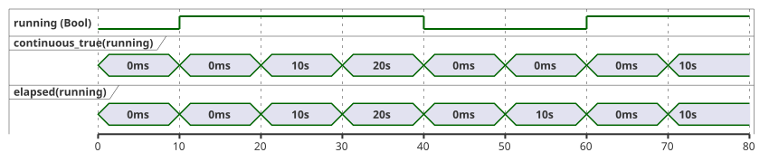
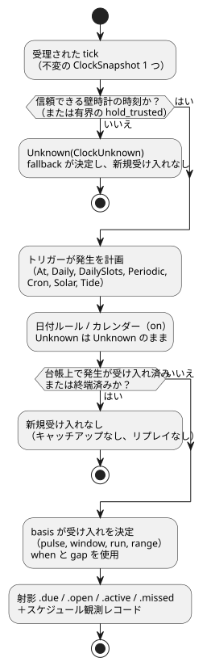
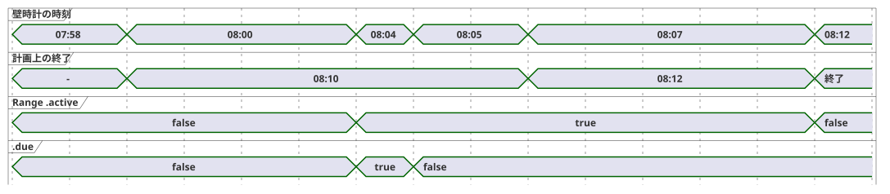

<!-- translation-source: docs/reference/03-time-and-schedules.en.md -->
[英語の原文](03-time-and-schedules.en.md)

# 3. 時間とスケジュール

[全体の目次](../LANGUAGE-REFERENCE.ja.md) · [前へ: 2. 型、式、状態](02-types-expressions-state.ja.md) ·
[次へ: 4. センサ、制約、制御](04-sensors-constraints-control.ja.md)

GhostFlowは時間を1つの数値として扱いません。次の2種類の時間を区別します。

- **経過時間**。「5分間オンにする」の「5分」は、前にしか進まない**単調**クロックで測ります。
- **暦時間**。「午前6時に開始する」の「午前6時」は、タイムゾーンの中で解釈される暦上の時刻です。

この区別から2つの規則が導かれます。壁時計を補正しても、すでに動作中の操作を巻き戻したり延長したりしてはなりません。再起動によってスケジュールの基準点が黙って移動してはなりません。この章では、この区別に基づいて、時間値、タイマー、繰り返しスケジュール、稼働カレンダー、自然現象（日の出、潮汐）を定義します。

**この章の読み方**。

- `ghost`コードブロックと文法ブロックは、選定された公開言語契約です。
- 現在のコンパイラがより狭いサブセットだけを検証または実行する場合は、その節で明記します。
- `text`と記したブロック（ClockSnapshot、マニフェスト、プロバイダのレコードなど）は、実行環境との契約です。GhostFlowのソースではありません。
- 時計、カレンダー、予測のデータは、ローカルデバイスから来ることも、任意のゲートウェイから来ることもあります。ネットワークも特定のゲートウェイも、言語の要件ではありません。

**この章の内容**

| 節 | トピック |
|---|---|
| §3.1 | 時間値の型（`Duration`、`Date`、`TimeOfDay`、`DateTime`）と2つのクロック |
| §3.2–§3.4 | タイマー：`elapsed`、`continuous_true`、累積使用量とローリング使用量 |
| §3.5 | Scheduleの共通意味論：ポリシー、basis、射影、取りこぼし、同一性、ギャップ |
| §3.6–§3.7 | `DailySlots`、`Periodic`、`cron5` |
| §3.8 | DST、深夜0時、稼働カレンダー |
| §3.9 | Solar、月、潮汐のスケジュール |
| §3.10 | 時間に基づく使用制限（日次予算とローリング予算、イベント回数） |
| §3.11 | 確立された構文と境界のまとめ |

この章は、[時間とスケジュールの契約](../TIME-AND-SCHEDULE-CONTRACT.ja.md)、
[連続Boolタイマーの契約](../CONTINUOUS-BOOL-TIMER-CONTRACT.ja.md)、
[Solarスケジュールの契約](../SOLAR-SCHEDULE.ja.md)、[選定された構文](../LANGUAGE-SURFACE.ja.md)、
[Programming in GhostFlow 第6–7章](../ProgrammingInGhostflow.ja.md)、
[2026-09-24 固定された計画時間範囲の決定](../2026-09-24-fixed-planned-time-range-decision.ja.md)、
[#23](https://github.com/callin2/ghostflow-language/issues/23)、
[#46](https://github.com/callin2/ghostflow-language/issues/46)、
[#90](https://github.com/callin2/ghostflow-language/issues/90)、
[#96](https://github.com/callin2/ghostflow-language/issues/96)に基づいています。

## 3.1 時間値とクロック領域

### Duration

`Duration`は時間の長さであり、暦上の日付ではありません。選定されたリテラルは、非負整数の後に単位`ms`、`s`、`min`、`h`のいずれかを続けたものです。

```ghost
config open_delay: Duration = 2s;
config watering_time: Duration = 5min;
```

**値域**。Durationは`0..2^53-1`の範囲にある厳密な整数ミリ秒です。すべての算術はこの範囲に対して検査されます。

次のものは、最終結果としても、動的な算術のどの中間結果としても禁止されています。

- 負のDuration
- ミリ秒未満の端数
- NaNとInfinity
- 範囲外の値

違反すると、現在のtick（論理判断の単位）は`duration-out-of-range`で拒否されます。新しい状態や意図が部分的に確定することはありません。

「正の遅延」を必要とする操作は、その引数に対して`0ms`を拒否してもかまいません。この制限はその操作に属するものであり、ゼロは有効な`Duration`値のままです。

**算術**。

- `Duration + Duration`は検査済みの和を返します。
- `Duration - Duration`は、結果が非負の場合にのみ`Duration`を返します。

月、年、暦上の日付はDurationの単位ではありません。それらの長さは固定のミリ秒数ではないからです。「1か月後」には別の暦演算の意味論が必要です。

### Date, TimeOfDay, DateTime

時間型のリテラルはタグ付き形式を使います。タグ（`date`、`time`、`datetime`）の後に、バッククォートで囲んだ文字列を続けます。

| 型 | 値域 | 規則 |
|---|---|---|
| `Date` | グレゴリオ暦`1970-01-01..9999-12-31` | 時刻もタイムゾーンも含みません。 |
| `TimeOfDay` | `00:00:00.000..23:59:59.999` | 日付、UTCオフセット、繰り返し規則を持ちません。 |
| `DateTime` | Unixエポックから`9999-12-31T23:59:59.999Z`までの厳密なUTC時点 | リテラルには`Z`または数値のUTCオフセットが必要です。値はIANAゾーンを保持しません。 |

```ghost
date`2026-09-22`
time`06:30`
datetime`2026-09-22T06:30:00+09:00`
```

正確な表記は次のとおりです。

```text
Date       := date`YYYY-MM-DD`
TimeOfDay  := time`HH:MM[:SS[.f|.ff|.fff]]`
DateTime   := datetime`YYYY-MM-DDTHH:MM:SS[.f|.ff|.fff](Z|+HH:MM|-HH:MM)`
```

**字句規則**。

- すべてのフィールドは、ゼロ埋めされたASCII 10進数字です。
- 秒の小数部は1～3桁です。右側をゼロで埋めて厳密なミリ秒にします。4桁以上は診断になり、決して丸められません。
- 数値オフセットの範囲は`00:00..14:00`です。時が14の場合は`14:00`のみ許可されます。
- `+00:00`は`Z`と同じ時点に正規化されます。`-00:00`（慣例的に「UTCオフセット不明」を意味する）は拒否されます。

**診断**。存在しない日付、`24:00`、うるう秒の`:60`、オフセットのないDateTimeは、いずれも診断になります。

**DateTime値とは何か**。DateTime値は厳密なUTCミリ秒の時点です。元の表記とオフセットは、ソースのメタデータにだけ保持されます。IANAタイムゾーンは**繰り返し**スケジュールを常用時（civil time）で解釈するための文脈であり、すでに解決されたDateTimeの時点の一部ではありません。

文字列と時間型の間、および`Date`、`TimeOfDay`、`DateTime`の相互間に暗黙の変換はありません。

最小限の時間算術は次のとおりです。

- `DateTime ± Duration -> DateTime`：範囲検査付きの時点のシフト。
- 同じ型の2つの値の比較（DateTime同士、TimeOfDay同士）。
- `TimeOfDay + Duration`は深夜0時で自動的に折り返し**ません**。Dateとタイムゾーンを与えるSchedule文脈の中で解釈してください。
- `DateTime - DateTime`は基本的な`Duration`演算ではありません。結果が負になる可能性があるからです。時点同士を比較するか、単調な`elapsed`を使ってください。

### 暦時計と単調クロック

各tickは、不変の**クロックスナップショット**を1つ使います。スナップショットは、役割の異なる2つのクロックを運びます。

| クロック | 用途 |
|---|---|
| 暦時計（壁時計） | スケジュール、日付、タイムゾーン、自然現象の解釈。 |
| 単調クロック | 操作がどれだけ動作したか、条件がどれだけ保持されたかの測定。 |

```text
// 契約を説明するための構造
ClockSnapshot {
  monotonicMs
  bootEpoch
  wallMs?
  wallQuality: Trusted | Unknown(reason)
  uncertaintyMs?
  sourceRevision?
}
```

スナップショットの規則：

- `monotonicMs`は1回の実行（run）の中で決して減少しません。単調時間が減少するスナップショット、または整数・範囲の要件を満たさないスナップショットは、状態が変わる前に拒否されます。
- `wallMs`は存在していても使えない場合があります。スケジュールの判断は、`wallQuality`が`Trusted`のときにだけそれを使います。
- 動作中のタイマーは、壁時計が前方または後方に補正されても、単調クロックに従い続けます。

どの時刻源（NTP、RTC、プラットフォーム時刻）を信頼するかはホストが決めます。制御式がネットワークやマシンの時計を直接読むことはありません。最後に信頼された時刻を一時的に保持するポリシーは、保持がどれだけ続くか、そしてどの終端フォールバックが適用されるかを明示しなければなりません。隠れた猶予期間はありません。

**理由**：壁時計の時刻と経過時間が「時間」という1つの言葉を共有していると、時計の補正、タイムゾーンの変更、DST、再起動によって、操作の動作時間まで変わってしまう可能性があります。

## 3.2 状態変化後の経過時間

`elapsed(state)`は、参照する状態が最後に**変化を確定**してからの単調時間を返します。

```ghost
type Phase = Idle | Watering;
state phase: Phase = Idle;
timer age = elapsed(phase);

phase' = case phase {
  Idle => if start then Watering else Idle;
  Watering => if stop || age >= watering_time then Idle else Watering;
};
```

正確な規則は次のとおりです。

- 最初に受理されたtickの式評価は`0ms`を読みます。
- §2.8のsnapshot規則に従い、状態遷移と出力はtick開始時の区間を読みます。
  そのtickで状態が変わっても、評価済みの`elapsed`出力は以前の区間を使います。
- 変更の確定時に現在の単調時間から新区間を開始します。同じ結果の確定後の
  タイマー観測は`0ms`です。ソースtraceはこの値を表示し、評価済み出力は再計算しません。
- 次の受理tickは新区間を読みます。同じtimestampなら`0ms`であり、状態が
  変わらなければ区間の開始時刻を維持します。
- Bool状態では、false→trueとtrue→falseの両方が変化です。したがって`elapsed(running)`は「現在の値がどれだけ保持されているか」を意味し、合計のON時間では**ありません**。
- 段階は1つのtickの中で連鎖しません。遷移は、その条件を満たす最初のtickで起こります。そのため実際の遅延は要求したDuration以上になり、通常は最大1tick間隔ぶん長くなります。
- 拒否されたtickはタイマーの状態を変えません。

タイマーは`sleep`でもバックグラウンドタスクでもありません。タイマーの動作中も、すべてのtickで停止要求、センサの故障（fault）、グローバルな制約が評価されます。

## 3.3 Boolが連続してtrueである時間

「温度が5分間しきい値を上回っていた」は、「この状態が最後に変化したのはいつか」とは別の問いです。**連続trueタイマー**は、条件がtrueである現在の途切れない区間だけを測ります。条件がfalseのtickでは、ただちに`0ms`を返します。

```ghost
timer hot_for = continuous_true(temperature_high);
```

`c`を条件、`wasTrue`を前回受理されたtickでのその値、`since`を現在の区間の開始、`now`を現在の単調時間とします。このとき次のようになります。

```text
value    = if c && wasTrue then now - since else 0ms
wasTrue' = c
since'   = if !c then now
           else if !wasTrue then now
           else since
```

帰結：

- 最初のtrueのtickはゼロを返します。同じタイムスタンプのtickが繰り返されてもゼロを返します。ゼロでない値は次のタイムスタンプ以降に現れます。
- falseのtickはただちにゼロを返し、次のtrueのtickが新しい区間を開始します。
- 各タイマーは独自の内部状態を持ち、タイマー同士で共有することはありません。

次のタイムラインは、10秒ごとにサンプリングされるBool状態について`continuous_true`と`elapsed`を比較したものです。値がfalseの間に違いが出ます。`elapsed`は**false**が保持されている時間を測りますが、`continuous_true`はゼロのままです。



`continuous_true`はBool式をちょうど1つ受け取ります。`Result<Bool, SensorFault>`をBoolへ暗黙に変換することはありません。故障を保守的にfalseとして扱うには、その選択を`case`で明示的に書いてください。

```ghost
let safe_high = case high_temperature {
  ok(value) => value;
  fault(_)  => false;
};
```

連続trueは、一時停止・再開する累積器でも、別々のON区間の合計でもありません。それらは別の時間演算です（§3.4を参照）。

## 3.4 累積時間とローリング予算

「どれだけの時間」についての問いが異なれば、必要な時間の意味論も異なります。

| 問い | 必要な時間の意味論 |
|---|---|
| 現在の段階はどれだけ保持されているか？ | `elapsed(state)` |
| 条件は途切れずにどれだけtrueであったか？ | 連続true |
| このジョブで合計何分のONが使われたか？ | ジョブを範囲とする累積ON時間 |
| 直近60秒間に合計何秒のONがあったか？ | スライディングウィンドウでのON積分 |
| 物理ポンプは今日合計何分オンだったか？ | 暦日単位の設備の使用量計上 |

ローリングの使用量計上（アカウンティング）は2段階です。まず、安定した物理リソースと計上段階に結び付けた**台帳**（`account`）を宣言します。次に、その台帳を時間の基準に対して問い合わせます。

```ghost
resource pump1: BoolActuator;
account pump_applied = on_time(pump1,
  stage: applied,
  persistence: durable);
constraints PumpBudget {
  limit used(pump_applied, rolling(60s)) <= 30s {
    reserve = 1s;
    on_unknown = block;
  }
}
```

これは`control`ブロック内の使用量計上宣言の断片です。現在のコンパイラは、正しい形の`limit used(...)`を検証し、使用量計上のディスクリプタを出力します。実行するには、別途リソースのバインディングと台帳の施行も必要です。

```text
used(t) = ON duration of x over (t - 60s, t]
```

予算の振る舞い：

- `used + reserve`が30秒に達すると、それ以上のONは禁止されます。
- 古いON区間の一部がウィンドウから外れると、ちょうどその分の予算がただちに戻ります。
- 固定の1分バケットや、現在の連続区間だけの測定でこれを近似しないでください。
- 複数区間の部分的な重なりを合計します。スキャンが不規則でも、同じ論理時間のトレースは同じ結果を与えなければなりません。

計上の**段階**は明示しなければなりません。

| 段階 | 数えるもの |
|---|---|
| requested | 制御が要求したON時間。 |
| admitted/safe | 制約を通過した論理的なON時間。 |
| applied | レンダラーが適用済みと報告したコマンド時間。 |
| confirmed | フィードバックで確認された物理的な動作時間。 |

段階が重要である理由の例：

- `manual_request`がtrueでも、低水位の制約によって安全出力がfalseになれば、admitted/safeの予算は消費されません。
- フィードバックがなければ、安全意図（safe）のON時間を実際の流量として提示してはなりません。

その他の要件：

- 状態メモリの上限を計算できるように、ウィンドウと最大ONは有限でなければなりません。
- 再起動が保護用の予算を暗黙にリセットしてはなりません。チェックポイントから復元する、ウィンドウの長さだけ保守的にブロックする、明示的な非永続ポリシーを宣言する、のいずれかの契約を選んでください。

**理由**：「1回30秒」と「直近1分間で合計30秒」は異なる安全規則です。両者が同じタイマーだと、短い起動を何度も繰り返すことで制限をすり抜けられてしまいます。

## 3.5 Scheduleの共通意味論

**Schedule**は、連続的に評価される型付きのリアクティブな値です。遅延呼び出しでもバックグラウンドスレッドでもありません。受理された各tickで、スケジュールは現在時刻を見て、トリガー、日付ルール、述語、文脈を評価します。それらから、発生（オカレンス）を**受け入れる**（admit）かどうか、つまり計画された1回の発生を開始済みとして受け入れるかどうかを決めます。条件が満たされなかったパルスが後のためにキューに入ることはありません。

次の図は、tickごとのこの判断の順序を示しています。各段階はこの節の残りで定義します。



選定されたトリガー型は`At`、`Daily`、`DailySlots<G>`、`Periodic`、`Cron`、`Solar`、`Tide`です。現在のコンパイラは、1回限りの`At`（pulseとWindow）と、スロットについては`DailySlots<15min>`のみを受け付けます。各トリガー型は、独自のトリガーフィールドに加えて、次の共通ポリシーフィールドを持ちます。

```ghost
schedule name: TriggerType {
  // trigger별 field
  basis = pulse;
  when = true;
  clock = trusted_only;
  gap = skip_after(60s);
  recovery = baseline;
  fallback = skip;
}
```

```text
basis       := pulse
             | window(positive Duration)
             | run(positive Duration, on_time)
             | run(positive Duration, within(positive Duration))
             | range(positive Duration)
when        := Bool
clock       := trusted_only
             | hold_trusted(positive Duration, terminal: skip)
gap         := skip_after(positive Duration)
recovery    := baseline
fallback    := skip
             | fixed_time(TimeOfDay, terminal: skip)  // Solar のみ
cancel_when := Bool                                   // 現在の常用時 range では必須。Tide run では任意
```

共通ポリシーフィールドの意味：

| フィールド | 意味 |
|---|---|
| `basis` | 発生をどのように受け入れ、計画時点の前後でどれだけ続くか（「Pulse, Window, Run, Range」を参照）。 |
| `when` | 受け入れの述語。無条件に受け入れる場合は`when = true`と書きます。 |
| `clock` | どの壁時計の時刻を使えるか：信頼された時刻のみ、または最後に信頼された時刻の有界な保持。 |
| `gap` | 発生を取りこぼしとして扱う前に許容する、最長の観測ギャップ。 |
| `recovery` | 起動時やクロックの信頼が戻ったときに何が起こるか。`baseline`はリプレイせずにベースラインを設定します。 |
| `fallback` | 判断がUnknownのときに何をするか。 |
| `cancel_when` | RunまたはRangeの言語レベルの取り消し。 |

共通フィールドの規則：

- 共通フィールドはすべて必須です。
- 言語レベルの取り消しを持たないRunまたはRangeは、`cancel_when = false`と記述できます。
- 現在のコンパイラでは、`cancel_when`は`Tide`のRunと常用時の`range`で許可されます。`range`では**必須**であり、`pulse`では**禁止**です。

**クロックの保持**。`hold_trusted(d, terminal: skip)`は、最後に信頼された壁時計の時点を取り、それ以降に経過した単調時間を加え、その結果を最大`d`の間使います。不確かさも同様に保持されます：最後の不確かさに同じ単調経過時間を加えたものです。保持された値は`HeldClock`の来歴（provenance）を持ちます。保持が上限に達すると、クロックは`ClockUnknown`になり、新しい受け入れの判断には終端の`skip`が適用されます。すでに受け入れられたRangeは、単調時間での終了時刻を維持します。ハイウォーター（すでに観測した最新の壁時計の時点）は変わりません。

**ポリシーとbasisに対する現在のコンパイラのサポート**。

| 機能 | 現在の状況 |
|---|---|
| `clock = hold_trusted(positive constant Duration, terminal: skip)` | SolarとTideで受け付けます。 |
| `fallback = fixed_time(TimeOfDay literal, terminal: skip)` | Solarで受け付けます。 |
| Tideのフォールバック | `fallback = skip`のみ。 |
| その他のトリガー | 信頼された時刻のみのクロックとskipフォールバックを維持します。 |
| `At` Window | 有界な実行可能Windowプロファイル。 |
| 他のトリガーでのWindow、`run(_, on_time)` | 現在のサポート範囲外。 |
| 不変のUTC Dailyと空でない静的DailySlotsのRange | 静的な非重複が証明され、GFB12として実行されます。 |
| 不変の非UTC `DailySlots<15min>` Range | GFB21プロファイル（「不変の非UTC DailySlots Range」を参照）：コンパイル時の名目上のスロット間隔の検査と、ホストが与える実際の発生区間に対するRustの検証。 |
| 受け付けられたその他のRange繰り返し | 実行不可能なディスクリプタのままです。 |
| オペレーターの`Duration`設定によるRangeの継続時間（サポートされるUTCプロファイル） | 初期値が非重複を証明する場合に許可されます。受理されたライブ設定のイベントは、凍結された計画開始から現在の発生を再計算します。新しいdueパルスや発生の同一性は作りません。 |
| Tideの`run(_, within(_))` | サポートされます。 |

**自然現象に対する有界な受け入れ**。次の規則は、予測の欠落や不確かなクロックが黙って発生を作ることを防ぎます。

- 保持された時刻は、単調経過時間が保持期間より**厳密に小さい**間だけ使われます。
- 信頼されたアンカーの欠落、不確かさの欠落、検査付き加算でのオーバーフローは、フェイルクローズします。
- 保持された壁時計の時刻と不確かさは、最後に信頼された値に経過時間を加えたものであり、`HeldClock`の来歴を持ちます。
- 期限切れになると新しい受け入れを終端skipし、ハイウォーターを維持し、動作中のRunを延長しません。
- recoveryはベースラインを確立します。再起動は新しいクロックで始まります。
- IANA変換はファクトプロバイダが担います。プロバイダは、既知のソースのローカル日付と、その日付で記述された時刻とタイムゾーンに一致するフォールバックの時点を与えます。
- 曖昧な常用時刻や存在しない常用時刻は終端skipします。foldをでっち上げることはありません。
- 受け入れと生成されるdue入力はコアが担います。
- 同じソースのローカル日付におけるフォールバックの発生と復旧したSolarイベントは、1つの消費済み同一性と終端チェックポイントを共有します。

`fixed_time`はSolarでのみ使えます。あるソースのローカル日付でフォールバックの発生が受け入れられると、同じ発生台帳がその日付のSolarイベントを消費します。そのため、プロバイダが復旧してもイベントは重複しません。Tideは`fallback = skip`のみを許可します。予測がなければ、潮汐イベントの数と同一性が不明だからです。

拡張されたSolarポリシーは、有界なSolarプロファイルでのみ実行されます。非Solarのスケジュール、プロバイダ・設定の実行、サポートされていない機能と組み合わせると拒否されます。従来のSolarの組み合わせは既存のプロファイルを維持します。

**Solarと設定の故障**。Solarの`when`が設定のResultを読むと、その設定は**受け入れ依存関係**になります。

- 依存する設定に現在故障があれば、記述された故障の分岐がtrueを返しても、判断は`Unknown(SettingsFault)`のままで、新しい発生は受け入れられません。
- 関係のない設定の故障はSolarを抑止しません。
- Solarと通常の制御は、同じ評価位置で現在のResultを読みます。
- 成功した復旧の観測はベースラインを確立します。過去のイベントをキャッチアップすることはありません。
- 設定の観測、Solarの判断、VMの遷移はまとめて確定します。そのため、評価に失敗するとイベントも発生も消費されません。
- 座標、タイムゾーン、イベント、オフセットは不変のプログラム定義です。ライブ設定がそれらを暗黙に置き換えることはありません。

**理由**：通常の制御が設定エラーを見ている間に、スケジュールが古い成功値から作業を開始すると、1つのプログラムが矛盾した判断を下すことになります。原因を保持し、実際に有効になった観測から受け入れを決めてください。

**1回限りの`At`（pulse）**。`At`は定数の型付きDateTimeを使います。タイムゾーンやDSTのフィールドはありません。

```ghost
schedule appointment: At {
  at = datetime`2026-01-01T08:00:00Z`;
  basis = pulse;
  when = true;
  clock = trusted_only;
  gap = skip_after(60s);
  recovery = baseline;
  fallback = skip;
}
```

- 絶対時点は明示されたオフセットから正規化されます。同じ時点を異なるオフセット表記で書いても、同じ発生が計画されます。
- この有界なPulseプロファイルが受け付けるのは、信頼された時刻のみのクロック、baselineのrecovery、skipのフォールバック、正の定数のgapだけです。
- 診断：フィールドの欠落、DateTimeでないまたは定数でない`at`、タイムゾーン・DST・取り消しのフィールド、その他のbasis。
- `.due`と`.missed`を公開します。
- プロバイダ、設定、センサ、リソース、目標（objective）、その他のスケジュールのプロファイルと混在させることはできません。
- GFB14とcontrol-v13がこの実行プロファイルを識別します。フレーム化されたクロック・スキャンの転送は変わりません。古いローダーはGFB14を拒否します。署名付きのポータブルパッケージは、まだこのプロファイルを受け付けません。

**Windowを伴う`At`**。`At`は、同じポリシーの制限の下で、正の定数の`window(Duration)`も受け付けます。

```ghost
schedule appointment: At {
  at = datetime`2026-01-01T08:00:00Z`;
  basis = window(5min);
  when = ready;
  clock = trusted_only;
  gap = skip_after(60s);
  recovery = baseline;
  fallback = skip;
}
output start_once: Bool;
start_once <- appointment.due;
```

計画された区間は半開区間`[at, at + duration)`です。2つの射影は異なる振る舞いをします。

| 射影 | 種類 | 意味 |
|---|---|---|
| `.open` | レベル | 信頼されたクロックがあるとき、**現在の**区間内に*あり*、かつ`when`がtrue。`when`の変化に応じてfalseになり、再びtrueになることがあります。 |
| `.due` | パルス | 区間内で最初に適格となった受理スキャンで、1回だけtrue。 |

終端の取りこぼしや以前の受け入れがあると、それ以降の`.due`は起こりません。ただし、現在の`.open`レベルを強制的にfalseにすることは**ありません**。1回だけ開始すべき作業には`.due`を使ってください。

例：08:00の`window(5min)`で、07:59:50から08:02:00までの観測ギャップがあると、その発生は終端の取りこぼしになります。08:02では`.missed`がtrue、`.due`がfalseですが、`when`がtrueなら`.open`はtrueになり得ます。08:05以降、`.open`はfalseです。

その他の規則：

- 不明な、または信頼されない壁時計の時刻が、開いていることが既知の区間を生むことは決してありません。
- `At` Windowには取り消しフィールドがなく、ホストの発生行も受け付けません。
- GFB23とcontrol-v23がこの別個の実行プロファイルを識別します。古いローダーはこれを拒否し、マニフェストとプロファイルの不一致は有効化の前に拒否されます。署名付きのポータブルパッケージは、まだこのプロファイルを受け付けません。

**コアが`At`の発生を受け入れる方法**。Rustコアは、コンパイルされたスケジュールの位置（site）と時点から、単一の発生を計算します。ホストが与える発生行は不要です。

- Pulseの受け入れには、観測ギャップのない信頼された受理スキャン、`previous < planned <= current`、`when = true`が必要です。通過時に`when`がfalseなら、その発生は終端の取りこぼしとして消費されます。
- Windowは、通過時に`when`がfalseであっても、ウィンドウが終わる前の最初の適格なスキャンで受け入れることができます。
- どちらの形式でも、重なる観測ギャップは終端の取りこぼしです。
- その時点以降の起動またはrecoveryのベースラインは、キャッチアップせずに、その発生を`BaselinePastMissed`として消費します。
- 再観測、壁時計の巻き戻し、再通過が別の受け入れを作ることは決してありません。新しいクロック源や起動リビジョンも、新しい同一性を作りません。
- 拒否されたスキャンは、クロックのベースラインも、終端の同一性も、射影も確定しません。

**再起動**。再起動をまたいだ重複除去には、同じプログラムの終端チェックポイントの復元が必要です。

- 消費済みまたは取りこぼし済みの同一性は、新しい起動の壁時計がその時点より前であっても、消費済みのままです。
- 発生の前に取得したチェックポイントは、将来の通過を受け入れることがあります。
- 新たな有効化は永続的な履歴を持ちません。
- 受け入れの後、永続的なチェックポイントが公開される前のクラッシュは、VMの「1回限り」の保証の範囲外です。その境界はホストの永続化とディスパッチが扱わなければなりません。
- 受け入れは論理的な証拠です。物理的な実行や応答確認を証明するものではありません。

**`Daily`**。`Daily`は毎日1つの時刻を計画します。`timezone`、``at = time`...`;``、`dst_missing`、`dst_repeated`が必要です。例：

```ghost
schedule morning: Daily {
  timezone = "Asia/Seoul";
  at = time`06:30`;
  dst_missing = skip;
  dst_repeated = first;
  basis = pulse;
  when = true;
  clock = trusted_only;
  gap = skip_after(60s);
  recovery = baseline;
  fallback = skip;
}
```

**トリガーとbasisは独立した軸です**。Cron、Window、Run、Rangeを同じ種類の選択肢として並べないでください。

- トリガー（たとえばCron）は、発生が**いつ**計画されるかを決めます。
- basis（Window、Run、Range）は、計画時点の**前後で**の受け入れと継続時間を決めます。

Scheduleを読んでもデバイスがオンになることはありません。

**判断とUnknown**。スケジュールの判断は、`True`、`False`、`Unknown(reason)`のいずれかであり、使用したリビジョンを伴います。`fallback = skip`は、新しい受け入れについてUnknownを`.due = false`に解決しますが、理由は保持します。Unknownを否定して許可に変えることは決してあってはなりません。

**射影**。

| 射影 | 意味 |
|---|---|
| `.due` | パルス：1つの発生を受け入れた受理tickでのみtrue。 |
| Window `.open` | レベル：`[planned, planned + length)`の内側に**あり**、かつ現在の述語がtrue。 |
| Run `.active` | 受け入れ後の動作区間。明示的な状態と単調タイマーで表されます。 |
| Range `.active` | 現在の発生の区間の残りの部分。計画開始に固定されます。受け入れ後、その終了は単調クロックで判断されます。安全制約が出力をブロックしても、区間は進み続けます。 |

**Runの継続時間と取り消し**。

- Runの継続時間は、実際の受け入れからの単調時間で測ります。
- `cancel_when`がtrueである受理tickで、RunとRangeは`.active`を終了します。その発生が再び有効化（rearm）されることはありません。
- 要求された出力がfalseになったり、グローバル制約が安全出力をブロックしたりしても、RunとRangeが黙って一時停止することはありません。
- 要求ON、安全ON、連続安全ONの時間を測るには、別の明示的な演算を使ってください。

**スケジュールの観測**。各判断は、Boolの射影とは別に、**スケジュール観測**も残します。記録される内容：

- 安定したスケジュールIDと定義リビジョン
- 判断`False | Due | Unknown(reason)`とその処置（disposition）
- 発生IDと計画された壁時計の時点
- ソースのローカル日付とスケジュール上のローカル日付
- プロバイダと文脈のリビジョン

典型的な処置は、`Before`、`PredicateFalse`、`AlreadyAdmitted`と、次の取りこぼし理由です。

| 取りこぼし理由 | 意味 |
|---|---|
| `ConditionsFalseAtPulse` | パルスの通過時に条件がfalseでした。 |
| `ObservationGap` | 信頼できない観測ギャップが受け入れ区間と重なりました。Rangeでは、これは開いている区間についての非終端の証拠であり、後述のrecovery規則で扱われます。 |
| `LateStartExpired` | 遅延受け入れの区間が終了しました。 |
| `CorrectionPastHighWater` | 補正されたイベント時刻が、すでに通過したハイウォーターより後ろに移動しました。 |
| `EventWithdrawn` | まだ受け入れられていないイベントをプロバイダが撤回しました。 |

`.due = false`だけでは、通常のfalse、Unknownのフォールバック、受け入れ済みのイベント、取りこぼしたイベントを区別できません。そのため、この証拠は同じ受理スキャンに結び付けられています。

### 取りこぼした発生へのソースでの対応

`schedule_name.missed`は、ソースコードが取りこぼしに反応できるようにする`Bool`射影です。

**利用可能範囲**。現在のコンパイラは、At pulseとWindow、Solar、実行可能な`pulse`の常用時スケジュールに`.missed`を提供します。Range（実行可能なUTC Rangeの制御を含む）については、まだ実行時の射影ではありません。

**意味論**。

- そのスケジュールの1つ以上の発生が、この受理スキャンで**終端の取りこぼし**になったときにのみtrueです。
- 1回のスキャンで複数の発生を取りこぼしても、trueになるのは1回だけです。新たな終端の取りこぼしがない限り、次の受理スキャンではfalseです。
- `control`の処理は、その受理スキャンの不変スナップショットの中で、これをちょうど1回評価します。
- すでに終端の取りこぼしとして記録された発生を再観測しても、チェックポイントを復元しても、再びtrueにはなりません。
- 拒否されたスキャンは、このパルスもどの状態遷移も確定しません。

```ghost
state missed_scans: Int = 0;
missed_scans' = if morning.missed then missed_scans + 1 else missed_scans;
output missed_alarm: Bool;
missed_alarm <- morning.missed;
```

`.missed`は通常の`Bool`式なので、作成者は`if`、`case`、状態遷移、出力式で対応を記述します。スケジュール宣言には、コールバックも、発生ごとのハンドラも、自動リプレイもありません。複数のスケジュールの取りこぼしにスキャンごとに1回対応するには、`morning.missed || evening.missed`のような1つの式を評価してください。

**発生ごとのレコード**。Boolのパルスは件数も理由も運びません。代わりに、同じ受理スキャンの**順序付きスケジュール観測**に、終端の取りこぼしとなった発生ごとに1つのレコードが含まれます。各レコードが保持するもの：

- 安定したスケジュールIDと発生ID
- 計画された時点
- 終端の取りこぼし理由（`ConditionsFalseAtPulse`、`ObservationGap`、`LateStartExpired`、`CorrectionPastHighWater`、`EventWithdrawn`のうち該当するもの）
- 定義、文脈、プロバイダのリビジョン

これらのレコードの規則：

- 1回のスキャンで複数のレコードが確定しても、マージされたり、1つの理由にまとめられたりはしません。
- 再起動後に復元された終端台帳が、重複したレコードやパルスを作ることはありません。
- `Unknown`、およびまだ開いているRangeに対する非終端の`ObservationGap`は、`.missed`をtrueにしません。
- 取りこぼした発生が、後で条件がtrueになったときに自動的に受け入れられたり実行されたりすることは決してありません。

### Pulse, Window, Run, Range

`basis`フィールドは、4つの受け入れの形のいずれかを選びます。

| basis | 受け入れの意味論 |
|---|---|
| `pulse` | 通過tickですべての条件がtrueの場合にのみ受け入れます。後でtrueになっても取りこぼしのままです。 |
| `window(5min)`（`At`で実行） | `[planned, planned+5min)`の中で条件が最初にtrueになったときに1回受け入れます。同じ発生の中でfalse→trueの変化が繰り返されても、再び有効化はされません。その他のトリガーの組み合わせは設計段階のままです。 |
| `run(5min, on_time)`（設計） | 観測された通過時にのみ受け入れ、受け入れから5分間動作します。 |
| `run(5min, within(10min))`（Tide） | `[planned, planned+10min)`の中での最初の受け入れを許可します。10分は猶予で、動作の長さは5分です。 |
| `range(10min)`（常用時の契約） | 信頼された現在時刻が`[planned, planned+10min)`の中にあり、`when`がtrueなら、最初の観測、起動、recoveryが遅れても1回受け入れます。終了は計画開始＋10分です。不変のUTC Daily/DailySlotsはGFB12を使い、後述の不変の非UTC DailySlotsはGFB21を使います。 |

```ghost
schedule morning_watering: Daily {
  timezone = "UTC";
  at = time`08:00`;
  dst_missing = skip;
  dst_repeated = first;
  basis = range(10min);
  when = true;
  cancel_when = false;
  clock = trusted_only;
  gap = skip_after(60s);
  recovery = baseline;
  fallback = skip;
}
```

**実行可能なRangeの範囲**。この不変のUTC `range`の例は、実行可能なGFB12の制御バイトコードです。

- 有界な実行スライスは、稼働カレンダーなしのDailyと、空でない静的DailySlotsを、`trusted_only`、`baseline`、`skip`とともにサポートします。
- `workday`または`offday`セレクタと型付きWorkCalendarを持つ不変のUTC DailyはGFB18を使います。その開始＋継続時間はローカルの深夜0時を越えてはなりません。夜をまたぐ作業区間は、別々の明示的なDaily rangeに分割してください。ちょうど深夜0時に終わるrangeは有効です。終了は排他的だからです。稼働カレンダーのない通常のrangeは、既存の深夜0時の振る舞いを維持します。
- ライブの継続時間設定は、稼働カレンダーのないUTC Daily/DailySlotsに対してのみ下位変換（lower）されます。
- ライブのスカラー開始設定は、固定Durationを持つ単一のUTC Daily Rangeに対してのみ下位変換されます。
- 次のものは、静的なRangeメタデータへ黙ってフォールバックする代わりに、静的に拒否されます：ライブの継続時間・開始の設定を持つ稼働カレンダーRange、ライブの開始とDurationの組み合わせ、Periodic Range、非UTCのDaily Range、非UTCの設定ベースのRange。
- 不変の非UTC DailySlotsは、次の小節の別プロファイルに従います。
- サポートされていない変種が、タイムゾーンやDSTのポリシーを推測することは決してありません。

**Rangeのチェックポイント**。Range文脈のチェックポイントは、消費済みの発生の同一性と、存在する場合は有効なライブの継続時間またはライブのスカラー開始設定を保存します。動作中の単調タイマーは保存しません。

- 新たな起動に復元しても、すでに消費された発生を再開したり再び受け入れたりはしません。次の発生は、復元された継続時間または開始を使います。
- まだ開いている未消費の区間は、残りの時間だけを受け入れることができます。
- 終端の容量が尽きると、スキャンはアトミックに拒否されます。同一性が黙って削除されることは決してありません。

**Runの遅延受け入れ**。遅延受け入れの区間は半開区間なので、その終了境界で新しい受け入れは起こりません。計画時刻08:00の`run(5min, within(10min))`を08:02に受け入れると、単調クロックで08:07まで動作します。

**Rangeは固定された計画区間です**。`range(duration)`は、受け入れ時刻ではなく計画時刻に固定されます。

- 08:00の`range(10min)`を、信頼された08:04に初めて観測した場合、08:10までの残り6分だけを要求します。
- 08:10以降に初めて観測した場合は開始せず、`LateStartExpired`が記録されます。
- `when`が遅れて、しかし終了前にtrueになった場合は、残りの時間だけを要求します。
- 起動時、再起動時、クロックの信頼が復旧したとき、観測ギャップの後も同様です。

この部分区間の受け入れはRangeに**のみ**適用されます。他のbasisに対する`gap = skip_after(...)`や`recovery = baseline`は変わりません。

**Rangeとクロックの信頼**。

- 信頼された現在時刻がなければ、判断は`Unknown(ClockUnknown)`です。推定された時刻が新しいRangeを受け入れることは決してありません。
- 明示的な`clock = hold_trusted(...)`は、その契約の下で保持された時刻と不確かさを使います。
- すでに動作中のRangeは、その後に壁時計の信頼や保持が期限切れになっても、既存の単調時間での終了まで続きます。
- 開始が将来に移動された後に同じ発生へ再び入るには、新しい受け入れと同様に信頼された時刻が必要です。信頼が復旧した後でも、現在の区間が終わっていれば再び入ることはありません。

**Rangeの発生は重なってはなりません**。同じスケジュールの2つのRangeの発生は重なってはなりません。

- 2つの半開区間の共通部分が空でなければエラーです。ちょうど接する区間は許可されます。
- 例：`selected = [08:00, 08:15]`と`basis = range(30min)`の`DailySlots`はコンパイルエラーです。08:00–08:30と08:15–08:45が重なるからです。
- コンパイラは、トリガー定義と有効な設定から非重複を証明します。
- 不変の非UTC DailySlotsプロファイルは、名目上のスロット間隔をコンパイル時に検査し、実際の区間の検証を後述のRustのファクト検査で完了します。
- その明示的なプロファイル以外で、プロバイダや動的な繰り返しの間隔を証明できない場合、`range`宣言はコンパイル診断で拒否されます。コンパイラが推測したり、1つの区間を選んだりすることは決してありません。
- 静的な既定値はコンパイル時に検査されます。復元された設定を含む有効値は、有効化の前に検査されます。重なる有効値は有効化を拒否します。
- 重なりを生むライブ設定の変更は、イベント全体をアトミックに拒否します。
- どちらの検査も、新しく計画された区間だけでなく、現在受け入れられている区間も対象にします。

**受け入れ時の終了の固定**。Rangeの受け入れ時に、計画上の終了は、その発生の計画開始とその時点で有効なDurationから固定されます。すでに経過した部分は、単調クロック上の残り時間に変換されます。受け入れ後は次のようになります。

- RTC/NTPによる壁時計の補正は、進行中の終了を早めも遅らせもしません。
- 補正された壁時計は、現在の発生が終わった後の、以降の発生の判断に適用されます。
- 信頼された時刻、計画開始、単調経過の基準はその発生のためにまとめて保持されるので、補正の間に終了が再計算されることはありません。

**ライブでの開始またはDurationの変更**。単一開始のトリガーのスカラー開始時刻設定、またはそのDurationが運用設定である場合、受理されたアトミックなライブイベントは、そのイベントの適用位置から現在の発生にも適用されます。

- 現在の区間とその終了は、変更された開始とDurationから再計算されます。
- 発生IDとすでに受け入れられた台帳は、設定リビジョンの変更後も維持されます。
- 受け入れ後は、補正前の安定した時間基準を単調経過時間だけ進めて、現在の位置と残り時間を求めます。
- 遅れた受け入れの時刻が新しい計画開始として使われることは決してありません。壁時計の補正やClockUnknownのために現在日付のキーが使えない場合でも、元のローカル日付と有効なTimeOfDayから時刻を再計算します。
- 設定イベントとスキャンが同じ位置に来た場合は、まず§5.2のイベント順序を適用し、その位置で有効な設定を使って判断します。

08:00に計画され、08:04に受け入れられた`range(10min)`の具体例：

| 変更 | 結果 |
|---|---|
| 08:07にDuration → 12分 | 08:12に終了します。 |
| Duration → 5分 | 新しい終了08:05はすでに過ぎているので、イベントを適用した判断で終了します。 |
| 開始 → 08:08 | ただちに非アクティブになり、信頼された08:08に再びアクティブになり、08:18に終了します。 |
| 開始 → 08:02（Durationは10分のまま） | 08:12に終了します。 |

次のタイムラインは最初の行を示しています。08:04に遅れて受け入れられ、その後08:07のライブのDuration変更によって計画上の終了が08:10から08:12に移動します。`.due`は受け入れ時に1回だけ発火します。



**安全のためのブロックはRangeの時計を止めません**。

- グローバルな安全制約が出力をブロックすると、安全出力はただちにfalseになりますが、Rangeの発生とその単調時間での終了は残ります。
- 終了前に制約が解除されれば、その時点で残っている区間だけを要求できます。ブロックされていた時間が終了に加算されることはありません。
- `cancel_when = true`は発生を終了させます。許可が再び出ても再開しません。
- `.active`と、requested/safe/applied/confirmedの出力は、それぞれ異なる観測です。

**開始が現在の位置より後に移動された場合**。

- 開始時刻の変更によって現在の位置が新しい計画開始より前になる場合、その判断で発生は`.active = false`で停止します。
- 新しい開始に達した受理tickで、同じ発生が変更後の区間に対して再評価されます。`when`がtrueなら、要求は現在の計画上の終了までだけ再開します。安全出力は、安全制約が許可する場合にのみ生成されます。
- これは新しい受け入れではありません。`.due`は再び出力されず、発生IDと台帳も同じままです。
- 変更後の終了が現在の位置以前であれば、発生は再開も再受け入れもせずに、ただちに終了します。

`DailySlots`の`TimeSlots`の変更については、§3.6の安定したスロットキーによって、時刻変更（retime）と削除・追加が区別されます。上記のRange再計算の規則は、キーを維持する時刻変更に適用されます。削除・追加には、新規項目のベースライン規則が適用されます。

### 不変の非UTC DailySlots Range

**プロファイル**。非UTCのIANAタイムゾーンにおける空でないリテラルの`DailySlots<15min>`で、正の固定Durationを持つものは、GFB21として実行されます。`civil-range`プレリュード（タグ19）と`GhostFlow/control-v21`を使います。

- 複数のそのようなRange、通常の時間ウィンドウ、`elapsed(state)`のように通常の状態へ下位変換されるタイマーと組み合わせることが**できます**。
- 別の`true-for`プレリュード、その他のスケジュール・プロバイダ・設定のプロファイル、稼働カレンダー、ライブの開始・Duration・TimeSlotsとは組み合わせ**られません**。
- 既存のUTCプロファイルとGFSFの常用時の発生行は変わりません。その行はGFSF4から存在していますが、現在の文脈エンコーダがGFSF4のエンベロープを出力するという意味ではありません。
- 古いローダーはGFB21を拒否します。別のプロファイルで代用することはありません。

```ghost
schedule night: DailySlots<15min> {
  timezone = "Asia/Seoul";
  selected = [22:00];
  dst_missing = skip;
  dst_repeated = first;
  basis = range(7h);
  when = true;
  cancel_when = false;
  clock = trusted_only;
  gap = skip_after(60s);
  recovery = baseline;
  fallback = skip;
}
```

同じポリシーで`selected = [05:00]`、`basis = range(17h)`とした2つ目のスケジュールが、昼の区間を定義します。ソウルでは次のようになります。

- 22:00＋7時間は翌日の05:00に終了します。
- 05:00＋17時間は22:00に終了します。

終了境界は排他的です。深夜0時は夜の区間の内側にあり、05:00と22:00はそれぞれ次の区間を開始します。この演算は、計画開始の時点に固定の経過時間を加えるものです。DSTのある地域で任意のローカル終了時刻まで動作させる演算では**ありません**。

**ホストの責任**。タイムゾーン変換とtzdbの完全性はホストが担います。ホストはスケジュールごとに、次の条件を満たすカバー区間`[coverageStartMs, coverageEndMs)`を与えます。

- 信頼された現在の壁時計の時点から、継続時間ぶん過去にさかのぼる：`coverageStartMs <= max(0, wallMs - durationMs)`
- 現在より後に終わる：`coverageEndMs > wallMs`

ホストは、そのカバー区間内の**すべての**発生を与えなければなりません。深夜0時を過ぎてもまだ区間が開いている前日の発生も含みます。日付が変わった後に今日の行だけを送るのでは不十分です。既存のGFSFスケジュールの証拠は`provider: null`と`calendar: null`を持ちます。JavaScriptの行は既存のフィールドを使います。

```text
{ sourceDay, slotKey, minuteOfDay, fold, eventId, eventKind: "civil",
  instantMs, withdrawn, providerRevision, contextRevision }
```

| フィールド | 規則 |
|---|---|
| `sourceDay` | 元のローカル日付の日番号。Unixエポックから数えます。 |
| `slotKey` | 不変のリテラルリストを時刻順に並べた後の、1始まりの序数。 |
| `minuteOfDay` | 宣言されたスロットの正確な分。 |
| `eventId` | 空。 |
| `withdrawn` | 撤回は禁止されています。 |
| `fold` | DSTのfoldの選択は、記述された`dst_repeated`に従います。 |

同一性は`site:sourceDay:slotKey:fold`です。リビジョンや計画された時点はこれを変えません。

**nullファクト（DSTによるスキップ）**。

- ホストが解決した存在しないローカルスロットで`dst_missing = skip`の場合、`instantMs = null`のファクトとして送るか、既知のスキップされた発生として省略してもかまいません。証拠が欠落しているだけではDSTギャップは確立されません。
- ホストが解決した繰り返しスロットで`dst_repeated = skip`の場合も、`fold = 0`のnullファクトを使えます。`dst_missing = next_valid`の場合も含みます。
- nullファクトには、`fold = 0`と、記述された少なくとも1つのskipポリシーが必要です。nullファクトは区間を作りません。
- ギャップと繰り返しスロットを区別する責任は、引き続きホストにあります。
- このnullを正常なOFFで置き換えたり、計画された時点をでっち上げたりしないでください。

**Rustによる検証**。Rustは次のものを検査します。

- フィールドの範囲、宣言されたスロットキーと分、DSTのfoldの選択
- nullのskipマーカーが許可されるかどうか
- 重複または矛盾する同一性とリビジョン
- 行の時点がカバー区間内にあること
- 現在受け入れられている凍結区間を含む、実際の半開区間の非重複
- 連続するカバー区間が重なる部分で、以前に観測した解決済み時点のファクトが消えたり矛盾したりしないこと

カバー区間の不足や不正な形式のファクトが、新しい受け入れにつながることは決してありません。失敗したスキャンは、部分的な状態も発生の履歴も確定しません。RustはIANA tzdbを持たないので、ホストの最初の証拠から完全に省略されたIANAの発生が網羅されていることを証明できません。

**実行**。検証済みのファクトは、既存のRangeEngineで実行されます。

- 最初の観測、起動、クロックの信頼の復旧が遅れても、開いている区間の残りの部分だけを受け入れることができます。
- `gap`はクロック観測のポリシーです。ファクトのカバー区間を短くすることはなく、開いているRangeをパルスのように破棄することもありません。
- 一度受け入れられると、タイマーは壁時計の信頼の喪失や壁時計の補正をまたいで、固定された単調時間の期限を維持します。
- チェックポイントは再起動時の重複除去のために消費済みの同一性を保持し、受け入れ済みのタイマーを再開することは決してありません。部分区間を受け入れられるのは、未消費の開いている発生だけです。

**理由**：深夜0時を過ぎて現在となっている区間は、昨日の計画から来ていることがあります。ホストのIANA変換をRustのファクト検証と受け入れから分離することで、検証済みの発生を同じRangeの意味論で実行できます。この契約は、コンパイルされたGhostFlowの決定的なシミュレーションを支えるものです。公道の信号の適合性を定義するものではなく、物理的な制御を検証するものでもありません。

### 発生の同一性と重複抑止

計画された各発生は、スケジュールの安定した宣言IDとソースの発生キーによって識別されます。

| トリガーの系統 | ソースの発生キーに含まれるもの |
|---|---|
| ローカルの日次 / Cronのスロット | DSTのfold |
| Solar | イベントの種類とソース日付 |
| Tide | プロバイダが保証する観測点（station）IDとイベントID |

定義リビジョンや補正された計画時刻はメタデータです。同じイベントを新しいイベントに変えることはありません。

発生は最大1回だけ受け入れられます。

- trueのままの条件が、tickごとに新しい動作を作ることはありません。
- すでに受け入れられた発生の新しいプロバイダリビジョンが、重複した動作を作ることはありません。
- 本当に別のスケジュールには、新しいスケジュールIDが必要です。

### 観測ギャップとrecovery

**ギャップの検出**。スケジュールは、連続する受理スナップショット間の単調時間の差と、正の壁時計の差を検査します。`gap = skip_after(d)`の場合、`d`より大きい差は`ObservationGap`です。

**Pulse、Window、Runへの影響**。ギャップが発生の受け入れ区間と重なると、その発生は取りこぼしとして終わります。

- Windowや`within(...)`の猶予がまだ開いていても、後で復活することはありません。
- Windowの終端の取りこぼしは`.due`の受け入れを止めます。現在の信頼された区間と述語によって、`.open`がtrueになることは依然としてあり得ます。

**Rangeへの影響**。区間中のギャップはギャップの証拠であり、発生の終端の取りこぼしではありません。

- 信頼された現在時刻がまだ計画区間内にあれば、最初の受け入れで残りの時間だけを要求できます。
- 終了境界に達すると、実行せずに`LateStartExpired`で終端の取りこぼしが記録されます。
- すでに終端の取りこぼしになった発生や撤回された発生は、時刻がその区間内にあるというだけでは復活しません。特に、Tideの`CorrectionPastHighWater`と`EventWithdrawn`はRangeでも終端です。

**recovery**。`recovery = baseline`は、最初の起動時とクロックの信頼が復旧したときにベースラインを設定するだけです。過去の発生をまとめて実行することは決してありません。

- Rangeは、まだ開いている現在の区間の残り時間だけを受け入れることができます。
- 壁時計の巻き戻しは、ハイウォーターと受け入れ台帳を使って重複除去されます。
- キャッチアップ、リトライ、リプレイの構文はありません。

**1ステップで複数の発生を通過した場合**。連続する受理スキャンの間に、同じスケジュールの発生を2つ以上通過した場合：

- 新しいPulse、Window、Runの発生はすべて取りこぼしとして記録され、どれも受け入れも実行もされません。
- Rangeは、すでに終わった発生や、終端の取りこぼし・撤回として記録された発生を実行しません。信頼された現在時刻で区間が開いている発生を、その残りの継続時間について受け入れます。
- 同じスケジュールの2つのRange区間が同時に開いていることは禁止されています。プロファイルのコンパイル時・ライブ設定の検査か、Rustのファクト検証によって拒否されます。

ちょうど1つの発生を通過した場合は、各basisの通常の受け入れ規則が適用されます。

## 3.6 選定されたDailySlots

`DailySlots<15min>`は、ローカル日付の15分グリッド上の特定の時刻を選びます。

```ghost
schedule starts: DailySlots<15min> {
  timezone = "Asia/Seoul";
  selected = [06:00, 18:45];
  dst_missing = skip;
  dst_repeated = first;
  basis = pulse;
  when = true;
  clock = trusted_only;
  gap = skip_after(60s);
  recovery = baseline;
  fallback = skip;
}
```

- `timezone`は、スケジュールの解釈に使うIANAゾーンです。
- `selected`は、1日の`00:00..23:45`の範囲にある15分グリッドの時刻を含みます。
- 重複するスロットとグリッドから外れた時刻は禁止されています。
- `starts.due`は、スロットの通過を観測した最初のtickで1回trueになります。
- 起動前のスロット、観測ギャップで取りこぼしたスロット、recovery前の発生が、暗黙にキャッチアップされることはありません。
- 壁時計が巻き戻された後、同じローカル日付・スロットが再び実行されることはありません。

**オペレーターが編集できるスロット**。同じプログラムと実行（run）の中でオペレーターがスロットの集合を変更できるようにするには、有限の設定型を使います。

```ghost
config watering_slots: TimeSlots<15min, 8> = [
  time`06:00`, time`18:45`
] {
  access = operator;
  label = "관수 시작 시각";
}
```

`TimeSlots<G,N>`は、TimeOfDay値の名目的な有限集合です。

- `G`は24時間をちょうど割り切る正のDurationのグリッドです。`N`はコンパイル時の最大項目数です。
- 空集合は、発生を持たない有効な値です。
- 値は一意で、ローカルの深夜0時から測ってグリッド上になければなりません。検証後にソートされます。
- Durationのリストへ暗黙に変換されることはありません。
- `selected = watering_slots`の場合、スケジュールと設定はまったく同じ`G`を持たなければなりません。
- リテラルの`selected`は簡潔な`HH:MM`を使い、設定値は通常の`time`リテラルを使います。

**設定の故障**。`selected = watering_slots`は、§5.2の`Result<TimeSlots<G,N>, SettingsFault>`ストリームを消費します。

- 現在の観測に故障があれば、同じ原因の`Unknown`となり、新しい発生は受け入れられません。
- 以前に成功したリストや空のリストで代用しないでください。
- 次の`ok`の出力は、後述の同一性、時刻変更、ベースラインの規則の下で適用されます。
- 故障そのものが、すでに受け入れられたRunを取り消したり、別途指定された取り消し規則を置き換えたりすることはありません。

**受理されたライブ編集**。受理されたライブ編集は、次の意味論を持ちます。

- **アトミックな検証**。イベント全体が一度に検証されます：型、グリッド、重複、`N`、権限、プログラムの同一性。
- **スロットキー**。承認されたランタイムの設定状態は、各項目について、表示される時刻とは独立した不透明な`slot key`を保持します。このキーはGhostFlowのソース構文ではなく、作成者が選ぶものでもありません。設定イベントは一意のイベント同一性と基準となる設定リビジョンを持ちます。時刻変更は、既存の`slot key`と新しい`TimeOfDay`の両方を指定します。UIとストレージは、順序や表示時刻を項目の同一性として使ってはなりません。
- **時刻変更（retime）**。時刻変更は、同じ項目の表示時刻だけを変えます。発生の同一性`(schedule ID, local date, slot key, DST fold)`と、受け入れ・終端の台帳は維持されます。新しい`TimeOfDay`は計画時刻のメタデータです。すでに受け入れられたRangeを将来へ移動すると、ただちに`.active = false`で停止します。信頼された時刻が新しい開始に達すると、同じ発生が変更後の半開区間で再評価されます。`.due`は再び出力されず、2回目の受け入れも作られません。
- **時刻変更の例**。`TimeSlots<1min,N>`で、08:00の`range(10min)`の発生が08:04に受け入れられたとします。その項目を08:07に時刻変更すると、イベントの適用位置で停止します。受理された08:07の判断が同じ発生を再評価し、`when`がtrueなら08:17まで要求します。発生ID、スロットキー、台帳は変わりません。イベントが08:07の判断位置で適用される場合は、§5.2の順序によってまず新しい値が適用され、その直後に同じ発生が評価されます。
- **追加**。新しく追加された項目は新しい`slot key`を得て、イベントの有効位置でベースラインを設定します。その位置以前の同日のスロットは出力されず、将来のスロットだけが計画されます。
- **削除**。削除は、その`slot key`の将来の計画だけを消します。表示時刻を削除して同じ時刻を再び追加すると、新しいキーと発生が作られます。これは時刻変更ではありません。削除は受け入れ済みのRunを取り消しません。受け入れ済みのRangeの時刻を変更するには、削除と追加ではなく、既存のキーを指定した時刻変更イベントを送ってください。
- **順序**。設定イベントとスケジュールのスキャンは、有効位置の全順序に従います。項目は、最初に追加されたまさにその位置では到来（due）しません。
- **再起動**。再起動は承認された設定値を復元することがありますが、保留中のキューは作りません。発生台帳の寿命は通常の設定とは別です。復元される状態は、表示時刻だけでなくスロットキーも含まなければなりません。

時刻変更の結果は、完全な`TimeSlots<G,N>`値として検証されます：グリッド、重複、`N`、同じスケジュール内でのRangeの非重複です。新しい時刻が別の項目のRangeと重なる場合は、イベント全体が拒否されます。既存の値、スロットキー、設定リビジョン、動作中の発生、台帳は維持されます。

この型は「15分ごと」を意味**しません**。`[06:00, 18:45]`のような特定のローカル時計のスロットを表します。これは、設定によって周期が変わるPeriodicとは異なります。

**実行可能なキー付きRangeプロファイル（GFB20）**。有界な実行可能プロファイルは次のとおりです。

- `TimeSlots<G,N>`で選ばれるUTCの`DailySlots<G>`、正の固定Duration、稼働カレンダーなし、24時間を割り切る分単位のグリッドを使います。
- GFB20/control-v20を使います。
- ライブのTimeSlotsとライブのDuration、または非UTCゾーンとの組み合わせを拒否します。

例：08:00の`range(20min)`が受け入れられている間は、リストを`[08:00, 08:15]`に変更できません。`[08:00, 08:20]`は有効です。半開区間が接するだけだからです。事前検査（preflight）には、提案された将来のリストからキーが削除された受け入れ済みの区間も含まれます。拒否されると、そのイベント内の他の設定も、クロック、アロケータ、リビジョン、発生の履歴も確定しません。**理由**：設定リビジョンが、重なる作業を持ち込んだり、制御スナップショットの一部だけを変えたりしてはならないからです。

このプロファイルのその他の規則：

- キーを追加または時刻変更する編集には、信頼された壁時計のベースラインが必要です。壁時計の信頼が不明な間は、アトミックに拒否されます。
- 変更されないキーと、受理された設定故障の出力は、既存の振る舞いを維持します。この制限は、別のライブのスカラー開始・Duration Rangeプロファイルを変えるものではありません。
- 故障の出力は過去のキーの同一性を保持しますが、Unknownを生成し、新しい有効な計画は作りません。
- GFRG4チェックポイントは、受理されたキー付きリスト、アロケータ、追加時のベースライン、消費済みの履歴を永続化します。これには空のリストや、表示時刻の順序が変わった保持キーも含まれます。
- 復元はそのメタデータを検証し、動作中のタイマーを再開することは決してありません。
- 既存のGFRG1/2/3プロファイルは独自の形式を維持します。古いローダーは、静的なフォールバックを実行する代わりにGFB20を拒否します。
- このプロファイルは、タイムゾーン・DSTのポリシーやRunの取り消しポリシーを選ぶものではありません。

## 3.7 PeriodicとCron

### Periodic

Periodicは、繰り返し間隔と決定的なアンカー（位相）を持つ発生のストリームです。

```ghost
schedule watering: Periodic {
  every = irrigation_interval;
  anchor = instant(datetime`2026-10-01T00:00:00Z`);
  interval_change = preserve_anchor;
  basis = pulse;
  when = true;
  clock = trusted_only;
  gap = skip_after(60s);
  recovery = baseline;
  fallback = skip;
}
```

**`every`**。`every`の成功時のペイロードは正の`Duration`でなければなりません。設定の参照も、ペイロード型として`Duration`を宣言しなければなりません。Bool、Percent、単位のないNumberは型エラーです。

**`anchor`**。ランタイムの起動時刻が隠れたアンカーとして使われることは決してありません。アンカーは次のいずれかです。

| アンカー | 意味 |
|---|---|
| `instant(DateTime)` | 厳密なUTC時点に`n*every`を加えます。 |
| `civil(Date, TimeOfDay)` | ローカルの常用時のタイムライン上で`n*every`を加え、各ローカルタイムスタンプを必須のタイムゾーンとDSTポリシーで解釈します。これは一般的なTimeOfDay算術を追加するものではありません。 |
| `persisted_epoch` | 有効化には、厳密なエポック時点と安定したエポックIDを与える有効化レコードが必要です。再起動をまたいで保持され、起動時刻で代用されることは決してありません。 |

**オペレーターによる間隔の変更**。これは#105/#110の最新の決定に従います。

- 1つの設定操作は、同じプログラムと実行（run）の中での1つのアトミックなストリーム出力です。設定ストリームの成功・故障のレールとバッチ検証は§5.2に従います。
- `every = irrigation_interval`は、その設定の`Result<Duration, SettingsFault>`を消費する専用構文です。
- `ok(interval)`の場合、新しい間隔が後述の位相ポリシーの下で使われます。
- `fault(reason)`の場合、判断は`Unknown(reason)`のままで、新しい発生は受け入れられません。最後に成功した間隔で動作し続けたり、初期値に戻したりしないでください。
- `ok`への復旧は、その有効位置から位相ポリシーを適用します。故障中に取りこぼした発生をキャッチアップすることはありません。
- すでに受け入れられた発生の同一性と実行が、遡って変更されることは決してありません。
- 設定リビジョンと有効なイベント位置が、成功と故障の両方の観測を識別します。ソースとバイトコードは書き換えられず、新しい実行（run）も作られません。
- `every`が設定の場合、`interval_change`を必ず指定しなければなりません。

| `interval_change` | 振る舞い |
|---|---|
| `preserve_anchor` | 同じアンカーから新しい位相リビジョンを作り、有効位置より後の時点だけを計画します。 |
| `preserve_next` | 前の位相ですでに計画された次の1つの発生を維持し、それが受け入れられるか取りこぼされた後に新しい間隔を開始します。 |
| `restart_after_change` | 有効位置を新しいアンカーとして使います。最初の発生は新しい`every`の1つ分後に来ます。設定イベントそのものは到来（due）しません。 |

受理された成功した変更はそれぞれ、永続的な位相リビジョンを作ります。前の位相の将来の発生は撤回され、すでに受け入れられたものは維持されます。ソースの発生キーは`(periodic epoch ID, phase revision, ordinal)`です。過去の発生はキャッチアップされません。

実際にデバイスが再起動した後は、設定値は保持されますが、実行（run）の同一性は新しくなります。これらのライブ設定の規則を、プログラムの置換、物理バインディングの変更、Auto↔Manualのモード切替に一般化しないでください。

### cron5

Cronは次の公開構文を使います。

```ghost
schedule weekday_morning: Cron {
  timezone = "Asia/Seoul";
  at = cron5`0 6 * * 1-5`;
  dst_missing = skip;
  dst_repeated = first;
  basis = pulse;
  when = true;
  clock = trusted_only;
  gap = skip_after(60s);
  recovery = baseline;
  fallback = skip;
}
```

`cron5`は秒フィールドのない5つのフィールドを持ちます。

| 位置 | フィールド | 範囲 |
|---|---|---|
| 1 | 分 | `0..59` |
| 2 | 時 | `0..23` |
| 3 | 日 | `1..31` |
| 4 | 月 | `1..12` |
| 5 | 曜日 | `0..6`（0は日曜日） |

- 各フィールドは、`*`、整数、カンマ区切りのリスト、範囲、`*/step`、`range/step`を受け付けます。
- 名前と日曜日の別名7は拒否されます。
- 日と曜日の両方を制限する（`*`以外にする）と診断になります。GhostFlowは、従来のCronの隠れたOR/AND規則を選びません。
- 存在しない常用時の日付は発生を生みません。別の日付にずらされることはありません。

Cronが定義するのは、発生が**いつ**起こるかだけです。動作の長さ、リトライ、遅延受け入れ、出力は決めません。それらはWindow/Run、フォールバック、制御の状態を通じて組み合わせてください。

## 3.8 DST、深夜0時、稼働カレンダー

**DSTポリシー**。常用時の繰り返しは、現在の設置地域にDSTがなくても、DSTポリシーを明記しなければなりません。

- `dst_missing = skip | next_valid`は、存在しないローカル時刻（春の時刻の繰り上げ）をどう扱うかを決めます。
- `dst_repeated = first | second | both | skip`は、2回現れるローカル時刻（秋の時刻の繰り下げ）をどう扱うかを決めます。
- `both`は、2つのfoldに異なる発生キーを与えます。

この2つのフィールドは、`Daily`、`DailySlots`、`Cron`、常用時の`Periodic`で必須です。`At`の固定DateTimeや、プロバイダが与える時点には、DSTの曖昧さはありません。

**深夜0時と自然現象のオフセット**。自然現象のオフセットが深夜0時をまたぐ場合、日付フィルタは計算された**スケジュール上の開始ローカルDate**に適用されます。トレースは、元の自然現象のソース日付も保持します。すでに受け入れられたRunは、日付が変わったというだけでは停止しません。

**SolarとTideでの実行可能な`on = day`**。

- 受け付けるもの：`sun`から`sat`までの曜日、`mon..fri`のような連続範囲、カンマ区切りのリスト。
- 自然現象ではまだ受け付けないもの：`holiday`、`workday`、`offday`。

例：`Asia/Seoul`で月曜日00:10の潮汐イベントに`high - 30min`のオフセットを付けると、日曜日23:40の開始が計画されます。

- 日曜日のフィルタなら適格です。
- 月曜日のフィルタなら、その発生は終端の取りこぼしや`.due`なしに`DayIneligible`として終わります。Solarではこれを`.missed = false`として公開します。Tideはまだ`.missed`のソース射影を公開していません。
- 受け入れられたTideのRunは、深夜0時をまたいで元の終了まで続きます。

**常用時の日付に関するホストのファクト**。ホストは、選択されたオフセットまたはSolarのフォールバック時点をIANAタイムゾーンで解決します。そして、`sourceDay`、`scheduledDay`、タイムゾーン、計画された時点、およびプロバイダ・文脈・リゾルバのリビジョンを結び付けたファクトを送ります。

- `sourceDay`はプロバイダの元のイベント同一性を保持します。オフセットから再計算されることは決してありません。
- コアは外部のタイムゾーンデータを独自に検証できないので、ホストの変換とそのリビジョンが信頼境界になります。
- 必須のファクトが欠落しているか矛盾していると、スキャン全体が拒否されます。
- 変換が利用できない場合は`Unknown(CivilDateUnavailable)`になります。その変換失敗だけでは、受け入れも終端化も起こりません。
- 後から来たファクトが、過去のSolarパルスをキャッチアップすることはありません。
- Tideの通過は、記述された`within(...)`の猶予を維持します。猶予の排他的な終了の前に変換が復旧し、日付が適格であれば、1回受け入れることができます。
- 取り消し、観測ギャップ、猶予の期限切れは、引き続き保留中の発生を終端させます。変換が復旧しても復活しません。
- トレースは両方の日付を示します。チェックポイントは終端と重複除去の履歴を保持しますが、動作中のRunを再開することはありません。

**カレンダー**。曜日、祝日、現場の稼働日はそれぞれ異なる規則です。カレンダーは論理プロバイダとして宣言し、設置プロファイルで実際のデータにバインドします。

```ghost
calendar holidays: HolidayCalendar;
calendar workers: WorkCalendar;

// schedule 내부의 예
on = day`mon..fri`;
on = day`mon,wed,fri`;
on = day`holiday`;
calendar = holidays;
on = day`workday`;
calendar = workers;
on = day`offday`;
calendar = workers;
```

| 日付タグ | 必要なもの |
|---|---|
| 曜日タグ（`mon..fri`、`mon,wed,fri`など） | カレンダー不要。 |
| `holiday` | `HolidayCalendar` |
| `workday`、`offday` | `WorkCalendar` |

互換性のないカレンダー種別やバインディングの欠落は、有効化エラーです。カレンダースナップショットのタイムゾーンは、スケジュールのタイムゾーンと等しくなければなりません。

**`holiday`の意味論**。

- `holiday`は、祝日の日付リストに含まれることを意味します。
- 同じ日付に対する`work`例外があっても、祝日というファクトは維持されます。週間パターンや祝日の稼働ポリシーはこれに影響しません。
- `holiday`、`workday`、`offday`に対するDailyのパルスは、型付きカレンダーと明示的な共通・DSTポリシーを使います。``on = day`mon..fri` `` を指定したDailyパルスは、予定された現地日付で判定し、カレンダーを必要としません。指定した時刻の精度とDSTポリシーを維持します。
- `workday`、`offday`、`holiday`セレクタを持つ通常の`calendar_is`は、後述の型付きResultを返します。その有界な実行可能プロファイルには、明示的なUTCカレンダーのバインディングが必要です。その他のタイムゾーンのプロファイルは有効化時に拒否され、ホストが事前計算した適格性の値を与えることはありません。

**カレンダーの合成とバージョン管理**。

- カレンダーの基礎とオーバーライドを明示的に合成すると、新しいID・リビジョンが作られます。元のものは不変のままです。
- タイムゾーンの不一致や、1つのオーバーレイ層内での日付の重複は拒否されます。
- バインディングを共有するスケジュールは、1つのtickの中で、等しいスナップショットを見るか、すべてが欠落したデータを見ます。
- 内容を変えたカレンダーのID・リビジョンを再利用することは決してあってはなりません。
- 受理された内容は、新しいリビジョンやチェックポイントをまたいで記録され続けます。ストレージの上限を超えるとフェイルクローズします。
- GFCXv3はこの履歴を保持し、v1/v2のチェックポイントを拒否します。

ファクトの組み立てと設置については、[カレンダープロバイダガイド](../CALENDAR-PROVIDERS.ja.md)を参照してください。

**稼働カレンダーの判断**。稼働カレンダーのスナップショットは、カレンダーID、リビジョン、タイムゾーン、カバー範囲を持ちます。

- 優先順位：その日付の明示的な例外、次に宣言された祝日ポリシー、次に週間パターン。
- 1つの日付に対する矛盾する例外は無効です。
- 稼働日は**計画上の**稼働日であり、人が実際にいることの確認ではありません。
- スナップショットがない場合、カバー範囲外の場合、または期限切れの後は、`workday`と`offday`の両方がUnknownです。祝日の判断にも同じ規則が適用されます。
- `!workday`がUnknownを非稼働日の許可に変えてはなりません。
- `fallback = skip`は新しい受け入れを作りません。

日付タグは、夜をまたぐシフトがどの業務日に属するかを決めません。別のシフト契約ができるまでは、深夜0時をまたぐ作業区間を拒否し、明示的な区間に分割してください。

**通常の式での日付の判断**。同じ型付きの判断を制御式で使うには、Resultを明示的に扱います。

```ghost
let weekday = local_day_is(day`mon..fri`, timezone: "Asia/Seoul");
let weekday_start = case weekday { ok(value) => value; fault(_) => false; };
let working = calendar_is(workers, day`workday`);
let can_start = case working { ok(value) => value; fault(_) => false; };
```

- `local_day_is`は`Result<Bool, ClockFault>`を返します。
- `calendar_is`は`Result<Bool, CalendarFault>`を返します。
- スケジュールの`on`は同じ故障をUnknownとして保持し、明示的なフォールバックに渡します。通常の式が`case`なしにそれをBoolに変換することは決してありません。

カレンダーとタイムゾーンのプロファイルは、ローカルデバイスのストレージ、リムーバブルストレージ、任意のゲートウェイから来ることがあります。言語が要求するのはデータID、リビジョン、カバー範囲、期限であり、インターネットではありません。

## 3.9 Solar、月、潮汐

### 選定されたSolar表記

Solarスケジュールは、位置とタイムゾーンを使って日の出・日の入りの発生を解釈します。

```ghost
schedule morning: Solar {
  timezone = "Asia/Seoul";
  latitude = 37.5665;
  longitude = 126.9780;
  at = sun`rise + 30min`;
  basis = pulse;
  when = true;
  clock = trusted_only;
  gap = skip_after(60s);
  recovery = baseline;
  fallback = skip;
}
```

各宣言には、各トリガーフィールドと§3.5の各共通ポリシーフィールドが、ちょうど1つずつ必要です。

- 緯度は`-90..90`の有限リテラル、経度は`-180..180`の有限リテラルです。
- Solarの`at`には次の形式しかありません。
  - ``sun`rise` ``または``sun`set` ``
  - それらのイベントのいずれかに`+`または`-`と、厳密な整数のDurationオフセットを組み合わせたもの
  - オフセットの大きさは最大24時間で、ゼロも許可されます。
- このタグ付き形式はSolarの`at`専用です。補間でも任意の式でもありません。

位置が欠落しているか無効な場合、クロックが信頼されていない場合、その日付と地域にイベントがない場合、またはプロバイダがサポートされていない場合は、新しい発生は作られず、理由が保持されます。`fallback = skip`は、すでに受け入れられた動作や単調タイマーをオフにしません。

Solarの日の出・日の入りは、海面高度での天文学的なイベントです。地形、標高、観測された天候は自動的な入力ではありません。そのような補正が必要な設置では、別のプロバイダ文脈と来歴を明示的に与えなければなりません。

### 月と潮汐

**何がイベントか**。

- 満潮と干潮は、予測された`DateTime`の発生です。その前後のDurationオフセットで開始点を定義できます。
- 大潮と小潮は、ある期間にわたる潮位差の分類であり、特定の時点ではありません。そのため、イベントオフセットの被演算子にはなれません。
- 月相は、現場の潮汐予測と同じものではありません。月相だけから満潮の時刻や1日のイベント数を推測することは決してしないでください。

潮汐プロバイダは論理的なケイパビリティとして宣言します。設置プロファイルがそれを観測点・モデルにバインドします。

```ghost
provider harbor_tides: TidePredictions;

schedule pre_high_tide: Tide {
  source = harbor_tides;
  timezone = "Asia/Seoul";
  at = tide`high - 30min`;
  basis = run(10min, within(5min));
  when = true;
  cancel_when = stop || unsafe_level;
  clock = trusted_only;
  gap = skip_after(60s);
  recovery = baseline;
  fallback = skip;
}
```

Tideの`at`は、``tide`high` ``または``tide`low` ``に、最大24時間の厳密な整数のDurationオフセットを付けたものだけを受け付けます。`spring`、`neap`、月相はイベントの被演算子ではありません。

**Tideの同一性と補正**。Tide文脈には、プロバイダの名前空間、安定した観測点ID、観測点・モデル、予測リビジョン、カバー範囲、期限が含まれます。

- プロバイダは、補正リビジョンをまたいで観測点内で一意かつ安定な、不透明なイベントIDを与えなければなりません。
- ソースの発生キーは（プロバイダの名前空間、観測点ID、不透明なイベントID）です。時刻や「今日2回目の満潮」のような序数を同一性として使ってはなりません。
- 受け入れの前に、補正によってイベントが新しい時刻に移動することがあります。新しい時刻が観測のハイウォーターより前であれば、そのイベントは`CorrectionPastHighWater`で取りこぼしとしてマークされます。
- プロバイダによる撤回は`EventWithdrawn`です。
- 受け入れ後のリビジョンや撤回は、重複した動作も隠れた取り消しも作りません。
- 安定したIDを保証できないプロバイダは、不変のスナップショットとしてのみバインドでき、既存のイベントに対する補正を公開することはできません。
- プロバイダのリビジョン、モデル・バインディングのリビジョン、補正された計画時点はメタデータであり、同一性ではありません。

**条件としての大潮・小潮と月相**。これらは品質を考慮した条件です。

```ghost
provider moon: LunarEphemeris;
let neap = tide_is(harbor_tides, tide`neap`);
let full = moon_is(moon, moon`full`);
let use_short_run = case neap { ok(value) => value; fault(_) => false; };
```

- `tide_is`は`spring | neap`を受け付けます。
- `moon_is`は`new | waxing_crescent | first_quarter | waxing_gibbous | full | waning_gibbous | last_quarter | waning_crescent`を受け付けます。
- どちらも`Result<Bool, TemporalContextFault>`を返します。通常の式では明示的な`case`が必要です。
- スケジュールの`when`は、これらの品質を考慮した述語を受け付け、故障をUnknownとして保持し、フォールバックに渡します。
- プロバイダは、分類基準、地域・タイムゾーン、リビジョン、カバー範囲、期限、不確かさを与えます。

月相は現場の潮汐を予測せず、潮汐の分類は実際の水位を証明しません。

### 自然現象の参照に対するフォールバックとrecovery

新しい自然現象・カレンダーのスケジュールにはフォールバックが必要で、最低限は`skip`です。Unknownの理由は区別して保持されます。たとえば`ClockUnknown`、`LocationUnknown`、`EventUnavailable`、`PredictionMissing`、`PredictionStale`、`CalendarMissing`、`CalendarOutOfRange`、`ZoneUnsupported`です。

| トリガー | 許可されるフォールバック |
|---|---|
| Solar | `skip`、または信頼された常用時の時計がある場合は``fixed_time(time`06:00`, terminal: skip)``。フォールバックの発生が受け入れられたソースのローカル日付では、復旧したSolarイベントは再び受け入れられません。 |
| Tide | `skip`のみ：予測がなければ、イベントの数と同一性が不明だからです。 |

ネットワークの切断とクロックの信頼の喪失は別の状態です。有界なクロックの保持には、`clock = hold_trusted(d, terminal: skip)`を明示的に記述してください。

復旧時にはベースラインが設定され、取りこぼしたイベントはリプレイされません。ハイウォーターと発生台帳が重複を防ぎます。フォールバックが、センサの検証、モード、リソースの調停、出力の安全制約を迂回することは決してありません。

## 3.10 時間に基づく使用制約

固定のローカル日の予算は、ローリングウィンドウの予算（§3.4）とは異なります。

```ghost
resource pump1: BoolActuator;
account pump_applied = on_time(pump1,
  stage: applied,
  persistence: durable);

constraints PumpBudgets {
  limit used(pump_applied, local_day("Asia/Seoul")) <= 1h {
    reserve = worst_case_on + stop_delay;
    on_unknown = block;
  }
}
```

**段階**。`stage`は`requested | safe | applied | confirmed`のいずれかです。`confirmed`には、互換性のあるフィードバックのバインディングと品質契約が必要です。段階を選んだ後、同じ物理リソースの別名や重なる制御要求は、1つの区間にマージされます。

**永続化**。台帳の永続化ポリシーをちょうど1つ選びます。

| ポリシー | 用途 |
|---|---|
| `durable` | 台帳は再起動後も残ります。 |
| `block_after_restart(d)` | ローリング基準。`d`は少なくとも保護用のウィンドウ以上でなければなりません。 |
| `block_until_day_boundary` | ローカル日基準。 |
| `volatile` | 観測専用。`limit`では拒否されます。 |

永続的な状態が欠落しているか破損している場合、`used`はUnknownです。観測ではUnknownを表示できますが、保護用のlimitでは`on_unknown = block`を明示します。

**日の予算**。

- 日の予算は、同じ物理設備の最終的なapplied ON区間を、自動運転と手動操作をまたいで、また複数の`control`ブロックをまたいで、1回だけ数えます。
- 深夜0時をまたぐ区間は、信頼されたローカル日付の境界で分割されます。
- 壁時計の補正が、すでに確定した使用量を別の日付に移したり、ゼロにリセットしたりすることはありません。
- ローリング24hの制限は、最近の区間履歴を必要とする別の規則です。

**時間の境界**。

- 受理スキャンt_iで選ばれたrequested/safeの値は、`[t_i,t_(i+1))`に適用されます。
- ゼロの使用量がKnownになるのは、問い合わせ区間全体をカバーする観測の証拠がある場合だけです。欠落したカバー範囲がfalseで埋められることは決してありません。
- スナップショットから復元された新しい実行（run）は、前の実行の最後の値を新しいタイムスタンプまで引き延ばしません。過去の区間は元の実行の同一性を保持し、新しい実行は独自の観測カバー範囲を持ちます。
- applied/confirmedは、単調イベントのタイムスタンプの`[start,end)`を使い、レンダラーの適用の証拠と入力ドライバの確認の証拠で検証されます。
- tにおいて、`rolling(d)`は`(t-d,t]`との区間の重なりを積分します。tで選ばれた新しい値は、tの時点ではまだ使用時間を消費していません。
- usedがちょうど制限値に等しいとき、それ以上のONはブロックされます。古い部分区間は論理時間に正確に従って外れ、固定バケットは使われません。
- `local_day(zone)`は、解決されたローカルの深夜0時の間の`[start,next)`です。DSTの下では23時間または25時間になることがあります。境界をまたぐ区間は分割されます。
- 信頼されたプロファイルの下である日付に確定した区間は、壁時計の補正によって移動も削除もされません。信頼できない境界はUnknownです。

**予約と精算**。

- ジョブの開始前に、その全ON上限と停止遅延の分の予算を予約します。
- 終了時刻のない手動操作は、有限のリースと、残り予算内のカットオフを持つことができます。
- 中断または完了の後、実際のapplied区間に対して精算します。不確かな使用量は保守的に扱ってください。
- 再起動、プログラムのリビジョン、新しいスケジュールID、時計の巻き戻しが、設備の台帳をリセットすることは決してありません。

`reserve`は有界なDuration式であり、開始受け入れのlimitで必須です。手動操作の場合、作成者は有限のリース・カットオフを記述し、その最大値を`reserve`に含めます。使用後は、宣言された段階で観測された区間に対して精算します。停電後に結果が不明な予約は、選択した永続化ポリシーが許可しない限り解放されません。

日次の制限は発生の重複除去ではありません。同じ5分のジョブを2回実行しても、1時間未満に収まることがあります。`once ... per occurrence`と安定した発生台帳が別途必要です。

**日次の回数**。ジョブを数えるのに時間の台帳を使わないでください。安定した同一性を持つ型付きのEventを別に集計します。

```ghost
event normal_run_started: Event;
account normal_starts = count_events(normal_run_started,
  over: local_day("Asia/Seoul"),
  persistence: durable);
let under_daily_start_limit = case normal_starts.count {
  ok(count) => count < 4;
  fault(_) => false;
};
```

どのイベントを生成するか（requested/admitted/applied/confirmedの開始または完了）、清掃イベントを含めるか、清掃を1日1回行うかN回の運転ごとに行うか、清掃の順序、再起動時の振る舞いは、ユーザープログラムとそのポリシーが決めます。

`.count`の型は`Result<Int, AccountingFault>`です。

| 条件 | 結果 |
|---|---|
| 同じイベントIDが再び届いた | 1回だけ数えます。 |
| 信頼できないローカル日の境界 | `ClockUnknown` |
| 台帳の欠落 | `LedgerMissing` |
| 台帳の破損 | `LedgerCorrupt` |
| 正確な回数が不明な不完全な台帳 | `LedgerIncomplete` |
| 内部のu64カウントが`Int`の最大値を超えた | `CountOverflow` |

ゼロで代用したり、整数範囲内で折り返したりすることは決してしないでください。上の`case`は、成功した回数と故障を明示的に分けて、制御用の`Bool`を生成しています。**理由**：不明な回数をゼロとして扱うと、1日のジョブ制限を超えてしまう可能性があるからです。保護用の`limit`における不明な使用量は、`on_unknown = block`によって実行をブロックします。

## 3.11 確立された時間構文と境界

この章で確立された公開表記は次のとおりです。

- `date`、`time`、`datetime`のタグ付きリテラルと`continuous_true`。
- 共通スケジュールポリシー、`pulse/window/run/range`、`At`、`Daily`、`DailySlots`、`Periodic`、`Cron`、`Solar`、`Tide`。
- `TimeSlots<G,N>`のライブ設定、Periodicの位相変更、`cron5`、日付・カレンダー・DST。
- 有界な`hold_trusted`、終端フォールバック、安定した自然現象プロバイダの同一性。
- `on_time`、`used`、`rolling`、`local_day`、limitの予約と永続化。

このリストは選定された言語契約です。現在のコンパイラのサポートと実行可能なバイトコードの範囲は、§3.5と§3.6の区別に従います。

**作成者が明記しなければならないもの**。スケジュールの開始述語、basisと継続時間、Runの取り消し、DSTの選択、Periodicのアンカーと変更ポリシー、自然現象のフォールバック、使用量計上の段階・リソース・予約、手動操作のリース、清掃ポリシー。

**言語が暗黙に追加することが決してないもの**。キャッチアップ、リトライ、取り消し、再起動、ゲートウェイの要件。

コンパイラが受け付けたことは、時計やプロバイダのデータ、ドライバ・レンダラーの振る舞い、物理的な動作の証拠ではありません。

[全体の目次](../LANGUAGE-REFERENCE.ja.md) · [前の章](02-types-expressions-state.ja.md) ·
[次の章](04-sensors-constraints-control.ja.md)
