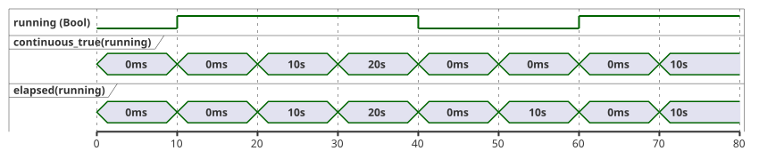
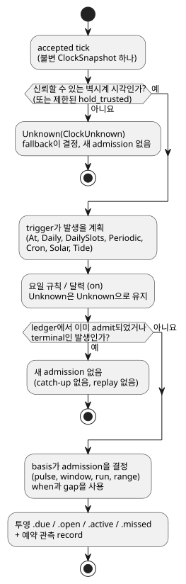
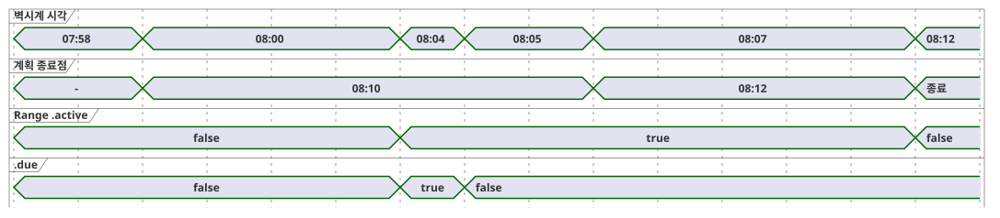

<!-- translation-source: docs/reference/03-time-and-schedules.en.md -->
[영문 원문](03-time-and-schedules.en.md)

# 3. 시간과 일정

[전체 목차](../LANGUAGE-REFERENCE.md) · [이전: 2. 타입, 식과 상태](02-types-expressions-state.md) ·
[다음: 4. 센서, 제약과 제어](04-sensors-constraints-control.md)

GhostFlow는 시간을 하나의 숫자로 다루지 않습니다. 시간을 두 종류로 나눕니다.

- **경과 시간.** “5분 동안 켠다”의 5분은 앞으로만 흐르는 *단조* 시계로 잽니다.
- **달력 시각.** “오전 6시에 시작한다”의 오전 6시는 시간대 안에서 해석하는 달력 시각입니다.

이 구분에서 두 가지 규칙이 나옵니다. 벽시계를 보정해도 이미 진행 중인 운전 시간을 되감거나 늘려서는 안 됩니다. 재부팅이 예약의 기준점을 조용히 옮겨서도 안 됩니다. 이 장은 이 구분을 바탕으로 시간값, 타이머, 반복 예약, 업무 달력, 자연 사건(일출, 조석)의 의미를 정의합니다.

**이 장을 읽는 방법.**

- `ghost` 코드 블록과 문법 블록은 선택된 공개 언어 계약입니다.
- 현재 컴파일러가 더 좁은 부분집합만 검증하거나 실행하는 곳은 해당 절에 명시합니다.
- ClockSnapshot, manifest, provider record처럼 `text`로 표시한 블록은 실행 환경과의 계약이며 GhostFlow 소스가 아닙니다.
- 일정의 실제 시계·달력·예측 자료는 로컬 장치나 선택적 gateway가 공급할 수 있다. 네트워크나 특정 gateway는 언어 요구가 아니다.

**이 장의 구성**

| 절 | 주제 |
|---|---|
| §3.1 | 시간값 타입(`Duration`, `Date`, `TimeOfDay`, `DateTime`)과 두 시계 |
| §3.2–§3.4 | 타이머: `elapsed`, `continuous_true`, 누적 사용량과 rolling 사용량 |
| §3.5 | 예약의 공통 의미: 정책, basis, 투영, 놓친 발생, identity, 관측 공백 |
| §3.6–§3.7 | `DailySlots`, `Periodic`, `cron5` |
| §3.8 | DST, 자정, 업무 달력 |
| §3.9 | Solar, 달, 조석 예약 |
| §3.10 | 시간 기반 사용량 한도(일 예산, rolling 예산, 이벤트 횟수) |
| §3.11 | 확정된 문법과 경계 요약 |

이 장의 근거는 [시간·일정 계약](../TIME-AND-SCHEDULE-CONTRACT.ko.md),
[연속 Bool 타이머 계약](../CONTINUOUS-BOOL-TIMER-CONTRACT.ko.md),
[Solar 일정 계약](../SOLAR-SCHEDULE.ko.md), [선택 문법](../LANGUAGE-SURFACE.md),
[Programming in GhostFlow 6–7장](../ProgrammingInGhostflow.md),
[2026-09-24 고정 계획 시간 구간 결정](../2026-09-24-fixed-planned-time-range-decision.ko.md),
[#23](https://github.com/callin2/ghostflow-language/issues/23),
[#46](https://github.com/callin2/ghostflow-language/issues/46),
[#90](https://github.com/callin2/ghostflow-language/issues/90),
[#96](https://github.com/callin2/ghostflow-language/issues/96)입니다.

## 3.1 시간값과 시계 영역

### Duration

`Duration`은 달력 날짜가 아니라 시간의 길이입니다. 선택된 리터럴은 0 이상의 정수 뒤에 `ms`, `s`, `min`, `h` 단위 중 하나를 붙입니다.

```ghost
config open_delay: Duration = 2s;
config watering_time: Duration = 5min;
```

**값 영역.** Duration은 `0..2^53-1` 범위의 정확한 정수 밀리초입니다. 모든 산술은 이 범위에 대해 검사합니다.

다음은 최종 결과로도, 동적 산술의 어떤 중간 결과로도 허용하지 않습니다.

- 음수 Duration
- 분수 밀리초
- NaN과 Infinity
- 범위를 벗어난 값

위반하면 현재 tick(논리 판단 단위)을 `duration-out-of-range`로 거부합니다. 새 상태나 intent를 일부만 확정하는 일은 없습니다.

“양의 지연”이 필요한 연산은 그 인수에 대해 `0ms`를 거부할 수 있습니다. 이는 그 연산의 제한일 뿐이며, 0은 여전히 유효한 `Duration` 값입니다.

**산술.**

- `Duration + Duration`은 검사된 합을 반환합니다.
- `Duration - Duration`은 결과가 0 이상일 때만 `Duration`을 반환합니다.

월, 연, 달력 날짜는 길이가 고정된 밀리초 수가 아니므로 Duration 단위가 아닙니다. “한 달 뒤”에는 달력 연산의 별도 의미가 필요합니다.

### Date, TimeOfDay, DateTime

시간 타입 리터럴은 tagged form을 씁니다. 태그(`date`, `time`, `datetime`) 뒤에 역따옴표로 감싼 문자열이 옵니다.

| 타입 | 값 영역 | 규칙 |
|---|---|---|
| `Date` | Gregorian `1970-01-01..9999-12-31` | 시각과 시간대를 포함하지 않습니다. |
| `TimeOfDay` | `00:00:00.000..23:59:59.999` | 날짜, UTC offset, 반복 규칙이 없습니다. |
| `DateTime` | Unix epoch부터 `9999-12-31T23:59:59.999Z`까지의 정확한 UTC instant | 리터럴에는 `Z` 또는 숫자 UTC offset이 필요합니다. 값은 IANA zone을 보존하지 않습니다. |

```ghost
date`2026-09-22`
time`06:30`
datetime`2026-09-22T06:30:00+09:00`
```

정확한 철자는 다음과 같습니다.

```text
Date       := date`YYYY-MM-DD`
TimeOfDay  := time`HH:MM[:SS[.f|.ff|.fff]]`
DateTime   := datetime`YYYY-MM-DDTHH:MM:SS[.f|.ff|.fff](Z|+HH:MM|-HH:MM)`
```

**어휘 규칙.**

- 모든 필드는 0으로 채운 ASCII 십진수입니다.
- 초의 소수부는 1~3자리입니다. 오른쪽을 0으로 채워 정확한 밀리초로 만듭니다. 네 자리 이상은 반올림하지 않고 진단합니다.
- 숫자 offset의 범위는 `00:00..14:00`입니다. 14시에는 `14:00`만 허용합니다.
- `+00:00`은 `Z`와 같은 instant로 정규화합니다. 관례상 “UTC offset 불명”을 뜻하는 `-00:00`은 거부합니다.

**진단.** 존재하지 않는 날짜, `24:00`, 윤초 `:60`, offset 없는 DateTime은 모두 진단합니다.

**DateTime 값이란.** DateTime 값은 정확한 UTC 밀리초 instant입니다. 원래 철자와 offset은 source metadata에만 남습니다. IANA 시간대는 *반복* 예약을 civil time으로 해석하기 위한 문맥이며, 이미 확정된 DateTime instant의 일부가 아닙니다.

문자열과 시간 타입 사이, 그리고 `Date`, `TimeOfDay`, `DateTime` 사이에는 암묵 변환이 없습니다.

최소 시간 산술은 다음과 같습니다.

- `DateTime ± Duration -> DateTime`: 범위를 검사한 instant 이동입니다.
- 같은 타입끼리의 비교(DateTime과 DateTime, TimeOfDay와 TimeOfDay)입니다.
- `TimeOfDay + Duration`은 자정에서 자동으로 순환하지 **않습니다**. Date와 시간대를 제공하는 Schedule 문맥 안에서 해석해야 합니다.
- `DateTime - DateTime`은 결과가 음수일 수 있으므로 기본 `Duration` 연산이 아닙니다. instant를 비교하거나 단조 `elapsed`를 사용합니다.

### 달력 시계와 단조 시계

각 tick은 불변 *clock snapshot* 하나를 사용합니다. snapshot에는 역할이 다른 두 시계가 들어 있습니다.

| 시계 | 용도 |
|---|---|
| 달력 시계(벽시계) | 예약, 날짜, 시간대, 자연 사건을 해석합니다. |
| 단조 시계 | 운전이 얼마나 오래 계속되었는지, 조건이 얼마나 오래 유지되었는지 잽니다. |

```text
// 계약 설명용 구조
ClockSnapshot {
  monotonicMs
  bootEpoch
  wallMs?
  wallQuality: Trusted | Unknown(reason)
  uncertaintyMs?
  sourceRevision?
}
```

snapshot 규칙은 다음과 같습니다.

- `monotonicMs`는 한 run 안에서 감소하지 않습니다. 단조 시각이 감소하거나 정수·범위 요건을 만족하지 않는 snapshot은 상태를 바꾸기 전에 거부합니다.
- `wallMs`가 있어도 쓸 수 없을 수 있습니다. 예약 판단은 `wallQuality`가 `Trusted`일 때만 이 값을 사용합니다.
- 벽시계가 앞으로 또는 뒤로 보정되어도 진행 중인 타이머는 단조 시계를 계속 따릅니다.

어떤 시각 출처(NTP, RTC, 플랫폼 시각)를 신뢰할지는 호스트가 정합니다. 제어식은 네트워크나 기계 시계를 직접 읽지 않습니다. 마지막 신뢰 시각을 잠시 유지하는 정책은 유지 기간과 최종 fallback을 명시해야 합니다. 숨은 grace period는 없습니다.

**왜:** wall time과 elapsed time이 “시간”이라는 한 단어를 공유하면 시계 보정, 시간대 변경, DST, 재부팅이 운전 길이까지 바꿀 수 있습니다.

## 3.2 상태 변경 뒤의 경과 시간

`elapsed(state)`는 참조한 상태가 마지막으로 **변경을 확정한** 시점부터의 단조 시간을 반환합니다.

```ghost
type Phase = Idle | Watering;
state phase: Phase = Idle;
timer age = elapsed(phase);

phase' = case phase {
  Idle => if start then Watering else Idle;
  Watering => if stop || age >= watering_time then Idle else Watering;
};
```

정확한 규칙은 다음과 같습니다.

- 첫 accepted tick의 식 평가값은 `0ms`입니다.
- §2.8의 snapshot 규칙에 따라 상태 전이식과 출력식은 tick 시작 시점의 구간을
  읽습니다. 이번 tick에서 상태가 바뀌어도 평가한 `elapsed` 출력은 이전 구간을 사용합니다.
- 변경을 확정하면 현재 단조 시각에서 새 구간을 시작합니다. 같은 결과의 커밋 후 타이머
  관찰값은 `0ms`입니다. 소스 trace는 이 커밋 후 값을 표시하며 이미 평가한 출력을
  다시 계산하지 않습니다.
- 다음 accepted tick은 새 구간을 읽습니다. 같은 timestamp이면 `0ms`이고 상태값이
  유지되면 구간 시작 시각도 유지됩니다.
- Bool 상태에서는 false→true와 true→false가 모두 변경입니다. 따라서 `elapsed(running)`은 “현재 값이 유지된 시간”이지 총 ON 시간이 **아닙니다**.
- 한 tick 안에서 여러 단계가 연쇄로 넘어가지 않습니다. 전이는 조건을 만족한 첫 tick에서 일어납니다. 그래서 실제 지연은 요청한 Duration 이상이며, 보통 최대 tick 간격 하나만큼 더 깁니다.
- rejected tick은 타이머 상태를 바꾸지 않습니다.

타이머는 `sleep`도 background task도 아닙니다. 타이머가 진행 중일 때도 매 tick 정지 요청, 센서 fault, 전역 제약을 평가합니다.

## 3.3 Bool이 연속으로 참인 시간

“온도가 기준을 5분 동안 계속 넘었다”는 “이 상태가 마지막으로 언제 바뀌었나”와 다른 질문입니다. *연속 참 타이머*는 조건이 끊김 없이 true인 현재 구간만 잽니다. 조건이 false인 tick에서는 즉시 `0ms`를 반환합니다.

```ghost
timer hot_for = continuous_true(temperature_high);
```

조건을 `c`, 직전 accepted tick의 값을 `wasTrue`, 현재 구간의 시작을 `since`, 현재 단조 시각을 `now`라 하면 의미는 다음과 같습니다.

```text
value    = if c && wasTrue then now - since else 0ms
wasTrue' = c
since'   = if !c then now
           else if !wasTrue then now
           else since
```

결과는 다음과 같습니다.

- 첫 true tick은 0을 반환합니다. timestamp가 같은 반복 tick도 0을 반환합니다. 0이 아닌 값은 다음 timestamp부터 나옵니다.
- false tick은 즉시 0을 반환하고, 그다음 true tick은 새 구간을 시작합니다.
- 각 타이머는 자기 내부 상태를 가지며 다른 타이머와 공유하지 않습니다.

아래 타임라인은 10초마다 샘플링한 Bool 상태에 대해 `continuous_true`와 `elapsed`를 비교합니다. 값이 false인 동안 둘은 다릅니다. `elapsed`는 *false*가 유지된 시간을 재지만 `continuous_true`는 0에 머뭅니다.



`continuous_true`는 Bool 식 하나만 받습니다. `Result<Bool, SensorFault>`를 Bool로 암묵 변환하지 않습니다. fault를 보수적으로 false로 다루려면 그 선택을 `case`로 명시합니다.

```ghost
let safe_high = case high_temperature {
  ok(value) => value;
  fault(_)  => false;
};
```

연속 참은 pause/resume 누적도, 여러 ON 조각의 합계도 아닙니다. 그것들은 별도의 시간 연산입니다(§3.4 참고).

## 3.4 누적 시간과 rolling budget

“얼마나 오래”에 대한 질문마다 필요한 시간 의미가 다릅니다.

| 질문 | 필요한 시간 의미 |
|---|---|
| 현재 단계가 얼마나 오래 유지되었나? | `elapsed(state)` |
| 조건이 끊기지 않고 얼마나 오래 true였나? | continuous-true |
| 이번 작업에서 ON이 총 몇 분이었나? | 작업 범위의 누적 ON 시간 |
| 최근 60초 동안 ON이 총 몇 초였나? | sliding-window ON 적분 |
| 오늘 물리 펌프가 총 몇 분 켜졌나? | 달력 날짜별 설비 accounting(사용량 집계) |

rolling accounting은 두 단계입니다. 먼저 안정적인 물리 자원과 accounting stage에 묶인 *ledger*(원장), 즉 `account`를 선언합니다. 그다음 그 ledger를 시간 basis로 조회합니다.

```ghost
resource pump1: BoolActuator;
account pump_applied = on_time(pump1,
  stage: applied,
  persistence: durable);
constraints PumpBudget {
  limit used(pump_applied, rolling(60s)) <= 30s {
    reserve = 1s;
    on_unknown = block;
  }
}
```

이 코드는 control 안의 accounting 선언 단편입니다. 현재 컴파일러는 올바른 `limit used(...)`를 검증하고 accounting descriptor를 내보냅니다. 실행하려면 별도의 자원 binding과 ledger 강제 적용도 필요합니다.

```text
used(t) = ON duration of x over (t - 60s, t]
```

예산의 동작은 다음과 같습니다.

- `used + reserve`가 30초에 도달하면 추가 ON을 금지합니다.
- 오래된 ON 구간의 일부가 창 밖으로 밀려나면 정확히 그만큼의 예산이 즉시 돌아옵니다.
- 고정된 1분 bucket이나 현재 연속 구간만 재는 방식으로 근사하지 않습니다.
- 여러 구간의 부분 겹침을 합산합니다. scan이 불규칙해도 같은 논리 시간 trace는 같은 결과를 내야 합니다.

accounting **stage**는 반드시 명시해야 합니다.

| Stage | 세는 대상 |
|---|---|
| requested | 제어가 요청한 ON 시간 |
| admitted/safe | 제약을 통과한 논리 ON 시간 |
| applied | renderer가 적용했다고 보고한 명령 시간 |
| confirmed | 피드백으로 확인한 물리 동작 시간 |

stage가 중요한 이유를 보여 주는 예는 다음과 같습니다.

- `manual_request`가 true여도 저수위 제약 때문에 safe output이 false이면 admitted/safe 예산은 소비하지 않습니다.
- 피드백이 없으면 safe ON 시간을 실제 유량처럼 표시해서는 안 됩니다.

추가 요구 사항은 다음과 같습니다.

- 상태 메모리의 상한을 계산할 수 있도록 window와 최대 ON은 유한해야 합니다.
- 재부팅이 보호 예산을 암묵적으로 초기화해서는 안 됩니다. checkpoint에서 복원, window 길이 동안 보수적 차단, 명시적인 non-durable 정책 중 하나의 계약을 선택합니다.

**왜:** “한 번에 30초”와 “최근 1분 합계 30초”는 서로 다른 안전 규칙입니다. 둘을 같은 타이머로 처리하면 짧게 여러 번 켜서 한도를 우회할 수 있습니다.

## 3.5 Schedule의 공통 의미

**예약**(Schedule)은 계속 평가되는 typed reactive value입니다. delayed call도 background thread도 아닙니다. 예약은 매 accepted tick마다 현재 시각을 보고 trigger, day rule, predicate, 문맥을 평가합니다. 그 결과로 발생(occurrence)을 **admit**할지, 즉 계획된 발생 하나를 시작된 것으로 받아들일지(admission, 수용) 판단합니다. 조건을 만족하지 못한 pulse는 나중을 위해 대기열에 넣지 않습니다.

아래 다이어그램은 tick마다 이루어지는 판단의 순서를 보여 줍니다. 각 단계는 이 절의 나머지 부분에서 정의합니다.



선택된 trigger 타입은 `At`, `Daily`, `DailySlots<G>`, `Periodic`, `Cron`, `Solar`, `Tide`입니다. 현재 컴파일러는 one-shot `At`(pulse와 Window)을 받고, slot에 대해서는 `DailySlots<15min>`만 받습니다. 각 trigger 타입은 고유한 trigger field와 아래의 공통 policy field를 가집니다.

```ghost
schedule name: TriggerType {
  // trigger별 field
  basis = pulse;
  when = true;
  clock = trusted_only;
  gap = skip_after(60s);
  recovery = baseline;
  fallback = skip;
}
```

```text
basis       := pulse
             | window(positive Duration)
             | run(positive Duration, on_time)
             | run(positive Duration, within(positive Duration))
             | range(positive Duration)
when        := Bool
clock       := trusted_only
             | hold_trusted(positive Duration, terminal: skip)
gap         := skip_after(positive Duration)
recovery    := baseline
fallback    := skip
             | fixed_time(TimeOfDay, terminal: skip)  // Solar만
cancel_when := Bool                                   // 현재 civil range에는 필수, Tide run에는 선택
```

공통 policy field의 의미는 다음과 같습니다.

| Field | 의미 |
|---|---|
| `basis` | 계획된 instant 주변에서 발생을 어떻게 admit하고 얼마나 지속하는지(“Pulse, Window, Run, Range” 참고). |
| `when` | admission predicate. 조건 없이 admit하려면 `when = true`라고 씁니다. |
| `clock` | 어떤 wall time을 쓸 수 있는지: 신뢰된 시각만, 또는 마지막 신뢰 시각의 제한된 유지. |
| `gap` | 발생을 놓친 것으로 처리하기 전까지 허용하는 가장 긴 관측 공백. |
| `recovery` | 부팅 시나 시계 신뢰가 돌아올 때의 동작. `baseline`은 replay 없이 기준선을 세웁니다. |
| `fallback` | 판단이 Unknown일 때 할 일. |
| `cancel_when` | Run 또는 Range의 언어 수준 취소. |

공통 field 규칙은 다음과 같습니다.

- 모든 공통 field는 필수입니다.
- 언어 수준 취소가 없는 Run이나 Range는 `cancel_when = false`라고 명시할 수 있습니다.
- 현재 컴파일러에서 `cancel_when`은 `Tide` Run과 civil `range`에 허용됩니다. `range`에는 **필수**이고 `pulse`에는 **금지**됩니다.

**시계 유지.** `hold_trusted(d, terminal: skip)`은 마지막 신뢰 wall instant에 그 뒤로 흐른 단조 시간을 더하고, 그 결과를 최대 `d` 동안 사용합니다. 불확실성도 같은 방식으로 유지합니다. 마지막 불확실성에 같은 단조 경과 시간을 더합니다. 유지한 값에는 `HeldClock` provenance(출처)가 붙습니다. 유지가 한계에 도달하면 시계는 `ClockUnknown`이 되고, 새 admission 판단에는 terminal `skip`이 적용됩니다. 이미 admit된 Range는 자신의 단조 종료 시각을 유지합니다. high-water(이미 관측한 가장 늦은 wall instant)는 바뀌지 않습니다.

**정책과 basis에 대한 현재 컴파일러 지원.**

| 기능 | 현재 상태 |
|---|---|
| `clock = hold_trusted(positive constant Duration, terminal: skip)` | Solar와 Tide에서 받습니다. |
| `fallback = fixed_time(TimeOfDay literal, terminal: skip)` | Solar에서 받습니다. |
| Tide fallback | `fallback = skip`만 허용합니다. |
| 다른 trigger | trusted-only clock과 skip fallback을 유지합니다. |
| `At` Window | 제한된 실행 가능 Window profile입니다. |
| 다른 trigger의 Window, `run(_, on_time)` | 현재 지원 범위 밖입니다. |
| 불변 UTC Daily와 비어 있지 않은 정적 DailySlots Range | 정적 non-overlap을 증명하며 GFB12로 실행합니다. |
| 불변 비 UTC `DailySlots<15min>` Range | GFB21 profile(“불변 비 UTC DailySlots Range” 참고): 명목상 slot 간격의 컴파일 시점 검사와, 호스트가 공급한 실제 발생 구간의 Rust 검증. |
| 그 밖에 허용된 Range recurrence | 실행할 수 없는 descriptor로 남습니다. |
| 운영자 `Duration` config에서 온 Range duration(지원되는 UTC profile) | 초기값으로 non-overlap을 증명할 수 있으면 허용합니다. 승인된 live 설정 event는 고정된 계획 시작점에서 현재 발생을 다시 계산하며, 새 due pulse나 발생 identity를 만들지 않습니다. |
| Tide `run(_, within(_))` | 지원합니다. |

**자연 사건의 제한된 admission.** 다음 규칙은 예측 부재나 불확실한 시계가 발생을 조용히 만들어 내지 못하게 합니다.

- 유지한 시각은 단조 경과 시간이 유지 기간보다 *엄격히 작은* 동안에만 사용합니다.
- 신뢰 anchor가 없거나, 불확실성이 없거나, 검사된 덧셈이 overflow하면 fail closed합니다.
- 유지한 wall time과 불확실성은 마지막 신뢰 값에 경과 시간을 더한 값이며 `HeldClock` provenance를 가집니다.
- 만료되면 새 admission을 terminal skip하고, high-water를 보존하며, 진행 중인 Run을 연장하지 않습니다.
- 복구는 기준선을 세웁니다. 재시작은 새 시계로 시작합니다.
- IANA 변환은 facts provider가 맡습니다. provider는 알려진 source local date와, 그 날짜에서 작성한 시각·시간대에 맞는 fallback instant를 공급합니다.
- 모호하거나 존재하지 않는 civil time은 terminal skip합니다. fold를 지어내지 않습니다.
- admission과 생성된 due 입력은 core가 맡습니다.
- 같은 source local date의 fallback 발생과 복구된 Solar 사건은 하나의 소비된 identity와 terminal checkpoint를 공유합니다.

`fixed_time`은 Solar에서만 쓸 수 있습니다. 어떤 source local date에 대해 fallback 발생이 admit되면 같은 발생 ledger가 그 날짜의 Solar 사건을 소비합니다. 그래서 provider가 복구되어도 사건이 중복되지 않습니다. Tide는 `fallback = skip`만 허용합니다. 예측이 없으면 조석 사건의 수와 identity를 알 수 없기 때문입니다.

확장 Solar 정책은 제한된(bounded) Solar profile에서만 실행합니다. non-Solar 예약, provider/config 실행, 지원하지 않는 기능과 결합하면 거부합니다. 기존 Solar 조합은 기존 profile을 유지합니다.

**Solar와 설정 fault.** Solar `when`이 config Result를 읽으면 그 config는 *admission 의존성*이 됩니다.

- 의존 config에 현재 fault가 있으면, 작성한 fault 분기가 true를 반환하더라도 판단은 `Unknown(SettingsFault)`로 남고 새 발생을 admit하지 않습니다.
- 관계없는 config의 fault는 Solar를 억제하지 않습니다.
- Solar와 일반 제어는 같은 평가 위치에서 현재 Result를 읽습니다.
- 성공적인 복구 관측은 기준선을 세웁니다. 지난 사건을 catch-up하지 않습니다.
- 설정 관측, Solar 판단, VM 전이는 함께 확정합니다. 따라서 실패한 평가는 event도 발생도 소비하지 않습니다.
- 좌표, 시간대, 사건, offset은 불변 프로그램 정의입니다. live 설정이 이를 암묵적으로 대체하지 않습니다.

**왜:** 일반 제어는 설정 오류를 보는데 예약은 과거의 성공 값으로 작업을 시작한다면, 한 프로그램이 서로 모순된 판단을 하게 됩니다. 원인을 보존하고, 실제로 적용된 관측으로 admission을 정해야 합니다.

**One-shot `At`(pulse).** `At`은 상수 typed DateTime을 사용합니다. 시간대나 DST field는 없습니다.

```ghost
schedule appointment: At {
  at = datetime`2026-01-01T08:00:00Z`;
  basis = pulse;
  when = true;
  clock = trusted_only;
  gap = skip_after(60s);
  recovery = baseline;
  fallback = skip;
}
```

- 절대 instant는 명시한 offset으로 정규화합니다. 같은 instant를 다른 offset으로 표기해도 같은 발생을 계획합니다.
- 이 제한된 Pulse profile은 trusted-only clock, baseline recovery, skip fallback, 양의 상수 gap만 받습니다.
- 진단 대상: 누락된 field, DateTime이 아니거나 상수가 아닌 `at`, 시간대/DST/취소 field, 그 밖의 basis.
- `.due`와 `.missed`를 노출합니다.
- provider, config, sensor, resource, objective, 다른 예약 profile과 섞을 수 없습니다.
- GFB14와 control-v13이 이 실행 profile을 식별합니다. framed clock/scan transport는 바뀌지 않습니다. 이전 loader는 GFB14를 거부합니다. 서명된 portable package는 아직 이 profile을 받지 않습니다.

**Window를 쓰는 `At`.** `At`은 같은 정책 제한 아래에서 양의 상수 `window(Duration)`도 받습니다.

```ghost
schedule appointment: At {
  at = datetime`2026-01-01T08:00:00Z`;
  basis = window(5min);
  when = ready;
  clock = trusted_only;
  gap = skip_after(60s);
  recovery = baseline;
  fallback = skip;
}
output start_once: Bool;
start_once <- appointment.due;
```

계획 구간은 반열린 구간 `[at, at + duration)`입니다. 두 투영은 다르게 동작합니다.

| 투영 | 종류 | 의미 |
|---|---|---|
| `.open` | Level | 신뢰된 시계에서 **현재** 구간 안이고 *그리고* `when`이 true입니다. `when`이 바뀌면 false가 되었다가 다시 true가 될 수 있습니다. |
| `.due` | Pulse | 구간 안에서 처음 자격을 갖춘 accepted scan에서 한 번 true입니다. |

terminal miss나 이전 admission은 이후의 `.due`를 막습니다. 그러나 현재 `.open` level을 강제로 false로 만들지는 **않습니다**. 한 번만 시작해야 하는 작업에는 `.due`를 사용합니다.

예: 08:00의 `window(5min)`에서 07:59:50부터 08:02:00까지 관측 공백이 생기면 그 발생은 terminal missed가 됩니다. 08:02에 `.missed`는 true, `.due`는 false이고, `when`이 true이면 `.open`은 true일 수 있습니다. 08:05 이후 `.open`은 false입니다.

추가 규칙은 다음과 같습니다.

- 알 수 없거나 신뢰할 수 없는 wall time은 결코 알려진 열린 구간을 만들지 않습니다.
- `At` Window에는 취소 field가 없으며 호스트의 발생 row를 받지 않습니다.
- GFB23과 control-v23이 이 별도의 실행 profile을 식별합니다. 이전 loader는 이를 거부하고, manifest/profile 불일치도 활성화 전에 거부합니다. 서명된 portable package는 아직 이 profile을 받지 않습니다.

**core가 `At` 발생을 admit하는 방법.** Rust core는 컴파일된 예약 site와 instant에서 단일 발생을 계산합니다. 호스트가 공급하는 발생 row는 필요하지 않습니다.

- Pulse admission에는 관측 공백이 없는 accepted trusted scan, `previous < planned <= current`, `when = true`가 필요합니다. crossing 시점에 `when`이 false이면 그 발생은 terminal miss로 소비됩니다.
- Window는 crossing 시점에 `when`이 false였더라도 window가 끝나기 전 처음 자격을 갖춘 scan에서 admit할 수 있습니다.
- 두 형태 모두 겹치는 관측 공백은 terminal miss입니다.
- instant와 같거나 그 뒤의 부팅 또는 복구 기준선은 catch-up 없이 그 발생을 `BaselinePastMissed`로 소비합니다.
- 재관측, 벽시계 rollback, 재교차는 결코 다른 admission을 만들지 않습니다. 새 clock source나 boot revision도 새 identity를 만들지 않습니다.
- 거부된 scan은 clock 기준선, terminal identity, 투영 중 어느 것도 확정하지 않습니다.

**재시작.** 재시작을 넘어선 중복 제거에는 같은 프로그램의 terminal checkpoint 복원이 필요합니다.

- 소비되었거나 놓친 identity는 새 부팅의 벽시계가 instant 이전이더라도 소비된 상태로 남습니다.
- 발생 이전에 찍은 checkpoint는 미래의 crossing을 여전히 admit할 수 있습니다.
- 새 activation에는 durable 이력이 없습니다.
- admission 뒤, durable checkpoint를 발행하기 전에 일어난 crash는 VM의 once-only 보장 밖입니다. 그 경계는 호스트의 영속화와 dispatch가 처리해야 합니다.
- admission은 논리적 증거입니다. 물리 실행이나 acknowledgement를 증명하지 않습니다.

**`Daily`.** `Daily`는 매일 한 시각을 계획합니다. `timezone`, ``at = time`...`;``, `dst_missing`, `dst_repeated`가 필요합니다. 예를 들면 다음과 같습니다.

```ghost
schedule morning: Daily {
  timezone = "Asia/Seoul";
  at = time`06:30`;
  dst_missing = skip;
  dst_repeated = first;
  basis = pulse;
  when = true;
  clock = trusted_only;
  gap = skip_after(60s);
  recovery = baseline;
  fallback = skip;
}
```

**trigger와 basis는 독립된 축입니다.** Cron, Window, Run, Range를 같은 종류의 대안으로 나열하지 않습니다.

- trigger(예: Cron)는 발생을 **언제** 계획할지 정합니다.
- basis(Window, Run, Range)는 계획된 instant **주변**의 admission과 지속 시간을 정합니다.

예약을 읽는 것만으로 장치가 켜지지는 않습니다.

**판단과 Unknown.** 예약 판단은 사용한 revision(판본)과 함께 `True`, `False`, `Unknown(reason)` 중 하나입니다. `fallback = skip`은 새 admission에 대해 Unknown을 `.due = false`로 해소하지만 이유는 보존합니다. Unknown을 부정해서 허가로 바꾸어서는 안 됩니다.

**투영.**

| 투영 | 의미 |
|---|---|
| `.due` | Pulse: 발생 하나를 admit하는 accepted tick에서만 true입니다. |
| Window `.open` | Level: `[planned, planned + length)` 안이고 **그리고** 현재 predicate가 true입니다. |
| Run `.active` | admission 뒤의 운전 구간으로, 명시적 상태와 단조 타이머로 표현합니다. |
| Range `.active` | 계획 시작점에 고정된 현재 발생 구간의 남은 부분입니다. admission 뒤에는 종료를 단조 시계로 판단합니다. 안전 제약이 출력을 막아도 구간은 계속 흐릅니다. |

**Run 지속 시간과 취소.**

- Run 지속 시간은 실제 admission부터 단조 시간으로 잽니다.
- `cancel_when`이 true인 accepted tick에서 Run과 Range는 `.active`를 끝냅니다. 그 발생을 다시 arm하지 않습니다.
- 요청 출력이 false이거나 전역 제약이 safe output을 막아도 Run과 Range는 조용히 일시정지하지 않습니다.
- 요청 ON, safe ON, 연속 safe ON 시간을 재려면 별도의 명시적 연산을 사용합니다.

**예약 관측.** 각 판단은 Bool 투영과 별도로 *예약 관측*(schedule observation)을 남깁니다. 여기에는 다음이 기록됩니다.

- 안정적인 예약 ID와 definition revision
- 판단 `False | Due | Unknown(reason)`과 그 disposition
- 발생 ID와 계획된 wall instant
- source local date와 scheduled local date
- provider와 문맥 revision

대표적인 disposition은 `Before`, `PredicateFalse`, `AlreadyAdmitted`와 다음의 missed reason입니다.

| Missed reason | 의미 |
|---|---|
| `ConditionsFalseAtPulse` | pulse crossing에서 조건이 거짓이었습니다. |
| `ObservationGap` | 신뢰할 수 없는 관측 공백이 admission 구간과 겹쳤습니다. Range에서는 열린 구간에 대한 비종결 증거이며, 아래 복구 규칙으로 처리합니다. |
| `LateStartExpired` | 늦은 admission 구간이 끝났습니다. |
| `CorrectionPastHighWater` | 수정된 사건 시각이 이미 지나간 high-water 뒤로 이동했습니다. |
| `EventWithdrawn` | provider가 아직 admit되지 않은 사건을 철회했습니다. |

`.due = false`만으로는 일반 false, Unknown fallback, 이미 admit된 사건, 놓친 사건을 구분할 수 없습니다. 그래서 이 증거를 같은 accepted scan에 묶습니다.

### 놓친 occurrence에 대한 소스 반응

`schedule_name.missed`는 소스 코드가 놓친 발생에 반응할 수 있게 하는 `Bool` 투영입니다.

**제공 범위.** 현재 컴파일러는 At pulse와 Window, Solar, 실행 가능한 `pulse` civil 예약에 `.missed`를 제공합니다. 실행 가능한 UTC Range control을 포함한 Range에는 아직 실행 투영이 아닙니다.

**의미.**

- 이번 accepted scan에서 그 예약의 발생 하나 이상이 **terminal missed**가 될 때만 true입니다.
- 한 scan에서 여러 발생을 놓쳐도 한 번만 true입니다. 새 terminal miss가 없으면 다음 accepted scan에서는 false입니다.
- control action은 이 값을 해당 accepted scan의 불변 snapshot에서 정확히 한 번 평가합니다.
- 이미 terminal missed로 기록된 발생을 재관측하거나 checkpoint를 복원해도 다시 true가 되지 않습니다.
- 거부된 scan은 이 pulse도, 어떤 상태 전이도 확정하지 않습니다.

```ghost
state missed_scans: Int = 0;
missed_scans' = if morning.missed then missed_scans + 1 else missed_scans;
output missed_alarm: Bool;
missed_alarm <- morning.missed;
```

`.missed`는 일반 `Bool` 식이므로 작성자는 `if`, `case`, 상태 전이, 출력 식으로 반응을 씁니다. 예약 선언에는 callback, 발생별 handler, 자동 replay가 없습니다. 여러 예약의 놓친 발생에 scan당 한 번 반응하려면 `morning.missed || evening.missed`처럼 식 하나로 평가합니다.

**발생별 record.** Bool pulse에는 횟수도 이유도 담기지 않습니다. 대신 같은 accepted scan의 **순서 있는 예약 관측**에 terminal missed 발생마다 record가 하나씩 들어갑니다. 각 record는 다음을 보존합니다.

- 안정적인 예약 ID와 발생 ID
- 계획된 instant
- terminal miss reason(`ConditionsFalseAtPulse`, `ObservationGap`, `LateStartExpired`, `CorrectionPastHighWater`, `EventWithdrawn` 중 해당하는 것)
- definition, 문맥, provider revision

이 record의 규칙은 다음과 같습니다.

- 한 scan에서 여러 record가 확정되어도 합치거나 하나의 이유로 요약하지 않습니다.
- 재부팅 뒤 복원된 terminal ledger는 중복 record나 pulse를 만들지 않습니다.
- `Unknown`과, 아직 열려 있는 Range의 비종결 `ObservationGap`은 `.missed`를 true로 만들지 않습니다.
- 놓친 발생은 나중에 조건이 true가 되어도 자동으로 admit되거나 실행되지 않습니다.

### Pulse, Window, Run, Range

`basis` field는 네 가지 admission 형태 중 하나를 고릅니다.

| basis | admission 의미 |
|---|---|
| `pulse` | crossing tick에서 조건이 모두 true일 때만 admit합니다. 나중에 true가 되어도 missed입니다. |
| `window(5min)` (`At` 실행) | `[planned, planned+5min)` 안에서 조건이 처음 true가 될 때 한 번 admit합니다. 같은 발생에서 false→true가 반복되어도 다시 arm하지 않습니다. 다른 trigger 조합은 설계 단계입니다. |
| `run(5min, on_time)` (설계) | 관측된 crossing에서만 admit하고, admission부터 5분 동안 운전합니다. |
| `run(5min, within(10min))` (Tide) | `[planned, planned+10min)` 안에서 첫 admission을 허용합니다. 10분은 유예(grace)이고 운전 길이는 5분입니다. |
| `range(10min)` (civil 계약) | 신뢰된 현재 시각이 `[planned, planned+10min)` 안이고 `when`이 true이면, 첫 관측·부팅·복구가 늦더라도 한 번 admit합니다. 끝은 계획 시작점 + 10분입니다. 불변 UTC Daily/DailySlots는 GFB12를, 아래의 불변 비 UTC DailySlots는 GFB21을 사용합니다. |

```ghost
schedule morning_watering: Daily {
  timezone = "UTC";
  at = time`08:00`;
  dst_missing = skip;
  dst_repeated = first;
  basis = range(10min);
  when = true;
  cancel_when = false;
  clock = trusted_only;
  gap = skip_after(60s);
  recovery = baseline;
  fallback = skip;
}
```

**실행 가능한 Range 범위.** 이 불변 UTC `range` 예시는 실행 가능한 GFB12 control bytecode입니다.

- 제한된 실행 slice는 업무 달력 없는 Daily와 비어 있지 않은 정적 DailySlots를 지원하며, `trusted_only`, `baseline`, `skip`을 사용합니다.
- `workday` 또는 `offday` selector와 typed WorkCalendar를 쓰는 불변 UTC Daily는 GFB18을 사용합니다. 시작 시각과 지속 시간의 합은 local midnight을 넘어서는 안 됩니다. 밤을 넘기는 작업 구간은 명시적인 별도 Daily range로 나눕니다. 끝은 제외되므로 정확히 자정에 끝나는 range는 유효합니다. 업무 달력 없는 일반 range는 기존 자정 동작을 유지합니다.
- live 지속 시간 설정은 업무 달력 없는 UTC Daily/DailySlots에서만 lowering됩니다.
- live scalar 시작 시각 설정은 고정 Duration을 가진 단일 UTC Daily Range에서만 lowering됩니다.
- 다음은 정적 Range metadata로 조용히 fallback하지 않고 정적으로 거부합니다: live 지속 시간/시작 시각 config를 쓰는 업무 달력 Range, live 시작 시각 + Duration의 조합, Periodic Range, 비 UTC Daily Range, 비 UTC 설정 기반 Range.
- 불변 비 UTC DailySlots는 다음 소절의 별도 profile을 따릅니다.
- 지원하지 않는 변형은 시간대나 DST 정책을 결코 추측하지 않습니다.

**Range checkpoint.** Range 문맥 checkpoint는 소비한 발생 identity와, 있다면 유효한 live 지속 시간 또는 live scalar 시작 시각 설정을 저장합니다. 진행 중인 단조 타이머는 저장하지 않습니다.

- 새 부팅으로 복원해도 이미 소비한 발생을 재개하거나 다시 admit하지 않습니다. 다음 발생은 복원된 지속 시간 또는 시작 시각을 사용합니다.
- 아직 소비하지 않았고 여전히 열려 있는 구간은 남은 시간만 admit할 수 있습니다.
- terminal 용량이 소진되면 scan을 원자적으로 거부합니다. identity를 조용히 정리하지 않습니다.

**Run의 늦은 admission.** 늦은 admission 구간은 반열린 구간이므로 끝 경계에서는 새 admission이 일어나지 않습니다. 계획 시각이 08:00인 `run(5min, within(10min))`이 08:02에 admit되면 단조 시계로 08:07까지 운전합니다.

**Range는 고정된 계획 구간입니다.** `range(duration)`은 admission 시각이 아니라 계획 시각에 고정됩니다.

- 08:00의 `range(10min)`을 신뢰된 시각 08:04에 처음 관측하면 08:10까지 남은 6분만 요청합니다.
- 08:10 또는 그 뒤에 처음 관측하면 시작하지 않고 `LateStartExpired`를 기록합니다.
- `when`이 늦게 true가 되더라도 끝나기 전이면 남은 시간만 요청합니다.
- 시작 시, 재부팅 시, 시계 신뢰 복구 시, 관측 공백 뒤에도 마찬가지입니다.

이 부분 구간 admission은 Range에**만** 적용됩니다. 다른 basis의 `gap = skip_after(...)`나 `recovery = baseline`을 바꾸지 않습니다.

**Range와 시계 신뢰.**

- 신뢰된 현재 시각이 없으면 판단은 `Unknown(ClockUnknown)`입니다. 추정 시각으로는 결코 새 Range를 admit하지 않습니다.
- 명시적인 `clock = hold_trusted(...)`는 그 계약에 따라 유지한 시각과 불확실성을 사용합니다.
- 이미 진행 중인 Range는 그 뒤 wall 신뢰나 유지가 만료되더라도 기존 단조 종료 시각까지 계속됩니다.
- 시작점이 미래로 옮겨진 같은 발생에 다시 들어가려면 새 admission과 마찬가지로 신뢰된 시각이 필요합니다. 신뢰가 복구된 뒤에도 현재 구간이 끝났다면 다시 들어가지 않습니다.

**Range 발생은 겹치면 안 됩니다.** 같은 예약의 두 Range 발생은 겹쳐서는 안 됩니다.

- 두 반열린 구간의 교집합이 비어 있지 않으면 오류입니다. 경계가 정확히 맞닿는 구간은 허용합니다.
- 예: `selected = [08:00, 08:15]`이고 `basis = range(30min)`인 `DailySlots`는 08:00–08:30과 08:15–08:45가 겹치므로 컴파일 오류입니다.
- 컴파일러는 trigger 정의와 유효 설정으로 비중첩을 증명합니다.
- 불변 비 UTC DailySlots profile은 명목상 slot 간격을 컴파일 시점에 검사하고, 실제 구간의 검증은 아래에 설명한 Rust fact 검사로 완성합니다.
- 이 명시적 profile 밖에서 provider나 동적 recurrence의 간격을 증명할 수 없으면 그 `range` 선언을 컴파일 진단으로 거부합니다. 컴파일러는 결코 추측하거나 구간 하나를 고르지 않습니다.
- 정적 기본값은 컴파일 시점에 검사합니다. 복원한 설정을 포함한 유효값은 활성화 전에 검사합니다. 유효값이 겹치면 활성화를 거부합니다.
- 겹침을 일으킬 live 설정 변경은 event 전체를 원자적으로 거부합니다.
- 두 검사 모두 새로 계획된 구간뿐 아니라 현재 admit된 구간도 포함합니다.

**admission 시점에 끝을 고정.** Range admission 시점에 계획 종료점을 발생의 계획 시작점과 그 순간 유효한 Duration으로 확정합니다. 이미 지난 부분은 단조 시계 기준 남은 시간으로 환산합니다. admission 뒤에는 다음과 같습니다.

- RTC/NTP 벽시계 보정은 진행 중인 종료 시각을 앞당기지도 늦추지도 않습니다.
- 보정된 벽시계는 현재 발생이 끝난 뒤의 이후 발생 판단에 적용됩니다.
- 신뢰 시각, 계획 시작점, 단조 경과 기준을 발생에 함께 보존하므로 보정 중에 종료 시각을 다시 계산하지 않습니다.

**live 시작 시각 또는 Duration 변경.** 단일 시작 trigger의 scalar 시작 시각 설정이나 그 Duration이 운영 설정이면, 승인된 atomic live event는 event의 적용 위치부터 현재 발생에도 적용됩니다.

- 현재 구간과 종료점을 변경된 시작 시각과 Duration으로 다시 계산합니다.
- 발생 ID와 이미 admit된 ledger는 settings revision이 바뀌어도 유지됩니다.
- admission 뒤에는 보정 전의 안정된 시간 기준을 단조 경과 시간만큼 전진시켜 현재 위치와 남은 시간을 구합니다.
- 늦은 admission 시각을 새 계획 시작점으로 쓰지 않습니다. wall 보정이나 ClockUnknown 때문에 현재 날짜 key를 쓸 수 없더라도, 원래 local date와 유효 TimeOfDay에서 다시 계산합니다.
- 설정 event와 scan이 같은 위치에 오면, 먼저 §5.2의 event 순서를 적용한 다음 그 위치에서 유효한 설정으로 판단합니다.

08:04에 admit된, 08:00 계획 `range(10min)`의 예시는 다음과 같습니다.

| 변경 | 결과 |
|---|---|
| 08:07에 Duration → 12분 | 08:12에 끝납니다. |
| Duration → 5분 | 새 종료점 08:05가 이미 지났으므로 event를 적용하는 판단에서 끝납니다. |
| 시작 시각 → 08:08 | 즉시 비활성화되고, 신뢰된 08:08에 다시 활성화되며, 08:18에 끝납니다. |
| 시작 시각 → 08:02(Duration은 10분 유지) | 08:12에 끝납니다. |

아래 타임라인은 첫 번째 행을 보여 줍니다. 08:04에 늦게 admit된 뒤, 08:07의 live Duration 변경이 계획 종료점을 08:10에서 08:12로 옮깁니다. `.due`는 admission 때 한 번만 발생합니다.



**안전 차단은 Range 시계를 멈추지 않습니다.**

- 전역 안전 제약이 출력을 막으면 safe output은 즉시 false가 되지만 Range 발생과 그 단조 종료 시각은 유지됩니다.
- 제약이 끝나기 전에 풀리면 그 시점에 남은 구간만 요청할 수 있습니다. 막힌 시간을 끝에 덧붙이지 않습니다.
- `cancel_when = true`는 발생을 종결합니다. 다시 허용되어도 재시작하지 않습니다.
- `.active`와 requested/safe/applied/confirmed 출력은 서로 다른 관측값입니다.

**시작 시각이 현재 위치보다 뒤로 옮겨진 경우.**

- 시작 시각 변경으로 현재 위치가 새 계획 시작점보다 앞서게 되면, 그 판단에서 발생은 `.active = false`로 멈춥니다.
- 새 시작점에 도달한 accepted tick에서 같은 발생을 변경된 구간에 대해 다시 평가합니다. `when`이 true이면 현재 계획 종료점까지만 요청을 재개합니다. safe output은 안전 제약이 허용할 때만 냅니다.
- 이는 새 admission이 아닙니다. `.due`를 다시 내지 않으며 발생 ID와 ledger는 그대로입니다.
- 변경된 종료점이 현재 위치 이하이면 재개나 재admission 없이 발생을 즉시 끝냅니다.

`DailySlots`의 `TimeSlots` 변경에서는 §3.6의 안정적인 slot key가 retime과 제거/추가를 구분합니다. 위의 Range 재계산 규칙은 key를 유지하는 retime에 적용하고, 제거/추가에는 새 항목 기준선 규칙을 적용합니다.

### 불변 비 UTC DailySlots Range

**Profile.** 비 UTC IANA 시간대의 비어 있지 않은 리터럴 `DailySlots<15min>`에 양의 고정 Duration을 쓰면 GFB21로 실행합니다. `civil-range` prelude(tag 19)와 `GhostFlow/control-v21`을 사용합니다.

- 이런 Range 여러 개, 일반 temporal window, `elapsed(state)`처럼 일반 상태로 lowering되는 타이머와 함께 쓸 **수 있습니다**.
- 별도의 `true-for` prelude, 다른 예약/provider/config profile, 업무 달력, live 시작 시각/Duration/TimeSlots와는 결합하지 **않습니다**.
- 기존 UTC profile과 GFSF civil 발생 row는 바뀌지 않습니다. 이 row는 GFSF4부터 존재했지만, 현재 context encoder가 GFSF4 envelope를 내보낸다는 뜻은 아닙니다.
- 이전 loader는 GFB21을 거부합니다. 다른 profile로 대체 실행하지 않습니다.

```ghost
schedule night: DailySlots<15min> {
  timezone = "Asia/Seoul";
  selected = [22:00];
  dst_missing = skip;
  dst_repeated = first;
  basis = range(7h);
  when = true;
  cancel_when = false;
  clock = trusted_only;
  gap = skip_after(60s);
  recovery = baseline;
  fallback = skip;
}
```

같은 정책에 `selected = [05:00]`, `basis = range(17h)`를 쓰는 두 번째 예약이 낮 구간을 정의합니다. 서울에서는 다음과 같습니다.

- 22:00 + 7시간은 다음 날 05:00에 끝납니다.
- 05:00 + 17시간은 22:00에 끝납니다.

끝 경계는 제외됩니다. 자정은 야간 구간 안에 있고, 05:00과 22:00에는 각각 다음 구간이 시작합니다. 이 연산은 계획 시작 instant에 고정된 경과 시간을 더합니다. DST가 있는 지역에서 임의의 local 종료 시각까지 운전하는 연산이 **아닙니다**.

**호스트의 책임.** 시간대 변환과 tzdb의 완전성은 호스트가 맡습니다. 호스트는 예약마다 다음을 만족하는 coverage 구간 `[coverageStartMs, coverageEndMs)`를 공급합니다.

- 신뢰된 현재 wall instant에서 지속 시간만큼 거슬러 올라갑니다: `coverageStartMs <= max(0, wallMs - durationMs)`
- 현재보다 뒤에서 끝납니다: `coverageEndMs > wallMs`

호스트는 그 coverage 안의 발생을 **모두** 공급해야 합니다. 자정을 넘어서도 구간이 아직 열려 있는 전날 발생도 포함합니다. 날짜가 바뀐 뒤 오늘의 row만 보내는 것으로는 충분하지 않습니다. 기존 GFSF 예약 증거의 `provider`와 `calendar`는 `null`입니다. JavaScript row는 기존 field를 사용합니다.

```text
{ sourceDay, slotKey, minuteOfDay, fold, eventId, eventKind: "civil",
  instantMs, withdrawn, providerRevision, contextRevision }
```

| Field | 규칙 |
|---|---|
| `sourceDay` | 원래 local date의 날 번호로, Unix epoch부터 셉니다. |
| `slotKey` | 불변 리터럴 목록을 시각순으로 정렬한 뒤의 1부터 시작하는 서수입니다. |
| `minuteOfDay` | 선언된 slot의 정확한 분입니다. |
| `eventId` | 비어 있습니다. |
| `withdrawn` | 철회는 금지됩니다. |
| `fold` | DST fold 선택은 작성한 `dst_repeated`를 따릅니다. |

identity는 `site:sourceDay:slotKey:fold`입니다. revision과 계획 instant는 identity를 바꾸지 않습니다.

**Null fact(DST skip).**

- 호스트가 존재하지 않는다고 확인한 local slot이 `dst_missing = skip`이면, `instantMs = null`인 fact로 보내거나 알려진 skip 발생으로 생략할 수 있습니다. 증거가 없다는 것만으로 DST gap이 성립하지는 않습니다.
- 호스트가 반복된다고 확인한 slot이 `dst_repeated = skip`이면, `dst_missing = next_valid`인 경우를 포함해 `fold = 0`인 null fact를 쓸 수 있습니다.
- null fact에는 `fold = 0`과 작성된 skip 정책이 하나 이상 필요합니다. null fact는 구간을 만들지 않습니다.
- gap과 반복 slot을 구분하는 책임은 여전히 호스트에 있습니다.
- 이 null을 정상 OFF로 대체하거나 계획 instant를 지어내지 않습니다.

**Rust 검증.** Rust는 다음을 검사합니다.

- field 범위, 선언된 slot key와 분, DST fold 선택
- null skip marker의 허용 여부
- 중복되거나 충돌하는 identity와 revision
- row instant가 coverage 안에 있는지
- 현재 admit되어 고정된 구간을 포함한 실제 반열린 구간의 비중첩
- 연속한 coverage가 겹치는 곳에서, 이전에 관측한 resolved instant fact가 사라지거나 충돌하지 않는지

coverage 부족과 잘못된 fact는 결코 새 admission으로 이어지지 않습니다. 실패한 scan은 부분 상태도 발생 이력도 확정하지 않습니다. Rust에는 IANA tzdb가 없으므로, 호스트의 첫 증거에서 통째로 빠진 IANA 발생까지 완전한지 증명할 수는 없습니다.

**실행.** 검증된 fact는 기존 RangeEngine에서 실행됩니다.

- 늦은 첫 관측, 부팅, 시계 신뢰 복구는 열린 구간의 남은 부분만 admit할 수 있습니다.
- `gap`은 시계 관측 정책입니다. fact coverage를 줄이지 않고, 열린 Range를 pulse처럼 버리지도 않습니다.
- 한 번 admit된 타이머는 wall 신뢰 상실이나 wall 보정에도 고정된 단조 마감 시각을 유지합니다.
- checkpoint는 재시작 중복 제거를 위해 소비한 identity를 보존하며, admit된 타이머를 재개하지 않습니다. 아직 소비하지 않은 열린 발생만 부분 구간을 admit할 수 있습니다.

**왜:** 자정 이후의 현재 구간은 어제의 계획에서 온 것일 수 있습니다. 호스트의 IANA 변환을 Rust의 fact 검증·admission과 분리해 두면, 검증된 발생이 같은 Range 의미로 실행됩니다. 이 계약은 컴파일된 GhostFlow의 결정적 시뮬레이션을 지원합니다. 공공도로 신호 규정 준수를 정의하지 않으며 물리 제어를 검증하지도 않습니다.

### occurrence identity와 중복 억제

계획된 각 발생은 예약의 안정적인 선언 ID와 source occurrence key로 식별합니다.

| Trigger 계열 | source occurrence key에 포함되는 것 |
|---|---|
| local daily / Cron slot | DST fold |
| Solar | 사건 종류와 source date |
| Tide | provider가 보장하는 station ID와 event ID |

definition revision과 수정된 계획 시각은 metadata입니다. 같은 사건을 새 사건으로 바꾸지 않습니다.

하나의 발생은 최대 한 번 admit됩니다.

- 계속 true인 조건이 매 tick 새 run을 만들지 않습니다.
- 이미 admit된 발생의 새 provider revision이 중복 run을 만들지 않습니다.
- 실제로 다른 예약에는 새 예약 ID가 필요합니다.

### 관측 gap과 회복

**공백 감지.** 예약은 연속한 accepted snapshot 사이의 단조 delta와 양의 wall delta를 검사합니다. `gap = skip_after(d)`에서 delta가 `d`보다 크면 `ObservationGap`입니다.

**Pulse, Window, Run에 미치는 영향.** 공백이 발생의 admission 구간과 겹치면 그 발생은 missed로 끝납니다.

- Window나 `within(...)` 유예가 아직 열려 있더라도 나중에 되살아나지 않습니다.
- Window의 terminal miss는 `.due` admission을 멈춥니다. 현재 신뢰 구간과 predicate에 따라 `.open`은 여전히 true일 수 있습니다.

**Range에 미치는 영향.** 구간 중의 공백은 공백의 증거일 뿐, 그 발생의 terminal miss가 아닙니다.

- 신뢰된 현재 시각이 아직 계획 구간 안이면 첫 admission은 남은 시간만 요청할 수 있습니다.
- 끝 경계에 도달하면 실행 없이 `LateStartExpired`로 terminal miss를 기록합니다.
- 이미 terminal missed이거나 철회된 발생은 시각이 그 구간 안이라는 이유만으로 되살아나지 않습니다. 특히 Tide의 `CorrectionPastHighWater`와 `EventWithdrawn`은 Range에서도 terminal입니다.

**복구.** `recovery = baseline`은 최초 부팅과 시계 신뢰 복구 시 기준선만 세웁니다. 지난 발생을 몰아서 실행하지 않습니다.

- Range는 아직 열려 있는 현재 구간의 남은 시간만 admit할 수 있습니다.
- 벽시계 rollback은 high-water와 admission ledger로 중복을 제거합니다.
- catch-up, retry, replay 문법은 없습니다.

**한 단계에서 여러 발생을 교차한 경우.** 연속한 accepted scan 사이에서 같은 예약의 발생을 둘 이상 교차하면 다음과 같습니다.

- 새 Pulse, Window, Run 발생은 모두 missed로 기록하며, 어느 것도 admit하거나 실행하지 않습니다.
- Range는 이미 끝났거나 terminal missed/withdrawn으로 기록된 발생을 실행하지 않습니다. 신뢰된 현재 시각에 구간이 열려 있는 발생을 남은 시간 동안 admit합니다.
- 같은 예약에서 동시에 열린 두 Range 구간은 금지됩니다. profile의 컴파일/live 설정 검사나 Rust fact 검증에서 거부합니다.

정확히 하나의 발생만 교차했다면 각 basis의 일반 admission 규칙을 적용합니다.

## 3.6 선택된 DailySlots

`DailySlots<15min>`은 local date의 15분 격자에서 특정 시각들을 선택합니다.

```ghost
schedule starts: DailySlots<15min> {
  timezone = "Asia/Seoul";
  selected = [06:00, 18:45];
  dst_missing = skip;
  dst_repeated = first;
  basis = pulse;
  when = true;
  clock = trusted_only;
  gap = skip_after(60s);
  recovery = baseline;
  fallback = skip;
}
```

- `timezone`은 예약 해석에 쓰는 IANA zone입니다.
- `selected`는 하루의 `00:00..23:45` 안에 있는 15분 격자 시각들입니다.
- 중복 slot과 격자 밖 시각은 금지됩니다.
- `starts.due`는 slot crossing을 관측한 첫 tick에서 한 번 true입니다.
- 부팅 전의 slot, 관측 공백 중에 놓친 slot, 복구 전의 발생은 암묵적으로 catch-up하지 않습니다.
- 벽시계 rollback 뒤에 같은 local date/slot을 다시 실행하지 않습니다.

**운영자가 편집할 수 있는 slot.** 같은 Program과 run 안에서 운영자가 slot 집합을 바꿀 수 있게 하려면 유한 설정 타입을 사용합니다.

```ghost
config watering_slots: TimeSlots<15min, 8> = [
  time`06:00`, time`18:45`
] {
  access = operator;
  label = "관수 시작 시각";
}
```

`TimeSlots<G,N>`은 TimeOfDay 값의 nominal 유한 집합입니다.

- `G`는 24시간을 정확히 나누는 양의 Duration 격자입니다. `N`은 컴파일 시점의 최대 항목 수입니다.
- 빈 집합은 발생이 없는 유효한 값입니다.
- 값은 고유해야 하며 local midnight 기준 격자 위에 있어야 합니다. 검증 뒤 정렬합니다.
- Duration 목록으로 암묵 변환하지 않습니다.
- `selected = watering_slots`에서는 예약과 설정의 `G`가 정확히 같아야 합니다.
- 리터럴 `selected`는 간결한 `HH:MM`을 쓰고, 설정값은 일반 `time` 리터럴을 씁니다.

**설정 fault.** `selected = watering_slots`는 §5.2의 `Result<TimeSlots<G,N>, SettingsFault>` stream을 소비합니다.

- 현재 관측에 fault가 있으면 같은 원인의 `Unknown`이 되며 새 발생을 admit하지 않습니다.
- 이전 성공 목록이나 빈 목록으로 대신하지 않습니다.
- 다음 `ok` emission은 아래의 identity, retime, 기준선 규칙에 따라 적용됩니다.
- fault 자체는 이미 admit된 Run을 취소하지 않으며, 별도로 명시한 취소 규칙을 대신하지도 않습니다.

**승인된 live 편집.** 승인된 live 편집의 의미는 다음과 같습니다.

- **원자적 검증.** event 전체를 한 번에 검증합니다: 타입, 격자, 중복, `N`, 권한, Program identity.
- **Slot key.** 승인된 런타임 설정 상태는 항목마다 표시 시각과 독립적인 불투명한 `slot key`를 보존합니다. 이 key는 GhostFlow 소스 문법이 아니며 작성자가 정하지 않습니다. 설정 event는 고유한 event identity와 기준 settings revision을 가지며, retime은 기존 `slot key`와 새 `TimeOfDay`를 함께 지정합니다. UI와 저장소는 순서나 표시 시각을 항목 identity로 써서는 안 됩니다.
- **Retime.** retime은 같은 항목의 표시 시각만 바꿉니다. 발생 identity `(schedule ID, local date, slot key, DST fold)`와 admission/terminal ledger는 유지됩니다. 새 `TimeOfDay`는 계획 시각 metadata입니다. 이미 admit된 Range를 미래로 옮기면 즉시 `.active = false`로 멈춥니다. 신뢰된 시각이 새 시작점에 도달하면 같은 발생을 변경된 반열린 구간에서 다시 평가합니다. `.due`를 다시 내지 않으며 두 번째 admission을 만들지 않습니다.
- **Retime 예.** `TimeSlots<1min,N>`에서 08:00 `range(10min)` 발생이 08:04에 admit되었다고 합시다. 그 항목을 08:07로 retime하면 event의 적용 위치에서 멈춥니다. 08:07의 accepted 판단이 같은 발생을 다시 평가하고, `when`이 true이면 08:17까지 요청합니다. 발생 ID, slot key, ledger는 그대로입니다. event가 08:07 판단 위치에 적용되면 §5.2의 순서에 따라 새 값을 먼저 적용한 다음 바로 같은 발생을 평가합니다.
- **추가.** 새로 추가한 항목은 새 `slot key`를 받고, event의 유효 위치에서 기준선을 세웁니다. 그 위치와 같거나 이전인 당일 slot은 내보내지 않으며 미래 slot만 계획합니다.
- **제거.** 제거는 그 `slot key`의 미래 계획만 지웁니다. 표시 시각을 제거했다가 같은 시각을 다시 추가하면 새 key와 새 발생이 생깁니다. 이는 retime이 아닙니다. 제거는 admit된 Run을 취소하지 않습니다. admit된 Range를 retime하려면 제거와 추가가 아니라, 기존 key를 지정한 retime event를 보냅니다.
- **순서.** 설정 event와 예약 scan은 유효 위치의 전체 순서를 따릅니다. 항목이 처음 추가된 바로 그 위치에서는 due가 되지 않습니다.
- **재시작.** 재시작은 승인된 설정값을 복원할 수 있지만 대기열을 만들지 않습니다. 발생 ledger의 수명은 일반 config와 별개입니다. 복원 상태에는 표시 시각뿐 아니라 slot key도 들어 있어야 합니다.

retime 결과는 완전한 `TimeSlots<G,N>` 값으로 검증합니다: 격자, 중복, `N`, 같은 예약 안의 Range 비중첩. 새 시각이 다른 항목의 Range와 겹치면 event 전체를 거부합니다. 기존 값, slot key, settings revision, 진행 중인 발생, ledger는 유지됩니다.

이 타입은 “15분마다”를 뜻하지 **않습니다**. `[06:00, 18:45]` 같은 특정 local 시계 slot을 나타냅니다. 설정으로 주기를 바꾸는 Periodic과는 다릅니다.

**실행 가능한 keyed Range profile(GFB20).** 제한된 실행 profile은 다음과 같습니다.

- `TimeSlots<G,N>`로 선택한 UTC `DailySlots<G>`, 양의 고정 Duration, 업무 달력 없음, 24시간을 나누는 정수 분 격자를 사용합니다.
- GFB20/control-v20을 사용합니다.
- live TimeSlots를 live Duration이나 비 UTC zone과 결합하면 거부합니다.

예: 08:00 `range(20min)`이 admit되어 있는 동안 목록을 `[08:00, 08:15]`로 바꿀 수 없습니다. `[08:00, 08:20]`은 반열린 구간이 맞닿기만 하므로 유효합니다. preflight는 제안된 미래 목록에서 key가 제거된 admit 구간도 포함합니다. 거부되면 event의 다른 설정도, clock, allocator, revision, 발생 이력도 확정하지 않습니다. **왜:** settings revision이 겹치는 작업을 만들거나 control snapshot의 일부만 바꾸어서는 안 되기 때문입니다.

이 profile의 추가 규칙은 다음과 같습니다.

- key를 추가하거나 retime하는 편집에는 신뢰된 wall 기준선이 필요합니다. wall 신뢰를 알 수 없는 동안에는 원자적으로 거부합니다.
- 바뀌지 않은 key와 승인된 settings-fault emission은 기존 동작을 유지합니다. 이 제한은 별도의 live scalar 시작 시각/Duration Range profile을 바꾸지 않습니다.
- fault emission은 과거 key identity를 유지하지만, 새 유효 계획 없이 Unknown을 냅니다.
- GFRG4 checkpoint는 승인된 keyed 목록, allocator, 추가 기준선, 소비 이력을 영속화합니다. 빈 목록과, 표시 시각 순서가 바뀐 유지 key도 포함합니다.
- 복원은 그 metadata를 검증하며 진행 중인 타이머를 결코 재개하지 않습니다.
- 기존 GFRG1/2/3 profile은 각자의 형식을 유지합니다. 이전 loader는 정적 fallback으로 실행하지 않고 GFB20을 거부합니다.
- 이 profile은 시간대/DST 정책이나 Run 취소 정책을 선택하지 않습니다.

## 3.7 Periodic과 Cron

### Periodic

Periodic은 반복 간격과 결정적인 anchor(위상)를 가진 발생 stream입니다.

```ghost
schedule watering: Periodic {
  every = irrigation_interval;
  anchor = instant(datetime`2026-10-01T00:00:00Z`);
  interval_change = preserve_anchor;
  basis = pulse;
  when = true;
  clock = trusted_only;
  gap = skip_after(60s);
  recovery = baseline;
  fallback = skip;
}
```

**`every`.** `every`의 성공 payload는 양의 `Duration`이어야 합니다. config 참조도 payload 타입을 `Duration`으로 선언해야 합니다. Bool, Percent, 단위 없는 Number는 타입 오류입니다.

**`anchor`.** 런타임 부팅 시각을 숨은 anchor로 쓰지 않습니다. anchor는 다음 중 하나입니다.

| Anchor | 의미 |
|---|---|
| `instant(DateTime)` | 정확한 UTC instant에 `n*every`를 더합니다. |
| `civil(Date, TimeOfDay)` | local civil timeline에서 `n*every`를 더한 뒤, 각 local timestamp를 필수 시간대와 DST 정책으로 해석합니다. 일반 TimeOfDay 산술을 추가하는 것은 아닙니다. |
| `persisted_epoch` | 활성화에는 정확한 epoch instant와 안정적인 epoch ID를 주는 activation record가 필요합니다. 재부팅 뒤에도 보존되며 부팅 시각으로 대체하지 않습니다. |

**운영자의 간격 변경.** #105/#110의 최신 결정을 따릅니다.

- 설정 동작 하나는 같은 프로그램과 run 안의 원자적 stream emission 하나입니다. 설정 stream의 성공/fault rail과 묶음 검증은 §5.2를 따릅니다.
- `every = irrigation_interval`은 그 config의 `Result<Duration, SettingsFault>`를 소비하는 전용 문법입니다.
- `ok(interval)`이면 아래 위상 정책에 따라 새 간격을 사용합니다.
- `fault(reason)`이면 판단은 `Unknown(reason)`으로 남고 새 발생을 admit하지 않습니다. 마지막 성공 간격으로 계속 실행하지 않으며, 초기값으로 되돌아가지도 않습니다.
- `ok`로 복구되면 그 유효 위치부터 위상 정책을 적용합니다. fault 동안 놓친 발생은 catch-up하지 않습니다.
- 이미 admit된 발생의 identity와 실행은 결코 소급해서 바꾸지 않습니다.
- settings revision과 유효 event 위치가 성공 관측과 fault 관측을 모두 식별합니다. 소스와 bytecode는 다시 쓰지 않으며 새 run도 만들지 않습니다.
- `every`가 설정이면 `interval_change`를 항상 명시해야 합니다.

| `interval_change` | 동작 |
|---|---|
| `preserve_anchor` | 같은 anchor에서 새 phase revision을 만들고, 유효 위치 이후의 instant만 계획합니다. |
| `preserve_next` | 이전 위상이 이미 계획한 다음 발생 하나를 유지합니다. 그 발생이 admit되거나 missed된 뒤 새 간격을 시작합니다. |
| `restart_after_change` | 유효 위치를 새 anchor로 씁니다. 첫 발생은 새 `every` 하나만큼 뒤에 옵니다. 설정 event 자체는 due가 아닙니다. |

승인된 성공 변경마다 durable phase revision이 생깁니다. 이전 위상의 미래 발생은 철회하고, 이미 admit된 발생은 유지합니다. source occurrence key는 `(periodic epoch ID, phase revision, ordinal)`입니다. 지난 발생은 catch-up하지 않습니다.

실제 장치를 재시작하면 설정값은 유지되지만 run identity는 새로 생깁니다. 이 live 설정 규칙을 프로그램 교체, 물리 binding 변경, Auto↔Manual 모드 전환으로 일반화하지 않습니다.

### cron5

Cron은 다음 공개 문법을 사용합니다.

```ghost
schedule weekday_morning: Cron {
  timezone = "Asia/Seoul";
  at = cron5`0 6 * * 1-5`;
  dst_missing = skip;
  dst_repeated = first;
  basis = pulse;
  when = true;
  clock = trusted_only;
  gap = skip_after(60s);
  recovery = baseline;
  fallback = skip;
}
```

`cron5`에는 field가 다섯 개 있으며 초 field는 없습니다.

| 위치 | Field | 범위 |
|---|---|---|
| 1 | minute | `0..59` |
| 2 | hour | `0..23` |
| 3 | day-of-month | `1..31` |
| 4 | month | `1..12` |
| 5 | day-of-week | `0..6` (0은 일요일) |

- 각 field는 `*`, 정수, 쉼표 목록, 범위, `*/step`, `range/step`을 받습니다.
- 이름과 일요일 별칭 7은 거부합니다.
- day-of-month와 day-of-week를 둘 다 제한하면(`*` 이외의 값) 진단합니다. GhostFlow는 전통 Cron의 숨은 OR/AND 규칙을 고르지 않습니다.
- 존재하지 않는 civil date에는 발생이 없습니다. 다른 날짜로 옮기지 않습니다.

Cron은 발생이 *언제* 일어나는지만 정의합니다. 운전 길이, retry, 늦은 admission, 출력은 정하지 않습니다. 그런 것들은 Window/Run, fallback, control 상태로 조합합니다.

## 3.8 DST, 자정과 work calendar

**DST 정책.** civil recurrence는 현재 설치 지역에 DST가 없더라도 DST 정책을 명시해야 합니다.

- `dst_missing = skip | next_valid`는 존재하지 않는 local time(서머타임 시작으로 건너뛰는 시각)을 어떻게 할지 정합니다.
- `dst_repeated = first | second | both | skip`은 두 번 나타나는 local time(서머타임 종료로 반복되는 시각)을 어떻게 할지 정합니다.
- `both`는 두 fold에 서로 다른 발생 key를 줍니다.

이 두 field는 `Daily`, `DailySlots`, `Cron`, civil `Periodic`에 필수입니다. `At`의 고정 DateTime이나 provider가 공급한 instant에는 DST 모호성이 없습니다.

**자정과 자연 사건 offset.** 자연 사건 offset이 자정을 넘으면 day filter는 계산된 **scheduled start local Date**에 적용합니다. trace에는 원래 자연 사건의 source date도 남깁니다. 날짜가 바뀌었다는 이유만으로 이미 admit된 Run을 멈추지 않습니다.

**Solar와 Tide의 실행 가능한 `on = day`.**

- 받는 것: `sun`부터 `sat`까지의 요일, `mon..fri` 같은 연속 범위, 쉼표 목록.
- 자연 사건에서 아직 받지 않는 것: `holiday`, `workday`, `offday`.

예: `Asia/Seoul`에서 월요일 00:10의 조석 사건에 `high - 30min` offset을 쓰면 일요일 23:40 시작을 계획합니다.

- 일요일 filter는 자격이 있습니다.
- 월요일 filter는 terminal miss나 `.due` 없이 발생을 `DayIneligible`로 끝냅니다. Solar는 이를 `.missed = false`로 드러냅니다. Tide는 아직 `.missed` 소스 투영을 제공하지 않습니다.
- admit된 Tide Run은 자정을 넘어 원래 종료 시각까지 계속됩니다.

**civil date에 대한 호스트 fact.** 호스트는 선택된 offset 또는 Solar fallback instant를 IANA 시간대로 해석합니다. 그리고 `sourceDay`, `scheduledDay`, 시간대, 계획 instant, provider·문맥·resolver revision을 묶은 fact를 보냅니다.

- `sourceDay`는 provider의 원래 사건 identity를 유지합니다. offset으로부터 다시 계산하지 않습니다.
- core는 외부 시간대 자료를 독립적으로 검증할 수 없으므로, 호스트 변환과 그 revision이 신뢰 경계를 이룹니다.
- 필요한 fact가 없거나 서로 충돌하면 scan 전체를 거부합니다.
- 변환할 수 없으면 `Unknown(CivilDateUnavailable)`이 됩니다. 변환 실패만으로는 admission도 종결도 일어나지 않습니다.
- 나중에 온 fact가 지난 Solar pulse를 catch-up하지 않습니다.
- Tide crossing은 작성한 `within(...)` 유예를 유지합니다. 유예의 끝(제외) 전에 변환이 복구되고 요일이 맞으면 한 번 admit할 수 있습니다.
- 취소, 관측 공백, 유예 만료는 여전히 대기 중인 발생을 종결합니다. 변환이 복구되어도 되살아나지 않습니다.
- trace는 두 날짜를 모두 보여 줍니다. checkpoint는 terminal 이력과 중복 제거 이력을 보존하지만 진행 중인 Run을 재개하지 않습니다.

**달력.** 요일, 공휴일, 현장 업무일은 서로 다른 규칙입니다. 달력은 logical provider로 선언하고, 설치 profile이 실제 자료에 bind합니다.

```ghost
calendar holidays: HolidayCalendar;
calendar workers: WorkCalendar;

// schedule 내부의 예
on = day`mon..fri`;
on = day`mon,wed,fri`;
on = day`holiday`;
calendar = holidays;
on = day`workday`;
calendar = workers;
on = day`offday`;
calendar = workers;
```

| Day tag | 필요한 것 |
|---|---|
| 요일 tag(`mon..fri`, `mon,wed,fri`, …) | 달력 없음 |
| `holiday` | `HolidayCalendar` |
| `workday`, `offday` | `WorkCalendar` |

달력 종류가 맞지 않거나 binding이 없으면 activation 오류입니다. 달력 snapshot의 시간대는 예약의 시간대와 같아야 합니다.

**`holiday`의 의미.**

- `holiday`는 공휴일 날짜 목록에 속하는지를 뜻합니다.
- 같은 날짜에 `work` 예외가 있어도 공휴일 사실은 유지됩니다. 주간 패턴과 공휴일 근무 정책은 영향을 주지 않습니다.
- `holiday`, `workday`, `offday`에 대한 Daily pulse는 typed 달력과 명시적인 공통/DST 정책을 사용합니다. ``on = day`mon..fri` ``를 쓰는 Daily pulse는 예약의 현지 날짜를 기준으로 판단하므로 달력이 필요 없습니다. 선언한 시각의 정밀도와 DST 정책은 유지됩니다.
- `workday`, `offday`, `holiday` selector를 쓰는 일반 `calendar_is`는 아래와 같은 typed Result를 반환합니다. 그 제한된 실행 profile은 명시적인 UTC 달력 binding을 요구합니다. 다른 시간대 profile은 activation에서 거부하며, 호스트가 미리 계산한 eligibility 값을 공급하지 않습니다.

**달력의 합성과 버전 관리.**

- 달력 base와 override를 명시적으로 합성하면 새 ID/revision이 생깁니다. 원본은 불변입니다.
- 시간대 불일치나 한 overlay 층 안의 중복 날짜는 거부합니다.
- 같은 binding을 공유하는 예약은 한 tick 안에서 같은 snapshot을 보거나, 모두 부재 자료를 봅니다.
- 달력 ID/revision을 다른 내용으로 재사용해서는 안 됩니다.
- 승인된 내용은 새 revision과 checkpoint를 거쳐도 기록으로 남습니다. 저장 한계를 넘으면 fail closed합니다.
- GFCXv3은 이 이력을 보존하며 v1/v2 checkpoint를 거부합니다.

fact 조립과 설치는 [달력 provider 안내](../CALENDAR-PROVIDERS.ko.md)를 참고하십시오.

**업무 달력 판단.** 업무 달력 snapshot은 달력 ID, revision, 시간대, coverage 범위를 가집니다.

- 우선순위: 그 날짜의 명시적 예외, 그다음 선언된 공휴일 정책, 그다음 주간 패턴.
- 한 날짜에 대해 충돌하는 예외는 유효하지 않습니다.
- 업무일은 *계획된* 근무일이며, 사람이 실제로 있다는 확인이 아닙니다.
- snapshot이 없거나, coverage 밖이거나, 만료 뒤에는 `workday`와 `offday` 모두 Unknown입니다. 공휴일 판단에도 같은 규칙을 적용합니다.
- `!workday`가 Unknown을 휴무일 허가로 바꾸어서는 안 됩니다.
- `fallback = skip`은 새 admission을 만들지 않습니다.

밤을 넘기는 교대 근무가 어느 업무 날짜에 속하는지는 day tag가 정하지 않습니다. 별도의 교대 근무 계약이 생기기 전까지는 자정을 넘는 작업 구간을 거부하고 명시적인 구간으로 나눕니다.

**일반 식에서의 날짜 판단.** 같은 typed 판단을 제어식에서 쓰려면 Result를 명시적으로 처리합니다.

```ghost
let weekday = local_day_is(day`mon..fri`, timezone: "Asia/Seoul");
let weekday_start = case weekday { ok(value) => value; fault(_) => false; };
let working = calendar_is(workers, day`workday`);
let can_start = case working { ok(value) => value; fault(_) => false; };
```

- `local_day_is`는 `Result<Bool, ClockFault>`를 반환합니다.
- `calendar_is`는 `Result<Bool, CalendarFault>`를 반환한다.
- Schedule의 `on`은 같은 fault를 Unknown으로 보존해 명시 fallback으로 보내지만 일반 식은 `case` 없이 Bool로 바꾸지 않는다.

달력과 시간대 profile은 장치 로컬 저장소, 이동식 저장소, 선택적 gateway에서 공급할 수 있습니다. 언어는 자료의 ID, revision, coverage, expiry를 요구할 뿐 인터넷을 요구하지 않는다.

## 3.9 Solar, 달과 조석

### 선택된 Solar 표기

Solar 예약은 위치와 시간대를 사용해 일출/일몰 발생을 해석합니다.

```ghost
schedule morning: Solar {
  timezone = "Asia/Seoul";
  latitude = 37.5665;
  longitude = 126.9780;
  at = sun`rise + 30min`;
  basis = pulse;
  when = true;
  clock = trusted_only;
  gap = skip_after(60s);
  recovery = baseline;
  fallback = skip;
}
```

각 선언에는 trigger field와 §3.5의 공통 policy field가 각각 정확히 하나씩 필요합니다.

- latitude는 `-90..90` 범위의 유한 리터럴이고, longitude는 `-180..180` 범위의 유한 리터럴입니다.
- Solar `at`은 다음 형태만 가집니다.
  - ``sun`rise` `` 또는 ``sun`set` ``
  - 위 사건 중 하나에 `+` 또는 `-`와 정확한 정수 Duration offset을 결합한 형태
  - offset의 크기는 최대 24시간이며 0도 허용합니다.
- 이 tagged form은 Solar `at` 전용입니다. interpolation이 아니며 임의의 식도 아닙니다.

위치가 없거나 유효하지 않을 때, 시계를 신뢰할 수 없을 때, 그 날짜와 지역에 사건이 없을 때, provider가 지원되지 않을 때에는 새 발생을 만들지 않고 이유를 보존합니다. `fallback = skip`은 이미 admit된 run이나 단조 타이머를 끄지 않습니다.

Solar의 일출/일몰은 해수면 기준의 천문 사건입니다. 지형, 고도, 관측된 날씨는 자동 입력이 아닙니다. 그런 보정이 필요한 설치는 별도의 provider 문맥과 provenance를 명시적으로 제공해야 합니다.

### 달과 조석

**사건이란 무엇인가.**

- 만조와 간조는 예측된 `DateTime` 발생입니다. 그 앞뒤의 Duration offset으로 시작점을 정할 수 있습니다.
- 사리와 조금은 특정 instant가 아니라 일정 기간에 걸친 조차의 분류이므로 사건 offset의 피연산자가 될 수 없습니다.
- 달의 위상은 현장의 조석 예측과 같은 것이 아닙니다. 달의 위상만으로 만조 시각이나 하루 사건 수를 결코 추론하지 않습니다.

조석 provider는 logical capability로 선언합니다. 설치 profile이 이를 station/model에 bind합니다.

```ghost
provider harbor_tides: TidePredictions;

schedule pre_high_tide: Tide {
  source = harbor_tides;
  timezone = "Asia/Seoul";
  at = tide`high - 30min`;
  basis = run(10min, within(5min));
  when = true;
  cancel_when = stop || unsafe_level;
  clock = trusted_only;
  gap = skip_after(60s);
  recovery = baseline;
  fallback = skip;
}
```

Tide `at`은 ``tide`high` `` 또는 ``tide`low` ``에 최대 24시간인 정확한 정수 Duration offset을 붙인 형태만 받습니다. `spring`, `neap`, 달의 위상은 사건 피연산자가 아닙니다.

**조석 identity와 정정.** 조석 문맥에는 provider namespace, 안정적인 station ID, station/model, 예측 revision, coverage, expiry가 포함됩니다.

- provider는 정정 revision이 바뀌어도 station 안에서 고유하고 안정적인 불투명 event ID를 공급해야 합니다.
- source occurrence key는 (provider namespace, station ID, 불투명 event ID)입니다. 시각이나 “오늘의 두 번째 만조” 같은 서수를 identity로 쓰지 않습니다.
- admission 전에는 정정이 사건을 새 시각으로 옮길 수 있습니다. 새 시각이 관측 high-water보다 이르면 그 사건은 `CorrectionPastHighWater`로 missed 처리됩니다.
- provider의 철회는 `EventWithdrawn`입니다.
- admission 뒤의 revision이나 철회는 중복 run도, 숨은 취소도 만들지 않습니다.
- 안정적인 ID를 보장할 수 없는 provider는 불변 snapshot으로만 bind할 수 있으며, 기존 사건에 대한 정정을 발행할 수 없습니다.
- provider revision, model/binding revision, 정정된 계획 instant는 identity가 아니라 metadata입니다.

**조건으로서의 사리/조금과 달의 위상.** 이것들은 품질을 고려하는(quality-aware) 조건입니다.

```ghost
provider moon: LunarEphemeris;
let neap = tide_is(harbor_tides, tide`neap`);
let full = moon_is(moon, moon`full`);
let use_short_run = case neap { ok(value) => value; fault(_) => false; };
```

- `tide_is`는 `spring | neap`을 받습니다.
- `moon_is`는 `new | waxing_crescent | first_quarter | waxing_gibbous | full | waning_gibbous | last_quarter | waning_crescent`를 받습니다.
- 둘 다 `Result<Bool, TemporalContextFault>`를 반환합니다. 일반 식에서는 명시적인 `case`가 필요합니다.
- 예약의 `when`은 이 quality-aware predicate를 받아 fault를 Unknown으로 유지하고 fallback으로 넘깁니다.
- provider는 분류 기준, 지역/시간대, revision, coverage, expiry, 불확실성을 공급합니다.

달의 위상은 현장 조석을 예측하지 않으며, 조석 분류는 실제 수위를 증명하지 않습니다.

### 자연 기준의 fallback과 회복

새 자연·달력 예약에는 fallback이 필수이며, 최소는 `skip`입니다. Unknown 이유는 서로 구분해서 유지합니다. 예를 들면 `ClockUnknown`, `LocationUnknown`, `EventUnavailable`, `PredictionMissing`, `PredictionStale`, `CalendarMissing`, `CalendarOutOfRange`, `ZoneUnsupported`입니다.

| Trigger | 허용되는 fallback |
|---|---|
| Solar | `skip`, 또는 신뢰된 civil 시계가 있을 때 ``fixed_time(time`06:00`, terminal: skip)``. fallback 발생이 admit된 source local date에서는 복구된 Solar 사건을 다시 admit하지 않습니다. |
| Tide | `skip`만 허용: 예측이 없으면 사건의 수와 identity를 알 수 없습니다. |

네트워크 단절과 시계 신뢰 상실은 서로 다른 상태입니다. 제한된 시계 유지가 필요하면 `clock = hold_trusted(d, terminal: skip)`을 명시합니다.

복구 시에는 기준선을 세우고 놓친 사건을 replay하지 않습니다. high-water와 발생 ledger가 중복을 막습니다. fallback은 센서 검증, 모드, 자원 중재, 출력 안전 제약을 결코 우회하지 않습니다.

## 3.10 시간 기반 사용량 제약

고정된 local day 예산은 rolling window(이동 구간) 예산(§3.4)과 다릅니다.

```ghost
resource pump1: BoolActuator;
account pump_applied = on_time(pump1,
  stage: applied,
  persistence: durable);

constraints PumpBudgets {
  limit used(pump_applied, local_day("Asia/Seoul")) <= 1h {
    reserve = worst_case_on + stop_delay;
    on_unknown = block;
  }
}
```

**Stage.** `stage`는 `requested | safe | applied | confirmed` 중 하나입니다. `confirmed`에는 호환되는 피드백 binding과 품질 계약이 필요합니다. stage를 정한 뒤, 같은 물리 자원의 별칭들과 겹치는 control 요청들은 하나의 구간으로 합칩니다.

**영속성.** ledger 영속성 정책은 정확히 하나를 고릅니다.

| 정책 | 용도 |
|---|---|
| `durable` | ledger가 재시작 뒤에도 유지됩니다. |
| `block_after_restart(d)` | rolling basis. `d`는 보호 window 이상이어야 합니다. |
| `block_until_day_boundary` | local-day basis. |
| `volatile` | 관측 전용이며 `limit`에서는 거부합니다. |

durable 상태가 없거나 손상되면 `used`는 Unknown입니다. 관측은 Unknown을 표시할 수 있지만, 보호용 limit는 `on_unknown = block`을 명시합니다.

**일 예산.**

- 일 예산은 같은 물리 설비의 최종 applied ON 구간을 자동·수동 운전과 여러 control에 걸쳐 한 번만 셉니다.
- 자정을 넘는 구간은 신뢰된 local date 경계에서 나눕니다.
- 벽시계 보정은 이미 확정된 사용량을 다른 날짜로 옮기거나 0으로 초기화하지 않습니다.
- rolling 24h 한도는 최근 구간 이력이 필요한 별도 규칙입니다.

**시간 경계.**

- accepted scan t_i에서 고른 requested/safe 값은 `[t_i,t_(i+1))`에 적용됩니다.
- 사용량 0은 질의 구간 전체를 덮는 관측 증거가 있을 때만 Known입니다. 빠진 coverage를 false로 채우지 않습니다.
- snapshot에서 복원한 새 run은 이전 run의 마지막 값을 새 timestamp까지 늘이지 않습니다. 과거 구간은 원래 run identity를 유지하고, 새 run은 자기 관측 coverage를 가집니다.
- applied/confirmed는 renderer 적용 증거와 입력 driver 확인 증거로 검증한 단조 event timestamp의 `[start,end)`를 사용합니다.
- 시각 t에서 `rolling(d)`는 구간과 `(t-d,t]`의 겹침을 적분합니다. t에서 고른 새 값은 t 시점에는 아직 사용 시간을 소비하지 않았습니다.
- used가 limit와 정확히 같으면 추가 ON을 차단합니다. 오래된 부분 구간은 논리 시간에 따라 정확히 빠져나갑니다. 고정 bucket은 쓰지 않습니다.
- `local_day(zone)`은 resolved local midnight 사이의 `[start,next)`입니다. DST 때문에 23시간이나 25시간일 수 있습니다. 경계를 넘는 구간은 나눕니다.
- 신뢰 profile 아래에서 날짜에 확정된 구간은 wall 보정으로 옮기거나 지우지 않습니다. 신뢰할 수 없는 경계는 Unknown입니다.

**사전 확보(reservation)와 정산.**

- 작업을 시작하기 전에, 전체 ON 상한과 정지 지연을 합한 예산을 미리 확보해 둡니다.
- 종료 시각이 없는 수동 운전은 남은 예산 안에서 유한한 lease와 cutoff를 가질 수 있습니다.
- 중단이나 완료 뒤에는 실제 applied 구간으로 정산합니다. 불확실한 사용량은 보수적으로 처리합니다.
- 재부팅, 프로그램 revision, 새 예약 ID, 시계 rollback은 결코 설비 ledger를 초기화하지 않습니다.

`reserve`는 시작 admission limit에 필수인 제한된 Duration 식입니다. 수동 운전에서는 작성자가 유한한 lease/cutoff를 명시하고 그 최댓값을 `reserve`에 포함합니다. 사용 뒤에는 선언한 stage에서 관측한 구간으로 정산합니다. 전원 상실 뒤 결과를 알 수 없는 확보분은 선택한 영속성 정책이 허용하지 않는 한 반환하지 않습니다.

일일 한도는 발생 중복 제거가 아닙니다. 같은 5분 작업을 두 번 실행해도 여전히 1시간 미만일 수 있습니다. `once ... per occurrence`와 안정적인 발생 ledger가 따로 필요합니다.

**일일 횟수.** 작업 횟수를 세는 데 시간 ledger를 쓰지 않습니다. 안정적인 identity를 가진 typed Event를 별도로 집계합니다.

```ghost
event normal_run_started: Event;
account normal_starts = count_events(normal_run_started,
  over: local_day("Asia/Seoul"),
  persistence: durable);
let under_daily_start_limit = case normal_starts.count {
  ok(count) => count < 4;
  fault(_) => false;
};
```

어떤 event를 만들지(requested/admitted/applied/confirmed의 시작 또는 완료), 세척 event를 포함할지, 세척을 하루 한 번 할지 N회 운전마다 할지, 세척 순서, 재시작 동작은 사용자 프로그램과 그 정책이 정합니다.

`.count`의 타입은 `Result<Int, AccountingFault>`입니다.

| 조건 | 결과 |
|---|---|
| 같은 event ID가 다시 전달됨 | 한 번만 셉니다. |
| 신뢰할 수 없는 local-day 경계 | `ClockUnknown` |
| ledger 없음 | `LedgerMissing` |
| ledger 손상 | `LedgerCorrupt` |
| 정확한 횟수를 알 수 없는 불완전 ledger | `LedgerIncomplete` |
| 내부 u64 횟수가 `Int` 최댓값 초과 | `CountOverflow` |

결코 0으로 대체하지 않으며 정수 범위 안으로 감싸지도 않습니다. 위의 `case`는 성공 횟수와 fault를 명시적으로 나누어 제어용 `Bool`을 만듭니다. **왜:** 알 수 없는 횟수를 0으로 취급하면 일일 작업 한도를 넘을 수 있습니다. 보호용 `limit`에서 알 수 없는 사용량은 `on_unknown = block`을 통해 실행을 차단합니다.

## 3.11 확정된 시간 문법과 경계

이 장에서 확정한 공개 표기는 다음과 같습니다.

- `date`, `time`, `datetime` tagged 리터럴과 `continuous_true`
- 공통 예약 정책, `pulse/window/run/range`, `At`, `Daily`, `DailySlots`, `Periodic`, `Cron`, `Solar`, `Tide`
- `TimeSlots<G,N>` live 설정, Periodic 위상 변경, `cron5`, day/calendar/DST
- 제한된 `hold_trusted`, terminal fallback, 안정적인 자연 사건 provider identity
- `on_time`, `used`, `rolling`, `local_day`, limit reserve와 영속성

이 목록은 선택된 언어 계약입니다. 현재 컴파일러 지원과 실행 가능한 bytecode 범위는 §3.5와 §3.6의 구분을 따릅니다.

**작성자가 명시해야 하는 것.** 예약 시작 predicate, basis와 지속 시간, Run 취소, DST 선택, Periodic anchor와 변경 정책, 자연 사건 fallback, accounting stage/자원/reserve, 수동 lease, 세척 정책.

**언어가 결코 암묵적으로 추가하지 않는 것.** catch-up, retry, 취소, 재시작, gateway 요구.

컴파일러가 받아들였다고 해서 시계나 provider 자료, driver/renderer 동작, 물리 동작의 증거가 되지는 않습니다.

[전체 목차](../LANGUAGE-REFERENCE.md) · [이전 장](02-types-expressions-state.md) ·
[다음 장](04-sensors-constraints-control.md)
