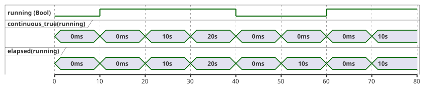
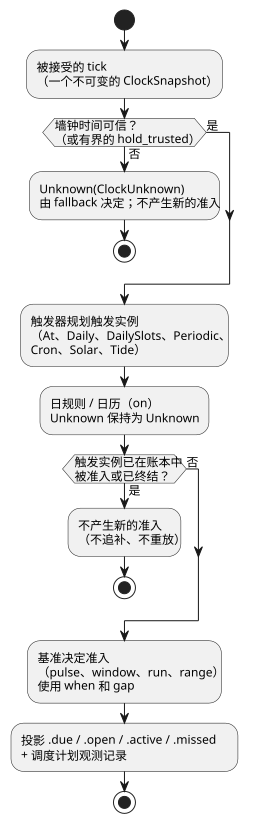
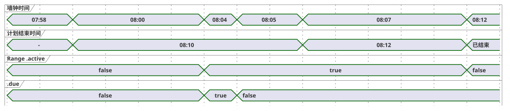

<!-- translation-source: docs/reference/03-time-and-schedules.en.md -->
[英文原文](03-time-and-schedules.en.md)

# 3. 时间与调度计划

[完整目录](../LANGUAGE-REFERENCE.zh.md) · [上一章：2. 类型、表达式与状态](02-types-expressions-state.zh.md) ·
[下一章：4. 传感器、约束与控制](04-sensors-constraints-control.zh.md)

GhostFlow 不把时间当作单一的数字。它区分两种时间：

- **经过时间。**“开启五分钟”中的“五分钟”用*单调*时钟测量，单调时钟只会向前走。
- **日历时间。**“早上 6 点启动”中的“早上 6 点”是在某个时区中解释的日历时间。

这一区分带来两条规则：校正墙钟不得让已在运行的操作倒退或延长；重启不得悄悄移动调度计划的基准点。本章在这一区分的基础上，定义时间值、定时器、循环调度计划、工作日历以及自然事件（日出、潮汐）。

**如何阅读本章。**

- `ghost` 代码块和语法块是选定的公开语言契约。
- 若当前编译器只校验或执行更窄的子集，相应小节会明确说明。
- 标记为 `text` 的代码块（例如 ClockSnapshot、清单（manifest）和 provider 记录）是与执行环境之间的契约，不是 GhostFlow 源代码。
- 时钟、日历和预测数据可以来自本地设备，也可以来自可选的网关。网络和任何特定网关都不是语言层面的要求。

**本章内容**

| 小节 | 主题 |
|---|---|
| §3.1 | 时间值类型（`Duration`、`Date`、`TimeOfDay`、`DateTime`）与两种时钟 |
| §3.2–§3.4 | 定时器：`elapsed`、`continuous_true`、累计用量与滚动用量 |
| §3.5 | 调度计划的通用语义：策略、基准、投影、错过、身份标识、间隙 |
| §3.6–§3.7 | `DailySlots`、`Periodic` 与 `cron5` |
| §3.8 | 夏令时（DST）、午夜与工作日历 |
| §3.9 | 太阳、月亮与潮汐调度计划 |
| §3.10 | 基于时间的用量限制（每日预算、滚动预算、事件计数） |
| §3.11 | 已确立语法与边界小结 |

本章依据以下文档：[时间与调度计划契约](../TIME-AND-SCHEDULE-CONTRACT.zh.md)、
[连续 Bool 定时器契约](../CONTINUOUS-BOOL-TIMER-CONTRACT.zh.md)、
[Solar 调度计划契约](../SOLAR-SCHEDULE.zh.md)、[选定语法](../LANGUAGE-SURFACE.zh.md)、
[Programming in GhostFlow 第 6–7 章](../ProgrammingInGhostflow.zh.md)、
[2026-09-24 固定计划时间区间决定](../2026-09-24-fixed-planned-time-range-decision.zh.md)、
[#23](https://github.com/callin2/ghostflow-language/issues/23)、
[#46](https://github.com/callin2/ghostflow-language/issues/46)、
[#90](https://github.com/callin2/ghostflow-language/issues/90) 和
[#96](https://github.com/callin2/ghostflow-language/issues/96)。

## 3.1 时间值与时钟域

### Duration

`Duration` 表示一段时间长度，而不是日历日期。选定的字面量是一个非负整数，后跟单位 `ms`、`s`、`min` 或 `h` 之一。

```ghost
config open_delay: Duration = 2s;
config watering_time: Duration = 5min;
```

**值域。** Duration 是 `0..2^53-1` 范围内的精确整数毫秒数。所有运算都会按此范围进行检查。

以下情况均被禁止，无论是作为最终结果，还是作为动态运算的任何中间结果：

- 负的 Duration；
- 小数毫秒；
- NaN 与 Infinity；
- 超出范围的值。

一旦违反，当前 tick（逻辑决策步）会以 `duration-out-of-range` 被拒绝，不会部分提交任何新状态或意图。

需要“正延迟”的操作可以对该参数拒绝 `0ms`。这一限制属于该操作本身；零仍然是合法的 `Duration` 值。

**运算。**

- `Duration + Duration` 返回经过检查的和。
- `Duration - Duration` 仅在结果非负时返回 `Duration`。

月、年和日历日期不是 Duration 的单位，因为它们的长度不是固定的毫秒数。“一个月后”需要另行定义的日历运算语义。

### Date, TimeOfDay, DateTime

时间类型的字面量采用带标签的形式：一个标签（`date`、`time`、`datetime`）后跟一个用反引号括起的字符串。

| 类型 | 值域 | 规则 |
|---|---|---|
| `Date` | 公历 `1970-01-01..9999-12-31` | 不含时刻与时区。 |
| `TimeOfDay` | `00:00:00.000..23:59:59.999` | 不含日期、UTC 偏移或重复规则。 |
| `DateTime` | 从 Unix 纪元到 `9999-12-31T23:59:59.999Z` 的精确 UTC 瞬时 | 字面量必须带 `Z` 或数字 UTC 偏移。值本身不保留 IANA 时区。 |

```ghost
date`2026-09-22`
time`06:30`
datetime`2026-09-22T06:30:00+09:00`
```

精确写法如下：

```text
Date       := date`YYYY-MM-DD`
TimeOfDay  := time`HH:MM[:SS[.f|.ff|.fff]]`
DateTime   := datetime`YYYY-MM-DDTHH:MM:SS[.f|.ff|.fff](Z|+HH:MM|-HH:MM)`
```

**词法规则。**

- 每个字段都是补零的 ASCII 十进制数字。
- 小数秒为一到三位数字，在右侧补零得到精确的毫秒数。四位及以上会产生诊断；绝不进行舍入。
- 数字偏移的范围是 `00:00..14:00`。小时为 14 时，只允许 `14:00`。
- `+00:00` 规范化为与 `Z` 相同的瞬时。`-00:00`（按惯例表示“UTC 偏移未知”）被拒绝。

**诊断。** 不存在的日期、`24:00`、闰秒 `:60` 以及不带偏移的 DateTime 都会产生诊断。

**DateTime 值是什么。** DateTime 值是一个精确到毫秒的 UTC 瞬时。原始写法和偏移只保存在源码元数据中。IANA 时区是在民用时间中解释*循环*调度计划所需的上下文；它不是已经解析完成的 DateTime 瞬时的一部分。

字符串与时间类型之间、`Date`、`TimeOfDay` 与 `DateTime` 之间都不存在隐式转换。

最基本的时间运算如下：

- `DateTime ± Duration -> DateTime`：对瞬时进行带范围检查的平移。
- 同类型两个值之间的比较（DateTime 与 DateTime、TimeOfDay 与 TimeOfDay）。
- `TimeOfDay + Duration` **不会**在午夜自动回绕。应在提供 Date 和时区的调度计划上下文中解释它。
- `DateTime - DateTime` 不是基本的 `Duration` 运算，因为结果可能需要为负。请比较两个瞬时，或使用单调的 `elapsed`。

### 日历时钟与单调时钟

每个 tick 使用一个不可变的*时钟快照*。快照携带两种用途不同的时钟：

| 时钟 | 用途 |
|---|---|
| 日历时钟（墙钟） | 解释调度计划、日期、时区与自然事件。 |
| 单调时钟 | 测量操作已运行多久、条件已保持多久。 |

```text
// 说明该契约的结构
ClockSnapshot {
  monotonicMs
  bootEpoch
  wallMs?
  wallQuality: Trusted | Unknown(reason)
  uncertaintyMs?
  sourceRevision?
}
```

快照的规则：

- 在一次运行（run）内，`monotonicMs` 绝不减小。单调时间减小、或不满足整数/范围要求的快照，会在任何状态改变之前被拒绝。
- `wallMs` 可能存在却仍不可用：只有当 `wallQuality` 为 `Trusted` 时，调度计划判定才会使用它。
- 正在运行的定时器始终基于单调时钟，即使墙钟被向前或向后校正。

由宿主（host）决定信任哪个时间源（NTP、RTC、平台时间）。控制表达式绝不直接读取网络或机器时钟。暂时保持最后一个可信时间的策略，必须说明保持多久以及适用哪种终结性回退（fallback）。不存在隐藏的宽限期。

**原因：** 如果墙钟时间和经过时间共用“时间”这一个词，那么时钟校正、时区变更、夏令时和重启也会改变操作的运行时长。

## 3.2 状态变化后的经过时间

`elapsed(state)` 返回自所引用的状态上次**提交变化**以来的单调时间。

```ghost
type Phase = Idle | Watering;
state phase: Phase = Idle;
timer age = elapsed(phase);

phase' = case phase {
  Idle => if start then Watering else Idle;
  Watering => if stop || age >= watering_time then Idle else Watering;
};
```

精确规则如下：

- 第一个被接受的 tick 中，表达式求值读取 `0ms`。
- 按 §2.8 的快照规则，状态转移和输出读取 tick 开始时的区间。
  即使本 tick 改变状态，已求值的 `elapsed` 输出仍使用先前的区间。
- 提交变化时，以当前单调时间开始新区间。同一结果的提交后定时器观测为 `0ms`。
  源 trace 显示此提交后值，不重新计算已经求值的输出。
- 下一个被接受的 tick 读取新区间。相同时间戳得到 `0ms`；状态不变则保留区间起点。
- 对 Bool 状态而言，false→true 和 true→false 都是变化。因此 `elapsed(running)` 表示“当前值已保持多久”，**而不是**累计 ON 时间。
- 在一个 tick 内，阶段不会级联推进。转换发生在第一个满足条件的 tick 上。因此实际延迟至少等于所请求的 Duration，通常最多再长一个 tick 间隔。
- 被拒绝的 tick 不改变定时器状态。

定时器不是 `sleep`，也不是后台任务。定时器运行期间，每个 tick 仍会求值停止请求、传感器故障和全局约束。

## 3.3 Bool 持续为 true 的时间

“温度在阈值以上持续了五分钟”与“该状态上次何时变化”是不同的问题。*连续为真定时器*只测量条件为 true 的当前不间断区段。只要某个 tick 上条件为 false，它就立即返回 `0ms`。

```ghost
timer hot_for = continuous_true(temperature_high);
```

设 `c` 为条件，`wasTrue` 为它在前一个被接受的 tick 上的值，`since` 为当前区段的起点，`now` 为当前单调时间。则：

```text
value    = if c && wasTrue then now - since else 0ms
wasTrue' = c
since'   = if !c then now
           else if !wasTrue then now
           else since
```

由此可得：

- 第一个为 true 的 tick 返回零。时间戳相同的重复 tick 也返回零。从下一个时间戳起才出现非零值。
- 为 false 的 tick 立即返回零，下一个为 true 的 tick 开始新的区段。
- 每个定时器都有自己的内部状态；定时器之间绝不共享状态。

下面的时间线比较了每 10 秒采样一次的 Bool 状态上 `continuous_true` 与 `elapsed` 的取值。两者在值为 false 时不同：`elapsed` 测量 *false* 已保持多久，而 `continuous_true` 保持为零。



`continuous_true` 恰好接受一个 Bool 表达式。它不会把 `Result<Bool, SensorFault>` 隐式转换为 Bool。若要把故障保守地当作 false，请用 `case` 显式写出这一选择：

```ghost
let safe_high = case high_temperature {
  ok(value) => value;
  fault(_)  => false;
};
```

连续为真既不是可暂停/恢复的累加器，也不是对若干独立 ON 段的求和。那些是不同的时间运算（见 §3.4）。

## 3.4 累计时间与滚动预算

关于“多久”的不同问题需要不同的时间语义：

| 问题 | 所需的时间语义 |
|---|---|
| 当前阶段已保持多久？ | `elapsed(state)` |
| 条件不间断地为 true 有多久？ | 连续为真（continuous-true） |
| 本次作业累计用了多少分钟 ON？ | 以作业为范围的累计 ON 时间 |
| 最近 60 秒内累计有多少秒 ON？ | 滑动窗口 ON 积分 |
| 今天物理泵累计开了多少分钟？ | 按日历日期的设备用量核算 |

滚动用量核算分两步。首先声明一个绑定到稳定物理资源和核算阶段的*账本*（一个 `account`）。然后按某个时间基准查询该账本。

```ghost
resource pump1: BoolActuator;
account pump_applied = on_time(pump1,
  stage: applied,
  persistence: durable);
constraints PumpBudget {
  limit used(pump_applied, rolling(60s)) <= 30s {
    reserve = 1s;
    on_unknown = block;
  }
}
```

这是控制内部用量核算声明的一个片段。当前编译器会校验格式正确的 `limit used(...)` 并生成一个用量核算描述符。要实际运行，还需要另外的资源绑定和账本执行机制。

```text
used(t) = ON duration of x over (t - 60s, t]
```

预算的行为：

- 当 `used + reserve` 达到 30 秒时，禁止进一步 ON。
- 旧 ON 区间的一部分滑出窗口时，恰好等量的预算会立即返还。
- 不要用固定的一分钟桶来近似，也不要只测量当前连续区间。
- 对多个区间的部分重叠求和。即使扫描不规则，同一逻辑时间轨迹也必须得到相同结果。

用量核算的**阶段**必须明确：

| 阶段 | 计入内容 |
|---|---|
| requested | 控制请求的 ON 时间。 |
| admitted/safe | 通过约束的逻辑 ON 时间。 |
| applied | 渲染器（renderer）报告已应用的命令时间。 |
| confirmed | 经反馈验证的物理运行时间。 |

说明阶段为何重要的例子：

- 若 `manual_request` 为 true，但低水位约束使安全输出为 false，则不消耗任何 admitted/safe 预算。
- 没有反馈时，不得把安全 ON 时间呈现为实际流量。

其他要求：

- 窗口和最大 ON 时长必须有限，以便能计算出状态内存的上界。
- 重启不得隐式重置保护性预算。请选择一种契约：从检查点恢复、在窗口长度内保守地阻止，或声明显式的非持久策略。

**原因：**“一次 30 秒”和“最近一分钟内累计 30 秒”是不同的安全规则。如果二者是同一个定时器，大量短时启动就可以绕过限制。

## 3.5 调度计划的通用语义

**调度计划（Schedule）**是一个持续求值的带类型响应式值。它不是延迟调用，也不是后台线程。在每个被接受的 tick 上，调度计划查看当前时间，并对其触发器、日规则、谓词和上下文求值，据此决定是否**准入**一个触发实例（occurrence），即接受一个计划中的触发实例为已开始。条件不满足的脉冲绝不会被排队留待以后执行。

下图展示了每个 tick 上这一判定的顺序。各步骤在本节其余部分中定义。



选定的触发器类型有 `At`、`Daily`、`DailySlots<G>`、`Periodic`、`Cron`、`Solar` 和 `Tide`。当前编译器接受一次性的 `At`（pulse 和 Window），时段类型仅接受 `DailySlots<15min>`。每种触发器类型都有自己的触发字段，以及下列通用策略字段。

```ghost
schedule name: TriggerType {
  // trigger별 field
  basis = pulse;
  when = true;
  clock = trusted_only;
  gap = skip_after(60s);
  recovery = baseline;
  fallback = skip;
}
```

```text
basis       := pulse
             | window(positive Duration)
             | run(positive Duration, on_time)
             | run(positive Duration, within(positive Duration))
             | range(positive Duration)
when        := Bool
clock       := trusted_only
             | hold_trusted(positive Duration, terminal: skip)
gap         := skip_after(positive Duration)
recovery    := baseline
fallback    := skip
             | fixed_time(TimeOfDay, terminal: skip)  // 仅 Solar
cancel_when := Bool                                   // 当前民用 range 必需；Tide run 可选
```

通用策略字段的含义：

| 字段 | 含义 |
|---|---|
| `basis` | 触发实例如何被准入，以及围绕计划瞬时持续多久（见“Pulse, Window, Run, Range”）。 |
| `when` | 准入谓词。无条件准入时写 `when = true`。 |
| `clock` | 可以使用哪种墙钟时间：只用可信时间，或在有界时长内保持最后一个可信时间。 |
| `gap` | 在触发实例被视为错过之前可容忍的最长观测间隙。 |
| `recovery` | 启动时或时钟可信度恢复时的行为。`baseline` 只设定基线，不重放。 |
| `fallback` | 判定为 Unknown 时怎么做。 |
| `cancel_when` | Run 或 Range 的语言级取消。 |

通用字段的规则：

- 所有通用字段都是必需的。
- 没有语言级取消的 Run 或 Range 可以写 `cancel_when = false`。
- 在当前编译器中，`cancel_when` 允许用于 `Tide` Run 和民用 `range`；对 `range` 是**必需**的，对 `pulse` 是**禁止**的。

**时钟保持。** `hold_trusted(d, terminal: skip)` 取最后一个可信的墙钟瞬时，加上自那以后经过的单调时间，并在至多 `d` 的时长内使用该结果。不确定度以同样方式保持：最后的不确定度加上同样的单调经过时间。保持的值带有 `HeldClock` 来源。保持达到上限时，时钟变为 `ClockUnknown`，终结性的 `skip` 适用于新的准入判定。已经准入的 Range 保留其单调结束时间。高水位（high-water，即已观测到的最新墙钟瞬时）不变。

**当前编译器对策略和基准的支持。**

| 功能 | 当前状态 |
|---|---|
| `clock = hold_trusted(positive constant Duration, terminal: skip)` | Solar 和 Tide 可用。 |
| `fallback = fixed_time(TimeOfDay literal, terminal: skip)` | Solar 可用。 |
| Tide 回退 | 仅 `fallback = skip`。 |
| 其他触发器 | 保持仅可信时钟和 skip 回退。 |
| `At` Window | 有界的可执行 Window 配置档。 |
| 其他触发器上的 Window；`run(_, on_time)` | 不在当前支持范围内。 |
| 不可变 UTC Daily 和非空静态 DailySlots Range | 静态证明不重叠；以 GFB12 执行。 |
| 不可变非 UTC `DailySlots<15min>` Range | GFB21 配置档（见“不可变非 UTC DailySlots Range”）：编译时检查名义时段间距，并由 Rust 校验宿主提供的实际触发实例区间。 |
| 其他被接受的 Range 循环 | 仍为不可执行的描述符。 |
| 来自操作员 `Duration` 设置的 Range 时长（受支持的 UTC 配置档） | 当初始值能证明不重叠时允许。被接受的实时设置事件会从冻结的计划开始时间重新计算当前触发实例，不产生新的 due 脉冲或触发实例身份标识。 |
| Tide `run(_, within(_))` | 支持。 |

**自然事件的有界准入。** 以下规则防止缺失的预测或不确定的时钟悄悄产生触发实例：

- 只有当单调经过时间*严格小于*保持时长时，才使用保持的时间。
- 缺少可信锚点、缺少不确定度，或检查加法溢出，都以关闭（fail closed）方式失败。
- 保持的墙钟时间和不确定度，等于最后的可信值加上经过时间，并带有 `HeldClock` 来源。
- 到期后对新准入做终结性 skip，保留高水位，不延长正在进行的 Run。
- 恢复时建立基线。重启以新的时钟开始。
- 事实 provider 负责 IANA 转换。它提供已知的来源本地日期，以及与该日期上编写的时间和时区相符的回退瞬时。
- 有歧义或不存在的民用时间做终结性 skip，不会臆造折叠（fold）。
- 核心负责准入以及生成的 due 输入。
- 同一来源本地日期上的回退触发实例和恢复后的 Solar 事件，共享一个已消耗的身份标识和终结检查点。

`fixed_time` 只用于 Solar。一旦某个来源本地日期的回退触发实例被准入，同一触发实例账本就会消耗该日期的 Solar 事件。因此即使 provider 恢复，事件也不会重复。Tide 只允许 `fallback = skip`，因为没有预测时，潮汐事件的数量和身份标识都是未知的。

扩展的 Solar 策略只在有界的 Solar 配置档中执行。把它们与非 Solar 调度计划、provider/config 执行或不受支持的功能组合，会被拒绝。旧有的 Solar 组合保留其现有配置档。

**Solar 与设置故障。** 当 Solar 的 `when` 读取一个 config Result 时，该 config 成为*准入依赖*：

- 所依赖 config 的当前故障会使判定保持为 `Unknown(SettingsFault)`，不准入新的触发实例，即使编写的 fault 分支返回 true。
- 无关 config 的故障不会抑制 Solar。
- Solar 与普通控制在同一求值位置读取当前的 Result。
- 一次成功的恢复观测建立基线；它不会追补过去的事件。
- 设置观测、Solar 判定和 VM 转换一起提交。因此失败的求值既不消耗事件，也不消耗触发实例。
- 坐标、时区、事件和偏移是不可变的程序定义。实时设置绝不会隐式替换它们。

**原因：** 如果调度计划依据一个旧的成功值启动作业，而普通控制看到的是设置错误，那么同一个程序就会作出相互矛盾的判定。应保留原因，并根据实际生效的观测来决定准入。

**一次性 `At`（pulse）。** `At` 使用一个常量的带类型 DateTime。它没有时区或夏令时字段。

```ghost
schedule appointment: At {
  at = datetime`2026-01-01T08:00:00Z`;
  basis = pulse;
  when = true;
  clock = trusted_only;
  gap = skip_after(60s);
  recovery = baseline;
  fallback = skip;
}
```

- 绝对瞬时依据其显式偏移进行规范化。同一瞬时的不同偏移写法规划出同一个触发实例。
- 这个有界的 Pulse 配置档只接受仅可信时钟、基线恢复、skip 回退和正的常量间隙。
- 诊断：缺少字段、`at` 不是 DateTime 或不是常量、出现时区/夏令时/取消字段，以及任何其他基准。
- 它提供 `.due` 和 `.missed`。
- 它不能与 provider、config、sensor、resource、objective 或其他调度计划配置档混用。
- GFB14 和 control-v13 标识这一执行配置档；带帧的时钟/扫描传输不变。旧的加载器拒绝 GFB14。签名的可移植包尚不接受此配置档。

**带 Window 的 `At`。** 在相同的策略限制下，`At` 也接受正的常量 `window(Duration)`：

```ghost
schedule appointment: At {
  at = datetime`2026-01-01T08:00:00Z`;
  basis = window(5min);
  when = ready;
  clock = trusted_only;
  gap = skip_after(60s);
  recovery = baseline;
  fallback = skip;
}
output start_once: Bool;
start_once <- appointment.due;
```

计划区间是半开区间：`[at, at + duration)`。两个投影的行为不同：

| 投影 | 种类 | 含义 |
|---|---|---|
| `.open` | 电平 | 时钟可信时：处于**当前**区间内*且* `when` 为 true。随着 `when` 变化，它可以先变 false 再变 true。 |
| `.due` | 脉冲 | 在区间内第一个符合条件的被接受扫描上为 true，仅一次。 |

终结性错过或更早的准入会阻止之后的任何 `.due`。它**不会**强制当前的 `.open` 电平变为 false。只应启动一次的作业请使用 `.due`。

示例：08:00 的 `window(5min)`，若观测间隙从 07:59:50 持续到 08:02:00，则该触发实例被终结性错过。在 08:02，`.missed` 为 true，`.due` 为 false，而若 `when` 为 true，`.open` 可以为 true。在 08:05 或之后，`.open` 为 false。

其他规则：

- 未知或不可信的墙钟时间绝不能产生已知为打开的区间。
- `At` Window 没有取消字段，也不接受宿主提供的触发实例行。
- GFB23 和 control-v23 标识这一独立的执行配置档。旧的加载器拒绝它，清单/配置档不匹配会在激活前被拒绝。签名的可移植包尚不接受此配置档。

**核心如何准入 `At` 触发实例。** Rust 核心根据编译后的调度计划位置和瞬时计算出唯一的触发实例，不需要宿主提供触发实例行。

- Pulse 准入要求：一次被接受的可信扫描、没有观测间隙、`previous < planned <= current`，且 `when = true`。若越过时 `when` 为 false，该触发实例作为终结性错过被消耗。
- Window 可以在窗口结束前的第一个符合条件的扫描上准入，即使越过时 `when` 为 false。
- 对这两种形式，重叠的观测间隙都是终结性错过。
- 在该瞬时或之后进行的启动或恢复基线，会把该触发实例作为 `BaselinePastMissed` 消耗，不追补。
- 重新观测、墙钟回退和再次越过都绝不会产生另一次准入。新的时钟源或启动修订版不会产生新的身份标识。
- 被拒绝的扫描既不提交时钟基线，也不提交终结身份标识和投影。

**重启。** 跨重启去重需要恢复同一程序的终结检查点：

- 已被消耗或错过的身份标识保持已消耗状态，即使新启动的墙钟早于该瞬时。
- 在触发实例之前生成的检查点，仍可能准入未来的越过。
- 全新的激活没有持久历史。
- 准入之后、持久检查点发布之前发生的崩溃，不在 VM 的“仅一次”保证范围内。宿主的持久化和分派必须处理这一边界。
- 准入是逻辑证据。它不证明物理执行或确认应答。

**`Daily`。** `Daily` 每天规划一个时间。它需要 `timezone`、``at = time`...`;``、`dst_missing` 和 `dst_repeated`。例如：

```ghost
schedule morning: Daily {
  timezone = "Asia/Seoul";
  at = time`06:30`;
  dst_missing = skip;
  dst_repeated = first;
  basis = pulse;
  when = true;
  clock = trusted_only;
  gap = skip_after(60s);
  recovery = baseline;
  fallback = skip;
}
```

**触发器与基准是相互独立的两个维度。** 不要把 Cron、Window、Run 和 Range 列为同一类的备选项：

- 触发器（例如 Cron）决定触发实例**何时**被规划。
- 基准（Window、Run、Range）决定**围绕**计划瞬时的准入和持续时间。

读取调度计划绝不会打开设备。

**判定与 Unknown。** 调度计划判定是 `True`、`False` 或 `Unknown(reason)`，并附带所使用的修订版。`fallback = skip` 在新准入时把 Unknown 解析为 `.due = false`，但保留原因。对 Unknown 取反绝不能把它变成许可。

**投影。**

| 投影 | 含义 |
|---|---|
| `.due` | 脉冲：仅在准入一个触发实例的被接受 tick 上为 true。 |
| Window `.open` | 电平：处于 `[planned, planned + length)` 内，**且**当前谓词为 true。 |
| Run `.active` | 准入后的运行区间，用显式状态和单调定时器表示。 |
| Range `.active` | 当前触发实例区间的剩余部分，锚定于计划开始时间。准入后，其结束按单调时钟判断。即使安全约束阻止输出，区间也会继续运行。 |

**Run 的持续时间与取消。**

- Run 的持续时间从实际准入起按单调时间测量。
- 在 `cancel_when` 为 true 的被接受 tick 上，Run 和 Range 结束 `.active`。该触发实例不会重新武装。
- 当请求的输出为 false 或全局约束阻止安全输出时，Run 和 Range 绝不会悄悄暂停。
- 要测量请求的 ON 时间、安全 ON 时间或连续安全 ON 时间，请使用单独的显式运算。

**调度计划观测。** 每个判定还会留下一个与 Bool 投影分开的*调度计划观测*。它记录：

- 稳定的调度计划 ID 和定义修订版；
- 判定 `False | Due | Unknown(reason)` 及其处置；
- 触发实例 ID 和计划的墙钟瞬时；
- 来源本地日期和计划本地日期；
- provider 和上下文修订版。

典型的处置有 `Before`、`PredicateFalse`、`AlreadyAdmitted` 以及以下错过原因：

| 错过原因 | 含义 |
|---|---|
| `ConditionsFalseAtPulse` | 脉冲越过时条件为 false。 |
| `ObservationGap` | 不可信的观测间隙与准入区间重叠。对 Range 而言，这是关于一个打开区间的非终结性证据，按下面的恢复规则处理。 |
| `LateStartExpired` | 延迟准入区间已结束。 |
| `CorrectionPastHighWater` | 校正后的事件时间移到了已经越过的高水位之后。 |
| `EventWithdrawn` | provider 撤回了一个尚未准入的事件。 |

仅凭 `.due = false` 无法区分普通的 false、Unknown 回退、已准入的事件和错过的事件。因此这一证据被绑定到同一个被接受的扫描。

### 源码对错过触发实例的响应

`schedule_name.missed` 是一个 `Bool` 投影，让源码可以对错过作出响应。

**可用范围。** 当前编译器为 At pulse 与 Window、Solar 以及可执行的 `pulse` 民用调度计划提供 `.missed`。对 Range（包括可执行的 UTC Range 控制）而言，它尚不是执行投影。

**语义。**

- 仅当该调度计划的一个或多个触发实例在本次被接受扫描中成为**终结性错过**时，它才为 true。
- 若一次扫描中错过了多个触发实例，它仍只为 true 一次。除非有新的终结性错过，下一次被接受扫描中它为 false。
- 控制动作在该被接受扫描的不可变快照中对它恰好求值一次。
- 重新观测一个已被记录为终结性错过的触发实例，或恢复检查点，都不会让它再次为 true。
- 被拒绝的扫描既不提交这个脉冲，也不提交任何状态转换。

```ghost
state missed_scans: Int = 0;
missed_scans' = if morning.missed then missed_scans + 1 else missed_scans;
output missed_alarm: Bool;
missed_alarm <- morning.missed;
```

由于 `.missed` 是普通的 `Bool` 表达式，作者用 `if`、`case`、状态转换和输出表达式来编写响应。调度计划声明没有回调、按触发实例的处理器或自动重放。若要在每次扫描中对多个调度计划的错过只响应一次，可以求值一个表达式，例如 `morning.missed || evening.missed`。

**按触发实例的记录。** Bool 脉冲既不携带计数，也不携带原因。取而代之，同一被接受扫描的**有序调度计划观测**为每个终结性错过的触发实例各包含一条记录。每条记录保留：

- 稳定的调度计划 ID 和触发实例 ID；
- 计划瞬时；
- 终结性错过原因（`ConditionsFalseAtPulse`、`ObservationGap`、`LateStartExpired`、`CorrectionPastHighWater`、`EventWithdrawn` 中适用的那一个）；
- 定义、上下文和 provider 修订版。

这些记录的规则：

- 一次扫描中提交多条记录时，它们不会被合并，也不会归纳到同一个原因下。
- 重启后恢复的终结账本不会产生重复的记录或脉冲。
- `Unknown`，以及仍处于打开状态的 Range 的非终结性 `ObservationGap`，不会使 `.missed` 为 true。
- 错过的触发实例绝不会在之后条件变为 true 时被自动准入或执行。

### Pulse, Window, Run, Range

`basis` 字段从四种准入形态中选择一种：

| basis | 准入语义 |
|---|---|
| `pulse` | 仅当越过的那个 tick 上所有条件都为 true 时才准入。之后才变为 true 仍算错过。 |
| `window(5min)`（`At` 执行） | 在 `[planned, planned+5min)` 内条件第一次为 true 时准入一次。同一触发实例内反复的 false→true 变化不会重新武装它。其他触发器组合仍处于设计阶段。 |
| `run(5min, on_time)`（设计） | 只在观测到的越过时准入，并从准入起运行五分钟。 |
| `run(5min, within(10min))`（Tide） | 允许在 `[planned, planned+10min)` 内首次准入。十分钟是宽限期；运行时长为五分钟。 |
| `range(10min)`（民用契约） | 若可信的当前时间处于 `[planned, planned+10min)` 内且 `when` 为 true，则即使首次观测较晚、或在启动/恢复之后，也准入一次。结束时间为计划开始时间 + 十分钟。不可变 UTC Daily/DailySlots 使用 GFB12；下文的不可变非 UTC DailySlots 使用 GFB21。 |

```ghost
schedule morning_watering: Daily {
  timezone = "UTC";
  at = time`08:00`;
  dst_missing = skip;
  dst_repeated = first;
  basis = range(10min);
  when = true;
  cancel_when = false;
  clock = trusted_only;
  gap = skip_after(60s);
  recovery = baseline;
  fallback = skip;
}
```

**可执行 Range 的范围。** 这个不可变 UTC `range` 示例是可执行的 GFB12 控制字节码。

- 有界的执行切片支持不带工作日历的 Daily 和非空的静态 DailySlots，并使用 `trusted_only`、`baseline` 和 `skip`。
- 带 `workday` 或 `offday` 选择器和带类型 WorkCalendar 的不可变 UTC Daily 使用 GFB18。其开始时间加持续时间不得越过本地午夜；跨夜的工作区间应拆分为多个显式的 Daily range。恰好在午夜结束的 range 是合法的，因为结束点是排除的。不带工作日历的普通 range 保持其现有的午夜行为。
- 实时时长设置只对不带工作日历的 UTC Daily/DailySlots 进行降级编译（lower）。
- 实时标量开始时间设置只对带固定 Duration 的单个 UTC Daily Range 进行降级编译。
- 以下情况会被静态拒绝，而不是悄悄回退为静态 Range 元数据：带实时时长/开始时间 config 的工作日历 Range；实时开始时间 + Duration 的组合；Periodic Range；非 UTC Daily Range；基于设置的非 UTC Range。
- 不可变非 UTC DailySlots 遵循下一小节中的独立配置档。
- 不受支持的变体绝不会推断时区或夏令时策略。

**Range 检查点。** Range 上下文检查点存储已消耗的触发实例身份标识，以及（如果存在）生效的实时时长或实时标量开始时间设置。它不存储正在运行的单调定时器。

- 恢复到全新启动中，不会继续或重新准入已被消耗的触发实例。下一个触发实例使用恢复后的时长或开始时间。
- 仍处于打开状态的未消耗区间只能准入其剩余时间。
- 终结容量耗尽会原子地拒绝该扫描。身份标识绝不会被悄悄清除。

**Run 的延迟准入。** 延迟准入区间是半开的，因此在其结束边界上不会发生新的准入。对计划时间 08:00 而言，在 08:02 准入的 `run(5min, within(10min))` 按单调时钟运行到 08:07。

**Range 是固定的计划区间。** `range(duration)` 锚定于计划时间，而不是准入时间：

- 08:00 的 `range(10min)` 若首次在可信的 08:04 被观测到，只请求到 08:10 为止剩余的六分钟。
- 若首次在 08:10 或之后被观测到，则不会启动，并记录 `LateStartExpired`。
- 若 `when` 较晚但在结束前变为 true，只请求剩余时间。
- 启动时、重启时、时钟可信度恢复时以及观测间隙之后，同样如此。

这种部分区间准入**只**适用于 Range。它不改变其他基准的 `gap = skip_after(...)` 或 `recovery = baseline`。

**Range 与时钟可信度。**

- 没有可信的当前时间时，判定为 `Unknown(ClockUnknown)`。估计的时间绝不会准入新的 Range。
- 显式的 `clock = hold_trusted(...)` 使用按该契约保持的时间和不确定度。
- 已在运行的 Range 会持续到其既有的单调结束时间，即使之后墙钟可信度或保持期到期。
- 在开始时间被移到未来之后重新进入同一触发实例，与新的准入一样需要可信时间。即使可信度恢复，若当前区间已经结束，也不会重新进入。

**Range 触发实例不得重叠。** 同一调度计划的两个 Range 触发实例不得重叠：

- 两个半开区间的交集非空即为错误。恰好相接的区间是允许的。
- 示例：`selected = [08:00, 08:15]` 且 `basis = range(30min)` 的 `DailySlots` 是编译错误，因为 08:00–08:30 与 08:15–08:45 重叠。
- 编译器根据触发器定义和生效的设置证明不重叠。
- 不可变非 UTC DailySlots 配置档在编译时检查名义时段间距，并通过下文所述的 Rust 事实检查完成对实际区间的校验。
- 在该显式配置档之外，如果无法证明 provider 或动态循环的间距，`range` 声明会以编译诊断被拒绝。编译器绝不猜测或挑选某一个区间。
- 静态默认值在编译时检查。生效值（包括恢复的设置）在激活前检查。生效值重叠会拒绝激活。
- 会导致重叠的实时设置变更会原子地拒绝整个事件。
- 两种检查都覆盖当前已准入的区间以及新规划的区间。

**在准入时固定结束时间。** 在 Range 准入时，计划结束时间由该触发实例的计划开始时间和当时生效的 Duration 确定。已经经过的部分被换算为单调时钟上的剩余时间。准入之后：

- RTC/NTP 墙钟校正既不会提前也不会推迟进行中的结束时间。
- 校正后的墙钟适用于当前触发实例结束之后的后续触发实例判定。
- 可信时间、计划开始时间和单调经过参考值一同为该触发实例保存，因此在校正期间不会重新计算结束时间。

**实时修改开始时间或 Duration。** 如果单次开始触发器的标量开始时间设置或其 Duration 是运行设置，那么一个被接受的原子实时事件也会从该事件的应用位置起作用于当前触发实例：

- 当前区间及其结束时间根据变更后的开始时间和 Duration 重新计算。
- 触发实例 ID 和已准入的账本在设置修订版变更后依然保留。
- 准入之后，稳定的校正前时间参考值按单调经过时间推进，以求得当前位置和剩余时间。
- 延迟准入的时间绝不会被用作新的计划开始时间。即使墙钟校正或 ClockUnknown 使当前日期键不可用，也要根据原始本地日期和生效的 TimeOfDay 重新定时。
- 如果设置事件和扫描落在同一位置，先按 §5.2 的事件顺序应用事件，再依据该位置上生效的设置进行判定。

以下是计划于 08:00、在 08:04 准入的 `range(10min)` 的实例：

| 变更 | 结果 |
|---|---|
| 08:07 时 Duration → 12 分钟 | 在 08:12 结束。 |
| Duration → 5 分钟 | 在应用该事件的判定时结束，因为新的结束时间 08:05 已经过去。 |
| 开始时间 → 08:08 | 立即变为非活动；在可信的 08:08 再次活动；在 08:18 结束。 |
| 开始时间 → 08:02（Duration 仍为 10 分钟） | 在 08:12 结束。 |

下面的时间线展示第一行：在 08:04 延迟准入，然后在 08:07 实时修改 Duration，使计划结束时间从 08:10 移到 08:12。`.due` 只在准入时触发一次。



**安全阻止不会停止 Range 的时钟。**

- 当全局安全约束阻止输出时，安全输出立即变为 false，但 Range 触发实例及其单调结束时间保持不变。
- 如果约束在结束前解除，只能请求那时剩余的区间。被阻止的时间不会追加到结尾。
- `cancel_when = true` 终止该触发实例。重新获得许可不会重新启动它。
- `.active` 与 requested/safe/applied/confirmed 输出是不同的观测。

**开始时间被移到当前位置之后。**

- 如果开始时间的变更使当前位置早于新的计划开始时间，该触发实例在该判定中以 `.active = false` 停止。
- 在到达新开始时间的被接受 tick 上，同一触发实例会按其变更后的区间重新评估。若 `when` 为 true，请求只恢复到当前计划结束时间为止。只有安全约束允许时才产生安全输出。
- 这不是新的准入：不会再次发出 `.due`，触发实例 ID 和账本保持不变。
- 如果变更后的结束时间不晚于当前位置，该触发实例立即结束，既不恢复也不重新准入。

对于 `DailySlots` 的 `TimeSlots` 变更，§3.6 的稳定时段键用于区分重新定时与删除/新增。上述 Range 重新计算规则适用于保留键的重新定时；新项基线规则适用于删除/新增。

### 不可变非 UTC DailySlots Range

**配置档。** 非 UTC IANA 时区中的非空字面量 `DailySlots<15min>`，配合正的固定 Duration，以 GFB21 执行。它使用 `civil-range` 前导段（tag 19）和 `GhostFlow/control-v21`。

- 它**可以**组合多个这样的 Range、普通的时间窗口，以及降级为普通状态的定时器（如 `elapsed(state)`）。
- 它**不能**与独立的 `true-for` 前导段、其他调度计划/provider/config 配置档、工作日历，或实时开始时间/Duration/TimeSlots 组合。
- 现有的 UTC 配置档和 GFSF 民用触发实例行保持不变。该行自 GFSF4 起就已存在；这并不意味着当前的上下文编码器会输出 GFSF4 信封。
- 旧的加载器拒绝 GFB21；它们不会用其他配置档代替。

```ghost
schedule night: DailySlots<15min> {
  timezone = "Asia/Seoul";
  selected = [22:00];
  dst_missing = skip;
  dst_repeated = first;
  basis = range(7h);
  when = true;
  cancel_when = false;
  clock = trusted_only;
  gap = skip_after(60s);
  recovery = baseline;
  fallback = skip;
}
```

第二个调度计划使用相同的策略、`selected = [05:00]` 和 `basis = range(17h)`，定义白天区间。在首尔：

- 22:00 + 七小时在次日 05:00 结束。
- 05:00 + 十七小时在 22:00 结束。

结束边界是排除的。午夜处于夜间区间内；05:00 和 22:00 各自开始下一个区间。该运算是在计划开始瞬时上加上固定的经过时间。它**不是**在有夏令时的地区中一直运行到任意本地结束时刻的运算。

**宿主的职责。** 宿主负责时区转换和 tzdb 的完整性。它为每个调度计划提供一个覆盖区间 `[coverageStartMs, coverageEndMs)`，该区间：

- 从可信的当前墙钟瞬时向前回溯至少一个持续时间：`coverageStartMs <= max(0, wallMs - durationMs)`；
- 在当前时刻之后结束：`coverageEndMs > wallMs`。

宿主必须提供该覆盖范围内的**每一个**触发实例，包括区间在午夜之后仍处于打开状态的前一天的触发实例。日期变更后只发送当天的行是不够的。现有的 GFSF 调度计划证据为 `provider: null` 和 `calendar: null`。JavaScript 行使用现有字段：

```text
{ sourceDay, slotKey, minuteOfDay, fold, eventId, eventKind: "civil",
  instantMs, withdrawn, providerRevision, contextRevision }
```

| 字段 | 规则 |
|---|---|
| `sourceDay` | 原始本地日期的日序号，从 Unix 纪元起计数。 |
| `slotKey` | 将不可变字面量列表按时间排序后、从 1 开始的序号。 |
| `minuteOfDay` | 所声明时段的精确分钟。 |
| `eventId` | 空。 |
| `withdrawn` | 禁止撤回。 |
| `fold` | 夏令时折叠的选择遵循编写的 `dst_repeated`。 |

身份标识为 `site:sourceDay:slotKey:fold`。修订版和计划瞬时不会改变它。

**空事实（夏令时跳过）。**

- 由宿主解析为不存在、且 `dst_missing = skip` 的本地时段，可以作为 `instantMs = null` 的事实发送，或作为已知跳过的触发实例省略。仅仅缺少证据并不能确立夏令时间隙。
- 由宿主解析为重复、且 `dst_repeated = skip` 的时段，也可以使用 `fold = 0` 的空事实，包括 `dst_missing = next_valid` 的情况。
- 空事实要求 `fold = 0`，并且至少有一个编写的 skip 策略。它们不产生区间。
- 区分间隙与重复时段仍是宿主的责任。
- 不要用正常的 OFF 代替这个 null，也不要臆造计划瞬时。

**Rust 校验。** Rust 检查：

- 字段范围、所声明的时段键和分钟，以及夏令时折叠的选择；
- 是否允许空的 skip 标记；
- 重复或冲突的身份标识与修订版；
- 行的瞬时是否位于覆盖范围内；
- 实际半开区间的不重叠，包括当前已准入的冻结区间；
- 在相继的覆盖范围重叠之处，之前观测到的已解析瞬时事实不会消失或冲突。

覆盖不足和格式错误的事实绝不会导致新的准入。失败的扫描既不提交部分状态，也不提交触发实例历史。Rust 没有 IANA tzdb，因此无法证明宿主初始证据中完全省略的 IANA 触发实例是完整的。

**执行。** 经过校验的事实在现有的 RangeEngine 中运行：

- 首次观测较晚、启动或时钟可信度恢复时，只能准入打开区间的剩余部分。
- `gap` 是时钟观测策略。它不会缩短事实覆盖范围，也不会像对待脉冲那样丢弃打开的 Range。
- 一旦准入，定时器在墙钟可信度丧失或墙钟校正时都保持其固定的单调截止时间。
- 检查点保留已消耗的身份标识以便重启时去重，并且绝不会继续已准入的定时器。只有未消耗的打开触发实例才能准入部分区间。

**原因：** 午夜之后的当前区间可能来自昨天的计划。把宿主的 IANA 转换与 Rust 的事实校验和准入分开，可以让经过校验的触发实例以相同的 Range 语义运行。该契约支持对编译后的 GhostFlow 进行确定性的模拟。它不定义公共道路信号的合规性，也不校验物理控制。

### 触发实例身份标识与重复抑制

每个计划中的触发实例由调度计划的稳定声明 ID 加上来源触发实例键来标识：

| 触发器系列 | 来源触发实例键包含 |
|---|---|
| 本地每日 / Cron 时段 | 夏令时折叠 |
| Solar | 事件种类和来源日期 |
| Tide | provider 保证的站点 ID 和事件 ID |

定义修订版和校正后的计划时间是元数据。它们不会把同一个事件变成新事件。

一个触发实例至多被准入一次：

- 持续为 true 的条件不会在每个 tick 上产生新的运行。
- 已准入触发实例的新 provider 修订版不会产生重复运行。
- 真正不同的调度计划需要新的调度计划 ID。

### 观测间隙与恢复

**检测间隙。** 调度计划检查相邻两个被接受快照之间的单调差值和正的墙钟差值。在 `gap = skip_after(d)` 下，大于 `d` 的差值就是 `ObservationGap`。

**对 Pulse、Window 和 Run 的影响。** 当间隙与某个触发实例的准入区间重叠时，该触发实例以错过结束：

- 之后不会恢复，即使 Window 或 `within(...)` 宽限期仍然打开。
- 终结性的 Window 错过会停止 `.due` 准入。当前可信区间和谓词仍可能使 `.open` 为 true。

**对 Range 的影响。** 区间内的间隙是关于该间隙的证据，而不是该触发实例的终结性错过：

- 若可信的当前时间仍处于计划区间内，首次准入只能请求剩余时间。
- 到达结束边界时，以 `LateStartExpired` 记录终结性错过，不执行。
- 已经是终结性错过或已撤回的触发实例，不会仅因时间处于其区间内而恢复。特别地，Tide 的 `CorrectionPastHighWater` 和 `EventWithdrawn` 对 Range 也是终结性的。

**恢复。** `recovery = baseline` 只在初次启动和时钟可信度恢复时设定基线。它绝不会批量执行过去的触发实例。

- Range 只能准入仍处于打开状态的当前区间的剩余时间。
- 墙钟回退通过高水位和准入账本去重。
- 不存在追补、重试或重放的语法。

**一步中越过多个触发实例。** 如果在相邻两次被接受扫描之间越过了同一调度计划的两个或更多触发实例：

- 新的 Pulse、Window 和 Run 触发实例全部记录为错过；没有一个被准入或执行。
- Range 不执行已经结束、或已记录为终结性错过/撤回的触发实例。它准入在可信当前时间区间仍打开的那个触发实例，执行其剩余时长。
- 同一调度计划同时打开两个 Range 区间是禁止的。它们会被配置档的编译/实时设置检查或 Rust 事实校验拒绝。

如果恰好越过一个触发实例，则适用各基准的普通准入规则。

## 3.6 选定的 DailySlots

`DailySlots<15min>` 在本地日期的 15 分钟网格上选择特定时刻。

```ghost
schedule starts: DailySlots<15min> {
  timezone = "Asia/Seoul";
  selected = [06:00, 18:45];
  dst_missing = skip;
  dst_repeated = first;
  basis = pulse;
  when = true;
  clock = trusted_only;
  gap = skip_after(60s);
  recovery = baseline;
  fallback = skip;
}
```

- `timezone` 是用于解释该调度计划的 IANA 时区。
- `selected` 包含一天 `00:00..23:45` 内 15 分钟网格上的时刻。
- 禁止重复时段和不在网格上的时刻。
- `starts.due` 在第一个观测到时段越过的 tick 上为 true，仅一次。
- 启动前的时段、在观测间隙中错过的时段，以及恢复前的触发实例，都不会被隐式追补。
- 墙钟回退后，同一本地日期/时段不会再次执行。

**操作员可编辑的时段。** 若要让操作员在同一程序和同一运行（run）内修改时段集合，请使用有限的设置类型：

```ghost
config watering_slots: TimeSlots<15min, 8> = [
  time`06:00`, time`18:45`
] {
  access = operator;
  label = "관수 시작 시각";
}
```

`TimeSlots<G,N>` 是一个名义上的 TimeOfDay 有限集合：

- `G` 是能整除 24 小时的正 Duration 网格。`N` 是编译时的最大项数。
- 空集合是合法值，没有任何触发实例。
- 值必须唯一且位于从本地午夜起算的网格上。校验后会排序。
- 它们不会隐式转换为 Duration 列表。
- 使用 `selected = watering_slots` 时，调度计划和设置的 `G` 必须完全相同。
- 字面量 `selected` 使用简洁的 `HH:MM`；设置值使用普通的 `time` 字面量。

**设置故障。** `selected = watering_slots` 消费 §5.2 中的 `Result<TimeSlots<G,N>, SettingsFault>` 流。

- 当前观测中的故障产生带同一原因的 `Unknown`，不准入新的触发实例。
- 不要用之前成功的列表或空列表代替。
- 下一次 `ok` 发出按下文的身份标识、重新定时和基线规则生效。
- 故障本身不会取消已准入的 Run，也不会替代另行指定的取消规则。

**被接受的实时编辑。** 被接受的实时编辑具有以下语义：

- **原子校验。** 整个事件一次性校验：类型、网格、重复、`N`、权限和程序身份标识。
- **时段键。** 经批准的运行时设置状态为每一项保存一个不透明的 `slot key`，与其显示时间无关。该键不是 GhostFlow 源码语法，也不由作者选择。设置事件具有唯一的事件身份标识和一个基础设置修订版；重新定时同时指明现有的 `slot key` 和新的 `TimeOfDay`。UI 和存储不得把顺序或显示时间用作项的身份标识。
- **重新定时。** 重新定时只改变同一项的显示时间。触发实例身份标识 `(schedule ID, local date, slot key, DST fold)` 以及准入/终结账本都被保留。新的 `TimeOfDay` 是计划时间元数据。把已准入的 Range 移到未来，会立即以 `.active = false` 停止它。当可信时间到达新的开始时间时，同一触发实例在其变更后的半开区间中重新评估。不会再次发出 `.due`，也不会产生第二次准入。
- **重新定时示例。** 使用 `TimeSlots<1min,N>`，假设 08:00 的 `range(10min)` 触发实例在 08:04 被准入。把该项重新定时到 08:07，会在事件的应用位置停止它。被接受的 08:07 判定重新评估同一触发实例，若 `when` 为 true，则请求持续到 08:17。触发实例 ID、时段键和账本不变。如果事件在 08:07 的判定位置应用，§5.2 的顺序会先应用新值，然后立即评估同一触发实例。
- **新增。** 新增的项获得新的 `slot key`，并在事件的生效位置设定基线。该位置当时或之前的同日时段不会发出；只规划未来的时段。
- **删除。** 删除只移除该 `slot key` 的未来计划。删除某个显示时间再加回相同时间，会产生新的键和触发实例；这不是重新定时。删除不会取消已准入的 Run。若要对已准入的 Range 重新定时，请发送指明其现有键的重新定时事件，而不是删除加新增。
- **顺序。** 设置事件和调度计划扫描遵循生效位置的全序。某项在首次被新增的那个确切位置上不会到期。
- **重启。** 重启可以恢复已批准的设置值，但不会创建待处理队列。触发实例账本的生命周期独立于普通 config。恢复的状态必须同时包含时段键和显示时间。

重新定时的结果作为一个完整的 `TimeSlots<G,N>` 值进行校验：网格、重复、`N`，以及同一调度计划内 Range 的不重叠。如果新时间会与另一项的 Range 重叠，整个事件被拒绝。现有值、时段键、设置修订版、活动触发实例和账本都保持不变。

该类型**不**表示“每 15 分钟一次”。它表示特定的本地时钟时段，例如 `[06:00, 18:45]`。这与 Periodic 不同，Periodic 中被设置修改的是周期。

**可执行的带键 Range 配置档（GFB20）。** 该有界可执行配置档：

- 使用由 `TimeSlots<G,N>` 选择的 UTC `DailySlots<G>`、正的固定 Duration、不带工作日历，以及能整除 24 小时的整分钟网格；
- 使用 GFB20/control-v20；
- 拒绝把实时 TimeSlots 与实时 Duration 或非 UTC 时区组合。

示例：当 08:00 的 `range(20min)` 处于准入状态时，列表不能改为 `[08:00, 08:15]`。`[08:00, 08:20]` 是合法的，因为两个半开区间只是相接。预检也包括键已从拟议的未来列表中删除的已准入区间。拒绝时，既不提交该事件中的其他设置，也不提交时钟、分配器、修订版或触发实例历史。**原因：** 设置修订版不得引入重叠的作业，也不得只改变控制快照的一部分。

该配置档的其他规则：

- 新增或重新定时某个键的编辑需要可信的墙钟基线。墙钟可信度未知时，它会被原子地拒绝。
- 未变更的键和被接受的设置故障发出保持现有行为。这一限制不改变独立的实时标量开始时间/Duration Range 配置档。
- 故障发出保留历史键的身份标识，但产生 Unknown，没有新的生效计划。
- GFRG4 检查点持久化被接受的带键列表、分配器、新增基线和已消耗历史，包括空列表以及显示时间顺序发生变化的保留键。
- 恢复时校验这些元数据，并且绝不继续活动的定时器。
- 现有的 GFRG1/2/3 配置档保留各自的格式。旧的加载器拒绝 GFB20，而不是运行静态回退。
- 该配置档不选择时区/夏令时策略，也不选择 Run 取消策略。

## 3.7 Periodic 与 Cron

### Periodic

Periodic 是一个带有重复间隔和确定性锚点（相位）的触发实例流。

```ghost
schedule watering: Periodic {
  every = irrigation_interval;
  anchor = instant(datetime`2026-10-01T00:00:00Z`);
  interval_change = preserve_anchor;
  basis = pulse;
  when = true;
  clock = trusted_only;
  gap = skip_after(60s);
  recovery = baseline;
  fallback = skip;
}
```

**`every`。** `every` 的成功载荷必须是正的 `Duration`。config 引用也必须将 `Duration` 声明为其载荷类型；Bool、Percent 和无单位的 Number 都是类型错误。

**`anchor`。** 运行时的启动时间绝不会被用作隐藏的锚点。锚点是以下之一：

| 锚点 | 含义 |
|---|---|
| `instant(DateTime)` | 在精确的 UTC 瞬时上加 `n*every`。 |
| `civil(Date, TimeOfDay)` | 在本地民用时间线上加 `n*every`，然后用必需的时区和夏令时策略解释每个本地时间戳。这并不引入通用的 TimeOfDay 运算。 |
| `persisted_epoch` | 激活需要一条激活记录，给出精确的纪元瞬时和稳定的纪元 ID。它在重启后保留；绝不会用启动时间代替。 |

**操作员修改间隔。** 这些遵循 #105/#110 中的最新决定：

- 一次设置操作就是同一程序和运行内的一次原子流发出。设置流的成功/故障轨道和批量校验遵循 §5.2。
- `every = irrigation_interval` 是专用语法，消费该 config 的 `Result<Duration, SettingsFault>`。
- 对 `ok(interval)`，新间隔按下面的相位策略使用。
- 对 `fault(reason)`，判定保持为 `Unknown(reason)`，不准入新的触发实例。不要继续按上一个成功的间隔运行，也不要恢复为初始值。
- 恢复为 `ok` 时，从该生效位置起应用相位策略，不追补故障期间错过的触发实例。
- 已准入触发实例的身份标识和执行绝不会被追溯修改。
- 设置修订版和生效事件位置同时标识成功观测和故障观测。源码和字节码不会被改写，也不会创建新的运行。
- 当 `every` 是设置时，必须始终指定 `interval_change`。

| `interval_change` | 行为 |
|---|---|
| `preserve_anchor` | 从同一锚点创建新的相位修订版，只规划生效位置之后的瞬时。 |
| `preserve_next` | 保留上一相位已规划的下一个触发实例；在它被准入或错过之后开始新间隔。 |
| `restart_after_change` | 以生效位置为新锚点；第一个触发实例在一个新的 `every` 之后到来。设置事件本身不会到期。 |

每次被接受的成功变更都会创建一个持久的相位修订版。上一相位的未来触发实例被撤回；已准入的触发实例保留。来源触发实例键为 `(periodic epoch ID, phase revision, ordinal)`。过去的触发实例不会被追补。

实际设备重启后，设置值保留，但运行身份标识是新的。不要把这些实时设置规则推广到程序替换、物理绑定变更或 Auto↔Manual 模式切换。

### cron5

Cron 使用以下公开语法：

```ghost
schedule weekday_morning: Cron {
  timezone = "Asia/Seoul";
  at = cron5`0 6 * * 1-5`;
  dst_missing = skip;
  dst_repeated = first;
  basis = pulse;
  when = true;
  clock = trusted_only;
  gap = skip_after(60s);
  recovery = baseline;
  fallback = skip;
}
```

`cron5` 有五个字段，没有秒字段：

| 位置 | 字段 | 范围 |
|---|---|---|
| 1 | 分钟 | `0..59` |
| 2 | 小时 | `0..23` |
| 3 | 月中日 | `1..31` |
| 4 | 月 | `1..12` |
| 5 | 星期 | `0..6`（0 为星期日） |

- 每个字段接受 `*`、整数、逗号列表、范围、`*/step` 和 `range/step`。
- 名称和星期日的别名 7 被拒绝。
- 同时限制月中日和星期（即两者都不是 `*`）会产生诊断。GhostFlow 不采用传统 Cron 隐含的 OR/AND 规则。
- 不存在的民用日期不产生触发实例；不会把它移到另一个日期。

Cron 只定义触发实例*何时*发生。它不决定运行时长、重试、延迟准入或输出。这些应通过 Window/Run、回退和控制状态组合实现。

## 3.8 夏令时、午夜与工作日历

**夏令时策略。** 民用循环必须声明夏令时策略，即使当前安装地区没有夏令时。

- `dst_missing = skip | next_valid` 决定不存在的本地时间（春季拨快）如何处理。
- `dst_repeated = first | second | both | skip` 决定出现两次的本地时间（秋季拨慢）如何处理。
- `both` 给两个折叠分配不同的触发实例键。

这两个字段对 `Daily`、`DailySlots`、`Cron` 和民用 `Periodic` 是必需的。`At` 中的固定 DateTime 或由 provider 提供的瞬时没有夏令时歧义。

**午夜与自然事件偏移。** 当自然事件的偏移跨越午夜时，日过滤器作用于计算出的**计划开始本地 Date**。轨迹中也保留原始自然事件的来源日期。已准入的 Run 不会仅因日期变化而停止。

**Solar 和 Tide 的可执行 `on = day`。**

- 已接受：从 `sun` 到 `sat` 的星期、`mon..fri` 这样的连续范围，以及逗号列表。
- 自然事件尚不接受：`holiday`、`workday` 和 `offday`。

示例：`Asia/Seoul` 中星期一 00:10 的潮汐事件，配合 `high - 30min` 偏移，规划出星期日 23:40 的开始。

- 星期日过滤器符合条件。
- 星期一过滤器使该触发实例以 `DayIneligible` 结束，没有终结性错过，也没有 `.due`。Solar 将其表现为 `.missed = false`；Tide 尚未提供 `.missed` 源码投影。
- 已准入的 Tide Run 跨越午夜继续运行到其原始结束时间。

**民用日期的宿主事实。** 宿主在 IANA 时区中解析所选的偏移或 Solar 回退瞬时。它发送一个事实，绑定 `sourceDay`、`scheduledDay`、时区、计划瞬时，以及 provider、上下文和解析器修订版。

- `sourceDay` 保留 provider 的原始事件身份标识。它绝不会根据偏移重新计算。
- 核心无法独立验证外部时区数据，因此宿主转换及其修订版构成一个信任边界。
- 缺少或冲突的必需事实会拒绝整个扫描。
- 无法完成转换会产生 `Unknown(CivilDateUnavailable)`。单凭这一转换失败既不会导致准入，也不会导致终结。
- 之后到来的事实不会追补过去的 Solar 脉冲。
- Tide 的越过保留其编写的 `within(...)` 宽限期：如果在宽限期的排除结束点之前转换恢复且日期符合条件，它可以准入一次。
- 取消、观测间隙和宽限期到期仍会终结待处理的触发实例；转换恢复不会使其复活。
- 轨迹显示两个日期。检查点保留终结和去重历史，但不会继续活动的 Run。

**日历。** 星期、公共节假日和现场工作日是不同的规则。请把日历声明为逻辑 provider；安装配置档会把它们绑定到实际数据。

```ghost
calendar holidays: HolidayCalendar;
calendar workers: WorkCalendar;

// schedule 내부의 예
on = day`mon..fri`;
on = day`mon,wed,fri`;
on = day`holiday`;
calendar = holidays;
on = day`workday`;
calendar = workers;
on = day`offday`;
calendar = workers;
```

| 日标签 | 需要 |
|---|---|
| 星期标签（`mon..fri`、`mon,wed,fri`、…） | 不需要日历。 |
| `holiday` | `HolidayCalendar` |
| `workday`、`offday` | `WorkCalendar` |

日历种类不兼容或缺少绑定都是激活错误。日历快照的时区必须与调度计划的时区相同。

**`holiday` 的语义。**

- `holiday` 表示属于公共节假日日期列表。
- 同一日期的 `work` 例外会保留节假日事实。每周模式和节假日工作策略不会影响它。
- `holiday`、`workday` 和 `offday` 的 Daily 脉冲使用带类型的日历以及显式的通用/夏令时策略。Daily 脉冲的星期标签仍不在此执行范围内。
- 带 `workday`、`offday` 或 `holiday` 选择器的普通 `calendar_is` 返回下文所示的带类型 Result。其有界可执行配置档需要显式的 UTC 日历绑定。其他时区配置档在激活时被拒绝，宿主也不提供预先计算的资格值。

**日历的组合与版本管理。**

- 显式地将日历基础与覆盖项组合会创建新的 ID/修订版。原始日历保持不可变。
- 时区不匹配，或同一覆盖层内日期重复，都会被拒绝。
- 在一个 tick 内，共享同一绑定的调度计划看到相同的快照，或全都看到缺失的数据。
- 日历 ID/修订版绝不能在内容改变后被重用。
- 被接受的内容在新修订版和检查点之间保持记录。超出存储上限时以关闭方式失败。
- GFCXv3 保留这一历史，并拒绝 v1/v2 检查点。

事实的组装和安装请参阅[日历 provider 指南](../CALENDAR-PROVIDERS.zh.md)。

**工作日历判定。** 工作日历快照具有日历 ID、修订版、时区和覆盖范围。

- 优先级：该日期的显式例外，其次是声明的节假日策略，最后是每周模式。
- 同一日期的相互冲突的例外是无效的。
- 工作日是*计划中*的工作日，并不是对人员实际在场的确认。
- 没有快照、超出覆盖范围或已过期时，`workday` 和 `offday` 都为 Unknown。节假日判定适用同样的规则。
- `!workday` 不得把 Unknown 变成对休息日的许可。
- `fallback = skip` 不产生新的准入。

日标签不决定跨夜班次归属于哪个业务日期。在有单独的班次契约之前，请拒绝跨越午夜的工作区间，并将其拆分为显式区间。

**普通表达式中的日判定。** 若要在控制表达式中使用相同的带类型判定，请显式处理 Result：

```ghost
let weekday = local_day_is(day`mon..fri`, timezone: "Asia/Seoul");
let weekday_start = case weekday { ok(value) => value; fault(_) => false; };
let working = calendar_is(workers, day`workday`);
let can_start = case working { ok(value) => value; fault(_) => false; };
```

- `local_day_is` 返回 `Result<Bool, ClockFault>`。
- `calendar_is` 返回 `Result<Bool, CalendarFault>`。
- 调度计划的 `on` 把同样的故障保留为 Unknown，并交给显式的回退处理。普通表达式在没有 `case` 的情况下绝不会把它转换为 Bool。

日历和时区配置档可以来自本地设备存储、可移动存储或可选的网关。语言要求的是数据 ID、修订版、覆盖范围和过期时间，而不是互联网。

## 3.9 太阳、月亮与潮汐

### 选定的 Solar 写法

Solar 调度计划使用位置和时区来解释日出/日落触发实例。

```ghost
schedule morning: Solar {
  timezone = "Asia/Seoul";
  latitude = 37.5665;
  longitude = 126.9780;
  at = sun`rise + 30min`;
  basis = pulse;
  when = true;
  clock = trusted_only;
  gap = skip_after(60s);
  recovery = baseline;
  fallback = skip;
}
```

每个声明都要求每个触发字段和每个 §3.5 通用策略字段各恰好出现一次。

- 纬度是 `-90..90` 内的有限字面量；经度是 `-180..180` 内的有限字面量。
- Solar `at` 只有以下形式：
  - ``sun`rise` `` 或 ``sun`set` ``；
  - 上述事件之一与 `+` 或 `-` 以及精确的整数 Duration 偏移组合；
  - 偏移量的绝对值至多为 24 小时；允许为零。
- 这种带标签的形式专用于 Solar `at`。它不是插值，也不是任意表达式。

当位置缺失或无效、时钟不可信、该日期和地区没有该事件，或 provider 不受支持时，不会产生新的触发实例，并保留原因。`fallback = skip` 不会关闭已准入的运行或单调定时器。

Solar 的日出/日落是海平面上的天文事件。地形、海拔和实际天气都不是自动输入。需要此类修正的安装必须显式提供单独的 provider 上下文和来源。

### 月亮与潮汐

**什么是事件。**

- 高潮和低潮是预测出的 `DateTime` 触发实例。在它们之前或之后的 Duration 偏移可以定义一个开始点。
- 大潮和小潮是对一段时期内潮差的分类，而不是特定的瞬时，因此不能作为事件偏移的操作数。
- 月相与现场潮汐预测不是一回事。绝不能仅凭月相推断高潮时间或每日事件的数量。

请把潮汐 provider 声明为逻辑能力（capability）。安装配置档会把它绑定到某个站点/模型。

```ghost
provider harbor_tides: TidePredictions;

schedule pre_high_tide: Tide {
  source = harbor_tides;
  timezone = "Asia/Seoul";
  at = tide`high - 30min`;
  basis = run(10min, within(5min));
  when = true;
  cancel_when = stop || unsafe_level;
  clock = trusted_only;
  gap = skip_after(60s);
  recovery = baseline;
  fallback = skip;
}
```

Tide `at` 只接受 ``tide`high` `` 或 ``tide`low` ``，配合至多 24 小时的精确整数 Duration 偏移。`spring`、`neap` 和月相都不是事件操作数。

**潮汐身份标识与校正。** 潮汐上下文包括 provider 命名空间、稳定的站点 ID、站点/模型、预测修订版、覆盖范围和过期时间。

- provider 必须提供不透明的事件 ID，这些 ID 在站点内跨校正修订版保持唯一且稳定。
- 来源触发实例键为（provider 命名空间、站点 ID、不透明事件 ID）。绝不能把时间或“今天的第二次高潮”这样的序号用作身份标识。
- 在准入之前，校正可以把事件移到新的时间。如果新时间早于观测高水位，该事件以 `CorrectionPastHighWater` 标记为错过。
- provider 撤回为 `EventWithdrawn`。
- 准入之后的修订或撤回既不产生重复运行，也不产生隐藏的取消。
- 无法保证稳定 ID 的 provider 只能作为不可变快照绑定，并且不能对已有事件发布校正。
- provider 修订版、模型/绑定修订版和校正后的计划瞬时是元数据，而不是身份标识。

**作为条件的大潮/小潮与月相。** 这些是感知质量的条件：

```ghost
provider moon: LunarEphemeris;
let neap = tide_is(harbor_tides, tide`neap`);
let full = moon_is(moon, moon`full`);
let use_short_run = case neap { ok(value) => value; fault(_) => false; };
```

- `tide_is` 接受 `spring | neap`。
- `moon_is` 接受 `new | waxing_crescent | first_quarter | waxing_gibbous | full | waning_gibbous | last_quarter | waning_crescent`。
- 两者都返回 `Result<Bool, TemporalContextFault>`。普通表达式需要显式的 `case`。
- 调度计划的 `when` 接受这些感知质量的谓词，把故障保留为 Unknown，并交给回退处理。
- provider 提供分类标准、地区/时区、修订版、覆盖范围、过期时间和不确定度。

月相不能预测现场潮汐，潮汐分类也不能证明实际水位。

### 自然参照的回退与恢复

新的自然/日历调度计划需要回退；最低要求是 `skip`。各种 Unknown 原因保持区分，例如 `ClockUnknown`、`LocationUnknown`、`EventUnavailable`、`PredictionMissing`、`PredictionStale`、`CalendarMissing`、`CalendarOutOfRange` 和 `ZoneUnsupported`。

| 触发器 | 允许的回退 |
|---|---|
| Solar | `skip`，或在存在可信民用时钟时使用 ``fixed_time(time`06:00`, terminal: skip)``。在回退触发实例已被准入的来源本地日期上，恢复后的 Solar 事件不会再次被准入。 |
| Tide | 仅 `skip`：没有预测时，事件的数量和身份标识都是未知的。 |

网络断开和时钟可信度丧失是不同的情况。若需要有界的时钟保持，请显式写出 `clock = hold_trusted(d, terminal: skip)`。

恢复时设定基线，错过的事件不会重放。高水位和触发实例账本防止重复。回退绝不会绕过传感器校验、模式、资源仲裁或输出安全约束。

## 3.10 基于时间的用量约束

固定的本地日预算与滚动窗口预算（§3.4）不同。

```ghost
resource pump1: BoolActuator;
account pump_applied = on_time(pump1,
  stage: applied,
  persistence: durable);

constraints PumpBudgets {
  limit used(pump_applied, local_day("Asia/Seoul")) <= 1h {
    reserve = worst_case_on + stop_delay;
    on_unknown = block;
  }
}
```

**阶段。** `stage` 是 `requested | safe | applied | confirmed` 之一。`confirmed` 需要兼容的反馈绑定和质量契约。选定阶段后，同一物理资源的别名和相互重叠的控制请求会合并为一个区间。

**持久化。** 请恰好选择一种账本持久化策略：

| 策略 | 用途 |
|---|---|
| `durable` | 账本在重启后保留。 |
| `block_after_restart(d)` | 滚动基准。`d` 必须不小于保护窗口。 |
| `block_until_day_boundary` | 本地日基准。 |
| `volatile` | 仅用于观测；在 `limit` 中被拒绝。 |

如果持久状态缺失或损坏，`used` 为 Unknown。观测可以显示 Unknown，但保护性限制要显式写明 `on_unknown = block`。

**日预算。**

- 日预算对同一物理设备的最终 applied ON 区间只计一次，不论是自动还是手动操作，也不论涉及多少个控制。
- 跨越午夜的区间在可信的本地日期边界处拆分。
- 墙钟校正不会把已提交的用量移到另一个日期，也不会将其清零。
- 滚动 24h 限制是另一条规则，需要最近的区间历史。

**时间边界。**

- 在被接受扫描 t_i 选定的 requested/safe 值适用于 `[t_i,t_(i+1))`。
- 只有当观测证据覆盖整个查询区间时，零用量才是 Known。缺失的覆盖绝不会用 false 填充。
- 从快照恢复的新运行不会把上一运行的最后一个值延伸到新的时间戳。历史区间保留其原始运行身份标识；新运行有自己的观测覆盖范围。
- applied/confirmed 使用单调事件时间戳的 `[start,end)`，并分别由渲染器的应用证据和输入驱动程序的确认证据校验。
- 在 t 时刻，`rolling(d)` 对区间与 `(t-d,t]` 的重叠部分积分。在 t 时刻选定的新值在 t 时刻尚未消耗任何用量时间。
- 当 used 恰好等于限制时，进一步的 ON 被阻止。旧的部分区间严格按逻辑时间离开窗口；不使用固定的桶。
- `local_day(zone)` 是解析出的相邻本地午夜之间的 `[start,next)`。在夏令时下它可能持续 23 或 25 小时。跨越边界的区间会被拆分。
- 在可信配置档下已提交到某个日期的区间，不会因墙钟校正而被移动或删除。不可信的边界为 Unknown。

**预留与结算。**

- 作业开始前，为其完整的 ON 上限加上停止延迟预留预算。
- 没有结束时间的手动操作可以有一个有限的租约，以及在剩余预算内的截止点。
- 中断或完成后，按实际的 applied 区间结算。对不确定的用量进行保守处理。
- 重启、程序修订、新的调度计划 ID 和时钟回退都绝不会重置设备账本。

`reserve` 是一个有界的 Duration 表达式，对开始准入限制是必需的。对于手动操作，作者应写明有限的租约/截止点，并将其最大值计入 `reserve`。使用后，按所声明阶段上观测到的区间结算。断电后结果未知的预留不会被释放，除非所选的持久化策略允许。

每日限制不是触发实例去重：同一个五分钟作业运行两次，仍可能低于一小时。另外还需要 `once ... per occurrence` 和稳定的触发实例账本。

**每日计数。** 不要用时间账本来计数作业。请另行汇总具有稳定身份标识的带类型 Event：

```ghost
event normal_run_started: Event;
account normal_starts = count_events(normal_run_started,
  over: local_day("Asia/Seoul"),
  persistence: durable);
let under_daily_start_limit = case normal_starts.count {
  ok(count) => count < 4;
  fault(_) => false;
};
```

产生哪些事件（requested/admitted/applied/confirmed 的开始或完成）、是否包含清洗事件、清洗是每天一次还是每 N 次运行一次、清洗顺序以及重启行为，都由用户程序及其策略决定。

`.count` 的类型为 `Result<Int, AccountingFault>`：

| 条件 | 结果 |
|---|---|
| 同一事件 ID 再次送达 | 只计一次。 |
| 不可信的本地日边界 | `ClockUnknown` |
| 账本缺失 | `LedgerMissing` |
| 账本损坏 | `LedgerCorrupt` |
| 账本不完整，无法确定精确计数 | `LedgerIncomplete` |
| 内部 u64 计数超过 `Int` 的最大值 | `CountOverflow` |

绝不能用零代替，也绝不能在整数范围内回绕。上面的 `case` 显式区分成功计数与故障，从而产生控制用的 `Bool`。**原因：** 把未知计数当作零可能会超出每日作业限制。保护性 `limit` 中的未知用量通过 `on_unknown = block` 阻止执行。

## 3.11 已确立的时间语法与边界

本章确立的公开写法有：

- `date`、`time`、`datetime` 带标签字面量和 `continuous_true`。
- 通用调度计划策略、`pulse/window/run/range`、`At`、`Daily`、`DailySlots`、`Periodic`、`Cron`、`Solar`、`Tide`。
- `TimeSlots<G,N>` 实时设置、Periodic 相位变更、`cron5`、日/日历/夏令时。
- 有界的 `hold_trusted`、终结性回退以及稳定的自然事件 provider 身份标识。
- `on_time`、`used`、`rolling`、`local_day`、限制的预留与持久化。

此列表是选定的语言契约。当前编译器支持和可执行字节码的范围遵循 §3.5 和 §3.6 中的区分。

**作者必须写明的内容。** 调度计划开始谓词、基准和持续时间、Run 取消、夏令时选择、Periodic 锚点和变更策略、自然事件回退、用量核算的阶段/资源/预留、手动租约以及清洗策略。

**语言绝不会隐式添加的内容。** 追补、重试、取消、重新启动，或对网关的依赖。

编译器接受并不能作为时钟或 provider 数据、驱动程序/渲染器行为或物理运行的证据。

[完整目录](../LANGUAGE-REFERENCE.zh.md) · [上一章](02-types-expressions-state.zh.md) ·
[下一章](04-sensors-constraints-control.zh.md)
