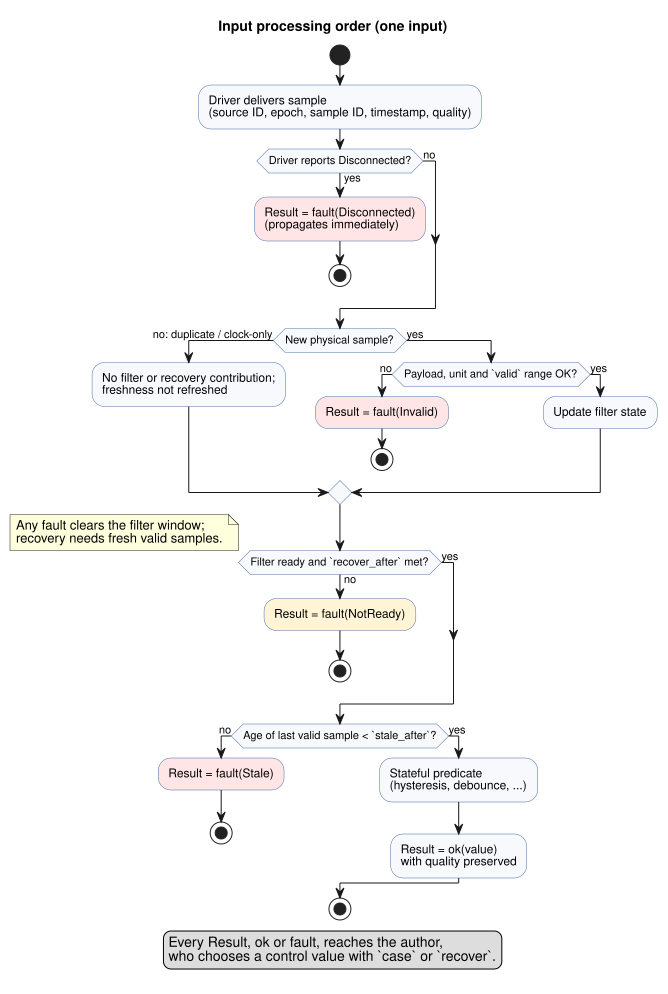
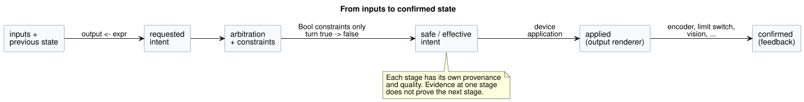
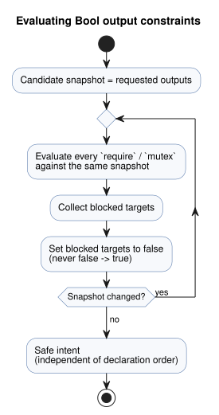
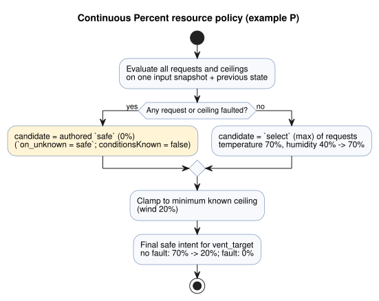

<!-- translation-source: docs/reference/04-sensors-constraints-control.md -->
[Korean original](04-sensors-constraints-control.md)

# 4. Sensors, constraints and control

[Full contents](../LANGUAGE-REFERENCE.en.md) · [Previous: 3. Time and schedules](03-time-and-schedules.en.md) ·
[Next: 5. Settings and observation](05-settings-and-observation.en.md)

In GhostFlow, a sensor value is not just a number. It also carries its source, its
quality, its time and any fault. Likewise, a control output is not a device command.
It is first calculated as a *requested intent*.

GhostFlow keeps five things apart:

1. local control expressions,
2. arbitration of shared resources,
3. safety constraints,
4. application by the output renderer, and
5. physical feedback.

Because these stay separate, a program can explain sensor failures and competing
controls instead of hiding them.

**In this chapter**

| Section | Topic |
|---|---|
| [4.1](#41-sensor-and-result-quality)–[4.2](#42-sample-contracts-and-sensor-processing-order) | Input quality (`Result`) and the sample-processing pipeline |
| [4.3](#43-filters-and-signal-operations)–[4.4](#44-temporal-evidence) | Filters, stateful signals and time-based evidence |
| [4.5](#45-optional-sensors-and-capabilities)–[4.6](#46-device-queries-and-strategy-selection) | Optional capabilities and strategy selection |
| [4.7](#47-requested-safe-applied-confirmed) | The requested → safe → applied → confirmed stages |
| [4.8](#48-common-constraints-notation-and-operations)–[4.11](#411-accounting-and-budgets) | Constraints, shared resources, modes, live settings and budgets |
| [4.12](#412-continuous-control-objectives)–[4.14](#414-bounded-adaptation) | Objectives and PI/PID, explicit fallback, bounded adaptation |
| [4.15](#415-types-resources-and-explanation-rules)–[4.16](#416-established-control-syntax-and-chapter-boundaries) | Common rules and boundaries with other chapters |

**How to read the code in this chapter**

- **Selected GhostFlow notation** is syntax established in the current language surface.
- Only examples explicitly marked **design notation** are illustrative. Everything this
  chapter establishes as selected notation is public syntax. That includes constraints,
  device queries, objectives, PI/PID, temporal evidence and adaptation.

**Sources.** This chapter is based on [common constraints and sensor contracts](../CONSTRAINTS.en.md),
[selected syntax](../LANGUAGE-SURFACE.en.md),
[language design §5–8](../LANGUAGE.en.md), [Programming in GhostFlow chapter 8 and appendix A](../ProgrammingInGhostflow.en.md),
[#3](https://github.com/callin2/ghostflow-language/issues/3),
[#94](https://github.com/callin2/ghostflow-language/issues/94),
[#95](https://github.com/callin2/ghostflow-language/issues/95),
[#96](https://github.com/callin2/ghostflow-language/issues/96),
[#105](https://github.com/callin2/ghostflow-language/issues/105) and
[#110](https://github.com/callin2/ghostflow-language/issues/110).

**`input` vs `sensor`.** The canonical keyword for declaring an external input is `input`.
An `input` inherits all of this chapter's rules for typed quality, conditioning and
optional capabilities. `sensor` is only an internal/wire quality category; it is **not**
an accepted declaration alias. Migrate existing source only as a new, reviewed revision.
See [the migration contract](../INPUT-MIGRATION.md).

## 4.1 sensor and Result quality

**Legacy Bool snapshots.** A program can keep the old behavior of required Bool snapshots
only by using the explicit, versioned directive from the
[migration contract](../INPUT-MIGRATION.md). That directive:

- preserves the original raw use sites,
- still requires typed values in each current frame, and
- rejects an invalid frame *before* evaluation, without inventing a fault default.

Any input without this marker is a `Result`. The distinction exists so that preserving an
existing program is never confused with authoring a new quality policy.

**Declared type vs read type.** In a selected declaration, you write the sensor's
normal payload type:

```ghost
input low_water: Bool;
input moisture: Percent;
```

When you *read* the sensor, its actual type is conceptually `Result<T, SensorFault>`.
Use `ok(value)` to branch on a normal sample and `fault(reason)` to branch on an error:

```ghost
let water_ok = case low_water {
  ok(low)  => !low;
  fault(_) => false;
};
```

The initial fault set distinguishes four meanings:

| fault | Meaning |
|---|---|
| `Disconnected` | The installed sensor's connection or delivery path is broken. |
| `Stale` | The last actual valid sample is older than its freshness limit. |
| `Invalid` | The value, unit, range or encoding violates the declared contract. |
| `NotReady` | Initialization, the filter window or the consecutive-recovery condition is not ready yet. |

Rules for handling a `Result`:

- You cannot compare a `Result` directly as if it were a Bool or a Number.
- Do not implicitly turn every fault into a single zero or false.
- In the example above, `false` is a control value the *author* chose. The original
  fault and its time are still recorded.
- `recover(default)` is a pure transform with the same meaning. `ok(x)` returns `x`;
  `fault(e)` returns `default`, which has the payload's type. `recover` does **not**
  reclassify the fault as normal and does **not** advance the sensor's recovery state.

Both exhaustive `case` and statically resolved Result transforms are supported:

```ghost
fn normalize(value: Temperature) -> Result<Temperature, SensorFault> {
  ok(value)
}

let dry = moisture |> map(below(30%)) |> recover(false);
let normalized = temperature |> and_then(normalize);
```

How these transforms work:

| Construct | Meaning |
|---|---|
| `below(limit)` | A static unary function for compatible ordered payloads. |
| `map(fnName)` | Transforms an `ok` payload to `U`. |
| `and_then(fnName)` | Transforms an `ok` payload to `Result<U,SensorFault>`. |
| `recover(expr)` | The only transform that returns a value on `fault`: an explicit default of the same payload type. |
| `\|>`, `>>` | Compile-time static chains, not function values. |

- `map` and `and_then` accept only pure functions that the compiler resolves by name.
  They are not runtime closures or general higher-order functions (HOFs).
- A `fault` passes through `map` and `and_then` without calling the function.
- GhostFlow adds no general user algebraic data types (ADTs). However,
  `Result<T,SensorFault>` may appear in function arguments and results, and the
  `ok(value)`/`fault(reason)` constructors are supported.
- Every transform leaves the original fault and provenance in the journal/explanation,
  and none of them advances recovery state.

**Why:** If a sensor fault is hidden as 0% or false, you can no longer tell normal low
water, a true zero reading and a disconnected sensor apart. Keeping both the substitute
value and its cause makes conservative control and later explanation possible.

## 4.2 Sample contracts and sensor processing order

The selected notation for configuring a sensor is:

```ghost
input moisture: Percent {
  sample = 1s;
  valid = 0% .. 100%;
  filter = median(5);
  stale_after = 3s;
  recover_after = 3 samples;
}
```

Each item's meaning and constraints:

| Item | Type/constraint | Meaning |
|---|---|---|
| `sample` | Positive `Duration` | The expected measurement interval. It is information only: it creates no sensor-reading thread or timer. |
| `valid` | Closed range of the same numeric payload type; not available for Bool | Checks raw normal candidates *before* filtering. Out-of-range values become `Invalid`. A Bool range is rejected at compile time. |
| `filter` | Stateful signal operation | Applies only to new, valid samples. |
| `stale_after` | Positive `Duration` | Freshness limit, measured from the time of the last actual valid sample. |
| `recover_after` | Positive integer `N samples` | After a fault, recovery requires N consecutive new valid samples. |

**Sample identity.** The Driver supplies, for each sample, the source ID, source epoch,
sample ID, sample timestamp and quality. If the same physical sample is repeated across
ticks, it counts only once toward the filter window and the recovery counter.
Recalculating the filter output does not refresh freshness.

**Processing order:**

```text
Identify a new sample
  → check payload/unit/valid range
  → update filter state
  → check filter readiness
  → stateful predicate (hysteresis, etc.)
  → preserve quality/fault
  → author selects control value with case/recover
```

The diagram below shows the same order, including where each fault arises.



**Freshness and hold.**

- An explicit `Disconnected` or `Invalid` propagates immediately.
- When no new sample arrives, the last valid value may be used until `stale_after`.
  At the limit, the input becomes `Stale`.
- Holding the last value without limit is **not** the default. A bounded hold needs a
  separate policy that states its duration and the `Held` quality explicitly.

**Recovery after a fault.**

- Clear the filter window after a fault.
- The result is `NotReady` until *both* the filter is ready *and* `recover_after` is met.
  For example, `median(5)` with `recover_after = 3` requires at least five new valid samples.
- A sample whose source epoch or time epoch changed does not count as the next normal
  sample of the previous consecutive sequence.

**Reboot.** By default, a reboot resets sensor state and freshness, and the input
prepares again from `NotReady`. Persistent resume is an explicit opt-in that validates
the checkpoint's source/time continuity. Never restore a single old normal value and
immediately use it as permission.

**Counting rules for `recover_after = N samples`.**

- It counts distinct new valid observations on initialization, reboot, a source-epoch
  change and recovery after a fault.
- The Nth observation is usable once the filter is also ready.
- Duplicate samples and clock-only scans do not count.
- A fault or loss of freshness starts a new sequence.
- To discard the first N valid observations, write `recover_after = N+1 samples` as a
  concrete count within `1..31`.
- This option counts samples. It is **not** a timed warm-up.

**Timed preparation.** To require a warm-up *period*, use the existing stateful `debounce`
operation; `recover_after` has no duration form. The pattern below withholds the Result
until two minutes have passed between the first conditioned `Good` observation and a
distinct, fresh `Good` observation at or after that deadline. The `usable` output only
indicates availability; it does not command any physical operation.

```ghost
fn observed(value: Number) -> Bool { true }
control TimedPreparation {
  input reading: Number { stale_after = 3min; }
  signal ready = debounce(reading |> map(observed), stable_for: 2min, initial: false);
  let prepared: Result<Number, SensorFault> = case ready {
    ok(value) => if value then reading else fault(NotReady);
    fault(_) => reading;
  };
  output usable: Bool;
  usable <- case prepared { ok(value) => true; fault(_) => false; };
}
```

How this example behaves:

- `observed` maps every healthy payload, including zero, to true. An input fault passes
  through `map` unchanged.
- The debounce interval uses observation timestamps. Clock-only scans and duplicate
  samples cannot promote readiness.
- A fault, stale reception or a source-epoch change restarts preparation.
- If filtering or sample-count recovery is also configured, the interval starts only
  after those stages first produce `Good`.
- The `fault(_) => reading` branch preserves the original input Result and its origin.
- Choose `stale_after` to match the expected observation cadence. Here, the three-minute
  bound permits sparse observations: only the first one and one at the deadline.
- The count-based `recover_after` and this authored duration gate are separate conditions.

## 4.3 Filters and signal operations

### median

Selected `median(n)` sorts the last `n` new valid payloads and returns the middle value.

- `n` is an odd integer in `1..31`.
- Until the window holds `n` samples, the result is `NotReady`. There is no "partial median".
- The window is empty after a fault or reinitialization.

```ghost
filter = median(5);
```

For example, the median of `28%, 29%, 90%, 28%, 29%` is 29%. A single spike does not
dominate the decision.

### hysteresis

Selected `hysteresis` takes a sensor/Result and creates a stateful Bool signal that
preserves quality.

```ghost
signal dry = hysteresis(moisture,
  on_below: 30%,
  off_above: 35%,
  initial: false);
```

- The first argument is an ordered numeric/quantity `Result<T, SensorFault>`.
- `on_below` and `off_above` have the same type as `T`, and `on_below < off_above` is required.
- A payload below `on_below` switches the signal to true.
- A payload above `off_above` switches the signal to false.
- Between the boundaries, and exactly at either boundary, the previous decision is kept.
- `initial` is the Bool state at initialization and after recovery.
- On an input fault, the fault propagates. The last Bool is **not** presented as a normal `ok`.

The two boundaries prevent rapid ON/OFF switching near a single threshold. This memory is
explicit signal state, not a hidden host correction.

### Design contract for bounded signal operations

The following is selected notation:

```ghost
input moisture: Percent { filter = moving_average(3); }
input temperature: Temperature { filter = ema(alpha: 0.25); }
signal stable_start = debounce(start, stable_for: 2s, initial: false);
```

| Operation | Required arguments | State and result semantics |
|---|---|---|
| `debounce` | Bool/finite signal, positive stable `Duration`, initial value | Changes the stable value only when the input candidate stays unchanged for the whole duration. Keeps the stable value, the candidate value and the monotonic start time of the candidate. |
| `moving_average(n)` | Numeric Result; positive fixed integer `n` within the profile bound | Arithmetic mean of the last `n` new valid samples. An empty or partial window is `NotReady`. State is finite and covers only the last `n` samples. |
| `ema(alpha)` | Numeric Result; finite `0 < alpha <= 1` | Seeds with the first valid sample, then computes `alpha*x + (1-alpha)*previous`. No normal result before the recovery conditions are met. |
| `stale_after(d)` | Timestamped Result; positive Duration | Becomes stale when the age of the last actual valid sample reaches `d`. Reevaluation or filter-output time does not extend it. |

**Composing filters.** `filter` accepts exactly one operation. To compose several steps,
declare each step as a named `signal`:

- Declare the next EMA stage of a numeric Result as `signal smooth = ema(moisture, alpha: 0.25);`.
- An EMA result can feed another stage: `signal slower = ema(smooth, alpha: 0.25);`.

Rules for EMA stages:

- Each EMA inherits the epoch, sample ID and timestamp of a single physical source. It
  updates only on a new healthy sample.
- It propagates input faults and clears its EMA memory. It then seeds again from the first
  healthy sample that satisfies the upstream filter readiness and `recover_after`.
- It creates neither another recovery counter nor a new freshness time.
- Values without sample lineage, and expressions that select among multiple physical
  sources, are not accepted as EMA-stage inputs.

**Other rules.**

- A Temperature filter internally computes an affine weighted mean in the canonical
  kelvin domain. This does **not** permit `Temperature+Temperature` or scalar
  multiplication of absolute temperatures in source expressions.
- Do not apply the same filter delay uniformly to protective signals and to slowly
  changing environmental sensors.
- Each operation must have a fixed state size and a fixed computation bound.
- Operations update only on new samples. Composition preserves quality until `case` or `recover`.

**Why:** If a filter erased sensor quality, or reused one sample once per tick, smoothing
would hide faults and replay results would change. Named, finite state makes delay and
resource cost reviewable.

## 4.4 temporal evidence

*Temporal evidence* is a time-based fact about a sensor signal, such as "true for five
minutes" or "the valve opened within ten seconds of the start event". It uses the
selected notation below. It is distinct from schedule `within`.

```ghost
signal hot_5m = true_for(hot, duration: 5min, quality: measured);
signal opened = after_event(started, valve_open, window: 10s, quality: measured);
input selected_start: EventId;
output selected_opened, any_opened, all_opened: Bool;
selected_opened <- after_event_for(opened, selected_start) |> recover(false);
any_opened <- after_event_any(opened) |> recover(false);
all_opened <- after_event_all(opened) |> recover(false);
signal avg_temp = window_average(temperature, over: 10min,
  quality: measured, max_age: 2min);
signal low_temp = window_min(temperature, over: 10min,
  quality: measured, max_age: 2min);
signal high_temp = window_max(temperature, over: 10min,
  quality: measured, max_age: 2min);
signal warming = window_rate(temperature, over: 10min,
  quality: measured, max_age: 2min);
signal usable_temp = hold_last(temperature, for_at_most: 2min, quality: measured);
```

**`true_for`** is evidence that an admissible true value held without interruption for a
positive duration.

- A false value or inadmissible quality resets it.
- It becomes true on the first decision that reaches the duration boundary.
- Continuity joins only intervals that the Driver certifies as actually observed. Do not
  interpolate between separated samples. Expected cadence, scan cadence, duplicates and
  clock-only ticks are not observation evidence.

**`after_event`** computes, for each event identity, whether the predicate held within
`[e,e+window)`, where `e` is the identified event time.

- The exact end boundary is excluded.
- Overlapping events keep independent results per identity. A new start event does not
  overwrite an earlier pending or completed result.

**Reading `after_event` results.** An `after_event` signal is not a scalar, so you cannot
read it directly in a Bool expression. Use one of three projections:

| Projection | Meaning |
|---|---|
| `after_event_for(signal, identity)` | Selects one explicit `EventId`. |
| `after_event_any(signal)` | True if *any* retained identity is satisfied; false only if *all* are expired. |
| `after_event_all(signal)` | False if *any* retained identity is expired; true only if *all* are satisfied. |

- The current compiler lowers `after_event` to executable control only when explicit
  `after_event_for`, `after_event_any` or `after_event_all` projections and a runtime
  binding exist. A declaration without projections is not accepted as executable control.
- For `after_event_for`, the runtime checks that the identity's source tag equals the
  signal's Event source. An identity from another source rejects the scan with an
  identity-binding error; it does not quietly become false.
- `EventId` is an opaque identity delivered by the Driver. It is not an arbitrary number,
  and source code cannot construct a "latest event".
- `after_event_any` and `after_event_all` aggregate the entire immutable set of retained
  identities in the accepted scan.
- An empty set, or remaining pending identities that could still change the result,
  yields `NotReady`. When there is no decisive true/false, original predicate/source
  faults take precedence over `NotReady`.
- Each projection returns `Result<Bool, SensorFault>`. Any fallback, such as
  `recover(false)`, is written explicitly by the author.

**Retained identities** are bounded by a fixed, finite runtime-profile capacity.

- Do not implicitly evict pending or terminal identities, or overwrite them with a new start.
- Capacity overflow atomically rejects the entire scan.
- Terminal results remain addressable until the host explicitly acknowledges them.
  Pending identities cannot be acknowledged.

**Window aggregates.**

- `window_average/min/max` use only admissible actual observations within `(t-d,t]`,
  without interpolation. If there are no admissible observations, or the newest
  observation's age is at least `max_age`, the result is `NotReady`.
- `window_rate` computes `(last-first)/(lastTime-firstTime)` from the earliest and latest
  admissible observations in the window. Without two different times, it is `NotReady`.

**`window_rate` and `Rate<Q>`.**

- For a supported ordered numeric payload `Q`, the result is the expression-only type `Rate<Q>`.
- Temperature differences use canonical ΔK. Linear quantities use canonical differences
  of the same nominal quantity.
- Refer to the result through the name of the `signal` that declares `window_rate`.
- `Rate<Q>` has no direct literal, no general value binding, no config/state/input/output
  storage and no free arithmetic.
- Comparison thresholds are constructed only with `rate(delta: <Q difference>, time: Duration)`.
- In v1, RelativeHumidity, CO2 and Acidity are not `window_rate` inputs.

**`hold_last`** supplies the last admissible payload only from its sample timestamp until
strictly before `for_at_most`.

- Runtime/trace records `quality=Held`, the source sample ID and the age.
- `Held` is not a source constructor and is not `Measured`.
- The hold ends exactly at the boundary.

### Time-window types and provenance

Measurement-based time windows take a `Result<T, SensorFault>` and return a successful
Result when there are enough observations.

| Operation | Accepted `T` | Result type |
|---|---|---|
| `window_min`, `window_max` | `Int`, `Number`, `Percent` or a physical quantity type | Same `T` |
| `window_average` | Same types as above | Averaging `Int` gives `Number` (keeps the fractional part); other types keep their original type. Absolute-temperature averages use canonical K values. |
| `window_rate` | Follows chapter 2's [`Rate<Q>` rules](02-types-expressions-state.en.md#29-physical-quantities-and-units) | `Rate<Q>` |

Bool, enum, Duration and calendar types are not payloads of these numeric windows.

**Parameters.** `over` and `max_age` are positive constant Durations.

**Observation provenance.**

- Preserve each actual observation's original source, epoch, sample ID and timestamp.
- Duplicate receipt or reevaluation of the same observation does not count as a new contribution.
- An ordinary upstream fault does not erase observations that are still in the window.
  Sufficiently fresh records can therefore keep providing an aggregate. The masked faults
  and their provenance also remain in the observation records.
- A change of the original source epoch invalidates that source's previous contributions.

**Aggregate provenance.** An aggregate's provenance is its time-window declaration, its
evaluation time and the actual set of contributing observations. Do not display it as a
single, directly measured sensor sample. Transformations and branches preserve this
aggregate provenance and must not invent a physical sample ID. Downstream windows must
also distinguish original observations from aggregate-result identifiers.

**Why:** Rounding integer averages, or changing their physical quantity, would change the
meaning of a control threshold. Preserving observation provenance and valid windows
prevents communication retransmission from adding weight to an average, and prevents
temporary faults from erasing valid past observations.

### Time-window composition

The result of one time window can be the input of another:

```ghost
signal short_average = window_average(temperature, over: 2min,
  quality: measured, max_age: 1min);
signal long_average = window_average(short_average, over: 10min,
  quality: measured, max_age: 2min);
```

Rules for composed windows:

- **When a new aggregate observation is produced.** A downstream window receives a new
  aggregate observation only when the upstream window accepts a new observation *and*
  produces a successful aggregate. Reevaluation, observation expiry, a change of branch
  selection or a change of fault alone does not create a new observation. The current
  aggregate, as changed by expiry, is still readable in ordinary expressions.
- **Aggregate identity.** An aggregate observation is identified by the time-window
  declaration and the observation-acceptance revision, within the same program, strategy
  and run. Keep this separate from physical sample identity. Downstream windows also
  remember revisions of unselected upstream windows, so a branch switch does not recount
  an already produced aggregate as a new observation.
- **Aggregate time.** An aggregate observation's time is the newest original observation
  time that contributes to it. Keep the evaluation time separately. Late calculation or
  recalculation does not refresh the reference time for `max_age`. Different aggregate
  observations may share the same observation time.
- **Weighting.** In a downstream average, each aggregate observation is one equally
  weighted term. Do not flatten nested averages into one average of the original samples.
  Keep the original observations behind each term as provenance evidence. For example,
  upstream averages of 0, 5 and 15 yield a downstream average of `20 / 3`.
- **Quality.** `quality: measured` accepts aggregate evidence only when all of its original
  contributing observations are admissible measurements. The aggregate itself has
  `Derived` quality. `map`, `and_then` and Result branches preserve the selected evidence.
  Do not assign new measured provenance to `Held` values or to values constructed with `ok(...)`.
- **Epoch change.** A change of an original source epoch invalidates every aggregate
  observation that depends on the old epoch. An average of A and B cannot drop only A's
  provenance and keep the existing average value. Separate observations that depend only
  on B remain.
- **Rollback.** A failed decision rolls back aggregate observations, revisions and
  downstream-window acceptance records together. Retrying the same observation must
  neither omit nor double-count it.

**Retention.** Maximum retention includes upstream windows' past observations and the
provenance evidence of each aggregate. Do not merge aggregates that share the newest
observation time, and do not silently discard valid observations to fit a budget. If the
required retention cannot be proved, reject activation.

**Why:** Composing aggregates means recalculating results that were already calculated.
Flattening to original observations and averaging again would change each aggregate's
weight. Separating observation acceptance from evaluation keeps scan count and branch
switching from influencing the average. Preserving original time and provenance prevents
recalculation alone from making old observations look fresh.

### `hold_last` values and provenance

**Signature.** `for_at_most` is a positive constant Duration. Measurement-based `hold_last`
keeps the last admissible observation of a `Result<T, SensorFault>` and returns the same
Result type.

- With no retained observation, or after its valid time ends, it returns `fault(NotReady)`.
- A successful result is `Held`, even immediately upon receipt.
- `map`, Result branches and later transforms never promote that provenance to `Measured`.
- Values created with `ok(...)` or `recover(...)` are not new measurement evidence either.

**What keeps or replaces the retained value.**

- Ordinary sensor faults, or branch changes in the input expression, do not erase a
  retained value. For example, if B's fault is selected after A's valid value, the hold
  keeps A's original sample ID and timestamp.
- A new admissible observation replaces both payload and provenance with that observation's.
- Retransmission, duplicate samples and rereading cached normal values do not extend retention.
- A change of the retained value's original source epoch, or loss of time continuity,
  makes it unusable.

**Trace.** The trace records, for the value actually returned, the `Held` marker, original
source, epoch, sample ID, timestamp and current age. Any upstream SensorFault masked by the
held value also keeps its error and provenance.

**Why:** Choosing to use a last measurement for a bounded time is different from claiming a
new measurement. Original measurement time and provenance prevent rereading from extending
validity, and prevent later control from reusing held values as measured evidence.

### Common quality and observation rules

- `quality` cannot be omitted. Allowing estimated evidence also requires the uncertainty
  bound set by the source/types.
- A window operation's `max_age` is required and positive.
- All windows use only the past and the present. Simulation does not look ahead at future samples.
- Example: if the only two samples are 25°C at 09:00 and 31°C at 12:00, you cannot
  conclude that the temperature exceeded 30°C for two hours. Combine windows with quality
  policies such as `require measured`, permitted estimate uncertainty and `max_age`.
- A missed scan creates no observation.
- The compiler must calculate the maximum retained sample count from the duration,
  `max_age`, sample contract and runtime profile. If it cannot, reject activation.
- Checkpoint restoration is allowed only after source/time continuity is validated.
  Otherwise, the result is `NotReady`.

### Estimated-value provenance and continuity

**What an estimate is.** An estimate is a value produced by an identified model. It is
neither a sensor observation nor an applied/confirmed output fact.

- `Result<T, SensorFault>` expresses validity or fault for a declared sensor value.
- `ok(value)` means the source value met its declared validity contract. It does not make
  a calculation measured or physically confirmed.
- `Estimated` is a conceptual evidence origin. It adds no `Result` status, no `Quality`
  variant and no executable syntax.

**What interpreting an estimate requires.**

- the model and calibration-parameter revisions,
- the runtime reference identity, and how and by whom it was established,
- the source/program and installation-binding revisions,
- the run and monotonic time epoch,
- the source or application receipt history that was used, and
- the declared basis.

Retained references and history must fit a finite bound declared by the deployment
profile. If that bound cannot be supported, reject the use. Do not keep unbounded history
on an MCU.

**Actuator-progress basis.** The first actuator-progress basis is the Device's acknowledged
output-register or write history.

- Its acknowledgement means only that the output renderer accepted that register/write.
  It does not prove motor movement or position.
- Request time may serve as a basis only when it is explicitly declared as *requested*
  history. Never substitute it for *applied* history.
- This follows the requested/safe/applied/confirmed distinction in §4.7.

**Starting and advancing an estimate.**

- An estimate interval starts from an admissible, declared runtime reference and
  qualifying receipt/history.
- Rereading a cached receipt, or exposing it in another scan, creates neither a new write
  nor new evidence. It does not reset the origin/start, freshness or uncertainty.
- An estimate may advance under normal monotonic-time evaluation only while verified
  continuity holds. The complete qualifying history is required.
- Do not interpolate across an unobserved gap, a failure or an uncertain write.
- If a new write fails, an earlier cached ACK keeps its original identity as historical
  evidence, and the current applied-target history is uncertain. Do not infer continuing
  application from that old ACK.

**Breaking continuity.** Each of the following breaks live-estimate continuity, unless the
owner explicitly validates and re-establishes it:

- a reboot,
- a change of run/time epoch or source epoch,
- a change of installation binding,
- a change of model/calibration revision, or
- a change of runtime reference.

Calibration parameters may remain after a reboot. A runtime position reference or estimate
must not be silently restored or set to zero. A missing or unverified basis makes the
current estimate unavailable/`NotReady`. An explicit existing source/time fault stays that
fault. Convert neither case to zero or to an automatic fallback. A timer-only policy remains
valid when no estimate is available and does not need to consume one.

**Uncertainty.** Unknown uncertainty remains unknown.

- The model/source must declare either a known uncertainty bound or that uncertainty is unknown.
- An estimate with unknown uncertainty may be retained or presented, but it is not
  admitted to bounded temporal operators.
- No universal formula, confidence, numeric uncertainty, duration or expiry is defined.
- Existing `quality: measured`, `hold_last` and `true_for` measured admission stay unchanged.
- Any future temporal consumer that admits estimates must explicitly admit the source/type
  and require its declared uncertainty bound. It cannot silently accept unknown uncertainty.

**Examples.**

- *Continuous:* with an explicit runtime reference, matching model, calibration and
  binding, the same run/time epoch, and a gap-free qualifying write history within the
  profile bound, the selected model may produce an estimate. It is still an estimate; an
  output-renderer ACK alone does not assert movement.
- *Discontinuous:* for an applied-history basis, an unacknowledged request, a failed or
  uncertain new write, a reboot, or an identity/revision change makes the live estimate
  unavailable until a reference is validated again. A separately declared requested-history
  basis may use a request as an assumption, but must not label it applied history. Keep
  calibration parameters and prior estimates as history, each with its own identity.

**Tracking and current status.**

The estimate semantics are tracked in GhostFlow [#383](https://github.com/callin2/ghostflow-language/issues/383);
follow-on compatibility work is [#385](https://github.com/callin2/ghostflow-language/issues/385).
Calibration/reference semantics are in [System #132](https://github.com/callin2/farm_studio_system/issues/132)
and its [architecture contract](https://github.com/callin2/farm_studio_system/blob/241643c125439c1ec141c8596feec3f4ad143ade/docs/architecture/INPUT-DRIVER-ARCHITECTURE.md#calibration-parameters-and-position-reference--system-132).
The concrete Device output-receipt boundary is in draft [PR #107](https://github.com/callin2/farm-device/pull/107),
head `b85ef02fb546cd5f957c12ab66f091b90f9484f0`, at
[host observation](https://github.com/callin2/farm-device/blob/b85ef02fb546cd5f957c12ab66f091b90f9484f0/rust/firmware/src/host_observation.rs).

- Current `sensorSample` lowering marks measured provenance with code `1`. The runtime
  classifications `Measured`/`Held`/`Constructed` do not represent `Estimated`.
- This contract does not enable runtime consumption. That requires the separate
  compatibility work in #385.

The [bounded estimate-basis admission API](../ESTIMATE-EVIDENCE.md) keeps validity, origin
and declared complete history separate. An admitted basis grants no measurement or
temporal permission. Source declaration and model selection remain separate compatibility
decisions.

## 4.5 Optional sensors and capabilities

```ghost
input moisture?: Percent;
```

`?` declares that this sensor capability is optional in the installation profile. It does
**not** merge "absent" with "faulted" for an installed sensor. These are different types:

| Type | Meaning |
|---|---|
| `Option<T>` or capability absence | The capability does not exist in the device configuration. |
| `Result<T, SensorFault>` | An installed sensor was read, yielding a normal value or a fault. |

Rules:

- `?` alone creates no substitute strategy. An adaptation such as "use a default schedule
  when moisture is absent, and moisture correction when present" needs a separate strategy
  contract.
- A temporary `Disconnected` must not enter the absence branch.
- Protecting an optional capability uses only the `adapt`/`strategy` surface in §4.6. The
  earlier `has` sketch is not v1 syntax.
- An optional role can be read only inside a strategy that matches that role, and it still
  needs `ok`/`fault` branching there.
- Neither `?` nor `adapt` switches strategy automatically on a fault, and neither creates
  default values.

**Optional device information.** Supplementary device information is also optional:
pressure, flow, pump curves, power and pipe loss, for example. Absence does not become zero,
infinite capacity or a normal value. Basic irrigation and explicit valve-count/time
interlocks can work without it. Optional analysis returns `Pass | Violation | Unknown(reason)`;
insufficient information gives `Unknown`.

## 4.6 Device queries and strategy selection

The following is selected control syntax.

> **Implementation status.** The current compiler accepts typed `match` and `match always`.
> `where` and presence-only matches omitting type are not yet supported.
> The `where` example below is design notation.

```ghost
adapt irrigation_policy {
  strategy WithMoisture priority 100
    match (moisture: sensor<Percent>)
    where moisture.type == Percent {
      let request = case moisture {
        ok(value) => scheduled && value < 30%;
        fault(_) => false;
      };
      pump <- request;
    }

  strategy Baseline priority 0 match always {
    pump <- scheduled;
  }
}
```

**Profiles.** A profile is a finite set of semantic capabilities. The initial key of a
capability is `(kind, name, type)`. The same `(kind, name)` cannot appear twice.

**Syntax.**

- The form is `strategy Name priority Int match (...) [where ...] { ... }`, or `match always`.
- Each match item is a capability-presence condition. Commas mean AND.
- `pump` and `moisture` are semantic role names, not variables that iterate database rows.
- `sensor<number>` names the normal payload type; actual samples are still Results.
- Omitting the type, as in `(moisture:sensor)`, tests presence only.
- `where` may read only the matched capability's kind/name/type, constant comparisons and
  Bool `&&`, `||`, `!`, `==`, `!=`.
- `where` does **not** read input samples, state, next state or current moisture values.
  Do not mix capability selection with per-tick control decisions.

**Selecting a strategy.**

- Each strategy has an i32 literal priority.
- Every strategy completely defines the same external output contract of the control.
- The matching strategy with the greatest priority is selected.
- A tie at the top is an ambiguity error. No matching strategy is an activation error.
- Declaration order and "last match" never decide.
- `match always` is an ordinary candidate, not an implicit fallback.

**Inputs and profile changes.**

- Common inputs are required by every strategy. Strategy inputs are required only when that
  strategy is selected.
- The selected strategy's capabilities and port types are checked against the profile.
- The profile does not change mid-tick. A new profile is applied atomically at a boundary,
  after the whole candidate and its strategy selection are validated.
- Handle a sensor fault in the current strategy immediately as a Result. Do not convert it
  to profile absence and silently switch to a less protective strategy.

**Why:** If installation-capability selection were mixed with current sensor values, the
binding could change every tick even with the same profile. A unique strategy, applied at
a boundary, keeps decision provenance clear when the device configuration changes.

## 4.7 requested, safe, applied, confirmed

A control result passes through distinct stages:

```text
sensor/input + previous state
  → requested output intent
  → arbitration and constraints
  → safe/effective intent
  → command applied by output renderer
  → state confirmed by feedback
```



Each stage in the diagram carries its own evidence. Evidence at one stage never proves a later stage.

Selected output connections (`<-`) define the *requested* intent:

```ghost
output pump, valve: Bool;
valve <- running';
pump <- running';
require pump => valve;
```

**How Bool output constraints act.**

- `require pump => valve` means pump=true is permitted only if valve=true. If the
  prerequisite is false, the target `pump` becomes false.
- Output constraints never turn false into true.
- `require !(forward && reverse)`, or a mutex, makes *all* simultaneously true members of
  the conflict group false.
- With several Bool constraints, blocked targets are computed from the same candidate
  snapshot. The process then repeats, only ever moving toward false, until nothing changes.
  The result does not depend on declaration order.



The result is the *safe intent*. It is not evidence that a GPIO or relay was actually set,
and not evidence that a valve physically opened. Applied commands and confirmed feedback,
from encoders, limit switches, vision estimates and similar sources, have their own
provenance and quality.

**Why:** If one Bool combined the request, the constraint result, device application and
the physical result, nobody could explain why an output was blocked or why the device
disagrees, and usage accounting would not know what to count.

### Output observations and recovery policy

For a declared Bool output, four observation functions are available:
`output_status(pump)`, `output_health(pump)`, `output_completion(pump)` and
`output_fault(pump)`. Their return types and members are listed below. Members of
different types cannot be compared with each other.

| Type | Members (numeric rails start at zero, in this order) |
| --- | --- |
| `OutputStatus` | `OutputInitial`, `OutputPending`, `OutputCompleted`, `OutputFailed`, `OutputUnknown` |
| `OutputHealth` | `OutputInitializing`, `OutputHealthy`, `OutputFaulted` |
| `OutputCompletion` | `CompletionNone`, `HostWrite`, `DeviceAck`, `DeviceReadback` |
| `OutputFault` | `NoOutputFault`, `OutputUnavailable`, `OutputTimeout`, `OutputProtocolError`, `OutputDriverError`, `OutputObservationLost` |

**What each observation means.**

- *Status* describes the current request's lifecycle. *Health* describes device readiness.
- At startup, request ID zero with `OutputInitial` can describe equipment that is
  initializing, ready or faulted, without any completion.
- A new request is `OutputPending` and keeps the prior health and fault.
- Being pending, and lacking ACK capability, are not faults.
- *Completion* records the actual level of evidence. `HostWrite` proves neither a device
  ACK nor a contact position. `DeviceReadback` does not automatically prove that the
  physical load operated, which needs a separate sensor.

```ghost
control OutputRecovery {
  input resume: Bool;
  output pump, alarm: Bool;
  state stopped: Bool = false;
  let resume_requested = resume |> recover(false);
  stopped' = if resume_requested then false else stopped || output_fault(pump) == OutputTimeout;
  pump <- !stopped';
  alarm <- output_health(pump) == OutputFaulted;
}
```

**Recovery is the author's choice.** The author chooses either a state that remembers
manual recovery, as above, or an expression that permits automatic recovery.

- An output failure does not roll back committed core state.
- Separate host safety and termination policies keep their own contracts.
- Other outputs keep their own observations.

**Compiler lowering.** The compiler generates four numeric inputs,
`__gf_output_{name}_{status|health|completion|fault}`, and one `outputObservations`
descriptor per output.

- This profile uses a `GhostFlow/control-v22` manifest and the existing scalar GFB1..4.
- Combining it with settings, schedules, context or adaptation is explicitly rejected.
- Source inputs cannot override these private rails.

**Host requirements.** Hosts must supply trusted renderer observations bound to the current
run, the output and the request ID that was actually dispatched.

- An ACK for an old request, a cache from a previous run, or a missing observation can
  never become success.
- A request's terminal status and completion evidence cannot regress. A retry uses a new request ID.
- Communication loss after completion may change health and fault, but keeps the completion fact.
- Recovered readiness uses evidence from a fresh initialization or recovery request. It
  does not rewrite the failed request as successful.
- A new run starts in the initial state.
- The portable Rust tracker validates identity and state combinations.
- The reference framed host requires `outputRunId` and `outputObservationProvider`, and
  treats the provider as the authority for dispatch identity. Injection through ordinary
  `inputs` or scan arguments is rejected.
- Hosts that do not declare support reject activation.

**Why:** Source must distinguish device delay, faults and completion evidence, so that
equipment recovery policies can be reviewed and replayed with the same facts. Requested
intent and `SensorFault` do not substitute for output observations.

## 4.8 Common constraints notation and operations

The canonical unit for authoring constraints is a named `constraints` block inside a control.
There are two kinds of rule:

- **Local rules** apply only to their own control.
- **Shared rules** apply to every request path that uses a stated resource.

**Local Bool output rules** use `constraints Name { require [at safe_output] p; mutex(a, b); }`.
A Bool `require` without a target means `safe_output`. A local group applies only to its own
control. This is a complete local control:

```ghost
control LocalPump {
  input request, valve_ready: Bool;
  output pump, valve: Bool;
  pump <- request;
  valve <- valve_ready;
  constraints LocalRules {
    require at safe_output pump => valve;
  }
}
```

**Shared rules** apply to the stable resource scope named by `constraints Name for resource`.
Every automatic, manual and fallback request path that uses that resource follows the same
rules. The complete source below defines a *checked shared-policy descriptor*. Checking a
descriptor does **not** replace executable binding and enforcement.

```ghost
control SharedPumpPolicy {
  resource station: Station;
  resource pump1: BoolActuator;
  resource valve1: BoolActuator;
  input automatic, manual, pump_request, valve_request: Bool;
  output pump, valve: Bool;
  pump <- pump_request;
  valve <- valve_request;
  constraints SharedRules for station {
    exclusive at admission { automatic, manual };
    require at safe_output pump1.on => any_on({ valve1 });
    safe { pump1 = false; valve1 = true; }
  }
}
```

**The `safe` vector.** `safe` assigns an authored safe value to every Bool resource in the
finite referenced set.

- Missing, duplicate or mistyped values are invalid definitions. So is a safe vector that
  violates a mandatory relation.
- This example chooses pump=false and valve=true. Safe does not always mean all OFF.
- Connecting request outputs to resource endpoints requires a separate, explicit binding
  contract. This introduces no new `station`, `use`, `bind` or session syntax.
- Do not label an unbound, unenforced shared descriptor as an executable control or an
  enforced policy. Former top-level resource-policy files also remain checked non-control artifacts.

**Executing a shared policy.**

- Selecting shared execution pins the exact canonical source/descriptor, binding revision,
  stable resource IDs and typed mappings into one bound program identity.
- Activation and every evaluation must supply that same binding identity. A missing or
  mismatched binding rejects the evaluation; it is never partially executed.
- Bound requests, admission and safe_output are checked inside one Rust commit boundary,
  not by a host filter after the output is published.
- Logical enforcement does not guarantee physical applied/confirmed evidence or
  output-renderer safe sequencing.

**Admission and recovery.**

- Raw exclusive activity inputs are not admission results.
- A new claim that conflicts with an admitted activity is denied. The incumbent's admission
  and the previous safe outputs are preserved.
- A predicted prestart output-relation violation creates neither a new admission nor a
  protected output.
- A denied newcomer must be observed false before it can request admission again with a
  fresh true claim.
- With no previously committed safe values, a denial has an empty output set.
- A relation violation during admitted execution uses the authored safe vector. Normal
  inputs alone do not clear this trip.
- An exclusive group requires an observation in which all claims are false. Only then does
  it check admission for a fresh claim.
- A require-only group establishes its recovery baseline when the requested map equals the
  authored safe map. It then checks a fresh departure.
- Hidden retries, queues or priority escalation cannot bypass this recovery boundary.

**Combining groups.**

- Mandatory conditions across groups combine as AND. Overlapping groups with conflicting
  safety meaning are rejected.
- The bound Bool profile requires finite resource mappings for every output and a complete safe vector.
- The registry shared under one installation authority refuses a second active logical
  writer for the same stable ID. Registries of separate installations do not prove
  physical exclusion.
- A trip propagates across the transitively connected component of groups that share
  protected resources. Authored safe values must agree on shared resources. Unrelated
  groups keep their admission.
- The final safe candidate is revalidated against the AND of all mandatory shared and local conditions.
- This does not implement cooperative multi-VM arbitration, session leases or arbitrary PID policies.
- VM or binding errors roll back state, guard and trace together.
- Traces distinguish raw requests, admitted activity, requested/safe values, cause, group
  and binding identity.
- A successfully evaluated denial commits ordinary VM state. It does not cancel jobs or sessions.

**Limit on exclusive sets.** An executable group supports at most one exclusive activity set.
Multiple `exclusive` statements are still checked source, but they need separate execution
integration. They are rejected rather than flattened into one set. The authored global safe
vector must also satisfy mandatory local constraints.

**Accounting constraints.** Accounting's `constraints Name { limit used(account, basis) <= bound { ... } }`
has a separate usage scope (§3.10). The ledger is defined by the declared `resource` and
`account`, the semantic stage, the basis and persistence. Local Bool rules and shared
admission do not replace it.

### Constraint statement semantics

| Notation | Application stage and meaning |
|---|---|
| Local `require [at safe_output] p` | Bool candidate-output invariant of its own control. An omitted target means safe_output. |
| Local `mutex(a, b)` | When both requested Bool outputs of its own control are true, keep that requested evidence and set both safe outputs false. |
| Shared `exclusive at admission { a, b, ... }` | At least two finite Bool activities in one scope. Rejects a conflicting new admission. |
| Shared `require at safe_output p` | Checks finite resource-output relations. Safe values must also satisfy these mandatory relations. |
| Shared `safe { resource = Bool; ... }` | Authored, resource-specific safe vector used for violations during execution. There is no universal all-OFF default. |
| Accounting `limit used(...) <= bound` | Remaining budget and limit at the explicit stage/basis; details in §3.10. |
| Station adapter `check pump_capacity(pump)` | Nonblocking `Pass/Violation/Unknown` advisory that uses optional information. Never promoted to a mandatory require. |

**How constraints relate to intents and priority.**

- All mandatory conditions combine as AND.
- Constraints define the *permitted region* for intents, including goals and PID.
- Priority is an arbitration policy that chooses among requests *inside* that region. It
  does not relax mandatory conditions, and it does not bypass resource binding, provenance
  or recovery.
- A predictable prestart violation denies admission. During execution, the authored
  resource-specific safe behavior applies, and the cause and transition are kept.
- The stages are distinguished in a deterministic order: admission, requested candidate,
  safe_output, output renderer applied and feedback confirmed. Evidence at one stage does
  not guarantee another (§4.7).
- Recovery of normal evidence creates no new start authority. Retries, recovery and manual
  paths follow the same mandatory conditions.

**Unsupported and adapter-only syntax.**

- `warn` and `monitor` are unsupported syntax.
- Do not mix the Station adapter's `allow`, `once`, `on_time` or `check` into generic named
  resource policies.
- The standalone `ghostrules` surface is kept only for concrete current consumers: the
  programming-book WASM simulation, station-demo and `bindStationPolicy` of the fixed
  Station artifact. The [Station adapter examples](../CONSTRAINTS.en.md) state this boundary.
- A standalone artifact is not a fallback for generic control constraints or arbitrary PID enforcement.

### Common functions and finite resources

**`count_on` and `any_on`.**

- Shared `count_on({ items })` returns the `Int` count of distinct true Bool resources.
- `any_on({ items })` is the Bool true when at least one is true.
- Set literals are finite compile-time lists.
- An empty count is zero; an empty `any` is false. An author who wants an empty set to
  allow operation must state that policy as a separate mandatory condition.
- `resource.on` expresses a relation on a Bool actuator resource. Do not confuse a typed
  endpoint with an arbitrary source Bool variable.
- After physical binding, aliases of one endpoint count once. If distinct identity changes
  between before and after binding, activation diagnostics show both lists.

**Station adapter meanings.**

- `stopped(station)` means the session and cleanup are complete, usage rights are returned
  and there is explicit stop evidence. It does not merely mean pump=false.
- In `pump_capacity`, do not arbitrarily add flow and pressure. Use unit-compatible models
  under the same validated conditions.
- Missing information gives `Unknown`. An advisory `check` does not block operation.
- Do not generalize this bounded Station meaning into implemented generic physical safe
  sequences or output ABIs.

**Why:** If local output invariants, shared admission, usage ledgers and nonblocking analysis
were treated as one execution path, a checked descriptor could be mistaken for real safety
enforcement, or manual paths could bypass the rules. Explicit scope, stage, safe values and
execution evidence keep every path that uses a resource inside the same permitted region.

## 4.9 Shared resources and arbitration

**One final writer.** When several controls use the same physical pump, the resource manager
is its only final writer. Each control's pump output is just a request. An inactive
control's false, or the last write, does not turn off the current owner's pump.

**Default policy: a session-long exclusive lease.** Ownership lasts for the whole session:
valve preopening, pump ON, pump OFF between stages, valve cleanup and stop confirmation. A
brief pump OFF does not hand the pump to another control.

**Admission.**

- Start requests in one tick are evaluated from one snapshot.
- Only requests that can reserve both the resource lease and the time budget are admitted.
- The decision follows an explicit policy, such as acceptance order and stable request ID.
  Queue length and expiry are bounded.
- Shared concurrent operation and preemption are opt-in policies.

**Authority categories.** General arbitration must expose its authority and constraint
semantics. These are design categories:

1. safety constraint,
2. manual authority,
3. automatic control objective,
4. adaptive/optimizer proposal.

This list does **not** imply a simple fixed priority for all equipment. Trace the
policy/revision that selected the final value, every request and every constraint clamp:

```text
temperature objective requested vent 70%
humidity objective requested vent 40%
arbitration selected 70% under policy P
wind safety limited maximum to 20%
final safe target 20%
```

**Declaring a shared resource.** Use the selected notation below. Queue and preemption have
no defaults.

```ghost
resource pump1: BoolActuator;
resource_policy shared_pump for pump1 {
  lease = session;
  concurrency = 1;
  admission = reserve_all;
  queue = fifo(max: 8, expires_after: 10min, tie: request_id);
  preempt = never;
}
```

| Field | Rule |
|---|---|
| `lease` | The first surface uses `session`. |
| `concurrency` | A positive static integer, at or below the capability bounds. |
| `admission = reserve_all` | Admit only when the lease and all required budgets can be acquired from the same snapshot. |
| `queue` | One of `reject`, `fifo(max:N, expires_after:D, tie:request_id)` or `authority_then_fifo(max:N, expires_after:D, tie:request_id)`. `N` and `D` are positive. |
| `preempt` | `never` or `higher_authority(cleanup: required, resume: requeue\|cancel)`. |

- The FIFO key is the durable accept position. Ties use the byte order of the stable request ID.
- Overflow and expiry are explicit occurrences. There is no hidden retry.
- In `resume: requeue|cancel`, the `|` lists syntax alternatives; actual source uses one of them.
- Preemption does not bypass cleanup, stop evidence or safety constraints.

### Continuous Percent requests and ceilings

A control declares named requests for a `ContinuousActuator<Percent>` resource. Its policy
is the only writer of the corresponding Percent output.

```ghost
control Vent {
  resource vent: ContinuousActuator<Percent>;
  output vent_target: Percent;
  let temperature_demand = 70%;
  let humidity_demand = 40%;
  let wind_limit = 20%;
  resource_policy P for vent {
    select = max;
    requests { temperature = temperature_demand; humidity = humidity_demand; }
    ceilings { wind = wind_limit; }
    safe = 0%;
    on_unknown = safe;
    output = vent_target;
  }
}
```

**Normal selection.**

- `select` is `min` or `max`.
- Each request and ceiling is a `Percent` or `Result<Percent, SensorFault>` expression,
  evaluated against the same input snapshot and previous state. Next-state references are rejected.
- The policy selects the minimum or maximum of all known requests, then clamps it to the
  minimum known ceiling. The example selects 70%, clamps at 20%, and produces a final safe
  intent of 20%.
- On equal values, the first request in ascending source node ID order wins, and every tied
  request ID is recorded. Reordering source creates a new source revision.

**Unknown inputs.**

- If any request or ceiling faults, the required `on_unknown = safe` uses the authored
  constant `safe` as the candidate. Known ceilings still clamp this fallback.
- A faulted request does not become 0%. A faulted ceiling does not become 100%.
- The decision keeps its reason and origin and sets `conditionsKnown` to false.
- `selected` is null when any request faults. If every request is known but a ceiling
  faults, the decision keeps the selected request value and applies the fallback.
- The example's 0% is an authored choice, not a universal physical safety value.

The diagram summarizes the example policy `P`.



**Limits and exclusions.**

- Each policy has 1..16 requests and 0..16 ceilings.
- A control has at most eight policies and 32 request/ceiling entries in total.
- Each resource and output belongs to exactly one policy.
- A separate `<-` writer, and `exclusive` or `highest_authority` selection, are rejected.
- Composition with objective/PID, adaptation, schedules, temporal operations, accounting or
  a Bool resource policy requires a separate integration contract.
- This profile does not establish PID final-value tracking or aggregate anti-windup.

**Execution.**

- Canonical source produces the existing checked policy descriptor.
- Execution requires GFB25 compiled with an explicit typed installation binding.
- In its decision, the Rust scan owner commits every request and ceiling, the selection and
  ties, the fallback, the clamp and the final value, the source SHA-256 and node IDs, and
  the binding and run/tick IDs.
- Invalid numeric ranges, packets or identities are rejected before state and journal commit.
- The final logical output is separate from applied and confirmed evidence.

**Why:** The reasons behind intents and constraints must stay explainable in the same
execution record. Unknown information cannot silently become a normal value, and no other
output writer can overwrite the final limit.

## 4.10 Modes and live settings

**Modes.** Modes such as Auto, Manual and Configure are exclusive within one equipment
scope. Switching Auto↔Manual, or from operation to Configure, follows this explicit path:

```text
stop request → suppress new starts → device cleanup → stop evidence → Stopped → new mode entry
```

**Stop evidence.** `stopped(station)` can distinguish two levels:

| Level | Meaning |
|---|---|
| `CommandedStop` | The safe command was applied and cleanup completed. |
| `VerifiedStop` | As above, and physical feedback also verified the stop. |

- Do not make `VerifiedStop` a global default for equipment that has no feedback.
- If the device fails to respond, sending the command alone does not mean the stop is complete.

**Conflicts.**

- Reject all conflicting mode entries in the same tick.
- Process Stop before any new entry or new work, and invalidate pending requests.
- Do not store a mode-change request made during operation for a later, hidden transition.

**Structural changes vs operational settings.** This stop/Configure path may apply when
validating or deploying candidate revisions that change structure or installation meaning:
programs, dependencies, physical bindings and equipment constraint bundles. An earlier
contract's `allow apply(settings) only when ... Configure` was read as covering *every*
operator property. That reading is superseded by the live-event decision below. The final
name and revision boundary of `apply` targets for structural changes belong to a separate
composition/installation contract.

**Live settings.** Operational settings follow the later decisions in #105 and #110. A
change to an operator-editable property is an **atomic live event within the same program
and run**:

- Validate every value in one event for type, range, step, authority and current program identity.
- If any value is invalid, reject the whole event without changing any setting.
- On success, record the settings revision and the effective event position.
- Controls and schedules can read the new values after that position.
- Preserve source/bytecode, program identity and run identity.
- Do not implicitly reset timers or state.
- An actual restart preserves settings but creates a new run identity.

*Example:* reducing a watering limit from ten to five minutes compares the current `elapsed`
against the new five minutes at the next decision. Do not add a hidden "wait for a new run"
policy.

Do not generalize this live-event meaning to Auto↔Manual mode switches, program deployment,
optional dependency replacement, or physical binding changes such as RO3→RO8. Those follow
their own mode, composition and installation/deployment contracts.

## 4.11 Accounting and budgets

**What is counted.** Suppose the accounting stage of `on_time(pump1)` is the final applied
command. Then the actually applied ON intervals from automatic operation, manual operation
and multiple controls are merged into one ledger for the physical resource.

- Rejected requests, queue waiting and constraint-blocked time are not counted.
- Counting confirmed flow separately requires the corresponding feedback capability and quality contract.

Declaration syntax uses `resource`, `account`, `used` and `limit` from
[§3.10 Time-based usage constraints](03-time-and-schedules.en.md#310-time-based-usage-constraints).

**Local-day budgets.**

- A local-day budget is not a rolling 24h budget. Each date's budget may be used on either
  side of midnight.
- An ON interval that crosses midnight is split at trusted date boundaries.
- A wall-clock rollback, or a program/settings revision, does not reduce or reset usage that
  is already committed.

**Reservation and settlement.**

- Before starting a new job, reserve budget that covers the worst-case ON duration plus the stop delay.
- Manual operation may use a finite lease and cutoff within the remaining budget.
- After use, settle with the applied intervals.
- For reservations made uncertain by power loss, use an explicit conservative policy, such
  as treating them as used or deferring recovery.

**Rolling duty limits.** A rolling duty limit, such as "at most 30 cumulative seconds in the
last 60 seconds", is a sliding window. It is different from the day ledger.

- Sum the ON Duration of the selected semantic signal within `(t-60s,t]`, including partial overlaps.
- Block additional ON exactly at the limit.
- Restore only the budget that corresponds to old intervals leaving the window.
- Do not implicitly reset on a power cycle.

**Occurrence duplication is a separate contract.** `once starts per occurrence` prevents
duplicate runs of the same occurrence, separately from any budget. Even with an hour of
budget left, the same five-minute occurrence could otherwise run twice. Do not substitute
one contract for the other.

**Why:** Without accounting per physical resource, several controls that share one pump can
omit or double-count usage. Day budgets, rolling windows and occurrence duplication also
answer different questions.

## 4.12 Continuous control objectives

The higher-level concept for continuous control is a **control objective**: keep a
controlled variable near a setpoint. This is a better unit of intent than "run PID". The
following is selected syntax:

```ghost
objective greenhouse_temperature {
  measure = inside_temperature;
  target = target_temperature;
  manipulate = roof_vent.position;
  output = 0% .. 80%;

  controller = pid {
    period = 10s;
    late_after = 30s;
    direction = reverse;
    kp = proportional_gain(output: 2%, error: 1Δ°C);
    ki = integral_gain(output: 0.1%, error: 1Δ°C, time: 1s);
    kd = derivative_gain(output: 1%, time: 1s, error: 1Δ°C);
    bias = 0%;
    anti_windup = conditional_safe;
    disabled = track_safe;
    transfer = track_safe;
    fault = disable;
    restart = reset(output: 0%);
  }
}
```

An objective connects:

| Field | Meaning |
|---|---|
| `measure` | The process value, with its quantity and quality/provenance. |
| `target` | A typed setpoint compatible with `measure`. |
| `manipulate` | The semantic target of a continuous actuator. |
| `controller` | A Hysteresis/On-Off, PI or PID policy. |
| `output` | The permitted range, within the actuator's capability. |

**Setpoints from config.** A `target` that references config consumes the current §5.2
`Result<T, SettingsFault>` observation, where `T` is a quantity compatible with `measure`.

- `ok(value)` is the current setpoint.
- `fault(reason)` goes to the explicit controller fault policy. Do not implicitly substitute
  the initial or last successful target.
- In the executable Temperature/Percent PID profile, `fault = disable` also disables the
  controller immediately on a target fault. Recovery follows the existing deadline and
  `track_safe` policy.
- A successful target change does not by itself reset controller state.

**Actuator capability.** A continuous actuator capability expresses the value quantity/type,
range, optional resolution, safe value, rate/slew limit and feedback availability. 0–10V,
PWM, VFD, Modbus and servo are Device bindings, not source objectives.

The loop below shows where the controller sits. Its output is only a request; the safe
target, after arbitration and constraints, feeds back into anti-windup and bumpless tracking.


### Items required for PI/PID semantics

**Gains.**

- `pi` does not accept `kd`. `pid` requires all three gains.
- Use the `proportional_gain`, `integral_gain` and `derivative_gain` constructors instead of
  arbitrary unit algebra.
- In a constructor, the output numerator is nonnegative, the error denominator is a
  positive compatible delta, and the I/D time is positive. A zero output disables that term.
- These values form nominal gain types bound to the output and to TemperatureDelta and
  similar types.

| Item | Meaning |
|---|---|
| sample period | Positive monotonic Duration for updating controller state, including the rules for missed/late ticks. |
| setpoint / process value | Compatible quantities. Do not calculate directly with nonfinite values or unresolved faults. |
| direction | `direct` or `reverse`. States explicitly in which direction the error moves the actuator. |
| `Kp`, `Ki`, `Kd` | Gains that preserve quantity dimensions. PI has no D term. |
| output min/max | Clamp for the requested target; cross-validated against the actuator capability range. |
| anti-windup | Policy for updating integral state (or back-calculating) during saturation/constraints. |
| enable/disable | Explicitly freezes, resets or tracks controller state. |
| manual/auto transition | Bumpless transfer that follows the current effective output and the authority transition rules. |
| fault policy | Explicit hold/safe fallback/disable policy for stale or missing measures and feedback discrepancy. |
| initialization/restart | Startup/checkpoint rules for the integral, the derivative memory and the previous sample. |

**Fixed execution rules.** Require `period > 0`, `late_after >= period` and finite values throughout.

1. Update at most once per monotonic deadline. Reevaluating the same sample does not change state.
2. The basic error is the delta `target - measure`. `direct` keeps its sign; `reverse` reverses it.
3. `P = Kp * signedError`; I is the trapezoidal integral of the previous and current signed error.
4. Apply D to the change in measurement to avoid setpoint kick: `-directionSign * Kd * Δmeasure/dt`.
5. `dt` is the monotonic time between the last accepted update and the current one. Do not synthesize missed samples.
6. `dt > late_after`, nonfinite values or an inadmissible measure enter the explicit `fault` branch.
7. The unclamped requested value is `bias + P + I + D`. Internal signed accumulators are not limited by Percent's external nonnegative range; clamp requested within the objective range.
8. Calculate requested and safe with a tentative I. If `(requested-safe) * signedError > 0`, I would increase saturation, so recalculate once with the previous I. Otherwise commit the candidate I.

This bounded two-pass procedure is the whole of `conditional_safe`. Do not build an iterative solver.

**Controller output is a request.** Later arbitration and safety constraints may clamp it:

```text
PID requested 92%
wind safety max 20%
safe target 20%
output renderer applied 20%
position feedback 17% with provenance
```

- Integral anti-windup follows the safe-tracking rules above. It does not keep accumulating
  based only on the requested 92%.
- Do not automatically convert continuous PID output into high-frequency time
  proportioning for relay-only actuators. Without a separate capability/safety contract,
  hysteresis/on-off is the right choice for relays.

**Initialization, fault and restart.**

- The first accepted sample initializes the previous error and previous measurement to the
  current values. D=0, and no imaginary previous interval is integrated.
- The current PID `fault` accepts only `disable`. `degraded Name` is a selected design alternative unsupported by the current native Temperature PID profile.
- `bias`, `anti_windup`, `disabled`, `transfer`, `fault` and `restart` cannot be omitted.
- Restart is `reset(output: value)` with a typed output. A continuity-validated
  `checkpoint` is a selected design alternative unsupported by the current native Temperature PID profile.
- `reset(output:v)` sets the integral tracking state at the first accepted sample so that the
  first unclamped requested value equals the explicit `v`.
- Disable and manual→auto transfer track the current safe target.

**Live settings for objectives.**

- Setpoint and gains may be typed operator settings.
- Live events apply atomically within the same program/run, without resetting
  controller/timer/filter state. At the next normal evaluation, `track_safe` continues bumplessly.
- Showing a setpoint in the farmer UI does not mean exposing every expert gain with the same permissions.

**Why:** A farmer's goal is to maintain a condition such as temperature or humidity. If an
algorithm name stood for that higher-level intent, it would be impossible to explain relay,
PI and PID replacements and safety clamps under one objective.

## 4.13 Explicit fallback and degraded control

Sensors, weather, models, cameras and actuator feedback can all become unavailable.
Fallback must be visible in source/policy and in the trace. It must never be hidden host behavior.

```text
// Design semantics
primary temperature normal → operate with PI
primary degraded, backup admissible → backup controller with stricter range
all temperature unavailable → conservative ventilation fallback
```

**What a fallback branch declares and may not do.**

- A fallback branch states its input capabilities, permitted quality, output bounds and authority.
- Cloud/AI unavailability does not unconditionally make local safety control unavailable.
- Conversely, low-confidence estimates alone do not release a safety trip.
- Fallback does not bypass global constraints, resource ownership or modes.

**Recovery** means that new normal evidence is ready. Automatic restart, return to the
original objective and restoration of accumulated timers are separate decisions. Meeting a
sensor's `recover_after` does not create a new start request.

Selected notation:

```ghost
degraded TemperatureFallback for greenhouse_temperature {
  branch Backup priority 100
    when backup_temperature quality in { measured }
    use objective backup_temperature_control
    authority automatic_degraded
    output 0% .. 30%;
  otherwise disable;
  recover primary after 3 samples;
  resume = require_start;
}
```

**Rules.**

- The satisfied branch with the greatest i32 priority is selected. A tie is an ambiguity
  error. Declaration order is not a selection criterion.
- `otherwise` is required. The current compiler accepts only `disable`. A full fallback branch in `otherwise` is a selected design alternative not yet supported.
- `resume` must be one of `require_start`, `automatic` or `stay_degraded`. Even `automatic`
  creates no new start authority; it returns to the primary only while the existing session is still valid.
- Fallback authority cannot exceed the primary's, and cannot hold safety authority.

> **Implementation status.** The compiler accepts
> structurally validated degraded descriptors marked `requires-native-fallback-binding`; this is not executable fallback support.
> The native Temperature PID profile rejects degraded control until an executable fallback binding exists.

## 4.14 Bounded adaptation

Adaptive models and optimizers have no default authority to modify the whole program or to
write output registers directly. Their initial meaning is a *bounded proposal* for a typed
setting or an objective setpoint.

```ghost
adapt_setting target_vpd_policy for target_vpd {
  allowed = 0.7kPa .. 1.2kPa;
  max_step = 0.05kPa;
  max_change = 0.05kPa per 1h;
  authority = optimizer;
}
```

**What a proposal contains:** the setting ID, proposed value, source/model, evidence
reference, actor/authority, current program and base settings revision, and occurrence time.

**How it is validated and applied.**

- Local validation checks type, range, one-step change, hourly rate and authority.
- Several successful property changes are applied as one atomic settings event that creates
  a new settings revision. A failure changes no values.
- The rate check requires that the sum of absolute accepted changes within `(t-window,t]`,
  plus the new change, does not exceed `max_change`. This prevents evasion by alternating
  increases and decreases.
- A successful adaptation settings event does not reset controller, timer or filter state,
  and does not switch to a checkpoint. The next normal control evaluation tracks the current safe target.
- The trace records the old, proposed and accepted/effective values, proposal provenance,
  rejection reason, program identity, settings revision and effective position.

**Setting vs safety program.** "Target temperature 25→26°C" can be a bounded setting.
"Always stop the pump at low water" is a change to the safety program. Adaptation can neither
remove safety constraints nor raise its own authority. AI authoring workflows that generate
programs have their own source review and deployment identity.

**Why:** If adaptation were treated as program modification or direct output authority, a
model error could erase safety constraints. Typed bounds and atomic settings events make the
permitted scope of change verifiable.

## 4.15 Types, resources and explanation rules

**Common rules for sensor and control operations.**

- Do not implicitly compare or sum different quantities such as pressure, flow, percent and temperature.
- Do not convert a Result or an Option to Bool truthiness.
- Filter, window and request counts, and state-memory bounds, must be statically calculable.
- A tick failure does not partially commit sensor, filter, controller or resource state.
- An analysis timeout or `Unknown` is not a successful proof.
- An "all outputs always OFF" result may satisfy safety constraints. Check separately that
  the intended operation is still reachable.

**What an explanation of a completed decision must distinguish**, at minimum:

- raw sample, filtered value, quality/fault and sample identity,
- predicate and temporal evidence,
- setpoint, process value, error and controller requested output,
- competing intents and arbitration policy,
- constraint clamp and final safe intent,
- applied command and confirmed feedback,
- usage target, used/limit, block reason and next release calculated from already recorded intervals,
- program, settings, profile/binding, policy and scan/run identity.

Observation and display layers consume decided values and evidence. They must not create
their own control semantics for budgets, PID, fallback or arbitration from animation time
or displayed output.

## 4.16 Established control syntax and chapter boundaries

This chapter establishes the surfaces for Result transforms, bounded signals/windows,
capability strategies, named constraints, shared resources, objectives/PI/PID,
degraded control and bounded adaptation. Only the following details defer to the contracts of their
owning chapters:

- Rolling-budget history, scan boundaries and reboot policy: [chapter 3 time/accounting contract](03-time-and-schedules.en.md#310-time-based-usage-constraints).
- General typing rules for quantity, delta, Result and quality predicates: [chapter 2 Result contract](02-types-expressions-state.en.md#25-sensor-results-and-explicit-error-flow) and [quantity/unit contract](02-types-expressions-state.en.md#29-physical-quantities-and-units).
- Installation binding and live-settings event records: [chapter 5 settings contract](05-settings-and-observation.en.md#52-source-changes-and-operating-settings-changes), [identity records](05-settings-and-observation.en.md#54-identity-and-physical-fact-boundaries), and [chapter 6 composition contract](06-composition-and-replay.en.md#63-parameters-settings-dependencies-and-bindings).

These references do not change any of the following: the Result/Option distinction, the
requested→safe→applied→confirmed sequence, mandatory constraint precedence,
bounded state, atomic live settings or explicit fallback semantics.

[Full contents](../LANGUAGE-REFERENCE.en.md) · [Previous chapter](03-time-and-schedules.en.md) ·
[Next chapter](05-settings-and-observation.en.md)
