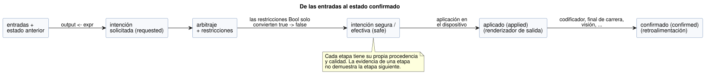
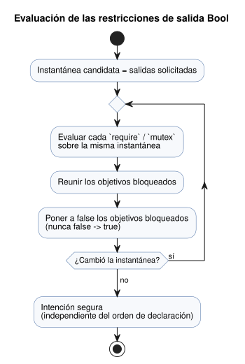
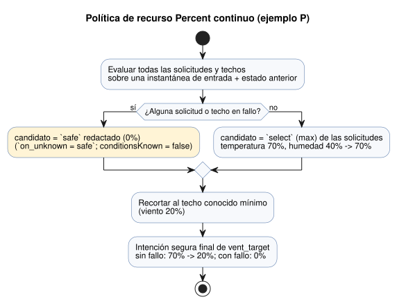

<!-- translation-source: docs/reference/04-sensors-constraints-control.en.md -->
[Original en inglés](04-sensors-constraints-control.en.md)

# 4. Sensores, restricciones y control

[Índice completo](../LANGUAGE-REFERENCE.es.md) · [Anterior: 3. Tiempo y programaciones](03-time-and-schedules.es.md) ·
[Siguiente: 5. Ajustes y observación](05-settings-and-observation.es.md)

En GhostFlow, el valor de un sensor no es solo un número. También lleva su origen, su
calidad, su instante y cualquier fallo. Del mismo modo, una salida de control no es un
comando de dispositivo. Primero se calcula como una *intención solicitada* (requested intent).

GhostFlow mantiene separadas cinco cosas:

1. las expresiones de control locales,
2. el arbitraje de los recursos compartidos,
3. las restricciones de seguridad,
4. la aplicación por parte del renderizador (renderer) de salida, y
5. la retroalimentación física.

Como se mantienen separadas, un programa puede explicar los fallos de los sensores y los
controles en competencia en lugar de ocultarlos.

**En este capítulo**

| Sección | Tema |
|---|---|
| [4.1](#41-sensor-y-calidad-de-result)–[4.2](#42-contratos-de-muestreo-y-orden-de-procesamiento-del-sensor) | Calidad de entrada (`Result`) y canal de procesamiento de muestras |
| [4.3](#43-filtros-y-operaciones-de-señal)–[4.4](#44-evidencia-temporal) | Filtros, señales con estado y evidencia basada en el tiempo |
| [4.5](#45-sensores-opcionales-y-capacidades)–[4.6](#46-consultas-de-dispositivos-y-selección-de-estrategia) | Capacidades opcionales y selección de estrategia |
| [4.7](#47-requested-safe-applied-confirmed) | Las etapas requested → safe → applied → confirmed |
| [4.8](#48-notación-y-operaciones-comunes-de-restricciones)–[4.11](#411-contabilización-de-uso-y-presupuestos) | Restricciones, recursos compartidos, modos, ajustes en vivo y presupuestos |
| [4.12](#412-objetivos-de-control-continuo)–[4.14](#414-adaptación-acotada) | Objetivos y PI/PID, respaldo explícito, adaptación acotada |
| [4.15](#415-reglas-de-tipos-recursos-y-explicación)–[4.16](#416-sintaxis-de-control-establecida-y-límites-del-capítulo) | Reglas comunes y límites con otros capítulos |

**Cómo leer el código de este capítulo**

- La **notación GhostFlow seleccionada** es sintaxis establecida en la superficie actual del lenguaje.
- Solo los ejemplos marcados explícitamente como **notación de diseño** son ilustrativos. Todo
  lo que este capítulo establece como notación seleccionada es sintaxis pública. Eso incluye
  restricciones, consultas de dispositivos, objetivos, PI/PID, evidencia temporal y adaptación.

**Fuentes.** Este capítulo se basa en [restricciones comunes y contratos de sensores](../CONSTRAINTS.es.md),
[sintaxis seleccionada](../LANGUAGE-SURFACE.es.md),
[diseño del lenguaje §5–8](../LANGUAGE.es.md), [Programming in GhostFlow, capítulo 8 y apéndice A](../ProgrammingInGhostflow.es.md),
[#3](https://github.com/callin2/ghostflow-language/issues/3),
[#94](https://github.com/callin2/ghostflow-language/issues/94),
[#95](https://github.com/callin2/ghostflow-language/issues/95),
[#96](https://github.com/callin2/ghostflow-language/issues/96),
[#105](https://github.com/callin2/ghostflow-language/issues/105) y
[#110](https://github.com/callin2/ghostflow-language/issues/110).

**`input` frente a `sensor`.** La palabra clave canónica para declarar una entrada externa es `input`.
Una declaración `input` hereda todas las reglas de este capítulo sobre calidad tipada,
acondicionamiento y capacidades opcionales. `sensor` es solo una categoría interna/de
transmisión de calidad; **no** es un alias de declaración aceptado. Migre el código fuente
existente solo como una revisión nueva y revisada. Consulte [el contrato de migración](../INPUT-MIGRATION.es.md).

## 4.1 sensor y calidad de Result

**Instantáneas Bool heredadas.** Un programa puede conservar el comportamiento antiguo de las
instantáneas Bool obligatorias solo mediante la directiva explícita y versionada del
[contrato de migración](../INPUT-MIGRATION.es.md). Esa directiva:

- conserva los puntos de uso originales sin procesar,
- sigue exigiendo valores tipados en cada trama actual, y
- rechaza una trama no válida *antes* de la evaluación, sin inventar un valor predeterminado para el fallo.

Toda entrada sin este marcador es un `Result`. La distinción existe para que conservar un
programa existente nunca se confunda con redactar una nueva política de calidad.

**Tipo declarado frente a tipo leído.** En una declaración seleccionada se escribe el tipo
de carga útil normal del sensor:

```ghost
input low_water: Bool;
input moisture: Percent;
```

Cuando se *lee* el sensor, su tipo real es conceptualmente `Result<T, SensorFault>`.
Use `ok(value)` para ramificar sobre una muestra normal y `fault(reason)` para ramificar sobre un error:

```ghost
let water_ok = case low_water {
  ok(low)  => !low;
  fault(_) => false;
};
```

El conjunto inicial de fallos distingue cuatro significados:

| fault | Significado |
|---|---|
| `Disconnected` | La conexión o la ruta de entrega del sensor instalado está interrumpida. |
| `Stale` | La última muestra válida real es más antigua que su límite de vigencia. |
| `Invalid` | El valor, la unidad, el rango o la codificación incumple el contrato declarado. |
| `NotReady` | La inicialización, la ventana del filtro o la condición de recuperación consecutiva aún no está lista. |

Reglas para manejar un `Result`:

- No se puede comparar un `Result` directamente como si fuera un Bool o un Number.
- No convierta implícitamente todos los fallos en un único cero o false.
- En el ejemplo anterior, `false` es un valor de control que eligió el *autor*. El fallo
  original y su instante siguen registrados.
- `recover(default)` es una transformación pura con el mismo significado. `ok(x)` devuelve `x`;
  `fault(e)` devuelve `default`, que tiene el tipo de la carga útil. `recover` **no**
  reclasifica el fallo como normal y **no** hace avanzar el estado de recuperación del sensor.

Se admiten tanto el `case` exhaustivo como las transformaciones de Result resueltas estáticamente:

```ghost
fn normalize(value: Temperature) -> Result<Temperature, SensorFault> {
  ok(value)
}

let dry = moisture |> map(below(30%)) |> recover(false);
let normalized = temperature |> and_then(normalize);
```

Cómo funcionan estas transformaciones:

| Construcción | Significado |
|---|---|
| `below(limit)` | Una función unaria estática para cargas útiles ordenadas compatibles. |
| `map(fnName)` | Transforma una carga útil `ok` en `U`. |
| `and_then(fnName)` | Transforma una carga útil `ok` en `Result<U,SensorFault>`. |
| `recover(expr)` | La única transformación que devuelve un valor ante `fault`: un valor predeterminado explícito del mismo tipo de carga útil. |
| `\|>`, `>>` | Cadenas estáticas en tiempo de compilación, no valores de función. |

- `map` y `and_then` aceptan solo funciones puras que el compilador resuelve por nombre.
  No son clausuras en tiempo de ejecución ni funciones de orden superior (HOF) generales.
- Un `fault` atraviesa `map` y `and_then` sin llamar a la función.
- GhostFlow no añade tipos de datos algebraicos (ADT) generales definidos por el usuario. Sin
  embargo, `Result<T,SensorFault>` puede aparecer en argumentos y resultados de funciones, y se
  admiten los constructores `ok(value)`/`fault(reason)`.
- Toda transformación deja el fallo original y la procedencia en el registro (journal)/la
  explicación, y ninguna hace avanzar el estado de recuperación.

**Por qué:** Si el fallo de un sensor se oculta como 0% o false, ya no se pueden distinguir
el nivel de agua bajo normal, una lectura realmente nula y un sensor desconectado. Conservar
tanto el valor sustituto como su causa hace posible un control conservador y una explicación posterior.

## 4.2 Contratos de muestreo y orden de procesamiento del sensor

La notación seleccionada para configurar un sensor es:

```ghost
input moisture: Percent {
  sample = 1s;
  valid = 0% .. 100%;
  filter = median(5);
  stale_after = 3s;
  recover_after = 3 samples;
}
```

Significado y restricciones de cada elemento:

| Elemento | Tipo/restricción | Significado |
|---|---|---|
| `sample` | `Duration` positiva | El intervalo de medición esperado. Es solo informativo: no crea ningún hilo de lectura del sensor ni ningún temporizador. |
| `valid` | Rango cerrado del mismo tipo de carga útil numérica; no disponible para Bool | Comprueba los candidatos normales sin procesar *antes* del filtrado. Los valores fuera de rango pasan a `Invalid`. Un rango Bool se rechaza en tiempo de compilación. |
| `filter` | Operación de señal con estado | Se aplica solo a muestras nuevas y válidas. |
| `stale_after` | `Duration` positiva | Límite de vigencia, medido desde el instante de la última muestra válida real. |
| `recover_after` | Entero positivo `N samples` | Tras un fallo, la recuperación exige N muestras válidas nuevas consecutivas. |

**Identidad de la muestra.** Para cada muestra, el driver proporciona el ID de origen, la época
del origen, el ID de la muestra, la marca de tiempo de la muestra y la calidad. Si la misma
muestra física se repite en varios ticks (pasos de decisión lógica), cuenta solo una vez para la ventana del filtro y el
contador de recuperación. Recalcular la salida del filtro no renueva la vigencia.

**Orden de procesamiento:**

```text
Identificar una muestra nueva
  → comprobar carga útil/unidad/rango válido
  → actualizar el estado del filtro
  → comprobar si el filtro está listo
  → predicado con estado (hysteresis, etc.)
  → conservar calidad/fallo
  → el autor selecciona el valor de control con case/recover
```

El diagrama siguiente muestra el mismo orden, incluido dónde surge cada fallo.


**Vigencia y retención.**

- Un `Disconnected` o `Invalid` explícito se propaga de inmediato.
- Cuando no llega ninguna muestra nueva, el último valor válido puede usarse hasta `stale_after`.
  Al alcanzar el límite, la entrada pasa a `Stale`.
- Retener el último valor sin límite **no** es el comportamiento predeterminado. Una retención
  acotada necesita una política aparte que indique explícitamente su duración y la calidad `Held`.

**Recuperación tras un fallo.**

- Vacíe la ventana del filtro tras un fallo.
- El resultado es `NotReady` hasta que *tanto* el filtro esté listo *como* se cumpla `recover_after`.
  Por ejemplo, `median(5)` con `recover_after = 3` exige al menos cinco muestras válidas nuevas.
- Una muestra cuya época de origen o época de tiempo cambió no cuenta como la siguiente muestra
  normal de la secuencia consecutiva anterior.

**Reinicio.** De forma predeterminada, un reinicio restablece el estado y la vigencia del sensor,
y la entrada vuelve a prepararse desde `NotReady`. La reanudación persistente es una opción
explícita que valida la continuidad de origen/tiempo del punto de control (checkpoint). Nunca
restaure un único valor normal antiguo para usarlo de inmediato como permiso.

**Reglas de conteo para `recover_after = N samples`.**

- Cuenta observaciones válidas nuevas y distintas en la inicialización, el reinicio, un cambio
  de época de origen y la recuperación tras un fallo.
- La N-ésima observación es utilizable en cuanto el filtro también está listo.
- Las muestras duplicadas y los escaneos que solo avanzan el reloj no cuentan.
- Un fallo o la pérdida de vigencia inicia una secuencia nueva.
- Para descartar las primeras N observaciones válidas, escriba `recover_after = N+1 samples` como
  un conteo concreto dentro de `1..31`.
- Esta opción cuenta muestras. **No** es un calentamiento temporizado.

**Preparación temporizada.** Para exigir un *periodo* de calentamiento, use la operación con
estado existente `debounce`; `recover_after` no tiene forma de duración. El patrón siguiente
retiene el Result hasta que hayan transcurrido dos minutos entre la primera observación `Good`
acondicionada y una observación `Good` distinta y vigente en ese plazo o después. La salida
`usable` solo indica disponibilidad; no ordena ninguna operación física.

```ghost
fn observed(value: Number) -> Bool { true }
control TimedPreparation {
  input reading: Number { stale_after = 3min; }
  signal ready = debounce(reading |> map(observed), stable_for: 2min, initial: false);
  let prepared: Result<Number, SensorFault> = case ready {
    ok(value) => if value then reading else fault(NotReady);
    fault(_) => reading;
  };
  output usable: Bool;
  usable <- case prepared { ok(value) => true; fault(_) => false; };
}
```

Cómo se comporta este ejemplo:

- `observed` asigna true a toda carga útil sana, incluido el cero. Un fallo de entrada
  atraviesa `map` sin cambios.
- El intervalo de antirrebote (debounce) usa las marcas de tiempo de las observaciones. Los
  escaneos que solo avanzan el reloj y las muestras duplicadas no pueden promover la preparación.
- Un fallo, una recepción obsoleta o un cambio de época de origen reinicia la preparación.
- Si también se configura filtrado o recuperación por conteo de muestras, el intervalo comienza
  solo después de que esas etapas produzcan `Good` por primera vez.
- La rama `fault(_) => reading` conserva el Result de entrada original y su origen.
- Elija `stale_after` según la cadencia de observación esperada. Aquí, el límite de tres minutos
  permite observaciones escasas: solo la primera y una en el plazo.
- El `recover_after` basado en conteo y esta compuerta de duración redactada por el autor son
  condiciones separadas.

## 4.3 Filtros y operaciones de señal

### median

El `median(n)` seleccionado ordena las últimas `n` cargas útiles válidas nuevas y devuelve el valor central.

- `n` es un entero impar en `1..31`.
- Hasta que la ventana contiene `n` muestras, el resultado es `NotReady`. No existe una "mediana parcial".
- La ventana queda vacía tras un fallo o una reinicialización.

```ghost
filter = median(5);
```

Por ejemplo, la mediana de `28%, 29%, 90%, 28%, 29%` es 29%. Un único pico no domina la decisión.

### hysteresis

El `hysteresis` seleccionado toma un sensor/Result y crea una señal Bool con estado que
conserva la calidad.

```ghost
signal dry = hysteresis(moisture,
  on_below: 30%,
  off_above: 35%,
  initial: false);
```

- El primer argumento es un `Result<T, SensorFault>` numérico/de magnitud ordenado.
- `on_below` y `off_above` tienen el mismo tipo que `T`, y se exige `on_below < off_above`.
- Una carga útil por debajo de `on_below` cambia la señal a true.
- Una carga útil por encima de `off_above` cambia la señal a false.
- Entre los límites, y exactamente en cualquiera de ellos, se mantiene la decisión anterior.
- `initial` es el estado Bool en la inicialización y tras la recuperación.
- Ante un fallo de entrada, el fallo se propaga. El último Bool **no** se presenta como un `ok` normal.

Los dos límites evitan la conmutación rápida ON/OFF cerca de un único umbral. Esta memoria es
estado explícito de la señal, no una corrección oculta del host.

### Contrato de diseño de las operaciones de señal acotadas

Lo siguiente es notación seleccionada:

```ghost
input moisture: Percent { filter = moving_average(3); }
input temperature: Temperature { filter = ema(alpha: 0.25); }
signal stable_start = debounce(start, stable_for: 2s, initial: false);
```

| Operación | Argumentos obligatorios | Semántica de estado y resultado |
|---|---|---|
| `debounce` | Señal Bool/finita, `Duration` estable positiva, valor inicial | Cambia el valor estable solo cuando el candidato de entrada permanece sin cambios durante toda la duración. Guarda el valor estable, el valor candidato y el instante monotónico de inicio del candidato. |
| `moving_average(n)` | Result numérico; entero fijo positivo `n` dentro del límite del perfil | Media aritmética de las últimas `n` muestras válidas nuevas. Una ventana vacía o parcial es `NotReady`. El estado es finito y abarca solo las últimas `n` muestras. |
| `ema(alpha)` | Result numérico; `0 < alpha <= 1` finito | Se inicializa con la primera muestra válida y luego calcula `alpha*x + (1-alpha)*previous`. No hay resultado normal antes de que se cumplan las condiciones de recuperación. |
| `stale_after(d)` | Result con marca de tiempo; Duration positiva | Pasa a obsoleto cuando la antigüedad de la última muestra válida real alcanza `d`. La reevaluación o el instante de salida del filtro no lo prolongan. |

**Composición de filtros.** `filter` acepta exactamente una operación. Para componer varios pasos,
declare cada paso como una `signal` con nombre:

- Declare la siguiente etapa EMA de un Result numérico como `signal smooth = ema(moisture, alpha: 0.25);`.
- Un resultado EMA puede alimentar otra etapa: `signal slower = ema(smooth, alpha: 0.25);`.

Reglas para las etapas EMA:

- Cada EMA hereda la época, el ID de muestra y la marca de tiempo de un único origen físico.
  Solo se actualiza con una muestra sana nueva.
- Propaga los fallos de entrada y vacía su memoria EMA. Después vuelve a inicializarse a partir
  de la primera muestra sana que cumpla la preparación del filtro anterior y `recover_after`.
- No crea otro contador de recuperación ni un nuevo instante de vigencia.
- Los valores sin linaje de muestra, y las expresiones que seleccionan entre varios orígenes
  físicos, no se aceptan como entradas de una etapa EMA.

**Otras reglas.**

- Un filtro de Temperature calcula internamente una media ponderada afín en el dominio canónico
  de kelvin. Esto **no** permite `Temperature+Temperature` ni la multiplicación escalar de
  temperaturas absolutas en las expresiones del código fuente.
- No aplique el mismo retardo de filtro de forma uniforme a las señales de protección y a los
  sensores ambientales que cambian lentamente.
- Cada operación debe tener un tamaño de estado fijo y un límite de cálculo fijo.
- Las operaciones se actualizan solo con muestras nuevas. La composición conserva la calidad
  hasta `case` o `recover`.

**Por qué:** Si un filtro borrara la calidad del sensor, o reutilizara una muestra una vez por
tick, el suavizado ocultaría los fallos y los resultados de la reproducción (replay) cambiarían.
Un estado finito y con nombre permite revisar el retardo y el coste de recursos.

## 4.4 Evidencia temporal

La *evidencia temporal* (temporal evidence) es un hecho basado en el tiempo acerca de una señal
de sensor, como "true durante cinco minutos" o "la válvula se abrió dentro de los diez segundos
posteriores al evento de arranque". Usa la notación seleccionada siguiente. Es distinta del
`within` de las programaciones.

```ghost
signal hot_5m = true_for(hot, duration: 5min, quality: measured);
signal opened = after_event(started, valve_open, window: 10s, quality: measured);
input selected_start: EventId;
output selected_opened, any_opened, all_opened: Bool;
selected_opened <- after_event_for(opened, selected_start) |> recover(false);
any_opened <- after_event_any(opened) |> recover(false);
all_opened <- after_event_all(opened) |> recover(false);
signal avg_temp = window_average(temperature, over: 10min,
  quality: measured, max_age: 2min);
signal low_temp = window_min(temperature, over: 10min,
  quality: measured, max_age: 2min);
signal high_temp = window_max(temperature, over: 10min,
  quality: measured, max_age: 2min);
signal warming = window_rate(temperature, over: 10min,
  quality: measured, max_age: 2min);
signal usable_temp = hold_last(temperature, for_at_most: 2min, quality: measured);
```

**`true_for`** es la evidencia de que un valor true admisible se mantuvo sin interrupción
durante una duración positiva.

- Un valor false o una calidad no admisible lo restablece.
- Pasa a true en la primera decisión que alcanza el límite de la duración.
- La continuidad une solo intervalos que el driver certifica como realmente observados. No
  interpole entre muestras separadas. La cadencia esperada, la cadencia de escaneo, los
  duplicados y los ticks que solo avanzan el reloj no son evidencia de observación.

**`after_event`** calcula, para cada identidad de evento, si el predicado se cumplió dentro de
`[e,e+window)`, donde `e` es el instante del evento identificado.

- El límite final exacto queda excluido.
- Los eventos superpuestos conservan resultados independientes por identidad. Un nuevo evento
  de arranque no sobrescribe un resultado anterior pendiente o completado.

**Lectura de los resultados de `after_event`.** Una señal `after_event` no es un escalar, por lo
que no se puede leer directamente en una expresión Bool. Use una de tres proyecciones:

| Proyección | Significado |
|---|---|
| `after_event_for(signal, identity)` | Selecciona un `EventId` explícito. |
| `after_event_any(signal)` | True si *alguna* identidad retenida se cumple; false solo si *todas* han vencido. |
| `after_event_all(signal)` | False si *alguna* identidad retenida ha vencido; true solo si *todas* se cumplen. |

- El compilador actual traduce `after_event` a control ejecutable solo cuando existen
  proyecciones explícitas `after_event_for`, `after_event_any` o `after_event_all` y una
  vinculación (binding) de runtime. Una declaración sin proyecciones no se acepta como control ejecutable.
- Para `after_event_for`, el runtime comprueba que la etiqueta de origen de la identidad sea
  igual al origen Event de la señal. Una identidad de otro origen rechaza el escaneo con un
  error de vinculación de identidad; no se convierte silenciosamente en false.
- `EventId` es una identidad opaca entregada por el driver. No es un número arbitrario, y el
  código fuente no puede construir un "evento más reciente".
- `after_event_any` y `after_event_all` agregan todo el conjunto inmutable de identidades
  retenidas en el escaneo aceptado.
- Un conjunto vacío, o las identidades pendientes restantes que aún podrían cambiar el
  resultado, producen `NotReady`. Cuando no hay un true/false decisivo, los fallos originales
  del predicado/origen tienen prioridad sobre `NotReady`.
- Cada proyección devuelve `Result<Bool, SensorFault>`. Cualquier respaldo, como
  `recover(false)`, lo escribe explícitamente el autor.

Las **identidades retenidas** están acotadas por una capacidad fija y finita del perfil de runtime.

- No desaloje implícitamente identidades pendientes o terminales, ni las sobrescriba con un nuevo arranque.
- El desbordamiento de capacidad rechaza atómicamente todo el escaneo.
- Los resultados terminales siguen siendo direccionables hasta que el host acusa recibo de
  ellos explícitamente. No se puede acusar recibo de las identidades pendientes.

**Agregados de ventana.**

- `window_average/min/max` usan solo observaciones reales admisibles dentro de `(t-d,t]`,
  sin interpolación. Si no hay observaciones admisibles, o la antigüedad de la observación más
  reciente es al menos `max_age`, el resultado es `NotReady`.
- `window_rate` calcula `(last-first)/(lastTime-firstTime)` a partir de las observaciones
  admisibles más antigua y más reciente de la ventana. Sin dos instantes distintos, es `NotReady`.

**`window_rate` y `Rate<Q>`.**

- Para una carga útil numérica ordenada admitida `Q`, el resultado es el tipo `Rate<Q>`, que
  existe solo en expresiones.
- Las diferencias de temperatura usan ΔK canónico. Las magnitudes lineales usan diferencias
  canónicas de la misma magnitud nominal.
- Haga referencia al resultado mediante el nombre de la `signal` que declara `window_rate`.
- `Rate<Q>` no tiene literal directo, ni vinculación general de valores, ni almacenamiento
  config/state/input/output, ni aritmética libre.
- Los umbrales de comparación se construyen solo con `rate(delta: <Q difference>, time: Duration)`.
- En v1, RelativeHumidity, CO2 y Acidity no son entradas de `window_rate`.

**`hold_last`** proporciona la última carga útil admisible solo desde la marca de tiempo de su
muestra hasta estrictamente antes de `for_at_most`.

- El runtime/la traza registra `quality=Held`, el ID de la muestra de origen y la antigüedad.
- `Held` no es un constructor de origen y no es `Measured`.
- La retención termina exactamente en el límite.

### Tipos de ventana temporal y procedencia

Las ventanas temporales basadas en mediciones toman un `Result<T, SensorFault>` y devuelven un
Result correcto cuando hay suficientes observaciones.

| Operación | `T` aceptado | Tipo del resultado |
|---|---|---|
| `window_min`, `window_max` | `Int`, `Number`, `Percent` o un tipo de magnitud física | El mismo `T` |
| `window_average` | Los mismos tipos que arriba | El promedio de `Int` da `Number` (conserva la parte fraccionaria); los demás tipos conservan su tipo original. Los promedios de temperatura absoluta usan valores canónicos en K. |
| `window_rate` | Sigue las [reglas de `Rate<Q>`](02-types-expressions-state.en.md#29-physical-quantities-and-units) del capítulo 2 | `Rate<Q>` |

Bool, enum, Duration y los tipos de calendario no son cargas útiles de estas ventanas numéricas.

**Parámetros.** `over` y `max_age` son Durations constantes positivas.

**Procedencia de las observaciones.**

- Conserve el origen original, la época, el ID de muestra y la marca de tiempo de cada observación real.
- La recepción duplicada o la reevaluación de la misma observación no cuenta como una contribución nueva.
- Un fallo ordinario aguas arriba no borra las observaciones que siguen en la ventana. Por ello,
  los registros suficientemente vigentes pueden seguir proporcionando un agregado. Los fallos
  enmascarados y su procedencia también permanecen en los registros de observación.
- Un cambio de la época del origen original invalida las contribuciones anteriores de ese origen.

**Procedencia del agregado.** La procedencia de un agregado es su declaración de ventana temporal,
su instante de evaluación y el conjunto real de observaciones que contribuyen. No la muestre como
una única muestra de sensor medida directamente. Las transformaciones y las ramas conservan esta
procedencia de agregado y no deben inventar un ID de muestra física. Las ventanas aguas abajo
también deben distinguir las observaciones originales de los identificadores de resultados agregados.

**Por qué:** Redondear los promedios enteros, o cambiar su magnitud física, cambiaría el
significado de un umbral de control. Conservar la procedencia de las observaciones y las
ventanas válidas evita que la retransmisión de comunicaciones añada peso a un promedio, y evita
que los fallos temporales borren observaciones pasadas válidas.

### Composición de ventanas temporales

El resultado de una ventana temporal puede ser la entrada de otra:

```ghost
signal short_average = window_average(temperature, over: 2min,
  quality: measured, max_age: 1min);
signal long_average = window_average(short_average, over: 10min,
  quality: measured, max_age: 2min);
```

Reglas para las ventanas compuestas:

- **Cuándo se produce una nueva observación agregada.** Una ventana aguas abajo recibe una nueva
  observación agregada solo cuando la ventana aguas arriba acepta una observación nueva *y*
  produce un agregado correcto. La reevaluación, el vencimiento de observaciones, un cambio en
  la selección de rama o un cambio de fallo por sí solos no crean una observación nueva. El
  agregado actual, tal como lo modifica el vencimiento, sigue siendo legible en expresiones ordinarias.
- **Identidad del agregado.** Una observación agregada se identifica por la declaración de la
  ventana temporal y la revisión de aceptación de observaciones, dentro del mismo programa,
  estrategia y ejecución (run). Manténgala separada de la identidad de la muestra física. Las
  ventanas aguas abajo también recuerdan las revisiones de las ventanas aguas arriba no
  seleccionadas, de modo que un cambio de rama no vuelve a contar como observación nueva un
  agregado ya producido.
- **Instante del agregado.** El instante de una observación agregada es el instante de la
  observación original más reciente que contribuye a ella. Guarde el instante de evaluación por
  separado. Un cálculo tardío o un recálculo no renueva el instante de referencia de `max_age`.
  Distintas observaciones agregadas pueden compartir el mismo instante de observación.
- **Ponderación.** En un promedio aguas abajo, cada observación agregada es un término con el
  mismo peso. No aplane los promedios anidados en un único promedio de las muestras originales.
  Conserve las observaciones originales de cada término como evidencia de procedencia. Por
  ejemplo, promedios aguas arriba de 0, 5 y 15 dan un promedio aguas abajo de `20 / 3`.
- **Calidad.** `quality: measured` acepta evidencia agregada solo cuando todas sus observaciones
  originales contribuyentes son mediciones admisibles. El agregado en sí tiene calidad `Derived`.
  `map`, `and_then` y las ramas de Result conservan la evidencia seleccionada. No asigne nueva
  procedencia medida a valores `Held` ni a valores construidos con `ok(...)`.
- **Cambio de época.** Un cambio de la época de un origen original invalida todas las
  observaciones agregadas que dependen de la época antigua. Un promedio de A y B no puede
  descartar solo la procedencia de A y conservar el valor promedio existente. Las observaciones
  separadas que dependen solo de B permanecen.
- **Reversión.** Una decisión fallida revierte conjuntamente las observaciones agregadas, las
  revisiones y los registros de aceptación de las ventanas aguas abajo. Reintentar la misma
  observación no debe omitirla ni contarla dos veces.

**Retención.** La retención máxima incluye las observaciones pasadas de las ventanas aguas arriba
y la evidencia de procedencia de cada agregado. No fusione agregados que compartan el instante de
observación más reciente, y no descarte silenciosamente observaciones válidas para ajustarse a un
presupuesto. Si no se puede demostrar la retención necesaria, rechace la activación.

**Por qué:** Componer agregados significa recalcular resultados que ya se calcularon. Aplanar
hasta las observaciones originales y volver a promediar cambiaría el peso de cada agregado.
Separar la aceptación de observaciones de la evaluación impide que el número de escaneos y los
cambios de rama influyan en el promedio. Conservar el instante y la procedencia originales evita
que el simple recálculo haga parecer vigentes observaciones antiguas.

### Valores y procedencia de `hold_last`

**Firma.** `for_at_most` es una Duration constante positiva. `hold_last` basado en mediciones
guarda la última observación admisible de un `Result<T, SensorFault>` y devuelve el mismo tipo Result.

- Sin observación retenida, o después de que termine su tiempo de validez, devuelve `fault(NotReady)`.
- Un resultado correcto es `Held`, incluso inmediatamente después de recibirse.
- `map`, las ramas de Result y las transformaciones posteriores nunca promueven esa procedencia a `Measured`.
- Los valores creados con `ok(...)` o `recover(...)` tampoco son evidencia de medición nueva.

**Qué conserva o sustituye el valor retenido.**

- Los fallos ordinarios del sensor, o los cambios de rama en la expresión de entrada, no borran
  un valor retenido. Por ejemplo, si se selecciona el fallo de B después del valor válido de A,
  la retención conserva el ID de muestra y la marca de tiempo originales de A.
- Una nueva observación admisible sustituye tanto la carga útil como la procedencia por las de esa observación.
- La retransmisión, las muestras duplicadas y la relectura de valores normales en caché no prolongan la retención.
- Un cambio de la época del origen original del valor retenido, o la pérdida de la continuidad
  temporal, lo vuelve inutilizable.

**Traza.** La traza registra, para el valor realmente devuelto, el marcador `Held`, el origen
original, la época, el ID de muestra, la marca de tiempo y la antigüedad actual. Cualquier
SensorFault aguas arriba enmascarado por el valor retenido también conserva su error y su procedencia.

**Por qué:** Elegir usar una última medición durante un tiempo acotado es distinto de afirmar una
medición nueva. El instante y la procedencia originales de la medición evitan que la relectura
prolongue la validez, y evitan que el control posterior reutilice valores retenidos como evidencia medida.

### Reglas comunes de calidad y observación

- `quality` no se puede omitir. Permitir evidencia estimada exige además el límite de
  incertidumbre establecido por el origen/los tipos.
- El `max_age` de una operación de ventana es obligatorio y positivo.
- Todas las ventanas usan solo el pasado y el presente. La simulación no anticipa muestras futuras.
- Ejemplo: si las dos únicas muestras son 25°C a las 09:00 y 31°C a las 12:00, no se puede
  concluir que la temperatura superó los 30°C durante dos horas. Combine las ventanas con
  políticas de calidad como `require measured`, la incertidumbre de estimación permitida y `max_age`.
- Un escaneo perdido no crea ninguna observación.
- El compilador debe calcular el número máximo de muestras retenidas a partir de la duración,
  `max_age`, el contrato de muestreo y el perfil de runtime. Si no puede, rechace la activación.
- La restauración desde un punto de control solo se permite después de validar la continuidad
  de origen/tiempo. De lo contrario, el resultado es `NotReady`.

### Procedencia y continuidad de los valores estimados

**Qué es una estimación.** Una estimación es un valor producido por un modelo identificado. No es
una observación de sensor ni un hecho de salida aplicado/confirmado.

- `Result<T, SensorFault>` expresa validez o fallo para un valor de sensor declarado.
- `ok(value)` significa que el valor de origen cumplió su contrato de validez declarado. No
  convierte un cálculo en medido ni en físicamente confirmado.
- `Estimated` es un origen de evidencia conceptual. No añade ningún estado de `Result`, ninguna
  variante de `Quality` ni ninguna sintaxis ejecutable.

**Qué exige interpretar una estimación.**

- las revisiones del modelo y de los parámetros de calibración,
- la identidad de la referencia de runtime, y cómo y quién la estableció,
- las revisiones del origen/programa y de la vinculación de la instalación,
- la ejecución y la época de tiempo monotónico,
- el historial de recepciones del origen o de la aplicación que se usó, y
- la base declarada.

Las referencias y el historial retenidos deben caber en un límite finito declarado por el perfil
de despliegue. Si ese límite no se puede soportar, rechace el uso. No guarde un historial sin
límite en una MCU.

**Base de progreso del actuador.** La primera base de progreso del actuador es el historial de
registros de salida o de escrituras con acuse de recibo del dispositivo.

- Su acuse de recibo significa solo que el renderizador de salida aceptó ese registro/esa
  escritura. No demuestra el movimiento del motor ni la posición.
- El instante de la solicitud puede servir de base solo cuando se declara explícitamente como
  historial *solicitado* (requested). Nunca lo sustituya por un historial *aplicado* (applied).
- Esto sigue la distinción requested/safe/applied/confirmed de §4.7.

**Inicio y avance de una estimación.**

- Un intervalo de estimación comienza a partir de una referencia de runtime admisible y declarada
  y de una recepción/un historial que cumpla los requisitos.
- Volver a leer una recepción en caché, o exponerla en otro escaneo, no crea una escritura nueva
  ni evidencia nueva. No restablece el origen/inicio, la vigencia ni la incertidumbre.
- Una estimación puede avanzar con la evaluación normal de tiempo monotónico solo mientras se
  mantenga una continuidad verificada. Se exige el historial completo que cumpla los requisitos.
- No interpole a través de una brecha no observada, un fallo o una escritura incierta.
- Si falla una escritura nueva, un ACK anterior en caché conserva su identidad original como
  evidencia histórica, y el historial actual del objetivo aplicado es incierto. No infiera una
  aplicación continuada a partir de ese ACK antiguo.

**Ruptura de la continuidad.** Cada uno de los siguientes rompe la continuidad de la estimación en
vivo, salvo que el titular la valide y la restablezca explícitamente:

- un reinicio,
- un cambio de la época de ejecución/tiempo o de la época de origen,
- un cambio de la vinculación de la instalación,
- un cambio de la revisión del modelo/de calibración, o
- un cambio de la referencia de runtime.

Los parámetros de calibración pueden conservarse tras un reinicio. Una referencia de posición de
runtime o una estimación no debe restaurarse silenciosamente ni ponerse a cero. Una base ausente
o no verificada hace que la estimación actual no esté disponible/sea `NotReady`. Un fallo
explícito existente de origen/tiempo sigue siendo ese fallo. No convierta ninguno de los dos casos
en cero ni en un respaldo automático. Una política basada solo en temporizador sigue siendo válida
cuando no hay ninguna estimación disponible y no necesita consumir una.

**Incertidumbre.** La incertidumbre desconocida sigue siendo desconocida.

- El modelo/origen debe declarar un límite de incertidumbre conocido o que la incertidumbre es desconocida.
- Una estimación con incertidumbre desconocida puede retenerse o presentarse, pero no se admite
  en los operadores temporales acotados.
- No se define ninguna fórmula universal, confianza, incertidumbre numérica, duración ni vencimiento.
- La admisión medida existente de `quality: measured`, `hold_last` y `true_for` no cambia.
- Cualquier consumidor temporal futuro que admita estimaciones debe admitir explícitamente el
  origen/tipo y exigir su límite de incertidumbre declarado. No puede aceptar silenciosamente
  una incertidumbre desconocida.

**Ejemplos.**

- *Continuo:* con una referencia de runtime explícita, modelo, calibración y vinculación
  coincidentes, la misma época de ejecución/tiempo y un historial de escrituras que cumple los
  requisitos sin brechas dentro del límite del perfil, el modelo seleccionado puede producir una
  estimación. Sigue siendo una estimación; un ACK del renderizador de salida por sí solo no
  afirma que haya movimiento.
- *Discontinuo:* para una base de historial aplicado, una solicitud sin acuse de recibo, una
  escritura nueva fallida o incierta, un reinicio o un cambio de identidad/revisión hacen que la
  estimación en vivo no esté disponible hasta que se valide de nuevo una referencia. Una base de
  historial solicitado declarada por separado puede usar una solicitud como supuesto, pero no debe
  etiquetarla como historial aplicado. Conserve los parámetros de calibración y las estimaciones
  anteriores como historial, cada uno con su propia identidad.

**Seguimiento y estado actual.**

La semántica de las estimaciones se sigue en GhostFlow [#383](https://github.com/callin2/ghostflow-language/issues/383);
el trabajo de compatibilidad posterior es [#385](https://github.com/callin2/ghostflow-language/issues/385).
La semántica de calibración/referencia está en [System #132](https://github.com/callin2/farm_studio_system/issues/132)
y en su [contrato de arquitectura](https://github.com/callin2/farm_studio_system/blob/241643c125439c1ec141c8596feec3f4ad143ade/docs/architecture/INPUT-DRIVER-ARCHITECTURE.md#calibration-parameters-and-position-reference--system-132).
El límite concreto de recepción de salidas del dispositivo está en el borrador [PR #107](https://github.com/callin2/farm-device/pull/107),
head `b85ef02fb546cd5f957c12ab66f091b90f9484f0`, en
[host observation](https://github.com/callin2/farm-device/blob/b85ef02fb546cd5f957c12ab66f091b90f9484f0/rust/firmware/src/host_observation.rs).

- La traducción actual de `sensorSample` marca la procedencia medida con el código `1`. Las
  clasificaciones de runtime `Measured`/`Held`/`Constructed` no representan `Estimated`.
- Este contrato no habilita el consumo en runtime. Eso requiere el trabajo de compatibilidad
  separado de #385.

La [API acotada de admisión de bases de estimación](../ESTIMATE-EVIDENCE.es.md) mantiene separados
la validez, el origen y el historial completo declarado. Una base admitida no concede ningún
permiso de medición ni temporal. La declaración del origen y la selección del modelo siguen
siendo decisiones de compatibilidad separadas.

## 4.5 Sensores opcionales y capacidades

```ghost
input moisture?: Percent;
```

`?` declara que esta capacidad (capability) de sensor es opcional en el perfil de instalación.
**No** fusiona "ausente" con "en fallo" para un sensor instalado. Son tipos distintos:

| Tipo | Significado |
|---|---|
| `Option<T>` o ausencia de capacidad | La capacidad no existe en la configuración del dispositivo. |
| `Result<T, SensorFault>` | Se leyó un sensor instalado y se obtuvo un valor normal o un fallo. |

Reglas:

- `?` por sí solo no crea ninguna estrategia sustituta. Una adaptación como "usar una
  programación predeterminada cuando falta la humedad, y corrección por humedad cuando está
  presente" necesita un contrato de estrategia aparte.
- Un `Disconnected` temporal no debe entrar en la rama de ausencia.
- La protección de una capacidad opcional usa solo la superficie `adapt`/`strategy` de §4.6. El
  esbozo anterior con `has` no es sintaxis de v1.
- Un rol opcional solo se puede leer dentro de una estrategia que coincida con ese rol, y allí
  sigue necesitando la ramificación `ok`/`fault`.
- Ni `?` ni `adapt` cambian de estrategia automáticamente ante un fallo, y ninguno crea valores
  predeterminados.

**Información opcional del dispositivo.** La información complementaria del dispositivo también es
opcional: por ejemplo, presión, caudal, curvas de bomba, potencia y pérdida en tuberías. Su
ausencia no se convierte en cero, en capacidad infinita ni en un valor normal. El riego básico y
los enclavamientos explícitos por número de válvulas/tiempo pueden funcionar sin ella. El análisis
opcional devuelve `Pass | Violation | Unknown(reason)`; la información insuficiente da `Unknown`.

## 4.6 Consultas de dispositivos y selección de estrategia

Lo siguiente es sintaxis de control seleccionada.

> **Estado de implementación.** El compilador actual acepta `match` tipado y `match always`.
> Las coincidencias que omiten el tipo comprueban la presencia al activar.
> `where` admite comparaciones booleanas constantes del kind, name y type de la capacidad coincidente.

```ghost
adapt irrigation_policy {
  strategy WithMoisture priority 100
    match (moisture: sensor<Percent>)
    where moisture.type == Percent {
      let request = case moisture {
        ok(value) => scheduled && value < 30%;
        fault(_) => false;
      };
      pump <- request;
    }

  strategy Baseline priority 0 match always {
    pump <- scheduled;
  }
}
```

**Perfiles.** Un perfil es un conjunto finito de capacidades semánticas. La clave inicial de una
capacidad es `(kind, name, type)`. El mismo `(kind, name)` no puede aparecer dos veces.

**Sintaxis.**

- La forma es `strategy Name priority Int match (...) [where ...] { ... }`, o `match always`.
- Cada elemento de coincidencia es una condición de presencia de capacidad. Las comas significan AND.
- `pump` y `moisture` son nombres de rol semánticos, no variables que recorren filas de una base de datos.
- `sensor<number>` nombra el tipo de carga útil normal; las muestras reales siguen siendo Results.
- Omitir el tipo, como en `(moisture:sensor)`, comprueba solo la presencia.
- `where` puede leer solo el kind/name/type de la capacidad coincidente, comparaciones
  constantes y los Bool `&&`, `||`, `!`, `==`, `!=`.
- `where` **no** lee muestras de entrada, estado, estado siguiente ni valores actuales de humedad.
  No mezcle la selección de capacidades con las decisiones de control de cada tick.

**Selección de una estrategia.**

- Cada estrategia tiene una prioridad literal i32.
- Cada estrategia define por completo el mismo contrato de salida externo del control.
- Se selecciona la estrategia coincidente con mayor prioridad.
- Un empate en la cima es un error de ambigüedad. La ausencia de estrategias coincidentes es un error de activación.
- El orden de declaración y la "última coincidencia" nunca deciden.
- `match always` es un candidato ordinario, no un respaldo implícito.

**Entradas y cambios de perfil.**

- Las entradas comunes son obligatorias para todas las estrategias. Las entradas de una estrategia
  son obligatorias solo cuando esa estrategia está seleccionada.
- Las capacidades y los tipos de puerto de la estrategia seleccionada se comprueban contra el perfil.
- El perfil no cambia a mitad de un tick. Un perfil nuevo se aplica atómicamente en un límite,
  después de validar todo el candidato y su selección de estrategia.
- Trate de inmediato un fallo de sensor en la estrategia actual como un Result. No lo convierta en
  ausencia en el perfil ni cambie silenciosamente a una estrategia menos protectora.

**Por qué:** Si la selección de capacidades de la instalación se mezclara con los valores actuales
de los sensores, la vinculación podría cambiar en cada tick incluso con el mismo perfil. Una
estrategia única, aplicada en un límite, mantiene clara la procedencia de las decisiones cuando
cambia la configuración del dispositivo.

## 4.7 requested, safe, applied, confirmed

El resultado de un control pasa por etapas distintas:

```text
sensor/input + estado anterior
  → intención de salida solicitada (requested)
  → arbitraje y restricciones
  → intención segura/efectiva (safe)
  → comando aplicado por el renderizador de salida (applied)
  → estado confirmado por la retroalimentación (confirmed)
```



Cada etapa del diagrama lleva su propia evidencia. La evidencia de una etapa nunca demuestra una etapa posterior.

Las conexiones de salida (`<-`) seleccionadas definen la intención *solicitada*:

```ghost
output pump, valve: Bool;
valve <- running';
pump <- running';
require pump => valve;
```

**Cómo actúan las restricciones de salida Bool.**

- `require pump => valve` significa que pump=true se permite solo si valve=true. Si el
  requisito previo es false, el objetivo `pump` pasa a false.
- Las restricciones de salida nunca convierten false en true.
- `require !(forward && reverse)`, o un `mutex`, pone a false a *todos* los miembros del grupo
  de conflicto que son true simultáneamente.
- Con varias restricciones Bool, los objetivos bloqueados se calculan a partir de la misma
  instantánea candidata. Después el proceso se repite, avanzando siempre solo hacia false, hasta
  que nada cambia. El resultado no depende del orden de declaración.



El resultado es la *intención segura* (safe intent). No es evidencia de que un GPIO o un relé se
haya activado realmente, ni evidencia de que una válvula se haya abierto físicamente. Los comandos
aplicados y la retroalimentación confirmada, procedente de codificadores, finales de carrera,
estimaciones por visión y fuentes similares, tienen su propia procedencia y calidad.

**Por qué:** Si un solo Bool combinara la solicitud, el resultado de las restricciones, la
aplicación en el dispositivo y el resultado físico, nadie podría explicar por qué se bloqueó una
salida ni por qué el dispositivo discrepa, y la contabilización de uso no sabría qué contar.

### Observaciones de salida y política de recuperación

Para una salida Bool declarada hay cuatro funciones de observación disponibles:
`output_status(pump)`, `output_health(pump)`, `output_completion(pump)` y
`output_fault(pump)`. Sus tipos de retorno y miembros se enumeran a continuación. Los miembros
de tipos distintos no se pueden comparar entre sí.

| Tipo | Miembros (los canales numéricos empiezan en cero, en este orden) |
| --- | --- |
| `OutputStatus` | `OutputInitial`, `OutputPending`, `OutputCompleted`, `OutputFailed`, `OutputUnknown` |
| `OutputHealth` | `OutputInitializing`, `OutputHealthy`, `OutputFaulted` |
| `OutputCompletion` | `CompletionNone`, `HostWrite`, `DeviceAck`, `DeviceReadback` |
| `OutputFault` | `NoOutputFault`, `OutputUnavailable`, `OutputTimeout`, `OutputProtocolError`, `OutputDriverError`, `OutputObservationLost` |

**Qué significa cada observación.**

- El *estado* (status) describe el ciclo de vida de la solicitud actual. La *salud* (health)
  describe la disponibilidad del dispositivo.
- En el arranque, el ID de solicitud cero con `OutputInitial` puede describir un equipo que se
  está inicializando, que está listo o que está en fallo, sin ninguna finalización.
- Una solicitud nueva es `OutputPending` y conserva la salud y el fallo anteriores.
- Estar pendiente, y carecer de capacidad de ACK, no son fallos.
- La *finalización* (completion) registra el nivel real de evidencia. `HostWrite` no demuestra
  ni un ACK del dispositivo ni la posición de un contacto. `DeviceReadback` no demuestra
  automáticamente que la carga física haya funcionado, lo cual necesita un sensor aparte.

```ghost
control OutputRecovery {
  input resume: Bool;
  output pump, alarm: Bool;
  state stopped: Bool = false;
  let resume_requested = resume |> recover(false);
  stopped' = if resume_requested then false else stopped || output_fault(pump) == OutputTimeout;
  pump <- !stopped';
  alarm <- output_health(pump) == OutputFaulted;
}
```

**La recuperación es decisión del autor.** El autor elige un estado que recuerde la recuperación
manual, como arriba, o una expresión que permita la recuperación automática.

- Un fallo de salida no revierte el estado del núcleo ya consolidado.
- Las políticas separadas de seguridad y de terminación del host mantienen sus propios contratos.
- Las demás salidas conservan sus propias observaciones.

**Traducción del compilador.** El compilador genera cuatro entradas numéricas,
`__gf_output_{name}_{status|health|completion|fault}`, y un descriptor `outputObservations`
por salida.

- Este perfil usa un manifiesto `GhostFlow/control-v22` y los GFB1..4 escalares existentes.
- Combinarlo con ajustes, programaciones, contexto o adaptación se rechaza explícitamente.
- Las entradas del código fuente no pueden sobrescribir estos canales privados.

**Requisitos del host.** Los hosts deben proporcionar observaciones de renderizador de confianza
vinculadas a la ejecución actual, a la salida y al ID de solicitud que realmente se despachó.

- Un ACK de una solicitud antigua, una caché de una ejecución anterior o una observación ausente
  nunca pueden convertirse en éxito.
- El estado terminal y la evidencia de finalización de una solicitud no pueden retroceder. Un
  reintento usa un ID de solicitud nuevo.
- La pérdida de comunicación tras la finalización puede cambiar la salud y el fallo, pero
  conserva el hecho de la finalización.
- La disponibilidad recuperada usa evidencia de una nueva solicitud de inicialización o de
  recuperación. No reescribe la solicitud fallida como correcta.
- Una ejecución nueva empieza en el estado inicial.
- El rastreador portable en Rust valida las combinaciones de identidad y estado.
- El host de referencia con tramas exige `outputRunId` y `outputObservationProvider`, y trata al
  proveedor como la autoridad de la identidad de despacho. Se rechaza la inyección a través de
  `inputs` ordinarios o de argumentos de escaneo.
- Los hosts que no declaran soporte rechazan la activación.

**Por qué:** El código fuente debe distinguir el retardo del dispositivo, los fallos y la evidencia
de finalización, para que las políticas de recuperación del equipo puedan revisarse y reproducirse
con los mismos hechos. La intención solicitada y `SensorFault` no sustituyen a las observaciones de salida.

## 4.8 Notación y operaciones comunes de restricciones

La unidad canónica para redactar restricciones es un bloque `constraints` con nombre dentro de un
control. Hay dos clases de regla:

- Las **reglas locales** se aplican solo a su propio control.
- Las **reglas compartidas** se aplican a todas las rutas de solicitud que usan un recurso indicado.

Las **reglas locales de salida Bool** usan `constraints Name { require [at safe_output] p; mutex(a, b); }`.
Un `require` Bool sin objetivo significa `safe_output`. Un grupo local se aplica solo a su propio
control. Este es un control local completo:

```ghost
control LocalPump {
  input request, valve_ready: Bool;
  output pump, valve: Bool;
  pump <- request;
  valve <- valve_ready;
  constraints LocalRules {
    require at safe_output pump => valve;
  }
}
```

Las **reglas compartidas** se aplican al ámbito de recurso estable nombrado por `constraints Name for resource`.
Todas las rutas de solicitud automáticas, manuales y de respaldo que usan ese recurso siguen las
mismas reglas. El código fuente completo siguiente define un *descriptor de política compartida
comprobado*. Comprobar un descriptor **no** sustituye a la vinculación ejecutable ni a la aplicación efectiva.

```ghost
control SharedPumpPolicy {
  resource station: Station;
  resource pump1: BoolActuator;
  resource valve1: BoolActuator;
  input automatic, manual, pump_request, valve_request: Bool;
  output pump, valve: Bool;
  pump <- pump_request;
  valve <- valve_request;
  constraints SharedRules for station {
    exclusive at admission { automatic, manual };
    require at safe_output pump1.on => any_on({ valve1 });
    safe { pump1 = false; valve1 = true; }
  }
}
```

**El vector `safe`.** `safe` asigna un valor seguro redactado por el autor a cada recurso Bool del
conjunto finito referenciado.

- Los valores ausentes, duplicados o con tipo incorrecto son definiciones no válidas. También lo
  es un vector seguro que incumple una relación obligatoria.
- Este ejemplo elige pump=false y valve=true. Seguro no siempre significa todo en OFF.
- Conectar las salidas de solicitud con los extremos de los recursos exige un contrato de
  vinculación aparte y explícito. Esto no introduce ninguna sintaxis nueva `station`, `use`,
  `bind` ni de sesión.
- No etiquete un descriptor compartido sin vincular y sin aplicación efectiva como control
  ejecutable ni como política aplicada. Los antiguos archivos de política de recursos de nivel
  superior también siguen siendo artefactos comprobados que no son controles.

**Ejecución de una política compartida.**

- Seleccionar la ejecución compartida fija en una única identidad de programa vinculada el código
  fuente/descriptor canónico exacto, la revisión de la vinculación, los ID de recursos estables y
  las correspondencias tipadas.
- La activación y cada evaluación deben proporcionar esa misma identidad de vinculación. Una
  vinculación ausente o discordante rechaza la evaluación; nunca se ejecuta parcialmente.
- Las solicitudes vinculadas, la admisión y safe_output se comprueban dentro de un único límite
  de consolidación de Rust, no mediante un filtro del host después de publicar la salida.
- La aplicación lógica de las reglas no garantiza la evidencia física applied/confirmed ni la
  secuenciación segura del renderizador de salida.

**Admisión y recuperación.**

- Las entradas de actividad exclusiva sin procesar no son resultados de admisión.
- Se deniega una nueva reclamación que entra en conflicto con una actividad admitida. Se
  conservan la admisión de la actividad titular y las salidas seguras anteriores.
- Una violación prevista de una relación de salida antes del arranque no crea ni una admisión
  nueva ni una salida protegida.
- Un recién llegado denegado debe observarse en false antes de poder volver a solicitar la
  admisión con una reclamación true nueva.
- Sin valores seguros consolidados previamente, una denegación tiene un conjunto de salidas vacío.
- Una violación de relación durante la ejecución admitida usa el vector seguro redactado por el
  autor. Las entradas normales por sí solas no anulan este disparo.
- Un grupo exclusivo exige una observación en la que todas las reclamaciones sean false. Solo
  entonces comprueba la admisión de una reclamación nueva.
- Un grupo solo con `require` establece su línea base de recuperación cuando el mapa solicitado
  es igual al mapa seguro redactado por el autor. Después comprueba una nueva salida de ese estado.
- Los reintentos ocultos, las colas o la escalada de prioridad no pueden saltarse este límite de recuperación.

**Combinación de grupos.**

- Las condiciones obligatorias de distintos grupos se combinan con AND. Se rechazan los grupos
  superpuestos con significados de seguridad en conflicto.
- El perfil Bool vinculado exige correspondencias finitas de recursos para cada salida y un vector seguro completo.
- El registro compartido bajo una misma autoridad de instalación rechaza un segundo escritor
  lógico activo para el mismo ID estable. Los registros de instalaciones separadas no demuestran
  la exclusión física.
- Un disparo se propaga por el componente transitivamente conectado de grupos que comparten
  recursos protegidos. Los valores seguros redactados deben coincidir en los recursos compartidos.
  Los grupos no relacionados conservan su admisión.
- El candidato seguro final se vuelve a validar contra el AND de todas las condiciones
  obligatorias compartidas y locales.
- Esto no implementa arbitraje cooperativo entre varias VM, arrendamientos de sesión ni políticas PID arbitrarias.
- Los errores de VM o de vinculación revierten conjuntamente el estado, la guarda y la traza.
- Las trazas distinguen las solicitudes sin procesar, la actividad admitida, los valores
  solicitados/seguros, la causa, el grupo y la identidad de vinculación.
- Una denegación evaluada correctamente consolida el estado ordinario de la VM. No cancela trabajos ni sesiones.

**Límite de los conjuntos exclusivos.** Un grupo ejecutable admite como máximo un conjunto de
actividades exclusivas. Varias sentencias `exclusive` siguen siendo código fuente comprobado, pero
necesitan una integración de ejecución aparte. Se rechazan en lugar de aplanarse en un solo
conjunto. El vector seguro global redactado por el autor también debe cumplir las restricciones
locales obligatorias.

**Restricciones de contabilización.** El `constraints Name { limit used(account, basis) <= bound { ... } }`
de la contabilización de uso tiene un ámbito de uso aparte (§3.10). El libro mayor (ledger) se
define por el `resource` y el `account` declarados, la etapa semántica, la base y la persistencia.
Las reglas Bool locales y la admisión compartida no lo sustituyen.

### Semántica de las sentencias de restricción

| Notación | Etapa de aplicación y significado |
|---|---|
| `require [at safe_output] p` local | Invariante de salida candidata Bool de su propio control. Un objetivo omitido significa safe_output. |
| `mutex(a, b)` local | Cuando las dos salidas Bool solicitadas de su propio control son true, conserva esa evidencia solicitada y pone a false ambas salidas seguras. |
| `exclusive at admission { a, b, ... }` compartido | Al menos dos actividades Bool finitas en un ámbito. Rechaza una nueva admisión en conflicto. |
| `require at safe_output p` compartido | Comprueba relaciones finitas entre recursos y salidas. Los valores seguros también deben cumplir estas relaciones obligatorias. |
| `safe { resource = Bool; ... }` compartido | Vector seguro específico de cada recurso, redactado por el autor, que se usa ante violaciones durante la ejecución. No existe un valor predeterminado universal de todo en OFF. |
| `limit used(...) <= bound` de contabilización | Presupuesto restante y límite en la etapa/base explícita; detalles en §3.10. |
| `check pump_capacity(pump)` del adaptador Station | Aviso no bloqueante `Pass/Violation/Unknown` que usa información opcional. Nunca se promueve a un `require` obligatorio. |

**Relación de las restricciones con las intenciones y la prioridad.**

- Todas las condiciones obligatorias se combinan con AND.
- Las restricciones definen la *región permitida* para las intenciones, incluidos los objetivos y el PID.
- La prioridad es una política de arbitraje que elige entre las solicitudes *dentro* de esa
  región. No relaja las condiciones obligatorias, y no se salta la vinculación de recursos, la
  procedencia ni la recuperación.
- Una violación previsible antes del arranque deniega la admisión. Durante la ejecución se aplica
  el comportamiento seguro específico del recurso redactado por el autor, y se conservan la causa y la transición.
- Las etapas se distinguen en un orden determinista: admisión, candidato solicitado,
  safe_output, aplicado (applied) por el renderizador de salida y confirmado (confirmed) por la
  retroalimentación. La evidencia de una etapa no garantiza otra (§4.7).
- La recuperación de evidencia normal no crea ninguna nueva autoridad de arranque. Los
  reintentos, la recuperación y las rutas manuales siguen las mismas condiciones obligatorias.

**Sintaxis no admitida y exclusiva del adaptador.**

- `warn` y `monitor` son sintaxis no admitida.
- No mezcle `allow`, `once`, `on_time` ni `check` del adaptador Station en políticas de recursos
  genéricas con nombre.
- La superficie independiente `ghostrules` se mantiene solo para consumidores actuales concretos:
  la simulación WASM del libro de programación, station-demo y `bindStationPolicy` del artefacto
  fijo de Station. Los [ejemplos del adaptador Station](../CONSTRAINTS.es.md) indican este límite.
- Un artefacto independiente no es un respaldo para las restricciones genéricas de control ni
  para la aplicación de PID arbitrarios.

### Funciones comunes y recursos finitos

**`count_on` y `any_on`.**

- El `count_on({ items })` compartido devuelve el conteo `Int` de recursos Bool distintos que son true.
- `any_on({ items })` es el Bool true cuando al menos uno es true.
- Los literales de conjunto son listas finitas en tiempo de compilación.
- Un conteo vacío es cero; un `any` vacío es false. Un autor que quiera que un conjunto vacío
  permita la operación debe indicar esa política como una condición obligatoria aparte.
- `resource.on` expresa una relación sobre un recurso actuador Bool. No confunda un extremo
  tipado con una variable Bool arbitraria del código fuente.
- Tras la vinculación física, los alias de un mismo extremo cuentan una sola vez. Si la identidad
  distinta cambia entre antes y después de la vinculación, los diagnósticos de activación muestran ambas listas.

**Significados del adaptador Station.**

- `stopped(station)` significa que la sesión y la limpieza han terminado, que se han devuelto los
  derechos de uso y que existe evidencia explícita de parada. No significa simplemente pump=false.
- En `pump_capacity`, no sume arbitrariamente caudal y presión. Use modelos con unidades
  compatibles bajo las mismas condiciones validadas.
- La información ausente da `Unknown`. Un `check` de aviso no bloquea la operación.
- No generalice este significado acotado de Station a secuencias físicas seguras genéricas
  implementadas ni a ABI de salida.

**Por qué:** Si los invariantes de salida locales, la admisión compartida, los libros mayores de
uso y el análisis no bloqueante se trataran como una sola ruta de ejecución, un descriptor
comprobado podría confundirse con una aplicación real de la seguridad, o las rutas manuales
podrían saltarse las reglas. Un ámbito, una etapa, unos valores seguros y una evidencia de
ejecución explícitos mantienen dentro de la misma región permitida todas las rutas que usan un recurso.

## 4.9 Recursos compartidos y arbitraje

**Un único escritor final.** Cuando varios controles usan la misma bomba física, el gestor de
recursos es su único escritor final. La salida de bomba de cada control es solo una solicitud. El
false de un control inactivo, o la última escritura, no apaga la bomba del titular actual.

**Política predeterminada: un arrendamiento exclusivo durante toda la sesión.** La titularidad
dura toda la sesión: apertura previa de válvulas, bomba en ON, bomba en OFF entre etapas, limpieza
de válvulas y comprobación de la parada. Un breve OFF de la bomba no la entrega a otro control.

**Admisión.**

- Las solicitudes de arranque de un mismo tick se evalúan a partir de una sola instantánea.
- Solo se admiten las solicitudes que pueden reservar tanto el arrendamiento del recurso como el
  presupuesto de tiempo.
- La decisión sigue una política explícita, como el orden de aceptación y el ID de solicitud
  estable. La longitud de la cola y el vencimiento están acotados.
- La operación concurrente compartida y la expropiación (preemption) son políticas opcionales que
  deben habilitarse explícitamente.

**Categorías de autoridad.** El arbitraje general debe exponer su semántica de autoridad y de
restricciones. Estas son categorías de diseño:

1. restricción de seguridad,
2. autoridad manual,
3. objetivo de control automático,
4. propuesta adaptativa/del optimizador.

Esta lista **no** implica una prioridad fija simple para todos los equipos. Registre en la traza
la política/revisión que seleccionó el valor final, cada solicitud y cada recorte por restricción:

```text
el objetivo de temperatura solicitó ventilación al 70%
el objetivo de humedad solicitó ventilación al 40%
el arbitraje seleccionó 70% según la política P
la seguridad por viento limitó el máximo al 20%
objetivo seguro final 20%
```

**Declaración de un recurso compartido.** Use la notación seleccionada siguiente. La cola y la
expropiación no tienen valores predeterminados.

```ghost
resource pump1: BoolActuator;
resource_policy shared_pump for pump1 {
  lease = session;
  concurrency = 1;
  admission = reserve_all;
  queue = fifo(max: 8, expires_after: 10min, tie: request_id);
  preempt = never;
}
```

| Campo | Regla |
|---|---|
| `lease` | La primera superficie usa `session`. |
| `concurrency` | Un entero estático positivo, igual o inferior a los límites de la capacidad. |
| `admission = reserve_all` | Admite solo cuando el arrendamiento y todos los presupuestos necesarios pueden adquirirse a partir de la misma instantánea. |
| `queue` | Uno de `reject`, `fifo(max:N, expires_after:D, tie:request_id)` o `authority_then_fifo(max:N, expires_after:D, tie:request_id)`. `N` y `D` son positivos. |
| `preempt` | `never` o `higher_authority(cleanup: required, resume: requeue\|cancel)`. |

- La clave FIFO es la posición de aceptación duradera. Los empates usan el orden de bytes del ID de solicitud estable.
- El desbordamiento y el vencimiento son ocurrencias explícitas. No hay reintentos ocultos.
- En `resume: requeue|cancel`, la `|` enumera alternativas sintácticas; el código fuente real usa una de ellas.
- La expropiación no se salta la limpieza, la evidencia de parada ni las restricciones de seguridad.

### Solicitudes continuas de Percent y techos

Un control declara solicitudes con nombre para un recurso `ContinuousActuator<Percent>`. Su
política es el único escritor de la salida Percent correspondiente.

```ghost
control Vent {
  resource vent: ContinuousActuator<Percent>;
  output vent_target: Percent;
  let temperature_demand = 70%;
  let humidity_demand = 40%;
  let wind_limit = 20%;
  resource_policy P for vent {
    select = max;
    requests { temperature = temperature_demand; humidity = humidity_demand; }
    ceilings { wind = wind_limit; }
    safe = 0%;
    on_unknown = safe;
    output = vent_target;
  }
}
```

**Selección normal.**

- `select` es `min` o `max`.
- Cada solicitud y cada techo es una expresión `Percent` o `Result<Percent, SensorFault>`,
  evaluada contra la misma instantánea de entrada y el mismo estado anterior. Se rechazan las
  referencias al estado siguiente.
- La política selecciona el mínimo o el máximo de todas las solicitudes conocidas y después lo
  recorta al techo conocido mínimo. El ejemplo selecciona 70%, recorta en 20% y produce una
  intención segura final del 20%.
- Ante valores iguales, gana la primera solicitud en orden ascendente de ID de nodo del código
  fuente, y se registran todos los ID de las solicitudes empatadas. Reordenar el código fuente
  crea una nueva revisión del código fuente.

**Entradas desconocidas.**

- Si alguna solicitud o techo falla, el `on_unknown = safe` obligatorio usa la constante `safe`
  redactada por el autor como candidato. Los techos conocidos siguen recortando este respaldo.
- Una solicitud en fallo no se convierte en 0%. Un techo en fallo no se convierte en 100%.
- La decisión conserva su motivo y su origen y pone `conditionsKnown` en false.
- `selected` es null cuando falla alguna solicitud. Si todas las solicitudes son conocidas pero
  falla un techo, la decisión conserva el valor de solicitud seleccionado y aplica el respaldo.
- El 0% del ejemplo es una elección del autor, no un valor universal de seguridad física.

El diagrama resume la política de ejemplo `P`.



**Límites y exclusiones.**

- Cada política tiene de 1 a 16 solicitudes y de 0 a 16 techos.
- Un control tiene como máximo ocho políticas y 32 entradas de solicitud/techo en total.
- Cada recurso y cada salida pertenecen exactamente a una política.
- Se rechazan un escritor `<-` aparte y la selección `exclusive` o `highest_authority`.
- La composición con objective/PID, adaptación, programaciones, operaciones temporales,
  contabilización de uso o una política de recurso Bool exige un contrato de integración aparte.
- Este perfil no establece el seguimiento del valor final de PID ni el anti-windup agregado.

**Ejecución.**

- El código fuente canónico produce el descriptor de política comprobado existente.
- La ejecución exige GFB25 compilado con una vinculación de instalación tipada explícita.
- En su decisión, el propietario del escaneo en Rust consolida cada solicitud y cada techo, la
  selección y los empates, el respaldo, el recorte y el valor final, el SHA-256 del código fuente
  y los ID de nodo, y la vinculación y los ID de ejecución/tick.
- Los rangos numéricos, paquetes o identidades no válidos se rechazan antes de consolidar el
  estado y el registro.
- La salida lógica final está separada de la evidencia applied y confirmed.

**Por qué:** Los motivos de las intenciones y las restricciones deben seguir siendo explicables en
el mismo registro de ejecución. La información desconocida no puede convertirse silenciosamente en
un valor normal, y ningún otro escritor de salida puede sobrescribir el límite final.

## 4.10 Modos y ajustes en vivo

**Modos.** Los modos como Auto, Manual y Configure son exclusivos dentro de un mismo ámbito de
equipo. Cambiar entre Auto↔Manual, o de operación a Configure, sigue esta ruta explícita:

```text
solicitud de parada → suprimir arranques nuevos → limpieza del dispositivo → evidencia de parada → Stopped → entrada en el nuevo modo
```

**Evidencia de parada.** `stopped(station)` puede distinguir dos niveles:

| Nivel | Significado |
|---|---|
| `CommandedStop` | Se aplicó el comando seguro y terminó la limpieza. |
| `VerifiedStop` | Lo anterior y, además, la retroalimentación física verificó la parada. |

- No convierta `VerifiedStop` en un valor predeterminado global para equipos que no tienen retroalimentación.
- Si el dispositivo no responde, enviar el comando por sí solo no significa que la parada haya terminado.

**Conflictos.**

- Rechace todas las entradas en modos en conflicto dentro del mismo tick.
- Procese Stop antes que cualquier entrada nueva o trabajo nuevo, e invalide las solicitudes pendientes.
- No guarde una solicitud de cambio de modo hecha durante la operación para una transición
  posterior y oculta.

**Cambios estructurales frente a ajustes operativos.** Esta ruta de parada/Configure puede
aplicarse al validar o desplegar revisiones candidatas que cambian la estructura o el significado
de la instalación: programas, dependencias, vinculaciones físicas y conjuntos de restricciones del
equipo. El `allow apply(settings) only when ... Configure` de un contrato anterior se interpretó
como aplicable a *todas* las propiedades del operador. Esa interpretación queda sustituida por la
decisión de eventos en vivo que se describe a continuación. El nombre definitivo y el límite de
revisión de los objetivos de `apply` para cambios estructurales corresponden a un contrato de
composición/instalación aparte.

**Ajustes en vivo.** Los ajustes operativos siguen las decisiones posteriores de #105 y #110. Un
cambio en una propiedad editable por el operador es un **evento en vivo atómico dentro del mismo
programa y la misma ejecución**:

- Valide cada valor de un evento en cuanto a tipo, rango, paso, autoridad e identidad del programa actual.
- Si algún valor no es válido, rechace todo el evento sin cambiar ningún ajuste.
- Si tiene éxito, registre la revisión de los ajustes y la posición efectiva del evento.
- Los controles y las programaciones pueden leer los valores nuevos después de esa posición.
- Conserve el código fuente/bytecode, la identidad del programa y la identidad de la ejecución.
- No restablezca implícitamente temporizadores ni estado.
- Un reinicio real conserva los ajustes pero crea una nueva identidad de ejecución.

*Ejemplo:* reducir un límite de riego de diez a cinco minutos compara el `elapsed` actual con los
nuevos cinco minutos en la siguiente decisión. No añada una política oculta de "esperar a una
ejecución nueva".

No generalice este significado de evento en vivo a los cambios de modo Auto↔Manual, al despliegue
de programas, al reemplazo de dependencias opcionales ni a los cambios de vinculación física como
RO3→RO8. Estos siguen sus propios contratos de modo, composición e instalación/despliegue.

## 4.11 Contabilización de uso y presupuestos

**Qué se cuenta.** Suponga que la etapa de contabilización de `on_time(pump1)` es el comando
aplicado final. Entonces, los intervalos en ON realmente aplicados procedentes de la operación
automática, la operación manual y varios controles se fusionan en un único libro mayor para el
recurso físico.

- No se cuentan las solicitudes rechazadas, la espera en cola ni el tiempo bloqueado por restricciones.
- Contar por separado el caudal confirmado exige la capacidad de retroalimentación y el contrato
  de calidad correspondientes.

La sintaxis de declaración usa `resource`, `account`, `used` y `limit` de
[§3.10 Restricciones de uso basadas en el tiempo](03-time-and-schedules.en.md#310-time-based-usage-constraints).

**Presupuestos por día local.**

- Un presupuesto por día local no es un presupuesto móvil de 24 h. El presupuesto de cada fecha
  puede usarse a ambos lados de la medianoche.
- Un intervalo en ON que cruza la medianoche se divide en los límites de fecha de confianza.
- Un retroceso del reloj de pared, o una revisión del programa/de los ajustes, no reduce ni
  restablece el uso ya consolidado.

**Reserva y liquidación.**

- Antes de iniciar un trabajo nuevo, reserve un presupuesto que cubra la duración en ON del peor
  caso más el retardo de parada.
- La operación manual puede usar un arrendamiento finito y un corte dentro del presupuesto restante.
- Después del uso, liquide con los intervalos aplicados.
- Para las reservas que un corte de energía deja inciertas, use una política conservadora
  explícita, como tratarlas como usadas o aplazar la recuperación.

**Límites de ciclo de trabajo móviles.** Un límite de ciclo de trabajo móvil, como "como máximo
30 segundos acumulados en los últimos 60 segundos", es una ventana deslizante. Es distinto del
libro mayor diario.

- Sume la Duration en ON de la señal semántica seleccionada dentro de `(t-60s,t]`, incluidos los
  solapamientos parciales.
- Bloquee el ON adicional exactamente en el límite.
- Restituya solo el presupuesto que corresponde a los intervalos antiguos que salen de la ventana.
- No restablezca implícitamente ante un ciclo de apagado y encendido.

**La duplicación de ocurrencias es un contrato aparte.** `once starts per occurrence` evita las
ejecuciones duplicadas de la misma ocurrencia, independientemente de cualquier presupuesto. Incluso
con una hora de presupuesto restante, la misma ocurrencia de cinco minutos podría ejecutarse dos
veces de otro modo. No sustituya un contrato por el otro.

**Por qué:** Sin una contabilización por recurso físico, varios controles que comparten una bomba
pueden omitir o contar dos veces el uso. Los presupuestos diarios, las ventanas móviles y la
duplicación de ocurrencias también responden a preguntas distintas.

## 4.12 Objetivos de control continuo

El concepto de nivel superior para el control continuo es un **objetivo de control**: mantener una
variable controlada cerca de una consigna. Es una unidad de intención mejor que "ejecutar un PID".
Lo siguiente es sintaxis seleccionada:

```ghost
objective greenhouse_temperature {
  measure = inside_temperature;
  target = target_temperature;
  manipulate = roof_vent.position;
  output = 0% .. 80%;

  controller = pid {
    period = 10s;
    late_after = 30s;
    direction = reverse;
    kp = proportional_gain(output: 2%, error: 1Δ°C);
    ki = integral_gain(output: 0.1%, error: 1Δ°C, time: 1s);
    kd = derivative_gain(output: 1%, time: 1s, error: 1Δ°C);
    bias = 0%;
    anti_windup = conditional_safe;
    disabled = track_safe;
    transfer = track_safe;
    fault = disable;
    restart = reset(output: 0%);
  }
}
```

Un objetivo conecta:

| Campo | Significado |
|---|---|
| `measure` | La variable de proceso, con su magnitud y su calidad/procedencia. |
| `target` | Una consigna tipada compatible con `measure`. |
| `manipulate` | El objetivo semántico de un actuador continuo. |
| `controller` | Una política Hysteresis/On-Off, PI o PID. |
| `output` | El rango permitido, dentro de la capacidad del actuador. |

**Consignas desde config.** Un `target` que hace referencia a config consume la observación actual
`Result<T, SettingsFault>` de §5.2, donde `T` es una magnitud compatible con `measure`.

- `ok(value)` es la consigna actual.
- `fault(reason)` pasa a la política de fallo explícita del controlador. No sustituya
  implícitamente el `target` inicial ni el último correcto.
- En el perfil PID ejecutable de Temperature/Percent, `fault = disable` también desactiva el
  controlador de inmediato ante un fallo de `target`. La recuperación sigue el plazo existente
  y la política `track_safe`.
- Un cambio correcto de `target` no restablece por sí solo el estado del controlador.

**Capacidad del actuador.** Una capacidad de actuador continuo expresa la magnitud/el tipo del
valor, el rango, la resolución opcional, el valor seguro, el límite de velocidad/rampa y la
disponibilidad de retroalimentación. 0–10V, PWM, VFD, Modbus y servo son vinculaciones del
dispositivo, no objetivos del código fuente.

El bucle siguiente muestra dónde se sitúa el controlador. Su salida es solo una solicitud; el
objetivo seguro, tras el arbitraje y las restricciones, se realimenta al anti-windup y al
seguimiento sin saltos.


### Elementos necesarios para la semántica PI/PID

**Ganancias.**

- `pi` no acepta `kd`. `pid` exige las tres ganancias.
- Use los constructores `proportional_gain`, `integral_gain` y `derivative_gain` en lugar de
  un álgebra de unidades arbitraria.
- En un constructor, el numerador de salida es no negativo, el denominador de error es un delta
  compatible positivo y el tiempo de I/D es positivo. Una salida cero desactiva ese término.
- Estos valores forman tipos de ganancia nominales vinculados a la salida y a TemperatureDelta y
  tipos similares.

| Elemento | Significado |
|---|---|
| periodo de muestreo | Duration monotónica positiva para actualizar el estado del controlador, incluidas las reglas para ticks perdidos/tardíos. |
| consigna / variable de proceso | Magnitudes compatibles. No calcule directamente con valores no finitos ni con fallos sin resolver. |
| dirección | `direct` o `reverse`. Indica explícitamente en qué sentido mueve el error al actuador. |
| `Kp`, `Ki`, `Kd` | Ganancias que conservan las dimensiones de las magnitudes. PI no tiene término D. |
| mín/máx de salida | Recorte del objetivo solicitado; validado de forma cruzada con el rango de capacidad del actuador. |
| anti-windup | Política para actualizar el estado integral (o recalcularlo hacia atrás) durante la saturación/las restricciones. |
| habilitar/deshabilitar | Congela, restablece o sigue explícitamente el estado del controlador. |
| transición manual/automático | Transferencia sin saltos que sigue la salida efectiva actual y las reglas de transición de autoridad. |
| política de fallo | Política explícita de mantener/respaldo seguro/deshabilitar ante medidas obsoletas o ausentes y discrepancias en la retroalimentación. |
| inicialización/reinicio | Reglas de arranque/punto de control para la integral, la memoria de la derivada y la muestra anterior. |

**Reglas de ejecución fijas.** Exija `period > 0`, `late_after >= period` y valores finitos en todo momento.

1. Actualice como máximo una vez por plazo monotónico. Reevaluar la misma muestra no cambia el estado.
2. El error básico es el delta `target - measure`. `direct` conserva su signo; `reverse` lo invierte.
3. `P = Kp * signedError`; I es la integral trapezoidal del error con signo anterior y actual.
4. Aplique D al cambio de la medición para evitar el salto por cambio de consigna: `-directionSign * Kd * Δmeasure/dt`.
5. `dt` es el tiempo monotónico entre la última actualización aceptada y la actual. No sintetice muestras perdidas.
6. `dt > late_after`, los valores no finitos o una medida no admisible entran en la rama `fault` explícita.
7. El valor solicitado sin recortar es `bias + P + I + D`. Los acumuladores internos con signo no están limitados por el rango externo no negativo de Percent; recorte el valor solicitado dentro del rango del objetivo.
8. Calcule los valores solicitado y seguro con una I provisional. Si `(requested-safe) * signedError > 0`, la I aumentaría la saturación, así que recalcule una vez con la I anterior. En caso contrario, consolide la I candidata.

Este procedimiento acotado de dos pasadas es todo lo que constituye `conditional_safe`. No construya un resolvedor iterativo.

**La salida del controlador es una solicitud.** El arbitraje y las restricciones de seguridad
posteriores pueden recortarla:

```text
PID solicitó 92%
máximo de seguridad por viento 20%
objetivo seguro 20%
el renderizador de salida aplicó 20%
retroalimentación de posición 17% con procedencia
```

- El anti-windup de la integral sigue las reglas de seguimiento del valor seguro anteriores. No
  sigue acumulando basándose solo en el 92% solicitado.
- No convierta automáticamente la salida continua del PID en una modulación proporcional en el
  tiempo de alta frecuencia para actuadores que solo tienen relé. Sin un contrato aparte de
  capacidad/seguridad, la histéresis/on-off es la opción adecuada para los relés.

**Inicialización, fallo y reinicio.**

- La primera muestra aceptada inicializa el error anterior y la medición anterior con los
  valores actuales. D=0, y no se integra ningún intervalo anterior imaginario.
- El `fault` actual del PID acepta solo `disable`. `degraded Name` es una alternativa de diseño
  seleccionada que el perfil PID nativo actual de Temperature no admite.
- `bias`, `anti_windup`, `disabled`, `transfer`, `fault` y `restart` no se pueden omitir.
- El reinicio es `reset(output: value)` con una salida tipada. Un `checkpoint` con continuidad
  validada es una alternativa de diseño seleccionada que el perfil PID nativo actual de
  Temperature no admite.
- `reset(output:v)` establece el estado de seguimiento de la integral en la primera muestra
  aceptada de modo que el primer valor solicitado sin recortar sea igual al `v` explícito.
- La desactivación y la transferencia manual→automático siguen el objetivo seguro actual.

**Ajustes en vivo para objetivos.**

- La consigna y las ganancias pueden ser ajustes de operador tipados.
- Los eventos en vivo se aplican atómicamente dentro del mismo programa/la misma ejecución, sin
  restablecer el estado del controlador/temporizador/filtro. En la siguiente evaluación normal,
  `track_safe` continúa sin saltos.
- Mostrar una consigna en la interfaz del agricultor no significa exponer todas las ganancias de
  experto con los mismos permisos.

**Por qué:** El objetivo de un agricultor es mantener una condición como la temperatura o la
humedad. Si el nombre de un algoritmo representara esa intención de nivel superior, sería
imposible explicar los reemplazos entre relé, PI y PID y los recortes de seguridad bajo un único objetivo.

## 4.13 Respaldo explícito y control degradado

Los sensores, el clima, los modelos, las cámaras y la retroalimentación de los actuadores pueden
dejar de estar disponibles. El respaldo (fallback) debe ser visible en el código fuente/la
política y en la traza. Nunca debe ser un comportamiento oculto del host.

```text
// Semántica de diseño
temperatura principal normal → operar con PI
principal degradada, respaldo admisible → controlador de respaldo con rango más estricto
toda la temperatura no disponible → respaldo conservador de ventilación
```

**Qué declara una rama de respaldo y qué no puede hacer.**

- Una rama de respaldo indica sus capacidades de entrada, la calidad permitida, los límites de
  salida y la autoridad.
- La falta de disponibilidad de la nube/IA no hace que el control de seguridad local deje de
  estar disponible de forma incondicional.
- A la inversa, las estimaciones de baja confianza por sí solas no liberan un disparo de seguridad.
- El respaldo no se salta las restricciones globales, la titularidad de los recursos ni los modos.

La **recuperación** significa que hay nueva evidencia normal lista. El rearranque automático, el
retorno al objetivo original y la restauración de los temporizadores acumulados son decisiones
separadas. Cumplir el `recover_after` de un sensor no crea una nueva solicitud de arranque.

Notación seleccionada:

```ghost
degraded TemperatureFallback for greenhouse_temperature {
  branch Backup priority 100
    when backup_temperature quality in { measured }
    use objective backup_temperature_control
    authority automatic_degraded
    output 0% .. 30%;
  otherwise disable;
  recover primary after 3 samples;
  resume = require_start;
}
```

**Reglas.**

- Se selecciona la rama satisfecha con mayor prioridad i32. Un empate es un error de ambigüedad.
  El orden de declaración no es un criterio de selección.
- `otherwise` es obligatorio. El compilador actual acepta solo `disable`. Una rama de respaldo
  completa en `otherwise` es una alternativa de diseño seleccionada que aún no se admite.
- `resume` debe ser uno de `require_start`, `automatic` o `stay_degraded`. Incluso `automatic`
  no crea ninguna nueva autoridad de arranque; vuelve al principal solo mientras la sesión
  existente siga siendo válida.
- La autoridad del respaldo no puede superar la del principal, y no puede tener autoridad de seguridad.

> **Estado de implementación.** El compilador acepta descriptores degradados validados
> estructuralmente y marcados con `requires-native-fallback-binding`; esto no es un soporte de
> respaldo ejecutable. El perfil PID nativo de Temperature rechaza el control degradado hasta que
> exista una vinculación de respaldo ejecutable.

## 4.14 Adaptación acotada

Los modelos adaptativos y los optimizadores no tienen autoridad predeterminada para modificar
todo el programa ni para escribir directamente en los registros de salida. Su significado inicial
es una *propuesta acotada* para un ajuste tipado o la consigna de un objetivo.

```ghost
adapt_setting target_vpd_policy for target_vpd {
  allowed = 0.7kPa .. 1.2kPa;
  max_step = 0.05kPa;
  max_change = 0.05kPa per 1h;
  authority = optimizer;
}
```

**Qué contiene una propuesta:** el ID del ajuste, el valor propuesto, el origen/modelo, la
referencia a la evidencia, el actor/la autoridad, el programa actual y la revisión base de los
ajustes, y el instante de la ocurrencia.

**Cómo se valida y se aplica.**

- La validación local comprueba el tipo, el rango, el cambio por paso, la tasa por hora y la autoridad.
- Varios cambios de propiedades correctos se aplican como un único evento de ajustes atómico que
  crea una nueva revisión de ajustes. Un fallo no cambia ningún valor.
- La comprobación de tasa exige que la suma de los cambios aceptados en valor absoluto dentro de
  `(t-window,t]`, más el cambio nuevo, no supere `max_change`. Esto impide la evasión mediante
  subidas y bajadas alternas.
- Un evento de ajustes de adaptación correcto no restablece el estado del controlador, del
  temporizador ni del filtro, y no cambia a un punto de control. La siguiente evaluación de
  control normal sigue el objetivo seguro actual.
- La traza registra los valores antiguo, propuesto y aceptado/efectivo, la procedencia de la
  propuesta, el motivo del rechazo, la identidad del programa, la revisión de los ajustes y la
  posición efectiva.

**Ajuste frente a programa de seguridad.** "Temperatura objetivo 25→26°C" puede ser un ajuste
acotado. "Detener siempre la bomba con nivel de agua bajo" es un cambio en el programa de
seguridad. La adaptación no puede eliminar restricciones de seguridad ni elevar su propia
autoridad. Los flujos de trabajo de redacción con IA que generan programas tienen su propia
revisión del código fuente y su propia identidad de despliegue.

**Por qué:** Si la adaptación se tratara como modificación del programa o como autoridad directa
sobre las salidas, un error del modelo podría borrar restricciones de seguridad. Los límites
tipados y los eventos de ajustes atómicos hacen verificable el alcance permitido del cambio.

## 4.15 Reglas de tipos, recursos y explicación

**Reglas comunes para las operaciones de sensores y de control.**

- No compare ni sume implícitamente magnitudes distintas como presión, caudal, porcentaje y temperatura.
- No convierta un Result ni un Option a veracidad Bool.
- Los conteos de filtros, ventanas y solicitudes, y los límites de la memoria de estado, deben
  poder calcularse estáticamente.
- Un fallo de tick no consolida parcialmente el estado de sensores, filtros, controladores ni recursos.
- Un tiempo de espera agotado del análisis o un `Unknown` no es una demostración correcta.
- Un resultado de "todas las salidas siempre en OFF" puede cumplir las restricciones de seguridad.
  Compruebe por separado que la operación prevista sigue siendo alcanzable.

**Lo que debe distinguir la explicación de una decisión completada**, como mínimo:

- muestra sin procesar, valor filtrado, calidad/fallo e identidad de la muestra,
- predicado y evidencia temporal,
- consigna, variable de proceso, error y salida solicitada del controlador,
- intenciones en competencia y política de arbitraje,
- recorte por restricciones e intención segura final,
- comando aplicado y retroalimentación confirmada,
- objetivo de uso, usado/límite, motivo del bloqueo y próxima liberación calculada a partir de
  los intervalos ya registrados,
- identidad del programa, los ajustes, el perfil/la vinculación, la política y el escaneo/la ejecución.

Las capas de observación y de visualización consumen los valores decididos y la evidencia. No
deben crear su propia semántica de control para presupuestos, PID, respaldo o arbitraje a partir
del tiempo de animación ni de la salida mostrada.

## 4.16 Sintaxis de control establecida y límites del capítulo

Este capítulo establece las superficies para las transformaciones de Result, las
señales/ventanas acotadas, las estrategias de capacidad, las restricciones con nombre, los
recursos compartidos, los objetivos/PI/PID, el control degradado y la adaptación acotada. Solo
los detalles siguientes remiten a los contratos de los capítulos que los rigen:

- Historial de presupuestos móviles, límites de escaneo y política de reinicio: [contrato de tiempo/contabilización del capítulo 3](03-time-and-schedules.en.md#310-time-based-usage-constraints).
- Reglas generales de tipado para magnitudes, deltas, Result y predicados de calidad: [contrato de Result del capítulo 2](02-types-expressions-state.en.md#25-sensor-results-and-explicit-error-flow) y [contrato de magnitudes/unidades](02-types-expressions-state.en.md#29-physical-quantities-and-units).
- Vinculación de la instalación y registros de eventos de ajustes en vivo: [contrato de ajustes del capítulo 5](05-settings-and-observation.en.md#52-source-changes-and-operating-settings-changes), [registros de identidad](05-settings-and-observation.en.md#54-identity-and-physical-fact-boundaries) y [contrato de composición del capítulo 6](06-composition-and-replay.en.md#63-parameters-settings-dependencies-and-bindings).

Estas referencias no cambian nada de lo siguiente: la distinción Result/Option, la secuencia
requested→safe→applied→confirmed, la precedencia de las restricciones obligatorias, el estado
acotado, los ajustes en vivo atómicos ni la semántica de respaldo explícito.

[Índice completo](../LANGUAGE-REFERENCE.es.md) · [Capítulo anterior](03-time-and-schedules.es.md) ·
[Capítulo siguiente](05-settings-and-observation.es.md)
