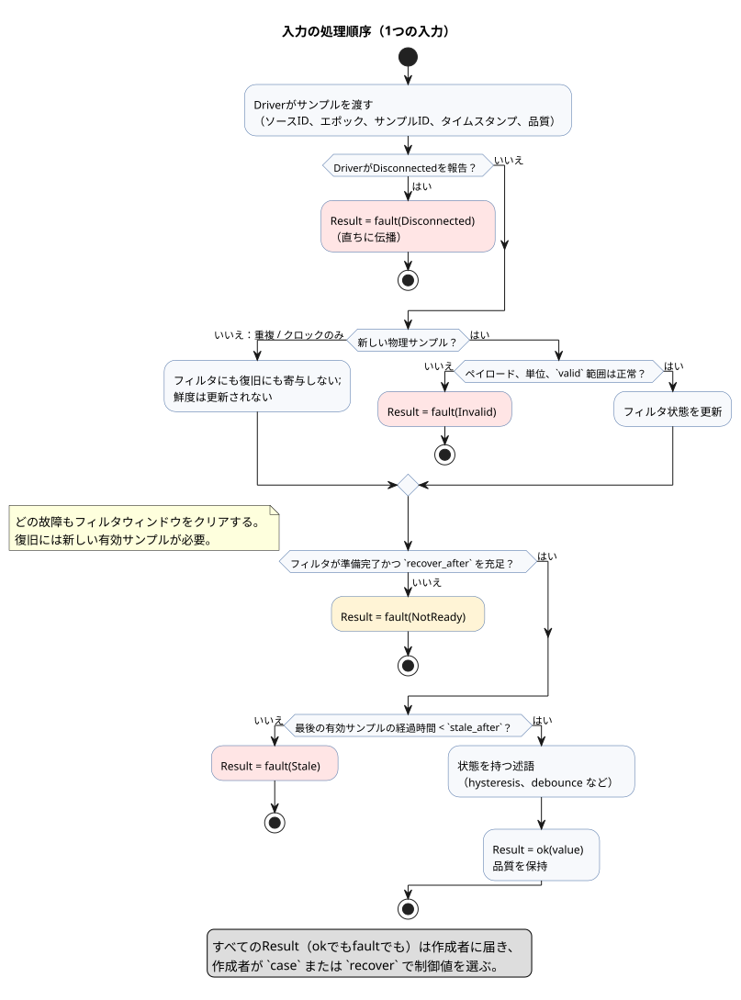
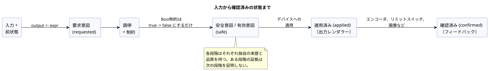
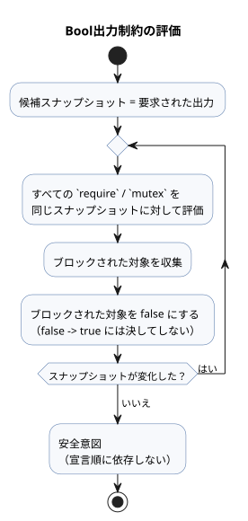
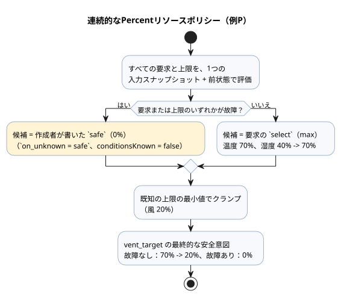
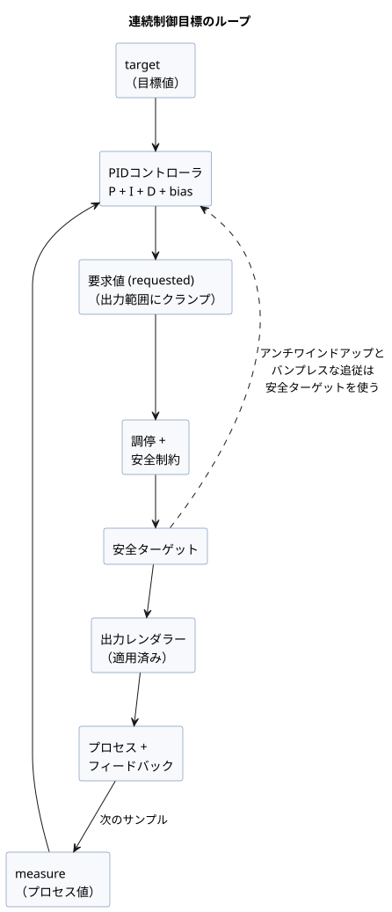

<!-- translation-source: docs/reference/04-sensors-constraints-control.en.md -->
[英語の原文](04-sensors-constraints-control.en.md)

# 4. センサ、制約、制御

[全体の目次](../LANGUAGE-REFERENCE.ja.md) · [前へ：3. 時間とスケジュール](03-time-and-schedules.ja.md) ·
[次へ：5. 設定と観測](05-settings-and-observation.ja.md)

GhostFlowでは、センサの値は単なる数値ではありません。値の出所、品質、時刻、そして故障（fault）も
あわせて持ちます。同様に、制御出力はデバイスへのコマンドではありません。まず*要求意図*
（requested intent）として計算されます。

GhostFlowは次の5つを分離して扱います。

1. ローカルな制御式
2. 共有リソースの調停（アービトレーション）
3. 安全制約
4. 出力レンダラーによる適用
5. 物理的なフィードバック

これらが分離されているため、プログラムはセンサの故障や競合する制御を隠さず、説明できます。

**この章の内容**

| 節 | 主題 |
|---|---|
| [4.1](#41-sensorとresultの品質)–[4.2](#42-サンプル契約とセンサ処理順序) | 入力の品質（`Result`）とサンプル処理パイプライン |
| [4.3](#43-フィルタと信号演算)–[4.4](#44-時間的証拠temporal-evidence) | フィルタ、状態を持つ信号、時間に基づく証拠 |
| [4.5](#45-オプションのセンサとケイパビリティ)–[4.6](#46-デバイス照会と戦略選択) | オプションのケイパビリティと戦略選択 |
| [4.7](#47-requestedsafeappliedconfirmed) | requested → safe → applied → confirmedの各段階 |
| [4.8](#48-制約の共通表記と演算)–[4.11](#411-使用量計上と予算) | 制約、共有リソース、モード、ライブ設定、予算 |
| [4.12](#412-連続制御目標)–[4.14](#414-有界適応) | 制御目標とPI/PID、明示的なフォールバック、有界適応 |
| [4.15](#415-型リソース説明の規則)–[4.16](#416-確定済みの制御構文と章の境界) | 共通規則と他の章との境界 |

**この章のコードの読み方**

- **選定済みのGhostFlow表記**（selected notation）は、現在の言語サーフェスで確定している構文です。
- 説明用なのは、**設計表記**と明示された例だけです。この章で選定済み表記として確定するものは、
  すべて公開構文です。これには制約、デバイス照会、制御目標、PI/PID、時間的証拠、適応が含まれます。

**出典。** この章は[共通の制約とセンサ契約](../CONSTRAINTS.ja.md)、
[選定済み構文](../LANGUAGE-SURFACE.ja.md)、
[言語設計 §5–8](../LANGUAGE.ja.md)、[Programming in GhostFlow第8章と付録A](../ProgrammingInGhostflow.ja.md)、
[#3](https://github.com/callin2/ghostflow-language/issues/3)、
[#94](https://github.com/callin2/ghostflow-language/issues/94)、
[#95](https://github.com/callin2/ghostflow-language/issues/95)、
[#96](https://github.com/callin2/ghostflow-language/issues/96)、
[#105](https://github.com/callin2/ghostflow-language/issues/105)、
[#110](https://github.com/callin2/ghostflow-language/issues/110)に基づいています。

**`input`と`sensor`。** 外部入力を宣言する正準キーワードは`input`です。
`input`は、型付きの品質、前処理（コンディショニング）、オプションのケイパビリティに関するこの章の
規則をすべて引き継ぎます。`sensor`は内部／ワイヤ上の品質カテゴリにすぎず、宣言の別名としては
**受け付けられません**。既存のソースは、レビュー済みの新しいリビジョンとしてのみ移行してください。
[移行契約](../INPUT-MIGRATION.ja.md)を参照してください。

## 4.1 sensorとResultの品質

**従来のBoolスナップショット。** 必須Boolスナップショットの従来の振る舞いをプログラムが維持できるのは、
[移行契約](../INPUT-MIGRATION.ja.md)にある、バージョン付きの明示的なディレクティブを使う場合だけです。
このディレクティブは次のように動作します。

- 元の生の使用箇所を保持します。
- 現在の各フレームでは、引き続き型付きの値を要求します。
- 不正なフレームは、故障の既定値をでっち上げることなく、*評価の前に*拒否します。

このマーカーのない入力はすべて`Result`です。この区別は、既存プログラムの保持と、新しい品質ポリシーの
作成とが決して混同されないようにするためのものです。

**宣言型と読み取り型。** 選定済みの宣言では、センサの通常のペイロード型を書きます。

```ghost
input low_water: Bool;
input moisture: Percent;
```

センサを*読み取る*とき、その実際の型は概念上`Result<T, SensorFault>`です。
正常なサンプルで分岐するには`ok(value)`を、エラーで分岐するには`fault(reason)`を使います。

```ghost
let water_ok = case low_water {
  ok(low)  => !low;
  fault(_) => false;
};
```

初期の故障セットは、次の4つの意味を区別します。

| fault | 意味 |
|---|---|
| `Disconnected` | 設置されたセンサの接続または伝送経路が断たれています。 |
| `Stale` | 実際の最後の有効サンプルが、鮮度の上限より古くなっています。 |
| `Invalid` | 値、単位、範囲、またはエンコードが宣言された契約に違反しています。 |
| `NotReady` | 初期化、フィルタウィンドウ、または連続復旧の条件がまだ整っていません。 |

`Result`の扱いに関する規則：

- `Result`をBoolやNumberのように直接比較することはできません。
- すべての故障を暗黙のうちに単一のゼロやfalseに変換しないでください。
- 上の例の`false`は、*作成者*が選んだ制御値です。元の故障とその時刻は引き続き記録されます。
- `recover(default)`は同じ意味を持つ純粋な変換です。`ok(x)`は`x`を返し、
  `fault(e)`はペイロードと同じ型の`default`を返します。`recover`は故障を正常として再分類**せず**、
  センサの復旧状態を進めることも**ありません**。

網羅的な`case`と、静的に解決されるResult変換の両方がサポートされています。

```ghost
fn normalize(value: Temperature) -> Result<Temperature, SensorFault> {
  ok(value)
}

let dry = moisture |> map(below(30%)) |> recover(false);
let normalized = temperature |> and_then(normalize);
```

これらの変換の働き：

| 構文 | 意味 |
|---|---|
| `below(limit)` | 互換性のある順序付きペイロード向けの静的な単項関数です。 |
| `map(fnName)` | `ok`のペイロードを`U`に変換します。 |
| `and_then(fnName)` | `ok`のペイロードを`Result<U,SensorFault>`に変換します。 |
| `recover(expr)` | `fault`のときに値を返す唯一の変換です。ペイロードと同じ型の明示的な既定値を返します。 |
| `\|>`、`>>` | コンパイル時の静的な連鎖であり、関数値ではありません。 |

- `map`と`and_then`は、コンパイラが名前で解決する純粋関数だけを受け付けます。
  実行時のクロージャや一般的な高階関数（HOF）ではありません。
- `fault`は関数を呼び出さずに`map`と`and_then`を通過します。
- GhostFlowは、ユーザー定義の一般的な代数的データ型（ADT）を追加しません。ただし、
  `Result<T,SensorFault>`は関数の引数と戻り値に使うことができ、
  `ok(value)`/`fault(reason)`コンストラクタもサポートされています。
- どの変換も、元の故障と来歴をジャーナル／説明に残し、復旧状態を進めることはありません。

**理由：** センサの故障を0%やfalseとして隠すと、正常な低水位、本当にゼロの読み値、断線したセンサを
区別できなくなります。代替値とその原因の両方を残すことで、保守的な制御と後からの説明が可能になります。

## 4.2 サンプル契約とセンサ処理順序

センサを構成するための選定済み表記は次のとおりです。

```ghost
input moisture: Percent {
  sample = 1s;
  valid = 0% .. 100%;
  filter = median(5);
  stale_after = 3s;
  recover_after = 3 samples;
}
```

各項目の意味と制約：

| 項目 | 型／制約 | 意味 |
|---|---|---|
| `sample` | 正の`Duration` | 想定される測定間隔です。情報としてのみ扱われ、センサ読み取りのスレッドやタイマーは作成しません。 |
| `valid` | 同じ数値ペイロード型の閉区間。Boolには使えません | フィルタリングの*前に*、生の正常候補を検査します。範囲外の値は`Invalid`になります。Boolの範囲はコンパイル時に拒否されます。 |
| `filter` | 状態を持つ信号演算 | 新しい有効なサンプルにだけ適用されます。 |
| `stale_after` | 正の`Duration` | 鮮度の上限です。実際の最後の有効サンプルの時刻から測ります。 |
| `recover_after` | 正の整数`N samples` | 故障の後、復旧には新しい有効サンプルがN個連続する必要があります。 |

**サンプルの同一性。** Driverは各サンプルについて、ソースID、ソースエポック、サンプルID、
サンプルのタイムスタンプ、品質を提供します。同じ物理サンプルが複数のtickにわたって繰り返された場合、
フィルタウィンドウと復旧カウンタには1回だけ数えられます。フィルタ出力を再計算しても鮮度は更新されません。

**処理順序：**

```text
新しいサンプルを識別
  → ペイロード／単位／有効範囲を検査
  → フィルタ状態を更新
  → フィルタの準備完了を検査
  → 状態を持つ述語（hysteresisなど）
  → 品質／故障を保持
  → 作成者がcase/recoverで制御値を選択
```

次の図は、各故障がどこで発生するかも含めて、同じ順序を示しています。



**鮮度と保持。**

- 明示的な`Disconnected`または`Invalid`は直ちに伝播します。
- 新しいサンプルが届かない場合、最後の有効値を`stale_after`まで使ってもかまいません。
  上限に達すると、入力は`Stale`になります。
- 最後の値を無期限に保持することは既定では**ありません**。有界な保持には、その期間と`Held`品質を
  明示する別のポリシーが必要です。

**故障後の復旧。**

- 故障の後はフィルタウィンドウをクリアします。
- フィルタの準備完了と`recover_after`の充足の*両方*が満たされるまで、結果は`NotReady`です。
  たとえば、`median(5)`と`recover_after = 3`の組み合わせでは、新しい有効サンプルが少なくとも5個必要です。
- ソースエポックまたは時間エポックが変わったサンプルは、以前の連続シーケンスに続く次の正常サンプルとしては
  数えられません。

**再起動。** 既定では、再起動するとセンサの状態と鮮度がリセットされ、入力は`NotReady`から再び準備を
始めます。永続的な再開は明示的なオプトインであり、チェックポイントのソース／時間の連続性を検証します。
古い正常値を1つだけ復元して、それを直ちに許可として使ってはなりません。

**`recover_after = N samples`の計数規則。**

- 初期化、再起動、ソースエポックの変更、故障後の復旧のときに、相異なる新しい有効な観測を数えます。
- N番目の観測は、フィルタも準備完了になった時点で使用可能になります。
- 重複サンプルとクロックだけのスキャンは数えません。
- 故障または鮮度の喪失によって、新しいシーケンスが始まります。
- 最初のN個の有効な観測を捨てるには、`1..31`の範囲内の具体的な数として
  `recover_after = N+1 samples`と書きます。
- このオプションはサンプルを数えます。時間による準備期間（ウォームアップ）では**ありません**。

**時間による準備。** 準備の*期間*を要求するには、既存の状態を持つ`debounce`演算を使います。
`recover_after`には継続時間の形式はありません。次のパターンは、前処理済みの最初の`Good`観測から、
その期限以降の相異なる新鮮な`Good`観測までの間に2分が経過するまで、Resultを保留します。
`usable`出力は利用可能性を示すだけで、物理的な操作を指令するものではありません。

```ghost
fn observed(value: Number) -> Bool { true }
control TimedPreparation {
  input reading: Number { stale_after = 3min; }
  signal ready = debounce(reading |> map(observed), stable_for: 2min, initial: false);
  let prepared: Result<Number, SensorFault> = case ready {
    ok(value) => if value then reading else fault(NotReady);
    fault(_) => reading;
  };
  output usable: Bool;
  usable <- case prepared { ok(value) => true; fault(_) => false; };
}
```

この例の振る舞い：

- `observed`は、ゼロを含むすべての健全なペイロードをtrueに対応付けます。入力の故障は
  `map`をそのまま通過します。
- debounceの間隔は観測のタイムスタンプを使います。クロックだけのスキャンや重複サンプルによって
  準備完了が早まることはありません。
- 故障、古い（stale）受信、ソースエポックの変更によって、準備は最初からやり直しになります。
- フィルタリングやサンプル数による復旧も構成されている場合、間隔はそれらの段階が最初に`Good`を
  生成した後にはじめて始まります。
- `fault(_) => reading`の分岐は、元の入力Resultとその出所を保持します。
- `stale_after`は、想定される観測の頻度に合わせて選んでください。ここでは3分の上限によって、
  まばらな観測（最初の1つと期限時点の1つだけ）が許容されます。
- 回数に基づく`recover_after`と、作成者が書いたこの継続時間のゲートは、別々の条件です。

## 4.3 フィルタと信号演算

### median

選定済みの`median(n)`は、直近`n`個の新しい有効ペイロードを並べ替えて中央の値を返します。

- `n`は`1..31`の範囲の奇数です。
- ウィンドウに`n`個のサンプルがそろうまで、結果は`NotReady`です。「部分的な中央値」はありません。
- 故障または再初期化の後、ウィンドウは空になります。

```ghost
filter = median(5);
```

たとえば、`28%, 29%, 90%, 28%, 29%`の中央値は29%です。単発のスパイクが判断を支配することはありません。

### hysteresis

選定済みの`hysteresis`は、センサ／Resultを受け取り、品質を保持する状態付きのBool信号を作成します。

```ghost
signal dry = hysteresis(moisture,
  on_below: 30%,
  off_above: 35%,
  initial: false);
```

- 第1引数は、順序付きの数値／物理量の`Result<T, SensorFault>`です。
- `on_below`と`off_above`は`T`と同じ型であり、`on_below < off_above`でなければなりません。
- ペイロードが`on_below`を下回ると、信号はtrueに切り替わります。
- ペイロードが`off_above`を上回ると、信号はfalseに切り替わります。
- 2つの境界の間、およびどちらかの境界ちょうどでは、直前の判断が維持されます。
- `initial`は、初期化時と復旧後のBool状態です。
- 入力が故障すると、その故障が伝播します。最後のBoolが正常な`ok`として示されることは**ありません**。

2つの境界により、単一のしきい値付近でのON/OFFの頻繁な切り替えを防ぎます。この記憶は明示的な信号状態であり、
ホストによる隠れた補正ではありません。

### 有界な信号演算の設計契約

次は選定済みの表記です。

```ghost
input moisture: Percent { filter = moving_average(3); }
input temperature: Temperature { filter = ema(alpha: 0.25); }
signal stable_start = debounce(start, stable_for: 2s, initial: false);
```

| 演算 | 必須の引数 | 状態と結果の意味 |
|---|---|---|
| `debounce` | Bool／有限の信号、正の安定`Duration`、初期値 | 入力候補が期間全体にわたって変化しなかった場合にだけ、安定値を変更します。安定値、候補値、候補の単調時間での開始時刻を保持します。 |
| `moving_average(n)` | 数値Result、プロファイル上限内の正の固定整数`n` | 直近`n`個の新しい有効サンプルの算術平均です。空または部分的なウィンドウは`NotReady`です。状態は有限で、直近`n`個のサンプルだけを対象とします。 |
| `ema(alpha)` | 数値Result、有限の`0 < alpha <= 1` | 最初の有効サンプルで初期化し、その後`alpha*x + (1-alpha)*previous`を計算します。復旧条件が満たされる前に正常な結果はありません。 |
| `stale_after(d)` | タイムスタンプ付きResult、正のDuration | 実際の最後の有効サンプルの経過時間が`d`に達すると古く（stale）なります。再評価やフィルタ出力の時刻によって延長されることはありません。 |

**フィルタの合成。** `filter`はちょうど1つの演算を受け付けます。複数の段階を合成するには、
各段階を名前付きの`signal`として宣言します。

- 数値Resultの次のEMA段階は`signal smooth = ema(moisture, alpha: 0.25);`のように宣言します。
- EMAの結果は別の段階に入力できます：`signal slower = ema(smooth, alpha: 0.25);`。

EMA段階の規則：

- 各EMAは、単一の物理ソースのエポック、サンプルID、タイムスタンプを引き継ぎます。
  新しい健全なサンプルでのみ更新されます。
- 入力の故障を伝播し、EMAの記憶をクリアします。その後、上流のフィルタの準備完了と
  `recover_after`を満たす最初の健全なサンプルで再び初期化します。
- 別の復旧カウンタも、新しい鮮度時刻も作成しません。
- サンプルの系譜を持たない値や、複数の物理ソースから選択する式は、EMA段階の入力として受け付けられません。

**その他の規則。**

- Temperatureのフィルタは、内部的には正準のケルビン領域でアフィン加重平均を計算します。これは、
  ソースの式で`Temperature+Temperature`や絶対温度のスカラー倍を許可するもの**ではありません**。
- 保護用の信号と、ゆっくり変化する環境センサに、同じフィルタ遅延を一律に適用しないでください。
- 各演算は、固定の状態サイズと固定の計算上限を持たなければなりません。
- 演算は新しいサンプルでのみ更新されます。合成は`case`または`recover`まで品質を保持します。

**理由：** フィルタがセンサの品質を消したり、1つのサンプルをtickごとに再利用したりすると、平滑化が故障を
隠し、リプレイの結果が変わってしまいます。名前付きの有限な状態にすることで、遅延とリソースコストを
レビューできるようになります。

## 4.4 時間的証拠（temporal evidence）

*時間的証拠*（temporal evidence）とは、「5分間trueだった」や「開始イベントから10秒以内にバルブが開いた」
のような、センサ信号に関する時間に基づく事実です。次の選定済み表記を使います。これはスケジュールの
`within`とは別のものです。

```ghost
signal hot_5m = true_for(hot, duration: 5min, quality: measured);
signal opened = after_event(started, valve_open, window: 10s, quality: measured);
input selected_start: EventId;
output selected_opened, any_opened, all_opened: Bool;
selected_opened <- after_event_for(opened, selected_start) |> recover(false);
any_opened <- after_event_any(opened) |> recover(false);
all_opened <- after_event_all(opened) |> recover(false);
signal avg_temp = window_average(temperature, over: 10min,
  quality: measured, max_age: 2min);
signal low_temp = window_min(temperature, over: 10min,
  quality: measured, max_age: 2min);
signal high_temp = window_max(temperature, over: 10min,
  quality: measured, max_age: 2min);
signal warming = window_rate(temperature, over: 10min,
  quality: measured, max_age: 2min);
signal usable_temp = hold_last(temperature, for_at_most: 2min, quality: measured);
```

**`true_for`**は、受け入れ可能なtrueの値が正の継続時間のあいだ途切れずに保たれたという証拠です。

- falseの値や受け入れられない品質によってリセットされます。
- 継続時間の境界に達した最初の判断でtrueになります。
- 連続性は、Driverが実際に観測されたと保証した区間だけをつなぎます。離れたサンプルの間を補間しては
  なりません。想定される頻度、スキャンの頻度、重複、クロックだけのtickは観測の証拠ではありません。

**`after_event`**は、イベントの同一性ごとに、述語が`[e,e+window)`の範囲内で成り立ったかどうかを計算します。
ここで`e`は識別されたイベントの時刻です。

- 終了境界ちょうどの時刻は含まれません。
- 重なり合うイベントは、同一性ごとに独立した結果を保持します。新しい開始イベントが、以前の保留中または
  完了済みの結果を上書きすることはありません。

**`after_event`の結果の読み方。** `after_event`信号はスカラーではないため、Bool式で直接読むことは
できません。次の3つの射影のいずれかを使います。

| 射影 | 意味 |
|---|---|
| `after_event_for(signal, identity)` | 明示的な`EventId`を1つ選択します。 |
| `after_event_any(signal)` | 保持されている同一性の*いずれか*が満たされていればtrue、*すべて*が期限切れの場合にのみfalseです。 |
| `after_event_all(signal)` | 保持されている同一性の*いずれか*が期限切れならfalse、*すべて*が満たされている場合にのみtrueです。 |

- 現在のコンパイラが`after_event`を実行可能な制御に変換（lowering）するのは、明示的な
  `after_event_for`、`after_event_any`、`after_event_all`の射影と実行時バインディングが存在する場合だけです。
  射影のない宣言は、実行可能な制御として受け付けられません。
- `after_event_for`では、同一性のソースタグが信号のEventソースと等しいことをランタイムが検査します。
  別のソースの同一性は、同一性バインディングエラーとしてスキャンを拒否します。黙ってfalseになることは
  ありません。
- `EventId`はDriverが渡す不透明な同一性です。任意の数値ではなく、ソースコードで「最新のイベント」を
  構築することもできません。
- `after_event_any`と`after_event_all`は、受け入れられたスキャン内で保持されている同一性の不変な集合全体を
  集約します。
- 集合が空である場合、または結果を変えうる保留中の同一性が残っている場合は、`NotReady`になります。
  決定的なtrue/falseがない場合は、元の述語／ソースの故障が`NotReady`より優先されます。
- 各射影は`Result<Bool, SensorFault>`を返します。`recover(false)`などのフォールバックは、
  作成者が明示的に書きます。

**保持される同一性**は、実行時プロファイルの固定された有限の容量で制限されます。

- 保留中または終端の同一性を暗黙に追い出したり、新しい開始で上書きしたりしてはなりません。
- 容量を超えると、スキャン全体がアトミックに拒否されます。
- 終端の結果は、ホストが明示的に確認応答するまで参照可能なままです。保留中の同一性は確認応答できません。

**ウィンドウ集約。**

- `window_average/min/max`は、`(t-d,t]`内の受け入れ可能な実際の観測だけを、補間せずに使います。
  受け入れ可能な観測がない場合、または最新の観測の経過時間が`max_age`以上の場合、結果は`NotReady`です。
- `window_rate`は、ウィンドウ内で最も古い受け入れ可能な観測と最も新しい受け入れ可能な観測から
  `(last-first)/(lastTime-firstTime)`を計算します。異なる2つの時刻がなければ`NotReady`です。

**`window_rate`と`Rate<Q>`。**

- サポートされている順序付き数値ペイロード`Q`に対して、結果は式専用の型`Rate<Q>`です。
- 温度差は正準のΔKを使います。線形の物理量は、同じ名目物理量の正準の差を使います。
- 結果は、`window_rate`を宣言した`signal`の名前を通じて参照します。
- `Rate<Q>`には、直接のリテラル、一般的な値バインディング、config/state/input/outputへの格納、
  自由な算術演算はありません。
- 比較のしきい値は、`rate(delta: <Q difference>, time: Duration)`でのみ構築します。
- v1では、RelativeHumidity、CO2、Acidityは`window_rate`の入力になりません。

**`hold_last`**は、最後の受け入れ可能なペイロードを、そのサンプルのタイムスタンプから`for_at_most`の
直前までに限って供給します。

- ランタイム／トレースは、`quality=Held`、ソースのサンプルID、経過時間を記録します。
- `Held`はソースのコンストラクタではなく、`Measured`でもありません。
- 保持は境界ちょうどで終了します。

### 時間窓の型と来歴

測定に基づく時間窓は`Result<T, SensorFault>`を受け取り、観測が十分にあれば成功のResultを返します。

| 演算 | 受け付ける`T` | 結果の型 |
|---|---|---|
| `window_min`、`window_max` | `Int`、`Number`、`Percent`、または物理量の型 | 同じ`T` |
| `window_average` | 上と同じ型 | `Int`の平均は`Number`になります（小数部を保持）。それ以外の型は元の型を保ちます。絶対温度の平均は正準のK値を使います。 |
| `window_rate` | 第2章の[`Rate<Q>`の規則](02-types-expressions-state.ja.md)に従う | `Rate<Q>` |

Bool、列挙型（enum）、Duration、暦の型は、これらの数値ウィンドウのペイロードになりません。

**パラメータ。** `over`と`max_age`は正の定数Durationです。

**観測の来歴。**

- 実際の各観測について、元のソース、エポック、サンプルID、タイムスタンプを保持します。
- 同じ観測の重複受信や再評価は、新しい寄与として数えません。
- 通常の上流の故障は、まだウィンドウ内にある観測を消しません。したがって、十分に新しい記録は集約を
  提供し続けることができます。隠された故障とその来歴も、観測記録に残ります。
- 元のソースエポックが変わると、そのソースの以前の寄与は無効になります。

**集約の来歴。** 集約の来歴は、その時間窓の宣言、評価時刻、実際に寄与した観測の集合です。
これを、直接測定された単一のセンササンプルとして表示してはなりません。変換や分岐はこの集約の来歴を
保持し、物理的なサンプルIDをでっち上げてはなりません。下流のウィンドウも、元の観測と集約結果の
識別子を区別しなければなりません。

**理由：** 整数の平均を丸めたり、その物理量を変えたりすると、制御しきい値の意味が変わってしまいます。
観測の来歴と有効なウィンドウを保持することで、通信の再送が平均の重みを増やすことを防ぎ、一時的な故障が
有効な過去の観測を消すことを防ぎます。

### 時間窓の合成

ある時間窓の結果を、別の時間窓の入力にできます。

```ghost
signal short_average = window_average(temperature, over: 2min,
  quality: measured, max_age: 1min);
signal long_average = window_average(short_average, over: 10min,
  quality: measured, max_age: 2min);
```

合成されたウィンドウの規則：

- **新しい集約観測が生成されるとき。** 下流のウィンドウが新しい集約観測を受け取るのは、上流のウィンドウが
  新しい観測を受け入れ、*かつ*成功した集約を生成したときだけです。再評価、観測の期限切れ、分岐選択の
  変更、故障の変化だけでは、新しい観測は作られません。期限切れによって変化した現在の集約は、通常の式では
  引き続き読み取れます。
- **集約の同一性。** 集約観測は、同じプログラム、戦略、実行（run）の中で、時間窓の宣言と観測受け入れの
  リビジョンによって識別されます。これを物理サンプルの同一性とは区別してください。下流のウィンドウは、
  選択されていない上流ウィンドウのリビジョンも記憶するため、分岐の切り替えによって既に生成された集約が
  新しい観測として再び数えられることはありません。
- **集約の時刻。** 集約観測の時刻は、それに寄与する元の観測のうち最も新しい時刻です。評価時刻は別に
  保持します。遅れた計算や再計算によって`max_age`の基準時刻が更新されることはありません。異なる集約観測が
  同じ観測時刻を共有することもあります。
- **重み付け。** 下流の平均では、各集約観測は等しい重みを持つ1つの項です。入れ子の平均を、元のサンプルの
  1つの平均に平坦化してはなりません。各項の背後にある元の観測は、来歴の証拠として保持します。たとえば、
  上流の平均が0、5、15であれば、下流の平均は`20 / 3`になります。
- **品質。** `quality: measured`が集約の証拠を受け入れるのは、それに寄与した元の観測がすべて
  受け入れ可能な測定である場合だけです。集約自体の品質は`Derived`です。`map`、`and_then`、Resultの分岐は、
  選択された証拠を保持します。`Held`の値や`ok(...)`で構築された値に、新しい測定の来歴を割り当てては
  なりません。
- **エポックの変更。** 元のソースエポックが変わると、古いエポックに依存するすべての集約観測が無効に
  なります。AとBの平均から、Aの来歴だけを取り除いて既存の平均値を保つことはできません。Bだけに依存する
  別の観測は残ります。
- **ロールバック。** 失敗した判断では、集約観測、リビジョン、下流ウィンドウの受け入れ記録がまとめて
  ロールバックされます。同じ観測を再試行しても、それが抜け落ちたり二重に数えられたりしてはなりません。

**保持。** 最大保持量には、上流ウィンドウの過去の観測と、各集約の来歴の証拠が含まれます。最新の観測時刻を
共有する集約を統合してはならず、予算に収めるために有効な観測を黙って破棄してもなりません。必要な保持量を
証明できない場合は、有効化を拒否します。

**理由：** 集約を合成するということは、既に計算された結果を再計算することです。元の観測に平坦化して
平均し直すと、各集約の重みが変わってしまいます。観測の受け入れと評価を分離することで、スキャン回数や
分岐の切り替えが平均に影響しないようにします。元の時刻と来歴を保持することで、再計算だけで古い観測が
新しく見えることを防ぎます。

### `hold_last`の値と来歴

**シグネチャ。** `for_at_most`は正の定数Durationです。測定に基づく`hold_last`は、`Result<T, SensorFault>`の
最後の受け入れ可能な観測を保持し、同じResult型を返します。

- 保持している観測がない場合、またはその有効時間が終わった後は、`fault(NotReady)`を返します。
- 成功した結果は、受信直後であっても`Held`です。
- `map`、Resultの分岐、その後の変換によって、その来歴が`Measured`に格上げされることは決してありません。
- `ok(...)`や`recover(...)`で作成した値も、新しい測定の証拠にはなりません。

**保持される値を維持するもの、置き換えるもの。**

- 通常のセンサ故障や、入力式での分岐の変更は、保持された値を消しません。たとえば、Aの有効値の後にBの故障が
  選択された場合、保持はAの元のサンプルIDとタイムスタンプを維持します。
- 新しい受け入れ可能な観測は、ペイロードと来歴の両方をその観測のもので置き換えます。
- 再送、重複サンプル、キャッシュされた正常値の再読み取りは、保持期間を延長しません。
- 保持された値の元のソースエポックが変わるか、時間の連続性が失われると、その値は使用できなくなります。

**トレース。** トレースは、実際に返された値について、`Held`マーカー、元のソース、エポック、サンプルID、
タイムスタンプ、現在の経過時間を記録します。保持された値によって隠された上流のSensorFaultも、その
エラーと来歴を保持します。

**理由：** 最後の測定値を限られた時間だけ使うと選ぶことは、新しい測定であると主張することとは異なります。
元の測定時刻と来歴によって、再読み取りが有効性を延長することを防ぎ、後の制御が保持された値を測定の証拠として
再利用することを防ぎます。

### 品質と観測の共通規則

- `quality`は省略できません。推定による証拠を許可するには、ソース／型で設定された不確かさの上限も必要です。
- ウィンドウ演算の`max_age`は必須で、正でなければなりません。
- すべてのウィンドウは過去と現在だけを使います。シミュレーションが将来のサンプルを先読みすることはありません。
- 例：サンプルが09:00の25°Cと12:00の31°Cの2つだけなら、温度が2時間にわたって30°Cを超えていたと
  結論づけることはできません。ウィンドウを、`require measured`、許容される推定の不確かさ、`max_age`などの
  品質ポリシーと組み合わせてください。
- 取りこぼされたスキャンは観測を作りません。
- コンパイラは、継続時間、`max_age`、サンプル契約、実行時プロファイルから、最大保持サンプル数を計算
  しなければなりません。計算できない場合は、有効化を拒否します。
- チェックポイントの復元は、ソース／時間の連続性が検証された後にのみ許可されます。そうでなければ、
  結果は`NotReady`です。

### 推定値の来歴と連続性

**推定値とは何か。** 推定値とは、識別されたモデルによって生成された値です。センサの観測でもなく、
適用済み／確認済みの出力の事実でもありません。

- `Result<T, SensorFault>`は、宣言されたセンサ値の有効性または故障を表します。
- `ok(value)`は、ソースの値が宣言された有効性の契約を満たしたことを意味します。計算を測定済みにしたり、
  物理的に確認済みにしたりするものではありません。
- `Estimated`は概念上の証拠の起源です。`Result`の状態も、`Quality`のバリアントも、実行可能な構文も
  追加しません。

**推定値の解釈に必要なもの。**

- モデルと校正パラメータのリビジョン
- 実行時の基準の同一性と、それがどのように、誰によって確立されたか
- ソース／プログラムと設置バインディングのリビジョン
- 実行（run）と単調時間のエポック
- 使用されたソースまたは適用の受信履歴
- 宣言された根拠（basis）

保持される基準と履歴は、デプロイメントプロファイルで宣言された有限の上限に収まらなければなりません。
その上限をサポートできない場合は、使用を拒否します。MCU上で無制限の履歴を保持してはなりません。

**アクチュエータ進行の根拠。** 最初のアクチュエータ進行の根拠は、デバイスが確認応答した出力レジスタ
または書き込みの履歴です。

- その確認応答が意味するのは、出力レンダラーがそのレジスタ／書き込みを受け付けたということだけです。
  モーターの動きや位置を証明するものではありません。
- 要求時刻を根拠として使えるのは、それが*要求*（requested）履歴として明示的に宣言されている場合だけです。
  *適用*（applied）履歴の代わりに使ってはなりません。
- これは§4.7のrequested/safe/applied/confirmedの区別に従います。

**推定の開始と進行。**

- 推定区間は、受け入れ可能で宣言された実行時の基準と、条件を満たす受信／履歴から始まります。
- キャッシュされた受信を再読み取りしたり、別のスキャンで公開したりしても、新しい書き込みも新しい証拠も
  作られません。起源／開始、鮮度、不確かさはリセットされません。
- 推定は、検証された連続性が保たれている間だけ、通常の単調時間の評価のもとで進めてもかまいません。
  条件を満たす完全な履歴が必要です。
- 観測されていないギャップ、障害、不確実な書き込みをまたいで補間してはなりません。
- 新しい書き込みが失敗した場合、以前にキャッシュされたACKは履歴上の証拠として元の同一性を保ち、
  現在の適用済みターゲットの履歴は不確実になります。その古いACKから、適用が継続していると推論しては
  なりません。

**連続性の断絶。** 次のいずれも、所有者が明示的に検証して再確立しない限り、ライブ推定の連続性を断ちます。

- 再起動
- 実行（run）／時間エポックまたはソースエポックの変更
- 設置バインディングの変更
- モデル／校正リビジョンの変更
- 実行時の基準の変更

校正パラメータは再起動後も残ってかまいません。実行時の位置基準や推定値を、黙って復元したりゼロに
設定したりしてはなりません。根拠が欠落している、または検証されていない場合、現在の推定値は利用不可／
`NotReady`になります。明示的な既存のソース／時間の故障は、その故障のままです。どちらの場合も、ゼロや
自動フォールバックに変換してはなりません。タイマーだけのポリシーは、推定値が利用できないときも有効であり、
推定値を消費する必要はありません。

**不確かさ。** 不明な不確かさは不明のままです。

- モデル／ソースは、既知の不確かさの上限か、不確かさが不明であることのどちらかを宣言しなければなりません。
- 不確かさが不明な推定値は、保持したり提示したりしてもかまいませんが、有界な時間演算子には受け入れられません。
- 普遍的な公式、信頼度、数値的な不確かさ、継続時間、期限は定義されていません。
- 既存の`quality: measured`、`hold_last`、`true_for`による測定値の受け入れは変わりません。
- 将来、推定値を受け入れる時間的な消費者は、そのソース／型を明示的に受け入れ、宣言された不確かさの上限を
  要求しなければなりません。不明な不確かさを黙って受け入れることはできません。

**例。**

- *連続している場合：* 明示的な実行時の基準、一致するモデル、校正、バインディング、同じ実行（run）／時間エポック、
  そしてプロファイルの上限内にある、ギャップのない条件を満たす書き込み履歴があれば、選択されたモデルは推定値を
  生成してもかまいません。それでもそれは推定値です。出力レンダラーのACKだけでは、動作したとは主張しません。
- *不連続な場合：* 適用履歴を根拠とする場合、確認応答されていない要求、失敗した、または不確実な新しい書き込み、
  再起動、同一性／リビジョンの変更によって、基準が再び検証されるまでライブ推定は利用不可になります。別途宣言
  された要求履歴の根拠では、要求を仮定として使ってもかまいませんが、それを適用履歴とラベル付けしてはなりません。
  校正パラメータと以前の推定値は、それぞれ独自の同一性を持つ履歴として保持します。

**追跡と現在の状況。**

推定値の意味論はGhostFlowの[#383](https://github.com/callin2/ghostflow-language/issues/383)で追跡されています。
後続の互換性作業は[#385](https://github.com/callin2/ghostflow-language/issues/385)です。
校正／基準の意味論は[System #132](https://github.com/callin2/farm_studio_system/issues/132)
とその[アーキテクチャ契約](https://github.com/callin2/farm_studio_system/blob/241643c125439c1ec141c8596feec3f4ad143ade/docs/architecture/INPUT-DRIVER-ARCHITECTURE.md#calibration-parameters-and-position-reference--system-132)にあります。
具体的なデバイスの出力受信境界は、ドラフトの[PR #107](https://github.com/callin2/farm-device/pull/107)
（head `b85ef02fb546cd5f957c12ab66f091b90f9484f0`）の
[host observation](https://github.com/callin2/farm-device/blob/b85ef02fb546cd5f957c12ab66f091b90f9484f0/rust/firmware/src/host_observation.rs)にあります。

- 現在の`sensorSample`の変換（lowering）は、測定の来歴をコード`1`で示します。ランタイムの分類
  `Measured`/`Held`/`Constructed`は`Estimated`を表しません。
- この契約は実行時の消費を有効にしません。それには#385の別の互換性作業が必要です。

[有界な推定根拠の受け入れAPI](../ESTIMATE-EVIDENCE.ja.md)は、有効性、起源、宣言された完全な履歴を
分離して保ちます。受け入れられた根拠は、測定や時間に関する許可を与えません。ソースの宣言とモデルの選択は、
引き続き別々の互換性の判断です。

## 4.5 オプションのセンサとケイパビリティ

```ghost
input moisture?: Percent;
```

`?`は、このセンサのケイパビリティが設置プロファイルにおいてオプションであることを宣言します。設置済みの
センサについて「欠落」と「故障」を統合するものでは**ありません**。これらは異なる型です。

| 型 | 意味 |
|---|---|
| `Option<T>`またはケイパビリティの欠落 | そのケイパビリティがデバイス構成に存在しません。 |
| `Result<T, SensorFault>` | 設置済みのセンサが読み取られ、正常値または故障が得られました。 |

規則：

- `?`だけでは代替戦略は作られません。「土壌水分がなければ既定のスケジュールを使い、あれば土壌水分による
  補正を使う」といった適応には、別の戦略契約が必要です。
- 一時的な`Disconnected`が欠落の分岐に入ってはなりません。
- オプションのケイパビリティの保護には、§4.6の`adapt`/`strategy`のサーフェスだけを使います。以前の`has`の
  スケッチはv1の構文ではありません。
- オプションのロールは、そのロールに一致する戦略の内部でのみ読み取ることができ、そこでも`ok`/`fault`の
  分岐が必要です。
- `?`も`adapt`も、故障時に戦略を自動的に切り替えることはなく、既定値を作ることもありません。

**オプションのデバイス情報。** 補足的なデバイス情報もオプションです。たとえば、圧力、流量、ポンプ曲線、
電力、配管損失などです。欠落はゼロにも、無限の容量にも、正常値にもなりません。基本的な灌水や、明示的な
バルブ数／時間のインターロックは、これらがなくても機能します。オプションの分析は
`Pass | Violation | Unknown(reason)`を返し、情報が不十分な場合は`Unknown`になります。

## 4.6 デバイス照会と戦略選択

次は選定済みの制御構文です。

> **実装状況。** 現在のコンパイラは、型付きの`match`と`match always`を受け付けます。
> `where`と、型を省略した存在のみのmatchはまだサポートされていません。以下の例の`where`節は
> 設計表記です。

```ghost
adapt irrigation_policy {
  strategy WithMoisture priority 100
    match (moisture: sensor<Percent>)
    where moisture.type == Percent {
      let request = case moisture {
        ok(value) => scheduled && value < 30%;
        fault(_) => false;
      };
      pump <- request;
    }

  strategy Baseline priority 0 match always {
    pump <- scheduled;
  }
}
```

**プロファイル。** プロファイルは、意味的なケイパビリティの有限集合です。ケイパビリティの初期キーは
`(kind, name, type)`です。同じ`(kind, name)`が2回現れることはできません。

**構文。**

- 形式は`strategy Name priority Int match (...) [where ...] { ... }`、または`match always`です。
- 各match項目は、ケイパビリティの存在条件です。カンマはANDを意味します。
- `pump`と`moisture`は意味的なロール名であり、データベースの行を反復する変数ではありません。
- `sensor<number>`は通常のペイロード型を示します。実際のサンプルは引き続きResultです。
- `(moisture:sensor)`のように型を省略すると、存在だけを検査します。
- `where`が読み取れるのは、一致したケイパビリティのkind/name/type、定数との比較、そしてBoolの
  `&&`、`||`、`!`、`==`、`!=`だけです。
- `where`は、入力サンプル、状態、次状態、現在の土壌水分の値を読み取り**ません**。
  ケイパビリティの選択と、tickごとの制御判断を混在させないでください。

**戦略の選択。**

- 各戦略は、i32リテラルの優先度を持ちます。
- すべての戦略は、その制御の同じ外部出力契約を完全に定義します。
- 一致する戦略のうち、優先度が最も高いものが選択されます。
- 最上位での同点は曖昧性エラーです。一致する戦略がない場合は有効化エラーです。
- 宣言順や「最後の一致」で決まることは決してありません。
- `match always`は通常の候補であり、暗黙のフォールバックではありません。

**入力とプロファイルの変更。**

- 共通の入力は、すべての戦略で必須です。戦略の入力は、その戦略が選択されたときにだけ必須です。
- 選択された戦略のケイパビリティとポートの型は、プロファイルに照らして検査されます。
- プロファイルはtickの途中で変わりません。新しいプロファイルは、候補全体とその戦略選択が検証された後、
  境界でアトミックに適用されます。
- 現在の戦略でのセンサ故障は、直ちにResultとして処理してください。それをプロファイルの欠落に変換して、
  保護の弱い戦略に黙って切り替えてはなりません。

**理由：** 設置ケイパビリティの選択が現在のセンサ値と混在していると、同じプロファイルでもバインディングが
tickごとに変わりかねません。一意の戦略を境界で適用することで、デバイス構成が変わったときにも判断の来歴が
明確に保たれます。

## 4.7 requested、safe、applied、confirmed

制御の結果は、互いに異なる段階を通過します。

```text
sensor/input + 前状態
  → 要求された出力意図（requested）
  → 調停と制約
  → 安全意図／有効意図（safe/effective）
  → 出力レンダラーが適用したコマンド（applied）
  → フィードバックで確認された状態（confirmed）
```



図の各段階は、それぞれ独自の証拠を持ちます。ある段階の証拠が、後の段階を証明することは決してありません。

選定済みの出力接続（`<-`）は、*要求*（requested）意図を定義します。

```ghost
output pump, valve: Bool;
valve <- running';
pump <- running';
require pump => valve;
```

**Bool出力制約の働き。**

- `require pump => valve`は、valve=trueの場合にのみpump=trueが許可されることを意味します。
  前提条件がfalseであれば、対象の`pump`はfalseになります。
- 出力制約がfalseをtrueに変えることは決してありません。
- `require !(forward && reverse)`またはmutexは、競合グループのうち同時にtrueである*すべての*メンバーを
  falseにします。
- 複数のBool制約がある場合、ブロックされる対象は同じ候補スナップショットから計算されます。その後、
  falseの方向にだけ進みながら、何も変わらなくなるまで処理を繰り返します。結果は宣言順に依存しません。



その結果が*安全意図*（safe intent）です。これは、GPIOやリレーが実際に設定されたことの証拠でも、バルブが
物理的に開いたことの証拠でもありません。適用済みのコマンドと、エンコーダ、リミットスイッチ、画像による推定
などからの確認済みフィードバックは、それぞれ独自の来歴と品質を持ちます。

**理由：** 1つのBoolが要求、制約の結果、デバイスへの適用、物理的な結果をすべて兼ねていたら、出力がなぜ
ブロックされたのか、デバイスがなぜ食い違っているのかを誰も説明できず、使用量計上も何を数えればよいか
わからなくなります。

### 出力の観測と復旧ポリシー

宣言されたBool出力には、4つの観測関数を使えます：
`output_status(pump)`、`output_health(pump)`、`output_completion(pump)`、
`output_fault(pump)`。それぞれの戻り値の型とメンバーを以下に示します。異なる型のメンバー同士は
比較できません。

| 型 | メンバー（数値のレールはゼロから始まり、この順序） |
| --- | --- |
| `OutputStatus` | `OutputInitial`, `OutputPending`, `OutputCompleted`, `OutputFailed`, `OutputUnknown` |
| `OutputHealth` | `OutputInitializing`, `OutputHealthy`, `OutputFaulted` |
| `OutputCompletion` | `CompletionNone`, `HostWrite`, `DeviceAck`, `DeviceReadback` |
| `OutputFault` | `NoOutputFault`, `OutputUnavailable`, `OutputTimeout`, `OutputProtocolError`, `OutputDriverError`, `OutputObservationLost` |

**各観測の意味。**

- *Status*は現在の要求のライフサイクルを表します。*Health*はデバイスの準備状態を表します。
- 起動時には、要求IDゼロと`OutputInitial`の組み合わせで、完了なしに、初期化中・準備完了・故障中の
  いずれの設備も表せます。
- 新しい要求は`OutputPending`であり、以前のhealthとfaultを保持します。
- 保留中であることや、ACKのケイパビリティがないことは故障ではありません。
- *Completion*は、実際の証拠のレベルを記録します。`HostWrite`は、デバイスのACKも接点の位置も証明しません。
  `DeviceReadback`は、物理的な負荷が動作したことを自動的に証明するものではなく、それには別のセンサが必要です。

```ghost
control OutputRecovery {
  input resume: Bool;
  output pump, alarm: Bool;
  state stopped: Bool = false;
  let resume_requested = resume |> recover(false);
  stopped' = if resume_requested then false else stopped || output_fault(pump) == OutputTimeout;
  pump <- !stopped';
  alarm <- output_health(pump) == OutputFaulted;
}
```

**復旧は作成者が選びます。** 作成者は、上の例のように手動での復旧を記憶する状態か、自動での復旧を許可する
式のどちらかを選びます。

- 出力の失敗によって、確定済みのコア状態がロールバックされることはありません。
- 別個のホストの安全ポリシーと終了ポリシーは、それぞれ独自の契約を保ちます。
- 他の出力は、それぞれ独自の観測を保ちます。

**コンパイラによる変換（lowering）。** コンパイラは、4つの数値入力
`__gf_output_{name}_{status|health|completion|fault}`と、出力ごとに1つの`outputObservations`
ディスクリプタを生成します。

- このプロファイルは、`GhostFlow/control-v22`マニフェストと既存のスカラーGFB1..4を使います。
- 設定、スケジュール、コンテキスト、適応との組み合わせは明示的に拒否されます。
- ソースの入力が、これらのプライベートなレールを上書きすることはできません。

**ホストの要件。** ホストは、現在の実行（run）、出力、実際にディスパッチされた要求IDに結び付けられた、
信頼できるレンダラーの観測を提供しなければなりません。

- 古い要求に対するACK、以前の実行（run）のキャッシュ、欠落した観測が成功になることは決してありません。
- 要求の終端状態と完了の証拠は後退できません。再試行には新しい要求IDを使います。
- 完了後の通信喪失によってhealthとfaultが変わることはありますが、完了の事実は保たれます。
- 復旧した準備状態は、新たな初期化または復旧要求からの証拠を使います。失敗した要求を成功に書き換えることは
  ありません。
- 新しい実行（run）は初期状態から始まります。
- ポータブルなRustトラッカーが、同一性と状態の組み合わせを検証します。
- リファレンスのフレーム化ホストは`outputRunId`と`outputObservationProvider`を必要とし、プロバイダを
  ディスパッチの同一性の権威として扱います。通常の`inputs`やスキャン引数を通じた注入は拒否されます。
- サポートを宣言していないホストは、有効化を拒否します。

**理由：** ソースは、デバイスの遅延、故障、完了の証拠を区別しなければなりません。そうすることで、設備の復旧
ポリシーを同じ事実に基づいてレビューし、リプレイできます。要求意図や`SensorFault`は、出力の観測の代わりには
なりません。

## 4.8 制約の共通表記と演算

制約を記述するための正準の単位は、制御の内部にある名前付きの`constraints`ブロックです。
規則には2種類あります。

- **ローカル規則**は、その制御自身にだけ適用されます。
- **共有規則**は、指定されたリソースを使うすべての要求経路に適用されます。

**ローカルなBool出力規則**は`constraints Name { require [at safe_output] p; mutex(a, b); }`を使います。
対象のないBoolの`require`は`safe_output`を意味します。ローカルなグループは、その制御自身にだけ適用されます。
次は完全なローカル制御です。

```ghost
control LocalPump {
  input request, valve_ready: Bool;
  output pump, valve: Bool;
  pump <- request;
  valve <- valve_ready;
  constraints LocalRules {
    require at safe_output pump => valve;
  }
}
```

**共有規則**は、`constraints Name for resource`で指定された安定したリソーススコープに適用されます。
そのリソースを使うすべての自動、手動、フォールバックの要求経路が、同じ規則に従います。次の完全なソースは、
*検査済みの共有ポリシーディスクリプタ*を定義します。ディスクリプタの検査は、実行可能なバインディングと
強制の代わりには**なりません**。

```ghost
control SharedPumpPolicy {
  resource station: Station;
  resource pump1: BoolActuator;
  resource valve1: BoolActuator;
  input automatic, manual, pump_request, valve_request: Bool;
  output pump, valve: Bool;
  pump <- pump_request;
  valve <- valve_request;
  constraints SharedRules for station {
    exclusive at admission { automatic, manual };
    require at safe_output pump1.on => any_on({ valve1 });
    safe { pump1 = false; valve1 = true; }
  }
}
```

**`safe`ベクトル。** `safe`は、参照される有限集合内のすべてのBoolリソースに、作成者が書いた安全値を
割り当てます。

- 値の欠落、重複、型の誤りは不正な定義です。必須の関係に違反する安全ベクトルも同様です。
- この例ではpump=false、valve=trueを選んでいます。安全とは、常にすべてOFFという意味ではありません。
- 要求の出力をリソースのエンドポイントに接続するには、別個の明示的なバインディング契約が必要です。
  これによって新しい`station`、`use`、`bind`、セッションの構文が導入されることはありません。
- バインドされておらず強制もされない共有ディスクリプタを、実行可能な制御や強制されたポリシーとして
  ラベル付けしてはなりません。以前のトップレベルのリソースポリシーファイルも、引き続き検査済みの
  非制御の成果物です。

**共有ポリシーの実行。**

- 共有実行を選択すると、正確な正準のソース／ディスクリプタ、バインディングのリビジョン、安定したリソースID、
  型付きのマッピングが、1つのバインドされたプログラム同一性に固定されます。
- 有効化とすべての評価は、その同じバインディング同一性を提供しなければなりません。バインディングが欠落して
  いるか一致しない場合は評価が拒否され、部分的に実行されることは決してありません。
- バインドされた要求、受け入れ（アドミッション）、safe_outputは、出力が公開された後のホスト側のフィルタではなく、
  1つのRustの確定境界の内部で検査されます。
- 論理的な強制は、物理的な適用済み／確認済みの証拠や、出力レンダラーによる安全な順序制御を保証しません。

**受け入れと復旧。**

- 生の排他アクティビティの入力は、受け入れの結果ではありません。
- 受け入れ済みのアクティビティと競合する新しい要求は拒否されます。既存の側の受け入れと、以前の安全出力は
  保持されます。
- 開始前に出力関係の違反が予測される場合、新しい受け入れも保護された出力も作られません。
- 拒否された新規の要求は、新たなtrueの要求で再び受け入れを求める前に、falseが観測されなければなりません。
- 以前に確定した安全値がない場合、拒否の出力集合は空です。
- 受け入れ済みの実行中に関係違反が起きると、作成者が書いた安全ベクトルが使われます。通常の入力だけでは、
  このトリップは解除されません。
- 排他グループでは、すべての要求がfalseである観測が必要です。そのときにはじめて、新たな要求の受け入れを
  検査します。
- requireだけのグループは、要求マップが作成者の書いた安全マップと等しくなったときに、復旧の基準を確立します。
  その後、新たな逸脱を検査します。
- 隠れた再試行、キュー、優先度の引き上げによって、この復旧境界を迂回することはできません。

**グループの組み合わせ。**

- グループをまたぐ必須条件はANDで組み合わされます。安全上の意味が矛盾する重なり合うグループは拒否されます。
- バインドされたBoolプロファイルでは、すべての出力について有限のリソースマッピングと、完全な安全ベクトルが
  必要です。
- 1つの設置の権限のもとで共有されるレジストリは、同じ安定IDに対する2つ目のアクティブな論理的書き手を
  拒否します。別々の設置のレジストリは、物理的な排他を証明しません。
- トリップは、保護されたリソースを共有するグループの推移的に連結された成分全体に伝播します。作成者が書いた
  安全値は、共有リソースについて一致していなければなりません。無関係なグループは自身の受け入れを保ちます。
- 最終的な安全候補は、すべての必須の共有条件とローカル条件のANDに対して再検証されます。
- これは、協調的なマルチVM調停、セッションのリース、任意のPIDポリシーを実装するものではありません。
- VMまたはバインディングのエラーは、状態、ガード、トレースをまとめてロールバックします。
- トレースは、生の要求、受け入れられたアクティビティ、要求値／安全値、原因、グループ、バインディングの
  同一性を区別します。
- 評価に成功した拒否は、通常のVM状態を確定します。ジョブやセッションをキャンセルすることはありません。

**排他集合の制限。** 実行可能なグループがサポートする排他アクティビティ集合は最大1つです。
複数の`exclusive`文も検査済みのソースではありますが、別途の実行統合が必要です。それらは1つの集合に平坦化される
のではなく、拒否されます。作成者が書いたグローバルな安全ベクトルは、必須のローカル制約も満たさなければなりません。

**使用量計上の制約。** 使用量計上（アカウンティング）の`constraints Name { limit used(account, basis) <= bound { ... } }`
は、別個の使用量スコープを持ちます（§3.10）。台帳（レジャー）は、宣言された`resource`と`account`、意味上の段階、
根拠（basis）、永続性によって定義されます。ローカルなBool規則や共有の受け入れが、その代わりになることは
ありません。

### 制約文の意味論

| 表記 | 適用段階と意味 |
|---|---|
| ローカルの`require [at safe_output] p` | その制御自身のBool候補出力の不変条件です。対象を省略するとsafe_outputを意味します。 |
| ローカルの`mutex(a, b)` | その制御自身の要求されたBool出力が両方trueのとき、その要求の証拠を保持したまま、両方の安全出力をfalseにします。 |
| 共有の`exclusive at admission { a, b, ... }` | 1つのスコープ内の、少なくとも2つの有限なBoolアクティビティです。競合する新しい受け入れを拒否します。 |
| 共有の`require at safe_output p` | 有限のリソース出力関係を検査します。安全値もこれらの必須の関係を満たさなければなりません。 |
| 共有の`safe { resource = Bool; ... }` | 実行中の違反に使われる、作成者が書いたリソース固有の安全ベクトルです。普遍的な「すべてOFF」の既定値はありません。 |
| 使用量計上の`limit used(...) <= bound` | 明示的な段階／根拠における残りの予算と上限です。詳細は§3.10を参照してください。 |
| Stationアダプタの`check pump_capacity(pump)` | オプションの情報を使う、ブロックしない`Pass/Violation/Unknown`の助言です。必須のrequireに格上げされることは決してありません。 |

**制約と意図・優先度の関係。**

- すべての必須条件はANDで組み合わされます。
- 制約は、目標やPIDを含む意図の*許可領域*を定義します。
- 優先度は、その領域の*内部で*要求の中から選ぶための調停ポリシーです。必須条件を緩めることはなく、
  リソースのバインディング、来歴、復旧を迂回することもありません。
- 開始前に予測できる違反は、受け入れを拒否します。実行中は、作成者が書いたリソース固有の安全動作が適用され、
  原因と遷移が保持されます。
- 段階は決定的な順序で区別されます：受け入れ、要求候補、safe_output、出力レンダラーによる適用（applied）、
  フィードバックによる確認（confirmed）。ある段階の証拠が別の段階を保証することはありません（§4.7）。
- 正常な証拠の復旧によって、新しい開始の権限が生まれることはありません。再試行、復旧、手動の経路も、
  同じ必須条件に従います。

**サポートされていない構文とアダプタ専用の構文。**

- `warn`と`monitor`はサポートされていない構文です。
- Stationアダプタの`allow`、`once`、`on_time`、`check`を、汎用の名前付きリソースポリシーに混在させないで
  ください。
- スタンドアロンの`ghostrules`サーフェスは、現在の具体的な利用者のためだけに維持されています。すなわち、
  プログラミングブックのWASMシミュレーション、station-demo、固定されたStation成果物の`bindStationPolicy`です。
  [Stationアダプタの例](../CONSTRAINTS.ja.md)がこの境界を述べています。
- スタンドアロンの成果物は、汎用の制御制約や任意のPIDの強制のためのフォールバックではありません。

### 共通関数と有限のリソース

**`count_on`と`any_on`。**

- 共有の`count_on({ items })`は、trueである相異なるBoolリソースの数を`Int`で返します。
- `any_on({ items })`は、少なくとも1つがtrueのときにBoolのtrueになります。
- 集合リテラルは、コンパイル時の有限なリストです。
- 空のcountはゼロ、空の`any`はfalseです。空集合で運転を許可したい作成者は、そのポリシーを別の必須条件として
  明記しなければなりません。
- `resource.on`は、Boolアクチュエータリソースに関する関係を表します。型付きのエンドポイントを、任意のソースの
  Bool変数と混同しないでください。
- 物理バインディングの後、1つのエンドポイントの別名は1回だけ数えられます。バインディングの前後で相異なる
  同一性が変わる場合、有効化の診断に両方のリストが表示されます。

**Stationアダプタの意味。**

- `stopped(station)`は、セッションと後処理が完了し、使用権が返却され、明示的な停止の証拠があることを
  意味します。単にpump=falseという意味ではありません。
- `pump_capacity`では、流量と圧力を恣意的に加算してはなりません。同じ検証済みの条件のもとで、単位の互換性が
  あるモデルを使ってください。
- 情報が欠落している場合は`Unknown`になります。助言としての`check`は運転をブロックしません。
- この限定されたStationの意味を、実装済みの汎用的な物理的安全シーケンスや出力ABIに一般化してはなりません。

**理由：** ローカルな出力の不変条件、共有の受け入れ、使用量の台帳、ブロックしない分析を1つの実行経路として
扱うと、検査済みのディスクリプタが本物の安全の強制と誤解されたり、手動の経路が規則を迂回したりしかねません。
スコープ、段階、安全値、実行の証拠を明示することで、リソースを使うすべての経路が同じ許可領域の内部に
とどまります。

## 4.9 共有リソースと調停

**最終的な書き手は1つ。** 複数の制御が同じ物理ポンプを使う場合、リソースマネージャがその唯一の最終的な
書き手です。各制御のポンプ出力は単なる要求です。非アクティブな制御のfalseや最後の書き込みが、現在の
所有者のポンプを止めることはありません。

**既定のポリシー：セッション全体にわたる排他リース。** 所有権はセッション全体にわたって続きます。つまり、
バルブの事前開放、ポンプON、段階間のポンプOFF、バルブの後処理、停止の確認までです。ポンプが短時間OFFに
なっても、ポンプが別の制御に引き渡されることはありません。

**受け入れ。**

- 1つのtick内の開始要求は、1つのスナップショットから評価されます。
- リソースのリースと時間予算の両方を予約できる要求だけが受け入れられます。
- 判断は、受け付け順や安定した要求IDなど、明示的なポリシーに従います。キューの長さと期限は有界です。
- 共有での同時運転とプリエンプションはオプトインのポリシーです。

**権限のカテゴリ。** 汎用の調停は、その権限と制約の意味論を明らかにしなければなりません。
次は設計上のカテゴリです。

1. 安全制約
2. 手動の権限
3. 自動の制御目標
4. 適応／最適化器の提案

このリストは、すべての設備に対する単純な固定優先度を意味するもの**ではありません**。最終値を選んだ
ポリシー／リビジョン、すべての要求、すべての制約によるクランプをトレースしてください。

```text
温度の制御目標が換気口70%を要求
湿度の制御目標が換気口40%を要求
調停がポリシーPのもとで70%を選択
風の安全制約が最大値を20%に制限
最終的な安全ターゲットは20%
```

**共有リソースの宣言。** 次の選定済み表記を使います。キューとプリエンプションには既定値がありません。

```ghost
resource pump1: BoolActuator;
resource_policy shared_pump for pump1 {
  lease = session;
  concurrency = 1;
  admission = reserve_all;
  queue = fifo(max: 8, expires_after: 10min, tie: request_id);
  preempt = never;
}
```

| フィールド | 規則 |
|---|---|
| `lease` | 最初のサーフェスでは`session`を使います。 |
| `concurrency` | ケイパビリティの上限以下の、正の静的整数です。 |
| `admission = reserve_all` | リースと必要なすべての予算を同じスナップショットから取得できる場合にだけ受け入れます。 |
| `queue` | `reject`、`fifo(max:N, expires_after:D, tie:request_id)`、`authority_then_fifo(max:N, expires_after:D, tie:request_id)`のいずれかです。`N`と`D`は正の値です。 |
| `preempt` | `never`または`higher_authority(cleanup: required, resume: requeue\|cancel)`です。 |

- FIFOのキーは、永続的な受け付け位置です。同順位は、安定した要求IDのバイト順で決めます。
- オーバーフローと期限切れは明示的な発生（オカレンス）です。隠れた再試行はありません。
- `resume: requeue|cancel`の`|`は構文上の選択肢を列挙したものです。実際のソースではそのどちらか一方を使います。
- プリエンプションは、後処理、停止の証拠、安全制約を迂回しません。

### 連続的なPercentの要求と上限

制御は、`ContinuousActuator<Percent>`リソースに対する名前付きの要求を宣言します。そのポリシーが、対応する
Percent出力の唯一の書き手です。

```ghost
control Vent {
  resource vent: ContinuousActuator<Percent>;
  output vent_target: Percent;
  let temperature_demand = 70%;
  let humidity_demand = 40%;
  let wind_limit = 20%;
  resource_policy P for vent {
    select = max;
    requests { temperature = temperature_demand; humidity = humidity_demand; }
    ceilings { wind = wind_limit; }
    safe = 0%;
    on_unknown = safe;
    output = vent_target;
  }
}
```

**通常の選択。**

- `select`は`min`または`max`です。
- 各要求と上限は`Percent`または`Result<Percent, SensorFault>`の式であり、同じ入力スナップショットと前状態に
  対して評価されます。次状態への参照は拒否されます。
- ポリシーは、既知のすべての要求の最小値または最大値を選び、それを既知の上限の最小値でクランプします。
  この例では70%を選び、20%でクランプし、最終的な安全意図は20%になります。
- 値が等しい場合は、ソースのノードIDの昇順で最初の要求が勝ち、同順位のすべての要求IDが記録されます。
  ソースの順序を入れ替えると、新しいソースリビジョンになります。

**不明な入力。**

- いずれかの要求または上限が故障すると、必須の`on_unknown = safe`により、作成者が書いた定数`safe`が候補として
  使われます。既知の上限は、このフォールバックも引き続きクランプします。
- 故障した要求が0%になることはありません。故障した上限が100%になることもありません。
- 判断はその理由と起源を保持し、`conditionsKnown`をfalseに設定します。
- いずれかの要求が故障している場合、`selected`はnullです。すべての要求が既知で上限が故障している場合、
  判断は選択された要求値を保持したうえでフォールバックを適用します。
- この例の0%は作成者が選んだ値であり、普遍的な物理的安全値ではありません。

次の図は、例のポリシー`P`をまとめたものです。



**制限と除外。**

- 各ポリシーは1..16個の要求と0..16個の上限を持ちます。
- 1つの制御が持てるのは、最大8個のポリシーと、合計32個の要求／上限のエントリです。
- 各リソースと出力は、ちょうど1つのポリシーに属します。
- 別の`<-`の書き手や、`exclusive`または`highest_authority`による選択は拒否されます。
- 制御目標／PID、適応、スケジュール、時間演算、使用量計上、Boolリソースポリシーとの合成には、別の統合契約が
  必要です。
- このプロファイルは、PIDの最終値の追従や、集約的なアンチワインドアップを確立するものではありません。

**実行。**

- 正準のソースは、既存の検査済みポリシーディスクリプタを生成します。
- 実行には、明示的な型付きの設置バインディングとともにコンパイルされたGFB25が必要です。
- Rustのスキャンの所有者は、その判断の中で、すべての要求と上限、選択と同順位、フォールバック、クランプと
  最終値、ソースのSHA-256とノードID、バインディングと実行（run）／tickのIDを確定します。
- 不正な数値範囲、パケット、同一性は、状態とジャーナルの確定の前に拒否されます。
- 最終的な論理出力は、適用済みの証拠や確認済みの証拠とは別のものです。

**理由：** 意図と制約の背後にある理由は、同じ実行記録の中で説明可能でなければなりません。不明な情報が
黙って正常値になることはなく、他の出力の書き手が最終的な制限を上書きすることもできません。

## 4.10 モードとライブ設定

**モード。** Auto、Manual、Configureなどのモードは、1つの設備スコープ内で排他的です。Auto↔Manualの
切り替えや、運転からConfigureへの切り替えは、次の明示的な経路に従います。

```text
停止要求 → 新たな開始を抑止 → デバイスの後処理 → 停止の証拠 → Stopped → 新しいモードへの移行
```

**停止の証拠。** `stopped(station)`は2つのレベルを区別できます。

| レベル | 意味 |
|---|---|
| `CommandedStop` | 安全なコマンドが適用され、後処理が完了しました。 |
| `VerifiedStop` | 上記に加えて、物理的なフィードバックでも停止が検証されました。 |

- フィードバックのない設備に対して、`VerifiedStop`をグローバルな既定にしないでください。
- デバイスが応答しない場合、コマンドを送っただけでは停止が完了したことにはなりません。

**競合。**

- 同じtick内で競合するモードへの移行は、すべて拒否します。
- Stopは新しい移行や新しい作業より先に処理し、保留中の要求を無効にします。
- 運転中に行われたモード変更の要求を、後で隠れて遷移するために保存してはなりません。

**構造の変更と運用設定。** この停止／Configureの経路は、構造や設置の意味を変える候補リビジョンを
検証またはデプロイするときに適用される場合があります。対象は、プログラム、依存関係、物理バインディング、
設備の制約バンドルです。以前の契約にあった`allow apply(settings) only when ... Configure`は、オペレーターが
扱う*すべての*プロパティを対象とするものと解釈されていました。その解釈は、以下のライブイベントに関する
決定によって置き換えられています。構造の変更における`apply`の対象の最終的な名前とリビジョン境界は、
別の合成／設置の契約に属します。

**ライブ設定。** 運用設定は、#105と#110の後の決定に従います。オペレーターが編集可能なプロパティの変更は、
**同じプログラムと実行（run）の中でのアトミックなライブイベント**です。

- 1つのイベント内のすべての値を、型、範囲、ステップ、権限、現在のプログラム同一性について検証します。
- いずれかの値が不正であれば、設定を一切変更せずにイベント全体を拒否します。
- 成功した場合は、設定のリビジョンと有効になるイベント位置を記録します。
- 制御とスケジュールは、その位置以降で新しい値を読み取れます。
- ソース／バイトコード、プログラム同一性、実行（run）の同一性を保持します。
- タイマーや状態を暗黙にリセットしてはなりません。
- 実際の再起動は設定を保持しますが、新しい実行（run）の同一性を作ります。

*例：* 給水の上限を10分から5分に減らすと、次の判断で現在の`elapsed`が新しい5分と比較されます。
「新しい実行（run）を待つ」という隠れたポリシーを追加してはなりません。

このライブイベントの意味を、Auto↔Manualのモード切り替え、プログラムのデプロイ、オプションの依存関係の交換、
RO3→RO8のような物理バインディングの変更に一般化してはなりません。それらは、それぞれ独自のモード、合成、
設置／デプロイの契約に従います。

## 4.11 使用量計上と予算

**何を数えるか。** `on_time(pump1)`の計上段階が、最終的に適用されたコマンドであるとします。この場合、
自動運転、手動運転、複数の制御から実際に適用されたONの区間が、その物理リソースの1つの台帳に統合されます。

- 拒否された要求、キューでの待機、制約によってブロックされた時間は数えません。
- 確認済みの流量を別に数えるには、対応するフィードバックのケイパビリティと品質の契約が必要です。

宣言の構文は、[§3.10 時間に基づく使用量の制約](03-time-and-schedules.ja.md)の`resource`、`account`、
`used`、`limit`を使います。

**ローカル日の予算。**

- ローカル日の予算は、ローリング24hの予算ではありません。各日付の予算は、真夜中のどちら側でも使えます。
- 真夜中をまたぐONの区間は、信頼できる日付の境界で分割されます。
- 壁時計の巻き戻しや、プログラム／設定のリビジョンによって、既に確定した使用量が減ったりリセットされたり
  することはありません。

**予約と精算。**

- 新しいジョブを開始する前に、最悪の場合のON継続時間に停止遅延を加えた分をカバーする予算を予約します。
- 手動運転では、残りの予算の範囲内で、有限のリースとカットオフを使ってもかまいません。
- 使用後は、適用された区間で精算します。
- 停電によって不確実になった予約には、使用済みとして扱う、復旧を延期するなど、明示的な保守的ポリシーを
  使います。

**ローリングのデューティ制限。** 「直近60秒間で累積30秒まで」のようなローリングのデューティ制限は、
スライディングウィンドウです。日ごとの台帳とは異なります。

- `(t-60s,t]`内で、選択された意味的な信号のONのDurationを、部分的な重なりも含めて合計します。
- 制限ちょうどで、追加のONをブロックします。
- ウィンドウから外れた古い区間に対応する予算だけを回復します。
- 電源の再投入で暗黙にリセットしてはなりません。

**発生（オカレンス）の重複は別の契約です。** `once starts per occurrence`は、予算とは別に、同じ発生の
重複実行を防ぎます。そうしなければ、予算が1時間残っていても、同じ5分間の発生が2回実行されかねません。
一方の契約を他方の代わりに使ってはなりません。

**理由：** 物理リソースごとの使用量計上がなければ、1つのポンプを共有する複数の制御が使用量を数え漏らしたり、
二重に数えたりしかねません。日ごとの予算、ローリングウィンドウ、発生の重複は、それぞれ異なる問いに答えます。

## 4.12 連続制御目標

連続制御のより上位の概念は**制御目標**（control objective）です。つまり、制御量を目標値（設定値）の近くに
保つことです。これは「PIDを動かす」よりも優れた意図の単位です。次は選定済みの構文です。

```ghost
objective greenhouse_temperature {
  measure = inside_temperature;
  target = target_temperature;
  manipulate = roof_vent.position;
  output = 0% .. 80%;

  controller = pid {
    period = 10s;
    late_after = 30s;
    direction = reverse;
    kp = proportional_gain(output: 2%, error: 1Δ°C);
    ki = integral_gain(output: 0.1%, error: 1Δ°C, time: 1s);
    kd = derivative_gain(output: 1%, time: 1s, error: 1Δ°C);
    bias = 0%;
    anti_windup = conditional_safe;
    disabled = track_safe;
    transfer = track_safe;
    fault = disable;
    restart = reset(output: 0%);
  }
}
```

制御目標は次のものを結び付けます。

| フィールド | 意味 |
|---|---|
| `measure` | プロセス値。その物理量と品質／来歴を含みます。 |
| `target` | `measure`と互換性のある型付きの目標値です。 |
| `manipulate` | 連続アクチュエータの意味上の対象です。 |
| `controller` | Hysteresis/On-Off、PI、PIDのいずれかのポリシーです。 |
| `output` | アクチュエータのケイパビリティの範囲内で許可される範囲です。 |

**configからの目標値。** configを参照する`target`は、§5.2の現在の`Result<T, SettingsFault>`の観測を
消費します。ここで`T`は`measure`と互換性のある物理量です。

- `ok(value)`が現在の目標値です。
- `fault(reason)`は、明示的なコントローラの故障ポリシーに進みます。初期の目標値や最後に成功した目標値で
  暗黙に代替してはなりません。
- 実行可能なTemperature/Percent PIDプロファイルでは、`fault = disable`は目標値の故障時にもコントローラを
  直ちに無効にします。復旧は既存の期限と`track_safe`のポリシーに従います。
- 目標値の変更に成功しても、それだけではコントローラの状態はリセットされません。

**アクチュエータのケイパビリティ。** 連続アクチュエータのケイパビリティは、値の物理量／型、範囲、
オプションの分解能、安全値、変化率／スルーの制限、フィードバックの有無を表します。0–10V、PWM、VFD、
Modbus、サーボはデバイスのバインディングであり、ソースの制御目標ではありません。

次のループは、コントローラがどこに位置するかを示しています。その出力は要求にすぎません。調停と制約を経た
安全ターゲットが、アンチワインドアップとバンプレスな追従のためにフィードバックされます。



### PI/PIDの意味論に必要な項目

**ゲイン。**

- `pi`は`kd`を受け付けません。`pid`には3つのゲインすべてが必要です。
- 任意の単位演算の代わりに、`proportional_gain`、`integral_gain`、`derivative_gain`の
  コンストラクタを使います。
- コンストラクタでは、出力の分子は非負、誤差の分母は互換性のある正の差分、I/Dの時間は正です。
  出力がゼロなら、その項は無効になります。
- これらの値は、出力と、TemperatureDeltaなどの型に結び付いた名目上のゲイン型を形成します。

| 項目 | 意味 |
|---|---|
| サンプル周期 | コントローラの状態を更新するための正の単調Durationです。取りこぼし／遅延したtickの規則を含みます。 |
| 目標値／プロセス値 | 互換性のある物理量です。非有限値や未解決の故障で直接計算してはなりません。 |
| 方向 | `direct`または`reverse`です。誤差がアクチュエータをどちらの方向に動かすかを明示します。 |
| `Kp`、`Ki`、`Kd` | 物理量の次元を保つゲインです。PIにはD項がありません。 |
| 出力の最小／最大 | 要求ターゲットのクランプです。アクチュエータのケイパビリティの範囲と相互に検証されます。 |
| アンチワインドアップ | 飽和／制約の間に積分状態を更新する（または逆算する）ためのポリシーです。 |
| 有効化／無効化 | コントローラの状態を明示的に凍結、リセット、または追従させます。 |
| 手動／自動の切り替え | 現在の有効出力と権限の遷移規則に従う、バンプレスな切り替えです。 |
| 故障ポリシー | 古い、または欠落した測定値や、フィードバックの食い違いに対する、明示的な保持／安全フォールバック／無効化のポリシーです。 |
| 初期化／再起動 | 積分、微分の記憶、前回のサンプルに関する起動時／チェックポイントの規則です。 |

**固定の実行規則。** `period > 0`、`late_after >= period`、そして全体を通じて有限の値であることを要求します。

1. 単調時間の期限ごとに最大1回だけ更新します。同じサンプルを再評価しても状態は変わりません。
2. 基本の誤差は差分`target - measure`です。`direct`はその符号を保ち、`reverse`は符号を反転します。
3. `P = Kp * signedError`です。Iは、前回と今回の符号付き誤差の台形積分です。
4. 目標値の急変によるキックを避けるため、Dは測定値の変化に適用します：`-directionSign * Kd * Δmeasure/dt`。
5. `dt`は、最後に受け入れられた更新から今回の更新までの単調時間です。取りこぼしたサンプルを合成してはなりません。
6. `dt > late_after`、非有限値、または受け入れられない測定値は、明示的な`fault`の分岐に入ります。
7. クランプ前の要求値は`bias + P + I + D`です。内部の符号付き累積器は、Percentの外部の非負の範囲には制限されません。要求値は制御目標の範囲内にクランプします。
8. 仮のIでrequestedとsafeを計算します。`(requested-safe) * signedError > 0`であれば、Iによって飽和が増すため、前回のIで1回だけ再計算します。そうでなければ候補のIを確定します。

この有界な2パスの手順が`conditional_safe`のすべてです。反復的なソルバーを作ってはなりません。

**コントローラの出力は要求です。** その後の調停と安全制約によって、クランプされることがあります。

```text
PIDの要求は92%
風の安全制約による最大値は20%
安全ターゲットは20%
出力レンダラーが20%を適用
位置フィードバックは来歴付きで17%
```

- 積分のアンチワインドアップは、上記の安全ターゲット追従の規則に従います。要求値の92%だけに基づいて
  累積し続けることはありません。
- 連続的なPIDの出力を、リレーだけのアクチュエータ向けの高周波の時間比例制御に自動変換してはなりません。
  別のケイパビリティ／安全の契約がなければ、リレーにはヒステリシス／オンオフ制御が適切な選択です。

**初期化、故障、再起動。**

- 最初に受け入れられたサンプルで、前回の誤差と前回の測定値を現在の値に初期化します。D=0であり、架空の
  前回の区間を積分することはありません。
- 現在のPIDの`fault`は`disable`だけを受け付けます。`degraded Name`は選定済みの設計上の代替案ですが、
  現在のネイティブのTemperature PIDプロファイルではサポートされていません。
- `bias`、`anti_windup`、`disabled`、`transfer`、`fault`、`restart`は省略できません。
- 再起動は、型付きの出力を持つ`reset(output: value)`です。連続性が検証された`checkpoint`は選定済みの
  設計上の代替案ですが、現在のネイティブのTemperature PIDプロファイルではサポートされていません。
- `reset(output:v)`は、最初に受け入れられたサンプルで積分の追従状態を設定し、クランプ前の最初の要求値が
  明示的な`v`と等しくなるようにします。
- 無効化と、手動→自動の切り替えでは、現在の安全ターゲットに追従します。

**制御目標のライブ設定。**

- 目標値とゲインは、型付きのオペレーター設定にしてもかまいません。
- ライブイベントは、コントローラ／タイマー／フィルタの状態をリセットせずに、同じプログラム／実行（run）の
  中でアトミックに適用されます。次の通常の評価で、`track_safe`がバンプレスに継続します。
- 農家向けUIで目標値を表示することは、専門家向けのすべてのゲインを同じ権限で公開することを意味しません。

**理由：** 農家の目標は、温度や湿度などの状態を維持することです。アルゴリズムの名前がその上位の意図を
表していたら、1つの制御目標のもとでのリレー、PI、PIDの置き換えや安全クランプを説明できなくなります。

## 4.13 明示的なフォールバックと縮退制御

センサ、気象、モデル、カメラ、アクチュエータのフィードバックは、どれも利用できなくなる可能性があります。
フォールバックは、ソース／ポリシーとトレースの中で見えるようになっていなければなりません。決して隠れた
ホストの振る舞いであってはなりません。

```text
// 設計上の意味論
主温度センサが正常 → PIで運転
主センサが縮退し、バックアップが受け入れ可能 → より厳しい範囲のバックアップコントローラ
すべての温度が利用不可 → 保守的な換気のフォールバック
```

**フォールバック分岐が宣言するものと、してはならないこと。**

- フォールバック分岐は、入力のケイパビリティ、許可される品質、出力の範囲、権限を明記します。
- クラウド／AIが利用できないことによって、ローカルの安全制御が無条件に利用できなくなることはありません。
- 逆に、信頼度の低い推定値だけで安全トリップが解除されることもありません。
- フォールバックは、グローバルな制約、リソースの所有権、モードを迂回しません。

**復旧**とは、新しい正常な証拠が準備できたことを意味します。自動再始動、元の制御目標への復帰、累積タイマーの
復元は、それぞれ別の判断です。センサの`recover_after`が満たされても、新しい開始要求は作られません。

選定済みの表記：

```ghost
degraded TemperatureFallback for greenhouse_temperature {
  branch Backup priority 100
    when backup_temperature quality in { measured }
    use objective backup_temperature_control
    authority automatic_degraded
    output 0% .. 30%;
  otherwise disable;
  recover primary after 3 samples;
  resume = require_start;
}
```

**規則。**

- 条件を満たす分岐のうち、i32の優先度が最も高いものが選択されます。同点は曖昧性エラーです。宣言順は選択の
  基準ではありません。
- `otherwise`は必須です。現在のコンパイラは`disable`だけを受け付けます。`otherwise`での完全なフォールバック
  分岐は、選定済みの設計上の代替案ですが、まだサポートされていません。
- `resume`は`require_start`、`automatic`、`stay_degraded`のいずれかでなければなりません。`automatic`であっても
  新しい開始の権限は作られません。既存のセッションがまだ有効な間に限って主系に戻ります。
- フォールバックの権限は主系の権限を超えることができず、安全の権限を持つこともできません。

> **実装状況。** コンパイラは、`requires-native-fallback-binding`とマークされた、構造的に検証済みの縮退
> ディスクリプタを受け付けます。これは実行可能なフォールバックのサポートではありません。ネイティブの
> Temperature PIDプロファイルは、実行可能なフォールバックのバインディングが存在するまで縮退制御を拒否します。

## 4.14 有界適応

適応モデルや最適化器には、プログラム全体を変更したり、出力レジスタに直接書き込んだりする既定の権限は
ありません。その最初の意味は、型付きの設定または制御目標の目標値に対する*有界な提案*です。

```ghost
adapt_setting target_vpd_policy for target_vpd {
  allowed = 0.7kPa .. 1.2kPa;
  max_step = 0.05kPa;
  max_change = 0.05kPa per 1h;
  authority = optimizer;
}
```

**提案に含まれるもの：** 設定ID、提案値、ソース／モデル、証拠の参照、行為者／権限、現在のプログラムと
基準の設定リビジョン、発生時刻。

**検証と適用の方法。**

- ローカルの検証では、型、範囲、1ステップの変化量、1時間あたりの変化率、権限を検査します。
- 成功した複数のプロパティ変更は、新しい設定リビジョンを作る1つのアトミックな設定イベントとして適用されます。
  失敗した場合は、どの値も変わりません。
- 変化率の検査では、`(t-window,t]`内で受け入れられた変化の絶対値の合計に新しい変化を加えたものが、
  `max_change`を超えないことを要求します。これにより、増加と減少を交互に繰り返すことによる回避を防ぎます。
- 成功した適応の設定イベントは、コントローラ、タイマー、フィルタの状態をリセットせず、チェックポイントへの
  切り替えも行いません。次の通常の制御評価では、現在の安全ターゲットに追従します。
- トレースは、以前の値、提案値、受け入れられた値／有効値、提案の来歴、拒否の理由、プログラム同一性、
  設定リビジョン、有効になる位置を記録します。

**設定と安全プログラム。** 「目標温度25→26°C」は有界な設定になりえます。「低水位では常にポンプを停止する」は
安全プログラムの変更です。適応は、安全制約を取り除くことも、自らの権限を引き上げることもできません。
プログラムを生成するAIによる作成ワークフローには、独自のソースレビューとデプロイの同一性があります。

**理由：** 適応がプログラムの変更や直接の出力権限として扱われると、モデルの誤りによって安全制約が消されかね
ません。型付きの範囲とアトミックな設定イベントによって、許可された変更の範囲を検証できるようになります。

## 4.15 型、リソース、説明の規則

**センサと制御の演算に共通の規則。**

- 圧力、流量、パーセント、温度のような異なる物理量を暗黙に比較したり合計したりしてはなりません。
- ResultやOptionをBoolの真偽値に変換してはなりません。
- フィルタ、ウィンドウ、要求の数、および状態の記憶の上限は、静的に計算可能でなければなりません。
- tickが失敗した場合、センサ、フィルタ、コントローラ、リソースの状態が部分的に確定されることはありません。
- 分析のタイムアウトや`Unknown`は、成功した証明ではありません。
- 「すべての出力が常にOFF」という結果は、安全制約を満たしうるものです。意図した運転が引き続き到達可能かどうかを
  別途検査してください。

**完了した判断の説明が区別しなければならないもの**は、少なくとも次のとおりです。

- 生のサンプル、フィルタ後の値、品質／故障、サンプルの同一性
- 述語と時間的証拠
- 目標値、プロセス値、誤差、コントローラの要求出力
- 競合する意図と調停ポリシー
- 制約によるクランプと最終的な安全意図
- 適用済みのコマンドと確認済みのフィードバック
- 既に記録された区間から計算した、使用量の対象、使用量／上限、ブロックの理由、次の解除
- プログラム、設定、プロファイル／バインディング、ポリシー、スキャン／実行（run）の同一性

観測層と表示層は、判断済みの値と証拠を消費します。アニメーションの時間や表示された出力から、予算、PID、
フォールバック、調停に関する独自の制御の意味論を作り出してはなりません。

## 4.16 確定済みの制御構文と章の境界

この章は、Result変換、有界な信号／ウィンドウ、ケイパビリティによる戦略、名前付きの制約、共有リソース、
制御目標／PI/PID、縮退制御、有界適応のサーフェスを確定します。次の詳細だけは、それぞれを所管する章の契約に
委ねます。

- ローリング予算の履歴、スキャン境界、再起動ポリシー：[第3章の時間／使用量計上の契約](03-time-and-schedules.ja.md)。
- 物理量、差分、Result、品質の述語に関する一般的な型付け規則：[第2章のResultの契約](02-types-expressions-state.ja.md)と[物理量／単位の契約](02-types-expressions-state.ja.md)。
- 設置バインディングとライブ設定のイベント記録：[第5章の設定の契約](05-settings-and-observation.ja.md)、[同一性の記録](05-settings-and-observation.ja.md)、[第6章の合成の契約](06-composition-and-replay.ja.md)。

これらの参照は、次のいずれも変更しません：Result/Optionの区別、requested→safe→applied→confirmedの順序、
必須制約の優先、有界な状態、アトミックなライブ設定、明示的なフォールバックの意味論。

[全体の目次](../LANGUAGE-REFERENCE.ja.md) · [前の章](03-time-and-schedules.ja.md) ·
[次の章](05-settings-and-observation.ja.md)
