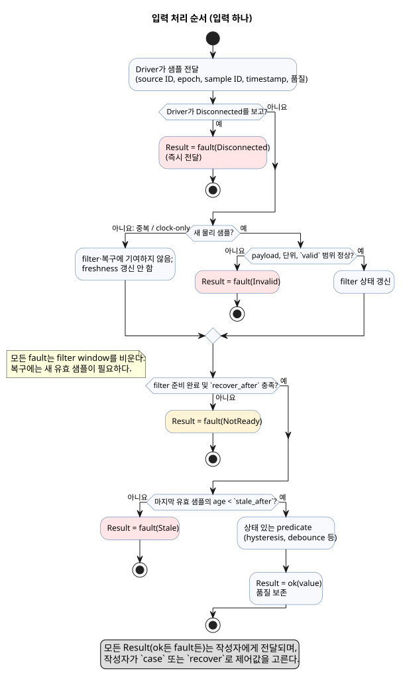
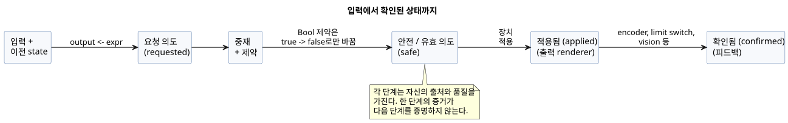
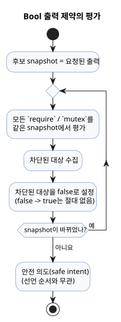
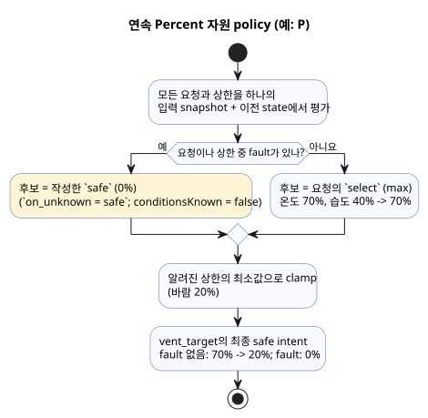
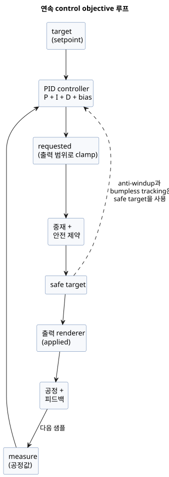

<!-- translation-source: docs/reference/04-sensors-constraints-control.en.md -->
[영문 원문](04-sensors-constraints-control.en.md)

# 4. 센서, 제약과 제어

[전체 목차](../LANGUAGE-REFERENCE.md) · [이전: 3. 시간과 일정](03-time-and-schedules.md) ·
[다음: 5. 설정과 관찰](05-settings-and-observation.md)

GhostFlow의 센서 값은 숫자 하나가 아니다. 값의 출처, 품질, 시각과 fault(고장)를 함께
지닌다. 마찬가지로 제어 출력은 장치 명령이 아니다. 출력은 먼저 *요청 의도(requested intent)*로
계산한다.

GhostFlow는 다음 다섯 가지를 구분한다.

1. 지역 제어식,
2. 공유 자원의 중재(arbitration),
3. 안전 제약,
4. 출력 renderer의 적용,
5. 물리 피드백.

이들을 분리해 두기 때문에 프로그램은 센서 고장이나 여러 control의 경쟁을 숨기지 않고
설명할 수 있다.

**이 장의 내용**

| 절 | 주제 |
|---|---|
| [4.1](#41-sensor와-result-품질)–[4.2](#42-샘플-계약과-sensor-처리-순서) | 입력 품질(`Result`)과 샘플 처리 파이프라인 |
| [4.3](#43-filter와-signal-연산)–[4.4](#44-temporal-evidence) | 필터, 상태 있는 signal, 시간 기반 증거 |
| [4.5](#45-선택-sensor와-capability)–[4.6](#46-device-query와-strategy-선택) | 선택적 capability와 strategy 선택 |
| [4.7](#47-requested-safe-applied-confirmed) | requested → safe → applied → confirmed 단계 |
| [4.8](#48-공통-constraints-표기와-연산)–[4.11](#411-accounting과-budget) | 제약, 공유 자원, 모드, live settings, 예산 |
| [4.12](#412-continuous-control-objective)–[4.14](#414-bounded-adaptation) | objective와 PI/PID, 명시적 fallback, 제한된 적응 |
| [4.15](#415-타입-자원과-설명-규칙)–[4.16](#416-확정된-control-문법과-장별-경계) | 공통 규칙과 다른 장과의 경계 |

**이 장의 코드 읽는 법**

- **선택된 GhostFlow 표기**는 현재 language surface에서 확정한 문법이다.
- **설계 표기**로 명시한 예만 설명용이다. 이 장에서 선택 표기로 확정한 것은 모두
  공개 문법이다. 여기에는 constraints, device query, objective, PI/PID, temporal evidence와
  adaptation이 포함된다.

**근거.** 이 장은 [공통 제약·센서 계약](../CONSTRAINTS.md),
[선택 문법](../LANGUAGE-SURFACE.md),
[언어 설계 §5–8](../LANGUAGE.md), [Programming in GhostFlow 8장과 부록 A](../ProgrammingInGhostflow.md),
[#3](https://github.com/callin2/ghostflow-language/issues/3),
[#94](https://github.com/callin2/ghostflow-language/issues/94),
[#95](https://github.com/callin2/ghostflow-language/issues/95),
[#96](https://github.com/callin2/ghostflow-language/issues/96),
[#105](https://github.com/callin2/ghostflow-language/issues/105),
[#110](https://github.com/callin2/ghostflow-language/issues/110)을 바탕으로 한다.

**`input`과 `sensor`.** 외부 입력을 선언하는 canonical keyword는 `input`이다.
`input`은 이 장의 typed quality, conditioning, optional capability 규칙을 모두 이어받는다.
`sensor`는 내부/wire 품질 분류일 뿐이며 허용되는 선언 별칭이 **아니다**. 기존 소스는
검토를 거친 새 revision으로만 이전한다. [migration 계약](../INPUT-MIGRATION.ko.md)을 참고한다.

## 4.1 sensor와 Result 품질

**기존 Bool snapshot.** 필수 Bool snapshot의 기존 동작을 유지하려면
[migration 계약](../INPUT-MIGRATION.ko.md)의 명시적 versioned directive를 써야 하며, 그 방법만
허용한다. 이 directive는 다음을 지킨다.

- 원래의 raw use site를 보존한다.
- 현재 frame마다 typed 값을 여전히 요구한다.
- 잘못된 frame은 평가 *전에* 거부하며, fault 기본값을 만들어 내지 않는다.

이 표시가 없는 input은 모두 `Result`다. 이 구분은 기존 프로그램의 보존을 새 품질 정책의
작성과 혼동하지 않기 위해 둔다.

**선언 타입과 읽기 타입.** 선택된 선언에는 sensor의 정상 payload 타입을 쓴다.

```ghost
input low_water: Bool;
input moisture: Percent;
```

sensor를 *읽을* 때의 실제 타입은 개념적으로 `Result<T, SensorFault>`다. 정상 샘플은
`ok(value)`, 오류는 `fault(reason)` 패턴으로 분기한다.

```ghost
let water_ok = case low_water {
  ok(low)  => !low;
  fault(_) => false;
};
```

초기 fault 집합은 네 가지 의미를 구분한다.

| fault | 의미 |
|---|---|
| `Disconnected` | 설치된 sensor의 연결 또는 전달 경로가 끊겼다. |
| `Stale` | 마지막 실제 유효 샘플이 freshness 한계보다 오래되었다. |
| `Invalid` | 값·단위·범위·encoding이 선언 계약에 맞지 않는다. |
| `NotReady` | 초기화, filter window 또는 연속 복구 조건이 아직 준비되지 않았다. |

`Result`를 다루는 규칙은 다음과 같다.

- `Result`를 Bool이나 Number처럼 직접 비교할 수 없다.
- 모든 fault를 하나의 0 또는 false로 암묵 변환하지 않는다.
- 위 예에서 `false`는 *작성자*가 선택한 제어값이다. 원래 fault와 그 시각은 기록에
  그대로 남는다.
- `recover(default)`도 같은 의미의 순수 변환이다. `ok(x)`는 `x`를, `fault(e)`는 payload와
  같은 타입의 `default`를 반환한다. `recover`는 fault를 정상으로 재분류하지 **않으며**
  sensor의 복구 상태를 진행시키지도 **않는다**.

exhaustive `case`와 정적으로 해석되는 Result transform을 모두 지원한다.

```ghost
fn normalize(value: Temperature) -> Result<Temperature, SensorFault> {
  ok(value)
}

let dry = moisture |> map(below(30%)) |> recover(false);
let normalized = temperature |> and_then(normalize);
```

각 transform의 동작은 다음과 같다.

| 구성 | 의미 |
|---|---|
| `below(limit)` | 호환되는 ordered payload에 쓰는 정적 단항 함수다. |
| `map(fnName)` | `ok` payload를 `U`로 변환한다. |
| `and_then(fnName)` | `ok` payload를 `Result<U,SensorFault>`로 변환한다. |
| `recover(expr)` | `fault`에서 값을 반환하는 유일한 transform이다. 같은 payload 타입의 명시 default를 반환한다. |
| `\|>`, `>>` | compile-time static chain이며 함수값이 아니다. |

- `map`과 `and_then`은 compiler가 이름으로 해석하는 순수 함수만 받는다. runtime
  closure나 일반 고차 함수(HOF)가 아니다.
- `fault`는 함수를 호출하지 않고 `map`과 `and_then`을 그대로 통과한다.
- GhostFlow는 일반 사용자 대수적 데이터 타입(ADT)을 추가하지 않는다. 다만
  `Result<T,SensorFault>`는 함수 인자와 결과에 쓸 수 있고, `ok(value)`/`fault(reason)`
  constructor를 지원한다.
- 모든 transform은 원래 fault와 provenance(출처)를 journal/explanation에 남기며, 어느 것도
  recovery state를 진행시키지 않는다.

**왜:** sensor fault를 0%나 false로 숨기면 정상적인 저수위, 실제 0 측정, 연결 끊김을
구분할 수 없다. 대체값과 원인을 함께 보존해야 보수적 제어와 사후 설명이 가능하다.

## 4.2 샘플 계약과 sensor 처리 순서

선택된 sensor 설정 표기는 다음과 같다.

```ghost
input moisture: Percent {
  sample = 1s;
  valid = 0% .. 100%;
  filter = median(5);
  stale_after = 3s;
  recover_after = 3 samples;
}
```

각 항목의 의미와 제약은 다음과 같다.

| 항목 | 타입·제약 | 의미 |
|---|---|---|
| `sample` | 양의 `Duration` | 기대 측정 간격이다. 정보일 뿐이며 sensor를 읽는 thread나 timer를 만들지 않는다. |
| `valid` | payload와 같은 numeric 타입의 닫힌 범위; Bool에는 쓸 수 없음 | 필터 *전에* raw 정상 후보를 검사한다. 범위 밖 값은 `Invalid`가 된다. Bool 범위는 컴파일에서 거부한다. |
| `filter` | 상태 있는 signal 연산 | 새롭고 유효한 샘플에만 적용한다. |
| `stale_after` | 양의 `Duration` | 마지막 실제 유효 샘플 시각부터 잰 freshness 한계다. |
| `recover_after` | 양의 정수 `N samples` | fault 뒤에는 새 유효 샘플 N개가 연속해야 복구한다. |

**샘플 identity.** Driver는 샘플마다 source ID, source epoch, sample ID, sample timestamp와
품질을 제공한다. 같은 물리 샘플이 여러 tick에 반복돼도 filter window와 recovery counter에는
한 번만 들어간다. filter output을 다시 계산해도 freshness는 갱신되지 않는다.

**처리 순서:**

```text
새 샘플 식별
  → payload/단위/valid 범위 검사
  → filter 상태 갱신
  → filter 준비 검사
  → stateful predicate(hysteresis 등)
  → quality/fault 보존
  → 작성자가 case/recover로 제어값 선택
```

아래 그림은 같은 순서와 함께 각 fault가 어디서 생기는지 보여 준다.



**Freshness와 hold.**

- 명시적인 `Disconnected`나 `Invalid`는 즉시 전달한다.
- 새 샘플이 오지 않으면 마지막 유효값을 `stale_after` 전까지 사용할 수 있다.
  한계에 도달하면 input은 `Stale`이 된다.
- 마지막 값을 무제한으로 유지하는 것은 기본이 **아니다**. 제한된 hold가 필요하면
  지속 시간과 `Held` 품질을 명시하는 별도 정책이 있어야 한다.

**fault 뒤의 복구.**

- fault 뒤에는 filter window를 비운다.
- filter가 준비되고 `recover_after`도 충족될 때까지, 즉 *두 조건을 모두* 만족할 때까지
  결과는 `NotReady`다. 예를 들어 `median(5)`와 `recover_after = 3`이면 새 유효 샘플이
  최소 5개 필요하다.
- source epoch나 time epoch가 바뀐 샘플은 이전 연속 sequence의 다음 정상 샘플로 세지 않는다.

**재부팅.** 기본적으로 재부팅은 sensor state와 freshness를 초기화하며, input은 `NotReady`부터
다시 준비한다. persistent resume은 checkpoint의 source/time 연속성을 검증하는 명시적
opt-in이다. 오래된 정상값 하나를 복원해 곧바로 허가 조건으로 사용해서는 안 된다.

**`recover_after = N samples`의 계수 규칙.**

- 초기화, 재부팅, source epoch 변경, fault 뒤 복구에서 서로 다른 새 유효 관측을 센다.
- filter도 준비되었다면 N번째 관측부터 사용할 수 있다.
- 중복 샘플과 clock-only scan은 세지 않는다.
- fault나 freshness 상실은 새 sequence를 시작한다.
- 첫 N개의 유효 관측을 버리려면 `recover_after = N+1 samples`를 `1..31` 안의
  구체적인 개수로 쓴다.
- 이 옵션은 샘플 개수를 센다. 시간 기반 예열이 **아니다**.

**시간 기반 준비.** 예열 *기간*이 필요하면 기존 상태 연산 `debounce`를 사용한다.
`recover_after`에는 duration 형태가 없다. 아래 패턴은 첫 conditioned `Good` 관측부터
2분이 지나고, 그 기한 시점 이후에 서로 다른 새 `Good` 관측이 들어올 때까지 Result를
보류한다. `usable` 출력은 사용 가능 여부만 나타내며 어떤 물리 동작도 명령하지 않는다.

```ghost
fn observed(value: Number) -> Bool { true }
control TimedPreparation {
  input reading: Number { stale_after = 3min; }
  signal ready = debounce(reading |> map(observed), stable_for: 2min, initial: false);
  let prepared: Result<Number, SensorFault> = case ready {
    ok(value) => if value then reading else fault(NotReady);
    fault(_) => reading;
  };
  output usable: Bool;
  usable <- case prepared { ok(value) => true; fault(_) => false; };
}
```

이 예의 동작은 다음과 같다.

- `observed`는 0을 포함한 모든 정상 payload를 true로 변환한다. 입력 fault는 `map`을
  그대로 통과한다.
- debounce 기간은 관측 timestamp를 사용한다. clock-only scan과 중복 샘플로는 준비
  완료에 도달할 수 없다.
- fault, stale 수신, source epoch 변경은 준비를 처음부터 다시 시작한다.
- filter나 샘플 개수 기반 복구도 설정했다면, 그 단계들이 처음 `Good`을 만든 뒤에야
  기간이 시작된다.
- `fault(_) => reading` 분기는 원래 입력 Result와 그 origin을 보존한다.
- `stale_after`는 예상 관측 주기에 맞춰 고른다. 여기서는 3분 한계 덕분에 첫 관측과
  기한 시점의 관측 하나만 있는 드문 관측도 허용된다.
- 개수 기반 `recover_after`와 작성자가 쓴 이 기간 gate는 서로 별개의 조건이다.

## 4.3 filter와 signal 연산

### median

선택된 `median(n)`은 최근 `n`개의 유효한 새 payload를 정렬해 가운데 값을 반환한다.

- `n`은 `1..31` 범위의 홀수 정수다.
- window에 샘플이 `n`개 찰 때까지 결과는 `NotReady`다. "부분 median"은 없다.
- fault나 재초기화 뒤 window는 빈 상태다.

```ghost
filter = median(5);
```

예를 들어 `28%, 29%, 90%, 28%, 29%`의 median은 29%다. 하나의 spike가 판단을
지배하지 않는다.

### hysteresis

선택된 `hysteresis`는 sensor/Result를 받아 품질을 보존하는 상태 있는 Bool signal을
만든다.

```ghost
signal dry = hysteresis(moisture,
  on_below: 30%,
  off_above: 35%,
  initial: false);
```

- 첫 인수는 ordered numeric/quantity `Result<T, SensorFault>`다.
- `on_below`와 `off_above`는 `T`와 같은 타입이며 `on_below < off_above`여야 한다.
- payload가 `on_below`보다 작으면 signal은 true로 바뀐다.
- payload가 `off_above`보다 크면 signal은 false로 바뀐다.
- 두 경계 사이에 있거나 어느 한 경계값과 정확히 같으면 직전 판정을 유지한다.
- `initial`은 초기화 때와 복구 뒤의 Bool 상태다.
- 입력 fault에서는 fault를 전달한다. 마지막 Bool을 정상 `ok`로 내세우지 **않는다**.

두 경계는 하나의 threshold 부근에서 ON/OFF가 빠르게 반복되는 것을 막는다. 이 기억은
명시적인 signal state이며 숨은 host 보정이 아니다.

### bounded signal 연산의 설계 계약

다음은 선택된 표기다.

```ghost
input moisture: Percent { filter = moving_average(3); }
input temperature: Temperature { filter = ema(alpha: 0.25); }
signal stable_start = debounce(start, stable_for: 2s, initial: false);
```

| 연산 | 필수 인수 | 상태와 결과 의미 |
|---|---|---|
| `debounce` | Bool/finite signal, 양의 안정 `Duration`, 초기값 | 입력 후보가 duration 내내 바뀌지 않을 때만 안정값을 바꾼다. 안정값, 후보값, 후보의 단조 시작 시각을 보존한다. |
| `moving_average(n)` | numeric Result; profile 상한 안의 양의 고정 정수 `n` | 최근 `n`개의 유효한 새 샘플의 산술평균이다. 비었거나 덜 찬 window는 `NotReady`다. 상태는 유한하며 최근 `n`개 샘플만 담는다. |
| `ema(alpha)` | numeric Result; 유한한 `0 < alpha <= 1` | 첫 유효 샘플을 seed로 삼은 뒤 `alpha*x + (1-alpha)*previous`를 계산한다. 복구 조건을 충족하기 전에는 정상 결과를 내지 않는다. |
| `stale_after(d)` | timestamp가 있는 Result; 양의 Duration | 마지막 실제 유효 샘플의 age가 `d`에 도달하면 stale이 된다. 재평가나 filter output 시각으로 연장되지 않는다. |

**filter 합성.** `filter`는 정확히 하나의 연산만 받는다. 여러 단계를 합성하려면 각 단계를
이름 있는 `signal`로 선언한다.

- numeric Result의 다음 EMA 단계는 `signal smooth = ema(moisture, alpha: 0.25);`로 선언한다.
- EMA 결과를 다른 단계에 다시 연결할 수 있다: `signal slower = ema(smooth, alpha: 0.25);`.

EMA 단계의 규칙은 다음과 같다.

- 각 EMA는 단일 물리 source의 epoch, sample ID, timestamp를 이어받으며 새 정상 샘플에서만
  갱신한다.
- 입력 fault를 전달하고 EMA 기억을 비운다. 그 뒤 upstream filter 준비와 `recover_after`를
  만족한 첫 정상 샘플로 다시 seed한다.
- 별도의 recovery counter나 새 freshness 시각을 만들지 않는다.
- sample lineage가 없는 값이나 여러 물리 source 중 하나를 선택하는 식은 EMA 단계의
  입력으로 받지 않는다.

**그 밖의 규칙.**

- Temperature filter는 내부적으로 canonical kelvin domain에서 affine weighted mean을
  계산한다. 그렇다고 source 식에서 `Temperature+Temperature`나 절대 온도의 scalar 곱셈이
  허용되는 것은 **아니다**.
- 보호 신호와 천천히 변하는 환경 sensor에 같은 filter 지연을 일괄 적용하지 않는다.
- 각 연산은 고정된 상태 크기와 고정된 계산 상한을 가져야 한다.
- 연산은 새 샘플에서만 갱신한다. 합성해도 `case`나 `recover` 전까지 품질을 보존한다.

**왜:** filter가 센서 품질을 지우거나 같은 샘플을 tick마다 재사용하면 평활화가 고장을
숨기고 replay 결과도 달라진다. 이름 있는 유한 상태는 지연과 자원 비용을 검토할 수 있게 한다.

## 4.4 temporal evidence

*temporal evidence(시간 증거)*는 "5분 동안 true" 또는 "시작 event 뒤 10초 안에 valve가
열림"처럼 sensor signal에 관한 시간 기반 사실이다. 아래 선택 표기를 쓰며, schedule의
`within`과는 구분한다.

```ghost
signal hot_5m = true_for(hot, duration: 5min, quality: measured);
signal opened = after_event(started, valve_open, window: 10s, quality: measured);
input selected_start: EventId;
output selected_opened, any_opened, all_opened: Bool;
selected_opened <- after_event_for(opened, selected_start) |> recover(false);
any_opened <- after_event_any(opened) |> recover(false);
all_opened <- after_event_all(opened) |> recover(false);
signal avg_temp = window_average(temperature, over: 10min,
  quality: measured, max_age: 2min);
signal low_temp = window_min(temperature, over: 10min,
  quality: measured, max_age: 2min);
signal high_temp = window_max(temperature, over: 10min,
  quality: measured, max_age: 2min);
signal warming = window_rate(temperature, over: 10min,
  quality: measured, max_age: 2min);
signal usable_temp = hold_last(temperature, for_at_most: 2min, quality: measured);
```

**`true_for`**는 admissible한 true가 양의 duration 동안 끊기지 않고 유지되었다는 증거다.

- false 값이나 허용되지 않는 품질에서 reset한다.
- duration 경계에 도달한 첫 판단에서 true가 된다.
- 연속성은 Driver가 실제로 관측되었다고 인증한 interval만 이어 붙인다. 서로 떨어진 샘플
  사이를 보간하지 않는다. expected cadence, scan cadence, 중복, clock-only tick은 관측 증거가
  아니다.

**`after_event`**는 식별된 event 시각 `e`에 대해 `[e,e+window)` 안에서 predicate가
성립했는지를 event identity별로 계산한다.

- 정확한 종료 경계는 제외한다.
- 겹치는 event도 identity별 결과를 독립적으로 유지한다. 새 start event가 이전의 pending 또는
  completed 결과를 덮어쓰지 않는다.

**`after_event` 결과 읽기.** `after_event` signal은 scalar가 아니므로 Bool 식에서 직접 읽을
수 없다. 세 가지 투영 중 하나를 사용한다.

| 투영 | 의미 |
|---|---|
| `after_event_for(signal, identity)` | 명시적인 `EventId` 하나를 선택한다. |
| `after_event_any(signal)` | 보존된 identity 중 *하나라도* satisfied이면 true, *모두* expired일 때만 false다. |
| `after_event_all(signal)` | 보존된 identity 중 *하나라도* expired이면 false, *모두* satisfied일 때만 true다. |

- 현재 compiler는 명시적인 `after_event_for`, `after_event_any`, `after_event_all` 투영과
  runtime binding이 있을 때만 `after_event`를 실행 control로 내린다. 투영 없는 선언은
  실행 control로 받아들이지 않는다.
- `after_event_for`에서 runtime은 identity의 source tag가 signal의 Event source와 같은지
  검사한다. 다른 source의 identity는 조용히 false가 되지 않고, scan을 identity binding
  오류로 거부한다.
- `EventId`는 Driver가 전달하는 불투명한 identity다. 임의의 숫자가 아니며, 소스 코드에서
  "최신 event"를 만들어 낼 수 없다.
- `after_event_any`와 `after_event_all`은 accepted scan에 보존된 identity의 immutable 집합
  전체를 집계한다.
- 집합이 비었거나, 결과를 바꿀 수 있는 pending identity가 남아 있으면 `NotReady`다.
  결정적인 true/false가 없으면 원래 predicate/source fault가 `NotReady`보다 우선한다.
- 각 투영은 `Result<Bool, SensorFault>`를 반환한다. `recover(false)` 같은 fallback은
  작성자가 명시적으로 쓴다.

**보존된 identity**의 수는 runtime profile의 고정된 유한 capacity로 제한한다.

- pending이나 terminal identity를 암묵적으로 evict하거나 새 start로 덮어쓰지 않는다.
- capacity를 초과하면 scan 전체를 원자적으로 거부한다.
- terminal 결과는 host가 명시적으로 acknowledge할 때까지 addressable하다. pending
  identity는 acknowledge할 수 없다.

**window 집계.**

- `window_average/min/max`는 `(t-d,t]` 안의 admissible 실제 관측만 사용하며 보간하지
  않는다. admissible 관측이 없거나 최신 관측의 age가 `max_age` 이상이면 결과는 `NotReady`다.
- `window_rate`는 window 안의 가장 이른 admissible 관측과 가장 늦은 admissible 관측으로
  `(last-first)/(lastTime-firstTime)`을 계산한다. 서로 다른 두 시각이 없으면 `NotReady`다.

**`window_rate`와 `Rate<Q>`.**

- 지원되는 ordered numeric payload `Q`에 대해 결과는 식 전용 타입 `Rate<Q>`다.
- Temperature의 차이는 canonical ΔK를 쓴다. linear quantity는 같은 nominal quantity의
  canonical difference를 쓴다.
- 결과는 `window_rate`를 선언한 `signal`의 이름으로 참조한다.
- `Rate<Q>`에는 직접 리터럴, 일반 값 바인딩, config/state/input/output 저장, 자유 산술이 없다.
- 비교 임계값은 `rate(delta: <Q difference>, time: Duration)`로만 만든다.
- v1에서 RelativeHumidity, CO2, Acidity는 `window_rate`의 입력이 아니다.

**`hold_last`**는 마지막 admissible payload를 그 sample timestamp부터 `for_at_most`
직전까지만 제공한다.

- runtime/trace는 `quality=Held`, source sample ID와 age를 기록한다.
- `Held`는 source constructor가 아니며 `Measured`도 아니다.
- 정확히 경계에서 hold가 끝난다.

### 시간창의 타입과 출처

측정 기반 시간창은 `Result<T, SensorFault>`를 받아, 관측이 충분하면 성공한 Result를
반환한다.

| 연산 | 받는 `T` | 결과 타입 |
|---|---|---|
| `window_min`, `window_max` | `Int`, `Number`, `Percent` 또는 물리량 타입 | 같은 `T` |
| `window_average` | 위와 같은 타입 | `Int`의 평균은 `Number`다(소수 부분 보존). 나머지는 원래 타입을 유지한다. 절대 온도의 평균은 canonical K 값으로 계산한다. |
| `window_rate` | 2장의 [`Rate<Q>` 규칙](02-types-expressions-state.md#29-물리량과-단위)을 따른다 | `Rate<Q>` |

Bool, enum, Duration, 달력 타입은 이 수치 시간창의 payload가 아니다.

**파라미터.** `over`와 `max_age`는 양의 상수 Duration이다.

**관측의 출처.**

- 각 실제 관측의 원본 source, epoch, sample ID, timestamp를 보존한다.
- 같은 관측의 중복 수신이나 재평가는 새 기여로 세지 않는다.
- 일반적인 상류 fault는 아직 창 안에 있는 관측을 지우지 않는다. 따라서 충분히 신선한
  기록이 있으면 집계값을 계속 제공할 수 있다. 가려진 fault와 그 출처도 관찰 기록에 남는다.
- 원본 source epoch가 바뀌면 그 source의 기존 기여는 무효가 된다.

**집계값의 출처.** 집계값의 출처는 시간창 선언, 평가 시각, 실제로 기여한 관측 집합이다.
이를 센서가 직접 측정한 단일 샘플로 표시하지 않는다. 변환과 분기는 이 집계 출처를
유지하며, 물리 sample ID를 만들어 붙여서는 안 된다. 후속 시간창도 원본 관측과 집계 결과의
식별자를 구분해야 한다.

**왜:** 정수 평균을 반올림하거나 다른 물리량으로 바꾸면 제어 임계값의 의미가 달라진다.
관측의 출처와 유효 창을 보존해야 통신 재전송이 평균에 가중치를 더하거나, 일시적인
오류가 유효한 과거 관측을 지우는 일을 막을 수 있다.

### 시간창의 합성

한 시간창의 결과를 다른 시간창의 입력으로 사용할 수 있다.

```ghost
signal short_average = window_average(temperature, over: 2min,
  quality: measured, max_age: 1min);
signal long_average = window_average(short_average, over: 10min,
  quality: measured, max_age: 2min);
```

합성된 시간창의 규칙은 다음과 같다.

- **새 집계 관측이 생기는 때.** 상류 시간창이 새 관측을 받아들이고 *동시에* 성공한
  집계 결과를 만들 때만 후속 시간창이 새 집계 관측을 받는다. 재평가, 관측 만료, 분기
  선택 변경, fault 변화만으로는 새 관측이 생기지 않는다. 만료로 바뀐 현재 집계값은
  일반 식에서 여전히 읽을 수 있다.
- **집계 identity.** 집계 관측은 같은 프로그램, strategy, 실행(run) 안에서 시간창 선언과
  관측 수용 revision으로 식별한다. 이를 물리 sample identity와 구분한다. 후속 시간창은
  선택되지 않은 상류 시간창의 revision도 기억하므로, 분기를 바꾸어도 이미 생성된
  집계값을 새 관측으로 다시 세지 않는다.
- **집계 시각.** 집계 관측의 시각은 그 결과에 기여한 가장 최신 원본 관측의 시각이다.
  평가 시각은 별도로 보존한다. 늦은 계산이나 재계산으로 `max_age`의 기준 시각을 갱신하지
  않는다. 서로 다른 집계 관측이 같은 관측 시각을 가질 수 있다.
- **가중치.** 후속 평균에서 각 집계 관측은 같은 가중치를 갖는 한 항이다. 중첩 평균을 원본
  샘플들의 단일 평균으로 펼치지 않는다. 각 항 뒤의 원본 관측은 출처 증거로 보존한다.
  예를 들어 상류 평균이 0, 5, 15였다면 후속 평균은 `20 / 3`이다.
- **품질.** `quality: measured`는 원본 기여 관측이 모두 허용되는 측정일 때만 집계 증거를
  받는다. 집계값 자체의 품질은 `Derived`다. `map`, `and_then`, Result 분기는 선택한 증거를
  보존한다. `Held` 값이나 `ok(...)`로 만든 값에 새 측정 출처를 부여하지 않는다.
- **epoch 변경.** 원본 source epoch가 바뀌면 이전 epoch에 의존하는 집계 관측은 모두
  무효가 된다. A와 B의 평균에서 A의 출처만 지우고 기존 평균값을 유지할 수는 없다.
  B에만 의존한 별도 관측은 유지된다.
- **되돌리기.** 판단이 실패하면 집계 관측, revision, 후속 시간창의 수용 기록을 함께
  되돌린다. 같은 관측을 재시도할 때 누락하거나 두 번 세어서는 안 된다.

**보존량.** 최대 보존량에는 상류 시간창의 과거 관측과 각 집계의 출처 증거가 포함된다.
같은 최신 관측 시각을 가진 집계값들을 하나로 합치지 않으며, 예산에 맞추려고 유효한 관측을
조용히 버리지 않는다. 필요한 보존량을 증명할 수 없으면 활성화를 거부한다.

**왜:** 집계를 합성한다는 것은 이미 계산된 결과를 다시 계산한다는 뜻이다. 원본 관측으로
펼쳐 다시 평균하면 각 집계의 가중치가 달라진다. 관측 수용과 평가를 분리해야 scan 횟수나
분기 전환이 평균에 영향을 주지 않는다. 원본 시각과 출처를 보존해야 재계산만으로 오래된
관측이 신선해 보이지 않는다.

### `hold_last`의 값과 출처

**시그니처.** `for_at_most`는 양의 상수 Duration이다. 측정 기반 `hold_last`는
`Result<T, SensorFault>`의 마지막 admissible 관측을 보관하고 같은 Result 타입을 반환한다.

- 보관된 관측이 없거나 유효 시간이 끝나면 `fault(NotReady)`를 반환한다.
- 성공한 결과는 관측을 받은 직후에도 `Held`다.
- `map`, Result 분기와 후속 변환은 이 출처를 결코 `Measured`로 승격하지 않는다.
- `ok(...)`나 `recover(...)`로 만든 값도 새 측정 증거가 아니다.

**보관값을 유지하거나 교체하는 것.**

- 일반적인 sensor fault나 입력 식의 분기 변경은 보관된 값을 지우지 않는다. 예를 들어
  A의 유효값 다음에 B의 fault가 선택되면 hold는 A의 원래 sample ID와 timestamp를 유지한다.
- 새 admissible 관측은 payload와 출처를 모두 그 관측의 것으로 교체한다.
- 재전송, 중복 샘플, 캐시된 정상값의 재조회는 보관 기한을 연장하지 않는다.
- 보관값의 원본 source epoch가 바뀌거나 시간 연속성을 잃으면 그 값은 사용할 수 없다.

**Trace.** trace는 실제로 반환한 값에 대해 `Held` 표시, 원본 source, epoch, sample ID,
timestamp와 현재 age를 기록한다. 보관값 때문에 가려진 상류 SensorFault도 그 오류와 출처를
유지한다.

**왜:** 마지막 측정값을 제한된 시간 동안 쓰기로 선택하는 것과 새로 측정했다고 주장하는
것은 다르다. 원래 측정 시각과 출처를 보존해야 재조회로 유효 기한이 늘어나거나, 후속
제어가 보관값을 측정 증거로 재사용하는 일을 막을 수 있다.

### 공통 품질과 관측 규칙

- `quality`는 생략할 수 없다. 추정 증거를 허용하려면 source/types가 정한 불확실성 상한도
  함께 있어야 한다.
- window 연산의 `max_age`는 필수이며 양수다.
- 모든 window는 과거와 현재만 사용한다. simulation에서도 미래 샘플을 미리 보지 않는다.
- 예: 샘플이 09:00의 25°C와 12:00의 31°C 두 개뿐이라면 온도가 2시간 동안 30°C를
  넘었다고 단정할 수 없다. `require measured`, 허용된 추정 불확실성, `max_age` 같은 품질
  정책과 window를 결합한다.
- 놓친 scan은 관측을 만들지 않는다.
- compiler는 duration, `max_age`, 샘플 계약과 runtime profile에서 최대 보존 샘플 수를
  계산해야 한다. 계산할 수 없으면 활성화를 거부한다.
- checkpoint 복원은 source/time 연속성을 검증한 뒤에만 허용한다. 그렇지 않으면 결과는
  `NotReady`다.

### 추정값의 출처와 연속성

**추정값이란.** 추정값(estimate)은 식별된 model이 산출한 값이다. sensor 관측도 아니고
적용·확인된 출력 사실도 아니다.

- `Result<T, SensorFault>`는 선언된 sensor 값의 유효성 또는 고장을 표현한다.
- `ok(value)`는 source 값이 선언된 유효성 계약을 충족했다는 뜻이다. 계산 결과를 측정된
  것이나 물리적으로 확인된 것으로 만들지 않는다.
- `Estimated`는 개념적인 증거 출처다. 새 `Result` 상태, `Quality` 변형, 실행 문법을
  추가하지 않는다.

**추정값을 해석하는 데 필요한 것.**

- model과 calibration parameter의 revision,
- runtime reference의 identity, 그리고 그것을 누가 어떤 방법으로 설정했는지,
- source/program과 설치 바인딩의 revision,
- run과 단조 시간 epoch,
- 사용한 source 또는 적용 receipt history,
- 선언된 basis.

보존할 참조와 history는 deployment profile이 선언한 유한한 bound 안에 들어가야 한다.
그 bound를 지원할 수 없으면 해당 사용을 거부한다. MCU에 무제한 history를 두지 않는다.

**액추에이터 진행의 basis.** 액추에이터 진행 추정의 첫 basis는 Device가 수락한
output register 또는 write history다.

- 그 수락은 출력 renderer가 해당 register/write를 받아들였다는 뜻일 뿐이다. motor가
  움직였거나 위치가 확인되었다는 증명이 아니다.
- 요청 시각은 *requested* history로 명시적으로 선언한 경우에만 basis가 될 수 있다.
  절대 *applied* history 대신 쓰지 않는다.
- 이는 §4.7의 requested/safe/applied/confirmed 구분을 따른다.

**추정의 시작과 진행.**

- 추정 interval은 admissible하다고 선언된 runtime reference와 자격을 갖춘
  receipt/history에서 시작한다.
- 캐시된 receipt를 다시 읽거나 다른 scan에서 노출해도 새 write나 새 증거가 생기지
  않는다. origin/start, freshness, 불확실성도 reset하지 않는다.
- 검증된 연속성이 유지되는 동안에만 추정이 정상적인 단조 시간 평가에 따라 진행할 수
  있다. 자격을 갖춘 history 전체가 필요하다.
- 관측되지 않은 gap, 실패, 불확실한 write를 가로질러 보간하지 않는다.
- 새 write가 실패하면 이전에 캐시된 ACK는 원래 identity를 지닌 과거 증거로 남고, 현재
  applied-target history는 불확실해진다. 그 오래된 ACK만으로 적용이 계속되었다고 추정하지
  않는다.

**연속성이 끊기는 경우.** 소유자가 명시적으로 검증해 다시 수립하지 않는 한, 다음 각각은
live 추정의 연속성을 끊는다.

- 재부팅,
- run/time epoch 또는 source epoch의 변경,
- 설치 바인딩의 변경,
- model/calibration revision의 변경,
- runtime reference의 변경.

calibration parameter는 재부팅 뒤에도 남을 수 있다. runtime 위치 reference나 추정값은
조용히 복원되거나 0으로 설정되어서는 안 된다. basis가 없거나 검증되지 않으면 현재 추정값은
unavailable/`NotReady`다. 명시적으로 발생한 기존 source/time fault는 그 fault로 남는다.
어느 경우도 0이나 자동 fallback으로 바꾸지 않는다. timer-only 정책은 추정값이 없어도
유효하며 추정값을 소비할 필요가 없다.

**불확실성.** 알 수 없는 불확실성은 알 수 없는 상태로 남는다.

- model/source는 알려진 불확실성 상한을 선언하거나, 불확실성을 알 수 없다고 선언해야 한다.
- 불확실성을 알 수 없는 추정값도 보존하거나 표시할 수 있지만, bounded temporal operator에는
  받아들여지지 않는다.
- 보편적인 공식, 신뢰도, 불확실성 수치, 지속 시간, 만료를 정하지 않는다.
- 기존 `quality: measured`, `hold_last`, `true_for`의 measured admission은 바뀌지 않는다.
- 앞으로 추정값을 받는 temporal consumer는 해당 source/type을 명시적으로 허용하고 선언된
  불확실성 상한을 요구해야 한다. 알 수 없는 불확실성을 조용히 받아들일 수 없다.

**예.**

- *연속:* 명시적인 runtime reference, 일치하는 model·calibration·바인딩, 같은 run/time epoch,
  profile bound 안에서 gap 없이 자격을 갖춘 write history가 있으면 선택된 model이 추정값을
  산출할 수 있다. 그래도 그것은 여전히 추정값이다. 출력 renderer의 ACK만으로는 움직임을
  주장하지 않는다.
- *단절:* applied-history basis에서는 ACK 없는 요청, 실패하거나 불확실한 새 write, 재부팅,
  identity/revision 변경이 생기면 reference를 다시 검증할 때까지 live 추정값이 unavailable이다.
  별도로 선언된 requested-history basis는 요청을 가정으로 쓸 수 있지만, 그것을 applied
  history로 표시해서는 안 된다. calibration parameter와 이전 추정값은 각자의 identity를 지닌
  이력으로 보존한다.

**추적과 현재 상태.**

추정 의미는 GhostFlow [#383](https://github.com/callin2/ghostflow-language/issues/383)에서,
후속 compatibility 작업은 [#385](https://github.com/callin2/ghostflow-language/issues/385)에서 추적한다.
calibration/reference 의미는 [System #132](https://github.com/callin2/farm_studio_system/issues/132)와
그 [architecture contract](https://github.com/callin2/farm_studio_system/blob/241643c125439c1ec141c8596feec3f4ad143ade/docs/architecture/INPUT-DRIVER-ARCHITECTURE.md#calibration-parameters-and-position-reference--system-132)에 있다.
구체적인 Device output receipt 경계는 draft [PR #107](https://github.com/callin2/farm-device/pull/107)
head `b85ef02fb546cd5f957c12ab66f091b90f9484f0`의
[host observation](https://github.com/callin2/farm-device/blob/b85ef02fb546cd5f957c12ab66f091b90f9484f0/rust/firmware/src/host_observation.rs)에 있다.

- 현재 `sensorSample` lowering은 measured provenance를 code `1`로 표시한다. runtime 분류
  `Measured`/`Held`/`Constructed`는 `Estimated`를 표현하지 않는다.
- 이 계약은 runtime 소비를 활성화하지 않는다. 그러려면 #385의 별도 compatibility 작업이
  필요하다.

[유한한 estimate-basis admission API](../ESTIMATE-EVIDENCE.ko.md)는 유효성, 출처, 선언된
완전한 history를 구분해 둔다. 승인된 basis는 측정이나 temporal 권한을 부여하지 않는다.
source 선언과 model 선택은 별도의 compatibility 결정으로 남는다.

## 4.5 선택 sensor와 capability

```ghost
input moisture?: Percent;
```

`?`는 이 sensor capability가 설치 profile에서 선택적이라고 선언한다. 이는 "없음"과
설치된 sensor의 "fault"를 합치지 **않는다**. 둘은 서로 다른 타입이다.

| 타입 | 의미 |
|---|---|
| `Option<T>` 또는 capability absence | 장치 구성에 그 능력이 없다. |
| `Result<T, SensorFault>` | 설치된 sensor를 읽었고, 그 결과가 정상값 또는 fault다. |

규칙:

- `?`만으로는 대체 strategy가 생기지 않는다. "moisture가 없으면 기본 schedule을 쓰고,
  있으면 moisture 보정을 쓴다" 같은 adaptation에는 별도 strategy 계약이 필요하다.
- 일시적인 `Disconnected`가 absence 분기로 들어가서는 안 된다.
- optional capability의 보호에는 §4.6의 `adapt`/`strategy` 표면만 쓴다. 이전의 `has`
  스케치는 v1 문법이 아니다.
- optional role은 그 role을 match한 strategy 안에서만 읽을 수 있으며, 그 안에서도
  `ok`/`fault` 분기가 필요하다.
- `?`와 `adapt`는 fault가 나도 strategy를 자동 전환하지 않으며, 기본값을 만들지도 않는다.

**선택적 장치 정보.** 압력, 유량, pump curve, 전력, 배관 손실 같은 장치 부가 정보도
선택적이다. 정보가 없다는 사실을 0, 무한 용량, 정상값으로 바꾸지 않는다. 기본 관수와
명시된 valve 개수/시간 인터록은 그런 정보 없이도 동작한다. 선택 분석은
`Pass | Violation | Unknown(reason)`을 반환하며, 정보가 부족하면 `Unknown`이다.

## 4.6 device query와 strategy 선택

다음은 선택된 control 문법이다.

> **구현 상태.** 현재 compiler는 typed `match`와 `match always`를 받는다.
> type을 생략한 presence-only match는 활성화 시 capability 존재를 검사한다. `where` 조건은 아직 지원하지 않으며 아래 예시는 설계 표기다.

```ghost
adapt irrigation_policy {
  strategy WithMoisture priority 100
    match (moisture: sensor<Percent>)
    where moisture.type == Percent {
      let request = case moisture {
        ok(value) => scheduled && value < 30%;
        fault(_) => false;
      };
      pump <- request;
    }

  strategy Baseline priority 0 match always {
    pump <- scheduled;
  }
}
```

**Profile.** profile은 semantic capability의 유한 집합이다. capability의 초기 key는
`(kind, name, type)`이다. 같은 `(kind, name)`은 두 번 나타날 수 없다.

**문법.**

- 형태는 `strategy Name priority Int match (...) [where ...] { ... }` 또는 `match always`다.
- 각 match 항목은 capability 존재 조건이다. 쉼표는 AND다.
- `pump`와 `moisture`는 semantic role 이름이다. DB의 여러 행을 순회하는 변수가 아니다.
- `sensor<number>`는 정상 payload 타입을 가리킨다. 실제 샘플은 여전히 Result다.
- `(moisture:sensor)`처럼 타입을 생략하면 존재만 검사한다.
- `where`는 match된 capability의 kind/name/type, 상수 비교, Bool `&&`, `||`, `!`, `==`, `!=`만
  읽을 수 있다.
- `where`는 input 샘플, state, 다음 상태, 현재 moisture 값을 읽지 **않는다**. capability
  선택과 tick마다의 제어 판단을 섞지 않는다.

**strategy 선택.**

- 각 strategy는 i32 리터럴 priority를 가진다.
- 모든 strategy는 control의 같은 외부 output 계약을 완전하게 정의한다.
- 일치하는 strategy 중 priority가 가장 큰 것을 선택한다.
- 최고 priority가 동률이면 ambiguity error다. 일치하는 strategy가 없으면 activation error다.
- 선언 순서나 "마지막 일치"로 결정하지 않는다.
- `match always`는 일반 후보일 뿐이며 암묵 fallback이 아니다.

**input과 profile 변경.**

- 공통 input은 모든 strategy에 필요하다. strategy input은 그 strategy가 선택된 경우에만
  필요하다.
- 선택된 strategy의 capability와 port 타입을 profile과 대조해 검사한다.
- tick 중간에 profile이 바뀌지 않는다. 새 profile은 후보 전체와 그 strategy 선택을 검증한
  뒤 경계에서 원자적으로 적용한다.
- 현재 strategy의 sensor fault는 즉시 Result로 처리한다. 이를 profile absence로 바꾸어 보호가
  더 약한 strategy로 조용히 전환하지 않는다.

**왜:** 설치 capability 선택을 현재 sensor 값과 섞으면 같은 profile에서도 tick마다
바인딩이 바뀔 수 있다. 유일한 strategy를 경계에서 적용하면 장치 구성이 바뀌어도 판단의
출처가 분명하게 남는다.

## 4.7 requested, safe, applied, confirmed

제어 결과는 서로 구분되는 단계를 거친다.

```text
sensor/input + 이전 state
  → requested output intent
  → arbitration과 constraints
  → safe/effective intent
  → 출력 renderer가 적용한 command
  → feedback으로 confirmed state
```



그림의 각 단계는 자신의 증거를 지닌다. 한 단계의 증거가 뒤 단계를 증명하지는 않는다.

선택된 출력 연결(`<-`)은 *requested* intent를 정의한다.

```ghost
output pump, valve: Bool;
valve <- running';
pump <- running';
require pump => valve;
```

**Bool 출력 제약의 동작.**

- `require pump => valve`는 valve=true일 때만 pump=true가 허용된다는 뜻이다. 전제 조건이
  false이면 대상 `pump`가 false가 된다.
- 출력 제약은 false를 true로 바꾸지 않는다.
- `require !(forward && reverse)` 또는 mutex는 충돌 그룹에서 동시에 true인 멤버를 *모두*
  false로 만든다.
- Bool 제약이 여러 개면 차단 대상은 같은 후보 snapshot에서 계산한다. 그 뒤 변경이 없을
  때까지 false 방향으로만 반복한다. 결과는 선언 순서와 무관하다.



이 결과는 safe intent다. GPIO/relay를 실제로 적용했다는 증거도, valve가 실제로
열렸다는 증거도 아니다. applied command와 encoder, limit switch, vision 추정 등에서 오는
confirmed feedback은 각자의 출처와 품질을 가진다.

**왜:** 요청, 제약 결과, 장치 적용, 물리 결과를 한 Bool로 합치면 출력이 왜 차단되었는지,
장치가 왜 다르게 동작하는지 아무도 설명할 수 없고, 사용량 accounting도 무엇을 세야 할지
알 수 없다.

### 출력 관측과 복구 정책

선언한 Bool 출력에는 네 가지 관측 함수 `output_status(pump)`, `output_health(pump)`,
`output_completion(pump)`, `output_fault(pump)`를 쓸 수 있다. 반환 타입과 멤버는 아래와
같다. 서로 다른 타입의 멤버는 비교할 수 없다.

| 타입 | 멤버 (숫자 rail은 0부터 이 순서) |
| --- | --- |
| `OutputStatus` | `OutputInitial`, `OutputPending`, `OutputCompleted`, `OutputFailed`, `OutputUnknown` |
| `OutputHealth` | `OutputInitializing`, `OutputHealthy`, `OutputFaulted` |
| `OutputCompletion` | `CompletionNone`, `HostWrite`, `DeviceAck`, `DeviceReadback` |
| `OutputFault` | `NoOutputFault`, `OutputUnavailable`, `OutputTimeout`, `OutputProtocolError`, `OutputDriverError`, `OutputObservationLost` |

**각 관측의 의미.**

- *status*는 현재 요청의 생명주기를, *health*는 장치 준비 상태를 나타낸다.
- 시작 시 요청 ID 0의 `OutputInitial`은 completion 없이 초기화 중·준비 완료·장치 오류
  상태의 설비를 나타낼 수 있다.
- 새 요청은 `OutputPending`이며 이전 health와 fault를 유지한다.
- pending 상태나 ACK 기능이 없다는 것은 오류가 아니다.
- *completion*은 실제 근거 수준을 기록한다. `HostWrite`는 장치 ACK도 접점 위치도 증명하지
  않는다. `DeviceReadback`도 물리 부하가 동작했다는 것을 자동으로 증명하지 않으며, 그러려면
  별도의 센서가 필요하다.

```ghost
control OutputRecovery {
  input resume: Bool;
  output pump, alarm: Bool;
  state stopped: Bool = false;
  let resume_requested = resume |> recover(false);
  stopped' = if resume_requested then false else stopped || output_fault(pump) == OutputTimeout;
  pump <- !stopped';
  alarm <- output_health(pump) == OutputFaulted;
}
```

**복구는 작성자가 선택한다.** 작성자는 위처럼 수동 복구를 기억하는 상태를 쓰거나, 자동
복구를 허용하는 식을 쓸 수 있다.

- 출력 실패가 이미 확정된 core state를 되돌리지 않는다.
- host의 별도 안전·종료 정책은 각자의 계약을 따른다.
- 다른 출력은 각자의 관측을 유지한다.

**compiler lowering.** compiler는 출력마다 네 숫자 입력
`__gf_output_{name}_{status|health|completion|fault}`와 `outputObservations` descriptor
하나를 생성한다.

- 이 profile은 `GhostFlow/control-v22` manifest와 기존 scalar GFB1..4를 사용한다.
- 설정, 예약, context, adaptation과의 조합은 명시적으로 거부한다.
- source 입력으로 이 전용 rail을 덮어쓸 수 없다.

**host 요구사항.** host는 현재 run, 해당 출력, 실제로 dispatch한 요청 ID에 결합된 신뢰할 수
있는 renderer 관측을 공급해야 한다.

- 이전 요청의 ACK, 이전 run의 cache, 누락된 관측은 결코 성공이 될 수 없다.
- 요청의 terminal status와 완료 근거는 퇴행할 수 없다. 재시도는 새 요청 ID를 쓴다.
- 완료 뒤 통신이 끊기면 health와 fault는 바뀔 수 있지만 완료 사실은 유지된다.
- 복구된 준비 상태는 새 초기화 또는 복구 요청의 근거를 사용한다. 실패한 요청을 성공으로
  고쳐 쓰지 않는다.
- 새 run은 초기 상태에서 시작한다.
- portable Rust tracker는 identity와 상태 조합을 검증한다.
- reference framed host는 `outputRunId`와 `outputObservationProvider`를 요구하며, provider를
  dispatch identity의 권한 있는 출처로 취급한다. 일반 `inputs`나 scan 인자를 통한 주입은
  거부한다.
- 지원을 선언하지 않은 host는 활성화를 거부한다.

**왜:** 장치 지연, 오류, 완료 근거를 source가 구분해야 설비 복구 정책을 검토하고 같은
사실로 replay할 수 있다. requested intent와 `SensorFault`는 출력 관측을 대신하지 않는다.

## 4.8 공통 constraints 표기와 연산

제약을 작성하는 정본 단위는 control 내부의 이름 있는 `constraints` 블록이다.
규칙에는 두 종류가 있다.

- **지역 규칙**은 자기 control에만 적용된다.
- **공유 규칙**은 명시한 자원을 사용하는 모든 요청 경로에 적용된다.

**지역 Bool 출력 규칙**은 `constraints Name { require [at safe_output] p; mutex(a, b); }`로 쓴다.
대상을 생략한 Bool `require`는 `safe_output`을 뜻한다. 지역 묶음은 자기 control에만
적용된다. 다음은 완전한 지역 control이다.

```ghost
control LocalPump {
  input request, valve_ready: Bool;
  output pump, valve: Bool;
  pump <- request;
  valve <- valve_ready;
  constraints LocalRules {
    require at safe_output pump => valve;
  }
}
```

**공유 규칙**은 `constraints Name for resource`로 지정한 안정적인 resource scope에 적용된다.
그 자원을 사용하는 자동·수동·fallback 요청 경로가 모두 같은 규칙을 따른다. 아래의 완전한
source는 *검증된 공유 policy descriptor*를 정의한다. descriptor 검증은 실행 바인딩과
집행(enforcement)을 대신하지 **않는다**.

```ghost
control SharedPumpPolicy {
  resource station: Station;
  resource pump1: BoolActuator;
  resource valve1: BoolActuator;
  input automatic, manual, pump_request, valve_request: Bool;
  output pump, valve: Bool;
  pump <- pump_request;
  valve <- valve_request;
  constraints SharedRules for station {
    exclusive at admission { automatic, manual };
    require at safe_output pump1.on => any_on({ valve1 });
    safe { pump1 = false; valve1 = true; }
  }
}
```

**`safe` vector.** `safe`는 참조한 유한 집합의 모든 Bool 자원에 작성자가 정한 안전 값을
지정한다.

- 누락, 중복, 타입이 맞지 않는 값은 잘못된 정의다. 필수 관계를 위반하는 safe vector도
  마찬가지다.
- 이 예는 pump=false, valve=true를 선택한다. 안전이 항상 전체 OFF를 뜻하지는 않는다.
- 요청 출력을 resource endpoint에 연결하려면 별도의 명시적 바인딩 계약이 필요하다. 이를
  위해 `station`, `use`, `bind`, session 문법을 새로 도입하지 않는다.
- 바인딩되지 않았거나 집행되지 않는 공유 descriptor를 실행 control이나 집행되는 policy로
  표시하지 않는다. 이전의 최상위 resource-policy 파일도 검증된 non-control artifact로 남는다.

**공유 policy의 실행.**

- 공유 실행을 선택하면 정확한 정본 source/descriptor, 바인딩 revision, 안정적인 resource ID,
  typed mapping을 하나의 bound 프로그램 identity로 고정한다.
- 활성화와 모든 평가는 같은 바인딩 identity를 공급해야 한다. 바인딩이 없거나 일치하지
  않으면 평가를 거부한다. 부분적으로 실행되는 일은 없다.
- 바인딩된 요청, admission, safe_output은 출력이 게시된 뒤의 host filter가 아니라 하나의
  Rust commit 경계 안에서 검사한다.
- 논리적 집행이 물리적 applied/confirmed 증거나 출력 renderer의 안전 순서를 보장하지는 않는다.

**admission과 복구.**

- 원시 exclusive activity 입력은 admission 결과가 아니다.
- 이미 admit된 activity와 충돌하는 새 claim은 거부한다. 기존 admission과 이전 safe 출력은
  보존한다.
- 시작 전에 예측한 출력 관계 위반은 새 admission도, 보호된 출력도 만들지 않는다.
- 거부된 newcomer는 false가 관측된 뒤에야 새 true claim으로 admission을 다시 요청할 수 있다.
- 이전에 확정된 safe 값이 없으면 거부의 출력 집합은 비어 있다.
- admit되어 실행 중에 관계를 위반하면 작성한 safe vector를 사용한다. 입력이 정상으로
  돌아온 것만으로 이 trip이 풀리지 않는다.
- exclusive 그룹은 모든 claim이 false인 관측이 있어야 한다. 그 뒤에야 새 claim의 admission을
  검사한다.
- require만 있는 그룹은 requested map이 작성한 safe map과 같아질 때 복구 기준선을 세운다.
  그 뒤 새 이탈(departure)을 검사한다.
- 숨은 재시도, 대기열, 우선순위 상승으로 이 복구 경계를 우회할 수 없다.

**그룹의 결합.**

- 그룹 사이의 필수 조건은 AND로 결합한다. 안전 의미가 충돌하는 중첩 그룹은 거부한다.
- bound Bool profile은 모든 출력에 대한 유한 resource mapping과 완전한 safe vector를 요구한다.
- 하나의 설치 authority 아래에서 공유하는 registry는 같은 안정 ID에 대한 두 번째 활성
  논리 writer를 거부한다. 별개 설치의 registry가 물리적 배타성을 증명하지는 않는다.
- trip은 보호 자원을 공유하는 그룹들이 전이적으로 연결된 component 전체로 전파된다.
  공유 자원에 대해 작성한 safe 값은 서로 일치해야 한다. 관련 없는 그룹은 admission을 유지한다.
- 최종 safe 후보는 모든 공유·지역 필수 조건의 AND로 다시 검증한다.
- 이것은 여러 VM의 협력 중재, session lease, 임의의 PID 정책을 구현하지 않는다.
- VM 오류나 바인딩 오류는 state, guard, trace를 함께 되돌린다.
- trace는 원시 요청, admit된 activity, requested/safe 값, 원인, 그룹, 바인딩 identity를 구분한다.
- 정상적으로 평가된 거부는 일반 VM state를 확정한다. job이나 session을 취소하지는 않는다.

**exclusive 집합의 한계.** 실행 그룹은 exclusive activity 집합을 최대 하나까지 지원한다.
여러 `exclusive` 문장은 여전히 소스 검사 대상이지만 별도의 실행 연결이 필요하다. 이들을
하나의 집합으로 합쳐 해석하지 않고 거부한다. 작성한 전역 safe vector는 필수 지역 제약도
만족해야 한다.

**accounting 제약.** accounting의 `constraints Name { limit used(account, basis) <= bound { ... } }`는
별도의 사용량 scope를 가진다(§3.10). ledger(원장)의 의미는 선언한 `resource`와 `account`,
semantic stage, basis, persistence가 정한다. 지역 Bool 규칙이나 공유 admission이 이를
대신하지 않는다.

### 제약문의 의미

| 표기 | 적용 단계와 의미 |
|---|---|
| 지역 `require [at safe_output] p` | 자기 control의 Bool 출력 후보 불변조건. 대상을 생략하면 safe_output이다. |
| 지역 `mutex(a, b)` | 자기 control의 두 requested Bool 출력이 모두 true이면 그 요청 증거를 보존하고 두 safe 출력을 false로 만든다. |
| 공유 `exclusive at admission { a, b, ... }` | 한 scope 안의 두 개 이상의 유한 Bool activity. 충돌하는 새 admission을 거부한다. |
| 공유 `require at safe_output p` | 유한 resource 출력 관계를 검사한다. safe 값도 이 필수 관계를 만족해야 한다. |
| 공유 `safe { resource = Bool; ... }` | 실행 중 위반에 사용하는, 작성자가 정한 resource별 safe vector. 보편적인 전체 OFF 기본값은 없다. |
| accounting `limit used(...) <= bound` | 명시한 stage/basis에서의 남은 예산과 한도. 세부 사항은 §3.10. |
| Station adapter `check pump_capacity(pump)` | 선택적 정보를 사용하는 비차단 `Pass/Violation/Unknown` advisory. 결코 필수 require로 승격하지 않는다. |

**제약과 의도, priority의 관계.**

- 모든 필수 조건은 AND로 결합한다.
- 제약은 goal과 PID를 포함한 의도가 움직일 수 있는 *허용 영역*을 정의한다.
- priority는 그 영역 *안에서* 요청을 고르는 arbitration 정책이다. 필수 조건을 완화하지
  않으며 resource 바인딩, provenance, 복구를 우회하지도 않는다.
- 예측 가능한 시작 전 위반은 admission을 거부한다. 실행 중에는 작성한 resource별 safe
  동작을 적용하고 원인과 전이를 기록한다.
- 단계는 admission, requested 후보, safe_output, 출력 renderer applied, feedback confirmed의
  결정적 순서로 구분한다. 한 단계의 증거가 다른 단계를 보장하지 않는다(§4.7).
- 정상 증거의 회복이 새 시작 권한을 만들지 않는다. 재시도, 복구, 수동 경로도 같은 필수
  조건을 따른다.

**지원하지 않는 문법과 adapter 전용 문법.**

- `warn`과 `monitor`는 지원 문법이 아니다.
- Station adapter의 `allow`, `once`, `on_time`, `check`를 generic named resource policy에
  섞지 않는다.
- 독립 `ghostrules` 표면은 구체적인 현재 consumer, 즉 programming-book WASM simulation,
  station-demo, 고정 Station artifact의 `bindStationPolicy`를 위해서만 유지한다.
  [Station adapter 예제](../CONSTRAINTS.md)가 이 경계를 명시한다.
- 독립 artifact는 범용 control 제약이나 임의 PID 집행의 fallback이 아니다.

### 공통 함수와 유한 자원

**`count_on`과 `any_on`.**

- 공유 `count_on({ items })`은 true인 서로 다른 Bool 자원의 개수를 `Int`로 반환한다.
- `any_on({ items })`은 하나 이상이 true일 때 Bool true다.
- 집합 리터럴은 compile-time 유한 목록이다.
- 빈 집합의 count는 0이고 빈 집합의 `any`는 false다. 빈 집합에서 운전을 허용하려는
  작성자는 그 정책을 별도의 필수 조건으로 명시해야 한다.
- `resource.on`은 Bool actuator 자원에 대한 관계를 표현한다. typed endpoint를 임의의
  source Bool 변수와 혼동하지 않는다.
- 물리 바인딩 뒤에는 한 endpoint의 별칭을 한 번만 센다. 바인딩 전후로 distinct identity가
  달라지면 activation 진단이 두 목록을 모두 보여 준다.

**Station adapter의 의미.**

- `stopped(station)`은 session과 정리가 끝났고, 사용권이 반환되었으며, 명시적인 정지
  증거가 있다는 뜻이다. 단순히 pump=false라는 뜻이 아니다.
- `pump_capacity`에서 유량과 압력을 임의로 더하지 않는다. 같은 검증 조건에서 단위가
  호환되는 model을 쓴다.
- 정보가 없으면 `Unknown`이다. advisory `check`는 운전을 차단하지 않는다.
- 이 제한된 Station 의미를 이미 구현된 범용 물리 safe sequence나 output ABI로 일반화하지
  않는다.

**왜:** 지역 출력 불변조건, 공유 admission, 사용량 ledger, 비차단 분석을 하나의 실행
경로로 취급하면 검증된 descriptor를 실제 안전 집행으로 오해하거나, 수동 경로가 규칙을
우회할 수 있다. scope, stage, safe 값, 실행 증거를 명시해야 한 자원을 쓰는 모든 경로가
같은 허용 영역 안에 머문다.

## 4.9 공유 자원과 arbitration

**최종 writer는 하나.** 여러 control이 같은 물리 pump를 쓰면 resource manager가 유일한
최종 writer다. 각 control의 pump output은 요청일 뿐이다. 비활성 control의 false나 마지막
write가 현재 소유자의 pump를 끄지 않는다.

**기본 정책: session 전체의 배타 lease.** 소유권은 session 전체 동안 유지된다. valve 사전
개방, pump ON, 단계 사이의 pump OFF, valve 정리, 정지 확인까지 포함한다. pump가 잠깐 꺼졌다고
다른 control에 넘기지 않는다.

**Admission.**

- 한 tick의 시작 요청은 하나의 snapshot에서 평가한다.
- resource lease와 시간 예산을 모두 예약할 수 있는 요청만 admit한다.
- 결정은 접수 순서와 안정적인 request ID 같은 명시적 정책을 따른다. queue 길이와 만료는
  유한하다.
- 공유 동시 운전과 선점(preemption)은 opt-in 정책이다.

**authority 범주.** 일반 arbitration은 authority와 제약의 의미를 드러내야 한다. 다음은
설계 범주다.

1. 안전 제약(safety constraint),
2. 수동 authority(manual authority),
3. 자동 제어 objective(automatic control objective),
4. 적응/optimizer 제안(adaptive/optimizer proposal).

이 목록이 모든 설비에 대한 단순한 고정 priority를 뜻하지는 **않는다**. 최종 값을 선택한
policy/revision, 모든 요청, 모든 제약 clamp를 trace에 남긴다.

```text
temperature objective requested vent 70%
humidity objective requested vent 40%
arbitration selected 70% under policy P
wind safety limited maximum to 20%
final safe target 20%
```

**공유 자원 선언.** 아래 선택 표기를 쓴다. queue와 preemption에는 기본값이 없다.

```ghost
resource pump1: BoolActuator;
resource_policy shared_pump for pump1 {
  lease = session;
  concurrency = 1;
  admission = reserve_all;
  queue = fifo(max: 8, expires_after: 10min, tie: request_id);
  preempt = never;
}
```

| 필드 | 규칙 |
|---|---|
| `lease` | 첫 표면은 `session`을 쓴다. |
| `concurrency` | 양의 정적 정수이며 capability 상한 이하다. |
| `admission = reserve_all` | lease와 필요한 모든 예산을 같은 snapshot에서 확보할 수 있을 때만 admit한다. |
| `queue` | `reject`, `fifo(max:N, expires_after:D, tie:request_id)`, `authority_then_fifo(max:N, expires_after:D, tie:request_id)` 중 하나. `N`과 `D`는 양수다. |
| `preempt` | `never` 또는 `higher_authority(cleanup: required, resume: requeue\|cancel)`. |

- FIFO key는 영속적인 accept position이다. 동률은 안정적인 request ID의 byte 순서로 정한다.
- overflow와 만료는 명시적인 occurrence다. 숨은 재시도는 없다.
- `resume: requeue|cancel`의 `|`는 문법 대안을 나열한 것이다. 실제 소스에는 그중 하나만 쓴다.
- 선점도 정리(cleanup), 정지 증거, 안전 제약을 우회하지 않는다.

### 연속 Percent 요청과 상한

control은 `ContinuousActuator<Percent>` 자원에 대한 요청을 이름으로 선언한다. 그 policy가
해당 Percent output의 유일한 writer다.

```ghost
control Vent {
  resource vent: ContinuousActuator<Percent>;
  output vent_target: Percent;
  let temperature_demand = 70%;
  let humidity_demand = 40%;
  let wind_limit = 20%;
  resource_policy P for vent {
    select = max;
    requests { temperature = temperature_demand; humidity = humidity_demand; }
    ceilings { wind = wind_limit; }
    safe = 0%;
    on_unknown = safe;
    output = vent_target;
  }
}
```

**정상 선택.**

- `select`는 `min` 또는 `max`다.
- 각 요청과 상한은 `Percent` 또는 `Result<Percent, SensorFault>` 식이며, 같은 입력 snapshot과
  이전 state에서 평가한다. 다음 상태 참조는 거부한다.
- policy는 알려진 모든 요청의 최소 또는 최대값을 선택한 뒤, 알려진 상한 중 최소값으로
  제한한다. 예에서는 70%를 선택하고 20%로 제한해 최종 safe intent 20%를 만든다.
- 값이 같으면 source node ID 오름차순에서 첫 요청이 이기며, 동률인 모든 request ID를
  기록한다. 소스 순서를 바꾸면 새 source revision이 된다.

**알 수 없는 입력.**

- 요청이나 상한 중 하나라도 fault이면, 필수인 `on_unknown = safe`에 따라 작성한 상수
  `safe`를 후보로 사용한다. 알려진 상한은 이 fallback도 여전히 제한한다.
- fault인 요청은 0%가 되지 않는다. fault인 상한은 100%가 되지 않는다.
- 판단은 이유와 origin을 유지하고 `conditionsKnown`을 false로 둔다.
- 요청 중 하나라도 fault이면 `selected`는 null이다. 요청은 모두 알려져 있고 상한만
  fault이면, 판단은 선택된 요청 값을 유지하면서 fallback을 적용한다.
- 예의 0%는 작성자의 선택이며 보편적인 물리 안전값이 아니다.

아래 그림은 예의 policy `P`를 요약한다.



**한계와 제외 사항.**

- policy마다 요청은 1..16개, 상한은 0..16개다.
- control 하나에는 policy가 최대 8개, 요청/상한 항목이 합계 최대 32개다.
- 각 resource와 output은 정확히 하나의 policy에 속한다.
- 별도의 `<-` writer와 `exclusive` 또는 `highest_authority` 선택은 거부한다.
- objective/PID, adaptation, 예약, temporal 연산, accounting, Bool resource policy와의 결합에는
  별도의 통합 계약이 필요하다.
- 이 profile은 PID의 최종값 추적이나 집계 anti-windup을 확정하지 않는다.

**실행.**

- 정본 소스는 기존의 검증된 policy descriptor를 만든다.
- 실행에는 명시적인 typed 설치 바인딩으로 컴파일한 GFB25가 필요하다.
- Rust scan 소유자는 판단에 모든 요청과 상한, 선택과 동률, fallback, clamp와 최종값,
  source SHA-256과 node ID, 바인딩과 run/tick ID를 확정해 기록한다.
- 잘못된 숫자 범위, packet, identity는 state와 journal을 확정하기 전에 거부한다.
- 최종 논리 출력은 applied 증거나 confirmed 증거와 별개다.

**왜:** 의도와 제약의 이유는 같은 실행 기록 안에서 설명할 수 있어야 한다. 알 수 없는 정보가
조용히 정상값이 되어서는 안 되며, 다른 출력 writer가 최종 제한을 덮어쓸 수 없어야 한다.

## 4.10 mode와 live settings

**모드.** Auto, Manual, Configure 같은 모드는 한 설비 scope 안에서 배타적이다.
Auto↔Manual 전환이나 운전에서 Configure로의 전환은 다음 명시적 경로를 따른다.

```text
stop request → 새 시작 억제 → 장치 정리 → stop evidence → Stopped → 새 mode 진입
```

**정지 증거.** `stopped(station)`은 두 수준을 구분할 수 있다.

| 수준 | 의미 |
|---|---|
| `CommandedStop` | 안전 명령을 적용했고 정리 절차가 끝났다. |
| `VerifiedStop` | 위와 같고, 물리 피드백으로도 정지를 확인했다. |

- 피드백이 없는 설비에 `VerifiedStop`을 전역 기본값으로 삼지 않는다.
- 장치가 응답하지 않으면 명령을 보낸 것만으로 정지가 완료된 것이 아니다.

**충돌.**

- 같은 tick에서 충돌하는 모드 진입은 모두 거부한다.
- Stop은 새 진입이나 새 작업보다 먼저 처리하며, 대기 중인 요청을 무효화한다.
- 운전 중에 들어온 모드 변경 요청을 저장해 두었다가 나중에 몰래 전환하지 않는다.

**구조 변경과 운영 설정.** 이 정지·Configure 경로는 프로그램, 의존성, 물리 바인딩, 설비
제약 묶음처럼 구조나 설치 의미를 바꾸는 후보 revision을 검증하거나 배포할 때 적용할 수
있다. 이전 계약의 `allow apply(settings) only when ... Configure`는 *모든* 운영자 property에
적용된다고 해석되었다. 그 해석은 아래의 live event 결정으로 대체되었다. 구조 변경용
`apply` 대상의 최종 이름과 revision 경계는 별도의 composition/installation 계약에 속한다.

**live 설정.** 운영 설정에는 #105와 #110의 후속 결정이 적용된다. 운영자가 편집할 수 있는
property의 변경은 **같은 프로그램과 같은 run 안의 원자적 live event**다.

- 한 event의 모든 값을 타입, 범위, step, authority, 현재 프로그램 identity에 대해 검증한다.
- 값이 하나라도 잘못되면 설정을 전혀 바꾸지 않고 event 전체를 거부한다.
- 성공하면 settings revision과 effective event position을 기록한다.
- 그 위치 이후 control과 예약은 새 값을 읽을 수 있다.
- source/bytecode, 프로그램 identity, run identity는 유지한다.
- timer나 state를 암묵적으로 초기화하지 않는다.
- 실제 재시작은 설정을 보존하지만 새 run identity를 만든다.

*예:* 급수 한도를 10분에서 5분으로 줄이면 다음 판단에서 현재 `elapsed`를 새 5분과
비교한다. "새 run을 기다린다"는 숨은 정책을 덧붙이지 않는다.

이 live event 의미를 Auto↔Manual 모드 전환, 프로그램 배포, 선택적 의존성 교체, RO3→RO8 같은
물리 바인딩 변경으로 일반화하지 않는다. 그런 변경은 각자의 모드, composition,
installation/deployment 계약을 따른다.

## 4.11 accounting과 budget

**무엇을 세는가.** `on_time(pump1)`의 accounting stage가 최종 applied command라고 하자. 그러면
자동 운전, 수동 운전, 여러 control에서 실제로 적용된 ON 구간을 그 물리 자원의 ledger 하나로
합친다.

- 거부된 요청, queue 대기, 제약으로 차단된 시간은 세지 않는다.
- confirmed 유량을 따로 세려면 해당 피드백 capability와 품질 계약이 필요하다.

선언 문법은 [§3.10 시간 기반 사용량 제약](03-time-and-schedules.md#310-시간-기반-사용량-제약)의
`resource`, `account`, `used`, `limit`을 사용한다.

**local day 예산.**

- local day 예산은 rolling 24h 예산이 아니다. 자정 양쪽에서 각 날짜의 예산을 쓸 수 있다.
- 자정을 넘는 ON 구간은 신뢰할 수 있는 날짜 경계에서 나눈다.
- 벽시계 되돌림이나 프로그램/설정 revision이 이미 확정한 사용량을 줄이거나 초기화하지 않는다.

**예약과 정산.**

- 새 작업을 시작하기 전에 최악의 ON 지속 시간과 정지 지연을 포함하는 예산을 예약한다.
- 수동 운전은 남은 예산 안에서 유한한 lease와 cutoff를 쓸 수 있다.
- 사용 뒤에는 applied 구간으로 정산한다.
- 정전으로 불확실해진 예약에는 사용한 것으로 보거나 복구를 보류하는 등 보수적인
  명시 정책을 쓴다.

**rolling duty 한도.** "최근 60초 동안 누적 최대 30초" 같은 rolling duty 한도는 sliding
window다. day ledger와는 다르다.

- `(t-60s,t]` 안에서 선택한 semantic signal의 ON Duration을 부분 겹침까지 포함해 합산한다.
- 정확히 한도에 도달하면 추가 ON을 차단한다.
- 오래된 구간이 window에서 빠지는 만큼만 예산을 되돌린다.
- 전원 재투입으로 암묵적으로 reset하지 않는다.

**발생 중복은 별도 계약이다.** `once starts per occurrence`는 예산과 별도로 같은 발생의 중복
실행을 막는다. 예산이 1시간 남아 있어도, 이 계약이 없다면 같은 5분짜리 발생이 두 번 실행될
수 있다. 한 계약으로 다른 계약을 대신하지 않는다.

**왜:** 물리 자원 단위로 계수하지 않으면 한 pump를 공유하는 여러 control이 사용량을
빠뜨리거나 중복 계수할 수 있다. day 예산, rolling window, 발생 중복은 서로 다른 질문에
답한다.

## 4.12 continuous control objective

연속 제어의 상위 개념은 **control objective**, 즉 제어 변수를 setpoint(설정점) 주변에
유지하는 것이다. 이는 "PID를 실행한다"보다 나은 의도의 단위다. 다음은 선택된 문법이다.

```ghost
objective greenhouse_temperature {
  measure = inside_temperature;
  target = target_temperature;
  manipulate = roof_vent.position;
  output = 0% .. 80%;

  controller = pid {
    period = 10s;
    late_after = 30s;
    direction = reverse;
    kp = proportional_gain(output: 2%, error: 1Δ°C);
    ki = integral_gain(output: 0.1%, error: 1Δ°C, time: 1s);
    kd = derivative_gain(output: 1%, time: 1s, error: 1Δ°C);
    bias = 0%;
    anti_windup = conditional_safe;
    disabled = track_safe;
    transfer = track_safe;
    fault = disable;
    restart = reset(output: 0%);
  }
}
```

objective는 다음을 연결한다.

| 필드 | 의미 |
|---|---|
| `measure` | quantity와 quality/provenance를 지닌 공정값. |
| `target` | `measure`와 호환되는 typed setpoint. |
| `manipulate` | 연속 액추에이터의 semantic target. |
| `controller` | Hysteresis/On-Off, PI 또는 PID 정책. |
| `output` | 액추에이터 capability 안의 허용 범위. |

**config의 setpoint.** config를 참조하는 `target`은 §5.2의 현재 `Result<T, SettingsFault>`
관찰을 소비한다. 여기서 `T`는 `measure`와 호환되는 quantity다.

- `ok(value)`는 현재 setpoint다.
- `fault(reason)`은 명시한 controller fault 정책으로 간다. 초기값이나 마지막으로 성공한
  target을 암묵적으로 대입하지 않는다.
- 실행 가능한 Temperature/Percent PID profile에서 `fault = disable`은 target fault에서도
  controller를 즉시 비활성화한다. 복구는 기존 deadline과 `track_safe` 정책을 따른다.
- 성공한 target 변경 자체는 controller state를 reset하지 않는다.

**액추에이터 capability.** 연속 액추에이터 capability는 값의 quantity/type, 범위, 선택적
resolution, safe 값, rate/slew 한도, 피드백 가용성을 표현한다. 0–10V, PWM, VFD, Modbus,
servo는 source objective가 아니라 Device 바인딩이다.

아래 루프는 controller의 위치를 보여 준다. controller의 출력은 요청일 뿐이다. 중재와 제약을
거친 safe target이 anti-windup과 bumpless tracking으로 되먹임된다.



### PI/PID 의미에 필요한 항목

**gain.**

- `pi`는 `kd`를 받지 않는다. `pid`는 세 gain을 모두 요구한다.
- 임의의 단위 대수 대신 `proportional_gain`, `integral_gain`, `derivative_gain` constructor를
  쓴다.
- constructor에서 output 분자는 0 이상이고, error 분모는 양의 호환 delta이며, I/D의 time은
  양수다. output이 0이면 그 항이 비활성화된다.
- 이 값들은 output과 TemperatureDelta 등에 결속된 nominal gain 타입을 이룬다.

| 항목 | 의미 |
|---|---|
| sample period | controller state를 갱신하는 양의 단조 Duration. missed/late tick 규칙을 포함한다. |
| setpoint / process value | 호환되는 quantity. nonfinite 값이나 해결되지 않은 fault로 직접 계산하지 않는다. |
| direction | `direct` 또는 `reverse`. error가 액추에이터를 어느 방향으로 움직이는지 명시한다. |
| `Kp`, `Ki`, `Kd` | quantity 차원을 보존하는 gain. PI에는 D 항이 없다. |
| output min/max | requested target의 clamp. 액추에이터 capability 범위와 교차 검증한다. |
| anti-windup | 포화/제약 동안 적분 state를 갱신(또는 back-calculation)하는 정책. |
| enable/disable | controller state를 freeze, reset, track 중 무엇으로 할지 명시한다. |
| manual/auto transition | 현재 effective output을 따르는 bumpless transfer와 authority 전환 규칙. |
| fault policy | stale/missing measure와 피드백 불일치에 대한 명시적 hold/safe fallback/disable 정책. |
| initialization/restart | 적분, 미분 기억, 이전 샘플의 시작/checkpoint 규칙. |

**고정 실행 규칙.** `period > 0`, `late_after >= period`이어야 하며 모든 값은 유한해야 한다.

1. 단조 deadline마다 최대 한 번 갱신한다. 같은 샘플을 재평가해도 state는 바뀌지 않는다.
2. 기본 error는 delta `target - measure`다. `direct`는 부호를 그대로 두고 `reverse`는 뒤집는다.
3. `P = Kp * signedError`; I는 이전 signed error와 현재 signed error의 사다리꼴 적분이다.
4. setpoint kick을 피하기 위해 D는 측정값의 변화에 적용한다: `-directionSign * Kd * Δmeasure/dt`.
5. `dt`는 마지막으로 수락된 갱신과 현재 갱신 사이의 단조 시간이다. 놓친 샘플을 합성하지 않는다.
6. `dt > late_after`, nonfinite 값, 허용되지 않는 measure는 명시적 `fault` 분기로 간다.
7. clamp 전 requested 값은 `bias + P + I + D`다. 내부 signed accumulator는 Percent의 외부 음이 아닌 범위에 제한되지 않는다. requested는 objective 범위 안으로 clamp한다.
8. 잠정 I로 requested와 safe를 계산한다. `(requested-safe) * signedError > 0`이면 I가 포화를 키우므로 이전 I로 한 번 다시 계산한다. 그렇지 않으면 후보 I를 확정한다.

이 유한한 two-pass 절차가 `conditional_safe`의 전부다. 반복 solver를 만들지 않는다.

**controller 출력은 요청이다.** 뒤따르는 중재와 안전 제약이 이를 clamp할 수 있다.

```text
PID requested 92%
wind safety max 20%
safe target 20%
output renderer applied 20%
position feedback 17% with provenance
```

- 적분 anti-windup은 위의 safe tracking 규칙을 따른다. requested 92%만 보고 계속 누적하지
  않는다.
- relay 전용 액추에이터에서 연속 PID 출력을 고빈도 time-proportioning으로 자동 변환하지
  않는다. 별도의 capability/안전 계약이 없으면 relay에는 hysteresis/on-off가 맞는 선택이다.

**초기화, fault, 재시작.**

- 첫 번째로 수락된 샘플은 이전 error와 이전 측정값을 현재 값으로 초기화한다. D=0이며,
  가상의 이전 구간을 적분하지 않는다.
- 현재 PID `fault`는 `disable`만 받는다. `degraded Name`은 선택된 설계 대안이며 현재 native Temperature PID profile이 받지 않는다.
- `bias`, `anti_windup`, `disabled`, `transfer`, `fault`, `restart`는 생략할 수 없다.
- 재시작은 typed output을 쓰는 `reset(output: value)`다. 연속성이 검증된 `checkpoint`는
  선택된 설계 대안이며 현재 native Temperature PID profile이 받지 않는다.
- `reset(output:v)`는 첫 번째로 수락된 샘플에서 적분 tracking state를 정해, 첫 clamp 전
  requested 값이 명시한 `v`와 같아지게 한다.
- 비활성화와 manual→auto transfer는 현재 safe target을 추적한다.

**objective의 live 설정.**

- setpoint와 gain은 typed 운영자 설정이 될 수 있다.
- live event는 controller/timer/filter state를 reset하지 않고 같은 프로그램/run 안에서
  원자적으로 적용된다. 다음 정상 평가에서 `track_safe`가 bumpless하게 이어 간다.
- 농민용 UI에 setpoint를 보여 준다고 해서 모든 전문가용 gain을 같은 권한으로 노출한다는
  뜻은 아니다.

**왜:** 농민의 목표는 온도나 습도 같은 상태를 유지하는 것이다. 알고리즘 이름이 그 상위
의도를 대신하면 relay, PI, PID 사이의 교체와 안전 clamp를 하나의 objective 아래에서 설명할
수 없다.

## 4.13 explicit fallback과 degraded control

sensor, 날씨, model, camera, 액추에이터 피드백은 모두 unavailable이 될 수 있다. fallback은
source/policy와 trace에 드러나야 한다. 숨은 host 동작이어서는 결코 안 된다.

```text
// 설계 의미
primary temperature 정상 → PI로 운전
primary degraded, backup admissible → 더 엄격한 범위의 backup controller
모든 temperature unavailable → 보수적인 환기 fallback
```

**fallback 분기가 선언하는 것과 해서는 안 되는 것.**

- fallback 분기는 입력 capability, 허용 품질, 출력 범위, authority를 명시한다.
- cloud/AI가 unavailable이라고 지역 안전 제어가 무조건 unavailable이 되지는 않는다.
- 반대로 신뢰도가 낮은 추정값만으로 안전 trip을 해제하지 않는다.
- fallback도 전역 제약, 자원 소유권, 모드를 우회하지 않는다.

**복구(recovery)**는 새로운 정상 증거가 준비되었다는 뜻이다. 자동 재시작, 원래 objective로의
복귀, 누적 timer의 복원은 각각 별도의 결정이다. sensor의 `recover_after`를 충족했다고 새
시작 요청이 생기지는 않는다.

선택 표기:

```ghost
degraded TemperatureFallback for greenhouse_temperature {
  branch Backup priority 100
    when backup_temperature quality in { measured }
    use objective backup_temperature_control
    authority automatic_degraded
    output 0% .. 30%;
  otherwise disable;
  recover primary after 3 samples;
  resume = require_start;
}
```

**규칙.**

- 조건이 성립한 분기 중 i32 priority가 가장 큰 것을 선택한다. 동률은 ambiguity error다.
  선언 순서는 선택 기준이 아니다.
- `otherwise`는 필수다. 현재 compiler는 `disable`만 받는다.
  `otherwise`의 완전한 fallback branch는 선택된 설계 대안이며 아직 지원하지 않는다.
- `resume`은 `require_start`, `automatic`, `stay_degraded` 중 하나여야 한다. `automatic`도 새
  시작 권한을 만들지 않는다. 기존 session이 아직 유효한 동안에만 primary로 복귀한다.
- fallback의 authority는 primary보다 높을 수 없으며 안전 authority를 가질 수 없다.

> **구현 상태.** compiler는 구조 검증된 degraded descriptor를 `requires-native-fallback-binding`으로 받지만,
> 이는 실행 가능한 fallback 지원이 아니다. 실행 가능한 fallback binding이 마련되기 전에는
> native Temperature PID profile이 degraded control을 거부한다.

## 4.14 bounded adaptation

적응 model이나 optimizer는 프로그램 전체를 수정하거나 output register를 직접 쓰는 기본
권한을 갖지 않는다. 그 첫 의미는 typed 설정이나 objective setpoint에 대한 *제한된 제안
(bounded proposal)*이다.

```ghost
adapt_setting target_vpd_policy for target_vpd {
  allowed = 0.7kPa .. 1.2kPa;
  max_step = 0.05kPa;
  max_change = 0.05kPa per 1h;
  authority = optimizer;
}
```

**제안에 담기는 것:** 설정 ID, 제안 값, source/model, 증거 참조, 행위자/authority, 현재
프로그램과 기준 settings revision, 발생 시각.

**검증과 적용 방법.**

- 지역 검증은 타입, 범위, 한 번의 step 변화량, 시간당 변화율, authority를 검사한다.
- 성공한 여러 property 변경은 하나의 원자적 settings event로 적용되며 새 settings revision을
  만든다. 실패하면 아무 값도 바뀌지 않는다.
- 변화율 검사는 `(t-window,t]` 안에서 수락된 변화의 절댓값 합에 새 변화를 더한 값이
  `max_change`를 넘지 않아야 한다는 조건이다. 이로써 증가와 감소를 번갈아 하는 우회를 막는다.
- 성공한 adaptation settings event는 controller, timer, filter state를 reset하지 않으며
  checkpoint로 전환하지도 않는다. 다음 정상 제어 평가가 현재 safe target을 추적한다.
- trace는 이전 값, 제안 값, 수락/유효 값, 제안의 provenance, 거부 이유, 프로그램 identity,
  settings revision, effective position을 기록한다.

**설정과 안전 프로그램.** "목표 온도 25→26°C"는 제한된 설정일 수 있다. "저수위에서는
pump를 항상 멈춘다"는 안전 프로그램의 변경이다. adaptation은 안전 제약을 제거할 수도,
자신의 authority를 스스로 높일 수도 없다. 프로그램을 생성하는 AI authoring workflow는 별도의
source 검토와 배포 identity를 가진다.

**왜:** adaptation을 프로그램 수정이나 직접 출력 권한으로 취급하면 model 오류가 안전 제약을
지울 수 있다. typed 범위와 원자적 settings event를 쓰면 허용된 변경 범위를 검증할 수 있다.

## 4.15 타입, 자원과 설명 규칙

**센서·제어 연산의 공통 규칙.**

- 압력, 유량, percent, 온도처럼 서로 다른 quantity를 암묵적으로 비교하거나 합산하지 않는다.
- Result나 Option을 Bool truthiness로 바꾸지 않는다.
- filter, window, 요청의 개수와 state 메모리 상한은 정적으로 계산할 수 있어야 한다.
- tick 실패는 sensor, filter, controller, resource state를 부분적으로 확정하지 않는다.
- 분석 timeout이나 `Unknown`은 증명 성공이 아니다.
- "항상 모든 출력 OFF"라는 결과도 안전 제약은 만족할 수 있다. 의도한 운전에 여전히 도달할
  수 있는지는 따로 확인한다.

**완료된 판단의 설명이 구분해야 하는 것**(최소한):

- raw 샘플, 필터 적용값, quality/fault, sample identity,
- predicate와 temporal evidence,
- setpoint, 공정값, error, controller의 requested 출력,
- 경쟁하는 의도들과 arbitration 정책,
- 제약 clamp와 최종 safe intent,
- applied command와 confirmed 피드백,
- 사용량 대상, used/limit, 차단 이유, 이미 기록된 구간에서 계산한 다음 해제 시점,
- 프로그램, 설정, profile/바인딩, policy, scan/run identity.

관찰·표시 계층은 판정된 값과 증거를 소비한다. animation 시간이나 표시된 출력에서 예산,
PID, fallback, arbitration에 관한 독자적인 제어 의미를 만들어서는 안 된다.

## 4.16 확정된 control 문법과 장별 경계

이 장은 Result transform, bounded signal/window, capability strategy, named constraints,
shared resource, objective·PI/PID, degraded control과 bounded adaptation의 표면을 확정했다.
다음 세부만 해당 소유 장의 계약을 참조한다.

- rolling budget의 history, scan boundary와 reboot policy: [3장 시간·accounting 계약](03-time-and-schedules.md#310-시간-기반-사용량-제약).
- quantity, delta, Result와 quality predicate의 일반 타입 규칙: [2장 Result 계약](02-types-expressions-state.md#25-sensor-결과와-명시적-오류-흐름)과 [물리량·단위 계약](02-types-expressions-state.md#29-물리량과-단위).
- installation binding과 live settings event record: [5장 설정 계약](05-settings-and-observation.md#52-소스-변경과-운영-설정-변경), [정체성 기록](05-settings-and-observation.md#54-정체성과-물리적-사실의-경계), [6장 조합 계약](06-composition-and-replay.md#63-parameters-settings-dependencies와-bindings).

이 참조는 Result/Option 구분, requested→safe→applied→confirmed 순서, 필수 constraint의
우선성, bounded state, atomic live settings와 명시 fallback 의미를 바꾸지 않는다.

[전체 목차](../LANGUAGE-REFERENCE.md) · [이전 장](03-time-and-schedules.md) ·
[다음 장](05-settings-and-observation.md)
