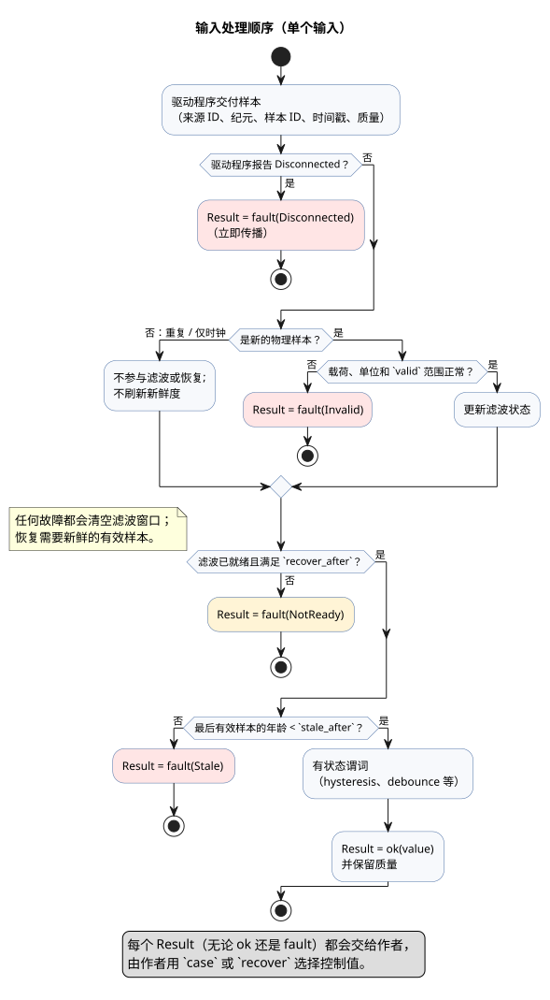
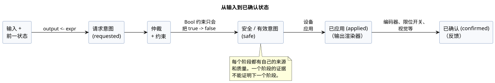
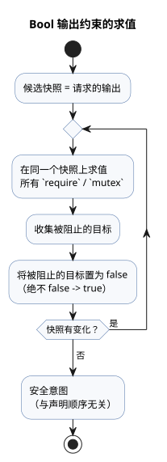
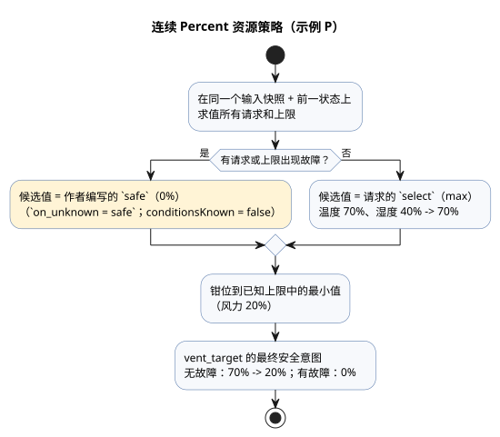
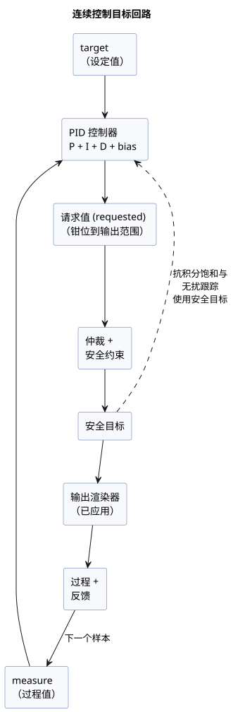

<!-- translation-source: docs/reference/04-sensors-constraints-control.en.md -->
[英文原文](04-sensors-constraints-control.en.md)

# 4. 传感器、约束与控制

[完整目录](../LANGUAGE-REFERENCE.zh.md) · [上一章：3. 时间与调度计划](03-time-and-schedules.zh.md) ·
[下一章：5. 设置与观测](05-settings-and-observation.zh.md)

在 GhostFlow 中，传感器值不只是一个数字。它还携带自己的来源、质量、时间以及任何故障。
同样，控制输出也不是设备命令。它首先被计算为一个*请求意图*（requested intent）。

GhostFlow 将以下五件事彼此分开：

1. 局部控制表达式，
2. 共享资源的仲裁，
3. 安全约束，
4. 输出渲染器（renderer）的应用，以及
5. 物理反馈。

正因为它们保持分离，程序才能解释传感器故障和相互竞争的控制，而不是把它们隐藏起来。

**本章内容**

| 小节 | 主题 |
|---|---|
| [4.1](#41-sensor-与-result-质量)–[4.2](#42-样本契约与传感器处理顺序) | 输入质量（`Result`）与样本处理流水线 |
| [4.3](#43-滤波与信号操作)–[4.4](#44-时间证据temporal-evidence) | 滤波、有状态信号与基于时间的证据 |
| [4.5](#45-可选传感器与能力)–[4.6](#46-设备查询与策略选择) | 可选能力与策略选择 |
| [4.7](#47-requestedsafeappliedconfirmed) | requested → safe → applied → confirmed 各阶段 |
| [4.8](#48-通用的约束写法与操作)–[4.11](#411-用量核算与预算) | 约束、共享资源、模式、实时设置与预算 |
| [4.12](#412-连续控制目标)–[4.14](#414-有界自适应) | 控制目标与 PI/PID、显式回退、有界自适应 |
| [4.15](#415-类型资源与解释规则)–[4.16](#416-已确立的控制语法与章节边界) | 通用规则以及与其他章节的边界 |

**如何阅读本章中的代码**

- **选定的 GhostFlow 写法**是当前语言表面中已确立的语法。
- 只有明确标为**设计写法**的示例才是示意性的。本章作为选定写法确立的一切都是公开语法，
  包括约束、设备查询、控制目标、PI/PID、时间证据和自适应。

**资料来源。** 本章基于[通用约束与传感器契约](../CONSTRAINTS.zh.md)、
[选定语法](../LANGUAGE-SURFACE.zh.md)、
[语言设计 §5–8](../LANGUAGE.zh.md)、[《Programming in GhostFlow》第 8 章和附录 A](../ProgrammingInGhostflow.zh.md)、
[#3](https://github.com/callin2/ghostflow-language/issues/3)、
[#94](https://github.com/callin2/ghostflow-language/issues/94)、
[#95](https://github.com/callin2/ghostflow-language/issues/95)、
[#96](https://github.com/callin2/ghostflow-language/issues/96)、
[#105](https://github.com/callin2/ghostflow-language/issues/105) 和
[#110](https://github.com/callin2/ghostflow-language/issues/110)。

**`input` 与 `sensor`。** 声明外部输入的规范关键字是 `input`。
`input` 继承本章关于带类型质量、信号调理和可选能力的全部规则。`sensor` 只是内部/线路上的
质量类别，它**不是**可接受的声明别名。迁移现有源码时，只能将其作为一个经过评审的新修订版。
参见[迁移契约](../INPUT-MIGRATION.zh.md)。

## 4.1 sensor 与 Result 质量

**旧式 Bool 快照。** 程序只有使用[迁移契约](../INPUT-MIGRATION.zh.md)中显式且带版本的指令，
才能保留旧的“必需 Bool 快照”行为。该指令：

- 保留原有的原始值（raw）使用位置，
- 仍然要求每个当前帧中的值带有类型，并且
- 在求值*之前*拒绝无效帧，而不会臆造一个故障默认值。

没有此标记的任何输入都是 `Result`。之所以作此区分，是为了让“保留现有程序”永远不会与
“编写新的质量策略”相混淆。

**声明类型与读取类型。** 在选定的声明中，写的是传感器的正常载荷类型：

```ghost
input low_water: Bool;
input moisture: Percent;
```

*读取*传感器时，其实际类型在概念上是 `Result<T, SensorFault>`。
用 `ok(value)` 对正常样本分支，用 `fault(reason)` 对错误分支：

```ghost
let water_ok = case low_water {
  ok(low)  => !low;
  fault(_) => false;
};
```

初始故障集合区分四种含义：

| fault | 含义 |
|---|---|
| `Disconnected` | 已安装传感器的连接或传输路径断开。 |
| `Stale` | 最后一个实际有效样本早于其新鲜度时限。 |
| `Invalid` | 值、单位、范围或编码违反了声明的契约。 |
| `NotReady` | 初始化、滤波窗口或连续恢复条件尚未就绪。 |

处理 `Result` 的规则：

- 不能像对待 Bool 或 Number 那样直接比较 `Result`。
- 不得隐式地把所有故障都变成同一个零或 false。
- 在上面的示例中，`false` 是*作者*选择的控制值。原始故障及其时间仍会被记录。
- `recover(default)` 是含义相同的纯变换。`ok(x)` 返回 `x`；
  `fault(e)` 返回 `default`，其类型与载荷类型相同。`recover` **不会**把故障重新归类为正常，
  也**不会**推进传感器的恢复状态。

穷尽的 `case` 和静态解析的 Result 变换都受支持：

```ghost
fn normalize(value: Temperature) -> Result<Temperature, SensorFault> {
  ok(value)
}

let dry = moisture |> map(below(30%)) |> recover(false);
let normalized = temperature |> and_then(normalize);
```

这些变换的工作方式：

| 构造 | 含义 |
|---|---|
| `below(limit)` | 适用于兼容的有序载荷的静态一元函数。 |
| `map(fnName)` | 将 `ok` 载荷变换为 `U`。 |
| `and_then(fnName)` | 将 `ok` 载荷变换为 `Result<U,SensorFault>`。 |
| `recover(expr)` | 唯一在 `fault` 时返回值的变换：一个相同载荷类型的显式默认值。 |
| `\|>`, `>>` | 编译期静态链，不是函数值。 |

- `map` 和 `and_then` 只接受编译器按名称解析的纯函数。
  它们不是运行时闭包，也不是通用的高阶函数（HOF）。
- `fault` 会穿过 `map` 和 `and_then`，而不调用函数。
- GhostFlow 不提供通用的用户代数数据类型（ADT）。不过，
  `Result<T,SensorFault>` 可以出现在函数参数和结果中，并且支持
  `ok(value)`/`fault(reason)` 构造器。
- 每个变换都会在日志（journal）/解释中保留原始故障和来源，且没有任何变换会推进恢复状态。

**原因：** 如果把传感器故障隐藏为 0% 或 false，就再也无法区分正常的低水位、真实的零读数和
断线的传感器。同时保留替代值及其原因，才能实现保守控制和事后解释。

## 4.2 样本契约与传感器处理顺序

配置传感器的选定写法如下：

```ghost
input moisture: Percent {
  sample = 1s;
  valid = 0% .. 100%;
  filter = median(5);
  stale_after = 3s;
  recover_after = 3 samples;
}
```

各项的含义和约束：

| 项 | 类型/约束 | 含义 |
|---|---|---|
| `sample` | 正的 `Duration` | 预期的测量间隔。它仅作为信息：不会创建读取传感器的线程或定时器。 |
| `valid` | 同一数值载荷类型的闭区间；Bool 不可用 | 在滤波*之前*检查原始的正常候选值。超出范围的值变为 `Invalid`。Bool 范围在编译时被拒绝。 |
| `filter` | 有状态信号操作 | 仅应用于新的有效样本。 |
| `stale_after` | 正的 `Duration` | 新鲜度时限，从最后一个实际有效样本的时间起算。 |
| `recover_after` | 正整数 `N samples` | 故障之后，恢复需要 N 个连续的新有效样本。 |

**样本标识。** 驱动程序（Driver）为每个样本提供来源 ID、来源纪元（epoch）、
样本 ID、样本时间戳和质量。如果同一个物理样本在多个 tick（逻辑决策步）中重复出现，
它在滤波窗口和恢复计数器中只计一次。重新计算滤波输出不会刷新新鲜度。

**处理顺序：**

```text
识别新样本
  → 检查载荷/单位/valid 范围
  → 更新滤波状态
  → 检查滤波是否就绪
  → 有状态谓词（hysteresis 等）
  → 保留质量/故障
  → 作者用 case/recover 选择控制值
```

下图展示了同样的顺序，包括每种故障产生的位置。



**新鲜度与保持。**

- 显式的 `Disconnected` 或 `Invalid` 立即传播。
- 没有新样本到达时，可以使用最后一个有效值，直到 `stale_after`。
  到达时限时，输入变为 `Stale`。
- 无限期保持最后一个值**不是**默认行为。有界保持需要一个单独的策略，明确写出其持续时间和
  `Held` 质量。

**故障后的恢复。**

- 故障后清空滤波窗口。
- 在滤波就绪*且*满足 `recover_after` *两者*都成立之前，结果都是 `NotReady`。
  例如，`median(5)` 配合 `recover_after = 3` 至少需要五个新的有效样本。
- 来源纪元或时间纪元发生变化的样本，不算作先前连续序列中的下一个正常样本。

**重启。** 默认情况下，重启会重置传感器状态和新鲜度，输入从 `NotReady` 重新开始准备。
持久恢复是显式选择启用的功能，会验证检查点的来源/时间连续性。绝不能恢复单个旧的正常值
并立即把它当作许可使用。

**`recover_after = N samples` 的计数规则。**

- 在初始化、重启、来源纪元变化以及故障后恢复时，它统计互不相同的新有效观测。
- 一旦滤波也已就绪，第 N 个观测即可使用。
- 重复样本和仅时钟扫描不计数。
- 故障或失去新鲜度会开始一个新序列。
- 若要丢弃前 N 个有效观测，应写成 `recover_after = N+1 samples`，即 `1..31` 范围内的
  具体计数。
- 此选项统计的是样本数，**不是**按时间计的预热。

**按时间准备。** 若要求一段预热*时间*，应使用现有的有状态 `debounce` 操作；
`recover_after` 没有持续时间形式。下面的模式会扣住 Result，直到从第一个经调理的 `Good`
观测起已过去两分钟，并且在该截止时刻或之后出现一个不同的、新鲜的 `Good` 观测。
`usable` 输出只表示可用性，不命令任何物理操作。

```ghost
fn observed(value: Number) -> Bool { true }
control TimedPreparation {
  input reading: Number { stale_after = 3min; }
  signal ready = debounce(reading |> map(observed), stable_for: 2min, initial: false);
  let prepared: Result<Number, SensorFault> = case ready {
    ok(value) => if value then reading else fault(NotReady);
    fault(_) => reading;
  };
  output usable: Bool;
  usable <- case prepared { ok(value) => true; fault(_) => false; };
}
```

此示例的行为：

- `observed` 把每个健康载荷（包括零）都映射为 true。输入故障原样穿过 `map`。
- 消抖间隔使用观测时间戳。仅时钟扫描和重复样本无法提升就绪状态。
- 故障、陈旧接收或来源纪元变化都会重新开始准备。
- 如果同时配置了滤波或基于样本数的恢复，则间隔只在这些阶段首次产生 `Good` 之后才开始。
- `fault(_) => reading` 分支保留原始输入 Result 及其来源。
- 应根据预期的观测节奏选择 `stale_after`。这里三分钟的界限允许稀疏的观测：
  只需第一个观测和截止时刻的一个观测。
- 基于计数的 `recover_after` 与这个由作者编写的持续时间门限是彼此独立的条件。

## 4.3 滤波与信号操作

### median

选定的 `median(n)` 对最后 `n` 个新的有效载荷排序并返回中间值。

- `n` 是 `1..31` 范围内的奇数。
- 在窗口积满 `n` 个样本之前，结果为 `NotReady`。不存在“部分中值”。
- 故障或重新初始化之后，窗口为空。

```ghost
filter = median(5);
```

例如，`28%, 29%, 90%, 28%, 29%` 的中值是 29%。单个尖峰不会主导判定。

### hysteresis

选定的 `hysteresis` 接受一个传感器/Result，创建一个保留质量的有状态 Bool 信号。

```ghost
signal dry = hysteresis(moisture,
  on_below: 30%,
  off_above: 35%,
  initial: false);
```

- 第一个参数是有序数值/物理量的 `Result<T, SensorFault>`。
- `on_below` 和 `off_above` 的类型与 `T` 相同，并且要求 `on_below < off_above`。
- 载荷低于 `on_below` 时，信号切换为 true。
- 载荷高于 `off_above` 时，信号切换为 false。
- 在两个边界之间，以及恰好位于任一边界上时，保持先前的判定。
- `initial` 是初始化时以及恢复后的 Bool 状态。
- 输入故障时，故障会传播。最后的 Bool **不会**作为正常的 `ok` 呈现。

两个边界防止在单一阈值附近快速地 ON/OFF 切换。这种记忆是显式的信号状态，
而不是隐藏的宿主修正。

### 有界信号操作的设计契约

以下是选定写法：

```ghost
input moisture: Percent { filter = moving_average(3); }
input temperature: Temperature { filter = ema(alpha: 0.25); }
signal stable_start = debounce(start, stable_for: 2s, initial: false);
```

| 操作 | 必需参数 | 状态与结果语义 |
|---|---|---|
| `debounce` | Bool/有限值信号、正的稳定 `Duration`、初始值 | 只有当输入候选值在整个持续时间内保持不变时，才改变稳定值。保存稳定值、候选值以及候选值的单调起始时间。 |
| `moving_average(n)` | 数值 Result；配置档界限内的正的固定整数 `n` | 最后 `n` 个新有效样本的算术平均。空窗口或部分窗口为 `NotReady`。状态是有限的，只覆盖最后 `n` 个样本。 |
| `ema(alpha)` | 数值 Result；有限的 `0 < alpha <= 1` | 以第一个有效样本作为初值，然后计算 `alpha*x + (1-alpha)*previous`。在满足恢复条件之前没有正常结果。 |
| `stale_after(d)` | 带时间戳的 Result；正的 Duration | 当最后一个实际有效样本的年龄达到 `d` 时变为陈旧。重新求值或滤波输出的时间不会延长它。 |

**组合滤波器。** `filter` 只接受恰好一个操作。若要组合多个步骤，
应把每一步声明为一个具名 `signal`：

- 将数值 Result 的下一级 EMA 声明为 `signal smooth = ema(moisture, alpha: 0.25);`。
- EMA 结果可以送入另一级：`signal slower = ema(smooth, alpha: 0.25);`。

EMA 级的规则：

- 每个 EMA 继承单一物理来源的纪元、样本 ID 和时间戳。它只在新的健康样本上更新。
- 它会传播输入故障并清空其 EMA 记忆。之后，它从第一个满足上游滤波就绪和 `recover_after`
  的健康样本重新取初值。
- 它既不创建另一个恢复计数器，也不创建新的新鲜度时间。
- 没有样本谱系的值，以及在多个物理来源之间进行选择的表达式，不被接受为 EMA 级的输入。

**其他规则。**

- Temperature 滤波器在内部于规范的开尔文域中计算仿射加权平均。这**并不**允许在源表达式中
  使用 `Temperature+Temperature` 或对绝对温度做标量乘法。
- 不得对保护信号和缓慢变化的环境传感器统一施加相同的滤波延迟。
- 每个操作必须具有固定的状态大小和固定的计算界限。
- 操作只在新样本上更新。组合会一直保留质量，直到 `case` 或 `recover`。

**原因：** 如果滤波器抹去了传感器质量，或在每个 tick 都重复使用同一个样本，平滑就会隐藏故障，
重放结果也会改变。具名且有限的状态让延迟和资源成本可以被评审。

## 4.4 时间证据（temporal evidence）

*时间证据*是关于传感器信号的、基于时间的事实，例如“持续五分钟为 true”或
“阀门在启动事件后十秒内打开”。它使用下面的选定写法，并且与调度计划的 `within` 不同。

```ghost
signal hot_5m = true_for(hot, duration: 5min, quality: measured);
signal opened = after_event(started, valve_open, window: 10s, quality: measured);
input selected_start: EventId;
output selected_opened, any_opened, all_opened: Bool;
selected_opened <- after_event_for(opened, selected_start) |> recover(false);
any_opened <- after_event_any(opened) |> recover(false);
all_opened <- after_event_all(opened) |> recover(false);
signal avg_temp = window_average(temperature, over: 10min,
  quality: measured, max_age: 2min);
signal low_temp = window_min(temperature, over: 10min,
  quality: measured, max_age: 2min);
signal high_temp = window_max(temperature, over: 10min,
  quality: measured, max_age: 2min);
signal warming = window_rate(temperature, over: 10min,
  quality: measured, max_age: 2min);
signal usable_temp = hold_last(temperature, for_at_most: 2min, quality: measured);
```

**`true_for`** 是一个可准入的 true 值在一段正的持续时间内不间断保持的证据。

- false 值或不可准入的质量会使其复位。
- 它在第一个达到持续时间边界的判定上变为 true。
- 连续性只连接驱动程序认证为实际观测到的区间。不得在彼此分离的样本之间插值。
  预期节奏、扫描节奏、重复样本和仅时钟 tick 都不是观测证据。

**`after_event`** 针对每个事件标识，计算谓词是否在 `[e,e+window)` 内成立，
其中 `e` 是已识别的事件时间。

- 精确的结束边界不包含在内。
- 重叠的事件按标识各自保留独立结果。新的启动事件不会覆盖先前处于待定或已完成状态的结果。

**读取 `after_event` 结果。** `after_event` 信号不是标量，因此不能在 Bool 表达式中直接读取。
应使用以下三种投影之一：

| 投影 | 含义 |
|---|---|
| `after_event_for(signal, identity)` | 选择一个显式的 `EventId`。 |
| `after_event_any(signal)` | 只要*任一*保留的标识被满足即为 true；仅当*全部*过期时为 false。 |
| `after_event_all(signal)` | 只要*任一*保留的标识过期即为 false；仅当*全部*被满足时为 true。 |

- 只有存在显式的 `after_event_for`、`after_event_any` 或 `after_event_all` 投影以及运行时
  绑定时，当前编译器才会把 `after_event` 降级为可执行控制。没有投影的声明不被接受为可执行控制。
- 对于 `after_event_for`，运行时会检查标识的来源标签是否等于信号的 Event 来源。
  来自其他来源的标识会以标识绑定错误拒绝该次扫描；它不会悄悄地变成 false。
- `EventId` 是由驱动程序交付的不透明标识。它不是任意数字，源码也无法构造“最新事件”。
- `after_event_any` 和 `after_event_all` 聚合已接受扫描中整个不可变的保留标识集合。
- 空集合，或仍可能改变结果的剩余待定标识，会得到 `NotReady`。当没有决定性的 true/false 时，
  原始谓词/来源故障优先于 `NotReady`。
- 每个投影都返回 `Result<Bool, SensorFault>`。任何回退，例如 `recover(false)`，
  都由作者显式编写。

**保留的标识**受固定且有限的运行时配置档容量约束。

- 不得隐式驱逐待定或终态标识，也不得用新的启动覆盖它们。
- 容量溢出会原子地拒绝整个扫描。
- 终态结果在宿主显式确认收到之前始终可寻址。待定标识不能被确认收到。

**窗口聚合。**

- `window_average/min/max` 只使用 `(t-d,t]` 内可准入的实际观测，不做插值。如果没有可准入的
  观测，或最新观测的年龄至少为 `max_age`，结果为 `NotReady`。
- `window_rate` 根据窗口内最早和最新的可准入观测计算 `(last-first)/(lastTime-firstTime)`。
  没有两个不同的时间时，结果为 `NotReady`。

**`window_rate` 与 `Rate<Q>`。**

- 对于受支持的有序数值载荷 `Q`，结果是仅用于表达式的类型 `Rate<Q>`。
- 温度差使用规范的 ΔK。线性物理量使用同一名义物理量的规范差值。
- 通过声明 `window_rate` 的那个 `signal` 的名称来引用结果。
- `Rate<Q>` 没有直接字面量、没有通用的值绑定、没有 config/state/input/output 存储，
  也不能自由进行算术运算。
- 比较阈值只能用 `rate(delta: <Q difference>, time: Duration)` 构造。
- 在 v1 中，RelativeHumidity、CO2 和 Acidity 不是 `window_rate` 的输入。

**`hold_last`** 只在从样本时间戳起、严格早于 `for_at_most` 的时段内提供最后一个可准入载荷。

- 运行时/追踪记录 `quality=Held`、来源样本 ID 和年龄。
- `Held` 不是来源构造器，也不是 `Measured`。
- 保持恰好在边界处结束。

### 时间窗口的类型与来源

基于测量的时间窗口接受 `Result<T, SensorFault>`，在观测足够时返回成功的 Result。

| 操作 | 接受的 `T` | 结果类型 |
|---|---|---|
| `window_min`, `window_max` | `Int`、`Number`、`Percent` 或物理量类型 | 相同的 `T` |
| `window_average` | 与上面相同的类型 | 对 `Int` 取平均得到 `Number`（保留小数部分）；其他类型保持原类型。绝对温度的平均使用规范的 K 值。 |
| `window_rate` | 遵循第 2 章的 [`Rate<Q>` 规则](02-types-expressions-state.zh.md) | `Rate<Q>` |

Bool、枚举、Duration 和日历类型都不是这些数值窗口的载荷。

**参数。** `over` 和 `max_age` 是正的常量 Duration。

**观测来源。**

- 保留每个实际观测的原始来源、纪元、样本 ID 和时间戳。
- 同一观测的重复接收或重新求值不算作新的贡献。
- 普通的上游故障不会抹去仍在窗口中的观测。因此，足够新鲜的记录可以继续提供聚合值。
  被掩盖的故障及其来源也保留在观测记录中。
- 原始来源纪元发生变化，会使该来源先前的贡献失效。

**聚合来源。** 聚合值的来源是其时间窗口声明、求值时间以及实际参与贡献的观测集合。
不得把它显示为单个直接测量的传感器样本。变换和分支会保留这一聚合来源，并且不得臆造物理样本 ID。
下游窗口也必须区分原始观测与聚合结果标识。

**原因：** 对整数平均取整，或改变其物理量，会改变控制阈值的含义。保留观测来源和有效窗口，
可以防止通信重传给平均值增加权重，也可以防止暂时性故障抹去有效的历史观测。

### 时间窗口的组合

一个时间窗口的结果可以作为另一个时间窗口的输入：

```ghost
signal short_average = window_average(temperature, over: 2min,
  quality: measured, max_age: 1min);
signal long_average = window_average(short_average, over: 10min,
  quality: measured, max_age: 2min);
```

组合窗口的规则：

- **何时产生新的聚合观测。** 只有当上游窗口接受了一个新观测*并且*产生了成功的聚合值时，
  下游窗口才会收到一个新的聚合观测。仅仅是重新求值、观测过期、分支选择变化或故障变化，
  都不会创建新观测。因过期而改变的当前聚合值仍可在普通表达式中读取。
- **聚合标识。** 在同一程序、策略和运行（run）内，聚合观测由时间窗口声明和观测接受修订号标识。
  应将其与物理样本标识分开。下游窗口还会记住未被选中的上游窗口的修订号，
  因此分支切换不会把已产生过的聚合值重新计为新观测。
- **聚合时间。** 聚合观测的时间是参与其中的最新原始观测时间。求值时间单独保存。
  延迟计算或重新计算不会刷新 `max_age` 的参考时间。不同的聚合观测可以具有相同的观测时间。
- **加权。** 在下游平均中，每个聚合观测是一个等权项。不得把嵌套平均展平为对原始样本的单一平均。
  每一项背后的原始观测作为来源证据保留。例如，上游平均值 0、5 和 15
  得到的下游平均值是 `20 / 3`。
- **质量。** 只有当聚合证据的所有原始贡献观测都是可准入的测量时，`quality: measured`
  才接受该聚合证据。聚合值本身的质量为 `Derived`。`map`、`and_then` 和 Result 分支保留被选中的
  证据。不得给 `Held` 值或用 `ok(...)` 构造的值赋予新的测量来源。
- **纪元变化。** 原始来源纪元的变化会使依赖旧纪元的所有聚合观测失效。A 与 B 的平均值
  不能只丢弃 A 的来源而保留现有平均值。只依赖 B 的独立观测仍然保留。
- **回滚。** 失败的判定会把聚合观测、修订号和下游窗口的接受记录一起回滚。
  重试同一观测既不得遗漏，也不得重复计数。

**保留量。** 最大保留量包括上游窗口的历史观测以及每个聚合值的来源证据。不得合并具有相同
最新观测时间的聚合值，也不得为了适应预算而悄悄丢弃有效观测。如果无法证明所需的保留量，
则拒绝激活。

**原因：** 组合聚合意味着对已经计算过的结果再次计算。展平为原始观测后再取平均，
会改变每个聚合值的权重。把观测接受与求值分开，可以避免扫描次数和分支切换影响平均值。
保留原始时间和来源，可以防止仅仅因为重新计算就让旧观测看起来是新鲜的。

### `hold_last` 的值与来源

**签名。** `for_at_most` 是正的常量 Duration。基于测量的 `hold_last` 保存
`Result<T, SensorFault>` 的最后一个可准入观测，并返回相同的 Result 类型。

- 没有保留的观测，或其有效时间结束之后，返回 `fault(NotReady)`。
- 成功的结果是 `Held`，即使是在刚接收时也是如此。
- `map`、Result 分支和后续变换绝不会把该来源提升为 `Measured`。
- 用 `ok(...)` 或 `recover(...)` 创建的值也不是新的测量证据。

**什么会保留或替换已保留的值。**

- 普通的传感器故障，或输入表达式中的分支变化，不会抹去已保留的值。例如，如果在 A 的有效值之后
  选中了 B 的故障，保持仍然保留 A 的原始样本 ID 和时间戳。
- 新的可准入观测会用该观测的载荷和来源同时替换原有的载荷和来源。
- 重传、重复样本以及重新读取缓存的正常值都不会延长保留时间。
- 已保留值的原始来源纪元发生变化，或时间连续性丢失，都会使其不可用。

**追踪。** 对于实际返回的值，追踪会记录 `Held` 标记、原始来源、纪元、样本 ID、时间戳和
当前年龄。被保持值掩盖的任何上游 SensorFault 也保留其错误和来源。

**原因：** 选择在有限时间内使用最后一次测量，不同于声称有了一次新测量。原始测量时间和来源
可以防止重新读取延长有效期，并防止后续控制把保持值当作测量证据重复使用。

### 通用的质量与观测规则

- `quality` 不能省略。若允许估计证据，还需要由来源/类型设定的不确定度界限。
- 窗口操作的 `max_age` 是必需的，且必须为正。
- 所有窗口只使用过去和现在。仿真不会预读未来的样本。
- 示例：如果仅有的两个样本是 09:00 的 25°C 和 12:00 的 31°C，就不能断定温度在两个小时内
  超过了 30°C。应将窗口与 `require measured`、允许的估计不确定度和 `max_age` 等质量策略结合使用。
- 漏掉的扫描不会产生观测。
- 编译器必须根据持续时间、`max_age`、样本契约和运行时配置档计算最大保留样本数。
  如果无法计算，则拒绝激活。
- 只有在验证了来源/时间连续性之后，才允许从检查点恢复。否则，结果为 `NotReady`。

### 估计值的来源与连续性

**什么是估计值。** 估计值是由已标识的模型产生的值。它既不是传感器观测，
也不是已应用/已确认的输出事实。

- `Result<T, SensorFault>` 表示已声明传感器值的有效性或故障。
- `ok(value)` 表示来源值满足其声明的有效性契约。它不会使计算结果成为测量值或经过物理确认。
- `Estimated` 是概念上的证据来源。它不增加 `Result` 状态、不增加 `Quality` 变体，
  也不增加可执行语法。

**解释估计值需要什么。**

- 模型和校准参数的修订版，
- 运行时参考的标识，以及它由谁、如何建立，
- 源码/程序和安装绑定的修订版，
- 运行（run）和单调时间纪元，
- 所使用的来源或应用接收历史，以及
- 声明的依据（basis）。

保留的参考和历史必须符合部署配置档声明的有限界限。如果无法支持该界限，则拒绝使用。
不得在 MCU 上保存无界的历史。

**执行器进度依据。** 第一个执行器进度依据是 Device 已确认收到的输出寄存器或写入历史。

- 该确认只表示输出渲染器接受了该寄存器/写入。它不能证明电机移动或位置。
- 只有在被显式声明为*请求*（requested）历史时，请求时间才可以作为依据。
  绝不能用它替代*已应用*（applied）历史。
- 这遵循 §4.7 中 requested/safe/applied/confirmed 的区分。

**估计值的开始与推进。**

- 估计区间从一个可准入的、已声明的运行时参考以及符合条件的接收/历史开始。
- 重新读取缓存的接收记录，或在另一次扫描中暴露它，既不会产生新的写入，也不会产生新的证据。
  它不会重置起点/开始时刻、新鲜度或不确定度。
- 只有在经过验证的连续性保持时，估计值才可以在正常的单调时间求值下推进。
  需要完整的、符合条件的历史。
- 不得跨越未观测的间隙、失败或不确定的写入进行插值。
- 如果一次新的写入失败，先前缓存的 ACK 作为历史证据保留其原始标识，而当前的已应用目标历史
  是不确定的。不得从那个旧 ACK 推断应用仍在持续。

**连续性的中断。** 除非所有者显式验证并重新建立连续性，否则以下每一项都会中断实时估计的连续性：

- 重启，
- 运行/时间纪元或来源纪元的变化，
- 安装绑定的变化，
- 模型/校准修订版的变化，或
- 运行时参考的变化。

校准参数可以在重启后保留。运行时位置参考或估计值不得被悄悄恢复或置零。依据缺失或未经验证时，
当前估计值不可用/为 `NotReady`。已有的显式来源/时间故障仍保持为该故障。两种情况都不得转换为零
或自动回退。没有估计值时，仅基于定时器的策略仍然有效，并且不需要使用估计值。

**不确定度。** 未知的不确定度保持未知。

- 模型/来源必须声明一个已知的不确定度界限，或声明不确定度未知。
- 不确定度未知的估计值可以被保留或呈现，但不会被准入到有界时间运算符中。
- 没有定义通用的公式、置信度、数值不确定度、持续时间或过期时间。
- 现有的 `quality: measured`、`hold_last` 和 `true_for` 的测量准入保持不变。
- 将来任何准入估计值的时间消费者，都必须显式准入该来源/类型并要求其声明的不确定度界限。
  它不能悄悄接受未知的不确定度。

**示例。**

- *连续：* 在具有显式运行时参考，模型、校准和绑定都匹配，运行/时间纪元相同，
  并且在配置档界限内具有无间隙的、符合条件的写入历史时，选定的模型可以产生估计值。
  它仍然是估计值；仅凭输出渲染器的 ACK 并不能断言发生了移动。
- *不连续：* 对于已应用历史依据，未确认的请求、失败或不确定的新写入、重启，或标识/修订版的变化，
  都会使实时估计值不可用，直到参考被重新验证。单独声明的请求历史依据可以把请求作为假设使用，
  但不得将其标记为已应用历史。校准参数和先前的估计值作为历史保留，各自带有自己的标识。

**跟踪与当前状态。**

估计值语义在 GhostFlow [#383](https://github.com/callin2/ghostflow-language/issues/383) 中跟踪；
后续的兼容性工作是 [#385](https://github.com/callin2/ghostflow-language/issues/385)。
校准/参考语义见 [System #132](https://github.com/callin2/farm_studio_system/issues/132)
及其[架构契约](https://github.com/callin2/farm_studio_system/blob/241643c125439c1ec141c8596feec3f4ad143ade/docs/architecture/INPUT-DRIVER-ARCHITECTURE.md#calibration-parameters-and-position-reference--system-132)。
具体的 Device 输出接收边界见草案 [PR #107](https://github.com/callin2/farm-device/pull/107)，
head 为 `b85ef02fb546cd5f957c12ab66f091b90f9484f0`，位置在
[host observation](https://github.com/callin2/farm-device/blob/b85ef02fb546cd5f957c12ab66f091b90f9484f0/rust/firmware/src/host_observation.rs)。

- 当前的 `sensorSample` 降级以代码 `1` 标记测量来源。运行时分类
  `Measured`/`Held`/`Constructed` 不表示 `Estimated`。
- 本契约不启用运行时消费。那需要 #385 中单独的兼容性工作。

[有界的估计依据准入 API](../ESTIMATE-EVIDENCE.zh.md) 将有效性、来源和声明的完整历史分开。
被准入的依据不授予任何测量或时间方面的许可。来源声明和模型选择仍是单独的兼容性决策。

## 4.5 可选传感器与能力

```ghost
input moisture?: Percent;
```

`?` 声明该传感器能力在安装配置档中是可选的。它**不会**把已安装传感器的“缺失”与“故障”合并。
它们是不同的类型：

| 类型 | 含义 |
|---|---|
| `Option<T>` 或能力缺失 | 该能力在设备配置中不存在。 |
| `Result<T, SensorFault>` | 读取了已安装的传感器，得到正常值或故障。 |

规则：

- 仅凭 `?` 不会创建替代策略。诸如“没有湿度时使用默认调度计划，有湿度时使用湿度修正”
  这样的适配，需要单独的策略契约。
- 暂时性的 `Disconnected` 不得进入缺失分支。
- 保护可选能力只使用 §4.6 中的 `adapt`/`strategy` 表面。早期的 `has` 草案不是 v1 语法。
- 可选角色只能在与该角色匹配的策略内部读取，并且在那里仍然需要 `ok`/`fault` 分支。
- `?` 和 `adapt` 都不会在故障时自动切换策略，也都不会创建默认值。

**可选的设备信息。** 补充性的设备信息同样是可选的，例如压力、流量、泵曲线、功率和管道损失。
缺失不会变成零、无限容量或正常值。基本灌溉以及显式的阀门数量/时间互锁在没有这些信息时也能工作。
可选分析返回 `Pass | Violation | Unknown(reason)`；信息不足时得到 `Unknown`。

## 4.6 设备查询与策略选择

以下是选定的控制语法。

> **实现状态。** 当前编译器接受带类型的 `match` 和 `match always`。
> 省略类型的匹配会在激活时检查能力是否存在。
> `where` 支持对匹配能力的 kind、name、type 进行常量布尔比较。

```ghost
adapt irrigation_policy {
  strategy WithMoisture priority 100
    match (moisture: sensor<Percent>)
    where moisture.type == Percent {
      let request = case moisture {
        ok(value) => scheduled && value < 30%;
        fault(_) => false;
      };
      pump <- request;
    }

  strategy Baseline priority 0 match always {
    pump <- scheduled;
  }
}
```

**配置档（profile）。** 配置档是语义能力的有限集合。能力的初始键是 `(kind, name, type)`。
同一个 `(kind, name)` 不能出现两次。

**语法。**

- 形式为 `strategy Name priority Int match (...) [where ...] { ... }`，或 `match always`。
- 每个匹配项都是一个能力存在条件。逗号表示 AND。
- `pump` 和 `moisture` 是语义角色名，不是遍历数据库行的变量。
- `sensor<number>` 指明正常载荷类型；实际样本仍然是 Result。
- 省略类型，如 `(moisture:sensor)`，仅检查存在性。
- `where` 只能读取所匹配能力的 kind/name/type、常量比较以及
  Bool 的 `&&`、`||`、`!`、`==`、`!=`。
- `where` **不会**读取输入样本、状态、下一状态或当前湿度值。
  不得把能力选择与每个 tick 的控制判定混在一起。

**选择策略。**

- 每个策略都有一个 i32 字面量优先级。
- 每个策略都完整定义该控制的同一个外部输出契约。
- 选择优先级最高的匹配策略。
- 最高优先级出现并列是歧义错误。没有匹配的策略是激活错误。
- 声明顺序和“最后一个匹配”绝不起决定作用。
- `match always` 是普通的候选项，而不是隐式回退。

**输入与配置档变化。**

- 公共输入是每个策略都需要的。策略输入只在选中该策略时才需要。
- 选中策略的能力和端口类型会对照配置档进行检查。
- 配置档不会在 tick 中途改变。新配置档在整个候选项及其策略选择都通过验证之后，
  在边界处原子地应用。
- 应在当前策略中立即把传感器故障当作 Result 处理。不得将其转换为配置档缺失，
  从而悄悄切换到保护性更弱的策略。

**原因：** 如果安装能力的选择与当前传感器值混在一起，即使配置档相同，绑定也可能在每个 tick 都发生变化。
在边界处应用唯一的策略，可以在设备配置变化时保持判定来源清晰。

## 4.7 requested、safe、applied、confirmed

控制结果会经过几个不同的阶段：

```text
sensor/input + 前一状态
  → 请求的输出意图
  → 仲裁与约束
  → 安全/有效意图
  → 由输出渲染器应用的命令
  → 由反馈确认的状态
```



图中的每个阶段都携带自己的证据。一个阶段的证据绝不能证明后续阶段。

选定的输出连接（`<-`）定义*请求*意图：

```ghost
output pump, valve: Bool;
valve <- running';
pump <- running';
require pump => valve;
```

**Bool 输出约束如何起作用。**

- `require pump => valve` 表示只有在 valve=true 时才允许 pump=true。如果前提条件为 false，
  目标 `pump` 变为 false。
- 输出约束绝不会把 false 变为 true。
- `require !(forward && reverse)` 或 mutex 会使冲突组中*所有*同时为 true 的成员变为 false。
- 有多个 Bool 约束时，被阻止的目标是从同一个候选快照计算得出的。然后该过程重复进行，
  且只朝 false 方向变化，直到不再有任何变化。结果不依赖声明顺序。



结果就是*安全意图*。它不是 GPIO 或继电器已被实际置位的证据，也不是阀门已在物理上打开的证据。
已应用的命令以及来自编码器、限位开关、视觉估计等来源的已确认反馈，各自具有自己的来源和质量。

**原因：** 如果用一个 Bool 同时表示请求、约束结果、设备应用和物理结果，就没有人能解释输出为何
被阻止或设备为何与之不一致，用量核算也不知道应该统计什么。

### 输出观测与恢复策略

对于已声明的 Bool 输出，可以使用四个观测函数：
`output_status(pump)`、`output_health(pump)`、`output_completion(pump)` 和
`output_fault(pump)`。它们的返回类型和成员如下。不同类型的成员不能相互比较。

| 类型 | 成员（数值通道从零开始，按此顺序） |
| --- | --- |
| `OutputStatus` | `OutputInitial`, `OutputPending`, `OutputCompleted`, `OutputFailed`, `OutputUnknown` |
| `OutputHealth` | `OutputInitializing`, `OutputHealthy`, `OutputFaulted` |
| `OutputCompletion` | `CompletionNone`, `HostWrite`, `DeviceAck`, `DeviceReadback` |
| `OutputFault` | `NoOutputFault`, `OutputUnavailable`, `OutputTimeout`, `OutputProtocolError`, `OutputDriverError`, `OutputObservationLost` |

**每个观测的含义。**

- *状态*（status）描述当前请求的生命周期。*健康*（health）描述设备的就绪情况。
- 启动时，请求 ID 为零且为 `OutputInitial`，可以描述正在初始化、已就绪或已故障的设备，
  而不带任何完成证据。
- 新请求为 `OutputPending`，并保留之前的健康和故障。
- 处于待定状态以及缺乏 ACK 能力都不是故障。
- *完成*（completion）记录实际的证据级别。`HostWrite` 既不能证明设备 ACK，也不能证明触点位置。
  `DeviceReadback` 也不会自动证明物理负载已经动作，那需要单独的传感器。

```ghost
control OutputRecovery {
  input resume: Bool;
  output pump, alarm: Bool;
  state stopped: Bool = false;
  let resume_requested = resume |> recover(false);
  stopped' = if resume_requested then false else stopped || output_fault(pump) == OutputTimeout;
  pump <- !stopped';
  alarm <- output_health(pump) == OutputFaulted;
}
```

**恢复由作者选择。** 作者可以选择像上面那样用状态记住手动恢复，也可以选择允许自动恢复的表达式。

- 输出失败不会回滚已提交的核心状态。
- 独立的宿主安全策略和终止策略保持各自的契约。
- 其他输出保持各自的观测。

**编译器降级。** 编译器为每个输出生成四个数值输入
`__gf_output_{name}_{status|health|completion|fault}` 和一个 `outputObservations`
描述符。

- 该配置档使用 `GhostFlow/control-v22` 清单（manifest）和现有的标量 GFB1..4。
- 与设置、调度计划、上下文或自适应的组合会被显式拒绝。
- 源输入不能覆盖这些私有通道。

**宿主要求。** 宿主必须提供可信的渲染器观测，并绑定到当前运行、该输出以及实际派发的请求 ID。

- 旧请求的 ACK、上一次运行的缓存或缺失的观测，绝不能变成成功。
- 请求的终态状态和完成证据不能倒退。重试使用新的请求 ID。
- 完成之后的通信丢失可以改变健康和故障，但保留完成这一事实。
- 恢复后的就绪状态使用来自新的初始化或恢复请求的证据。它不会把失败的请求改写为成功。
- 新的运行从初始状态开始。
- 可移植的 Rust 跟踪器验证标识与状态的组合。
- 参考的帧式宿主要求 `outputRunId` 和 `outputObservationProvider`，并把该提供者视为派发标识的
  权威来源。通过普通 `inputs` 或扫描参数注入会被拒绝。
- 未声明支持的宿主会拒绝激活。

**原因：** 源码必须区分设备延迟、故障和完成证据，这样设备恢复策略才能用相同的事实来评审和重放。
请求意图和 `SensorFault` 不能替代输出观测。

## 4.8 通用的约束写法与操作

编写约束的规范单位是控制内部一个具名的 `constraints` 块。规则有两种：

- **局部规则**只适用于其所在的控制。
- **共享规则**适用于使用某个指定资源的每一条请求路径。

**局部 Bool 输出规则**使用 `constraints Name { require [at safe_output] p; mutex(a, b); }`。
没有目标的 Bool `require` 表示 `safe_output`。局部组只适用于其所在的控制。
下面是一个完整的局部控制：

```ghost
control LocalPump {
  input request, valve_ready: Bool;
  output pump, valve: Bool;
  pump <- request;
  valve <- valve_ready;
  constraints LocalRules {
    require at safe_output pump => valve;
  }
}
```

**共享规则**适用于由 `constraints Name for resource` 指定的稳定资源范围。
使用该资源的每一条自动、手动和回退请求路径都遵循相同的规则。下面的完整源码定义了一个
*经过检查的共享策略描述符*。检查描述符**并不能**替代可执行的绑定与强制执行。

```ghost
control SharedPumpPolicy {
  resource station: Station;
  resource pump1: BoolActuator;
  resource valve1: BoolActuator;
  input automatic, manual, pump_request, valve_request: Bool;
  output pump, valve: Bool;
  pump <- pump_request;
  valve <- valve_request;
  constraints SharedRules for station {
    exclusive at admission { automatic, manual };
    require at safe_output pump1.on => any_on({ valve1 });
    safe { pump1 = false; valve1 = true; }
  }
}
```

**`safe` 向量。** `safe` 为有限引用集合中的每个 Bool 资源指定一个由作者编写的安全值。

- 缺失、重复或类型错误的值都是无效定义。违反强制关系的安全向量同样无效。
- 此示例选择 pump=false 和 valve=true。安全并不总是意味着全部 OFF。
- 把请求输出连接到资源端点需要单独的、显式的绑定契约。这不会引入新的 `station`、`use`、`bind`
  或会话语法。
- 不得把未绑定、未强制执行的共享描述符标记为可执行控制或已强制执行的策略。以前的顶层资源策略文件
  也仍然只是经过检查的非控制制品。

**执行共享策略。**

- 选择共享执行会把精确的规范源码/描述符、绑定修订版、稳定的资源 ID 和带类型的映射固定到
  同一个已绑定的程序身份标识中。
- 激活和每一次求值都必须提供同一个绑定身份标识。绑定缺失或不匹配会拒绝该次求值；
  它绝不会被部分执行。
- 已绑定的请求、准入和 safe_output 在同一个 Rust 提交边界内检查，而不是在输出发布之后
  由宿主过滤器检查。
- 逻辑上的强制执行不能保证物理上的已应用/已确认证据，也不能保证输出渲染器的安全时序。

**准入与恢复。**

- 原始的排他活动输入不是准入结果。
- 与已准入活动冲突的新申请会被拒绝。现任者的准入和之前的安全输出都会保留。
- 预测到的启动前输出关系违规，既不会创建新的准入，也不会创建受保护的输出。
- 被拒绝的新申请者必须先被观测为 false，然后才能以新的 true 申请再次请求准入。
- 如果之前没有已提交的安全值，拒绝时的输出集合为空。
- 已准入执行期间的关系违规使用作者编写的安全向量。仅靠正常输入无法清除这一跳闸。
- 排他组需要一次所有申请均为 false 的观测。只有这样，它才会对新的申请检查准入。
- 仅含 require 的组在请求映射等于作者编写的安全映射时建立其恢复基线，然后检查新的偏离。
- 隐藏的重试、队列或优先级提升都不能绕过这一恢复边界。

**组的合并。**

- 跨组的强制条件以 AND 合并。安全含义相互冲突的重叠组会被拒绝。
- 已绑定的 Bool 配置档要求每个输出都有有限的资源映射以及完整的安全向量。
- 在同一安装权限下共享的注册表，会拒绝同一稳定 ID 的第二个活动逻辑写入者。
  不同安装的注册表不能证明物理上的互斥。
- 跳闸会沿着共享受保护资源的组的传递连通分量传播。作者编写的安全值在共享资源上必须一致。
  不相关的组保持其准入。
- 最终的安全候选值会对照所有强制共享条件和局部条件的 AND 重新验证。
- 这并未实现协作式多 VM 仲裁、会话租约或任意的 PID 策略。
- VM 或绑定错误会将状态、守卫和追踪一起回滚。
- 追踪区分原始请求、已准入活动、请求值/安全值、原因、组以及绑定身份标识。
- 成功求值的拒绝会提交普通的 VM 状态。它不会取消作业或会话。

**排他集合的限制。** 一个可执行组最多支持一个排他活动集合。多个 `exclusive` 语句仍然是
经过检查的源码，但需要单独的执行集成。它们会被拒绝，而不是被展平为一个集合。
作者编写的全局安全向量也必须满足强制的局部约束。

**用量核算约束。** 用量核算的 `constraints Name { limit used(account, basis) <= bound { ... } }`
具有单独的用量范围（§3.10）。账本由声明的 `resource` 和 `account`、语义阶段、依据和持久化方式定义。
局部 Bool 规则和共享准入都不能替代它。

### 约束语句的语义

| 写法 | 应用阶段与含义 |
|---|---|
| 局部 `require [at safe_output] p` | 其所在控制的 Bool 候选输出不变式。省略目标表示 safe_output。 |
| 局部 `mutex(a, b)` | 当其所在控制的两个请求 Bool 输出都为 true 时，保留该请求证据，并将两个安全输出都置为 false。 |
| 共享 `exclusive at admission { a, b, ... }` | 一个范围内至少两个有限的 Bool 活动。拒绝冲突的新准入。 |
| 共享 `require at safe_output p` | 检查有限的资源输出关系。安全值也必须满足这些强制关系。 |
| 共享 `safe { resource = Bool; ... }` | 由作者编写、针对具体资源的安全向量，用于执行期间的违规。不存在通用的全部 OFF 默认值。 |
| 用量核算 `limit used(...) <= bound` | 在显式阶段/依据下的剩余预算和上限；详见 §3.10。 |
| Station 适配器 `check pump_capacity(pump)` | 使用可选信息的非阻塞 `Pass/Violation/Unknown` 建议。绝不会被提升为强制的 require。 |

**约束与意图和优先级的关系。**

- 所有强制条件以 AND 合并。
- 约束为意图（包括目标和 PID）定义*允许区域*。
- 优先级是在该区域*内部*从请求中做选择的仲裁策略。它不会放宽强制条件，
  也不会绕过资源绑定、来源或恢复。
- 可预测的启动前违规会拒绝准入。执行期间，应用作者编写的、针对具体资源的安全行为，
  并保留原因和转换。
- 各阶段按确定性的顺序区分：准入、请求候选值、safe_output、输出渲染器已应用（applied）和
  反馈已确认（confirmed）。一个阶段的证据不能保证另一个阶段（§4.7）。
- 正常证据的恢复不会产生新的启动权限。重试、恢复和手动路径都遵循相同的强制条件。

**不支持的语法与仅限适配器的语法。**

- `warn` 和 `monitor` 是不支持的语法。
- 不得把 Station 适配器的 `allow`、`once`、`on_time` 或 `check` 混入通用的具名资源策略中。
- 独立的 `ghostrules` 表面只为具体的现有使用方保留：编程书的 WASM 仿真、station-demo 以及固定
  Station 制品的 `bindStationPolicy`。[Station 适配器示例](../CONSTRAINTS.zh.md)说明了这一边界。
- 独立制品不是通用控制约束或任意 PID 强制执行的回退。

### 通用函数与有限资源

**`count_on` 与 `any_on`。**

- 共享的 `count_on({ items })` 返回取值为 true 的不同 Bool 资源的 `Int` 计数。
- 当至少有一个为 true 时，`any_on({ items })` 为 Bool true。
- 集合字面量是有限的编译期列表。
- 空集合的计数为零；空集合的 `any` 为 false。希望空集合也允许运行的作者，
  必须把该策略写成单独的强制条件。
- `resource.on` 表达 Bool 执行器资源上的关系。不要把带类型的端点与任意的源 Bool 变量混淆。
- 物理绑定之后，同一端点的多个别名只计一次。如果不同的标识在绑定前后发生变化，
  激活诊断会显示两份列表。

**Station 适配器的含义。**

- `stopped(station)` 表示会话和清理已完成、使用权已归还，并且有显式的停止证据。
  它并不只是表示 pump=false。
- 在 `pump_capacity` 中，不得随意将流量与压力相加。应在相同的已验证条件下使用单位兼容的模型。
- 信息缺失时得到 `Unknown`。建议性的 `check` 不会阻止运行。
- 不得把这一有界的 Station 含义推广为已实现的通用物理安全时序或输出 ABI。

**原因：** 如果把局部输出不变式、共享准入、用量账本和非阻塞分析当作同一条执行路径，
经过检查的描述符就可能被误认为是真正的安全强制执行，手动路径也可能绕过规则。显式的范围、阶段、
安全值和执行证据，使使用某一资源的每条路径都保持在同一个允许区域内。

## 4.9 共享资源与仲裁

**唯一的最终写入者。** 当多个控制使用同一台物理泵时，资源管理器是它唯一的最终写入者。
每个控制的泵输出都只是一个请求。不活动控制的 false 或最后一次写入，都不会关闭当前所有者的泵。

**默认策略：会话期间的排他租约。** 所有权持续整个会话：阀门预开、泵 ON、阶段之间的泵 OFF、
阀门清理和停止确认。短暂的泵 OFF 不会把泵交给另一个控制。

**准入。**

- 同一 tick 中的启动请求从同一个快照求值。
- 只有能够同时预留资源租约和时间预算的请求才会被准入。
- 判定遵循显式策略，例如接受顺序和稳定的请求 ID。队列长度和过期时间都是有界的。
- 共享并发运行和抢占是选择启用的策略。

**权限类别。** 通用仲裁必须公开其权限和约束语义。以下是设计类别：

1. 安全约束，
2. 手动权限，
3. 自动控制目标，
4. 自适应/优化器提议。

此列表**并不**意味着对所有设备采用简单的固定优先级。应追踪选出最终值的策略/修订版、
每个请求以及每次约束钳位：

```text
温度控制目标请求通风 70%
湿度控制目标请求通风 40%
仲裁在策略 P 下选择了 70%
风力安全将最大值限制为 20%
最终安全目标 20%
```

**声明共享资源。** 使用下面的选定写法。队列和抢占没有默认值。

```ghost
resource pump1: BoolActuator;
resource_policy shared_pump for pump1 {
  lease = session;
  concurrency = 1;
  admission = reserve_all;
  queue = fifo(max: 8, expires_after: 10min, tie: request_id);
  preempt = never;
}
```

| 字段 | 规则 |
|---|---|
| `lease` | 第一个表面使用 `session`。 |
| `concurrency` | 正的静态整数，不超过能力界限。 |
| `admission = reserve_all` | 仅当能从同一个快照获取租约和所有必需预算时才准入。 |
| `queue` | `reject`、`fifo(max:N, expires_after:D, tie:request_id)` 或 `authority_then_fifo(max:N, expires_after:D, tie:request_id)` 之一。`N` 和 `D` 为正。 |
| `preempt` | `never` 或 `higher_authority(cleanup: required, resume: requeue\|cancel)`。 |

- FIFO 的键是持久化的接受位置。并列时使用稳定请求 ID 的字节顺序。
- 溢出和过期是显式的触发实例（occurrence）。不存在隐藏的重试。
- 在 `resume: requeue|cancel` 中，`|` 列出的是语法备选项；实际源码使用其中之一。
- 抢占不会绕过清理、停止证据或安全约束。

### 连续 Percent 请求与上限

控制为 `ContinuousActuator<Percent>` 资源声明具名请求。其策略是对应 Percent 输出的唯一写入者。

```ghost
control Vent {
  resource vent: ContinuousActuator<Percent>;
  output vent_target: Percent;
  let temperature_demand = 70%;
  let humidity_demand = 40%;
  let wind_limit = 20%;
  resource_policy P for vent {
    select = max;
    requests { temperature = temperature_demand; humidity = humidity_demand; }
    ceilings { wind = wind_limit; }
    safe = 0%;
    on_unknown = safe;
    output = vent_target;
  }
}
```

**正常选择。**

- `select` 为 `min` 或 `max`。
- 每个请求和上限都是 `Percent` 或 `Result<Percent, SensorFault>` 表达式，
  针对同一个输入快照和前一状态求值。对下一状态的引用会被拒绝。
- 策略选择所有已知请求中的最小值或最大值，然后将其钳位到已知上限中的最小值。
  该示例选择 70%，在 20% 处钳位，得到最终安全意图 20%。
- 值相等时，按源节点 ID 升序排在第一位的请求胜出，并记录每个并列请求的 ID。
  重新排列源码会产生新的源码修订版。

**未知输入。**

- 如果任何请求或上限出现故障，必需的 `on_unknown = safe` 使用作者编写的常量 `safe` 作为候选值。
  已知的上限仍会钳位这一回退值。
- 出现故障的请求不会变为 0%。出现故障的上限不会变为 100%。
- 判定保留其原因和来源，并将 `conditionsKnown` 置为 false。
- 任何请求出现故障时，`selected` 为 null。如果所有请求都已知但某个上限出现故障，
  判定保留所选的请求值并应用回退。
- 示例中的 0% 是作者的选择，而不是通用的物理安全值。

下图概括了示例策略 `P`。



**限制与排除。**

- 每个策略有 1..16 个请求和 0..16 个上限。
- 一个控制最多有八个策略，请求/上限条目合计最多 32 个。
- 每个资源和输出恰好属于一个策略。
- 单独的 `<-` 写入者以及 `exclusive` 或 `highest_authority` 选择都会被拒绝。
- 与控制目标/PID、自适应、调度计划、时间运算、用量核算或 Bool 资源策略的组合，
  需要单独的集成契约。
- 该配置档并未确立 PID 最终值跟踪或聚合抗积分饱和。

**执行。**

- 规范源码生成现有的、经过检查的策略描述符。
- 执行需要以显式带类型的安装绑定编译的 GFB25。
- 在其判定中，Rust 扫描所有者提交每个请求和上限、选择与并列、回退、钳位与最终值、
  源码 SHA-256 和节点 ID，以及绑定和运行/tick ID。
- 无效的数值范围、数据包或标识会在状态和日志提交之前被拒绝。
- 最终的逻辑输出与已应用证据和已确认证据是分开的。

**原因：** 意图和约束背后的原因必须在同一份执行记录中保持可解释。未知信息不能悄悄变成正常值，
其他输出写入者也不能覆盖最终上限。

## 4.10 模式与实时设置

**模式。** 诸如 Auto、Manual 和 Configure 的模式在同一设备范围内是互斥的。
在 Auto↔Manual 之间切换，或从运行切换到 Configure，遵循以下显式路径：

```text
停止请求 → 抑制新的启动 → 设备清理 → 停止证据 → Stopped → 进入新模式
```

**停止证据。** `stopped(station)` 可以区分两个级别：

| 级别 | 含义 |
|---|---|
| `CommandedStop` | 安全命令已应用，清理已完成。 |
| `VerifiedStop` | 同上，并且物理反馈也验证了停止。 |

- 不得把 `VerifiedStop` 作为没有反馈的设备的全局默认值。
- 如果设备无响应，仅发送命令并不意味着停止已完成。

**冲突。**

- 拒绝同一 tick 中所有相互冲突的模式进入请求。
- 先于任何新进入或新工作处理 Stop，并使待定请求失效。
- 不得把运行期间提出的模式切换请求保存起来，留待之后隐藏地转换。

**结构变更与运行设置。** 在验证或部署会改变结构或安装含义的候选修订版时，可能适用这条
停止/Configure 路径：程序、依赖、物理绑定和设备约束包。早期契约中的
`allow apply(settings) only when ... Configure` 曾被解读为涵盖*所有*操作员属性。
这一解读已被下面的实时事件决策取代。结构变更中 `apply` 目标的最终名称和修订版边界，
属于单独的组合/安装契约。

**实时设置。** 运行设置遵循 #105 和 #110 中较新的决策。对操作员可编辑属性的更改，是
**同一程序和同一运行内的原子实时事件**：

- 针对类型、范围、步长、权限和当前程序身份标识，验证同一事件中的每个值。
- 如果任何值无效，则拒绝整个事件，不更改任何设置。
- 成功时，记录设置修订版和生效的事件位置。
- 控制和调度计划可以在该位置之后读取新值。
- 保留源码/字节码、程序身份标识和运行身份标识。
- 不得隐式重置定时器或状态。
- 实际重启会保留设置，但会创建新的运行身份标识。

*示例：* 把浇水上限从十分钟减少到五分钟后，下一次判定会把当前的 `elapsed` 与新的五分钟相比较。
不得加入隐藏的“等待新运行”策略。

不得把这种实时事件的含义推广到 Auto↔Manual 模式切换、程序部署、可选依赖替换，
或诸如 RO3→RO8 的物理绑定变更。它们遵循各自的模式、组合以及安装/部署契约。

## 4.11 用量核算与预算

**统计什么。** 假设 `on_time(pump1)` 的用量核算阶段是最终已应用的命令。那么，
来自自动运行、手动运行以及多个控制的、实际已应用的 ON 区间，会合并到该物理资源的同一个账本中。

- 被拒绝的请求、队列等待和被约束阻止的时间都不计入。
- 单独统计已确认的流量，需要相应的反馈能力和质量契约。

声明语法使用
[§3.10 基于时间的用量约束](03-time-and-schedules.zh.md)中的 `resource`、`account`、`used` 和 `limit`。

**本地日预算。**

- 本地日预算不是滚动 24h 预算。每个日期的预算可以在午夜两侧使用。
- 跨越午夜的 ON 区间在可信的日期边界处拆分。
- 墙钟回拨，或程序/设置修订版的变化，都不会减少或重置已经提交的用量。

**预留与结算。**

- 在开始新作业之前，预留覆盖最坏情况 ON 持续时间加上停止延迟的预算。
- 手动运行可以在剩余预算内使用有限的租约和截止时刻。
- 使用之后，按已应用的区间结算。
- 对于因停电而变得不确定的预留，使用显式的保守策略，例如将其视为已使用或推迟恢复。

**滚动占空限制。** 滚动占空限制，例如“最近 60 秒内累计最多 30 秒”，是一个滑动窗口。
它与日账本不同。

- 对 `(t-60s,t]` 内所选语义信号的 ON Duration 求和，包括部分重叠。
- 恰好达到上限时，阻止额外的 ON。
- 只恢复与离开窗口的旧区间相对应的预算。
- 不得在电源重启时隐式重置。

**触发实例的重复是一个单独的契约。** `once starts per occurrence` 防止同一触发实例重复运行，
这与任何预算无关。即使还剩一小时预算，同一个五分钟的触发实例也可能运行两次。
不得用一个契约替代另一个。

**原因：** 如果不按物理资源进行用量核算，共享同一台泵的多个控制可能会遗漏或重复计算用量。
日预算、滚动窗口和触发实例重复回答的也是不同的问题。

## 4.12 连续控制目标

连续控制的更高层概念是**控制目标**（control objective）：让被控变量保持在设定值附近。
这比“运行 PID”更适合作为意图的单位。以下是选定语法：

```ghost
objective greenhouse_temperature {
  measure = inside_temperature;
  target = target_temperature;
  manipulate = roof_vent.position;
  output = 0% .. 80%;

  controller = pid {
    period = 10s;
    late_after = 30s;
    direction = reverse;
    kp = proportional_gain(output: 2%, error: 1Δ°C);
    ki = integral_gain(output: 0.1%, error: 1Δ°C, time: 1s);
    kd = derivative_gain(output: 1%, time: 1s, error: 1Δ°C);
    bias = 0%;
    anti_windup = conditional_safe;
    disabled = track_safe;
    transfer = track_safe;
    fault = disable;
    restart = reset(output: 0%);
  }
}
```

控制目标连接以下各项：

| 字段 | 含义 |
|---|---|
| `measure` | 过程值，带有其物理量和质量/来源。 |
| `target` | 与 `measure` 兼容的带类型设定值。 |
| `manipulate` | 连续执行器的语义目标。 |
| `controller` | Hysteresis/On-Off、PI 或 PID 策略。 |
| `output` | 允许的范围，位于执行器能力之内。 |

**来自 config 的设定值。** 引用 config 的 `target` 使用当前 §5.2 的
`Result<T, SettingsFault>` 观测，其中 `T` 是与 `measure` 兼容的物理量。

- `ok(value)` 是当前设定值。
- `fault(reason)` 进入显式的控制器故障策略。不得隐式替换为初始目标或最后一次成功的目标。
- 在可执行的 Temperature/Percent PID 配置档中，`fault = disable` 也会在目标故障时立即禁用控制器。
  恢复遵循现有的截止时刻和 `track_safe` 策略。
- 成功的目标变更本身不会重置控制器状态。

**执行器能力。** 连续执行器能力表达值的物理量/类型、范围、可选的分辨率、安全值、速率/斜率限制
以及反馈是否可用。0–10V、PWM、VFD、Modbus 和伺服是 Device 绑定，而不是源码中的控制目标。

下面的回路展示了控制器所处的位置。它的输出只是一个请求；经过仲裁和约束之后的安全目标，
会反馈到抗积分饱和与无扰跟踪中。



### PI/PID 语义所需的各项

**增益。**

- `pi` 不接受 `kd`。`pid` 需要全部三个增益。
- 使用 `proportional_gain`、`integral_gain` 和 `derivative_gain` 构造器，而不是任意的单位代数。
- 在构造器中，输出分子非负，误差分母是正的兼容差值，I/D 时间为正。输出为零会禁用该项。
- 这些值构成绑定到输出以及 TemperatureDelta 等类型的名义增益类型。

| 项 | 含义 |
|---|---|
| 采样周期 | 用于更新控制器状态的正的单调 Duration，包括对错过/迟到 tick 的规则。 |
| 设定值 / 过程值 | 兼容的物理量。不得直接用非有限值或未解决的故障进行计算。 |
| 方向 | `direct` 或 `reverse`。明确说明误差向哪个方向驱动执行器。 |
| `Kp`, `Ki`, `Kd` | 保持物理量量纲的增益。PI 没有 D 项。 |
| 输出最小值/最大值 | 请求目标的钳位；与执行器能力范围交叉验证。 |
| 抗积分饱和 | 在饱和/约束期间更新积分状态（或反算）的策略。 |
| 启用/禁用 | 显式地冻结、重置或跟踪控制器状态。 |
| 手动/自动转换 | 遵循当前有效输出和权限转换规则的无扰切换。 |
| 故障策略 | 针对陈旧或缺失的测量值以及反馈不一致的显式保持/安全回退/禁用策略。 |
| 初始化/重启 | 积分、微分记忆和前一样本的启动/检查点规则。 |

**固定的执行规则。** 要求 `period > 0`、`late_after >= period`，并且全程为有限值。

1. 每个单调截止时刻最多更新一次。重新求值同一样本不会改变状态。
2. 基本误差是差值 `target - measure`。`direct` 保持其符号；`reverse` 将其取反。
3. `P = Kp * signedError`；I 是前一个与当前带符号误差的梯形积分。
4. 对测量值的变化应用 D，以避免设定值冲击：`-directionSign * Kd * Δmeasure/dt`。
5. `dt` 是上一次被接受的更新与当前更新之间的单调时间。不得合成错过的样本。
6. `dt > late_after`、非有限值或不可准入的测量值会进入显式的 `fault` 分支。
7. 未钳位的请求值是 `bias + P + I + D`。内部的带符号累加器不受 Percent 外部非负范围的限制；在控制目标范围内钳位请求值。
8. 用暂定的 I 计算请求值和安全值。如果 `(requested-safe) * signedError > 0`，说明 I 会加剧饱和，因此用前一个 I 重新计算一次。否则提交候选 I。

这个有界的两遍过程就是 `conditional_safe` 的全部。不得构建迭代求解器。

**控制器输出是一个请求。** 之后的仲裁和安全约束可能会对它钳位：

```text
PID 请求 92%
风力安全最大值 20%
安全目标 20%
输出渲染器已应用 20%
位置反馈 17%（带来源）
```

- 积分抗饱和遵循上面的安全跟踪规则。它不会仅根据请求的 92% 持续累积。
- 不得为仅有继电器的执行器自动把连续 PID 输出转换为高频时间比例控制。在没有单独的能力/安全契约时，
  迟滞/开关控制才是继电器的正确选择。

**初始化、故障与重启。**

- 第一个被接受的样本把前一误差和前一测量值初始化为当前值。D=0，并且不会对虚构的前一区间积分。
- 当前 PID 的 `fault` 只接受 `disable`。`degraded Name` 是一个选定的设计备选项，
  当前的原生 Temperature PID 配置档不支持它。
- `bias`、`anti_windup`、`disabled`、`transfer`、`fault` 和 `restart` 不能省略。
- 重启是带类型输出的 `reset(output: value)`。经连续性验证的 `checkpoint`
  是一个选定的设计备选项，当前的原生 Temperature PID 配置档不支持它。
- `reset(output:v)` 在第一个被接受的样本处设置积分跟踪状态，使第一个未钳位的请求值等于显式的 `v`。
- 禁用以及手动→自动切换都会跟踪当前的安全目标。

**控制目标的实时设置。**

- 设定值和增益可以是带类型的操作员设置。
- 实时事件在同一程序/运行内原子地应用，不重置控制器/定时器/滤波器状态。在下一次正常求值时，
  `track_safe` 无扰地继续。
- 在农户 UI 中显示设定值，并不意味着要以相同权限公开所有专家级增益。

**原因：** 农户的目标是维持温度或湿度等条件。如果用算法名称代表这一更高层的意图，
就无法在同一个控制目标下解释继电器、PI 和 PID 之间的替换以及安全钳位。

## 4.13 显式回退与降级控制

传感器、天气、模型、摄像头和执行器反馈都可能变得不可用。回退必须在源码/策略和追踪中可见。
它绝不能是隐藏的宿主行为。

```text
// 设计语义
主温度正常 → 以 PI 运行
主温度降级、备用可准入 → 使用范围更严格的备用控制器
所有温度均不可用 → 保守的通风回退
```

**回退分支声明什么、不能做什么。**

- 回退分支声明其输入能力、允许的质量、输出界限和权限。
- 云端/AI 不可用，并不会无条件地使本地安全控制不可用。
- 反之，仅凭低置信度的估计值也不能解除安全跳闸。
- 回退不会绕过全局约束、资源所有权或模式。

**恢复**意味着新的正常证据已就绪。自动重启、回到原控制目标以及恢复累计定时器是彼此独立的决策。
满足传感器的 `recover_after` 不会产生新的启动请求。

选定写法：

```ghost
degraded TemperatureFallback for greenhouse_temperature {
  branch Backup priority 100
    when backup_temperature quality in { measured }
    use objective backup_temperature_control
    authority automatic_degraded
    output 0% .. 30%;
  otherwise disable;
  recover primary after 3 samples;
  resume = require_start;
}
```

**规则。**

- 选择满足条件且 i32 优先级最高的分支。并列是歧义错误。声明顺序不是选择标准。
- `otherwise` 是必需的。当前编译器只接受 `disable`。在 `otherwise` 中使用完整的回退分支
  是一个选定的设计备选项，目前尚不支持。
- `resume` 必须是 `require_start`、`automatic` 或 `stay_degraded` 之一。即使是 `automatic`
  也不会产生新的启动权限；它只在现有会话仍然有效时回到主控制目标。
- 回退权限不能超过主控制目标的权限，也不能持有安全权限。

> **实现状态。** 编译器接受经过结构验证、标记为 `requires-native-fallback-binding` 的降级描述符；
> 这并不是可执行的回退支持。在存在可执行的回退绑定之前，原生 Temperature PID 配置档会拒绝降级控制。

## 4.14 有界自适应

自适应模型和优化器默认没有修改整个程序或直接写入输出寄存器的权限。它们的初始含义是针对带类型设置
或控制目标设定值的*有界提议*。

```ghost
adapt_setting target_vpd_policy for target_vpd {
  allowed = 0.7kPa .. 1.2kPa;
  max_step = 0.05kPa;
  max_change = 0.05kPa per 1h;
  authority = optimizer;
}
```

**提议包含什么：** 设置 ID、提议值、来源/模型、证据引用、行为者/权限、当前程序和基础设置修订版，
以及发生时间。

**如何验证和应用。**

- 本地验证检查类型、范围、单步变化、每小时速率和权限。
- 多个成功的属性更改作为一个原子设置事件应用，并创建新的设置修订版。失败时不改变任何值。
- 速率检查要求 `(t-window,t]` 内已接受变化的绝对值之和加上新的变化不超过 `max_change`。
  这可以防止通过交替增减来规避限制。
- 成功的自适应设置事件不会重置控制器、定时器或滤波器状态，也不会切换到检查点。
  下一次正常控制求值会跟踪当前的安全目标。
- 追踪记录旧值、提议值和被接受/生效的值、提议来源、拒绝原因、程序身份标识、设置修订版和生效位置。

**设置与安全程序。** “目标温度 25→26°C”可以是一个有界设置。“低水位时始终停泵”则是对安全程序的修改。
自适应既不能移除安全约束，也不能提升自身的权限。生成程序的 AI 编写工作流有其自己的源码评审和部署身份标识。

**原因：** 如果把自适应当作程序修改或直接输出权限，模型错误就可能抹去安全约束。带类型的界限和原子设置事件
使允许的变更范围可以被验证。

## 4.15 类型、资源与解释规则

**传感器与控制操作的通用规则。**

- 不得隐式比较或累加压力、流量、百分比和温度等不同的物理量。
- 不得把 Result 或 Option 转换为 Bool 真值。
- 滤波器、窗口和请求的数量以及状态存储界限必须可以静态计算。
- tick 失败不会部分提交传感器、滤波器、控制器或资源状态。
- 分析超时或 `Unknown` 不是成功的证明。
- “所有输出始终 OFF”的结果可能满足安全约束。应另外检查预期的运行是否仍然可达。

**对已完成判定的解释至少必须区分：**

- 原始样本、滤波值、质量/故障和样本标识，
- 谓词和时间证据，
- 设定值、过程值、误差和控制器的请求输出，
- 相互竞争的意图和仲裁策略，
- 约束钳位和最终安全意图，
- 已应用的命令和已确认的反馈，
- 用量目标、已用量/上限、阻止原因，以及根据已记录区间计算出的下一次释放时间，
- 程序、设置、配置档/绑定、策略以及扫描/运行身份标识。

观测层和显示层使用已判定的值和证据。它们不得根据动画时间或显示的输出，自行为预算、PID、回退或仲裁
创造控制语义。

## 4.16 已确立的控制语法与章节边界

本章确立了 Result 变换、有界信号/窗口、能力策略、具名约束、共享资源、控制目标/PI/PID、降级控制和
有界自适应的表面。只有以下细节遵从其所属章节的契约：

- 滚动预算历史、扫描边界和重启策略：[第 3 章时间/用量核算契约](03-time-and-schedules.zh.md)。
- 物理量、差值、Result 和质量谓词的通用类型规则：[第 2 章 Result 契约](02-types-expressions-state.zh.md)和[物理量/单位契约](02-types-expressions-state.zh.md)。
- 安装绑定和实时设置事件记录：[第 5 章设置契约](05-settings-and-observation.zh.md)、[身份标识记录](05-settings-and-observation.zh.md)以及[第 6 章组合契约](06-composition-and-replay.zh.md)。

这些引用不改变以下任何内容：Result/Option 的区分、requested→safe→applied→confirmed 的顺序、
强制约束的优先地位、有界状态、原子实时设置或显式回退语义。

[完整目录](../LANGUAGE-REFERENCE.zh.md) · [上一章](03-time-and-schedules.zh.md) ·
[下一章](05-settings-and-observation.zh.md)
