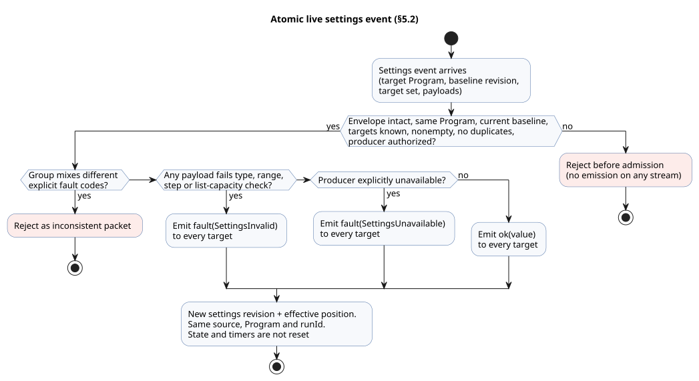
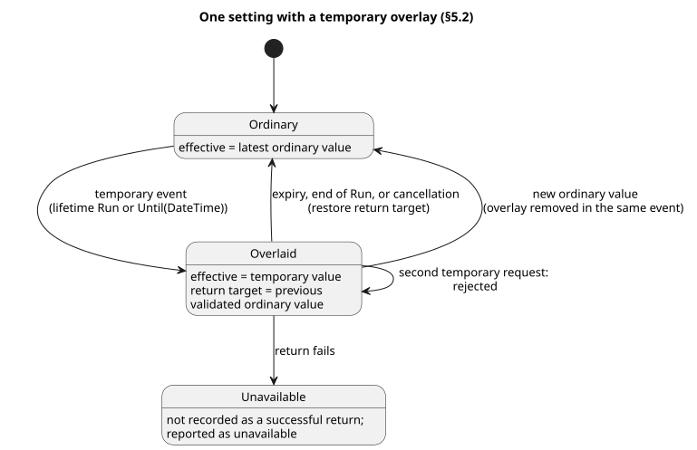

<!-- translation-source: docs/reference/05-settings-and-observation.md -->
[Korean original](05-settings-and-observation.md)

# 5. Settings and observation

[Complete contents](../LANGUAGE-REFERENCE.en.md) · [Previous: Sensors, constraints, and control](04-sensors-constraints-control.en.md) · [Next: Composition and replay](06-composition-and-replay.en.md)

A GhostFlow program separates two kinds of values:

- **Adjustable values.** A `config` is an adjustment point that the author deliberately exposes.
- **Values produced by execution.** `state`, timers, inputs, and outputs exist so that you can observe what the program is doing.

This separation matters in practice. An operator who changes the irrigation duration is doing something different from someone who edits the current timer, and the language keeps the two apart. It also lets a screen reuse the same types and validation rules as the program, without re-interpreting the source.

**In this chapter**

- §5.1 — how to declare a `config`, and the validation rules for each type.
- §5.2 — the difference between editing source and changing a setting during operation; atomic live events; temporary settings; restart.
- §5.3 — the observation model (descriptors, snapshots, events, command results, alarms, explanations), independent of any screen.
- §5.4 — which identities must never be mixed, and where GhostFlow's knowledge of the physical world ends.
- §5.5 — design rationale and evidence.

## 5.1 `config` declarations

The source notation below is settled.

```ghost
control OperatorSettings {
  config duration: Duration = 5min {
    min = 1min;
    max = 20min;
    step = 1min;
    access = operator;
    label = "관수 시간";
  }

  config duty: Percent = 50% {
    min = 0%;
    max = 100%;
    step = 10%;
    access = designer;
    label = "출력 비율";
  }

  config enabled: Bool = false {
    access = operator;
    label = "자동 관수 사용";
  }
}
```

`config name: Type = default { ... }` declares a **typed stream**. Its payload type is `Type`, and its first emission is `ok(default)`. One declaration holds three things together: the name, the initial value from source, and the validation metadata.

- `access` controls who may change the value. It does not change the stream's type.
- A config that operators may not change is still read with the same Result rules as any other config.
- If you only need a computational constant that never changes, use a constant expression in an ordinary `let` instead.

| Item | Meaning | Rule |
|---|---|---|
| Type | What the value means and which values it can represent | The same type rules apply to executable expressions and to settings input. |
| Default | Payload of the first `ok` emission | Part of the canonical `.ghost.md`. It is **not** a fallback for errors. |
| `min`, `max` | Closed permitted range | Same type as the setting, with `min <= max`. Both endpoints are permitted. |
| `step` | Grid of permitted values, starting at `min` | Must be greater than 0. A value is rejected if `(value - min)` is not a whole number of steps. For Temperature, the difference type is TemperatureDelta. |
| `access = operator` | An operator may change this setting | Only typed settings events within the declared range are permitted. |
| `access = designer` | The source author chooses this value | Cannot be changed by operating settings events. |
| `label` | Human-readable display name | Not an identifier. It changes neither meaning nor permissions. |

Enum members can also declare a display label: `type Phase = Idle { label = "대기"; } | Running;`.

- The label is optional plain-text metadata. It does not change the member's name, its ordinal, or how the control executes.
- A member without a label is displayed by its source name.
- These are errors: an empty label, a label containing only whitespace, duplicate labels, and unsupported member options.
- The compiler emits the label as `enumMembers[].displayLabel` in Interaction Schema `0.3`. Web, HMI, and mobile consumers all share this metadata. See the [Interaction contract](../../contracts/interaction-v0/README.md).

There is **no `apply` field**. Both `apply = stopped` and `apply = live` are syntax errors. An `operator` setting always takes effect through the atomic live event described in §5.2. The rule is fixed in the declaration itself so that no second settings system for choosing *when* a change applies can appear.

**Rules for defaults and validation**

- A numeric default must lie within `min..max` and on the step grid that starts at `min`.
- `Bool` has no numeric range or step: its two selectable values are already defined by the type.
- `false`, `0`, and `0%` are valid explicit values. They do not mean "no value".
- Unknown targets, duplicate targets, and unauthorized changes are rejected **before stream admission** (before the change enters the stream).
- If a change is identified and authorized, but its payload fails type, range, or step validation, it produces the error emission described in §5.2. A failed payload is never applied as a successful value.

An `Int` setting's default, `min`, `max`, and `step` are all signed 32-bit integers. `step` is positive. Both the default and `max` must lie on the integer grid that starts at `min`. For example, `min = -2; max = 4; step = 2;` permits exactly `-2, 0, 2, 4`. Fractions and floating-point tolerances are never rounded so that a value fits the integer grid.

**Why:** Integer settings, such as counts, must select permitted values exactly. Even with a large step, an integer outside the grid must not slip through because of a tolerance. And both endpoints of the closed range must actually be selectable.

For `Temperature`, `min`, `max`, and the default are absolute temperatures, while `step` is a `TemperatureDelta`. For example: `min = 10°C; max = 30°C; step = 0.5Δ°C;`. Other physical quantities use the difference types defined by the operation table in §2.9. For nominal types that have no general arithmetic, the settings grid is checked only on the type's canonical magnitude. This internal check does not give programs any new arithmetic operation.

Time-related settings work as follows.

| Setting type | Default, `min`, `max` | `step` | Grid is checked on |
|---|---|---|---|
| `Date` | `Date` | Positive `Int`, in days | Calendar days. `step = 1;` selects one date at a time from `min`. |
| `TimeOfDay` | `TimeOfDay` | Positive `Duration`, such as `1min` | Difference in milliseconds since midnight |
| `DateTime` | `DateTime` | Positive `Duration`, such as `1min` | Difference in UTC epoch milliseconds |

There is no wrapping at midnight and no time-zone inference. This settings validation does not give programs extra arithmetic such as `DateTime - DateTime` or `TimeOfDay + Duration`.

**Why:** Dates are chosen in calendar days; time values are chosen at millisecond resolution. A calendar day is not converted into 24 hours of real operation in some arbitrary time zone. This way the settings form and the runtime check exactly the same set of permitted values.

Schedule lists use the form ``config times: TimeSlots<15min, 8> = [time`06:00`];``. For this type, the grid and the maximum number of elements define the permitted range, so it does not use `min`, `max`, or `step`. List validation and connection to `DailySlots` follow [§3.6](03-time-and-schedules.md#36-선택된-dailyslots).

**Settings descriptors.** A settings descriptor supplies everything a consumer needs to present a setting: a stable setting ID, the source name, type, default, access permissions, range, step, label, and source/intent provenance (where in the source and intent it comes from). A cabinet view can use it to build typed forms such as a Duration input, a Bool selection, or a ranged numeric input. The cabinet view decides sliders, dials, coordinates, colors, and layout. Never infer a setting's identity or validation rules from its `label` or from the shape of a widget.

**Temperature display units.** A `Temperature` settings descriptor must include the selected `displayUnit` (`°C` or `K`), separately from the canonical value in `K`.

- A live event that changes only the number keeps the existing `displayUnit`.
- To change the unit, the event must name the new unit.
- A missing or ambiguous unit is an error before application. Never infer a display unit from the canonical value or its magnitude, and never pick a default unit.

### Defaults and effective values

A **default** is the initial payload defined in source. An **effective observation** is the latest `Result<Type, SettingsFault>` that an expression reads at a particular execution position.

```text
First observation                       → ok(source initial value)
Later accepted normal emission          → ok(new payload)
Later accepted error emission           → fault(SettingsFault)
```

Observers must be able to tell apart:

- `defaultValue`;
- the current Result: its status, and its payload or fault;
- the settings revision;
- the position at which the value took effect.

You may keep previous successful values as history. You must not present one as the effective value in a way that hides the current fault.

## 5.2 Source changes and operating settings changes

There are two different ways to "change a setting", and they mean different things.

| Change | Identity that changes | Meaning |
|---|---|---|
| Editing source defaults, expressions, or declarations | Document revision, source digest, and usually the program artifact | A new canonical `.ghost.md` candidate, to be reviewed |
| Operating settings event | Settings revision and effective event position | The effective value changes within the same source, Program, and run |

**Source editing** modifies the original Markdown. The result must be a new document revision that preserves prose, comments, fences, line breaks, and the original bytes. It must not pretend to be a settings overlay. Intent anchors, confirmed premises, unconfirmed assumptions, and source-map provenance are all revalidated against the new revision.

**Operating settings** never change source literals and never recompile anything.

API, Web, and FSD consumers therefore choose between two paths:

- For a permanent change to a default, submit a new `.ghost.md` candidate.
- To tune the same Program while it runs, submit a typed settings event.

Do not revive the deleted source-candidate helper as an implicit fallback, and do not leave it as an active consumer path. Keeping the two paths apart makes a request like "change 5 minutes to 10 minutes" reviewable: is it a permanent default edit, or a setting for this operation only?

### Settings streams and current observations

A settings **producer** can be a web UI, a network message, MQTT, or a physical control such as an EC11 rotary encoder. Swapping one producer for another changes neither the consumer program's expressions nor the meaning of the stream. The language semantics do not depend on any particular protocol, on RxJS, or on any UI library.

`access` is permission to **edit** values. It does not stop a legitimate producer from reporting an error on a `designer` or read-only config, or from recovering it to its declared initial payload. Changing it to any other payload is still an edit and goes through authorization. Before admission, the host verifies the source and permissions of both producer observations and operator edits. An origin label inside a packet is not authentication on its own, and consumer expressions never branch on origin.

Each stream behaves like this:

1. It supplies a valid initial value once.
2. After that, it supplies ordered `ok(value)` or `fault(reason)` observations.
3. A fault does not end the stream. A later normal emission can recover it.
4. Silence alone never creates a fault. "Unavailable" is an explicit `fault(SettingsUnavailable)` emission, as defined by the producer contract.

Ordinary control expressions handle both rails explicitly, using the existing Result syntax.

```ghost
config duration: Duration = 5min {
  min = 1min; max = 20min; step = 1min; access = operator;
}
let within_duration = case duration {
  ok(value) => age < value;
  fault(reason) => false;
};
```

Here, `false` is the error handling the author chose. The language never substitutes a stop, the default, or the previous successful value on its own. You may also use existing Result operations such as `map`, `and_then`, and `recover`, following their type rules. `TimeSlots` has the same success and error observations, and the `DailySlots` that consumes it handles errors directly. A list is never converted into an arbitrary scalar.

**One evaluation, one view.** All consumers read the same config observation at one logical evaluation position. A schedule's `every` and a control expression's run duration must never read different copies of the same setting. An emission that arrives during an evaluation does not change that evaluation's immutable view; it is placed at the next position in order. This evaluation boundary is how stream semantics are implemented. It does not turn settings into commands that only work inside a scan loop. The DI (digital input) snapshot is also fixed for the same evaluation, but ordinary Bool inputs are not required to carry a settings revision or an EventId.

### Atomic live event

When several settings change together, the change is a single **atomic live emission** with an explicit set of targets. It is processed in these steps.

1. Verify the Program the event targets and its baseline settings revision.
2. Verify that the target set is nonempty, fully identified, and free of duplicates, and that the producer has permission. Reject these **before admission**: corrupt envelopes, unknown targets, events for another Program, stale baseline revisions, and authorization failures. Never create an error emission on a stream that cannot be identified.
3. Validate all payloads of the identified operation together, against type, range, step, and list-capacity rules.
   - If all are valid, emit `ok(value)` to all targets together.
   - If any one fails, emit `fault(SettingsInvalid)` to all targets together. Never switch only the valid subset to `ok`. Keep the causes and the affected items in diagnostic provenance.
   - Explicit producer unavailability also emits `fault(SettingsUnavailable)` to the whole target group.
   - If one group carries different explicit fault codes, reject it as an inconsistent packet. Do not guess an error precedence.
   - If there is an actual payload validation failure, the whole group observes `SettingsInvalid`.
4. An accepted success or error emission gets a settings revision and an effective position. From that position on, all target observations take effect together. Streams that are not targets do not change.
5. The canonical source, the compiled Program, and the `runId` stay the same.
6. State and timers are **not** reset. The current control expressions read the new effective values and decide the results.

The flow below summarizes steps 1–6. Rejection happens before admission and produces no emission at all; every admitted event ends in one emission shared by all of its targets.



**Accepting a fault is not the same as rejecting a transport.** The error rail is new state that the consumer observes.

- A later failure of control evaluation does not cancel an emission that has already been accepted.
- If an API submits a not-yet-accepted emission together with its evaluation as one transaction, and the transaction fails, the emission stays unaccepted. It can be retried with the same identity.
- Never report an unaccepted operation as already effective.
- If the producer retransmits, the same emission is not applied twice.

So if you shorten `duration` from 10 minutes to 5 minutes during operation, the next decision compares the time already elapsed with the new limit. Nothing implicitly waits for a "next round", a stop, a reset, a recompile, or a new run. A settings event also does not force any particular output; output changes come only from the control expressions the author wrote.

Do not add application-timing fields to settings declarations. If you want to keep the run duration that was chosen at start, the program should copy the setting into its own state during the starting transition and read that state afterwards. The stop procedures needed to replace a program or firmware do not apply to operating settings events either.

### Lifecycle and temporary settings

A **temporary setting** is an operating setting with a defined lifetime. It is not separate source. It must specify:

- the target Program, setting ID, and typed value;
- the actor, permissions, and reason;
- the creating event, settings revision, and starting position;
- the lifetime, expiry, rollback provenance, and return target.

Previous overrides are never attached automatically to a different Program revision. They must be revalidated and explicitly approved for the new revision.

**Persistence across restart.** For accepted ordinary live settings, the latest Result and revision survive an actual device restart.

- If the last observation was a fault, the fault is restored. It is not replaced with the initial value.
- If there is a latest observation to restore, its history is applied after the initial emission and before the first control decision.
- A restart creates a new `runId`.

A temporary change is **one layer of overlay** on top of ordinary settings. It adds no source keyword. Its meaning is defined entirely by the following settings-event rules.

| Item | Settled rule |
|---|---|
| Lifetime | The requester explicitly chooses `Run` or `Until(DateTime)`. A request without a lifetime is rejected. |
| `Run` | Valid only in the current run. The overlay is removed when the run ends. |
| `Until` | Stores the absolute expiry time and the exact Program identity. Remains valid across restarts of the same Program until it expires. |
| Return value | The validated ordinary value that was in effect just before the temporary change. It is never silently replaced by the source default. |
| Nesting | If the setting already has an active temporary change, a new temporary change is rejected. Cancel the first one explicitly. |
| New ordinary setting | The same event removes that setting's overlay and applies the new ordinary value. An old expiry cannot later overwrite the new value. |
| Expiry/cancellation | An atomic settings event that targets the original overlay ID. It records the completed settings revision and the application position. |
| Return failure | It is not recorded as a successful return. Settings validity is reported as unavailable, and decisions that need that setting are not committed. How physical outputs respond follows the installation's explicit failure contract. |

The state diagram below shows these rules for one setting.



More rules:

- If no trusted time is available to decide when `Until` expires, reject the new temporary request.
- If the validity of an already applied value can no longer be determined, stop reading it as valid.
- At restart, finish all restoration and expiry decisions before the first control decision.
- A temporary event that groups several settings gives them one shared lifetime, and application and return are all-or-nothing.
- To change part of such a group with an ordinary change, submit a single event that cancels the whole group and sets the new values.

**Why:** These rules stop a temporary value from quietly becoming permanent, and stop a late expiry from undoing a newer operator decision. The expiry time and the temporary value are the operator's choices; the language never picks an arbitrary run duration.

### Restart and memory restoration

A new run starts from the declared state initial values and fresh timer baselines. Time spent powered off is **not** added to `elapsed`.

Persisting ordinary settings and restoring state are two separate things. If a host offers checkpoint restoration:

- it must verify the Program, the instance, the state schema, and the continuity of monotonic time;
- it must receive an explicit execution request that names the checkpoint and the restoration-permission policy;
- it must not restore timer or filter memory whose continuity cannot be proven;
- a restoration failure must be observable. Never initialize state while reporting that restoration succeeded.

When a program needs the reason for a restart, use the exact reserved, runtime-owned lifecycle input contract below. There is no dedicated `on_restart` statement. These ports are read directly as scalar values, without `Result<T, SensorFault>` acquisition, and they cannot have optional markers or conditioning settings. All other external inputs keep the canonical quality contract.

```ghost
type RestartReason = PowerOn | Brownout | Watchdog | Software | Unknown;
input restart_reason: RestartReason;
input restart_event: Bool;
```

These exact reserved declarations are a fragment of a control body. They work as follows.

- **Who supplies them.** The framed runtime owns both values and injects them. Callers cannot supply them in scan frames or through ordinary input setters.
- **`restart_reason`.** The host explicitly supplies the reason confirmed by hardware, or `Unknown` when there is no evidence. `PowerOn` alone does not prove recovery from a power outage. The reason is fixed for the whole run.
- **`restart_event`.** The host also states whether the boot event is still pending. While it is pending, `restart_event` is true in the first scan that commits successfully, and false afterwards. A rejected scan leaves it pending. If the program is replaced after the boot event has already been consumed, the host sets it to false.
- **What the author decides.** Automatic resumption, waiting, or cancelling and then returning to the home position are all expressed as state transitions written by the author.
- **What it does not do.** This contract supplies an event and a cause only. It does not restore VM or timer memory. Before the first decision, physical outputs are owned by the device installation policy and the output renderer.


## 5.3 Cabinet-view-independent observation model

<a id="53-renderer-독립-관찰-모델"></a>

<a id="53-renderer-independent-observation-model"></a>


In this chapter, the older term "renderer", when it refers to forms and observation views, means the cabinet view/UI (`@ghostflow/cabinet-view`). An *output renderer* is different: it applies logical output intent, as defined in §8.2. UI display does not establish applied or confirmed evidence: showing something on a screen never proves that an output was applied or confirmed.


Observation contracts carry meaning; they do not specify screens.

| Concept | Question it answers | Time meaning |
|---|---|---|
| descriptor | What can be read or changed? | Static source/Program meaning |
| snapshot | What were the values in one completed decision? | One completed scan |
| event | What happened, and in what order? | Ordered occurrence within a run |
| command result | How did the execution boundary handle a request? | Command lifecycle |
| alarm | Which condition was raised, and when did it clear? | Raise/clear events and current state |
| explanation | Which evaluation supports the current result? | The same completed scan |

The contract contains no widgets, layouts, coordinates, colors, or screen-specific visibility policies. Several cabinet views may present the same descriptors and execution identities differently. None of them may change values, permissions, validation, or command availability.

### Descriptors and snapshots

A **descriptor** has a public semantic ID, a name, a kind, a source type, read/write/execute permissions, and source/intent provenance. State, timers, exact counters, settings, inputs, outputs, commands, and alarms are each classified by their declared meaning. Never infer that something is a counter because it is named `count` or because its value looks like an integer.

Changing a setting and observing a value are different capabilities.

- Seeing a value in a `state`, timer, or output descriptor does not grant write permission.
- Metadata producers and cabinet views cannot add `write` or `execute` permissions that the source does not declare.
- Command permission does not imply permission to write internal state directly.
- Operator settings permission does not imply permission to edit source.

A **snapshot** is bound to exactly one completed scan. Each observation in it is one of:

- `ready`: an actual value exists, including `false` and `0`.
- `unavailable`: no value exists at that completion point, and a reason is given.
- `error`: the descriptor could not be observed.
- `stale`: a result the *consumer* computes by comparing against the identity it expected. The payload never asserts this status about itself.

A valid stateless control may have an empty descriptor list with an identified schema; its completed snapshots then have empty observation lists. This is not an observation failure. Do not add artificial Bool state or timers just to fill a screen.

The descriptor for `timer age = elapsed(phase)` directly names the original enum `phase` as its subject. Do not expose a synthesized Bool clock, used for internal calculation or display, as if it were public meaning. When the subject is a Bool, the timer counts time since the last committed change in either direction (true-to-false or false-to-true).

### Events, command results, and alarms

A snapshot alone cannot show an alarm that was raised and cleared between two refreshes. That is why events exist.

- **Events** are ordered per run, and duplicates must be identifiable. If records drop out of the retention range or a connection breaks, report the sequence gap or missed range explicitly. Never reconstruct the missing events from the last snapshot.
- **Command results** keep these outcomes distinct: request received, rejected, started, completed, cancelled, and failed. The notation `received → rejected | started → completed | cancelled | failed` explains these distinctions; it is not settled source syntax, nor a record enum or transition schema. Command IDs and execution identities must match, and cabinet views or callbacks must not infer a separate state machine. If bounded history loses records before export, report a gap.
- **Alarms** use both the current active status and raise/clear events, so that even brief occurrences are preserved.

The final serialization and transport of command and alarm records belong to the execution environment's observation contract. The language has no `command` or `alarm` source declarations and no severity keywords. Control responses are written with explicit typed inputs and state expressions. An explicit external descriptor contract decides which inputs are command requests and which observations are exposed as alarms. Never infer this automatically from names or from Bool values alone.

### Explanation DAG

An **explanation** is a directed acyclic graph (DAG). It connects one output result to the inputs, state, timers, named intermediate values, predicates, and constraints that were actually evaluated to produce it. A condition shared by several results stays a single, stable node. If needed, a cabinet view may unfold the graph into a tree rooted at a particular output.

For each completed scan, every evaluation needs at least these meanings: `evaluated`, the actual value/status, and `supportsResult`.

- Never show a branch that was short-circuited (not evaluated) as actual evidence.
- If an AND is false, its evaluated false children may help explain the result. If an OR is true, all of its evaluated true children may help explain it. Never pick one arbitrary "winner".
- The graph is a proof path for the evaluation result. It does **not** claim counterfactual causation, such as "without this condition the result would have been different".

Explanations cover both output ON and output OFF, and both the requested intent and the safe intent after constraints. Never use private compiler slot names as public semantic IDs. Every node must be traceable back to source nodes/spans, intent anchors, and the canonical document revision.

## 5.4 Identity and physical-fact boundaries

Observation and settings records keep the following identities separate. Never mix them.

```text
source document + immutable revision + source digest
Program/module + artifact digest
settings revision + effective event position
behavior instance and installation/binding revision (when composed)
runId + completed scanId + logical time
event/command/alarm sequence identity
```

`scanId` only orders scans within one run. If a reset or an actual restart creates a new run, even the same `scanId = 0` is a different occurrence. A live settings event does not change `runId`. If you join snapshots and explanations that come from different sources, Programs, settings, bindings, or runs, treat the result as stale or a mismatch.

**What GhostFlow can and cannot know.** GhostFlow observes inputs and control decisions. `pump = true` is output *intent*; it does not prove that the pump was electrically energized, that it turned, or that water flowed. Keep these separate:

- requested intent;
- safe intent;
- the application result reported by the host/renderer;
- actual feedback.

Without feedback, the physical outcome is unknown. An explanation that "the low-water signal blocked irrigation" must never be turned into the claim that "the tank was actually empty".

## 5.5 Design rationale and evidence

- **Typed settings** give code, validation, and automatically generated forms one shared meaning.
- **Atomic events** remove the moments when only some values have been applied.
- **Separating snapshots from events** preserves both current values and past occurrences.
- **Exact identity and provenance** prevent different executions that share a name from being linked by mistake.
- **Keeping the physical-fact boundary** prevents simulations and UIs from inventing device success.

Rationale: [Language model](../LANGUAGE.en.md), [Control surface](../LANGUAGE-SURFACE.en.md), [Intent anchors](../INTENT-ANCHOR-MAP.md), [Interaction v0](../../contracts/interaction-v0/README.md), [#68](https://github.com/callin2/ghostflow-language/issues/68), [#70](https://github.com/callin2/ghostflow-language/issues/70), [#73](https://github.com/callin2/ghostflow-language/issues/73), [#74](https://github.com/callin2/ghostflow-language/issues/74), [#88](https://github.com/callin2/ghostflow-language/issues/88), [#89](https://github.com/callin2/ghostflow-language/issues/89), [#105](https://github.com/callin2/ghostflow-language/issues/105), [#110](https://github.com/callin2/ghostflow-language/issues/110).
