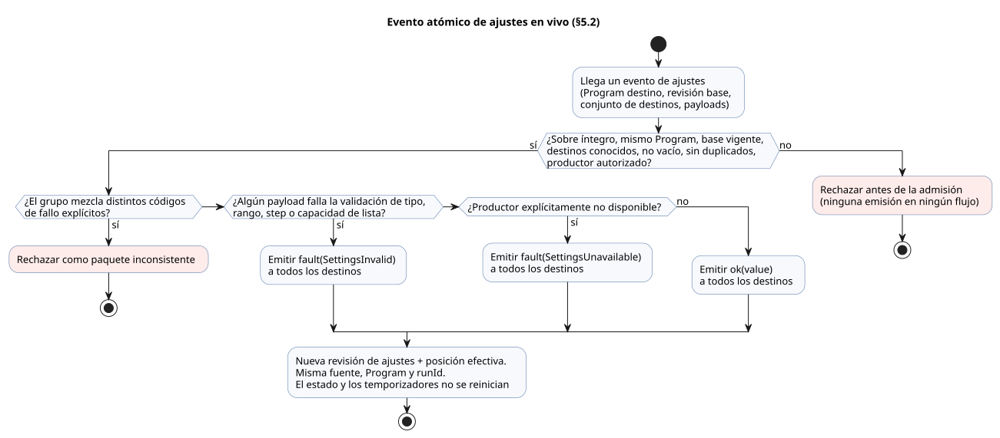
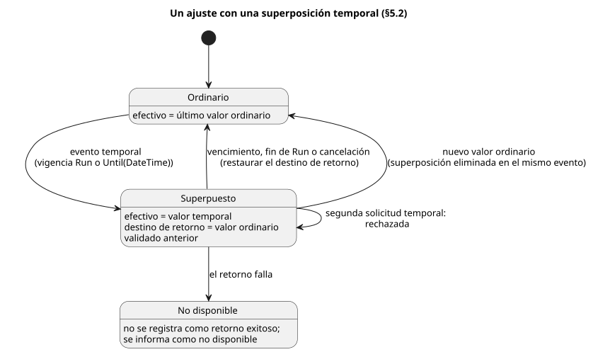

<!-- translation-source: docs/reference/05-settings-and-observation.en.md -->
[Original en inglés](05-settings-and-observation.en.md)

# 5. Ajustes y observación

[Índice completo](../LANGUAGE-REFERENCE.es.md) · [Anterior: Sensores, restricciones y control](04-sensors-constraints-control.es.md) · [Siguiente: Composición y reproducción](06-composition-and-replay.es.md)

Un programa GhostFlow separa dos tipos de valores:

- **Valores ajustables.** Un `config` es un punto de ajuste que el autor expone deliberadamente.
- **Valores producidos por la ejecución.** `state`, los temporizadores, las entradas y las salidas existen para que usted pueda observar lo que hace el programa.

Esta separación importa en la práctica. Un operador que cambia la duración del riego hace algo distinto de quien edita el temporizador actual, y el lenguaje mantiene separadas ambas acciones. También permite que una pantalla reutilice los mismos tipos y reglas de validación que el programa, sin volver a interpretar la fuente.

**En este capítulo**

- §5.1 — cómo declarar un `config` y las reglas de validación de cada tipo.
- §5.2 — la diferencia entre editar la fuente y cambiar un ajuste durante la operación; eventos atómicos en vivo; ajustes temporales; reinicio.
- §5.3 — el modelo de observación (descriptores, instantáneas, eventos, resultados de comandos, alarmas, explicaciones), independiente de cualquier pantalla.
- §5.4 — qué identidades nunca deben mezclarse y dónde termina el conocimiento de GhostFlow sobre el mundo físico.
- §5.5 — fundamento de diseño y evidencia.

## 5.1 Declaraciones `config`

La notación de fuente siguiente está establecida.

```ghost
control OperatorSettings {
  config duration: Duration = 5min {
    min = 1min;
    max = 20min;
    step = 1min;
    access = operator;
    label = "관수 시간";
  }

  config duty: Percent = 50% {
    min = 0%;
    max = 100%;
    step = 10%;
    access = designer;
    label = "출력 비율";
  }

  config enabled: Bool = false {
    access = operator;
    label = "자동 관수 사용";
  }
}
```

`config name: Type = default { ... }` declara un **flujo tipado**. Su tipo de payload es `Type` y su primera emisión es `ok(default)`. Una sola declaración reúne tres cosas: el nombre, el valor inicial de la fuente y los metadatos de validación.

- `access` controla quién puede cambiar el valor. No cambia el tipo del flujo.
- Un config que los operadores no pueden cambiar se lee igualmente con las mismas reglas de Result que cualquier otro config.
- Si solo necesita una constante de cálculo que nunca cambia, use en su lugar una expresión constante en un `let` ordinario.

| Elemento | Significado | Regla |
|---|---|---|
| Tipo | Qué significa el valor y qué valores puede representar | Las mismas reglas de tipos se aplican a las expresiones ejecutables y a la entrada de ajustes. |
| Valor predeterminado | Payload de la primera emisión `ok` | Forma parte del `.ghost.md` canónico. **No** es un respaldo ante errores. |
| `min`, `max` | Rango permitido cerrado | Del mismo tipo que el ajuste, con `min <= max`. Ambos extremos están permitidos. |
| `step` | Rejilla de valores permitidos, a partir de `min` | Debe ser mayor que 0. Un valor se rechaza si `(value - min)` no es un número entero de pasos. Para Temperature, el tipo de diferencia es TemperatureDelta. |
| `access = operator` | Un operador puede cambiar este ajuste | Solo se permiten eventos de ajustes tipados dentro del rango declarado. |
| `access = designer` | El autor de la fuente elige este valor | No puede cambiarse mediante eventos de ajustes operativos. |
| `label` | Nombre visible legible por personas | No es un identificador. No cambia ni el significado ni los permisos. |

Los miembros de una enumeración también pueden declarar una etiqueta visible: `type Phase = Idle { label = "대기"; } | Running;`.

- La etiqueta es un metadato opcional de texto plano. No cambia el nombre del miembro, su ordinal ni la forma en que se ejecuta el control.
- Un miembro sin etiqueta se muestra con su nombre en la fuente.
- Son errores: una etiqueta vacía, una etiqueta que solo contiene espacios en blanco, etiquetas duplicadas y opciones de miembro no admitidas.
- El compilador emite la etiqueta como `enumMembers[].displayLabel` en Interaction Schema `0.3`. Los consumidores web, HMI y móviles comparten estos metadatos. Consulte el [contrato de interacción](../../contracts/interaction-v0/README.es.md).

**No existe un campo `apply`**. Tanto `apply = stopped` como `apply = live` son errores de sintaxis. Un ajuste `operator` siempre surte efecto mediante el evento atómico en vivo descrito en §5.2. La regla se fija en la propia declaración para que no pueda surgir un segundo sistema de ajustes que elija *cuándo* se aplica un cambio.

**Reglas para valores predeterminados y validación**

- Un valor predeterminado numérico debe estar dentro de `min..max` y sobre la rejilla de pasos que empieza en `min`.
- `Bool` no tiene rango numérico ni paso: sus dos valores seleccionables ya están definidos por el tipo.
- `false`, `0` y `0%` son valores explícitos válidos. No significan "sin valor".
- Los destinos desconocidos, los destinos duplicados y los cambios no autorizados se rechazan **antes de la admisión en el flujo** (antes de que el cambio entre en el flujo).
- Si un cambio está identificado y autorizado, pero su payload no supera la validación de tipo, rango o paso, produce la emisión de error descrita en §5.2. Un payload fallido nunca se aplica como valor exitoso.

El valor predeterminado, `min`, `max` y `step` de un ajuste `Int` son todos enteros con signo de 32 bits. `step` es positivo. Tanto el valor predeterminado como `max` deben estar sobre la rejilla entera que empieza en `min`. Por ejemplo, `min = -2; max = 4; step = 2;` permite exactamente `-2, 0, 2, 4`. Las fracciones y las tolerancias de coma flotante nunca se redondean para que un valor encaje en la rejilla entera.

**Por qué:** Los ajustes enteros, como los recuentos, deben seleccionar exactamente valores permitidos. Incluso con un paso grande, un entero fuera de la rejilla no debe colarse por una tolerancia. Y ambos extremos del rango cerrado deben poder seleccionarse realmente.

Para `Temperature`, `min`, `max` y el valor predeterminado son temperaturas absolutas, mientras que `step` es un `TemperatureDelta`. Por ejemplo: `min = 10°C; max = 30°C; step = 0.5Δ°C;`. Las demás magnitudes físicas usan los tipos de diferencia definidos por la tabla de operaciones de §2.9. Para los tipos nominales que no tienen aritmética general, la rejilla de ajustes se comprueba solo sobre la magnitud canónica del tipo. Esta comprobación interna no da a los programas ninguna operación aritmética nueva.

Los ajustes relacionados con el tiempo funcionan así.

| Tipo de ajuste | Valor predeterminado, `min`, `max` | `step` | La rejilla se comprueba sobre |
|---|---|---|---|
| `Date` | `Date` | `Int` positivo, en días | Días de calendario. `step = 1;` selecciona una fecha cada vez a partir de `min`. |
| `TimeOfDay` | `TimeOfDay` | `Duration` positiva, como `1min` | Diferencia en milisegundos desde la medianoche |
| `DateTime` | `DateTime` | `Duration` positiva, como `1min` | Diferencia en milisegundos de época UTC |

No hay vuelta a cero a medianoche ni inferencia de zona horaria. Esta validación de ajustes no da a los programas aritmética adicional como `DateTime - DateTime` o `TimeOfDay + Duration`.

**Por qué:** Las fechas se eligen en días de calendario; los valores de tiempo se eligen con resolución de milisegundos. Un día de calendario no se convierte en 24 horas de operación real en alguna zona horaria arbitraria. Así, el formulario de ajustes y el runtime comprueban exactamente el mismo conjunto de valores permitidos.

Las listas de programación usan la forma ``config times: TimeSlots<15min, 8> = [time`06:00`];``. Para este tipo, la rejilla y el número máximo de elementos definen el rango permitido, por lo que no usa `min`, `max` ni `step`. La validación de la lista y la conexión con `DailySlots` siguen [§3.6](03-time-and-schedules.es.md#36-dailyslots-seleccionado).

**Descriptores de ajustes.** Un descriptor de ajustes proporciona todo lo que un consumidor necesita para presentar un ajuste: un ID de ajuste estable, el nombre en la fuente, el tipo, el valor predeterminado, los permisos de acceso, el rango, el paso, la etiqueta y la procedencia de fuente/intención (de qué parte de la fuente y de la intención proviene). Una vista de gabinete (cabinet view) puede usarlo para construir formularios tipados, como una entrada de Duration, una selección Bool o una entrada numérica con rango. La vista de gabinete decide los deslizadores, diales, coordenadas, colores y la disposición. Nunca infiera la identidad o las reglas de validación de un ajuste a partir de su `label` o de la forma de un widget.

**Unidades de visualización de temperatura.** Un descriptor de ajustes de `Temperature` debe incluir la `displayUnit` seleccionada (`°C` o `K`), separada del valor canónico en `K`.

- Un evento en vivo que solo cambia el número conserva la `displayUnit` existente.
- Para cambiar la unidad, el evento debe nombrar la nueva unidad.
- Una unidad ausente o ambigua es un error antes de la aplicación. Nunca infiera una unidad de visualización a partir del valor canónico o de su magnitud, y nunca elija una unidad predeterminada.

### Valores predeterminados y valores efectivos

Un **valor predeterminado** es el payload inicial definido en la fuente. Una **observación efectiva** es el último `Result<Type, SettingsFault>` que lee una expresión en una posición de ejecución concreta.

```text
Primera observación                     → ok(valor inicial de la fuente)
Emisión normal aceptada posterior       → ok(nuevo payload)
Emisión de error aceptada posterior     → fault(SettingsFault)
```

Los observadores deben poder distinguir:

- `defaultValue`;
- el Result actual: su estado, y su payload o fallo;
- la revisión de ajustes;
- la posición en la que el valor surtió efecto.

Puede conservar los valores exitosos anteriores como historial. No debe presentar uno de ellos como el valor efectivo de forma que oculte el fallo actual.

## 5.2 Cambios de fuente y cambios de ajustes operativos

Hay dos formas distintas de "cambiar un ajuste", y significan cosas diferentes.

| Cambio | Identidad que cambia | Significado |
|---|---|---|
| Editar valores predeterminados, expresiones o declaraciones de la fuente | Revisión del documento, digest de la fuente y, normalmente, el artefacto del programa | Un nuevo candidato `.ghost.md` canónico, que debe revisarse |
| Evento de ajustes operativos | Revisión de ajustes y posición efectiva del evento | El valor efectivo cambia dentro de la misma fuente, Program y ejecución (run) |

**La edición de la fuente** modifica el Markdown original. El resultado debe ser una nueva revisión del documento que conserve la prosa, los comentarios, los bloques delimitados, los saltos de línea y los bytes originales. No debe hacerse pasar por una superposición de ajustes. Las anclas de intención, las premisas confirmadas, los supuestos no confirmados y la procedencia del mapa de fuente se vuelven a validar contra la nueva revisión.

**Los ajustes operativos** nunca cambian los literales de la fuente y nunca recompilan nada.

Por tanto, los consumidores de API, Web y FSD eligen entre dos caminos:

- Para un cambio permanente de un valor predeterminado, envíe un nuevo candidato `.ghost.md`.
- Para ajustar el mismo Program mientras se ejecuta, envíe un evento de ajustes tipado.

No reviva el auxiliar eliminado de candidatos de fuente como respaldo implícito, ni lo deje como camino activo para consumidores. Mantener separados ambos caminos hace que una solicitud como "cambiar 5 minutos a 10 minutos" sea revisable: ¿es una edición permanente del valor predeterminado o un ajuste solo para esta operación?

### Flujos de ajustes y observaciones actuales

Un **productor** de ajustes puede ser una interfaz web, un mensaje de red, MQTT o un control físico como un codificador rotatorio EC11. Sustituir un productor por otro no cambia ni las expresiones del programa consumidor ni el significado del flujo. La semántica del lenguaje no depende de ningún protocolo concreto, de RxJS ni de ninguna biblioteca de interfaz.

`access` es el permiso para **editar** valores. No impide que un productor legítimo informe de un error en un config `designer` o de solo lectura, ni que lo recupere a su payload inicial declarado. Cambiarlo a cualquier otro payload sigue siendo una edición y pasa por la autorización. Antes de la admisión, el host verifica el origen y los permisos tanto de las observaciones del productor como de las ediciones del operador. Una etiqueta de origen dentro de un paquete no es por sí sola una autenticación, y las expresiones consumidoras nunca se ramifican según el origen.

Cada flujo se comporta así:

1. Proporciona una vez un valor inicial válido.
2. Después, proporciona observaciones ordenadas `ok(value)` o `fault(reason)`.
3. Un fallo no termina el flujo. Una emisión normal posterior puede recuperarlo.
4. El silencio por sí solo nunca crea un fallo. "No disponible" es una emisión explícita `fault(SettingsUnavailable)`, tal como lo define el contrato del productor.

Las expresiones de control ordinarias tratan ambos carriles explícitamente, con la sintaxis de Result existente.

```ghost
config duration: Duration = 5min {
  min = 1min; max = 20min; step = 1min; access = operator;
}
let within_duration = case duration {
  ok(value) => age < value;
  fault(reason) => false;
};
```

Aquí, `false` es el tratamiento de errores que eligió el autor. El lenguaje nunca sustituye por sí mismo una parada, el valor predeterminado ni el valor exitoso anterior. También puede usar operaciones de Result existentes como `map`, `and_then` y `recover`, siguiendo sus reglas de tipos. `TimeSlots` tiene las mismas observaciones de éxito y error, y el `DailySlots` que lo consume trata los errores directamente. Una lista nunca se convierte en un escalar arbitrario.

**Una evaluación, una vista.** Todos los consumidores leen la misma observación de config en una misma posición de evaluación lógica. El `every` de una programación y la duración de ejecución de una expresión de control nunca deben leer copias distintas del mismo ajuste. Una emisión que llega durante una evaluación no cambia la vista inmutable de esa evaluación; se coloca en la siguiente posición en orden. Este límite de evaluación es la forma en que se implementa la semántica de flujos. No convierte los ajustes en comandos que solo funcionan dentro de un ciclo de escaneo. La instantánea de DI (entrada digital) también queda fija para la misma evaluación, pero no se exige que las entradas Bool ordinarias lleven una revisión de ajustes ni un EventId.

### Evento atómico en vivo

Cuando varios ajustes cambian juntos, el cambio es una única **emisión atómica en vivo** con un conjunto explícito de destinos. Se procesa en estos pasos.

1. Verificar el Program al que apunta el evento y su revisión de ajustes base.
2. Verificar que el conjunto de destinos no esté vacío, esté completamente identificado y no tenga duplicados, y que el productor tenga permiso. Rechazar **antes de la admisión**: sobres corruptos, destinos desconocidos, eventos para otro Program, revisiones base obsoletas y fallos de autorización. Nunca crear una emisión de error en un flujo que no pueda identificarse.
3. Validar juntos todos los payloads de la operación identificada, contra las reglas de tipo, rango, paso y capacidad de lista.
   - Si todos son válidos, emitir `ok(value)` a todos los destinos a la vez.
   - Si alguno falla, emitir `fault(SettingsInvalid)` a todos los destinos a la vez. Nunca cambiar a `ok` solo el subconjunto válido. Conservar las causas y los elementos afectados en la procedencia del diagnóstico.
   - La no disponibilidad explícita del productor también emite `fault(SettingsUnavailable)` a todo el grupo de destinos.
   - Si un grupo lleva códigos de fallo explícitos distintos, rechazarlo como paquete inconsistente. No adivinar una precedencia de errores.
   - Si hay un fallo real de validación de payload, todo el grupo observa `SettingsInvalid`.
4. Una emisión de éxito o de error aceptada obtiene una revisión de ajustes y una posición efectiva. A partir de esa posición, todas las observaciones de los destinos surten efecto juntas. Los flujos que no son destinos no cambian.
5. La fuente canónica, el Program compilado y el `runId` siguen siendo los mismos.
6. El estado y los temporizadores **no** se reinician. Las expresiones de control actuales leen los nuevos valores efectivos y deciden los resultados.

El flujo siguiente resume los pasos 1–6. El rechazo ocurre antes de la admisión y no produce ninguna emisión; todo evento admitido termina en una emisión compartida por todos sus destinos.



**Aceptar un fallo no es lo mismo que rechazar un transporte.** El carril de error es un estado nuevo que el consumidor observa.

- Un fallo posterior de la evaluación del control no cancela una emisión ya aceptada.
- Si una API envía una emisión aún no aceptada junto con su evaluación como una sola transacción, y la transacción falla, la emisión sigue sin aceptarse. Puede reintentarse con la misma identidad.
- Nunca informe de una operación no aceptada como si ya fuera efectiva.
- Si el productor retransmite, la misma emisión no se aplica dos veces.

Así, si acorta `duration` de 10 minutos a 5 minutos durante la operación, la siguiente decisión compara el tiempo ya transcurrido con el nuevo límite. Nada espera implícitamente a una "siguiente ronda", una parada, un reinicio, una recompilación ni una nueva ejecución. Un evento de ajustes tampoco fuerza ninguna salida concreta; los cambios de salida provienen solo de las expresiones de control que escribió el autor.

No añada campos de momento de aplicación a las declaraciones de ajustes. Si desea conservar la duración de ejecución elegida al inicio, el programa debería copiar el ajuste en su propio estado durante la transición de arranque y leer ese estado después. Los procedimientos de parada necesarios para reemplazar un programa o un firmware tampoco se aplican a los eventos de ajustes operativos.

### Ciclo de vida y ajustes temporales

Un **ajuste temporal** es un ajuste operativo con una vigencia definida. No es una fuente aparte. Debe especificar:

- el Program destino, el ID del ajuste y el valor tipado;
- el actor, los permisos y el motivo;
- el evento que lo crea, la revisión de ajustes y la posición de inicio;
- la vigencia, el vencimiento, la procedencia de la reversión y el destino de retorno.

Las anulaciones anteriores nunca se asocian automáticamente a una revisión distinta del Program. Deben volver a validarse y aprobarse explícitamente para la nueva revisión.

**Persistencia tras un reinicio.** Para los ajustes en vivo ordinarios aceptados, el último Result y la revisión sobreviven a un reinicio real del dispositivo.

- Si la última observación fue un fallo, se restaura el fallo. No se sustituye por el valor inicial.
- Si hay una última observación que restaurar, su historial se aplica después de la emisión inicial y antes de la primera decisión de control.
- Un reinicio crea un nuevo `runId`.

Un cambio temporal es **una capa de superposición** sobre los ajustes ordinarios. No añade ninguna palabra clave a la fuente. Su significado está definido por completo por las siguientes reglas de eventos de ajustes.

| Elemento | Regla establecida |
|---|---|
| Vigencia | El solicitante elige explícitamente `Run` o `Until(DateTime)`. Una solicitud sin vigencia se rechaza. |
| `Run` | Válido solo en la ejecución actual. La superposición se elimina cuando termina la ejecución. |
| `Until` | Almacena la hora absoluta de vencimiento y la identidad exacta del Program. Sigue siendo válido a través de reinicios del mismo Program hasta que vence. |
| Valor de retorno | El valor ordinario validado que estaba en vigor justo antes del cambio temporal. Nunca se sustituye silenciosamente por el valor predeterminado de la fuente. |
| Anidamiento | Si el ajuste ya tiene un cambio temporal activo, un nuevo cambio temporal se rechaza. Cancele explícitamente el primero. |
| Nuevo ajuste ordinario | El mismo evento elimina la superposición de ese ajuste y aplica el nuevo valor ordinario. Un vencimiento antiguo no puede sobrescribir después el nuevo valor. |
| Vencimiento/cancelación | Un evento de ajustes atómico que apunta al ID de la superposición original. Registra la revisión de ajustes completada y la posición de aplicación. |
| Fallo del retorno | No se registra como retorno exitoso. La validez del ajuste se informa como no disponible, y las decisiones que necesitan ese ajuste no se consolidan. La respuesta de las salidas físicas sigue el contrato de fallo explícito de la instalación. |

El diagrama de estados siguiente muestra estas reglas para un ajuste.



Más reglas:

- Si no hay una hora de confianza disponible para decidir cuándo vence `Until`, rechace la nueva solicitud temporal.
- Si ya no puede determinarse la validez de un valor ya aplicado, deje de leerlo como válido.
- Al reiniciar, termine todas las decisiones de restauración y vencimiento antes de la primera decisión de control.
- Un evento temporal que agrupa varios ajustes les da una vigencia compartida, y la aplicación y el retorno son de todo o nada.
- Para cambiar parte de un grupo así con un cambio ordinario, envíe un único evento que cancele todo el grupo y establezca los nuevos valores.

**Por qué:** Estas reglas impiden que un valor temporal se vuelva permanente sin que nadie lo note, y que un vencimiento tardío deshaga una decisión más reciente del operador. La hora de vencimiento y el valor temporal son decisiones del operador; el lenguaje nunca elige una duración de ejecución arbitraria.

### Reinicio y restauración de memoria

Una nueva ejecución empieza a partir de los valores iniciales de estado declarados y de bases de temporizador nuevas. El tiempo pasado sin alimentación **no** se suma a `elapsed`.

Persistir los ajustes ordinarios y restaurar el estado son dos cosas distintas. Si un host ofrece restauración desde un punto de control (checkpoint):

- debe verificar el Program, la instancia, el esquema de estado y la continuidad del tiempo monotónico;
- debe recibir una solicitud de ejecución explícita que nombre el punto de control y la política de permisos de restauración;
- no debe restaurar memoria de temporizadores o filtros cuya continuidad no pueda demostrarse;
- un fallo de restauración debe ser observable. Nunca inicialice el estado mientras informa de que la restauración tuvo éxito.

Cuando un programa necesite el motivo de un reinicio, use exactamente el contrato de entradas de ciclo de vida reservado y propiedad del runtime que se muestra a continuación. No existe una sentencia `on_restart` dedicada. Estos puertos se leen directamente como valores escalares, sin la adquisición `Result<T, SensorFault>`, y no pueden tener marcadores opcionales ni ajustes de acondicionamiento. Todas las demás entradas externas conservan el contrato de calidad canónico.

```ghost
type RestartReason = PowerOn | Brownout | Watchdog | Software | Unknown;
input restart_reason: RestartReason;
input restart_event: Bool;
```

Estas declaraciones reservadas exactas son un fragmento del cuerpo de un control. Funcionan así.

- **Quién las proporciona.** El runtime con tramas es propietario de ambos valores y los inyecta. Quienes llaman no pueden proporcionarlos en las tramas de escaneo ni mediante los asignadores de entradas ordinarios.
- **`restart_reason`.** El host proporciona explícitamente el motivo confirmado por el hardware, o `Unknown` cuando no hay evidencia. `PowerOn` por sí solo no demuestra la recuperación tras un corte de energía. El motivo es fijo durante toda la ejecución.
- **`restart_event`.** El host también indica si el evento de arranque sigue pendiente. Mientras está pendiente, `restart_event` es verdadero en el primer escaneo que se consolida con éxito, y falso después. Un escaneo rechazado lo deja pendiente. Si el programa se reemplaza después de que el evento de arranque ya se haya consumido, el host lo establece en falso.
- **Qué decide el autor.** La reanudación automática, la espera, o la cancelación seguida del regreso a la posición de origen se expresan como transiciones de estado escritas por el autor.
- **Qué no hace.** Este contrato solo proporciona un evento y una causa. No restaura la memoria de la VM ni de los temporizadores. Antes de la primera decisión, las salidas físicas quedan a cargo de la política de instalación del dispositivo y del renderizador de salidas.


## 5.3 Modelo de observación independiente de la vista de gabinete

<a id="53-renderer-독립-관찰-모델"></a>

<a id="53-renderer-independent-observation-model"></a>


En este capítulo, el término antiguo "renderer", cuando se refiere a formularios y vistas de observación, significa la vista de gabinete/interfaz (`@ghostflow/cabinet-view`). Un *renderizador de salidas* (output renderer) es distinto: aplica la intención de salida lógica, tal como se define en §8.2. La visualización en la interfaz no establece evidencia de aplicado (applied) ni de confirmado (confirmed): mostrar algo en una pantalla nunca demuestra que una salida se haya aplicado o confirmado.


Los contratos de observación transmiten significado; no especifican pantallas.

| Concepto | Pregunta que responde | Significado temporal |
|---|---|---|
| descriptor | ¿Qué se puede leer o cambiar? | Significado estático de la fuente/Program |
| instantánea (snapshot) | ¿Cuáles eran los valores en una decisión completada? | Un escaneo completado |
| evento | ¿Qué ocurrió y en qué orden? | Ocurrencia ordenada dentro de una ejecución |
| resultado del comando | ¿Cómo trató el límite de ejecución una solicitud? | Ciclo de vida del comando |
| alarma | ¿Qué condición se activó y cuándo se despejó? | Eventos de activación/despeje y estado actual |
| explicación | ¿Qué evaluación respalda el resultado actual? | El mismo escaneo completado |

El contrato no contiene widgets, disposiciones, coordenadas, colores ni políticas de visibilidad específicas de una pantalla. Varias vistas de gabinete pueden presentar de forma distinta los mismos descriptores e identidades de ejecución. Ninguna de ellas puede cambiar valores, permisos, validación ni la disponibilidad de comandos.

### Descriptores e instantáneas

Un **descriptor** tiene un ID semántico público, un nombre, una clase, un tipo de fuente, permisos de lectura/escritura/ejecución y procedencia de fuente/intención. El estado, los temporizadores, los contadores exactos, los ajustes, las entradas, las salidas, los comandos y las alarmas se clasifican cada uno según su significado declarado. Nunca infiera que algo es un contador porque se llama `count` o porque su valor parece un entero.

Cambiar un ajuste y observar un valor son capacidades distintas.

- Ver un valor en un descriptor de `state`, temporizador o salida no concede permiso de escritura.
- Los productores de metadatos y las vistas de gabinete no pueden añadir permisos `write` o `execute` que la fuente no declara.
- El permiso de comando no implica permiso para escribir directamente el estado interno.
- El permiso de ajustes del operador no implica permiso para editar la fuente.

Una **instantánea** está vinculada a exactamente un escaneo completado. Cada observación que contiene es una de estas:

- `ready`: existe un valor real, incluidos `false` y `0`.
- `unavailable`: no existe valor en ese punto de finalización, y se indica un motivo.
- `error`: el descriptor no pudo observarse.
- `stale`: un resultado que calcula el *consumidor* comparando con la identidad que esperaba. El payload nunca afirma este estado sobre sí mismo.

Un control sin estado válido puede tener una lista de descriptores vacía con un esquema identificado; sus instantáneas completadas tienen entonces listas de observaciones vacías. Esto no es un fallo de observación. No añada estado Bool ni temporizadores artificiales solo para llenar una pantalla.

El descriptor de `timer age = elapsed(phase)` nombra directamente la enumeración original `phase` como su sujeto. No exponga un reloj Bool sintetizado, usado para cálculo interno o visualización, como si fuera significado público. Cuando el sujeto es un Bool, el temporizador cuenta el tiempo desde el último cambio consolidado en cualquier dirección (de verdadero a falso o de falso a verdadero).

### Eventos, resultados de comandos y alarmas

Una instantánea por sí sola no puede mostrar una alarma que se activó y se despejó entre dos actualizaciones. Por eso existen los eventos.

- **Los eventos** se ordenan por ejecución, y los duplicados deben poder identificarse. Si los registros salen del rango de retención o una conexión se interrumpe, informe explícitamente del hueco en la secuencia o del rango perdido. Nunca reconstruya los eventos faltantes a partir de la última instantánea.
- **Los resultados de comandos** mantienen diferenciados estos desenlaces: solicitud recibida, rechazada, iniciada, completada, cancelada y fallida. La notación `received → rejected | started → completed | cancelled | failed` explica estas distinciones; no es sintaxis de fuente establecida, ni una enumeración de registro ni un esquema de transiciones. Los ID de comando y las identidades de ejecución deben coincidir, y las vistas de gabinete o las devoluciones de llamada no deben inferir una máquina de estados aparte. Si un historial acotado pierde registros antes de exportarse, informe de un hueco.
- **Las alarmas** usan tanto el estado activo actual como los eventos de activación/despeje, de modo que incluso las ocurrencias breves se conservan.

La serialización y el transporte finales de los registros de comandos y alarmas corresponden al contrato de observación del entorno de ejecución. El lenguaje no tiene declaraciones de fuente `command` ni `alarm`, ni palabras clave de severidad. Las respuestas de control se escriben con entradas tipadas explícitas y expresiones de estado. Un contrato explícito de descriptores externos decide qué entradas son solicitudes de comando y qué observaciones se exponen como alarmas. Nunca infiera esto automáticamente a partir de nombres o solo de valores Bool.

### DAG de explicación

Una **explicación** es un grafo acíclico dirigido (DAG). Conecta un resultado de salida con las entradas, el estado, los temporizadores, los valores intermedios con nombre, los predicados y las restricciones que se evaluaron realmente para producirlo. Una condición compartida por varios resultados sigue siendo un único nodo estable. Si es necesario, una vista de gabinete puede desplegar el grafo en un árbol con raíz en una salida concreta.

Para cada escaneo completado, toda evaluación necesita al menos estos significados: `evaluated`, el valor/estado real y `supportsResult`.

- Nunca muestre como evidencia real una rama que se cortocircuitó (no se evaluó).
- Si un AND es falso, sus hijos falsos evaluados pueden ayudar a explicar el resultado. Si un OR es verdadero, todos sus hijos verdaderos evaluados pueden ayudar a explicarlo. Nunca elija un "ganador" arbitrario.
- El grafo es una ruta de prueba del resultado de la evaluación. **No** afirma una causalidad contrafáctica, como "sin esta condición el resultado habría sido distinto".

Las explicaciones cubren tanto la salida ON como la salida OFF, y tanto la intención solicitada (requested) como la intención segura (safe) tras las restricciones. Nunca use nombres de ranuras privados del compilador como ID semánticos públicos. Cada nodo debe poder rastrearse hasta los nodos/fragmentos de la fuente, las anclas de intención y la revisión canónica del documento.

## 5.4 Identidad y límites de los hechos físicos

Los registros de observación y de ajustes mantienen separadas las identidades siguientes. Nunca las mezcle.

```text
documento fuente + revisión inmutable + digest de la fuente
Program/módulo + digest del artefacto
revisión de ajustes + posición efectiva del evento
instancia de comportamiento y revisión de instalación/vinculación (cuando hay composición)
runId + scanId completado + tiempo lógico
identidad de secuencia de evento/comando/alarma
```

`scanId` solo ordena los escaneos dentro de una ejecución. Si un reinicio lógico o un reinicio real crea una nueva ejecución, incluso el mismo `scanId = 0` es una ocurrencia distinta. Un evento de ajustes en vivo no cambia el `runId`. Si combina instantáneas y explicaciones que provienen de fuentes, Programs, ajustes, vinculaciones o ejecuciones distintas, trate el resultado como obsoleto (stale) o como una discrepancia.

**Lo que GhostFlow puede y no puede saber.** GhostFlow observa las entradas y las decisiones de control. `pump = true` es *intención* de salida; no demuestra que la bomba recibiera energía eléctrica, que girara ni que fluyera agua. Mantenga separados:

- la intención solicitada;
- la intención segura;
- el resultado de aplicación informado por el host/renderizador;
- la retroalimentación real.

Sin retroalimentación, el resultado físico es desconocido. Una explicación como "la señal de nivel bajo de agua bloqueó el riego" nunca debe convertirse en la afirmación de que "el tanque estaba realmente vacío".

## 5.5 Fundamento de diseño y evidencia

- **Los ajustes tipados** dan al código, a la validación y a los formularios generados automáticamente un significado compartido.
- **Los eventos atómicos** eliminan los momentos en que solo se han aplicado algunos valores.
- **Separar instantáneas de eventos** conserva tanto los valores actuales como las ocurrencias pasadas.
- **La identidad y la procedencia exactas** impiden que ejecuciones distintas que comparten un nombre se vinculen por error.
- **Mantener el límite de los hechos físicos** impide que las simulaciones y las interfaces inventen el éxito de los dispositivos.

Fundamento: [Modelo del lenguaje](../LANGUAGE.es.md), [Superficie de control](../LANGUAGE-SURFACE.es.md), [Anclas de intención](../INTENT-ANCHOR-MAP.es.md), [Interaction v0](../../contracts/interaction-v0/README.es.md), [#68](https://github.com/callin2/ghostflow-language/issues/68), [#70](https://github.com/callin2/ghostflow-language/issues/70), [#73](https://github.com/callin2/ghostflow-language/issues/73), [#74](https://github.com/callin2/ghostflow-language/issues/74), [#88](https://github.com/callin2/ghostflow-language/issues/88), [#89](https://github.com/callin2/ghostflow-language/issues/89), [#105](https://github.com/callin2/ghostflow-language/issues/105), [#110](https://github.com/callin2/ghostflow-language/issues/110).
