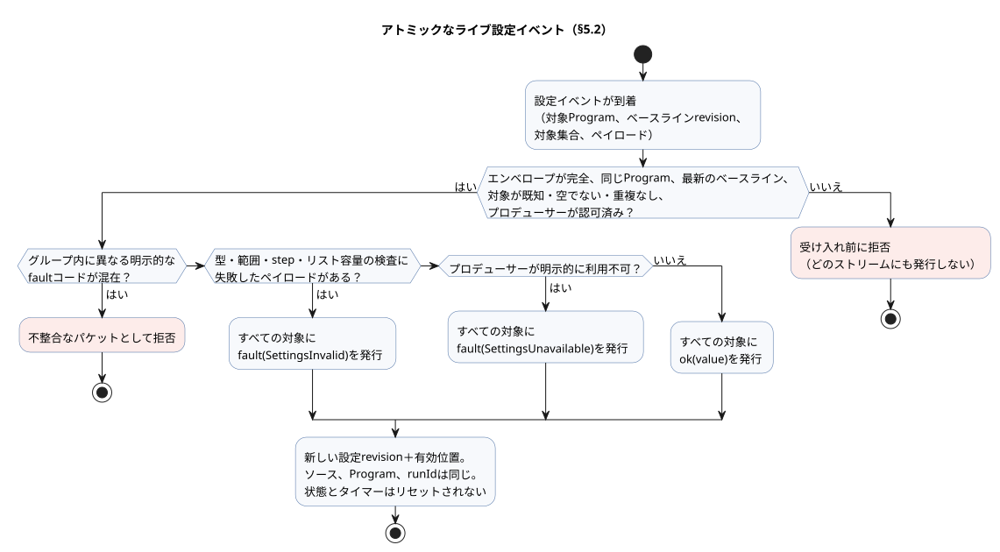
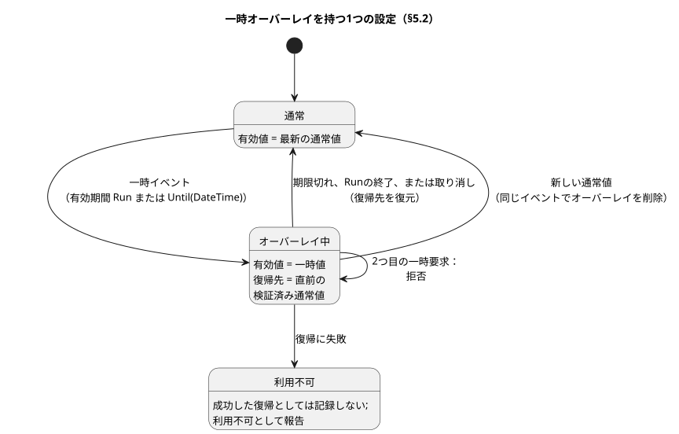

<!-- translation-source: docs/reference/05-settings-and-observation.en.md -->
[英語の原文](05-settings-and-observation.en.md)

# 5. 設定と観測

[全体の目次](../LANGUAGE-REFERENCE.ja.md) · [前へ：4. センサ、制約、制御](04-sensors-constraints-control.ja.md) · [次へ：6. 合成、リプレイ、置換](06-composition-and-replay.ja.md)

GhostFlowプログラムは、2種類の値を区別します。

- **調整可能な値。** `config` は、作者が意図的に公開する調整点です。
- **実行によって生じる値。** `state`、タイマー、入力、出力は、プログラムが何をしているかを観測できるようにするために存在します。

この区別は実務上重要です。灌水時間を変更するオペレーターは、現在のタイマーを書き換える人とは異なることをしており、言語はこの2つを分けて扱います。また、画面はソースを解釈し直すことなく、プログラムと同じ型と検証規則を再利用できます。

**この章の内容**

- §5.1 — `config` の宣言方法と、型ごとの検証規則。
- §5.2 — ソースの編集と運用中の設定変更の違い、アトミックなライブイベント、一時設定、再起動。
- §5.3 — どの画面にも依存しない観測モデル（ディスクリプタ、スナップショット、イベント、コマンド結果、アラーム、説明）。
- §5.4 — 決して混同してはならない同一性と、物理世界に関するGhostFlowの知識の限界。
- §5.5 — 設計の根拠と証拠。

## 5.1 `config` 宣言

以下のソース表記は確定しています。

```ghost
control OperatorSettings {
  config duration: Duration = 5min {
    min = 1min;
    max = 20min;
    step = 1min;
    access = operator;
    label = "관수 시간";
  }

  config duty: Percent = 50% {
    min = 0%;
    max = 100%;
    step = 10%;
    access = designer;
    label = "출력 비율";
  }

  config enabled: Bool = false {
    access = operator;
    label = "자동 관수 사용";
  }
}
```

`config name: Type = default { ... }` は**型付きストリーム**を宣言します。そのペイロード型は `Type` で、最初の発行（emission）は `ok(default)` です。1つの宣言が、名前、ソース上の初期値、検証メタデータの3つをまとめて保持します。

- `access` は、誰が値を変更できるかを制御します。ストリームの型は変えません。
- オペレーターが変更できないconfigも、他のconfigと同じResult規則で読み取ります。
- 決して変わらない計算用の定数だけが必要なら、代わりに通常の `let` で定数式を使います。

| 項目 | 意味 | 規則 |
|---|---|---|
| 型 | 値が何を意味し、どの値を表せるか | 実行可能な式にも設定入力にも同じ型規則が適用されます。 |
| 既定値 | 最初の `ok` 発行のペイロード | 正準的な `.ghost.md` の一部です。エラー時のフォールバックでは**ありません**。 |
| `min`、`max` | 許可される閉区間 | 設定と同じ型で、`min <= max` です。両端とも許可されます。 |
| `step` | `min` から始まる許可値のグリッド | 0より大きくなければなりません。`(value - min)` がstepの整数倍でない値は拒否されます。Temperatureの場合、差の型はTemperatureDeltaです。 |
| `access = operator` | オペレーターがこの設定を変更できる | 宣言された範囲内の型付き設定イベントだけが許可されます。 |
| `access = designer` | ソースの作者がこの値を決める | 運用設定イベントでは変更できません。 |
| `label` | 人が読むための表示名 | 識別子ではありません。意味も権限も変えません。 |

列挙型（enum）のメンバーも表示ラベルを宣言できます：`type Phase = Idle { label = "대기"; } | Running;`。

- ラベルは省略可能なプレーンテキストのメタデータです。メンバーの名前、序数、controlの実行方法は変えません。
- ラベルのないメンバーは、ソース上の名前で表示されます。
- 次はエラーです：空のラベル、空白だけのラベル、重複したラベル、サポートされていないメンバーオプション。
- コンパイラは、ラベルをInteraction Schema `0.3` の `enumMembers[].displayLabel` として出力します。Web、HMI、モバイルの利用側はすべてこのメタデータを共有します。[Interaction契約](../../contracts/interaction-v0/README.md)を参照してください。

**`apply` フィールドはありません。** `apply = stopped` も `apply = live` も構文エラーです。`operator` 設定は、常に§5.2で説明するアトミックなライブイベントによって有効になります。変更を*いつ*適用するかを選ぶ第二の設定システムが生まれないよう、この規則は宣言そのものに固定されています。

**既定値と検証の規則**

- 数値の既定値は、`min..max` の範囲内で、かつ `min` から始まるstepのグリッド上になければなりません。
- `Bool` には数値範囲もstepもありません。選択可能な2つの値は型によってすでに定義されています。
- `false`、`0`、`0%` は有効な明示的な値です。「値がない」という意味ではありません。
- 未知の対象、重複した対象、認可されていない変更は、**ストリームへの受け入れ前**（変更がストリームに入る前）に拒否されます。
- 変更が識別され認可されていても、ペイロードが型・範囲・stepの検証に失敗した場合は、§5.2で説明するエラー発行になります。失敗したペイロードが成功値として適用されることは決してありません。

`Int` 設定の既定値、`min`、`max`、`step` はすべて符号付き32ビット整数です。`step` は正の値です。既定値と `max` はどちらも、`min` から始まる整数グリッド上になければなりません。たとえば `min = -2; max = 4; step = 2;` が許可するのは、ちょうど `-2, 0, 2, 4` です。値を整数グリッドに合わせるために、小数や浮動小数点の許容誤差で丸めることは決してありません。

**理由：** 個数などの整数設定は、許可された値を厳密に選択しなければなりません。stepが大きくても、グリッド外の整数が許容誤差によって紛れ込んではなりません。また、閉区間の両端は実際に選択可能でなければなりません。

`Temperature` では、`min`、`max`、既定値は絶対温度で、`step` は `TemperatureDelta` です。例：`min = 10°C; max = 30°C; step = 0.5Δ°C;`。その他の物理量は、§2.9の演算表で定義された差の型を使います。一般的な算術を持たない名目型では、設定グリッドは型の正準的な大きさの上でのみ検査されます。この内部検査が、プログラムに新しい算術演算を与えることはありません。

時間関連の設定は次のとおりです。

| 設定の型 | 既定値、`min`、`max` | `step` | グリッドの検査対象 |
|---|---|---|---|
| `Date` | `Date` | 正の `Int`（日単位） | 暦日。`step = 1;` は `min` から1日ずつ日付を選択します。 |
| `TimeOfDay` | `TimeOfDay` | `1min` のような正の `Duration` | 午前0時からのミリ秒差 |
| `DateTime` | `DateTime` | `1min` のような正の `Duration` | UTCエポックミリ秒の差 |

午前0時での折り返しも、タイムゾーンの推論もありません。この設定検証が、`DateTime - DateTime` や `TimeOfDay + Duration` のような追加の算術をプログラムに与えることはありません。

**理由：** 日付は暦日単位で選択し、時刻値はミリ秒の分解能で選択します。暦日が、任意のタイムゾーンでの実稼働24時間に換算されることはありません。こうすることで、設定フォームとランタイムがまったく同じ許可値の集合を検査します。

スケジュールのリストは ``config times: TimeSlots<15min, 8> = [time`06:00`];`` の形を使います。この型ではグリッドと最大要素数が許可範囲を定義するため、`min`、`max`、`step` は使いません。リストの検証と `DailySlots` への接続は[§3.6](03-time-and-schedules.ja.md)に従います。

**設定ディスクリプタ。** 設定ディスクリプタは、利用側が設定を提示するのに必要なものをすべて提供します。安定した設定ID、ソース上の名前、型、既定値、アクセス権限、範囲、step、ラベル、そしてソース／意図の来歴（ソースと意図のどこに由来するか）です。Cabinet-viewはこれを使って、Duration入力、Bool選択、範囲付き数値入力のような型付きフォームを構築できます。スライダー、ダイヤル、座標、色、レイアウトはCabinet-viewが決めます。設定の同一性や検証規則を、その `label` やウィジェットの形から推論してはなりません。

**温度の表示単位。** `Temperature` の設定ディスクリプタは、`K` での正準値とは別に、選択された `displayUnit`（`°C` または `K`）を含めなければなりません。

- 数値だけを変更するライブイベントは、既存の `displayUnit` を維持します。
- 単位を変更するには、イベントが新しい単位を指定しなければなりません。
- 単位が欠けている、または曖昧な場合は、適用前のエラーです。表示単位を正準値やその大きさから推論してはならず、既定の単位を選んでもなりません。

### 既定値と有効値

**既定値**は、ソースで定義された初期ペイロードです。**有効な観測**は、式が特定の実行位置で読み取る最新の `Result<Type, SettingsFault>` です。

```text
最初の観測                              → ok(ソースの初期値)
その後に受け入れられた正常な発行          → ok(新しいペイロード)
その後に受け入れられたエラー発行          → fault(SettingsFault)
```

観測者は次を区別できなければなりません。

- `defaultValue`
- 現在のResult：その状態と、ペイロードまたはfault
- 設定revision
- 値が有効になった位置

以前の成功値を履歴として保持してもかまいません。ただし、現在のfaultを隠すような形で、それを有効値として提示してはなりません。

## 5.2 ソースの変更と運用設定の変更

「設定を変更する」には2つの異なる方法があり、意味が異なります。

| 変更 | 変わる同一性 | 意味 |
|---|---|---|
| ソースの既定値、式、宣言の編集 | 文書revision、ソースダイジェスト、通常はプログラムのアーティファクト | レビュー対象となる新しい正準的な `.ghost.md` の候補 |
| 運用設定イベント | 設定revisionと有効イベント位置 | 同じソース、Program、実行（run）の中で有効値が変わる |

**ソースの編集**は、元のMarkdownを変更します。その結果は、散文、コメント、フェンス、改行、元のバイトを保持した新しい文書revisionでなければなりません。設定オーバーレイのふりをしてはなりません。意図アンカー、確認済みの前提、未確認の仮定、ソースマップの来歴は、すべて新しいrevisionに対して再検証されます。

**運用設定**は、ソースのリテラルを決して変更せず、何も再コンパイルしません。

そのため、API、Web、FSDの利用側は2つの経路から選びます。

- 既定値を恒久的に変更するには、新しい `.ghost.md` の候補を提出します。
- 実行中の同じProgramを調整するには、型付き設定イベントを提出します。

削除されたソース候補ヘルパーを暗黙のフォールバックとして復活させてはならず、有効な利用側の経路として残してもなりません。2つの経路を分けておくことで、「5分を10分に変更する」という要求がレビュー可能になります。恒久的な既定値の編集なのか、今回の運用だけの設定なのかが分かるからです。

### 設定ストリームと現在の観測

設定の**プロデューサー**は、Web UI、ネットワークメッセージ、MQTT、あるいはEC11ロータリーエンコーダのような物理的な操作部品でもかまいません。あるプロデューサーを別のものに交換しても、利用側プログラムの式もストリームの意味も変わりません。言語のセマンティクスは、特定のプロトコル、RxJS、どのUIライブラリにも依存しません。

`access` は値を**編集**する権限です。正当なプロデューサーが、`designer` のconfigや読み取り専用のconfigについてエラーを報告したり、宣言された初期ペイロードへ復旧したりすることを妨げるものではありません。それ以外のペイロードへ変更することは依然として編集であり、認可を経ます。受け入れの前に、ホストはプロデューサーの観測とオペレーターの編集の両方について、送信元と権限を検証します。パケット内の送信元ラベルはそれ自体では認証にならず、利用側の式が送信元によって分岐することは決してありません。

各ストリームは次のように振る舞います。

1. 有効な初期値を1回供給します。
2. その後、順序付けられた `ok(value)` または `fault(reason)` の観測を供給します。
3. faultはストリームを終了させません。後の正常な発行によって復旧できます。
4. 沈黙だけでfaultが生じることは決してありません。「利用不可」は、プロデューサー契約が定める明示的な `fault(SettingsUnavailable)` の発行です。

通常のcontrol式は、既存のResult構文を使って両方のレールを明示的に扱います。

```ghost
config duration: Duration = 5min {
  min = 1min; max = 20min; step = 1min; access = operator;
}
let within_duration = case duration {
  ok(value) => age < value;
  fault(reason) => false;
};
```

ここで `false` は、作者が選んだエラー処理です。言語が独自に停止、既定値、以前の成功値で置き換えることは決してありません。`map`、`and_then`、`recover` のような既存のResult演算も、その型規則に従って使えます。`TimeSlots` にも同じ成功とエラーの観測があり、それを消費する `DailySlots` がエラーを直接扱います。リストが任意のスカラーに変換されることは決してありません。

**1回の評価に1つのビュー。** 1つの論理評価位置では、すべての利用側が同じconfigの観測を読み取ります。スケジュールの `every` とcontrol式の実行時間が、同じ設定の異なるコピーを読み取ることがあってはなりません。評価の途中で到着した発行は、その評価の不変なビューを変えず、順序上の次の位置に置かれます。この評価境界はストリームのセマンティクスを実装する方法であり、設定をスキャンループの中でしか機能しないコマンドに変えるものではありません。DI（デジタル入力）のスナップショットも同じ評価に対して固定されますが、通常のBool入力が設定revisionやEventIdを持つ必要はありません。

### アトミックなライブイベント

複数の設定が一緒に変わる場合、その変更は、明示的な対象集合を持つ1つの**アトミックなライブ発行**です。次の手順で処理されます。

1. イベントが対象とするProgramと、そのベースライン設定revisionを検証します。
2. 対象集合が空でなく、完全に識別され、重複がないこと、およびプロデューサーが権限を持つことを検証します。次のものは**受け入れ前に**拒否します：破損したエンベロープ、未知の対象、別のProgram向けのイベント、古いベースラインrevision、認可の失敗。識別できないストリームにエラー発行を作成してはなりません。
3. 識別された操作のすべてのペイロードを、型、範囲、step、リスト容量の規則に照らしてまとめて検証します。
   - すべて有効なら、すべての対象に一緒に `ok(value)` を発行します。
   - 1つでも失敗したら、すべての対象に一緒に `fault(SettingsInvalid)` を発行します。有効な部分集合だけを `ok` に切り替えてはなりません。原因と影響を受けた項目は診断の来歴に保持します。
   - プロデューサーが明示的に利用不可である場合も、対象グループ全体に `fault(SettingsUnavailable)` を発行します。
   - 1つのグループが異なる明示的なfaultコードを持つ場合は、不整合なパケットとして拒否します。エラーの優先順位を推測してはなりません。
   - 実際のペイロード検証の失敗がある場合、グループ全体が `SettingsInvalid` を観測します。
4. 受け入れられた成功またはエラーの発行には、設定revisionと有効位置が与えられます。その位置以降、すべての対象の観測が一緒に有効になります。対象でないストリームは変わりません。
5. 正準ソース、コンパイル済みProgram、`runId` は同じままです。
6. 状態とタイマーはリセット**されません**。現在のcontrol式が新しい有効値を読み取り、結果を判断します。

以下のフローは手順1〜6をまとめたものです。拒否は受け入れ前に起こり、発行はまったく生じません。受け入れられたイベントはすべて、その全対象が共有する1つの発行で終わります。



**faultの受け入れは、転送の拒否と同じではありません。** エラーレールは、利用側が観測する新しい状態です。

- 後でcontrolの評価が失敗しても、すでに受け入れられた発行は取り消されません。
- APIが、まだ受け入れられていない発行をその評価と一緒に1つのトランザクションとして提出し、そのトランザクションが失敗した場合、発行は未受け入れのままです。同じ同一性で再試行できます。
- 受け入れられていない操作を、すでに有効であるかのように報告してはなりません。
- プロデューサーが再送しても、同じ発行が2回適用されることはありません。

したがって、運用中に `duration` を10分から5分に短縮すると、次の判断ではすでに経過した時間を新しい上限と比較します。「次の回」、停止、リセット、再コンパイル、新しい実行（run）を暗黙に待つことはありません。設定イベントが特定の出力を強制することもありません。出力の変化は、作者が書いたcontrol式からのみ生じます。

設定宣言に適用タイミングのフィールドを追加しないでください。開始時に選ばれた実行時間を保持したい場合は、プログラムが開始の遷移で設定を自身の状態にコピーし、以後はその状態を読み取るようにします。プログラムやファームウェアの置換に必要な停止手順も、運用設定イベントには適用されません。

### ライフサイクルと一時設定

**一時設定**は、有効期間が定められた運用設定です。別のソースではありません。次を指定しなければなりません。

- 対象のProgram、設定ID、型付きの値
- 操作者（actor）、権限、理由
- 作成したイベント、設定revision、開始位置
- 有効期間、期限切れ、ロールバックの来歴、復帰先

以前のオーバーライドが、別のProgram revisionに自動的に引き継がれることは決してありません。新しいrevisionに対して再検証し、明示的に承認しなければなりません。

**再起動をまたぐ永続化。** 受け入れられた通常のライブ設定については、最新のResultとrevisionが実際のデバイス再起動後も保持されます。

- 最後の観測がfaultだった場合は、faultが復元されます。初期値に置き換えられることはありません。
- 復元すべき最新の観測がある場合、その履歴は初期発行の後、最初のcontrol判断の前に適用されます。
- 再起動は新しい `runId` を作成します。

一時変更は、通常の設定の上に重なる**1層のオーバーレイ**です。ソースのキーワードは追加しません。その意味は、以下の設定イベント規則によって完全に定義されます。

| 項目 | 確定した規則 |
|---|---|
| 有効期間 | 要求者が `Run` または `Until(DateTime)` を明示的に選択します。有効期間のない要求は拒否されます。 |
| `Run` | 現在の実行（run）でのみ有効です。実行が終了するとオーバーレイは削除されます。 |
| `Until` | 絶対的な期限時刻と厳密なProgramの同一性を保存します。期限が切れるまで、同じProgramの再起動をまたいで有効です。 |
| 復帰値 | 一時変更の直前に有効だった、検証済みの通常値です。ソースの既定値に暗黙に置き換えられることは決してありません。 |
| 入れ子 | その設定にすでに有効な一時変更がある場合、新しい一時変更は拒否されます。最初のものを明示的に取り消してください。 |
| 新しい通常設定 | 同じイベントが、その設定のオーバーレイを削除し、新しい通常値を適用します。古い期限切れが後から新しい値を上書きすることはありません。 |
| 期限切れ／取り消し | 元のオーバーレイIDを対象とするアトミックな設定イベントです。完了した設定revisionと適用位置を記録します。 |
| 復帰の失敗 | 成功した復帰としては記録されません。設定の有効性は利用不可として報告され、その設定を必要とする判断は確定されません。物理出力がどう応答するかは、設備の明示的な故障時契約に従います。 |

以下の状態図は、1つの設定についてこれらの規則を示しています。



その他の規則：

- `Until` の期限切れを判断するための信頼できる時刻が得られない場合は、新しい一時要求を拒否します。
- すでに適用された値の有効性が判断できなくなった場合は、それを有効な値として読み取るのをやめます。
- 再起動時には、最初のcontrol判断の前に、すべての復元と期限切れの判断を終えます。
- 複数の設定をまとめた一時イベントは、それらに1つの共有された有効期間を与え、適用と復帰はすべてかゼロかで行われます。
- そのようなグループの一部を通常の変更で変えるには、グループ全体を取り消して新しい値を設定する1つのイベントを提出します。

**理由：** これらの規則により、一時的な値が黙って恒久化することや、遅れて来た期限切れがより新しいオペレーターの判断を取り消すことを防ぎます。期限時刻と一時的な値はオペレーターが選ぶものであり、言語が任意の実行時間を選ぶことは決してありません。

### 再起動とメモリの復元

新しい実行（run）は、宣言された状態の初期値と新しいタイマーのベースラインから始まります。電源が切れていた時間が `elapsed` に加算されることは**ありません**。

通常の設定の永続化と状態の復元は、別々のものです。ホストがチェックポイントの復元を提供する場合：

- Program、インスタンス、状態スキーマ、単調時間の連続性を検証しなければなりません。
- チェックポイントと復元許可ポリシーを指定した明示的な実行要求を受け取らなければなりません。
- 連続性を証明できないタイマーやフィルタのメモリを復元してはなりません。
- 復元の失敗は観測可能でなければなりません。復元が成功したと報告しながら状態を初期化してはなりません。

プログラムが再起動の理由を必要とする場合は、以下の厳密な予約済みの、ランタイムが所有するライフサイクル入力契約を使います。専用の `on_restart` 文はありません。これらのポートは `Result<T, SensorFault>` の取得を経ずにスカラー値として直接読み取られ、オプションのマーカーや前処理の設定を持てません。その他の外部入力はすべて、正準的な品質契約を維持します。

```ghost
type RestartReason = PowerOn | Brownout | Watchdog | Software | Unknown;
input restart_reason: RestartReason;
input restart_event: Bool;
```

これらの厳密な予約宣言は、control本体の断片です。次のように動作します。

- **誰が供給するか。** フレーム化ランタイムが両方の値を所有し、注入します。呼び出し側は、スキャンフレームでも通常の入力セッターでもこれらを供給できません。
- **`restart_reason`。** ホストは、ハードウェアが確認した理由を明示的に供給します。証拠がない場合は `Unknown` を供給します。`PowerOn` だけでは停電からの復旧を証明しません。理由は実行全体を通して固定されます。
- **`restart_event`。** ホストは、ブートイベントがまだ保留中かどうかも明示します。保留中の間、`restart_event` は確定に成功した最初のスキャンでtrueになり、その後はfalseになります。拒否されたスキャンでは保留のままです。ブートイベントがすでに消費された後にプログラムが置換された場合、ホストはこれをfalseに設定します。
- **作者が決めること。** 自動再開、待機、または取り消してから原点位置へ戻ることは、すべて作者が書いた状態遷移として表現されます。
- **しないこと。** この契約はイベントと原因だけを供給します。VMやタイマーのメモリは復元しません。最初の判断の前は、物理出力はデバイスの設備ポリシーと出力レンダラーが所有します。


## 5.3 Cabinet-viewに依存しない観測モデル

<a id="53-renderer-독립-관찰-모델"></a>

<a id="53-renderer-independent-observation-model"></a>


この章では、旧来の用語「レンダラー（renderer）」がフォームや観測ビューを指す場合、Cabinet-view／UI（`@ghostflow/cabinet-view`）を意味します。*出力レンダラー*はこれとは異なり、§8.2で定義されるとおり、論理的な出力意図を適用するものです。UIの表示は、適用済み（applied）や確認済み（confirmed）の証拠にはなりません。画面に何かが表示されても、出力が適用された、あるいは確認されたことの証明には決してなりません。


観測契約は意味を伝えるものであり、画面を規定するものではありません。

| 概念 | 答える問い | 時間的な意味 |
|---|---|---|
| ディスクリプタ（descriptor） | 何を読み取れ、何を変更できるか？ | 静的なソース／Programの意味 |
| スナップショット（snapshot） | 1つの完了した判断で値は何だったか？ | 1つの完了したスキャン |
| イベント（event） | 何が、どの順序で起こったか？ | 実行（run）内の順序付けられた発生 |
| コマンド結果（command result） | 実行境界は要求をどう処理したか？ | コマンドのライフサイクル |
| アラーム（alarm） | どの条件が発生し、いつ解除されたか？ | 発生／解除イベントと現在の状態 |
| 説明（explanation） | どの評価が現在の結果を裏付けているか？ | 同じ完了したスキャン |

契約には、ウィジェット、レイアウト、座標、色、画面固有の表示ポリシーは含まれません。複数のCabinet-viewが、同じディスクリプタと実行の同一性を異なる方法で提示してもかまいません。ただし、どれも値、権限、検証、コマンドの利用可能性を変えてはなりません。

### ディスクリプタとスナップショット

**ディスクリプタ**は、公開の意味的ID、名前、種類、ソース上の型、読み取り／書き込み／実行の権限、ソース／意図の来歴を持ちます。状態、タイマー、厳密なカウンタ、設定、入力、出力、コマンド、アラームは、それぞれ宣言された意味によって分類されます。`count` という名前だから、あるいは値が整数に見えるからといって、それがカウンタであると推論してはなりません。

設定の変更と値の観測は、異なる能力です。

- `state`、タイマー、出力のディスクリプタで値が見えても、書き込み権限が与えられるわけではありません。
- メタデータのプロデューサーやCabinet-viewは、ソースが宣言していない `write` や `execute` の権限を追加できません。
- コマンドの権限は、内部状態に直接書き込む権限を意味しません。
- オペレーター設定の権限は、ソースを編集する権限を意味しません。

**スナップショット**は、ちょうど1つの完了したスキャンに結び付けられます。その中の各観測は、次のいずれかです。

- `ready`：実際の値が存在します（`false` や `0` を含みます）。
- `unavailable`：その完了時点で値が存在せず、理由が示されます。
- `error`：ディスクリプタを観測できませんでした。
- `stale`：*利用側*が、期待していた同一性と比較して算出する結果です。ペイロードが自分自身についてこの状態を主張することは決してありません。

有効なステートレスcontrolは、識別されたスキーマを持ちつつディスクリプタのリストが空であってもかまいません。その場合、完了したスナップショットの観測リストは空になります。これは観測の失敗ではありません。画面を埋めるためだけに、人工的なBool状態やタイマーを追加しないでください。

`timer age = elapsed(phase)` のディスクリプタは、元の列挙型 `phase` を直接その対象として示します。内部計算や表示のために合成されたBoolクロックを、公開の意味であるかのように公開してはなりません。対象がBoolの場合、タイマーはどちらの方向（trueからfalse、またはfalseからtrue）であれ、最後に確定した変化からの時間を数えます。

### イベント、コマンド結果、アラーム

スナップショットだけでは、2回の更新の間に発生して解除されたアラームを示せません。そのためにイベントがあります。

- **イベント**は実行（run）ごとに順序付けられ、重複が識別可能でなければなりません。レコードが保持範囲から外れたり接続が切れたりした場合は、シーケンスのギャップや欠落した範囲を明示的に報告します。最後のスナップショットから欠落したイベントを再構築してはなりません。
- **コマンド結果**は、次の結果を区別して保持します：要求の受信、拒否、開始、完了、取り消し、失敗。表記 `received → rejected | started → completed | cancelled | failed` はこれらの区別を説明するものであり、確定したソース構文でも、レコードの列挙型や遷移スキーマでもありません。コマンドIDと実行の同一性は一致しなければならず、Cabinet-viewやコールバックが別の状態機械を推論してはなりません。上限付きの履歴がエクスポート前にレコードを失った場合は、ギャップを報告します。
- **アラーム**は、現在のアクティブ状態と発生／解除イベントの両方を使い、短時間の発生も保持されるようにします。

コマンドとアラームのレコードの最終的なシリアライズと転送は、実行環境の観測契約に属します。言語には `command` や `alarm` のソース宣言も、重大度のキーワードもありません。controlの応答は、明示的な型付き入力と状態式で書きます。どの入力がコマンド要求で、どの観測がアラームとして公開されるかは、明示的な外部ディスクリプタ契約が決めます。名前やBool値だけからこれを自動的に推論してはなりません。

### 説明DAG

**説明**は有向非巡回グラフ（DAG）です。1つの出力結果を、それを生み出すために実際に評価された入力、状態、タイマー、名前付きの中間値、述語、制約に結び付けます。複数の結果が共有する条件は、1つの安定したノードのままです。必要に応じて、Cabinet-viewは特定の出力を根とする木にグラフを展開してもかまいません。

完了したスキャンごとに、すべての評価は少なくとも次の意味を必要とします：`evaluated`、実際の値／状態、`supportsResult`。

- 短絡された（評価されなかった）分岐を、実際の証拠として表示してはなりません。
- ANDがfalseの場合、評価されたfalseの子が結果の説明に役立つことがあります。ORがtrueの場合、評価されたtrueの子はすべて結果の説明に役立つことがあります。任意の「勝者」を1つ選んではなりません。
- このグラフは評価結果の証明経路です。「この条件がなければ結果は違っていた」というような反事実的な因果関係を主張するものでは**ありません**。

説明は、出力のONとOFFの両方、そして要求意図と制約後の安全意図の両方を対象とします。コンパイラ内部のスロット名を公開の意味的IDとして使ってはなりません。すべてのノードは、ソースノード／スパン、意図アンカー、正準的な文書revisionまでたどれなければなりません。

## 5.4 同一性と物理的事実の境界

観測と設定のレコードは、以下の同一性を区別して保持します。決して混同してはなりません。

```text
source document + immutable revision + source digest
Program/module + artifact digest
settings revision + effective event position
behavior instance and installation/binding revision (when composed)
runId + completed scanId + logical time
event/command/alarm sequence identity
```

`scanId` は、1つの実行（run）内でスキャンを順序付けるだけです。リセットや実際の再起動によって新しい実行が作られた場合、同じ `scanId = 0` でも別の発生です。ライブ設定イベントは `runId` を変えません。異なるソース、Program、設定、バインディング、実行から来たスナップショットと説明を結合した場合は、その結果をstaleまたは不一致として扱います。

**GhostFlowが知りうることと知りえないこと。** GhostFlowは入力とcontrolの判断を観測します。`pump = true` は出力の*意図*であり、ポンプが電気的に通電されたこと、回転したこと、水が流れたことを証明するものではありません。次を区別してください。

- 要求意図
- 安全意図
- ホスト／レンダラーが報告する適用結果
- 実際のフィードバック

フィードバックがなければ、物理的な結果は不明です。「低水位信号が灌水をブロックした」という説明を、「タンクが実際に空だった」という主張に変えてはなりません。

## 5.5 設計の根拠と証拠

- **型付き設定**により、コード、検証、自動生成されるフォームが1つの意味を共有します。
- **アトミックなイベント**により、一部の値だけが適用された瞬間がなくなります。
- **スナップショットとイベントの分離**により、現在の値と過去の発生の両方が保持されます。
- **厳密な同一性と来歴**により、名前を共有する異なる実行が誤って結び付けられることを防ぎます。
- **物理的事実の境界の維持**により、シミュレーションやUIがデバイスの成功を捏造することを防ぎます。

根拠：[言語モデル](../LANGUAGE.ja.md)、[制御サーフェス](../LANGUAGE-SURFACE.ja.md)、[意図アンカー](../INTENT-ANCHOR-MAP.ja.md)、[Interaction v0](../../contracts/interaction-v0/README.md)、[#68](https://github.com/callin2/ghostflow-language/issues/68)、[#70](https://github.com/callin2/ghostflow-language/issues/70)、[#73](https://github.com/callin2/ghostflow-language/issues/73)、[#74](https://github.com/callin2/ghostflow-language/issues/74)、[#88](https://github.com/callin2/ghostflow-language/issues/88)、[#89](https://github.com/callin2/ghostflow-language/issues/89)、[#105](https://github.com/callin2/ghostflow-language/issues/105)、[#110](https://github.com/callin2/ghostflow-language/issues/110)。
