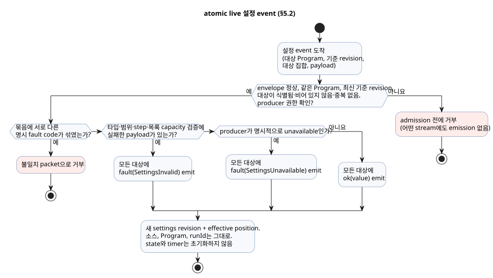
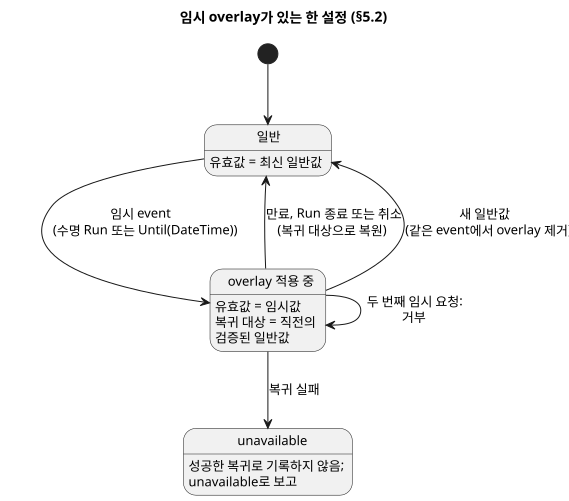

<!-- translation-source: docs/reference/05-settings-and-observation.en.md -->
[영문 원문](05-settings-and-observation.en.md)

# 5. 설정과 관찰

[전체 목차](../LANGUAGE-REFERENCE.md) · [이전: 센서·제약·제어](04-sensors-constraints-control.md) · [다음: 합성과 재현](06-composition-and-replay.md)

GhostFlow 프로그램은 두 종류의 값을 구분합니다.

- **조절 가능한 값.** `config`는 작성자가 의도적으로 공개한 조절점입니다.
- **실행이 만들어 내는 값.** `state`, 타이머, 입력, 출력은 프로그램이 무엇을 하고 있는지 관찰하기 위한 값입니다.

이 구분은 실제 운영에서 중요합니다. 운영자가 관수 시간을 바꾸는 일과 누군가 현재 타이머를 고치는 일은 서로 다른 행위이며, 언어는 둘을 분리해 둡니다. 또한 화면은 소스를 다시 해석하지 않고도 프로그램과 같은 타입과 검증 규칙을 그대로 사용할 수 있습니다.

**이 장의 내용**

- §5.1 — `config`를 선언하는 방법과 타입별 검증 규칙.
- §5.2 — 소스 편집과 운전 중 설정 변경의 차이, atomic live event, 임시 설정, 재시작.
- §5.3 — 화면과 무관한 관찰 모델(descriptor, snapshot, event, command result, alarm, explanation).
- §5.4 — 절대 섞어서는 안 되는 정체성과, GhostFlow가 물리 세계에 대해 알 수 있는 범위의 끝.
- §5.5 — 설계 이유와 근거.

## 5.1 `config` 선언

다음은 확정된 소스 표기입니다.

```ghost
control OperatorSettings {
  config duration: Duration = 5min {
    min = 1min;
    max = 20min;
    step = 1min;
    access = operator;
    label = "관수 시간";
  }

  config duty: Percent = 50% {
    min = 0%;
    max = 100%;
    step = 10%;
    access = designer;
    label = "출력 비율";
  }

  config enabled: Bool = false {
    access = operator;
    label = "자동 관수 사용";
  }
}
```

`config name: Type = default { ... }`는 **typed stream**을 선언합니다. payload 타입은 `Type`이고 첫 emission은 `ok(default)`입니다. 선언 하나가 이름, 소스 초기값, 검증 메타데이터 세 가지를 함께 묶습니다.

- `access`는 누가 값을 바꿀 수 있는지를 정합니다. stream의 타입은 바꾸지 않습니다.
- 운영자가 바꿀 수 없는 config도 다른 config와 똑같은 Result 읽기 규칙으로 읽습니다.
- 바뀌지 않는 계산 상수만 필요하다면 대신 일반 `let`의 상수 식을 사용합니다.

| 항목 | 의미 | 규칙 |
|---|---|---|
| 타입 | 값의 의미와 표현할 수 있는 값의 범위 | 실행식과 설정 입력에 같은 타입 규칙을 적용합니다. |
| 기본값 | 첫 `ok` emission의 payload | canonical `.ghost.md`의 일부입니다. 오류 때의 fallback이 **아닙니다**. |
| `min`, `max` | 닫힌 허용 범위 | 설정과 같은 타입이며 `min <= max`여야 합니다. 양 끝값을 허용합니다. |
| `step` | `min`에서 시작하는 허용 값 격자 | 0보다 커야 합니다. `(value - min)`이 step의 정수배가 아니면 거부합니다. Temperature의 차이 타입은 TemperatureDelta입니다. |
| `access = operator` | 운영자가 바꿀 수 있는 설정 | 선언된 범위 안의 typed 설정 event만 허용합니다. |
| `access = designer` | 소스 작성자가 정하는 값 | 운영 설정 event로 바꿀 수 없습니다. |
| `label` | 사람이 읽는 표시 이름 | 식별자가 아니며 의미나 권한을 바꾸지 않습니다. |

enum 멤버도 표시 레이블을 선언할 수 있습니다: `type Phase = Idle { label = "대기"; } | Running;`.

- 레이블은 선택적인 일반 텍스트 메타데이터입니다. 멤버 이름, 순번, control의 실행 방식을 바꾸지 않습니다.
- 레이블이 없는 멤버는 소스 이름으로 표시합니다.
- 빈 레이블, 공백만 있는 레이블, 중복 레이블, 지원하지 않는 멤버 옵션은 오류입니다.
- 컴파일러는 레이블을 Interaction 스키마 `0.3`의 `enumMembers[].displayLabel`로 생성합니다. 웹, HMI, 모바일 consumer가 모두 이 메타데이터를 공유합니다. [Interaction 계약](../../contracts/interaction-v0/README.ko.md)을 참고하세요.

**`apply` 필드는 없습니다.** `apply = stopped`와 `apply = live`는 모두 구문 오류입니다. `operator` 설정은 항상 §5.2에서 설명하는 atomic live event로 적용됩니다. 변경이 *언제* 적용될지 고르는 두 번째 설정 체계가 생기지 않도록 이 규칙을 선언 자체에 고정합니다.

**기본값과 검증 규칙**

- 수치 기본값은 `min..max` 안에 있어야 하고 `min`에서 시작하는 step 격자 위에 있어야 합니다.
- `Bool`에는 수치 범위나 step이 없습니다. 선택 가능한 두 값이 이미 타입에 정해져 있기 때문입니다.
- `false`, `0`, `0%`는 유효한 명시 값입니다. "값 없음"을 뜻하지 않습니다.
- 알 수 없는 대상, 중복 대상, 권한 없는 변경은 **stream admission 전에**(변경이 stream에 들어가기 전에) 거부합니다.
- 변경이 식별되고 권한도 확인되었지만 payload가 타입·범위·step 검증에 실패하면 §5.2에서 설명하는 error emission을 만듭니다. 실패한 payload를 성공값으로 적용하는 일은 없습니다.

`Int` 설정의 기본값, `min`, `max`, `step`은 모두 signed 32-bit 정수입니다. `step`은 양수입니다. 기본값과 `max`는 모두 `min`에서 시작하는 정수 격자 위에 있어야 합니다. 예를 들어 `min = -2; max = 4; step = 2;`는 정확히 `-2, 0, 2, 4`를 허용합니다. 분수나 부동소수점 오차 허용값을 반올림해서 정수 격자에 맞추는 일은 없습니다.

**왜:** 횟수 같은 정수 설정은 허용된 값을 정확히 선택해야 합니다. step이 크더라도 격자 밖의 정수가 오차 허용 때문에 통과해서는 안 됩니다. 또한 닫힌 범위의 양 끝값을 실제로 선택할 수 있어야 합니다.

`Temperature`의 `min`, `max`, 기본값은 절대 온도이고 `step`은 `TemperatureDelta`입니다. 예: `min = 10°C; max = 30°C; step = 0.5Δ°C;`. 그 밖의 물리량은 §2.9의 연산 표에서 정의한 차이 타입을 사용합니다. 일반 산술이 없는 명목 타입의 설정 격자는 해당 타입의 canonical 크기에서만 검사합니다. 이 내부 검사가 프로그램에 새로운 산술 연산을 허용하지는 않습니다.

시간 관련 설정은 다음과 같이 동작합니다.

| 설정 타입 | 기본값, `min`, `max` | `step` | 격자 검사 기준 |
|---|---|---|---|
| `Date` | `Date` | 양의 `Int` 일수 | 달력 날짜. `step = 1;`은 `min`부터 날짜를 하루씩 선택합니다. |
| `TimeOfDay` | `TimeOfDay` | `1min` 같은 양의 `Duration` | 자정 이후 밀리초의 차이 |
| `DateTime` | `DateTime` | `1min` 같은 양의 `Duration` | UTC epoch 밀리초의 차이 |

자정 순환이나 시간대 추론은 하지 않습니다. 이 설정 검증이 프로그램에 `DateTime - DateTime`이나 `TimeOfDay + Duration` 같은 추가 산술을 허용하지는 않습니다.

**왜:** 날짜는 달력 일수 단위로 고르고, 시간값은 밀리초 해상도로 고릅니다. 달력의 하루를 임의 시간대의 실제 운전 시간 24시간으로 바꾸지 않습니다. 그래야 설정창과 런타임이 정확히 같은 허용 값 집합을 검사합니다.

예약 목록에는 ``config times: TimeSlots<15min, 8> = [time`06:00`];`` 형태를 사용합니다. 이 타입은 grid와 최대 원소 수가 허용 범위를 정하므로 `min`, `max`, `step`을 쓰지 않습니다. 목록 검증과 `DailySlots` 연결은 [§3.6](03-time-and-schedules.md#36-선택된-dailyslots)을 따릅니다.

**설정 descriptor.** 설정 descriptor는 consumer가 설정을 보여 주는 데 필요한 모든 정보를 제공합니다. stable setting ID, 소스 이름, 타입, 기본값, 접근 권한, 범위, step, label, 소스·의도 provenance(소스와 의도의 어디에서 왔는지)입니다. cabinet view는 이 정보로 Duration 입력, Bool 선택, 범위가 있는 수치 입력 같은 typed form을 만들 수 있습니다. slider, dial, 좌표, 색, 배치는 cabinet view가 정합니다. `label`이나 widget 모양으로 설정의 identity나 검증 규칙을 추론해서는 안 됩니다.

**Temperature 표시 단위.** `Temperature` 설정 descriptor는 canonical `K` 값과 별도로 선택된 `displayUnit`(`°C` 또는 `K`)을 반드시 포함해야 합니다.

- 숫자만 바꾸는 live event는 기존 `displayUnit`을 유지합니다.
- 단위를 바꾸려면 event가 새 unit을 명시해야 합니다.
- 누락되거나 모호한 unit은 적용 전 오류입니다. canonical 값이나 값의 크기에서 표시 unit을 추론해서는 안 되며, 기본 unit을 정해서도 안 됩니다.

### 기본값과 유효값

**기본값**은 소스가 정한 초기 payload입니다. **유효 observation**은 특정 실행 위치에서 식이 읽는 최신 `Result<Type, SettingsFault>`입니다.

```text
최초 observation                       → ok(소스 초기값)
이후 받아들인 정상 emission             → ok(새 payload)
이후 받아들인 오류 emission             → fault(SettingsFault)
```

관찰자는 다음을 구분할 수 있어야 합니다.

- `defaultValue`
- 현재 Result: status와, payload 또는 fault
- settings revision
- 값이 유효해진 적용 위치

이전 성공값을 이력으로 보관할 수는 있습니다. 그러나 현재 fault를 숨기는 방식으로 그 값을 유효값으로 제공해서는 안 됩니다.

## 5.2 소스 변경과 운영 설정 변경

"설정을 바꾼다"에는 서로 다른 의미를 가진 두 가지 방법이 있습니다.

| 변경 | 바뀌는 정체성 | 의미 |
|---|---|---|
| 소스 기본값·식·선언 편집 | document revision, source digest, 보통 program artifact | 검토할 새 canonical `.ghost.md` 후보 |
| 운영 설정 event | settings revision과 effective event position | 같은 소스·Program·run에서 유효값 변경 |

**소스 편집**은 원문 Markdown을 수정합니다. 결과는 prose, 주석, fence, 줄바꿈과 원본 byte를 보존한 새 document revision이어야 합니다. 설정 overlay로 위장해서는 안 됩니다. 의도 anchor, 확인된 전제, 미확인 assumption, source-map provenance는 모두 새 revision에 대해 다시 검증합니다.

**운영 설정**은 소스 리터럴을 바꾸지 않으며 무엇도 재컴파일하지 않습니다.

따라서 API, Web, FSD consumer는 두 경로 중 하나를 고릅니다.

- 기본값을 영구적으로 바꾸려면 새 `.ghost.md` 후보를 제출합니다.
- 실행 중인 같은 Program을 조정하려면 typed settings event를 제출합니다.

삭제된 source-candidate helper를 암묵 fallback으로 되살리거나 활성 consumer 경로로 남겨 두어서는 안 됩니다. 두 경로를 분리해 두면 "5분을 10분으로 바꿔 줘" 같은 요청이 영구 기본값 수정인지, 이번 운전에만 쓰는 설정인지 검토할 수 있습니다.

### 설정 stream과 현재 observation

설정 **producer**는 웹 UI, 네트워크 메시지, MQTT, 또는 EC11 로터리 인코더 같은 물리 조작기일 수 있습니다. producer를 다른 것으로 바꾸어도 consumer 프로그램의 식이나 stream의 의미는 바뀌지 않습니다. 언어 의미는 특정 프로토콜, RxJS, UI 라이브러리에 의존하지 않습니다.

`access`는 값을 **편집**할 권한입니다. 정당한 producer가 `designer` 또는 읽기 전용 config의 오류를 보고하거나, 선언된 초기 payload로 회복하는 것을 막지 않습니다. 다른 payload로 바꾸는 것은 여전히 편집이므로 권한 검사를 거칩니다. host는 admission 전에 producer observation과 operator edit 모두의 출처와 권한을 확인합니다. packet 안의 origin 표기만으로 인증된 것으로 보지 않으며, consumer 식은 origin에 따라 분기하지 않습니다.

각 stream은 다음과 같이 동작합니다.

1. 유효한 초기값을 한 번 제공합니다.
2. 그 뒤 순서가 있는 `ok(value)` 또는 `fault(reason)` observation을 제공합니다.
3. fault는 stream의 끝이 아닙니다. 이후의 정상 emission으로 회복할 수 있습니다.
4. 메시지가 없다는 사실만으로 fault를 만들지 않습니다. "unavailable"은 producer 계약에 정의된 명시적인 `fault(SettingsUnavailable)` emission입니다.

일반 제어식은 기존 Result 문법으로 두 rail을 명시적으로 처리합니다.

```ghost
config duration: Duration = 5min {
  min = 1min; max = 20min; step = 1min; access = operator;
}
let within_duration = case duration {
  ok(value) => age < value;
  fault(reason) => false;
};
```

여기서 `false`는 작성자가 고른 오류 처리입니다. 언어가 정지, 기본값, 이전 성공값을 스스로 대신 선택하는 일은 없습니다. `map`, `and_then`, `recover` 같은 기존 Result 연산도 각 연산의 타입 규칙에 따라 사용할 수 있습니다. `TimeSlots`도 같은 성공·오류 observation을 가지며, 목록을 소비하는 `DailySlots`가 오류를 직접 처리합니다. 목록을 임의의 scalar로 변환하지 않습니다.

**한 번의 평가, 하나의 view.** 모든 consumer는 한 논리 평가 위치에서 같은 config observation을 읽습니다. 일정의 `every`와 제어식의 운전 duration이 같은 설정의 서로 다른 복사본을 읽어서는 안 됩니다. 평가 중에 도착한 emission은 그 평가의 immutable view를 바꾸지 않고, 순서상 다음 위치에 놓입니다. 이 평가 경계는 stream 의미를 구현하는 방법일 뿐이며, 설정을 scan loop 안에서만 동작하는 명령으로 만들지 않습니다. DI(디지털 입력) snapshot도 같은 평가에 대해 고정되지만, 일반 Bool 입력이 settings revision이나 EventId를 가질 필요는 없습니다.

### atomic live event

여러 설정을 함께 바꾸는 변경은 명시된 대상 집합을 가진 하나의 **atomic live emission**입니다. 다음 단계로 처리합니다.

1. event가 대상으로 삼는 Program과 settings 기준 revision을 확인합니다.
2. 대상 집합이 비어 있지 않고, 모두 식별되며, 중복이 없는지, 그리고 producer에게 권한이 있는지 확인합니다. 손상된 envelope, 알 수 없는 대상, 다른 Program을 향한 event, stale 기준 revision, 권한 실패는 **admission 전에** 거부합니다. 식별할 수 없는 stream에 오류 emission을 만들지 않습니다.
3. 식별된 동작의 모든 payload를 타입·범위·step·목록 capacity 규칙으로 함께 검증합니다.
   - 전부 유효하면 모든 대상에 `ok(value)`를 함께 emit합니다.
   - 하나라도 실패하면 모든 대상에 `fault(SettingsInvalid)`를 함께 emit합니다. 유효한 일부만 `ok`로 바꾸지 않습니다. 실패 원인과 해당 항목은 진단 provenance에 남깁니다.
   - 명시적인 producer unavailable도 대상 묶음 전체에 `fault(SettingsUnavailable)`을 emit합니다.
   - 한 묶음에 서로 다른 명시 fault code가 있으면 불일치 packet으로 거부합니다. 오류 우선순위를 추측하지 않습니다.
   - 실제 payload 검증 실패가 있으면 묶음 전체가 `SettingsInvalid`를 관찰합니다.
4. 받아들인 성공 또는 오류 emission은 settings revision과 effective position을 받습니다. 그 위치부터 대상 observation 전체가 함께 유효해집니다. 대상이 아닌 stream은 바뀌지 않습니다.
5. canonical source, 컴파일된 Program, `runId`는 그대로 유지됩니다.
6. state와 timer는 초기화하지 **않습니다**. 현재 제어식이 새 유효값을 읽어 결과를 정합니다.

아래 흐름은 1–6단계를 요약합니다. 거부는 admission 전에 일어나며 emission을 전혀 만들지 않습니다. 받아들인 event는 모두 그 대상 전체가 공유하는 하나의 emission으로 끝납니다.



**fault의 수락은 transport 거부와 다릅니다.** 오류 rail도 consumer가 관찰하는 새 상태입니다.

- 이미 수락된 emission은 이후 제어 평가가 실패하더라도 취소되지 않습니다.
- API가 아직 수락되지 않은 emission과 그 평가를 하나의 transaction으로 제출했고 그 transaction이 실패하면, emission은 미수락 상태로 남습니다. 같은 identity로 재시도할 수 있습니다.
- 미수락 동작을 이미 effective라고 응답해서는 안 됩니다.
- producer가 재전송해도 같은 emission을 두 번 적용하지 않습니다.

따라서 운전 중에 `duration`을 10분에서 5분으로 줄이면, 다음 판단에서 이미 경과한 시간과 새 제한을 비교합니다. "다음 회차", 정지, reset, 재컴파일, 새 run을 암묵적으로 기다리지 않습니다. 설정 event가 특정 출력 결과를 강제하지도 않습니다. 출력 변화는 오직 작성자가 쓴 제어식에서 나옵니다.

설정 선언에 적용 시점 필드를 추가하지 마세요. 시작할 때 정한 운전 길이를 유지하려면, 프로그램이 시작 전이에서 설정값을 자기 state로 복사해 두고 이후에는 그 state를 읽어야 합니다. 프로그램이나 펌웨어를 교체할 때 필요한 정지 절차도 운영 설정 event에는 적용하지 않습니다.

### 생명주기와 임시 설정

**임시 설정**은 수명이 정해진 운영 설정입니다. 별도의 소스가 아닙니다. 다음을 명시해야 합니다.

- 대상 Program, 설정 ID, typed 값
- actor, 권한, 이유
- 생성 event, settings revision, 시작 위치
- lifetime, expiry, rollback provenance, 복귀 대상

이전 override를 다른 Program revision에 자동으로 붙이지 않습니다. 새 revision에 대해 다시 검증하고 명시적으로 승인해야 합니다.

**재시작을 넘는 보존.** 받아들인 일반 live 설정의 최신 Result와 revision은 실제 장치 재시작 뒤에도 보존됩니다.

- 마지막 observation이 fault였다면 fault를 복원합니다. 초기값으로 바꾸지 않습니다.
- 복원할 최신 observation이 있으면 초기 emission 이후, 첫 제어 판단 전에 그 이력을 반영합니다.
- 재시작은 새 `runId`를 만든다.

임시 변경은 일반 설정 위에 놓는 **한 층의 overlay**입니다. 소스 키워드를 추가하지 않으며, 의미는 전적으로 다음 설정 event 규칙으로 정의됩니다.

| 항목 | 확정 규칙 |
|---|---|
| 수명 | 요청자가 `Run` 또는 `Until(DateTime)` 중 하나를 명시한다. 수명 생략은 거부한다. |
| `Run` | 현재 run에서만 유효하다. run이 끝나면 overlay를 제거한다. |
| `Until` | 절대 만료 시각과 정확한 Program identity를 저장한다. 같은 Program의 재시작에서도 만료 전이면 유효하다. |
| 복귀값 | 임시 변경 직전의 검증된 일반 설정값이다. 소스 기본값으로 임의 대체하지 않는다. |
| 중첩 | 같은 setting에 활성 임시 변경이 있으면 다른 임시 변경을 거부한다. 먼저 명시적으로 취소한다. |
| 새 일반 설정 | 해당 setting의 overlay를 같은 event에서 제거하고 새 일반값을 적용한다. 이전 expiry가 새 값을 덮어쓰지 않는다. |
| 만료·취소 | 원래 overlay ID를 대상으로 하는 atomic settings event다. 완료된 settings revision과 적용 위치를 남긴다. |
| 복귀 실패 | 성공한 복귀로 기록하지 않는다. 설정 유효성을 unavailable로 보고하고 해당 설정을 요구하는 판단을 확정하지 않는다. 물리 출력 대응은 설치의 명시된 장애 계약을 따른다. |

아래 상태 다이어그램은 한 설정에 대해 이 규칙을 보여 줍니다.



추가 규칙:

- `Until`의 만료를 판단할 신뢰 가능한 시각이 없으면 새 임시 요청을 거부합니다.
- 이미 적용한 값의 유효성을 더 이상 판단할 수 없으면, 그 값을 유효한 값으로 계속 읽지 않습니다.
- 재시작 시 모든 복원과 만료 판정은 첫 제어 판단 전에 끝냅니다.
- 여러 설정을 묶은 임시 event는 그 설정들에 하나의 공통 수명을 주며, 적용과 복귀는 전부 또는 전무입니다.
- 일반 변경으로 그런 묶음의 일부를 바꾸려면, 묶음 전체의 취소와 새 값을 하나의 event로 제출해야 합니다.

**왜:** 이 규칙은 임시값이 조용히 영구값이 되는 일과, 늦게 도착한 만료가 더 새로운 운영자 결정을 되돌리는 일을 막습니다. 만료 시각과 임시값은 운영자가 고르는 것이며, 언어가 임의의 운전 시간을 정하지 않습니다.

### 재시작과 기억의 복원

새 run은 선언한 state 초기값과 새 타이머 기준점으로 시작합니다. 정전 중의 시간은 `elapsed`에 더하지 **않습니다**.

일반 설정의 지속성과 state 복원은 별개입니다. 호스트가 checkpoint 복원을 제공한다면:

- Program, instance, state schema, 단조 시간의 연속성을 검증해야 합니다.
- 사용할 checkpoint와 복원 허용 정책을 명시한 실행 요청을 받아야 합니다.
- 연속성을 입증할 수 없는 timer·filter 기억은 복원해서는 안 됩니다.
- 복원 실패는 관찰 가능해야 합니다. 복원이 성공했다고 보고하면서 state를 초기화해서는 안 됩니다.

프로그램이 재시작 원인을 알아야 한다면 아래의 정확한 reserved runtime 소유 lifecycle input 계약을 사용합니다. 전용 `on_restart` 문장은 없습니다. 이 port는 `Result<T, SensorFault>` 취득 없이 scalar 값으로 직접 읽으며, optional 표기나 conditioning 설정을 가질 수 없습니다. 그 밖의 모든 외부 입력은 canonical 품질 계약을 유지합니다.

```ghost
type RestartReason = PowerOn | Brownout | Watchdog | Software | Unknown;
input restart_reason: RestartReason;
input restart_event: Bool;
```

이 정확한 reserved 선언은 control 본문의 단편입니다. 다음과 같이 동작합니다.

- **누가 공급하는가.** framed runtime이 두 값을 소유하고 주입합니다. 호출자는 scan frame이나 일반 input setter로 값을 넣을 수 없습니다.
- **`restart_reason`.** 호스트는 하드웨어가 확인한 원인을 명시적으로 공급합니다. 원인 근거가 없으면 `Unknown`이다. `PowerOn`만으로 정전 복구라고 단정하지 않는다. 이 입력은 한 run 동안 고정된다.
- **`restart_event`.** 호스트는 부팅 이벤트가 아직 pending인지도 명시합니다. pending인 동안 `restart_event`는 처음 성공적으로 commit된 scan에서 true이고 그 뒤로는 false입니다. 거부된 scan은 pending을 유지합니다. 부팅 이벤트를 이미 소비한 뒤 프로그램을 교체하면 호스트는 pending을 false로 설정합니다.
- **작성자가 정하는 것.** 자동 재개, 대기, 취소 후 원위치 복귀는 모두 작성자가 쓰는 state 전이로 표현합니다.
- **하지 않는 것.** 이 계약은 이벤트와 원인만 제공합니다. VM이나 timer 기억을 복원하지 않습니다. 첫 판단 전의 물리 출력은 Device 설치 정책과 출력 renderer가 소유합니다.


## 5.3 cabinet-view 독립 관찰 모델

<a id="53-renderer-독립-관찰-모델"></a>

<a id="53-renderer-independent-observation-model"></a>


이 장에서 입력창과 관찰 화면을 가리키던 예전 용어 "renderer"는 cabinet view/UI(`@ghostflow/cabinet-view`)를 뜻합니다. *출력 renderer*는 이와 다릅니다. §8.2에 따라 논리 출력 의도를 적용하는 구성 요소입니다. UI 표시는 applied 또는 confirmed 증거가 아닙니다. 화면에 무언가를 보여 주었다고 해서 출력이 적용되었거나 확인되었다는 증거가 되지 않습니다.


관찰 계약은 의미를 전달하며, 화면을 지정하지 않습니다.

| 개념 | 답하는 질문 | 시간 의미 |
|---|---|---|
| descriptor | 무엇을 읽거나 바꿀 수 있는가? | 정적 source/Program 의미 |
| snapshot | 완료된 한 판단에서 값이 무엇이었는가? | 한 completed scan |
| event | 무엇이 어떤 순서로 발생했는가? | run 안의 순서 있는 occurrence |
| command result | 실행 경계가 요청을 어떻게 처리했는가? | command lifecycle |
| alarm | 어떤 조건이 발생했고 언제 해제되었는가? | raise/clear event와 현재 상태 |
| explanation | 어떤 평가가 현재 결과를 뒷받침하는가? | 같은 completed scan |

이 계약에는 widget, layout, 좌표, 색상, 화면별 visibility 정책이 들어 있지 않습니다. 여러 cabinet view가 같은 descriptor와 실행 정체성을 서로 다르게 보여 줄 수 있습니다. 그러나 어느 것도 값, 권한, 검증, command availability를 바꿀 수 없습니다.

### descriptor와 snapshot

**descriptor**는 공개 의미 ID, 이름, kind, source type, 읽기·쓰기·실행 권한, source/intent provenance를 가집니다. 상태, 타이머, 정확한 counter, 설정, 입력, 출력, command, alarm은 각각 선언된 의미로 분류합니다. 이름이 `count`이거나 값이 정수처럼 보인다는 이유로 counter라고 추론해서는 안 됩니다.

설정 변경과 값 관찰은 서로 다른 capability입니다.

- `state`, timer, output descriptor에 값이 보인다고 해서 write 권한이 생기지 않습니다.
- metadata producer나 cabinet view는 소스가 선언하지 않은 `write`·`execute` 권한을 추가할 수 없습니다.
- command 권한은 내부 state를 직접 쓸 권한을 뜻하지 않습니다.
- operator 설정 권한은 소스를 편집할 권한을 뜻하지 않습니다.

**snapshot**은 정확히 한 completed scan에 결속됩니다. 그 안의 각 observation은 다음 중 하나입니다.

- `ready`: `false`와 `0`을 포함해 실제 값이 있습니다.
- `unavailable`: 그 완료 시점에 값이 없으며 이유가 함께 주어집니다.
- `error`: 해당 descriptor를 관찰하지 못했습니다.
- `stale`: *consumer*가 예상한 identity와 대조해 계산하는 결과입니다. payload가 스스로 이 상태를 주장하지는 않습니다.

유효한 stateless control은 식별된 schema와 함께 빈 descriptor 목록을 가질 수 있으며, 그 completed snapshot도 빈 observation 목록을 가집니다. 이는 관찰 실패가 아닙니다. 화면을 채우려고 가짜 Bool state나 timer를 추가하지 마세요.

`timer age = elapsed(phase)`의 descriptor는 원본 enum `phase`를 직접 subject로 가리킵니다. 내부 계산이나 표시에 쓰는 합성 Bool 시계를 공개 의미처럼 노출해서는 안 됩니다. subject가 Bool이면 timer는 어느 방향(true에서 false, 또는 false에서 true)이든 마지막으로 확정된 변화부터 시간을 셉니다.

### event, command result와 alarm

snapshot만으로는 두 번의 새로고침 사이에 발생했다가 해제된 alarm을 알 수 없습니다. 그래서 event가 있습니다.

- **event**는 run별로 순서가 있으며 중복을 식별할 수 있어야 합니다. 보존 범위를 벗어나 record가 사라졌거나 연결이 끊기면 sequence gap 또는 missed range를 명시적으로 보고합니다. 빠진 event를 마지막 snapshot으로 재구성해서는 안 됩니다.
- **command result**는 요청 수신, 거부, 시작, 완료, 취소, 실패를 서로 다른 결과로 유지합니다. `received → rejected | started → completed | cancelled | failed`는 이 구분을 설명하는 표기이며, 확정된 source 문법도 record enum이나 전이 schema도 아닙니다. command ID와 실행 identity는 일치해야 하며, cabinet view나 callback이 별도의 상태기를 추론해서는 안 됩니다. bounded history가 내보내기 전에 record를 잃으면 gap을 보고합니다.
- **alarm**은 현재 active 여부와 raise/clear event를 함께 사용하여 짧은 발생도 보존합니다.

command와 alarm record의 최종 직렬화와 전송은 실행 환경의 관찰 계약에 속합니다. 이 언어에는 `command`나 `alarm` 소스 선언도, severity 키워드도 없습니다. 제어 반응은 명시적인 typed input과 state 식으로 작성합니다. 어떤 입력이 명령 요청인지, 어떤 관찰을 알람으로 공개할지는 명시적인 외부 descriptor 계약이 정합니다. 이름이나 Bool 값만 보고 이를 자동으로 추론해서는 안 됩니다.

### explanation DAG

**explanation(설명)**은 방향성 비순환 그래프(DAG)입니다. 하나의 output 결과를, 그 결과를 만들기 위해 실제로 평가한 입력, 상태, timer, 이름 있는 중간값, predicate, 제약과 연결합니다. 여러 결과가 공유하는 조건은 하나의 stable node로 유지합니다. 필요하면 cabinet view가 특정 output을 root로 삼아 그래프를 tree처럼 펼칠 수 있습니다.

completed scan마다 모든 평가에는 적어도 `evaluated`, 실제 value/status, `supportsResult`라는 의미가 필요합니다.

- short-circuit로 평가하지 않은 branch를 실제 근거처럼 표시해서는 안 됩니다.
- AND가 false이면 평가된 false child들이 결과 설명에 참여할 수 있습니다. OR가 true이면 평가된 모든 true child가 참여할 수 있습니다. 임의의 "승자" 하나를 고르지 않습니다.
- 이 그래프는 평가 결과에 대한 proof path입니다. "이 조건이 없었다면 결과가 달랐을 것이다" 같은 counterfactual 인과를 주장하지 **않습니다**.

설명은 output ON과 OFF를 모두 다루며, requested intent와 제약 후의 safe intent도 모두 다룹니다. compiler의 private slot 이름을 공개 의미 ID로 사용해서는 안 됩니다. 모든 node는 source node/span, intent anchor, canonical document revision까지 거슬러 갈 수 있어야 합니다.

## 5.4 정체성과 물리적 사실의 경계

관찰과 설정 기록은 다음 정체성을 서로 분리해 유지합니다. 절대 섞지 마세요.

```text
source document + immutable revision + source digest
Program/module + artifact digest
settings revision + effective event position
behavior instance와 installation/binding revision(조합한 경우)
runId + completed scanId + logical time
event/command/alarm sequence identity
```

`scanId`는 한 run 안에서 scan의 순서를 매길 뿐입니다. reset이나 실제 재시작으로 새 run이 생기면 같은 `scanId = 0`이라도 다른 occurrence입니다. 설정 live event는 `runId`를 바꾸지 않습니다. 서로 다른 source, Program, settings, binding, run에서 온 snapshot과 explanation을 이어 붙이면 그 결과를 stale 또는 mismatch로 처리합니다.

**GhostFlow가 알 수 있는 것과 알 수 없는 것.** GhostFlow가 관찰하는 것은 입력과 제어 판단입니다. `pump = true`는 출력 *의도*입니다. 펌프에 전기가 인가되었는지, 회전했는지, 물이 흘렀는지를 증명하지 않습니다. 다음을 각각 분리해 보존합니다.

- requested intent
- safe intent
- host/renderer가 보고한 적용 결과
- 실제 feedback

feedback이 없으면 물리적 결과는 unknown입니다. "저수위 신호가 관수를 막았다"는 설명을 "탱크가 실제로 비어 있었다"는 주장으로 바꾸어서는 안 됩니다.

## 5.5 설계 이유와 근거

- **typed 설정**은 코드, 검증, 자동 생성 form이 하나의 같은 의미를 공유하게 합니다.
- **atomic event**는 일부 값만 적용된 순간을 없앱니다.
- **snapshot과 event의 분리**는 현재값과 지나간 발생을 모두 보존합니다.
- **정확한 identity와 provenance**는 이름이 같은 서로 다른 실행이 잘못 연결되는 것을 막습니다.
- **물리적 사실의 경계 유지**는 시뮬레이션과 UI가 장치의 성공을 지어내지 못하게 합니다.

근거: [언어 모델](../LANGUAGE.md), [control 표면](../LANGUAGE-SURFACE.md), [의도 anchor](../INTENT-ANCHOR-MAP.ko.md), [Interaction v0](../../contracts/interaction-v0/README.ko.md), [#68](https://github.com/callin2/ghostflow-language/issues/68), [#70](https://github.com/callin2/ghostflow-language/issues/70), [#73](https://github.com/callin2/ghostflow-language/issues/73), [#74](https://github.com/callin2/ghostflow-language/issues/74), [#88](https://github.com/callin2/ghostflow-language/issues/88), [#89](https://github.com/callin2/ghostflow-language/issues/89), [#105](https://github.com/callin2/ghostflow-language/issues/105), [#110](https://github.com/callin2/ghostflow-language/issues/110).
