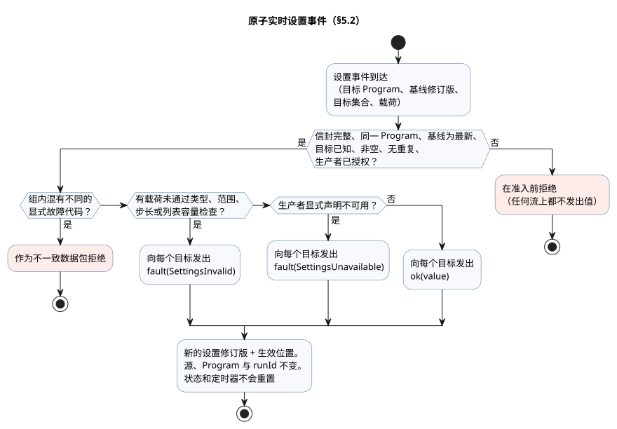
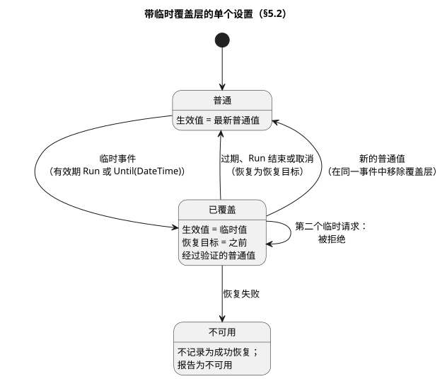

<!-- translation-source: docs/reference/05-settings-and-observation.en.md -->
[英文原文](05-settings-and-observation.en.md)

# 5. 设置与观测

[完整目录](../LANGUAGE-REFERENCE.zh.md) · [上一章：传感器、约束与控制](04-sensors-constraints-control.zh.md) · [下一章：组合与重放](06-composition-and-replay.zh.md)

GhostFlow 程序区分两类值：

- **可调整的值。** `config` 是作者有意公开的调整点。
- **由执行产生的值。** `state`、定时器、输入和输出的存在，是为了让人观测程序正在做什么。

这种区分在实践中很重要。修改灌溉时长的操作员，与直接编辑当前定时器的人所做的事情并不相同，语言会把两者分开。它还使界面可以复用与程序相同的类型和验证规则，而无需重新解释源代码。

**本章内容**

- §5.1 —— 如何声明 `config`，以及各类型的验证规则。
- §5.2 —— 编辑源代码与运行期间修改设置的区别；原子实时事件；临时设置；重启。
- §5.3 —— 与具体界面无关的观测模型（描述符、快照、事件、命令结果、报警、解释）。
- §5.4 —— 哪些身份标识绝不能混用，以及 GhostFlow 对物理世界认知的边界。
- §5.5 —— 设计依据与证据。

## 5.1 `config` 声明

下面的源写法已经确定。

```ghost
control OperatorSettings {
  config duration: Duration = 5min {
    min = 1min;
    max = 20min;
    step = 1min;
    access = operator;
    label = "관수 시간";
  }

  config duty: Percent = 50% {
    min = 0%;
    max = 100%;
    step = 10%;
    access = designer;
    label = "출력 비율";
  }

  config enabled: Bool = false {
    access = operator;
    label = "자동 관수 사용";
  }
}
```

`config name: Type = default { ... }` 声明一个**带类型的流**。它的载荷类型是 `Type`，第一次发出的值是 `ok(default)`。一条声明同时包含三样东西：名称、来自源代码的初始值，以及验证元数据。

- `access` 控制谁可以修改该值，它不改变流的类型。
- 不允许操作员修改的 config，仍然按与其他 config 相同的 Result 规则读取。
- 如果只需要一个永不改变的计算常量，请改用普通 `let` 中的常量表达式。

| 项 | 含义 | 规则 |
|---|---|---|
| 类型 | 值的含义以及它能表示哪些值 | 可执行表达式与设置输入适用相同的类型规则。 |
| 默认值 | 第一次 `ok` 发出的载荷 | 属于规范的 `.ghost.md`。它**不是**出错时的 fallback。 |
| `min`、`max` | 闭合的允许范围 | 与设置类型相同，且 `min <= max`。两个端点都被允许。 |
| `step` | 从 `min` 开始的允许值网格 | 必须大于 0。若 `(value - min)` 不是整数个步长，则拒绝该值。对于 Temperature，差值类型是 TemperatureDelta。 |
| `access = operator` | 操作员可以修改此设置 | 只允许声明范围内的带类型设置事件。 |
| `access = designer` | 由源作者选定此值 | 不能通过运行设置事件修改。 |
| `label` | 供人阅读的显示名称 | 不是标识符。它既不改变含义，也不改变权限。 |

枚举成员也可以声明显示标签：`type Phase = Idle { label = "대기"; } | Running;`。

- 标签是可选的纯文本元数据。它不改变成员名称、序号，也不改变 control 的执行方式。
- 没有标签的成员以其源名称显示。
- 以下情况是错误：空标签、只含空白的标签、重复标签，以及不受支持的成员选项。
- 编译器在 Interaction Schema `0.3` 中以 `enumMembers[].displayLabel` 输出标签。Web、HMI 和移动端使用方都共享这一元数据。参见 [Interaction 契约](../../contracts/interaction-v0/README.md)。

**没有 `apply` 字段**。`apply = stopped` 和 `apply = live` 都是语法错误。`operator` 设置总是通过 §5.2 所述的原子实时事件生效。这条规则直接固定在声明本身中，因此不会出现用来选择变更*何时*生效的第二套设置系统。

**默认值与验证规则**

- 数值默认值必须位于 `min..max` 之内，并落在从 `min` 开始的步长网格上。
- `Bool` 没有数值范围或步长：它的两个可选值已经由类型定义。
- `false`、`0` 和 `0%` 都是有效的显式值，它们并不表示“没有值”。
- 未知目标、重复目标和未授权的修改会在**流准入之前**（即变更进入流之前）被拒绝。
- 如果变更已被识别并获得授权，但其载荷未通过类型、范围或步长验证，则会产生 §5.2 所述的错误发出。验证失败的载荷绝不会作为成功值被应用。

`Int` 设置的默认值、`min`、`max` 和 `step` 都是有符号 32 位整数。`step` 为正数。默认值和 `max` 都必须落在从 `min` 开始的整数网格上。例如，`min = -2; max = 4; step = 2;` 恰好允许 `-2, 0, 2, 4`。绝不会为了让值落入整数网格而对小数或浮点容差进行舍入。

**原因：** 整数设置（例如计数）必须精确地选择允许的值。即使步长很大，网格之外的整数也不能借助容差混进来。而且闭合范围的两个端点都必须真正可选。

对于 `Temperature`，`min`、`max` 和默认值是绝对温度，而 `step` 是 `TemperatureDelta`。例如：`min = 10°C; max = 30°C; step = 0.5Δ°C;`。其他物理量使用 §2.9 运算表所定义的差值类型。对于没有通用算术的名义类型，设置网格只在该类型的规范量值上检查。这一内部检查不会给程序增加任何新的算术运算。

与时间相关的设置如下。

| 设置类型 | 默认值、`min`、`max` | `step` | 网格检查依据 |
|---|---|---|---|
| `Date` | `Date` | 正 `Int`，单位为天 | 日历日。`step = 1;` 从 `min` 开始逐日选择。 |
| `TimeOfDay` | `TimeOfDay` | 正 `Duration`，如 `1min` | 自午夜起的毫秒差 |
| `DateTime` | `DateTime` | 正 `Duration`，如 `1min` | UTC epoch 毫秒差 |

不存在跨午夜的回绕，也不推断时区。这一设置验证不会给程序增加诸如 `DateTime - DateTime` 或 `TimeOfDay + Duration` 之类的额外算术。

**原因：** 日期按日历日选择；时间值按毫秒分辨率选择。日历日不会在某个任意时区中被换算成 24 小时的实际运行时间。这样，设置表单与运行时检查的允许值集合完全相同。

调度计划列表使用 ``config times: TimeSlots<15min, 8> = [time`06:00`];`` 的形式。对于该类型，网格和最大元素数定义了允许范围，因此不使用 `min`、`max` 或 `step`。列表验证以及与 `DailySlots` 的连接遵循 [§3.6](03-time-and-schedules.zh.md#36-选定的-dailyslots)。

**设置描述符。** 设置描述符提供使用方呈现某个设置所需的一切：稳定的设置 ID、源名称、类型、默认值、访问权限、范围、步长、标签，以及源/意图来源（它来自源代码和意图的哪个位置）。Cabinet-view 可以用它构建带类型的表单，例如 Duration 输入框、Bool 选择或带范围的数值输入。滑块、旋钮、坐标、颜色和布局由 Cabinet-view 决定。绝不要从 `label` 或控件形状推断设置的身份标识或验证规则。

**温度显示单位。** `Temperature` 设置描述符必须包含所选的 `displayUnit`（`°C` 或 `K`），并与以 `K` 表示的规范值分开。

- 只修改数值的实时事件保留现有的 `displayUnit`。
- 要修改单位，事件必须指明新单位。
- 缺失或含糊的单位在应用之前就是错误。绝不要从规范值或其量值推断显示单位，也绝不要选取默认单位。

### 默认值与生效值

**默认值**是源代码中定义的初始载荷。**生效观测**是表达式在某个特定执行位置读取到的最新 `Result<Type, SettingsFault>`。

```text
首次观测                                → ok(源初始值)
之后被接受的正常发出                    → ok(新载荷)
之后被接受的错误发出                    → fault(SettingsFault)
```

观测者必须能够区分：

- `defaultValue`；
- 当前 Result：其状态，以及其载荷或故障；
- 设置修订版；
- 该值生效的位置。

可以把之前的成功值作为历史保留，但不得以掩盖当前故障的方式把它呈现为生效值。

## 5.2 源代码变更与运行设置变更

“修改设置”有两种不同的方式，含义也不同。

| 变更 | 发生变化的身份标识 | 含义 |
|---|---|---|
| 编辑源代码中的默认值、表达式或声明 | 文档修订版、源摘要，通常还有程序制品 | 一个新的规范 `.ghost.md` 候选，需要审查 |
| 运行设置事件 | 设置修订版和生效事件位置 | 在同一源代码、Program 和运行中，生效值发生变化 |

**源代码编辑**修改原始 Markdown。结果必须是一个新的文档修订版，并保留正文、注释、围栏、换行和原始字节。它不得假装成设置覆盖层。意图锚点、已确认的前提、未确认的假设以及源映射来源，都要针对新修订版重新验证。

**运行设置**绝不修改源字面量，也绝不重新编译任何东西。

因此，API、Web 和 FSD 使用方在两条路径之间选择：

- 要永久修改默认值，提交新的 `.ghost.md` 候选。
- 要在运行中调整同一个 Program，提交带类型的设置事件。

不要把已删除的源候选辅助工具作为隐式 fallback 复活，也不要把它保留为活动的使用路径。将两条路径分开，才能审查“把 5 分钟改成 10 分钟”这样的请求：它是永久修改默认值，还是只针对本次运行的设置？

### 设置流与当前观测

设置**生产者**可以是 Web UI、网络消息、MQTT，或者 EC11 旋转编码器之类的物理控件。把一个生产者换成另一个，既不改变使用方程序的表达式，也不改变流的含义。语言语义不依赖任何特定协议、RxJS 或任何 UI 库。

`access` 是**编辑**值的权限。它并不阻止合法的生产者在 `designer` 或只读 config 上报告错误，或将其恢复为声明的初始载荷。把它改成其他任何载荷仍然属于编辑，需要经过授权。在准入之前，宿主会验证生产者观测和操作员编辑两者的来源与权限。数据包内的来源标签本身并不构成认证，使用方表达式也绝不会根据来源分支。

每个流的行为如下：

1. 它提供一次有效的初始值。
2. 之后，它提供有序的 `ok(value)` 或 `fault(reason)` 观测。
3. 故障不会结束流。之后的正常发出可以使其恢复。
4. 仅仅沉默绝不会产生故障。“不可用”是一次显式的 `fault(SettingsUnavailable)` 发出，由生产者契约定义。

普通控制表达式使用现有的 Result 语法显式处理两条轨道。

```ghost
config duration: Duration = 5min {
  min = 1min; max = 20min; step = 1min; access = operator;
}
let within_duration = case duration {
  ok(value) => age < value;
  fault(reason) => false;
};
```

这里的 `false` 是作者选择的错误处理方式。语言绝不会自行替换为停止、默认值或之前的成功值。也可以按照类型规则使用 `map`、`and_then` 和 `recover` 等现有 Result 运算。`TimeSlots` 具有相同的成功与错误观测，使用它的 `DailySlots` 会直接处理错误。列表绝不会被转换成任意的标量。

**一次求值，一个视图。** 在同一个逻辑求值位置，所有使用方读取同一个 config 观测。调度计划的 `every` 与控制表达式的运行时长绝不能读取同一设置的不同副本。求值期间到达的发出不会改变该次求值的不可变视图，而是按顺序放在下一个位置。这一求值边界是流语义的实现方式；它并不会把设置变成只在扫描循环内部起作用的命令。DI（数字输入）快照也在同一次求值中固定，但普通 Bool 输入不要求携带设置修订版或 EventId。

### 原子实时事件

当多个设置一起变化时，这一变更是一次带有显式目标集合的**原子实时发出**。处理步骤如下。

1. 验证事件所针对的 Program 及其基线设置修订版。
2. 验证目标集合非空、全部已识别、没有重复，并且生产者具有权限。以下情况在**准入之前**拒绝：损坏的信封、未知目标、针对其他 Program 的事件、过时的基线修订版以及授权失败。绝不要在无法识别的流上产生错误发出。
3. 按照类型、范围、步长和列表容量规则，一起验证已识别操作的所有载荷。
   - 如果全部有效，则向所有目标一起发出 `ok(value)`。
   - 如果有任何一个失败，则向所有目标一起发出 `fault(SettingsInvalid)`。绝不要只把有效的子集切换为 `ok`。把原因和受影响的项保留在诊断来源中。
   - 生产者显式不可用时，同样向整个目标组发出 `fault(SettingsUnavailable)`。
   - 如果同一组携带不同的显式故障代码，则作为不一致的数据包拒绝。不要猜测错误优先级。
   - 如果确实存在载荷验证失败，则整组观测到 `SettingsInvalid`。
4. 被接受的成功或错误发出获得一个设置修订版和一个生效位置。从该位置起，所有目标观测一起生效。非目标的流不变。
5. 规范源代码、已编译的 Program 和 `runId` 保持不变。
6. 状态和定时器**不会**重置。当前控制表达式读取新的生效值并决定结果。

下面的流程概括了第 1–6 步。拒绝发生在准入之前，完全不产生发出；每个被准入的事件都以一次由其所有目标共享的发出结束。



**接受一个故障不同于拒绝一次传输。** 错误轨道是使用方观测到的新状态。

- 之后控制求值失败，不会撤销已经被接受的发出。
- 如果 API 把尚未接受的发出与其求值作为一个事务提交，而事务失败，则该发出保持未接受状态，可以用相同的身份标识重试。
- 绝不要把未被接受的操作报告为已经生效。
- 如果生产者重传，同一次发出不会被应用两次。

因此，如果在运行中把 `duration` 从 10 分钟缩短到 5 分钟，下一次判定会用已经经过的时间与新的限值比较。不会隐式地等待“下一轮”、停止、复位、重新编译或新的运行。设置事件也不会强制任何特定输出；输出的变化只来自作者编写的控制表达式。

不要在设置声明中添加应用时机字段。如果想保留启动时选定的运行时长，程序应在启动转换期间把该设置复制到自己的状态中，之后读取该状态。替换程序或固件所需的停止流程同样不适用于运行设置事件。

### 生命周期与临时设置

**临时设置**是具有确定有效期的运行设置。它不是单独的源代码。它必须指明：

- 目标 Program、设置 ID 和带类型的值；
- 执行者、权限和原因；
- 创建它的事件、设置修订版和起始位置；
- 有效期、过期、回滚来源和恢复目标。

之前的覆盖绝不会自动附加到不同的 Program 修订版上。必须针对新修订版重新验证并显式批准。

**跨重启的持久化。** 对于已接受的普通实时设置，最新的 Result 和修订版在设备实际重启后仍然保留。

- 如果最后一次观测是故障，则恢复该故障，而不会用初始值替代。
- 如果存在可恢复的最新观测，则其历史在初始发出之后、第一次控制判定之前应用。
- 重启会产生新的 `runId`。

临时变更是叠加在普通设置之上的**一层覆盖层**。它不增加任何源关键字。其含义完全由以下设置事件规则定义。

| 项 | 已确定的规则 |
|---|---|
| 有效期 | 请求者显式选择 `Run` 或 `Until(DateTime)`。没有有效期的请求被拒绝。 |
| `Run` | 仅在当前运行中有效。运行结束时移除覆盖层。 |
| `Until` | 存储绝对过期时间和确切的 Program 身份标识。在同一 Program 的多次重启之间持续有效，直到过期。 |
| 恢复值 | 临时变更之前刚刚生效的、经过验证的普通值。绝不会被源默认值悄悄替代。 |
| 嵌套 | 如果该设置已经有一个活动的临时变更，则新的临时变更被拒绝。需要先显式取消第一个。 |
| 新的普通设置 | 同一个事件移除该设置的覆盖层并应用新的普通值。旧的过期之后不能覆盖新值。 |
| 过期/取消 | 一个以原覆盖层 ID 为目标的原子设置事件。它记录完成后的设置修订版和应用位置。 |
| 恢复失败 | 不记录为成功恢复。设置有效性报告为不可用，需要该设置的判定不会被提交。物理输出如何响应，遵循设施的显式故障契约。 |

下面的状态图针对单个设置展示了这些规则。



更多规则：

- 如果没有可信时间来判断 `Until` 何时过期，则拒绝新的临时请求。
- 如果已应用值的有效性无法再确定，则停止把它当作有效值读取。
- 重启时，在第一次控制判定之前完成所有恢复和过期判定。
- 把多个设置组合在一起的临时事件为它们赋予一个共享的有效期，应用和恢复都是全有或全无。
- 要用普通变更修改此类组中的一部分，请提交一个取消整个组并设置新值的单一事件。

**原因：** 这些规则防止临时值悄悄变成永久值，也防止迟到的过期撤销操作员更新的决定。过期时间和临时值都由操作员选择；语言绝不会选取任意的运行时长。

### 重启与内存恢复

新的运行从声明的状态初始值和全新的定时器基线开始。断电期间的时间**不会**计入 `elapsed`。

持久化普通设置与恢复状态是两回事。如果宿主提供检查点恢复：

- 它必须验证 Program、实例、状态模式以及单调时间的连续性；
- 它必须收到一个显式的执行请求，其中指明检查点和恢复许可策略；
- 它不得恢复无法证明连续性的定时器或滤波器内存；
- 恢复失败必须可观测。绝不要在报告恢复成功的同时初始化状态。

当程序需要重启原因时，请使用下面这一确切的、保留的、由运行时拥有的生命周期输入契约。没有专门的 `on_restart` 语句。这些端口直接作为标量值读取，不经过 `Result<T, SensorFault>` 采集，也不能带可选标记或调理设置。其他所有外部输入仍遵循规范的质量契约。

```ghost
type RestartReason = PowerOn | Brownout | Watchdog | Software | Unknown;
input restart_reason: RestartReason;
input restart_event: Bool;
```

这些确切的保留声明是 control 主体的一个片段。它们的工作方式如下。

- **由谁提供。** 两个值都由帧式运行时拥有并注入。调用方不能通过扫描帧或普通输入设置器提供它们。
- **`restart_reason`。** 宿主显式提供由硬件确认的原因；没有证据时提供 `Unknown`。仅凭 `PowerOn` 并不能证明是从停电中恢复。该原因在整个运行期间固定不变。
- **`restart_event`。** 宿主还会说明启动事件是否仍处于待处理状态。在待处理期间，`restart_event` 在第一次成功提交的扫描中为 true，之后为 false。被拒绝的扫描使其保持待处理。如果在启动事件已被消费之后替换程序，宿主将其设为 false。
- **由作者决定什么。** 自动恢复运行、等待，或者取消后返回原位，都由作者编写的状态转换来表达。
- **它不做什么。** 这一契约只提供事件和原因。它不恢复 VM 或定时器内存。在第一次判定之前，物理输出由设备安装策略和输出渲染器负责。


## 5.3 独立于 Cabinet-view 的观测模型

<a id="53-renderer-독립-관찰-모델"></a>

<a id="53-renderer-independent-observation-model"></a>


在本章中，较早的术语“renderer”在指表单和观测视图时，表示 Cabinet-view/UI（`@ghostflow/cabinet-view`）。*输出渲染器*则不同：它应用逻辑输出意图，定义见 §8.2。UI 显示不构成 applied 或 confirmed 的证据：在屏幕上显示某个东西，绝不能证明某个输出已应用或已确认。


观测契约承载含义，而不规定界面。

| 概念 | 回答的问题 | 时间含义 |
|---|---|---|
| descriptor（描述符） | 什么可以被读取或修改？ | 静态的源/Program 含义 |
| snapshot（快照） | 一次已完成的判定中各值是什么？ | 一次已完成的扫描 |
| event（事件） | 发生了什么，顺序如何？ | 运行内的有序发生 |
| command result（命令结果） | 执行边界如何处理了一个请求？ | 命令生命周期 |
| alarm（报警） | 哪个条件被触发，何时清除？ | 触发/清除事件以及当前状态 |
| explanation（解释） | 哪次求值支持当前结果？ | 同一次已完成的扫描 |

契约中不包含控件、布局、坐标、颜色或特定界面的可见性策略。多个 Cabinet-view 可以用不同方式呈现相同的描述符和执行身份标识，但它们都不得改变值、权限、验证或命令可用性。

### 描述符与快照

**描述符**具有公开的语义 ID、名称、种类、源类型、读/写/执行权限，以及源/意图来源。状态、定时器、精确计数器、设置、输入、输出、命令和报警各自按其声明的含义分类。绝不要因为某个东西名为 `count`，或其值看起来像整数，就推断它是计数器。

修改设置与观测值是不同的能力。

- 在 `state`、定时器或输出描述符中看到某个值，并不授予写权限。
- 元数据生产者和 Cabinet-view 不能添加源代码未声明的 `write` 或 `execute` 权限。
- 命令权限并不意味着可以直接写内部状态。
- 操作员设置权限并不意味着可以编辑源代码。

**快照**恰好绑定到一次已完成的扫描。其中的每个观测是以下之一：

- `ready`：存在实际值，包括 `false` 和 `0`。
- `unavailable`：在该完成点不存在值，并给出原因。
- `error`：无法观测该描述符。
- `stale`：由*使用方*与其期望的身份标识比较后计算出的结果。载荷本身绝不会声明自己处于此状态。

一个有效的无状态 control 可以拥有一个模式已识别的空描述符列表；它完成的快照于是具有空的观测列表。这不是观测失败。不要仅仅为了填满界面而添加人为的 Bool 状态或定时器。

`timer age = elapsed(phase)` 的描述符直接把原始的枚举 `phase` 命名为其主体。不要把为内部计算或显示而合成的 Bool 时钟当作公开含义暴露出来。当主体是 Bool 时，定时器计算自上一次已提交的任一方向变化（true 到 false 或 false 到 true）以来的时间。

### 事件、命令结果与报警

仅靠快照无法显示在两次刷新之间被触发又被清除的报警。这就是事件存在的原因。

- **事件**在每个运行内有序，并且重复项必须可识别。如果记录超出保留范围或连接中断，要显式报告序列缺口或错过的范围。绝不要根据最后一个快照重建缺失的事件。
- **命令结果**区分以下结局：请求已接收、已拒绝、已开始、已完成、已取消和已失败。写法 `received → rejected | started → completed | cancelled | failed` 用于说明这些区别；它不是已确定的源语法，也不是记录枚举或转换模式。命令 ID 与执行身份标识必须匹配，Cabinet-view 或回调不得推断出另一个状态机。如果有界历史在导出之前丢失了记录，要报告缺口。
- **报警**同时使用当前的活动状态和触发/清除事件，以便连短暂的发生也能保留下来。

命令和报警记录最终的序列化与传输属于执行环境的观测契约。语言中没有 `command` 或 `alarm` 源声明，也没有严重程度关键字。控制响应用显式的带类型输入和状态表达式编写。哪些输入是命令请求、哪些观测作为报警公开，由显式的外部描述符契约决定。绝不要仅根据名称或 Bool 值自动推断。

### 解释 DAG

**解释**是一个有向无环图（DAG）。它把一个输出结果与为产生该结果而实际求值的输入、状态、定时器、具名中间值、谓词和约束连接起来。被多个结果共享的条件保持为单个稳定节点。如有需要，Cabinet-view 可以把图展开为以某个特定输出为根的树。

对于每次已完成的扫描，每个求值至少需要以下含义：`evaluated`、实际值/状态，以及 `supportsResult`。

- 绝不要把被短路（未求值）的分支显示为实际证据。
- 如果 AND 为 false，其已求值的 false 子项可以帮助解释结果。如果 OR 为 true，其所有已求值的 true 子项都可以帮助解释结果。绝不要任意挑选一个“胜者”。
- 该图是求值结果的证明路径。它**不**主张反事实因果关系，例如“没有这个条件，结果就会不同”。

解释同时覆盖输出 ON 和输出 OFF，并同时覆盖请求意图和经过约束后的安全意图。绝不要把编译器私有的槽位名称用作公开语义 ID。每个节点都必须能追溯到源节点/范围、意图锚点以及规范文档修订版。

## 5.4 身份标识与物理事实的边界

观测和设置记录把以下身份标识分开保存。绝不要混用它们。

```text
源文档 + 不可变修订版 + 源摘要
Program/模块 + 制品摘要
设置修订版 + 生效事件位置
行为实例以及设施/绑定修订版（组合时）
runId + 已完成的 scanId + 逻辑时间
事件/命令/报警序列身份标识
```

`scanId` 只在一次运行内为扫描排序。如果复位或实际重启产生了新的运行，即使同样是 `scanId = 0`，也是不同的发生。实时设置事件不改变 `runId`。如果把来自不同源代码、Program、设置、绑定或运行的快照和解释拼接在一起，应把结果视为过时或不匹配。

**GhostFlow 能知道什么、不能知道什么。** GhostFlow 观测输入和控制判定。`pump = true` 是输出*意图*；它并不能证明泵已通电、已转动或水已流动。请把以下几项分开：

- 请求意图；
- 安全意图；
- 宿主/渲染器报告的应用结果；
- 实际反馈。

没有反馈时，物理结果是未知的。“低水位信号阻止了灌溉”这样的解释，绝不能被改写为“水箱实际上是空的”这一断言。

## 5.5 设计依据与证据

- **带类型的设置**让代码、验证和自动生成的表单共享同一含义。
- **原子事件**消除了只有部分值被应用的时刻。
- **将快照与事件分开**，既保留当前值，也保留过去的发生。
- **精确的身份标识与来源**防止共享同一名称的不同执行被错误关联。
- **守住物理事实的边界**，防止仿真和 UI 编造设备成功。

依据：[语言模型](../LANGUAGE.zh.md)、[控制表面](../LANGUAGE-SURFACE.zh.md)、[意图锚点](../INTENT-ANCHOR-MAP.zh.md)、[Interaction v0](../../contracts/interaction-v0/README.md)、[#68](https://github.com/callin2/ghostflow-language/issues/68)、[#70](https://github.com/callin2/ghostflow-language/issues/70)、[#73](https://github.com/callin2/ghostflow-language/issues/73)、[#74](https://github.com/callin2/ghostflow-language/issues/74)、[#88](https://github.com/callin2/ghostflow-language/issues/88)、[#89](https://github.com/callin2/ghostflow-language/issues/89)、[#105](https://github.com/callin2/ghostflow-language/issues/105)、[#110](https://github.com/callin2/ghostflow-language/issues/110)。
