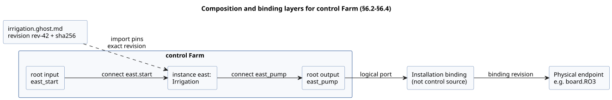
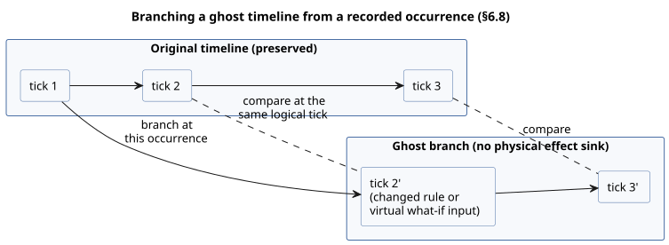
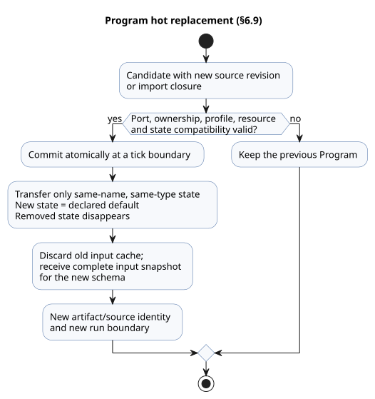

<!-- translation-source: docs/reference/06-composition-and-replay.md -->
[Korean original](06-composition-and-replay.md)

# 6. Composition, replay, and replacement

[Complete contents](../LANGUAGE-REFERENCE.en.md) · [Previous: Settings and observation](05-settings-and-observation.en.md) · [Next: Semantic rules and index](07-semantic-rules-and-index.en.md)

In GhostFlow, the unit of reuse is a **behavior**: something with a meaning and a contract, not a code fragment. A behavior keeps these together:

- control expressions and state;
- logical ports;
- settings and dependencies;
- constraints;
- explanation provenance.

**Composition** does not copy and paste a behavior. It creates an **instance** of one exact definition revision and validates the typed relationships between instances.

**In this chapter**

- §6.1 — one semantic model, viewed through several graphs with different cycle rules.
- §6.2–§6.4 — definitions, instances, logical ports, parameters, settings, dependencies, bindings, and the `import`/`connect` syntax.
- §6.5–§6.7 — invariants of composed execution, resource contracts, and composed explanations.
- §6.8–§6.9 — replay, ghost branches, and hot replacement of a Program.
- §6.10 — compile-time `syntax` extensions (`quote` and splice).
- §6.11 — design rationale and evidence.

## 6.1 One semantic model and multiple graphs

Source, control, intent, ports, devices, observations, and events are linked by stable identity. The same subject can appear in an editing document, an HMI, a timeline, a simulation, and a trace. It does not become a new semantic object in each of those views.

Not every relationship belongs to one universal DAG. Each graph gives its edges a different meaning and has its own rule for cycles.

| Graph | Edge meaning | Cycle rule |
|---|---|---|
| import graph | A definition depends on another definition revision | Executable import cycles are rejected |
| Computation graph within one tick | A value reads another value of the same decision | Combinational cycles are rejected |
| State feedback | A value reads committed state from the previous tick | Allowed, through an explicit state boundary |
| explanation graph | Evaluation evidence supports a result | Must be a DAG; cycles are rejected |
| installation graph | A logical port is bound to a physical capability | Separate ownership and compatibility rules apply |
| timeline | Occurrences follow each other in time | Branches and ordering are stated explicitly |

**Why:** If execution order, physical connections, and explanation relationships were all treated by the same rules just because each is drawn as a line on a screen, the result would be hidden schedulers or false safety claims.

## 6.2 Definitions, instances, and logical ports

- A **definition revision** identifies one immutable canonical `.ghost.md` together with its exact imported source closure (every source it imports, transitively).
- An **instance** is a separate execution unit that uses a definition inside a composition.

Even when the same definition is used twice, each instance has its own instance ID, state, timers, settings, bindings, and provenance.

Display names, file locations, and declaration order are **not** identity. If you reorder declarations but keep the same instance IDs and the same input/time records, the results and the identity-keyed traces must not change.

A behavior's **port** is a typed logical role, not a physical pin number.

```text
Port pump of instance irrigation-east
  → installation binding
  → MainPump or board.RO3
```

A logical port keeps its direction, semantic type, required or optional dependencies, and ownership requirements. Physical endpoints belong to separate profiles and binding revisions. A `Bool` input does not always consume a physical DI (digital input); an explicit software input may supply the same logical type.

**Proposing bindings.** Keep existing bindings first, and propose the remaining capabilities for new ports. Matching types and directions do **not** prove polarity, load, fail-safe behavior, or actual wiring. Without evidence, each of these is `unknown`. Never promote it to "compatible" or "physically verified".

Physical endpoints are not limited to an MCU's own GPIO. A channel on an I/O expander, or a channel on a relay reached over a communication link, can also be a binding target if it satisfies the same logical output contract. The output renderer and the installation connections own bus addresses, channel selection, and transmission procedures. Committing several output intentions in one language tick does **not** guarantee that the physical channels switch at the same moment.

The diagram below uses the `Farm` example from §6.4 to show the layers: an import pins a definition, `connect` wires ports inside the control, and an installation binding (outside control source) connects a root logical port to a physical endpoint.



### External observations and internal computed connections

There are two kinds of connection into an instance `input`, and they carry different evidence.

**Acquisition forwarding (root `input` → instance `input`).** This forwards the existing typed-quality acquisition contract, including the sample identity and every declared conditioning contract.

**Internal computed connection (instance scalar `output` → another instance's `input`).** The value actually evaluated is passed as `Result.ok(value)`.

- The receiving definition still handles the Result explicitly, with `case`, `recover`, or another typed Result operation.
- The connection does not recover an upstream error by itself. The producing scalar output has already expressed its own definition's handling policy.
- It creates no acquisition input, no Good-quality claim, no sample timestamp, no sample identity, and no sensor fault origin.
- If the receiving port has optional-acquisition or input-conditioning annotations, the connection is rejected rather than silently discarding them. (For acquisition forwarding, those annotations keep their meaning.)
- Committed-state output feedback keeps the previous-tick boundary. Wrapping a computed value in `ok` does not permit combinational cycles or next-state feedback.

A root's external Result cannot be connected directly to a scalar output without Result handling written by the author.

**Why:** A calculated value and a producer's observation are different kinds of evidence. Reuse keeps the receiving definition's Result contract, while preserving where acquisition quality came from and the explicit state boundary.

## 6.3 Parameters, settings, dependencies, and bindings

All four of these relationships connect values, but each has a different lifecycle.

| Relationship | Role | Effect of a change |
|---|---|---|
| import parameter | Specializes a definition with specific values | A new composition/source revision, and usually a new artifact |
| operator setting | Changes operating values of the same Program | Same Program and run; a new settings revision and effective position |
| dependency | Selects a required external behavior or capability | The pinned closure and compatibility are revalidated |
| binding | Connects a logical port to an installation endpoint | A new installation/binding revision |

Do not blur these differences into a single untyped `with` map. In particular, an operator setting can never change a dependency or physical wiring, and a change to an import parameter is never handled as a live setting.

### Compatible device replacement and independence from recompilation

A GhostFlow Program targets **logical port contracts**. It never uses an installation's device model, communication address, or pin as part of the identity of its executable rules. The work is divided like this:

- **Input drivers** handle device-specific communication and value interpretation.
- **Output renderers** apply output intent.
- **Bindings** connect the actual endpoint for each role.

**Replacing a physical device or Driver that satisfies the same logical device contract does not require editing control source or recompiling the Program.** Keep the canonical `.ghost.md`, the source revision, and the compiled Program; change only the relevant installation profile/binding revision. The execution environment manages the Driver's own deployment revision.

Compatibility is not established just because names or primitive types match. The replacement must satisfy what the existing program requires: direction, meaning, units, ranges, sample timing, quality/error contracts, and capabilities. Source rules such as sensor `sample`, `valid`, `filter`, `stale_after`, and `recover_after` do **not** adapt automatically to a replacement device. If a replacement cannot satisfy the contract, it must not be approved as compatible.

What kind of change is it?

- Changing the rules in source is a **source change**.
- Changing only values exposed through `config` is an **operating settings change**.
- Dynamic Driver installation, firmware updates, and physical replacement procedures belong to the **execution environment**.

Reusing a Program does not guarantee uninterrupted replacement, nor automatic continuity of existing runs or sensor state. Application procedures follow [§4.10](04-sensors-constraints-control.md#410-mode와-live-settings); sample continuity and recovery follow [§4.2](04-sensors-constraints-control.md#42-샘플-계약과-sensor-처리-순서).

**Why:** Replacing a printer Driver does not require recompiling a word processor. In the same way, device-specific differences should be handled behind a common contract. This decouples control intent from hardware replacement cycles.

## 6.4 Import and connection syntax

Each document still defines exactly one `control`. A document-level import pins a complete `.ghost.md` definition, and the imported control is then used as an instance in the body.

```ghost
import Irrigation from "./irrigation.ghost.md"
  revision "rev-42"
  sha256 "0123456789abcdef0123456789abcdef0123456789abcdef0123456789abcdef";

control Farm {
  input east_start, west_start: Bool;
  output east_pump, west_pump: Bool;
  instance east: Irrigation;
  instance west: Irrigation;
  connect east.start <- east_start;
  connect west.start <- west_start;
  connect east_pump <- east.pump;
  connect west_pump <- west.pump;
}
```

The digest above is a placeholder. To compile a real example, you need the exact UTF-8 SHA-256 and the immutable revision of the referenced document.

- The path is a locator relative to the importing document. It is **not** identity.
- During execution, nothing outside the source closure supplied by the resolver is read — no other files and no network.
- Browsers and devices resolve against the same complete closure of original sources.

```text
import_decl    ::= 'import' Identifier 'from' String
                  'revision' String 'sha256' HexDigestString ';'
parameter_decl ::= 'parameter' Identifier ':' type '=' constant_expr ';'
instance_decl  ::= 'instance' Identifier ':' ImportAlias
                  [ '(' named_constant_args ')' ] ';'
connect_decl   ::= 'connect' sink_port '<-' source_port ';'
```

**Parameters** are declared inside the definition's control. For example, `parameter duration: Duration = 5min;` is specialized with `instance east: Irrigation(duration = 10min);`.

- Arguments bind by name. An omitted argument uses the declared default.
- Duplicate arguments, unknown arguments, non-constant arguments, and type mismatches are rejected.
- Parameters never change during execution, and a parameter cannot share a name with an operator setting.
- Public top-level functions and types are referenced as `Irrigation.name`. Another control's internal state, `let`s, and timers are not accessible.

**Connections.** The source of a `connect` is a root input or an instance output; the sink is an instance input or a root output.

- Types must match exactly.
- Each input has exactly one supplier, and every required input must be connected.
- A root output is defined either by an ordinary `<- expr` or by `connect` — never both.
- Sensor-port quality is never erased by connecting to an ordinary value port. A sensor connection is allowed only from a root sensor to an instance sensor with the same payload type and sample/quality contract. Each instance's declared filter and freshness rules still apply.

For sensor connections, the payload type, optionality, and declared sample interval must all match. Every instance receives the same raw sample from the root: the same sample identity, timestamp, quality, and value. A value the root has already conditioned is never substituted. Each instance owns its own filter, recovery, and stale state. Function parameters and `case` bindings keep their lexical scope, and the definition's functions and calls are isolated per instance.

`bind` is not control source syntax. Installation bindings connect root logical ports to actual endpoints. Never put GPIO addresses, bus addresses, or credentials in this program.

The composition rules are:

1. An import pins an exact immutable revision and digest — never a catalog `latest` or a display name.
2. Transitive imports also form a fully pinned closure. Missing entries, digest mismatches, and import cycles are rejected.
3. Canonical source authority stays with each original `.ghost.md`. A composition graph or a generated manifest is not a second, editable program.
4. Name collisions are avoided with instance-qualified names, without erasing the original definition and source-node provenance.
5. Reusable definitions never contain local site bindings, credentials, conversations, or runtime history.

## 6.5 Invariants of composed execution

Composition keeps the tick semantics of a single control.

- All state transitions read the same input snapshot and the same previous-state snapshot.
- A state's next value is never read as a same-tick value by another state's transition expression or by a `let`.
- Only output expressions may reference the permitted next state.
- State results and logical output results are committed together, as one decision.
- Each instance's state and timers are isolated from every other instance.
- Declaration order and traversal order are never used for scheduling or priority.
- Instantaneous dependency cycles within the same scan are rejected before execution. Feedback through committed state from the previous scan is a separate, explicit time boundary.
- The ban on next-state references is checked transitively along port connections. Connecting an output computed from another instance's next state into a same-scan state transition is also rejected.
- Each logical output channel has exactly one authoritative direct definition. Competing writers are rejected; they are not resolved by a "last writer wins" rule.

Resources that need arbitration, such as a shared pump, receive requests through an explicit station/resource manager. The fact that several behaviors use the same physical resource does not justify several direct output writers. An existing station's pump/valve policy must not be generalized into a universal arbiter for every resource.

## 6.6 Resources and contracts

In their initial scope, composition contracts check:

- port direction and semantic type;
- presence and exact revision of required dependencies;
- import parameter types and bounds;
- exclusive ownership of outputs and resources;
- compatibility with the supplied installation contracts.

Results keep four kinds of assurance apart: declared assumptions, static checks, constraints enforced at runtime, and physical verification.

- An invalid port or a missing dependency is rejected with a specific reason.
- Installation suitability without evidence stays `unknown`.
- Matching channel counts, or a passing simulation, never establish safety or physical suitability on their own.

Diagnostics supply the reason, the affected definitions/instances/ports, expected and actual values, the evidence revisions, and the choices available for fixing the problem. For example, if two instances both claim one exclusive pump, the diagnostic identifies both instances and both ports, and the composition is rejected before activation.

## 6.7 Composed explanations and provenance

A composed explanation keeps the whole path below intact.

```text
completed occurrence
→ requested / safe output
→ instance-qualified explanation node and constraint
→ imported definition's source node/span and intent anchor
→ exact source revision and import closure
→ settings revision and binding revision
```

- Never merge the traces of several instances of one definition just because their names match.
- Never flatten nodes that come from different source documents into one synthesized location.
- When a low-water input blocks a pump request, you can report the signal and the logical result. This does not prove the tank's actual physical state.
- Renderer application failures and missing feedback are shown separately from the requested and safe stages.

## 6.8 Replay, ghost, and branches

- **Replay** recomputes recorded inputs, faults, logical time, and a starting checkpoint with the same language semantics.
- A **ghost** is a separate instance that uses the same execution core but has no physical effect sink: it cannot move real devices.

A replay or branch record needs: the timeline/branch ID, the baseline checkpoint, the Program and source closure, the instance, the settings and binding revisions, `runId`, the logical tick, inputs and faults, old and candidate state, requested and safe intent, and constraint interventions. Intermediate traces are bounded, optional information.

**Branching.** A branch is created at a particular occurrence, and the original timeline is preserved.

- Comparison lines up state, requested intent, safe intent, and faults at the **same logical tick**. Wall-clock time is input data; it never replaces logical ticks as the alignment basis.
- Sensor values that are not in the record are never generated automatically. Values needed for a what-if must be supplied as traces explicitly marked as virtual inputs.

The diagram shows a ghost branch taken from a recorded occurrence and compared tick by tick with the preserved original.



**What replay never does.** Rewind does not move real devices back to a past state. A ghost branch does not modify real usage ledgers, schedule occurrence records, or the physical installation's state. Predicting the long-term effect of different outputs on the environment requires an environmental model that is separate from control replay.

**Why:** So that you can reproduce the effect of a rule change on identical inputs, while leaving real devices and the original records untouched.

## 6.9 Program hot replacement

Replacing a Program is different from an operator settings event. The steps are:

1. Validate a candidate that has a new source revision or import closure.
2. Check port, ownership, profile, resource, and state compatibility.
3. Commit atomically at a tick boundary.

If validation fails, the previous Program stays in place.

**State migration.**

- Only state explicitly defined with the same name and the same type, under the same module identity policy, can carry over.
- New state starts from its declared default. Removed state disappears.
- Without an explicit migration, these are rejected: changing the type of a same-name state, implicit renames, and merging state from different instances.
- Previous input caches are discarded, and a complete input snapshot for the new schema is received.
- Removed outputs follow the host's release policy.

The replacement Program has a new artifact/source identity and starts a new run. Old and new traces must not be joined into one run as if this were a settings change. Persistent records owned by the physical installation — such as accumulated usage and schedule deduplication — are not reset by ordinary control-state migration or by a ghost rewind.



The diagram summarizes the replacement flow: a failed check keeps the previous Program, and a successful commit transfers only compatible state and begins a new run.

## 6.10 `syntax`, `quote`, and splice syntax

For ordinary reuse of values, a pure function is the right tool. Use compile-time syntax extensions only to build recurring domain structures themselves. Extensions are limited to typed expression ASTs.

```ghost
syntax hold(start: Expr<Bool>, stop: Expr<Bool>, held: Expr<Bool>): Expr<Bool> {
  quote { !$(stop) && ($(start) || $(held)) }
}

running' = @hold(start, stop, running);
```

**Declaration rules**

- Declare `syntax` at document level.
- Arguments and the result have type `Expr<T>`, where `T` is a complete value type.
- The body is exactly one `quote { expr }`.
- `$(parameter)` splices that argument's AST into the quote. `@hold(...)` expands at the call site.
- Only declared macro argument names are allowed inside a splice.
- `Expr<T>` is not a runtime value type. It cannot be stored in, or returned as, an input, state, or config.
- These are rejected: splices outside a quote, unknown arguments, type mismatches, and macros that create declarations.

**Name resolution and evaluation**

- Spliced names resolve at the **call site**. Names written directly in the quote resolve at the **definition site**.
- Macro arguments and same-name locals in the caller never capture definition-site names.
- If an argument is spliced several times, the expression appears several times. Do not assume it is evaluated once, as with a function; each occurrence follows the ordinary lazy evaluation rules.
- Declarations that create memory, such as timers or filters, cannot be hidden inside an expression macro.

**Expansion limits**

- Expansion never reads runtime values.
- Expansion must be hygienic: it must not capture the caller's names. The expanded result goes through type, state-boundary, cycle, and resource checks again.
- Recursion, reading external files, the network, or the clock, and unbounded AST generation are prohibited. The macro call graph must be acyclic.
- Each compilation target states the maximum number of expanded nodes it permits. Exceeding it is a compile error; the output is never truncated. This limit is a resource bound of the target, not a setting that changes what the language computes.
- Source/intent provenance is preserved between the original macro call and the generated nodes, so that explanations can lead back to the location a human wrote.
- Syntax expansion itself must never become work done during operation, or a new physical effect.

## 6.11 Design rationale and evidence

- **Pinned imports and separate instance identities** support both reuse and reproducibility.
- **Separating logical ports from physical bindings** lets the same behavior run in different installations.
- **Execution invariants and cycle rejection** ensure that declaration order never changes results.
- **Replay and effect boundaries** let you compare changes without moving a real installation.
- **Restricting macros to compile time** adds domain notation while preserving execution cost and provenance.

Rationale: [Language model](../LANGUAGE.en.md), [Syntax alternatives and macro notation](../LANGUAGE-EXAMPLES.en.md), [Programming in GhostFlow](../ProgrammingInGhostflow.en.md), [Portable package](../PORTABLE-PACKAGE.md), [#99](https://github.com/callin2/ghostflow-language/issues/99), [#100](https://github.com/callin2/ghostflow-language/issues/100), [#101](https://github.com/callin2/ghostflow-language/issues/101), [#102](https://github.com/callin2/ghostflow-language/issues/102), [#103](https://github.com/callin2/ghostflow-language/issues/103), [#104](https://github.com/callin2/ghostflow-language/issues/104), [#105](https://github.com/callin2/ghostflow-language/issues/105), [#106](https://github.com/callin2/ghostflow-language/issues/106), [#107](https://github.com/callin2/ghostflow-language/issues/107), [#108](https://github.com/callin2/ghostflow-language/issues/108).
