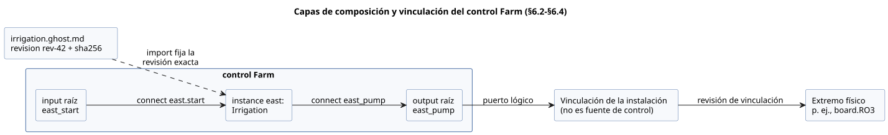
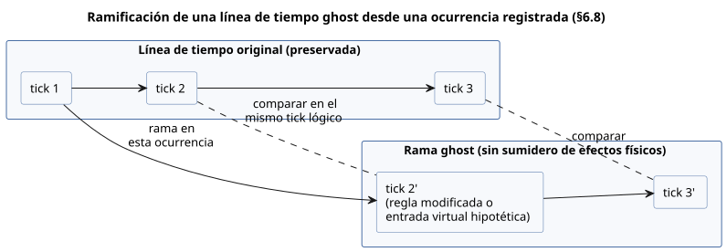
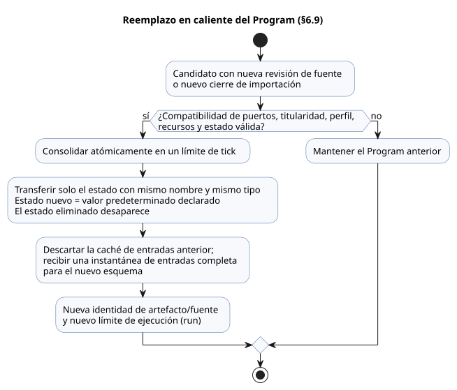

<!-- translation-source: docs/reference/06-composition-and-replay.en.md -->
[Original en inglés](06-composition-and-replay.en.md)

# 6. Composición, reproducción y reemplazo

[Índice completo](../LANGUAGE-REFERENCE.es.md) · [Anterior: Ajustes y observación](05-settings-and-observation.es.md) · [Siguiente: Reglas semánticas e índice](07-semantic-rules-and-index.es.md)

En GhostFlow, la unidad de reutilización es un **comportamiento**: algo con significado y contrato, no un fragmento de código. Un comportamiento mantiene juntos:

- las expresiones de control y el estado;
- los puertos lógicos;
- los ajustes y las dependencias;
- las restricciones;
- la procedencia de las explicaciones.

**La composición** no copia y pega un comportamiento. Crea una **instancia** de una revisión de definición exacta y valida las relaciones tipadas entre instancias.

**En este capítulo**

- §6.1 — un único modelo semántico, visto a través de varios grafos con reglas de ciclos distintas.
- §6.2–§6.4 — definiciones, instancias, puertos lógicos, parámetros, ajustes, dependencias, vinculaciones y la sintaxis `import`/`connect`.
- §6.5–§6.7 — invariantes de la ejecución compuesta, contratos de recursos y explicaciones compuestas.
- §6.8–§6.9 — reproducción (replay), ramas ghost y reemplazo en caliente de un Program.
- §6.10 — extensiones `syntax` en tiempo de compilación (`quote` y splice).
- §6.11 — fundamento de diseño y evidencia.

## 6.1 Un modelo semántico y múltiples grafos

La fuente, el control, la intención, los puertos, los dispositivos, las observaciones y los eventos están enlazados mediante una identidad estable. El mismo sujeto puede aparecer en un documento de edición, una HMI, una línea de tiempo, una simulación y una traza. No se convierte en un objeto semántico nuevo en cada una de esas vistas.

No todas las relaciones pertenecen a un único DAG universal. Cada grafo da a sus aristas un significado distinto y tiene su propia regla para los ciclos.

| Grafo | Significado de la arista | Regla de ciclos |
|---|---|---|
| grafo de importación | Una definición depende de otra revisión de definición | Se rechazan los ciclos de importación ejecutables |
| Grafo de cálculo dentro de un tick | Un valor lee otro valor de la misma decisión | Se rechazan los ciclos combinacionales |
| Retroalimentación de estado | Un valor lee el estado consolidado del tick anterior | Permitida, mediante un límite de estado explícito |
| grafo de explicación | La evidencia de evaluación respalda un resultado | Debe ser un DAG; se rechazan los ciclos |
| grafo de instalación | Un puerto lógico se vincula a una capacidad física | Se aplican reglas propias de titularidad y compatibilidad |
| línea de tiempo | Las ocurrencias se suceden en el tiempo | Las ramas y el orden se indican explícitamente |

**Por qué:** Si el orden de ejecución, las conexiones físicas y las relaciones de explicación se trataran con las mismas reglas solo porque cada una se dibuja como una línea en una pantalla, el resultado serían planificadores ocultos o falsas afirmaciones de seguridad.

## 6.2 Definiciones, instancias y puertos lógicos

- Una **revisión de definición** identifica un `.ghost.md` canónico inmutable junto con su cierre exacto de fuentes importadas (todas las fuentes que importa, de forma transitiva).
- Una **instancia** es una unidad de ejecución independiente que usa una definición dentro de una composición.

Incluso cuando la misma definición se usa dos veces, cada instancia tiene su propio ID de instancia, estado, temporizadores, ajustes, vinculaciones y procedencia.

Los nombres visibles, las ubicaciones de archivo y el orden de declaración **no** son identidad. Si reordena las declaraciones pero mantiene los mismos ID de instancia y los mismos registros de entradas/tiempo, los resultados y las trazas indexadas por identidad no deben cambiar.

El **puerto** de un comportamiento es un rol lógico tipado, no un número de pin físico.

```text
Puerto pump de la instancia irrigation-east
  → vinculación de la instalación
  → MainPump o board.RO3
```

Un puerto lógico conserva su dirección, su tipo semántico, sus dependencias obligatorias u opcionales y sus requisitos de titularidad. Los extremos físicos pertenecen a perfiles y revisiones de vinculación independientes. Una entrada `Bool` no siempre consume una DI (entrada digital) física; una entrada de software explícita puede proporcionar el mismo tipo lógico.

**Propuesta de vinculaciones.** Mantenga primero las vinculaciones existentes y proponga las capacidades restantes para los puertos nuevos. Que los tipos y las direcciones coincidan **no** demuestra la polaridad, la carga, el comportamiento a prueba de fallos ni el cableado real. Sin evidencia, cada uno de estos aspectos es `unknown`. Nunca lo promueva a "compatible" ni a "verificado físicamente".

Los extremos físicos no se limitan a los GPIO propios de una MCU. Un canal de un expansor de E/S, o un canal de un relé al que se accede mediante un enlace de comunicación, también puede ser un destino de vinculación si cumple el mismo contrato de salida lógica. El renderizador de salidas y las conexiones de la instalación son responsables de las direcciones de bus, la selección de canales y los procedimientos de transmisión. Consolidar varias intenciones de salida en un mismo tick del lenguaje **no** garantiza que los canales físicos conmuten en el mismo instante.

El diagrama siguiente usa el ejemplo `Farm` de §6.4 para mostrar las capas: un import fija una definición, `connect` conecta puertos dentro del control, y una vinculación de la instalación (fuera de la fuente de control) conecta un puerto lógico raíz con un extremo físico.



### Observaciones externas y conexiones calculadas internas

Hay dos tipos de conexión hacia el `input` de una instancia, y transportan evidencias distintas.

**Reenvío de adquisición (`input` raíz → `input` de instancia).** Reenvía el contrato existente de adquisición con calidad tipada, incluida la identidad de la muestra y todos los contratos de acondicionamiento declarados.

**Conexión calculada interna (`output` escalar de una instancia → `input` de otra instancia).** El valor realmente evaluado se pasa como `Result.ok(value)`.

- La definición receptora sigue tratando el Result explícitamente, con `case`, `recover` u otra operación de Result tipada.
- La conexión no recupera por sí misma un error de la etapa anterior. La salida escalar productora ya ha expresado la política de tratamiento de su propia definición.
- No crea ninguna entrada de adquisición, ninguna afirmación de calidad Good, ninguna marca de tiempo de muestra, ninguna identidad de muestra ni ningún origen de fallo de sensor.
- Si el puerto receptor tiene anotaciones de adquisición opcional o de acondicionamiento de entrada, la conexión se rechaza en lugar de descartarlas silenciosamente. (En el reenvío de adquisición, esas anotaciones conservan su significado).
- La retroalimentación de salida basada en estado consolidado mantiene el límite del tick anterior. Envolver un valor calculado en `ok` no permite ciclos combinacionales ni retroalimentación del estado siguiente.

El Result externo de una raíz no puede conectarse directamente a una salida escalar sin un tratamiento de Result escrito por el autor.

**Por qué:** Un valor calculado y la observación de un productor son tipos distintos de evidencia. La reutilización mantiene el contrato de Result de la definición receptora, a la vez que conserva de dónde procede la calidad de adquisición y el límite de estado explícito.

## 6.3 Parámetros, ajustes, dependencias y vinculaciones

Estas cuatro relaciones conectan valores, pero cada una tiene un ciclo de vida distinto.

| Relación | Rol | Efecto de un cambio |
|---|---|---|
| parámetro de importación | Especializa una definición con valores concretos | Una nueva revisión de composición/fuente y, normalmente, un nuevo artefacto |
| ajuste del operador | Cambia los valores operativos del mismo Program | Mismo Program y ejecución; nueva revisión de ajustes y posición efectiva |
| dependencia | Selecciona un comportamiento o capacidad externos necesarios | Se vuelven a validar el cierre fijado y la compatibilidad |
| vinculación | Conecta un puerto lógico con un extremo de la instalación | Una nueva revisión de instalación/vinculación |

No difumine estas diferencias en un único mapa `with` sin tipos. En particular, un ajuste del operador nunca puede cambiar una dependencia ni el cableado físico, y un cambio en un parámetro de importación nunca se trata como un ajuste en vivo.

### Reemplazo de dispositivo compatible e independencia de la recompilación

Un Program de GhostFlow apunta a **contratos de puertos lógicos**. Nunca usa el modelo de dispositivo, la dirección de comunicación ni el pin de una instalación como parte de la identidad de sus reglas ejecutables. El trabajo se reparte así:

- **Los drivers de entrada** se encargan de la comunicación específica del dispositivo y de la interpretación de valores.
- **Los renderizadores de salidas** aplican la intención de salida.
- **Las vinculaciones** conectan el extremo real de cada rol.

**Reemplazar un dispositivo físico o un Driver que cumple el mismo contrato de dispositivo lógico no requiere editar la fuente de control ni recompilar el Program.** Conserve el `.ghost.md` canónico, la revisión de la fuente y el Program compilado; cambie solo la revisión de perfil/vinculación de la instalación correspondiente. El entorno de ejecución gestiona la revisión de despliegue del propio Driver.

La compatibilidad no se establece solo porque coincidan los nombres o los tipos primitivos. El reemplazo debe cumplir lo que exige el programa existente: dirección, significado, unidades, rangos, temporización de muestras, contratos de calidad/error y capacidades. Las reglas de la fuente como `sample`, `valid`, `filter`, `stale_after` y `recover_after` del sensor **no** se adaptan automáticamente a un dispositivo de reemplazo. Si un reemplazo no puede cumplir el contrato, no debe aprobarse como compatible.

¿Qué tipo de cambio es?

- Cambiar las reglas en la fuente es un **cambio de fuente**.
- Cambiar solo valores expuestos mediante `config` es un **cambio de ajustes operativos**.
- La instalación dinámica de Drivers, las actualizaciones de firmware y los procedimientos de reemplazo físico pertenecen al **entorno de ejecución**.

Reutilizar un Program no garantiza un reemplazo sin interrupciones, ni la continuidad automática de las ejecuciones existentes o del estado de los sensores. Los procedimientos de aplicación siguen [§4.10](04-sensors-constraints-control.es.md#410-modos-y-ajustes-en-vivo); la continuidad de muestras y la recuperación siguen [§4.2](04-sensors-constraints-control.es.md#42-contratos-de-muestreo-y-orden-de-procesamiento-del-sensor).

**Por qué:** Reemplazar el Driver de una impresora no requiere recompilar un procesador de textos. Del mismo modo, las diferencias específicas de cada dispositivo deben tratarse detrás de un contrato común. Esto desacopla la intención de control de los ciclos de reemplazo del hardware.

## 6.4 Sintaxis de importación y conexión

Cada documento sigue definiendo exactamente un `control`. Un import a nivel de documento fija una definición `.ghost.md` completa, y el control importado se usa después como instancia en el cuerpo.

```ghost
import Irrigation from "./irrigation.ghost.md"
  revision "rev-42"
  sha256 "0123456789abcdef0123456789abcdef0123456789abcdef0123456789abcdef";

control Farm {
  input east_start, west_start: Bool;
  output east_pump, west_pump: Bool;
  instance east: Irrigation;
  instance west: Irrigation;
  connect east.start <- east_start;
  connect west.start <- west_start;
  connect east_pump <- east.pump;
  connect west_pump <- west.pump;
}
```

El digest anterior es un marcador de posición. Para compilar un ejemplo real, necesita el SHA-256 UTF-8 exacto y la revisión inmutable del documento referenciado.

- La ruta es un localizador relativo al documento que importa. **No** es identidad.
- Durante la ejecución no se lee nada fuera del cierre de fuentes proporcionado por el resolutor: ni otros archivos ni la red.
- Los navegadores y los dispositivos resuelven contra el mismo cierre completo de fuentes originales.

```text
import_decl    ::= 'import' Identifier 'from' String
                  'revision' String 'sha256' HexDigestString ';'
parameter_decl ::= 'parameter' Identifier ':' type '=' constant_expr ';'
instance_decl  ::= 'instance' Identifier ':' ImportAlias
                  [ '(' named_constant_args ')' ] ';'
connect_decl   ::= 'connect' sink_port '<-' source_port ';'
```

**Los parámetros** se declaran dentro del control de la definición. Por ejemplo, `parameter duration: Duration = 5min;` se especializa con `instance east: Irrigation(duration = 10min);`.

- Los argumentos se vinculan por nombre. Un argumento omitido usa el valor predeterminado declarado.
- Se rechazan los argumentos duplicados, los argumentos desconocidos, los argumentos no constantes y las discrepancias de tipo.
- Los parámetros nunca cambian durante la ejecución, y un parámetro no puede compartir nombre con un ajuste del operador.
- Las funciones y los tipos públicos de nivel superior se referencian como `Irrigation.name`. No se puede acceder al estado interno, a los `let` ni a los temporizadores de otro control.

**Conexiones.** El origen de un `connect` es una entrada raíz o una salida de instancia; el destino es una entrada de instancia o una salida raíz.

- Los tipos deben coincidir exactamente.
- Cada entrada tiene exactamente un proveedor, y toda entrada obligatoria debe estar conectada.
- Una salida raíz se define mediante un `<- expr` ordinario o mediante `connect`, nunca con ambos.
- La calidad de un puerto de sensor nunca se borra al conectarlo a un puerto de valor ordinario. Una conexión de sensor solo se permite desde un sensor raíz hacia un sensor de instancia con el mismo tipo de payload y el mismo contrato de muestra/calidad. Las reglas de filtrado y frescura declaradas de cada instancia siguen aplicándose.

En las conexiones de sensor, el tipo de payload, la opcionalidad y el intervalo de muestreo declarado deben coincidir. Cada instancia recibe de la raíz la misma muestra en bruto: la misma identidad de muestra, marca de tiempo, calidad y valor. Nunca se sustituye por un valor que la raíz ya haya acondicionado. Cada instancia es propietaria de su propio filtro, recuperación y estado de obsolescencia (stale). Los parámetros de función y las vinculaciones de `case` mantienen su ámbito léxico, y las funciones y llamadas de la definición están aisladas por instancia.

`bind` no es sintaxis de la fuente de control. Las vinculaciones de la instalación conectan los puertos lógicos raíz con los extremos reales. Nunca ponga direcciones GPIO, direcciones de bus ni credenciales en este programa.

Las reglas de composición son:

1. Un import fija una revisión inmutable y un digest exactos, nunca un `latest` de catálogo ni un nombre visible.
2. Los imports transitivos también forman un cierre totalmente fijado. Se rechazan las entradas faltantes, las discrepancias de digest y los ciclos de importación.
3. La autoridad de la fuente canónica sigue en cada `.ghost.md` original. Un grafo de composición o un manifiesto generado no es un segundo programa editable.
4. Las colisiones de nombres se evitan con nombres calificados por instancia, sin borrar la procedencia de la definición original ni la de los nodos de la fuente.
5. Las definiciones reutilizables nunca contienen vinculaciones locales de un sitio, credenciales, conversaciones ni historial de ejecución.

## 6.5 Invariantes de la ejecución compuesta

La composición conserva la semántica de tick de un único control.

- Todas las transiciones de estado leen la misma instantánea de entradas y la misma instantánea del estado anterior.
- El valor siguiente de un estado nunca se lee como valor del mismo tick desde la expresión de transición de otro estado ni desde un `let`.
- Solo las expresiones de salida pueden referenciar el estado siguiente permitido.
- Los resultados de estado y los resultados de salida lógica se consolidan juntos, como una sola decisión.
- El estado y los temporizadores de cada instancia están aislados de los de cualquier otra instancia.
- El orden de declaración y el orden de recorrido nunca se usan para la planificación ni para la prioridad.
- Los ciclos de dependencia instantánea dentro del mismo escaneo se rechazan antes de la ejecución. La retroalimentación a través del estado consolidado del escaneo anterior es un límite temporal separado y explícito.
- La prohibición de referencias al estado siguiente se comprueba de forma transitiva a lo largo de las conexiones de puertos. También se rechaza conectar una salida calculada a partir del estado siguiente de otra instancia con una transición de estado del mismo escaneo.
- Cada canal de salida lógica tiene exactamente una definición directa autorizada. Los escritores en competencia se rechazan; no se resuelven con una regla de "gana el último escritor".

Los recursos que necesitan arbitraje, como una bomba compartida, reciben las solicitudes mediante un gestor explícito de estación/recursos. Que varios comportamientos usen el mismo recurso físico no justifica varios escritores directos de salida. La política de bomba/válvula de una estación existente no debe generalizarse como árbitro universal para todos los recursos.

## 6.6 Recursos y contratos

En su alcance inicial, los contratos de composición comprueban:

- la dirección y el tipo semántico de los puertos;
- la presencia y la revisión exacta de las dependencias obligatorias;
- los tipos y límites de los parámetros de importación;
- la titularidad exclusiva de salidas y recursos;
- la compatibilidad con los contratos de instalación proporcionados.

Los resultados mantienen separados cuatro tipos de garantía: supuestos declarados, comprobaciones estáticas, restricciones aplicadas en tiempo de ejecución y verificación física.

- Un puerto no válido o una dependencia faltante se rechaza con un motivo concreto.
- La idoneidad de la instalación sin evidencia sigue siendo `unknown`.
- Que coincida el número de canales, o que una simulación sea satisfactoria, nunca establece por sí solo la seguridad ni la idoneidad física.

Los diagnósticos proporcionan el motivo, las definiciones/instancias/puertos afectados, los valores esperados y reales, las revisiones de la evidencia y las opciones disponibles para corregir el problema. Por ejemplo, si dos instancias reclaman ambas una misma bomba exclusiva, el diagnóstico identifica ambas instancias y ambos puertos, y la composición se rechaza antes de la activación.

## 6.7 Explicaciones compuestas y procedencia

Una explicación compuesta mantiene intacta toda la ruta siguiente.

```text
ocurrencia completada
→ salida requested / safe
→ nodo de explicación y restricción calificados por instancia
→ nodo/fragmento de fuente y ancla de intención de la definición importada
→ revisión exacta de la fuente y cierre de importación
→ revisión de ajustes y revisión de vinculación
```

- Nunca fusione las trazas de varias instancias de una definición solo porque sus nombres coinciden.
- Nunca aplane en una única ubicación sintetizada nodos que provienen de documentos fuente distintos.
- Cuando una entrada de nivel bajo de agua bloquea una solicitud de bomba, puede informar de la señal y del resultado lógico. Esto no demuestra el estado físico real del tanque.
- Los fallos de aplicación del renderizador y la falta de retroalimentación se muestran por separado de las etapas solicitada (requested) y segura (safe).

## 6.8 Reproducción, ghost y ramas

- **La reproducción (replay)** vuelve a calcular las entradas, los fallos, el tiempo lógico y un punto de control inicial registrados, con la misma semántica del lenguaje.
- Un **ghost** (ejecución fantasma) es una instancia independiente que usa el mismo núcleo de ejecución pero no tiene sumidero de efectos físicos: no puede mover dispositivos reales.

Un registro de reproducción o de rama necesita: el ID de línea de tiempo/rama, el punto de control base, el Program y el cierre de fuentes, la instancia, las revisiones de ajustes y de vinculación, `runId`, el tick lógico, las entradas y los fallos, el estado antiguo y el candidato, la intención solicitada y la segura, y las intervenciones de las restricciones. Las trazas intermedias son información acotada y opcional.

**Ramificación.** Una rama se crea en una ocurrencia concreta, y la línea de tiempo original se conserva.

- La comparación alinea el estado, la intención solicitada, la intención segura y los fallos en el **mismo tick lógico**. La hora del reloj de pared es un dato de entrada; nunca sustituye a los ticks lógicos como base de alineación.
- Los valores de sensor que no están en el registro nunca se generan automáticamente. Los valores necesarios para un análisis hipotético deben proporcionarse como trazas marcadas explícitamente como entradas virtuales.

El diagrama muestra una rama ghost tomada de una ocurrencia registrada y comparada tick a tick con el original conservado.



**Lo que la reproducción nunca hace.** El rebobinado no devuelve los dispositivos reales a un estado pasado. Una rama ghost no modifica los libros mayores (ledger) de uso reales, los registros de ocurrencias de programaciones ni el estado de la instalación física. Predecir el efecto a largo plazo de salidas distintas sobre el entorno requiere un modelo ambiental independiente de la reproducción del control.

**Por qué:** Para que pueda reproducir el efecto de un cambio de reglas con entradas idénticas, sin tocar los dispositivos reales ni los registros originales.

## 6.9 Reemplazo en caliente del Program

Reemplazar un Program es distinto de un evento de ajustes del operador. Los pasos son:

1. Validar un candidato que tiene una nueva revisión de fuente o un nuevo cierre de importación.
2. Comprobar la compatibilidad de puertos, titularidad, perfil, recursos y estado.
3. Consolidar atómicamente en un límite de tick.

Si la validación falla, el Program anterior se mantiene.

**Migración de estado.**

- Solo puede trasladarse el estado definido explícitamente con el mismo nombre y el mismo tipo, bajo la misma política de identidad de módulo.
- El estado nuevo empieza a partir de su valor predeterminado declarado. El estado eliminado desaparece.
- Sin una migración explícita, se rechazan: cambiar el tipo de un estado con el mismo nombre, los renombrados implícitos y la fusión de estado de instancias distintas.
- Se descartan las cachés de entradas anteriores, y se recibe una instantánea de entradas completa para el nuevo esquema.
- Las salidas eliminadas siguen la política de liberación del host.

El Program de reemplazo tiene una nueva identidad de artefacto/fuente e inicia una nueva ejecución. Las trazas antiguas y nuevas no deben unirse en una sola ejecución como si se tratara de un cambio de ajustes. Los registros persistentes propiedad de la instalación física —como el uso acumulado y la deduplicación de programaciones— no se reinician ni por la migración ordinaria del estado de control ni por un rebobinado ghost.



El diagrama resume el flujo de reemplazo: una comprobación fallida mantiene el Program anterior, y una consolidación exitosa transfiere solo el estado compatible e inicia una nueva ejecución.

## 6.10 Sintaxis `syntax`, `quote` y splice

Para la reutilización ordinaria de valores, la herramienta adecuada es una función pura. Use las extensiones sintácticas en tiempo de compilación solo para construir las propias estructuras recurrentes del dominio. Las extensiones se limitan a AST de expresiones tipadas.

```ghost
syntax hold(start: Expr<Bool>, stop: Expr<Bool>, held: Expr<Bool>): Expr<Bool> {
  quote { !$(stop) && ($(start) || $(held)) }
}

running' = @hold(start, stop, running);
```

**Reglas de declaración**

- Declare `syntax` a nivel de documento.
- Los argumentos y el resultado tienen tipo `Expr<T>`, donde `T` es un tipo de valor completo.
- El cuerpo es exactamente un `quote { expr }`.
- `$(parameter)` inserta (splice) el AST de ese argumento en el quote. `@hold(...)` se expande en el lugar de la llamada.
- Dentro de un splice solo se permiten los nombres de argumentos de macro declarados.
- `Expr<T>` no es un tipo de valor en tiempo de ejecución. No puede almacenarse en una entrada, un estado o un config, ni devolverse como tal.
- Se rechazan: los splices fuera de un quote, los argumentos desconocidos, las discrepancias de tipo y las macros que crean declaraciones.

**Resolución de nombres y evaluación**

- Los nombres insertados mediante splice se resuelven en el **lugar de la llamada**. Los nombres escritos directamente en el quote se resuelven en el **lugar de la definición**.
- Los argumentos de macro y las variables locales del llamador con el mismo nombre nunca capturan nombres del lugar de la definición.
- Si un argumento se inserta varias veces, la expresión aparece varias veces. No suponga que se evalúa una sola vez, como en una función; cada aparición sigue las reglas ordinarias de evaluación perezosa.
- Las declaraciones que crean memoria, como temporizadores o filtros, no pueden ocultarse dentro de una macro de expresión.

**Límites de la expansión**

- La expansión nunca lee valores en tiempo de ejecución.
- La expansión debe ser higiénica: no debe capturar los nombres del llamador. El resultado expandido vuelve a pasar por las comprobaciones de tipos, límites de estado, ciclos y recursos.
- Se prohíben la recursión, la lectura de archivos externos, la red o el reloj, y la generación ilimitada de AST. El grafo de llamadas de macros debe ser acíclico.
- Cada destino de compilación indica el número máximo de nodos expandidos que permite. Superarlo es un error de compilación; la salida nunca se trunca. Este límite es una cota de recursos del destino, no un ajuste que cambie lo que calcula el lenguaje.
- La procedencia de fuente/intención se conserva entre la llamada de macro original y los nodos generados, de modo que las explicaciones puedan conducir de vuelta a la ubicación que escribió una persona.
- La expansión sintáctica nunca debe convertirse por sí misma en trabajo realizado durante la operación ni en un nuevo efecto físico.

## 6.11 Fundamento de diseño y evidencia

- **Los imports fijados y las identidades de instancia separadas** permiten tanto la reutilización como la reproducibilidad.
- **Separar los puertos lógicos de las vinculaciones físicas** permite que el mismo comportamiento se ejecute en instalaciones distintas.
- **Los invariantes de ejecución y el rechazo de ciclos** garantizan que el orden de declaración nunca cambie los resultados.
- **La reproducción y los límites de efectos** permiten comparar cambios sin mover una instalación real.
- **Restringir las macros al tiempo de compilación** añade notación de dominio a la vez que conserva el coste de ejecución y la procedencia.

Fundamento: [Modelo del lenguaje](../LANGUAGE.es.md), [Alternativas de sintaxis y notación de macros](../LANGUAGE-EXAMPLES.es.md), [Programar en GhostFlow](../ProgrammingInGhostflow.es.md), [Paquete portable](../PORTABLE-PACKAGE.es.md), [#99](https://github.com/callin2/ghostflow-language/issues/99), [#100](https://github.com/callin2/ghostflow-language/issues/100), [#101](https://github.com/callin2/ghostflow-language/issues/101), [#102](https://github.com/callin2/ghostflow-language/issues/102), [#103](https://github.com/callin2/ghostflow-language/issues/103), [#104](https://github.com/callin2/ghostflow-language/issues/104), [#105](https://github.com/callin2/ghostflow-language/issues/105), [#106](https://github.com/callin2/ghostflow-language/issues/106), [#107](https://github.com/callin2/ghostflow-language/issues/107), [#108](https://github.com/callin2/ghostflow-language/issues/108).
