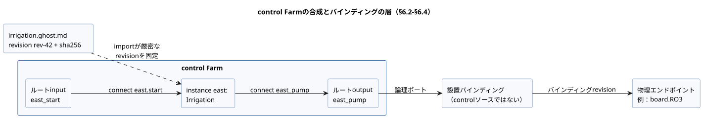
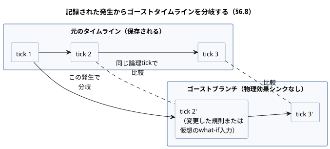
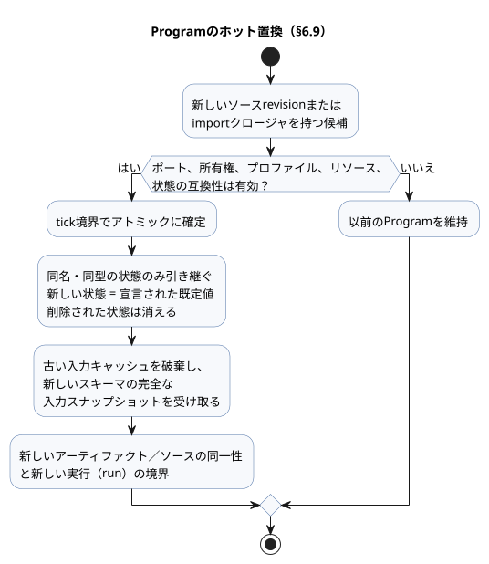

<!-- translation-source: docs/reference/06-composition-and-replay.en.md -->
[英語の原文](06-composition-and-replay.en.md)

# 6. 合成、リプレイ、置換

[全体の目次](../LANGUAGE-REFERENCE.ja.md) · [前へ：5. 設定と観測](05-settings-and-observation.ja.md) · [次へ：7. 意味規則と索引](07-semantic-rules-and-index.ja.md)

GhostFlowでは、再利用の単位は**振る舞い（behavior）**です。コード断片ではなく、意味と契約を持つものです。振る舞いは次のものをまとめて保持します。

- control式と状態
- 論理ポート
- 設定と依存関係
- 制約
- 説明の来歴

**合成**は、振る舞いをコピー＆ペーストするものではありません。1つの厳密な定義revisionの**インスタンス**を作成し、インスタンス間の型付きの関係を検証します。

**この章の内容**

- §6.1 — 1つの意味モデルを、サイクル規則の異なる複数のグラフを通して見る。
- §6.2–§6.4 — 定義、インスタンス、論理ポート、パラメータ、設定、依存関係、バインディング、`import`／`connect` 構文。
- §6.5–§6.7 — 合成された実行の不変条件、リソース契約、合成された説明。
- §6.8–§6.9 — リプレイ、ゴーストブランチ、Programのホット置換。
- §6.10 — コンパイル時の `syntax` 拡張（`quote` とsplice）。
- §6.11 — 設計の根拠と証拠。

## 6.1 1つの意味モデルと複数のグラフ

ソース、control、意図、ポート、デバイス、観測、イベントは、安定した同一性によって結び付けられています。同じ対象が、編集文書、HMI、タイムライン、シミュレーション、トレースに現れることがあります。それぞれのビューで新しい意味的オブジェクトになるわけではありません。

すべての関係が1つの汎用DAGに属するわけではありません。各グラフは辺に異なる意味を与え、サイクルについて独自の規則を持ちます。

| グラフ | 辺の意味 | サイクル規則 |
|---|---|---|
| importグラフ | ある定義が別の定義revisionに依存する | 実行可能なimportのサイクルは拒否されます |
| 1 tick内の計算グラフ | ある値が同じ判断の別の値を読み取る | 組み合わせのサイクルは拒否されます |
| 状態フィードバック | ある値が前のtickで確定した状態を読み取る | 明示的な状態境界を介して許可されます |
| 説明グラフ | 評価の証拠が結果を裏付ける | DAGでなければならず、サイクルは拒否されます |
| 設置グラフ | 論理ポートが物理的な能力にバインドされる | 別個の所有権と互換性の規則が適用されます |
| タイムライン | 発生が時間的に連続する | 分岐と順序は明示されます |

**理由：** 実行順序、物理的な接続、説明の関係が、画面上でどれも線として描かれるという理由だけで同じ規則で扱われると、隠れたスケジューラや誤った安全性の主張が生まれてしまいます。

## 6.2 定義、インスタンス、論理ポート

- **定義revision**は、1つの不変な正準 `.ghost.md` を、その厳密なimportソースクロージャ（推移的にimportするすべてのソース）とともに識別します。
- **インスタンス**は、合成の中で定義を使用する独立した実行単位です。

同じ定義を2回使う場合でも、各インスタンスは独自のインスタンスID、状態、タイマー、設定、バインディング、来歴を持ちます。

表示名、ファイルの場所、宣言順序は同一性では**ありません**。宣言を並べ替えても、インスタンスIDと入力／時間の記録が同じなら、結果と同一性をキーとするトレースは変わってはなりません。

振る舞いの**ポート**は型付きの論理的な役割であり、物理的なピン番号ではありません。

```text
インスタンス irrigation-east のポート pump
  → 設置バインディング
  → MainPump または board.RO3
```

論理ポートは、方向、意味的な型、必須または任意の依存関係、所有権の要件を保持します。物理エンドポイントは、別個のプロファイルとバインディングrevisionに属します。`Bool` 入力が常に物理DI（デジタル入力）を消費するとは限りません。明示的なソフトウェア入力が同じ論理型を供給することもあります。

**バインディングの提案。** 既存のバインディングを優先して維持し、残りの能力を新しいポートに提案します。型と方向が一致しても、極性、負荷、フェイルセーフの動作、実際の配線は証明され**ません**。証拠がなければ、これらはそれぞれ `unknown` です。「互換性あり」や「物理的に検証済み」に格上げしてはなりません。

物理エンドポイントは、MCU自身のGPIOに限られません。I/Oエキスパンダのチャネルや、通信リンクを介して到達するリレーのチャネルも、同じ論理出力契約を満たすならバインディングの対象になりえます。バスアドレス、チャネル選択、送信手順は、出力レンダラーと設置接続が所有します。1つの言語tickで複数の出力意図を確定しても、物理チャネルが同じ瞬間に切り替わることは保証され**ません**。

以下の図は、§6.4の `Farm` の例を使って層を示しています。importが定義を固定し、`connect` がcontrol内部のポートを配線し、設置バインディング（controlソースの外側）がルートの論理ポートを物理エンドポイントに接続します。



### 外部の観測と内部の計算接続

インスタンスの `input` への接続には2種類あり、それぞれ異なる証拠を運びます。

**取得の転送（ルートの `input` → インスタンスの `input`）。** 既存の型付き品質の取得契約を、サンプルの同一性と宣言されたすべての前処理契約を含めて転送します。

**内部の計算接続（インスタンスのスカラー `output` → 別のインスタンスの `input`）。** 実際に評価された値が `Result.ok(value)` として渡されます。

- 受け取る側の定義は、引き続き `case`、`recover`、その他の型付きResult演算でResultを明示的に扱います。
- 接続そのものが上流のエラーを復旧することはありません。生成側のスカラー出力は、すでに自身の定義の処理方針を表現しています。
- 取得入力、Good品質の主張、サンプルのタイムスタンプ、サンプルの同一性、センサfaultの発生元は作成されません。
- 受け取るポートに任意取得や入力前処理の注釈がある場合、それらを黙って破棄するのではなく、接続が拒否されます。（取得の転送では、これらの注釈は意味を保ちます。）
- 確定済み状態の出力フィードバックは、前tickの境界を維持します。計算値を `ok` で包んでも、組み合わせのサイクルや次状態のフィードバックが許可されることはありません。

ルートの外部Resultを、作者が書いたResult処理なしにスカラー出力へ直接接続することはできません。

**理由：** 計算された値とプロデューサーの観測は、異なる種類の証拠です。再利用は受け取る側の定義のResult契約を維持しつつ、取得品質の出所と明示的な状態境界を保持します。

## 6.3 パラメータ、設定、依存関係、バインディング

これら4つの関係はいずれも値を結び付けますが、それぞれライフサイクルが異なります。

| 関係 | 役割 | 変更の影響 |
|---|---|---|
| importパラメータ | 定義を特定の値で特殊化する | 新しい合成／ソースrevision、通常は新しいアーティファクト |
| オペレーター設定 | 同じProgramの運用値を変更する | 同じProgramと実行（run）、新しい設定revisionと有効位置 |
| 依存関係 | 必要な外部の振る舞いや能力を選択する | 固定されたクロージャと互換性が再検証される |
| バインディング | 論理ポートを設置エンドポイントに接続する | 新しい設置／バインディングrevision |

これらの違いを、型のない単一の `with` マップに曖昧にまとめないでください。特に、オペレーター設定が依存関係や物理的な配線を変えることは決してなく、importパラメータの変更がライブ設定として扱われることも決してありません。

### 互換デバイスの交換と再コンパイルからの独立

GhostFlowのProgramは**論理ポート契約**を対象とします。設置のデバイス型番、通信アドレス、ピンを、実行可能な規則の同一性の一部として使うことは決してありません。作業は次のように分担されます。

- **入力ドライバ**は、デバイス固有の通信と値の解釈を扱います。
- **出力レンダラー**は、出力意図を適用します。
- **バインディング**は、各役割の実際のエンドポイントを接続します。

**同じ論理デバイス契約を満たす物理デバイスやDriverの交換には、controlソースの編集もProgramの再コンパイルも必要ありません。** 正準 `.ghost.md`、ソースrevision、コンパイル済みProgramはそのまま保ち、該当する設置プロファイル／バインディングrevisionだけを変更します。Driver自体のデプロイrevisionは実行環境が管理します。

名前やプリミティブ型が一致するだけでは、互換性は成立しません。交換品は、既存のプログラムが要求するもの、すなわち方向、意味、単位、範囲、サンプルのタイミング、品質／エラー契約、能力を満たさなければなりません。センサの `sample`、`valid`、`filter`、`stale_after`、`recover_after` のようなソースの規則が、交換デバイスに自動的に適応することは**ありません**。交換品が契約を満たせない場合は、互換として承認してはなりません。

どの種類の変更でしょうか。

- ソースの規則を変更するのは**ソースの変更**です。
- `config` で公開された値だけを変更するのは**運用設定の変更**です。
- 動的なDriverのインストール、ファームウェアの更新、物理的な交換手順は**実行環境**に属します。

Programを再利用しても、無停止での交換や、既存の実行やセンサ状態の自動的な継続は保証されません。適用手順は[§4.10](04-sensors-constraints-control.ja.md)に、サンプルの連続性と復旧は[§4.2](04-sensors-constraints-control.ja.md)に従います。

**理由：** プリンタのDriverを交換しても、ワープロを再コンパイルする必要はありません。同じように、デバイス固有の違いは共通の契約の背後で扱うべきです。これにより、制御の意図がハードウェアの交換サイクルから切り離されます。

## 6.4 importと接続の構文

各文書は依然として、ちょうど1つの `control` を定義します。文書レベルのimportは完全な `.ghost.md` の定義を固定し、importされたcontrolは本体の中でインスタンスとして使われます。

```ghost
import Irrigation from "./irrigation.ghost.md"
  revision "rev-42"
  sha256 "0123456789abcdef0123456789abcdef0123456789abcdef0123456789abcdef";

control Farm {
  input east_start, west_start: Bool;
  output east_pump, west_pump: Bool;
  instance east: Irrigation;
  instance west: Irrigation;
  connect east.start <- east_start;
  connect west.start <- west_start;
  connect east_pump <- east.pump;
  connect west_pump <- west.pump;
}
```

上記のダイジェストはプレースホルダーです。実際の例をコンパイルするには、参照する文書の厳密なUTF-8 SHA-256と不変のrevisionが必要です。

- パスは、importする側の文書からの相対的なロケーターです。同一性では**ありません**。
- 実行中は、リゾルバが供給するソースクロージャの外側にあるものは何も読み取りません。他のファイルもネットワークも読みません。
- ブラウザとデバイスは、元のソースの同じ完全なクロージャに対して解決します。

```text
import_decl    ::= 'import' Identifier 'from' String
                  'revision' String 'sha256' HexDigestString ';'
parameter_decl ::= 'parameter' Identifier ':' type '=' constant_expr ';'
instance_decl  ::= 'instance' Identifier ':' ImportAlias
                  [ '(' named_constant_args ')' ] ';'
connect_decl   ::= 'connect' sink_port '<-' source_port ';'
```

**パラメータ**は、定義のcontrolの内部で宣言します。たとえば `parameter duration: Duration = 5min;` は `instance east: Irrigation(duration = 10min);` で特殊化されます。

- 引数は名前で束縛されます。省略された引数には宣言された既定値が使われます。
- 重複した引数、未知の引数、定数でない引数、型の不一致は拒否されます。
- パラメータは実行中に決して変わらず、オペレーター設定と同じ名前を持つことはできません。
- 公開されたトップレベルの関数と型は `Irrigation.name` として参照します。別のcontrolの内部状態、`let`、タイマーにはアクセスできません。

**接続。** `connect` のソースはルートの入力またはインスタンスの出力で、シンクはインスタンスの入力またはルートの出力です。

- 型は厳密に一致しなければなりません。
- 各入力にはちょうど1つの供給元があり、必須の入力はすべて接続されなければなりません。
- ルートの出力は、通常の `<- expr` か `connect` のどちらか一方で定義されます。両方で定義されることは決してありません。
- センサポートの品質が、通常の値ポートへの接続によって消されることは決してありません。センサの接続は、ルートのセンサから、同じペイロード型とサンプル／品質契約を持つインスタンスのセンサへの場合にのみ許可されます。各インスタンスで宣言されたフィルタと鮮度の規則は引き続き適用されます。

センサの接続では、ペイロード型、任意性、宣言されたサンプル間隔がすべて一致しなければなりません。すべてのインスタンスは、ルートから同じ生のサンプル、すなわち同じサンプルの同一性、タイムスタンプ、品質、値を受け取ります。ルートがすでに前処理した値で置き換えられることは決してありません。各インスタンスは独自のフィルタ、復旧、stale状態を所有します。関数パラメータと `case` の束縛はレキシカルスコープを保ち、定義の関数と呼び出しはインスタンスごとに分離されます。

`bind` はcontrolソースの構文ではありません。設置バインディングは、ルートの論理ポートを実際のエンドポイントに接続します。GPIOアドレス、バスアドレス、認証情報をこのプログラムに書いてはなりません。

合成の規則は次のとおりです。

1. importは、厳密な不変のrevisionとダイジェストを固定します。カタログの `latest` や表示名を使うことは決してありません。
2. 推移的なimportも、完全に固定されたクロージャを形成します。欠落したエントリ、ダイジェストの不一致、importのサイクルは拒否されます。
3. 正準ソースの権威は、各元の `.ghost.md` にとどまります。合成グラフや生成されたマニフェストは、第二の編集可能なプログラムではありません。
4. 名前の衝突は、元の定義とソースノードの来歴を消すことなく、インスタンス修飾名によって回避されます。
5. 再利用可能な定義には、現場固有のバインディング、認証情報、会話、ランタイムの履歴を決して含めません。

## 6.5 合成された実行の不変条件

合成は、単一のcontrolのtickセマンティクスを維持します。

- すべての状態遷移は、同じ入力スナップショットと同じ前状態スナップショットを読み取ります。
- ある状態の次の値が、別の状態の遷移式や `let` から同一tickの値として読み取られることは決してありません。
- 許可された次状態を参照できるのは、出力式だけです。
- 状態の結果と論理出力の結果は、1つの判断として一緒に確定されます。
- 各インスタンスの状態とタイマーは、他のすべてのインスタンスから分離されます。
- 宣言順序や走査順序が、スケジューリングや優先順位に使われることは決してありません。
- 同じスキャン内の瞬時的な依存サイクルは、実行前に拒否されます。前のスキャンで確定した状態を介したフィードバックは、別個の明示的な時間境界です。
- 次状態の参照の禁止は、ポート接続に沿って推移的に検査されます。別のインスタンスの次状態から計算された出力を、同一スキャンの状態遷移に接続することも拒否されます。
- 各論理出力チャネルには、権威ある直接の定義がちょうど1つあります。競合する書き込み元は拒否され、「最後の書き込みが勝つ」規則で解決されることはありません。

共有ポンプのように調停を必要とするリソースは、明示的なステーション／リソースマネージャを通して要求を受け取ります。複数の振る舞いが同じ物理リソースを使うという事実は、複数の直接の出力書き込み元を正当化しません。既存のステーションのポンプ／バルブのポリシーを、あらゆるリソースのための汎用の調停器に一般化してはなりません。

## 6.6 リソースと契約

初期の範囲では、合成の契約は次を検査します。

- ポートの方向と意味的な型
- 必須の依存関係の存在と厳密なrevision
- importパラメータの型と境界
- 出力とリソースの排他的な所有権
- 供給された設置契約との互換性

結果は、4種類の保証を区別して保持します：宣言された仮定、静的検査、実行時に強制される制約、物理的な検証。

- 無効なポートや欠落した依存関係は、具体的な理由とともに拒否されます。
- 証拠のない設置の適合性は `unknown` のままです。
- チャネル数の一致やシミュレーションの成功だけで、安全性や物理的な適合性が確立されることは決してありません。

診断は、理由、影響を受ける定義／インスタンス／ポート、期待値と実際の値、証拠のrevision、問題を修正するための選択肢を提供します。たとえば、2つのインスタンスが1つの排他的なポンプをどちらも要求する場合、診断は両方のインスタンスと両方のポートを特定し、合成は有効化の前に拒否されます。

## 6.7 合成された説明と来歴

合成された説明は、以下の経路全体をそのまま保持します。

```text
完了した発生
→ 要求（requested）／安全（safe）出力
→ インスタンス修飾された説明ノードと制約
→ importされた定義のソースノード／スパンと意図アンカー
→ 厳密なソースrevisionとimportクロージャ
→ 設定revisionとバインディングrevision
```

- 1つの定義の複数のインスタンスのトレースを、名前が一致するという理由だけで統合してはなりません。
- 異なるソース文書に由来するノードを、1つの合成された場所に平坦化してはなりません。
- 低水位入力がポンプの要求をブロックした場合、その信号と論理的な結果は報告できます。これはタンクの実際の物理状態を証明しません。
- レンダラーの適用失敗やフィードバックの欠落は、要求段階や安全段階とは別に示されます。

## 6.8 リプレイ、ゴースト、ブランチ

- **リプレイ**は、記録された入力、fault、論理時間、開始チェックポイントを、同じ言語セマンティクスで再計算します。
- **ゴースト（ゴースト実行）**は、同じ実行コアを使いながら物理効果シンクを持たない別個のインスタンスです。実際のデバイスを動かすことはできません。

リプレイやブランチのレコードには次が必要です：タイムライン／ブランチID、ベースラインのチェックポイント、Programとソースクロージャ、インスタンス、設定とバインディングのrevision、`runId`、論理tick、入力とfault、旧状態と候補状態、要求意図と安全意図、制約による介入。中間トレースは、上限付きの任意の情報です。

**分岐。** ブランチは特定の発生で作成され、元のタイムラインは保存されます。

- 比較では、状態、要求意図、安全意図、faultを**同じ論理tick**で揃えます。壁時計の時刻は入力データであり、整列の基準として論理tickに取って代わることは決してありません。
- 記録にないセンサ値が自動的に生成されることは決してありません。what-ifに必要な値は、仮想入力であることが明示されたトレースとして供給しなければなりません。

この図は、記録された発生から取り出されたゴーストブランチが、保存された元のタイムラインとtickごとに比較される様子を示しています。



**リプレイが決してしないこと。** 巻き戻しは、実際のデバイスを過去の状態へ戻しません。ゴーストブランチは、実際の使用量台帳、スケジュールの発生記録、物理設備の状態を変更しません。異なる出力が環境に及ぼす長期的な影響を予測するには、制御のリプレイとは別の環境モデルが必要です。

**理由：** 実際のデバイスと元の記録に手を触れずに、同一の入力に対する規則変更の効果を再現できるようにするためです。

## 6.9 Programのホット置換

Programの置換は、オペレーター設定イベントとは異なります。手順は次のとおりです。

1. 新しいソースrevisionまたはimportクロージャを持つ候補を検証します。
2. ポート、所有権、プロファイル、リソース、状態の互換性を検査します。
3. tick境界でアトミックに確定します。

検証に失敗した場合、以前のProgramがそのまま維持されます。

**状態の移行。**

- 同じモジュール同一性ポリシーのもとで、同じ名前と同じ型で明示的に定義された状態だけが引き継がれます。
- 新しい状態は宣言された既定値から始まります。削除された状態は消えます。
- 明示的な移行がない場合、次は拒否されます：同名の状態の型変更、暗黙の名前変更、異なるインスタンスの状態の統合。
- 以前の入力キャッシュは破棄され、新しいスキーマに対する完全な入力スナップショットを受け取ります。
- 削除された出力は、ホストの解放ポリシーに従います。

置換後のProgramは、新しいアーティファクト／ソースの同一性を持ち、新しい実行（run）を開始します。設定変更であるかのように、新旧のトレースを1つの実行に結合してはなりません。累積使用量やスケジュールの重複抑止など、物理設備が所有する永続的な記録は、通常のcontrol状態の移行やゴーストの巻き戻しによってリセットされません。



この図は置換のフローをまとめたものです。検査に失敗すると以前のProgramが維持され、確定に成功すると互換性のある状態だけが引き継がれて新しい実行が始まります。

## 6.10 `syntax`、`quote`、spliceの構文

値の通常の再利用には、純粋関数が適切な道具です。コンパイル時の構文拡張は、繰り返し現れるドメイン構造そのものを組み立てる場合にのみ使ってください。拡張は型付きの式ASTに限定されます。

```ghost
syntax hold(start: Expr<Bool>, stop: Expr<Bool>, held: Expr<Bool>): Expr<Bool> {
  quote { !$(stop) && ($(start) || $(held)) }
}

running' = @hold(start, stop, running);
```

**宣言の規則**

- `syntax` は文書レベルで宣言します。
- 引数と結果は `Expr<T>` 型で、`T` は完全な値型です。
- 本体はちょうど1つの `quote { expr }` です。
- `$(parameter)` は、その引数のASTをquoteに埋め込み（splice）ます。`@hold(...)` は呼び出し箇所で展開されます。
- splice内で許可されるのは、宣言されたマクロ引数名だけです。
- `Expr<T>` はランタイムの値型ではありません。input、state、configに格納することも、それとして返すこともできません。
- 次は拒否されます：quote外のsplice、未知の引数、型の不一致、宣言を作成するマクロ。

**名前解決と評価**

- spliceされた名前は**呼び出し箇所**で解決されます。quote内に直接書かれた名前は**定義箇所**で解決されます。
- マクロ引数や呼び出し側の同名のローカルが、定義箇所の名前を捕捉することは決してありません。
- 引数が複数回spliceされると、その式は複数回現れます。関数のように1回だけ評価されると想定しないでください。各出現は通常の遅延評価の規則に従います。
- タイマーやフィルタのようにメモリを作成する宣言を、式マクロの中に隠すことはできません。

**展開の制限**

- 展開がランタイムの値を読み取ることは決してありません。
- 展開は衛生的でなければなりません。呼び出し側の名前を捕捉してはなりません。展開された結果は、型、状態境界、サイクル、リソースの検査を再び通ります。
- 再帰、外部ファイル・ネットワーク・時計の読み取り、無制限のAST生成は禁止されています。マクロの呼び出しグラフは非巡回でなければなりません。
- 各コンパイルターゲットは、許可する展開後ノードの最大数を明示します。それを超えるとコンパイルエラーになり、出力が切り詰められることは決してありません。この上限はターゲットのリソース制限であり、言語が計算する内容を変える設定ではありません。
- 元のマクロ呼び出しと生成されたノードの間でソース／意図の来歴が保持され、説明が人の書いた場所までたどれるようになります。
- 構文展開そのものが、運用中に行われる作業や新しい物理的効果になってはなりません。

## 6.11 設計の根拠と証拠

- **固定されたimportと独立したインスタンスの同一性**は、再利用と再現性の両方を支えます。
- **論理ポートと物理バインディングの分離**により、同じ振る舞いを異なる設置で実行できます。
- **実行の不変条件とサイクルの拒否**により、宣言順序が結果を変えることは決してありません。
- **リプレイと効果の境界**により、実際の設備を動かさずに変更を比較できます。
- **マクロをコンパイル時に限定すること**で、実行コストと来歴を保ちながらドメインの表記を追加できます。

根拠：[言語モデル](../LANGUAGE.ja.md)、[構文の代替案とマクロ表記](../LANGUAGE-EXAMPLES.ja.md)、[Programming in GhostFlow](../ProgrammingInGhostflow.ja.md)、[ポータブルパッケージ](../PORTABLE-PACKAGE.ja.md)、[#99](https://github.com/callin2/ghostflow-language/issues/99)、[#100](https://github.com/callin2/ghostflow-language/issues/100)、[#101](https://github.com/callin2/ghostflow-language/issues/101)、[#102](https://github.com/callin2/ghostflow-language/issues/102)、[#103](https://github.com/callin2/ghostflow-language/issues/103)、[#104](https://github.com/callin2/ghostflow-language/issues/104)、[#105](https://github.com/callin2/ghostflow-language/issues/105)、[#106](https://github.com/callin2/ghostflow-language/issues/106)、[#107](https://github.com/callin2/ghostflow-language/issues/107)、[#108](https://github.com/callin2/ghostflow-language/issues/108)。
