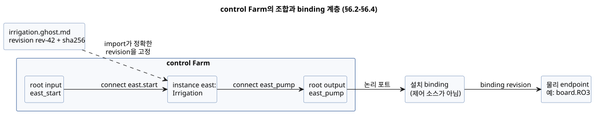
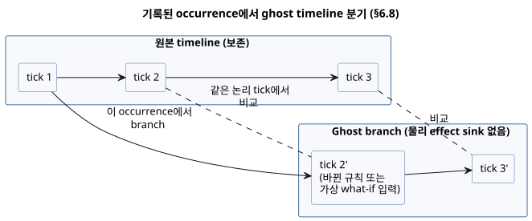
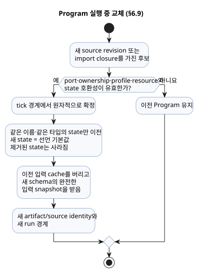

<!-- translation-source: docs/reference/06-composition-and-replay.en.md -->
[영문 원문](06-composition-and-replay.en.md)

# 6. 조합, 재생과 교체

[전체 목차](../LANGUAGE-REFERENCE.md) · [이전: 설정과 관찰](05-settings-and-observation.md) · [다음: 의미 규칙·색인](07-semantic-rules-and-index.md)

GhostFlow에서 재사용 단위는 **behavior**입니다. 코드 조각이 아니라 의미와 계약을 가진 단위입니다. behavior는 다음을 함께 보존합니다.

- 제어식과 상태
- 논리 포트
- 설정과 의존성
- 제약
- 설명 provenance

**조합(composition)**은 behavior를 복사해 붙이는 작업이 아닙니다. 정확한 정의 revision 하나로 **instance**를 만들고, instance 사이의 typed 관계를 검증하는 작업입니다.

**이 장의 내용**

- §6.1 — 하나의 의미 모델과, cycle 규칙이 서로 다른 여러 그래프로 보는 방법.
- §6.2–§6.4 — definition, instance, 논리 포트, parameter, 설정, 의존성, binding, 그리고 `import`/`connect` 문법.
- §6.5–§6.7 — 조합 실행의 불변 규칙, resource 계약, 조합된 설명.
- §6.8–§6.9 — replay, ghost branch, Program 실행 중 교체(hot replacement).
- §6.10 — compile-time `syntax` 확장(`quote`와 splice).
- §6.11 — 설계 이유와 근거.

## 6.1 하나의 의미 모델과 여러 그래프

소스, control, intent, port, 장치, observation, event는 stable identity로 연결됩니다. 같은 대상이 편집 문서, HMI, timeline, simulation, trace에 나타날 수 있지만, view마다 새로운 의미 객체가 되지는 않습니다.

모든 관계를 하나의 보편적 DAG로 취급하지는 않습니다. 그래프마다 edge의 의미가 다르고 cycle 규칙도 따로 있습니다.

| 그래프 | edge의 의미 | cycle 규칙 |
|---|---|---|
| import graph | 정의가 다른 정의 revision에 의존 | executable import cycle 거부 |
| 한 tick의 계산 graph | 값이 같은 판단의 다른 값을 읽음 | 조합 순환 거부 |
| 상태 feedback | 이전 tick의 확정 state를 읽음 | 명시적 state 경계로 허용 |
| explanation graph | 평가 근거가 결과를 뒷받침 | DAG이며 cycle 거부 |
| installation graph | 논리 port가 physical capability에 bind | 별도 소유권·호환성 규칙 적용 |
| timeline | occurrence가 시간 순서로 이어짐 | branch와 선후 관계를 명시 |

**왜:** 화면에 선 하나로 그려진다는 이유만으로 실행 순서, 물리 연결, 설명 관계를 모두 같은 규칙으로 처리하면, 숨은 scheduler나 잘못된 안전 주장이 생깁니다.

## 6.2 definition, instance와 논리 port

- **definition revision**은 immutable canonical `.ghost.md` 하나와 그 정확한 imported source closure(전이적으로 import하는 모든 소스)를 가리킵니다.
- **instance**는 조합 안에서 definition을 사용하는 별도의 실행 단위입니다.

같은 definition을 두 번 사용하더라도 각 instance는 자기만의 instance ID, state, timer, settings, binding, provenance를 가집니다.

표시 이름, 파일 위치, 선언 순서는 identity가 **아닙니다**. 같은 instance ID와 같은 input/time 기록을 유지한 채 선언 순서만 바꾸면 결과와 identity-keyed trace가 달라져서는 안 됩니다.

behavior의 **port**는 물리 핀 번호가 아니라 typed logical role입니다.

```text
instance irrigation-east의 port pump
  → installation binding
  → MainPump 또는 board.RO3
```

logical port는 direction, semantic type, 필수 또는 선택 의존성, ownership 요구를 보존합니다. physical endpoint는 별도 profile과 binding revision이 소유한다. `Bool` input이 항상 물리 DI(디지털 입력)를 소비하지는 않습니다. 명시적인 software input도 같은 논리 타입을 공급할 수 있습니다.

**binding 제안.** 기존 binding을 먼저 보존하고, 남은 capability를 새 port에 제안합니다. 타입과 direction이 맞아도 극성, 부하, fail-safe 동작, 실제 배선은 증명되지 **않습니다**. 증거가 없으면 각각 `unknown`입니다. 이를 "compatible"이나 "physically verified"로 승격해서는 안 됩니다.

물리 endpoint는 MCU 자체의 GPIO에 한정되지 않습니다. I/O 확장기의 채널이나 통신으로 연결된 릴레이의 채널도 같은 논리 출력 계약을 만족하면 binding 대상이 될 수 있습니다. 버스 주소·채널 선택·전송 절차는 출력 renderer와 설치 연결이 소유한다. 언어의 한 tick에서 여러 출력 의도를 확정해도 실제 채널들이 같은 순간에 전환된다는 보장은 **없습니다**.

아래 다이어그램은 §6.4의 `Farm` 예제로 계층을 보여 줍니다. import가 definition을 고정하고, `connect`가 control 안에서 port를 연결하며, 설치 binding(제어 소스 밖)이 root 논리 포트를 물리 endpoint에 연결합니다.



### 외부 관측과 내부 계산 연결

instance의 `input`으로 들어오는 연결에는 두 종류가 있으며, 각각 다른 증거를 전달합니다.

**획득 전달(root `input` → instance `input`).** 기존 typed-quality 획득 계약을 그대로 전달합니다. sample identity와 선언된 모든 conditioning 계약도 포함됩니다.

**내부 계산 연결(instance의 scalar `output` → 다른 instance의 `input`).** 실제로 평가한 값을 `Result.ok(value)`로 전달합니다.

- 받는 definition은 여전히 `case`, `recover` 또는 타입에 맞는 다른 Result 연산으로 Result를 명시적으로 처리합니다.
- 연결 자체가 상위 오류를 복구하지는 않습니다. 값을 만드는 scalar output에 이미 그 definition의 처리 정책이 표현되어 있습니다.
- 획득 입력, Good 품질 주장, sample timestamp, sample identity, sensor fault origin을 만들지 않습니다.
- 받는 port에 optional 획득 또는 input conditioning 주석이 있으면 조용히 버리지 않고 연결을 거부합니다. (획득 전달에서는 이 주석의 의미가 유지됩니다.)
- committed-state output feedback은 이전 tick의 경계를 유지합니다. 계산값을 `ok`로 감싼다고 해서 조합 cycle이나 next-state feedback이 허용되지 않습니다.

root의 외부 Result는 작성자가 쓴 Result 처리 없이 scalar output에 직접 연결할 수 없습니다.

**왜:** 계산값과 producer의 관측은 서로 다른 종류의 증거입니다. 재사용은 받는 definition의 Result 계약을 유지하면서, 획득 품질의 출처와 명시적인 state 경계를 보존합니다.

## 6.3 parameters, settings, dependencies와 bindings

네 관계는 모두 값을 연결하지만 생명주기가 서로 다릅니다.

| 관계 | 역할 | 변경 효과 |
|---|---|---|
| import parameter | definition을 특정 값으로 전문화 | 새 composition/source revision과 보통 새 artifact |
| operator setting | 같은 Program의 운전값 변경 | 같은 Program/run, 새 settings revision/effective position |
| dependency | 필요한 외부 behavior·capability 선택 | pinned closure와 호환성 재검증 |
| binding | logical port와 설치 endpoint 연결 | 새 installation/binding revision |

이 차이를 하나의 무타입 `with` map으로 흐리게 만들지 마세요. 특히 operator setting으로 dependency나 물리 배선을 바꿀 수는 없으며, import parameter 변경을 live setting처럼 처리하지도 않습니다.

### 호환 장치 교체와 재컴파일 독립성

GhostFlow Program은 **논리 port 계약**을 대상으로 합니다. 설치별 장치 모델, 통신 주소, 핀을 실행 규칙의 정체성 일부로 사용하지 않습니다. 역할은 다음과 같이 나뉩니다.

- **입력 Driver**는 장치별 통신과 값 해석을 담당합니다.
- **출력 renderer**는 출력 의도를 적용합니다.
- **binding**은 각 역할에 맞는 실제 endpoint를 연결합니다.

**같은 논리 장치 계약을 만족하는 물리 장치 또는 Driver의 교체는 제어 소스 수정이나 Program 재컴파일을 요구하지 않습니다.** canonical `.ghost.md`, source revision, 컴파일된 Program은 그대로 두고, 해당 설치 profile/binding 판본만 변경합니다. Driver 자체의 배포 판본은 실행 환경에서 관리한다.

호환성은 이름이나 기본 타입이 같다는 사실만으로 성립하지 않습니다. 교체 장치는 기존 프로그램이 요구하는 direction, 의미, 단위, 범위, 샘플 시각, 품질·오류 계약, capability를 만족해야 합니다. 센서의 `sample`, `valid`, `filter`, `stale_after`, `recover_after` 같은 소스 규칙은 교체 장치에 맞추어 자동으로 바뀌지 **않습니다**. 계약을 만족하지 못하는 교체는 호환 교체로 승인해서는 안 됩니다.

어떤 종류의 변경인가?

- 소스의 규칙을 바꾸면 **소스 변경**입니다.
- `config`로 공개된 값만 바꾸면 **운영 설정 변경**입니다.
- Driver의 동적 설치, 펌웨어 갱신, 물리 교체 절차는 **실행 환경**의 책임입니다.

Program을 재사용한다고 해서 무정지 교체나 기존 run·센서 상태의 자동 연속성이 보장되지는 않습니다. 적용 절차는 [§4.10](04-sensors-constraints-control.md#410-mode와-live-settings), 샘플 연속성과 복구는 [§4.2](04-sensors-constraints-control.md#42-샘플-계약과-sensor-처리-순서)를 따릅니다.

**왜:** 프린터 Driver를 바꿔도 워드 프로세서를 재컴파일하지 않듯이, 장치별 차이는 공통 계약 뒤에서 처리해야 합니다. 그래야 제어 의도와 하드웨어의 교체 주기를 분리할 수 있습니다.

## 6.4 import와 연결의 문법

각 문서는 여전히 정확히 하나의 `control`을 정의합니다. 문서 최상위의 import는 완전한 `.ghost.md` definition을 고정하고, import한 control은 본문에서 instance로 사용합니다.

```ghost
import Irrigation from "./irrigation.ghost.md"
  revision "rev-42"
  sha256 "0123456789abcdef0123456789abcdef0123456789abcdef0123456789abcdef";

control Farm {
  input east_start, west_start: Bool;
  output east_pump, west_pump: Bool;
  instance east: Irrigation;
  instance west: Irrigation;
  connect east.start <- east_start;
  connect west.start <- west_start;
  connect east_pump <- east.pump;
  connect west_pump <- west.pump;
}
```

위 digest는 자리 표시용입니다. 실제 예제를 컴파일하려면 참조 문서의 정확한 UTF-8 SHA-256과 immutable revision이 필요합니다.

- 경로는 import하는 문서에 대한 상대 locator입니다. identity가 **아닙니다**.
- 실행 중에는 resolver가 제공한 source closure 밖의 것을 읽지 않습니다. 다른 파일도, 네트워크도 읽지 않습니다.
- 브라우저와 장치도 동일한 완전한 원문 closure로 해석합니다.

```text
import_decl    ::= 'import' Identifier 'from' String
                  'revision' String 'sha256' HexDigestString ';'
parameter_decl ::= 'parameter' Identifier ':' type '=' constant_expr ';'
instance_decl  ::= 'instance' Identifier ':' ImportAlias
                  [ '(' named_constant_args ')' ] ';'
connect_decl   ::= 'connect' sink_port '<-' source_port ';'
```

**parameter**는 definition의 control 안에 선언합니다. 예를 들어 `parameter duration: Duration = 5min;`은 `instance east: Irrigation(duration = 10min);`으로 전문화합니다.

- 인자는 이름으로 결속합니다. 생략한 인자는 선언 기본값을 사용합니다.
- 중복 인자, 알 수 없는 인자, 비상수 인자, 타입 불일치는 거부합니다.
- parameter는 실행 중에 바뀌지 않으며, operator 설정과 같은 이름을 가질 수 없습니다.
- 공개 top-level 함수와 타입은 `Irrigation.name`으로 참조합니다. 다른 control의 내부 state, `let`, timer에는 접근할 수 없습니다.

**연결.** `connect`의 source는 root input 또는 instance output이고, sink는 instance input 또는 root output입니다.

- 타입은 정확히 일치해야 합니다.
- 각 입력의 공급자는 정확히 하나이며, 필수 입력은 빠짐없이 연결해야 합니다.
- root output은 일반 `<- expr`와 `connect` 중 하나로만 정의합니다. 둘 다 쓸 수는 없습니다.
- sensor 포트의 품질은 일반 값 포트에 연결한다고 지워지지 않습니다. sensor 연결은 같은 payload 타입과 sample·quality 계약을 가진 root sensor에서 instance sensor로만 허용합니다. 각 instance가 선언한 filter와 freshness 규칙은 계속 적용됩니다.

sensor 연결에서는 payload 타입, 선택성, 선언한 sample 간격이 모두 일치해야 합니다. 모든 instance는 root에서 같은 원본 sample, 즉 같은 sample identity, timestamp, quality, value를 받습니다. root에서 이미 처리한 값으로 대체하지 않습니다. 각 instance는 독립적인 filter, 복구, stale 상태를 소유합니다. 함수 인자와 `case` 바인딩은 지역 scope를 유지하며, definition의 함수와 호출은 instance별로 격리됩니다.

`bind`는 제어 소스 문법이 아니다. 설치 binding이 root 논리 포트를 실제 endpoint에 연결합니다. GPIO 주소, 버스 주소, credential을 이 프로그램에 넣어서는 안 됩니다.

조합 규칙은 다음과 같습니다.

1. import는 catalog의 `latest`나 표시 이름이 아니라 정확한 immutable revision과 digest를 고정합니다.
2. transitive import도 모두 고정한 closure를 이룹니다. 누락, digest 불일치, import cycle은 거부합니다.
3. canonical source authority는 각 원본 `.ghost.md`에 남습니다. 조합 graph나 생성된 manifest는 편집 가능한 두 번째 프로그램이 아닙니다.
4. instance-qualified 이름으로 이름 충돌을 피하되, 원본 definition과 source node provenance를 지우지 않습니다.
5. 재사용 가능한 definition에는 local site binding, credential, 대화, runtime history를 넣지 않습니다.

## 6.5 조합 실행의 불변 규칙

조합한 뒤에도 단일 control의 tick 의미를 유지합니다.

- 모든 상태 전이는 같은 input snapshot과 같은 이전 state snapshot을 읽습니다.
- 한 state의 다음 값을 다른 state의 전이식이나 `let`에서 같은 tick 값으로 읽지 않습니다.
- 허용된 다음 상태를 참조할 수 있는 것은 output 식뿐입니다.
- state 결과와 논리 output 결과는 하나의 판단으로 함께 확정합니다.
- 각 instance의 state와 timer는 다른 모든 instance와 격리됩니다.
- 선언 순서나 탐색 순서를 scheduling이나 우선순위로 사용하지 않습니다.
- 같은 scan 안의 순간적인 dependency cycle은 실행 전에 거부합니다. 이전 scan의 확정 state를 통한 feedback은 별도의 명시적 시간 경계입니다.
- 다음 상태 참조 금지는 port 연결을 따라 전이적으로 검사합니다. 다른 instance의 다음 상태로 계산한 output을 같은 scan의 state 전이에 연결하는 것도 거부합니다.
- 각 논리 output channel의 authoritative direct definition은 정확히 하나입니다. 경쟁하는 writer는 거부하며, "마지막 writer가 이긴다" 규칙으로 해결하지 않습니다.

공유 펌프처럼 중재가 필요한 자원은 명시적인 station/resource manager를 통해 요청을 받습니다. 여러 behavior가 같은 물리 자원을 쓴다는 사실이 여러 direct output writer를 정당화하지 않습니다. 기존 station의 pump/valve 정책을 모든 자원의 보편적 arbiter로 일반화해서는 안 됩니다.

## 6.6 resource와 contract

조합 contract는 첫 범위에서 다음을 검사합니다.

- port direction과 semantic type
- 필수 dependency의 존재와 정확한 revision
- import parameter의 타입과 bound
- output과 resource의 exclusive ownership
- 제공된 installation contract와의 호환성

검사 결과는 네 종류의 보증을 구분합니다. 선언된 assumption, 정적 검사, 실행 중 강제한 constraint, 물리 검증입니다.

- 잘못된 port나 빠진 dependency는 구체적인 이유와 함께 거부합니다.
- 증거가 없는 설치 적합성은 `unknown`으로 둡니다.
- channel 수가 맞거나 simulation이 통과했다는 사실만으로 안전성이나 물리 적합성이 성립하지 않습니다.

diagnostic은 이유, 영향받은 definition/instance/port, 기대값과 실제값, 근거 revision, 문제를 고칠 수 있는 선택지를 제공합니다. 예를 들어 두 instance가 한 exclusive pump를 모두 소유하려 하면, diagnostic은 두 instance와 두 port를 모두 가리키며 조합은 activation 전에 거부됩니다.

## 6.7 조합된 설명과 provenance

조합된 설명은 아래 경로 전체를 잃지 않고 유지합니다.

```text
completed occurrence
→ requested / safe output
→ instance-qualified explanation node와 constraint
→ imported definition의 source node/span과 intent anchor
→ exact source revision과 import closure
→ settings revision 및 binding revision
```

- 한 definition의 여러 instance trace를 이름이 같다는 이유로 합쳐서는 안 됩니다.
- 서로 다른 소스 문서에서 온 node를 하나의 합성 위치로 평탄화해서는 안 됩니다.
- low-water 입력이 pump 요청을 차단했다면 그 신호와 논리 결과를 보고할 수 있습니다. 그러나 이것이 tank의 실제 물리 상태를 증명하지는 않습니다.
- renderer 적용 실패와 feedback 부재는 requested·safe 단계와 분리해서 표시합니다.

## 6.8 replay, ghost와 branch

- **replay(재생)**는 기록한 입력, fault, 논리 시간, 시작 checkpoint를 같은 언어 의미로 다시 계산합니다.
- **ghost**는 같은 실행 core를 쓰지만 physical effect sink가 없는 별도의 instance입니다. 실제 장치를 움직일 수 없습니다.

replay나 branch 기록에는 timeline/branch ID, 기준 checkpoint, Program과 source closure, instance, settings와 binding revision, `runId`, 논리 tick, 입력과 fault, old/candidate state, requested/safe intent, 제약 개입이 필요합니다. 중간 trace는 bounded 선택 정보입니다.

**분기.** branch는 특정 occurrence에서 만들며, 원본 timeline은 보존됩니다.

- 비교는 **같은 논리 tick**에서 state, requested intent, safe intent, fault를 맞춥니다. wall clock 시각은 입력 데이터이며, 정렬 기준인 논리 tick을 대신하지 않습니다.
- 기록에 없는 센서값을 자동으로 생성하지 않습니다. what-if에 필요한 값은 가상 입력임을 명시한 trace로 제공해야 합니다.

다이어그램은 기록된 occurrence에서 분기한 ghost branch를 보존된 원본과 tick 단위로 비교하는 모습을 보여 줍니다.



**replay가 절대 하지 않는 일.** rewind는 실제 장치를 과거 상태로 되돌리지 않습니다. ghost branch는 실제 사용량 ledger, 예약 발생 기록, 물리 설비의 상태를 수정하지 않습니다. 다른 출력이 환경에 미칠 장기 효과를 예측하려면 제어 replay와 별도의 환경 모델이 필요합니다.

**왜:** 실제 장치와 원본 기록은 건드리지 않은 채, 같은 입력에서 규칙 변경의 영향을 재현할 수 있게 하기 위해서입니다.

## 6.9 Program hot replacement

Program 교체는 operator setting event와 다릅니다. 단계는 다음과 같습니다.

1. 새 source revision 또는 import closure를 가진 후보를 검증합니다.
2. port, ownership, profile, resource, state의 호환성을 확인합니다.
3. tick 경계에서 원자적으로 확정합니다.

검증이 실패하면 이전 Program이 그대로 유지됩니다.

**state 이전.**

- 같은 module identity 정책 아래에서 같은 이름과 같은 타입으로 명시된 state만 이전할 수 있습니다.
- 새 state는 선언 기본값에서 시작합니다. 제거된 state는 사라집니다.
- 명시적 migration 없이는 다음을 거부합니다. 같은 이름 state의 타입 변경, 암묵적 rename, 서로 다른 instance의 state 합치기.
- 이전 입력 cache는 버리고, 새 schema의 완전한 input snapshot을 다시 받습니다.
- 제거된 output은 host의 해제 정책을 따릅니다.

교체된 Program은 새 artifact/source identity를 가지며 새 run을 시작합니다. 이전 trace와 새 trace를 settings 변경처럼 하나의 run으로 이어 붙여서는 안 됩니다. 누적 사용량이나 예약 중복 방지처럼 물리 설비가 소유한 영속 기록은 일반 control state migration이나 ghost rewind로 초기화되지 않습니다.



다이어그램은 교체 흐름을 요약합니다. 검사에 실패하면 이전 Program을 유지하고, 확정에 성공하면 호환되는 state만 이전한 뒤 새 run을 시작합니다.

## 6.10 `syntax`, `quote`, splice의 문법

일반적인 값 재사용에는 순수 함수가 알맞습니다. compile-time 구문 확장은 반복되는 도메인 구조 자체를 만들 때만 사용합니다. 확장은 타입이 있는 expression AST로 한정됩니다.

```ghost
syntax hold(start: Expr<Bool>, stop: Expr<Bool>, held: Expr<Bool>): Expr<Bool> {
  quote { !$(stop) && ($(start) || $(held)) }
}

running' = @hold(start, stop, running);
```

**선언 규칙**

- `syntax`는 문서 최상위에서 선언합니다.
- 인자와 결과의 타입은 `Expr<T>`이며, `T`는 완전한 값 타입입니다.
- 본문은 정확히 하나의 `quote { expr }`입니다.
- `$(parameter)`는 해당 인자의 AST를 quote 안에 splice합니다. `@hold(...)`는 호출 위치에서 확장됩니다.
- splice 안에는 선언한 macro 인자 이름만 허용합니다.
- `Expr<T>`는 런타임 값 타입이 아닙니다. input, state, config에 저장하거나 그것으로 반환할 수 없습니다.
- 다음은 거부합니다. quote 밖의 splice, 알 수 없는 인자, 타입 불일치, 선언을 만드는 macro.

**이름 해석과 평가**

- splice된 이름은 **호출 위치**에서 해석합니다. quote에 직접 적은 이름은 **정의 위치**에서 해석합니다.
- macro 인자나 호출자의 같은 이름 지역 변수가 정의 위치의 이름을 가로채지 않습니다.
- 인자가 여러 번 splice되면 식도 여러 번 나타납니다. 함수처럼 한 번만 평가된다고 가정하지 마세요. 각 위치는 일반 lazy 평가 규칙을 따릅니다.
- timer나 filter처럼 기억을 만드는 선언은 expression macro 안에 숨길 수 없습니다.

**확장의 제한**

- 확장은 런타임 값을 읽지 않습니다.
- 확장은 hygienic이어야 합니다. 즉 호출자의 이름을 포획해서는 안 됩니다. 확장 결과는 타입, state 경계, cycle, resource 검사를 다시 통과해야 합니다.
- 재귀, 외부 파일·network·clock 읽기, 무제한 AST 생성은 금지됩니다. macro 호출 graph는 비순환이어야 합니다.
- 각 컴파일 대상은 허용하는 최대 확장 node 수를 명시합니다. 이를 넘으면 컴파일 오류이며, 결과를 잘라 내지 않습니다. 이 상한은 대상의 자원 한계이지, 언어가 계산하는 결과를 바꾸는 설정이 아닙니다.
- 원본 macro 호출과 생성된 node 사이의 source/intent provenance를 보존하여, explanation이 사람이 작성한 위치로 돌아갈 수 있게 합니다.
- 구문 확장 자체가 운전 중에 수행하는 작업이나 새로운 물리적 효과가 되어서는 안 됩니다.

## 6.11 설계 이유와 근거

- **고정된(pinned) import와 분리된 instance identity**는 재사용과 재현을 함께 보장합니다.
- **logical port와 physical binding의 분리**는 같은 behavior를 서로 다른 설치에서 실행할 수 있게 합니다.
- **실행 불변 규칙과 cycle 거부**는 선언 순서가 결과를 바꾸지 않도록 보장합니다.
- **replay와 effect 경계**는 실제 설비를 움직이지 않고도 변경을 비교할 수 있게 합니다.
- **macro를 compile time으로 제한**하면 도메인 표기를 추가하면서도 실행 비용과 provenance를 보존합니다.

근거: [언어 모델](../LANGUAGE.md), [문법 대안과 macro 표기](../LANGUAGE-EXAMPLES.md), [Programming in GhostFlow](../ProgrammingInGhostflow.md), [portable package](../PORTABLE-PACKAGE.ko.md), [#99](https://github.com/callin2/ghostflow-language/issues/99), [#100](https://github.com/callin2/ghostflow-language/issues/100), [#101](https://github.com/callin2/ghostflow-language/issues/101), [#102](https://github.com/callin2/ghostflow-language/issues/102), [#103](https://github.com/callin2/ghostflow-language/issues/103), [#104](https://github.com/callin2/ghostflow-language/issues/104), [#105](https://github.com/callin2/ghostflow-language/issues/105), [#106](https://github.com/callin2/ghostflow-language/issues/106), [#107](https://github.com/callin2/ghostflow-language/issues/107), [#108](https://github.com/callin2/ghostflow-language/issues/108).
