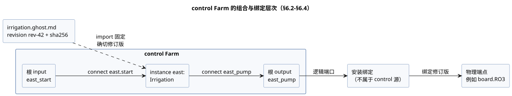
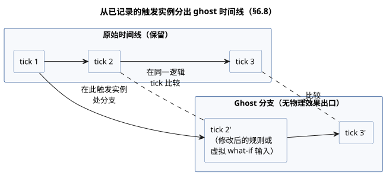
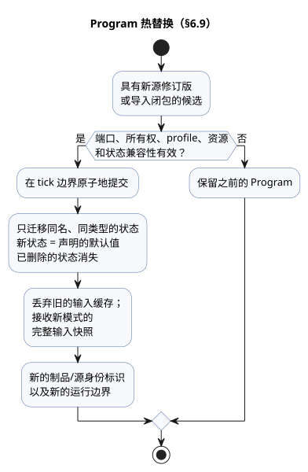

<!-- translation-source: docs/reference/06-composition-and-replay.en.md -->
[英文原文](06-composition-and-replay.en.md)

# 6. 组合、重放与替换

[完整目录](../LANGUAGE-REFERENCE.zh.md) · [上一章：设置与观测](05-settings-and-observation.zh.md) · [下一章：语义规则与索引](07-semantic-rules-and-index.zh.md)

在 GhostFlow 中，复用的单位是**行为**（behavior）：一个具有含义和契约的东西，而不是代码片段。一个行为把以下内容保持在一起：

- 控制表达式和状态；
- 逻辑端口；
- 设置和依赖；
- 约束；
- 解释来源。

**组合**并不复制粘贴行为。它为某个确切的定义修订版创建一个**实例**，并验证实例之间的带类型关系。

**本章内容**

- §6.1 —— 一个语义模型，通过多个具有不同环规则的图来观察。
- §6.2–§6.4 —— 定义、实例、逻辑端口、参数、设置、依赖、绑定，以及 `import`/`connect` 语法。
- §6.5–§6.7 —— 组合执行的不变量、资源契约和组合后的解释。
- §6.8–§6.9 —— 重放、ghost 分支以及 Program 的热替换。
- §6.10 —— 编译期 `syntax` 扩展（`quote` 与 splice）。
- §6.11 —— 设计依据与证据。

## 6.1 一个语义模型与多个图

源代码、控制、意图、端口、设备、观测和事件通过稳定的身份标识相互关联。同一个对象可以出现在编辑文档、HMI、时间线、仿真和追踪中，但它不会在每个视图中变成一个新的语义对象。

并非所有关系都属于同一个通用 DAG。每个图赋予边不同的含义，并有自己的环规则。

| 图 | 边的含义 | 环规则 |
|---|---|---|
| import 图 | 一个定义依赖另一个定义修订版 | 拒绝可执行的导入环 |
| 单个 tick 内的计算图 | 一个值读取同一判定中的另一个值 | 拒绝组合环 |
| 状态反馈 | 一个值读取上一个 tick 已提交的状态 | 允许，经由显式的状态边界 |
| 解释图 | 求值证据支持某个结果 | 必须是 DAG；拒绝环 |
| 设施图 | 逻辑端口绑定到物理能力 | 适用单独的所有权和兼容性规则 |
| 时间线 | 发生按时间先后相随 | 分支和顺序显式声明 |

**原因：** 如果仅仅因为执行顺序、物理连接和解释关系在界面上都画成线，就用相同规则对待它们，结果就会出现隐藏的调度器或虚假的安全声明。

## 6.2 定义、实例与逻辑端口

- **定义修订版**标识一个不可变的规范 `.ghost.md`，连同其确切的导入源闭包（它传递导入的每个源）。
- **实例**是在组合内部使用某个定义的独立执行单元。

即使同一个定义被使用两次，每个实例也有自己的实例 ID、状态、定时器、设置、绑定和来源。

显示名称、文件位置和声明顺序**不是**身份标识。如果重新排列声明，但保持相同的实例 ID 和相同的输入/时间记录，结果和以身份标识为键的追踪都不得改变。

行为的**端口**是带类型的逻辑角色，而不是物理引脚编号。

```text
实例 irrigation-east 的端口 pump
  → 设施绑定
  → MainPump 或 board.RO3
```

逻辑端口保留其方向、语义类型、必需或可选依赖以及所有权要求。物理端点属于单独的 profile 和绑定修订版。`Bool` 输入并不总是消耗一个物理 DI（数字输入）；一个显式的软件输入也可以提供相同的逻辑类型。

**提议绑定。** 先保留现有绑定，再为新端口提议剩余的能力。类型和方向匹配**不能**证明极性、负载、故障安全行为或实际接线。没有证据时，其中每一项都是 `unknown`。绝不要把它提升为“兼容”或“已物理验证”。

物理端点不限于 MCU 自身的 GPIO。I/O 扩展器上的通道，或通过通信链路访问的继电器上的通道，只要满足相同的逻辑输出契约，也可以作为绑定目标。总线地址、通道选择和传输流程由输出渲染器和设施连接负责。在一个语言 tick 中提交多个输出意图，**并不**保证物理通道在同一时刻切换。

下图使用 §6.4 中的 `Farm` 示例展示各个层次：import 固定一个定义，`connect` 在 control 内部连接端口，而设施绑定（在 control 源代码之外）把根逻辑端口连接到物理端点。



### 外部观测与内部计算连接

进入实例 `input` 的连接有两种，它们携带的证据不同。

**采集转发（根 `input` → 实例 `input`）。** 它转发现有的带类型质量采集契约，包括样本身份标识和所有声明的调理契约。

**内部计算连接（实例标量 `output` → 另一个实例的 `input`）。** 实际求出的值以 `Result.ok(value)` 传递。

- 接收方定义仍然要用 `case`、`recover` 或其他带类型的 Result 运算显式处理 Result。
- 连接本身不会恢复上游错误。产生该值的标量输出已经表达了其自身定义的处理策略。
- 它不创建采集输入、Good 质量声明、样本时间戳、样本身份标识，也不创建传感器故障来源。
- 如果接收端口带有可选采集或输入调理注解，则拒绝该连接，而不是悄悄丢弃这些注解。（对于采集转发，这些注解保持其含义。）
- 已提交状态的输出反馈保留上一个 tick 的边界。把计算值包装在 `ok` 中，并不允许组合环或下一状态反馈。

根的外部 Result 不能在没有作者编写的 Result 处理的情况下直接连接到标量输出。

**原因：** 计算出的值与生产者的观测是不同种类的证据。复用会保留接收方定义的 Result 契约，同时保留采集质量的来源和显式的状态边界。

## 6.3 参数、设置、依赖与绑定

这四种关系都连接值，但各自的生命周期不同。

| 关系 | 作用 | 变更的影响 |
|---|---|---|
| import 参数 | 用特定值特化一个定义 | 新的组合/源修订版，通常还有新的制品 |
| 操作员设置 | 修改同一 Program 的运行值 | 同一 Program 和运行；新的设置修订版和生效位置 |
| 依赖 | 选择所需的外部行为或能力 | 重新验证固定的闭包和兼容性 |
| 绑定 | 把逻辑端口连接到设施端点 | 新的设施/绑定修订版 |

不要把这些差异模糊成一个无类型的 `with` 映射。特别是，操作员设置绝不能改变依赖或物理接线，import 参数的变更也绝不会被当作实时设置处理。

### 兼容设备替换与无需重新编译

GhostFlow Program 面向**逻辑端口契约**。它绝不把设施的设备型号、通信地址或引脚作为其可执行规则身份标识的一部分。工作划分如下：

- **输入驱动程序**处理设备特定的通信和值解释。
- **输出渲染器**应用输出意图。
- **绑定**为每个角色连接实际端点。

**替换满足同一逻辑设备契约的物理设备或 Driver，不需要编辑控制源代码，也不需要重新编译 Program。** 保留规范的 `.ghost.md`、源修订版和已编译的 Program；只修改相关的设施 profile/绑定修订版。Driver 自身的部署修订版由执行环境管理。

兼容性不会仅仅因为名称或基本类型匹配就成立。替换品必须满足现有程序的要求：方向、含义、单位、范围、样本时序、质量/错误契约以及能力。传感器的 `sample`、`valid`、`filter`、`stale_after` 和 `recover_after` 等源规则**不会**自动适配替换设备。如果替换品无法满足契约，就不得被批准为兼容。

这属于哪种变更？

- 修改源代码中的规则，是**源代码变更**。
- 只修改通过 `config` 公开的值，是**运行设置变更**。
- 动态安装 Driver、固件更新和物理替换流程属于**执行环境**。

复用 Program 并不保证不中断的替换，也不保证现有运行或传感器状态自动延续。应用流程遵循 [§4.10](04-sensors-constraints-control.zh.md#410-模式与实时设置)；样本连续性与恢复遵循 [§4.2](04-sensors-constraints-control.zh.md#42-样本契约与传感器处理顺序)。

**原因：** 更换打印机 Driver 不需要重新编译文字处理软件。同样，设备特定的差异应当在公共契约之后处理。这使控制意图与硬件更换周期解耦。

## 6.4 导入与连接语法

每个文档仍然只定义一个 `control`。文档级 import 固定一个完整的 `.ghost.md` 定义，然后在主体中把导入的 control 用作实例。

```ghost
import Irrigation from "./irrigation.ghost.md"
  revision "rev-42"
  sha256 "0123456789abcdef0123456789abcdef0123456789abcdef0123456789abcdef";

control Farm {
  input east_start, west_start: Bool;
  output east_pump, west_pump: Bool;
  instance east: Irrigation;
  instance west: Irrigation;
  connect east.start <- east_start;
  connect west.start <- west_start;
  connect east_pump <- east.pump;
  connect west_pump <- west.pump;
}
```

上面的摘要是占位符。要编译真实示例，需要被引用文档的确切 UTF-8 SHA-256 和不可变修订版。

- 路径是相对于导入方文档的定位符，**不是**身份标识。
- 执行期间，不会读取解析器所提供的源闭包之外的任何内容——不读其他文件，也不访问网络。
- 浏览器和设备针对同一个完整的原始源闭包进行解析。

```text
import_decl    ::= 'import' Identifier 'from' String
                  'revision' String 'sha256' HexDigestString ';'
parameter_decl ::= 'parameter' Identifier ':' type '=' constant_expr ';'
instance_decl  ::= 'instance' Identifier ':' ImportAlias
                  [ '(' named_constant_args ')' ] ';'
connect_decl   ::= 'connect' sink_port '<-' source_port ';'
```

**参数**在定义的 control 内部声明。例如，`parameter duration: Duration = 5min;` 通过 `instance east: Irrigation(duration = 10min);` 特化。

- 实参按名称绑定。省略的实参使用声明的默认值。
- 重复实参、未知实参、非常量实参和类型不匹配都会被拒绝。
- 参数在执行期间绝不改变，参数也不能与操作员设置同名。
- 公开的顶层函数和类型以 `Irrigation.name` 引用。不能访问另一个 control 的内部状态、`let` 和定时器。

**连接。** `connect` 的源是根输入或实例输出；汇是实例输入或根输出。

- 类型必须完全匹配。
- 每个输入恰好有一个提供方，并且每个必需输入都必须连接。
- 根输出要么由普通的 `<- expr` 定义，要么由 `connect` 定义——绝不能两者兼有。
- 传感器端口的质量绝不会因连接到普通值端口而被抹去。传感器连接只允许从根传感器连到具有相同载荷类型和样本/质量契约的实例传感器。每个实例声明的滤波和新鲜度规则仍然适用。

对于传感器连接，载荷类型、可选性和声明的采样间隔都必须匹配。每个实例从根接收相同的原始样本：相同的样本身份标识、时间戳、质量和值。绝不会以根已经调理过的值代替。每个实例拥有自己的滤波、恢复和陈旧状态。函数参数和 `case` 绑定保持其词法作用域，定义中的函数及其调用按实例隔离。

`bind` 不是控制源语法。设施绑定把根逻辑端口连接到实际端点。绝不要在此程序中放入 GPIO 地址、总线地址或凭据。

组合规则如下：

1. import 固定一个确切的不可变修订版和摘要——绝不是目录中的 `latest` 或显示名称。
2. 传递导入同样形成完全固定的闭包。缺失条目、摘要不匹配和导入环都会被拒绝。
3. 规范源的权威性保留在各个原始 `.ghost.md` 中。组合图或生成的清单不是第二个可编辑的程序。
4. 通过实例限定名称避免名称冲突，同时不抹去原始定义和源节点的来源。
5. 可复用的定义绝不包含本地现场绑定、凭据、对话或运行时历史。

## 6.5 组合执行的不变量

组合保持单个 control 的 tick 语义。

- 所有状态转换读取同一个输入快照和同一个前一状态快照。
- 某个状态的下一个值，绝不会被另一个状态的转换表达式或 `let` 当作同一 tick 的值读取。
- 只有输出表达式可以引用允许的下一状态。
- 状态结果和逻辑输出结果作为一次判定一起提交。
- 每个实例的状态和定时器与其他所有实例隔离。
- 声明顺序和遍历顺序绝不用于调度或优先级。
- 同一扫描内的瞬时依赖环在执行前被拒绝。经由上一次扫描已提交状态的反馈，是一个单独的、显式的时间边界。
- 禁止引用下一状态的规则会沿端口连接进行传递性检查。把由另一个实例的下一状态计算出的输出连接到同一扫描的状态转换中，同样会被拒绝。
- 每个逻辑输出通道恰好有一个权威的直接定义。相互竞争的写入方会被拒绝；不会用“最后写入者获胜”的规则来解决。

需要仲裁的资源（例如共享泵）通过显式的站点/资源管理器接收请求。多个行为使用同一物理资源这一事实，并不能成为多个直接输出写入方的理由。不得把现有站点的泵/阀门策略泛化为适用于所有资源的通用仲裁器。

## 6.6 资源与契约

在初始范围内，组合契约检查：

- 端口方向和语义类型；
- 必需依赖是否存在及其确切修订版；
- import 参数的类型和界限；
- 输出和资源的独占所有权；
- 与所提供设施契约的兼容性。

结果把四种保证区分开：声明的假设、静态检查、运行时强制的约束以及物理验证。

- 无效端口或缺失的依赖会以具体原因被拒绝。
- 没有证据的设施适用性保持为 `unknown`。
- 通道数量匹配或仿真通过，本身绝不能确立安全性或物理适用性。

诊断提供原因、受影响的定义/实例/端口、期望值与实际值、证据修订版以及可用于修复问题的选项。例如，如果两个实例都声明占用同一台独占泵，诊断会指出这两个实例和两个端口，组合在激活之前即被拒绝。

## 6.7 组合后的解释与来源

组合后的解释完整保留下面的整条路径。

```text
已完成的发生
→ 请求/安全输出
→ 实例限定的解释节点与约束
→ 被导入定义的源节点/范围与意图锚点
→ 确切的源修订版与导入闭包
→ 设置修订版与绑定修订版
```

- 绝不要仅仅因为名称相同，就合并同一定义的多个实例的追踪。
- 绝不要把来自不同源文档的节点扁平化为一个合成的位置。
- 当低水位输入阻止泵请求时，可以报告该信号和逻辑结果。这并不能证明水箱的实际物理状态。
- 渲染器应用失败和缺失的反馈，与请求阶段和安全阶段分开显示。

## 6.8 重放、ghost 与分支

- **重放**（replay）以相同的语言语义，重新计算记录的输入、故障、逻辑时间和起始检查点。
- **ghost**（影子运行）是使用相同执行核心、但没有物理效果出口的独立实例：它无法驱动真实设备。

重放或分支记录需要：时间线/分支 ID、基线检查点、Program 与源闭包、实例、设置与绑定修订版、`runId`、逻辑 tick、输入与故障、旧状态与候选状态、请求意图与安全意图，以及约束干预。中间追踪是有界的可选信息。

**分支。** 分支在某个特定的发生处创建，原始时间线被保留。

- 比较在**同一逻辑 tick** 上对齐状态、请求意图、安全意图和故障。墙钟时间是输入数据；它绝不会取代逻辑 tick 作为对齐基准。
- 不在记录中的传感器值绝不会被自动生成。what-if 所需的值必须作为明确标记为虚拟输入的追踪提供。

下图展示了从已记录的发生处分出的 ghost 分支，并与被保留的原始时间线逐 tick 比较。



**重放绝不会做什么。** 倒带不会把真实设备移回过去的状态。ghost 分支不会修改真实的用量账本、调度计划发生记录或物理设施的状态。预测不同输出对环境的长期影响，需要一个独立于控制重放的环境模型。

**原因：** 这样就可以在相同的输入上复现规则变更的效果，同时不触动真实设备和原始记录。

## 6.9 Program 热替换

替换 Program 与操作员设置事件不同。步骤如下：

1. 验证具有新源修订版或导入闭包的候选。
2. 检查端口、所有权、profile、资源和状态兼容性。
3. 在 tick 边界原子地提交。

如果验证失败，之前的 Program 保持不变。

**状态迁移。**

- 只有在相同的模块身份标识策略下、以相同名称和相同类型显式定义的状态才能延续。
- 新状态从其声明的默认值开始。已删除的状态消失。
- 没有显式迁移时，以下情况会被拒绝：更改同名状态的类型、隐式重命名，以及合并来自不同实例的状态。
- 丢弃之前的输入缓存，并接收新模式的完整输入快照。
- 已删除的输出遵循宿主的释放策略。

替换后的 Program 具有新的制品/源身份标识，并开始新的运行。不得把新旧追踪当作设置变更那样合并到同一个运行中。由物理设施拥有的持久记录——例如累计用量和调度计划去重——不会因普通控制状态迁移或 ghost 倒带而被重置。



该图概括了替换流程：检查失败时保留之前的 Program；提交成功时只迁移兼容的状态，并开始新的运行。

## 6.10 `syntax`、`quote` 与 splice 语法

对于值的普通复用，纯函数是合适的工具。只有在构建反复出现的领域结构本身时，才使用编译期语法扩展。扩展仅限于带类型的表达式 AST。

```ghost
syntax hold(start: Expr<Bool>, stop: Expr<Bool>, held: Expr<Bool>): Expr<Bool> {
  quote { !$(stop) && ($(start) || $(held)) }
}

running' = @hold(start, stop, running);
```

**声明规则**

- 在文档级声明 `syntax`。
- 实参和结果的类型为 `Expr<T>`，其中 `T` 是完整的值类型。
- 主体恰好是一个 `quote { expr }`。
- `$(parameter)` 把该实参的 AST 拼接（splice）到 quote 中。`@hold(...)` 在调用处展开。
- splice 内部只允许出现声明过的宏实参名称。
- `Expr<T>` 不是运行时值类型。它不能存入输入、状态或 config，也不能作为它们返回。
- 以下情况会被拒绝：quote 之外的 splice、未知实参、类型不匹配，以及创建声明的宏。

**名称解析与求值**

- 被拼接的名称在**调用处**解析。直接写在 quote 中的名称在**定义处**解析。
- 宏实参和调用方中的同名局部变量绝不会捕获定义处的名称。
- 如果某个实参被拼接多次，该表达式就会出现多次。不要像函数那样假设它只求值一次；每次出现都遵循普通的惰性求值规则。
- 创建内存的声明（如定时器或滤波器）不能隐藏在表达式宏内部。

**展开限制**

- 展开绝不读取运行时值。
- 展开必须是卫生的：不得捕获调用方的名称。展开后的结果会再次经过类型、状态边界、环和资源检查。
- 禁止递归、读取外部文件、网络或时钟，以及无界的 AST 生成。宏调用图必须无环。
- 每个编译目标都声明其允许的最大展开节点数。超过该数是编译错误；输出绝不会被截断。这一限制是目标的资源界限，而不是改变语言计算内容的设置。
- 原始宏调用与生成节点之间保留源/意图来源，以便解释能回溯到人编写代码的位置。
- 语法展开本身绝不能变成运行期间完成的工作，或成为新的物理效果。

## 6.11 设计依据与证据

- **固定的 import 和独立的实例身份标识**同时支持复用与可复现性。
- **将逻辑端口与物理绑定分开**，使同一行为可以在不同设施中运行。
- **执行不变量与环拒绝**确保声明顺序绝不改变结果。
- **重放与效果边界**让你可以在不驱动真实设施的情况下比较变更。
- **将宏限制在编译期**，在增加领域写法的同时保留执行成本和来源。

依据：[语言模型](../LANGUAGE.zh.md)、[语法备选方案与宏写法](../LANGUAGE-EXAMPLES.zh.md)、[GhostFlow 编程](../ProgrammingInGhostflow.zh.md)、[可移植包](../PORTABLE-PACKAGE.zh.md)、[#99](https://github.com/callin2/ghostflow-language/issues/99)、[#100](https://github.com/callin2/ghostflow-language/issues/100)、[#101](https://github.com/callin2/ghostflow-language/issues/101)、[#102](https://github.com/callin2/ghostflow-language/issues/102)、[#103](https://github.com/callin2/ghostflow-language/issues/103)、[#104](https://github.com/callin2/ghostflow-language/issues/104)、[#105](https://github.com/callin2/ghostflow-language/issues/105)、[#106](https://github.com/callin2/ghostflow-language/issues/106)、[#107](https://github.com/callin2/ghostflow-language/issues/107)、[#108](https://github.com/callin2/ghostflow-language/issues/108)。
