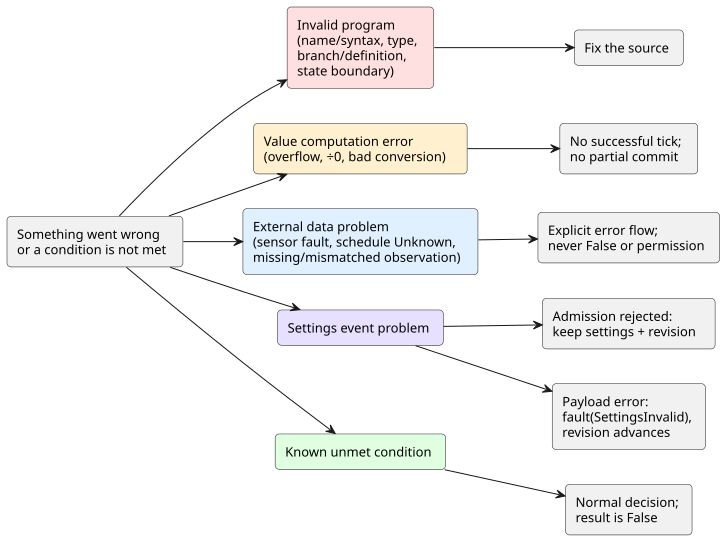

<!-- translation-source: docs/reference/07-semantic-rules-and-index.md -->
[Korean original](07-semantic-rules-and-index.md)

# 7. Semantic preservation rules and syntax index

[Language Reference](../LANGUAGE-REFERENCE.en.md) · [Previous: Composition and replay](06-composition-and-replay.en.md) · [Next: Layer responsibilities](08-language-runtime-and-device-boundaries.en.md)

**In this chapter**

- [7.2](#72-invalid-programs-and-external-failures) — how to tell a broken program from a failure in the field.
- [7.3](#73-false-absent-and-uncertain-are-different) — why `false`, "missing", and `Unknown` are never interchangeable.
- [7.4](#74-transformations-that-preserve-meaning) — what any rewrite of a program must keep.
- [7.5](#75-declaration-and-notation-index)–[7.7](#77-terms) — lookup tables for notation, symbols, and terms.
- [7.8](#78-from-original-documents-to-the-reference) — where each design document is settled in this Reference.

## 7.1 Purpose of this chapter

Knowing the syntax of one feature is not the same as keeping its meaning when you combine it with others. This chapter gives two things:

- **Semantic preservation rules** that apply to the whole language.
- **Index tables** for finding where each notation or concept is defined.

The index mixes keywords, settings keys, built-in operations, and design concepts. The entire list is not a set of reserved words. For the exact syntax of an item and where it may appear, follow its linked chapter.

## 7.2 Invalid programs and external failures

**Why.** An incorrect control expression and a failed sensor are different problems. The first needs a program fix; the second needs a response in the field. If you treat them the same, you can no longer tell which one you have.

The diagram below groups the categories in the table by what happens next. Program errors send you back to the source. Value computation errors stop the tick from succeeding. External data problems go through an explicit error flow. Settings problems split into rejection and payload errors. A known unmet condition is not an error at all.

| Category | Example | Meaning in the language |
|---|---|---|
| Name/syntax error | Undefined name, ambiguous declaration, isolated intent link | The rule cannot be interpreted in exactly one way. |
| Type error | Implicitly mixing Int and Number variables; confusing a Duration with a count | Values with different meanings were treated as the same. |
| Branch/definition error | Missing enum case; two connections to the same output | The result is not completely or uniquely defined. |
| State-boundary error | Reading another next state inside a next-state expression; combinational cycle | The program created a hidden ordering or an infinite dependency inside one decision. |
| Value computation error | Out-of-range integer operation, division by zero, invalid numeric conversion | No normal result can be produced. Do not partially commit it as a successful tick. |
| Sensor fault | Disconnected, Invalid, Stale, NotReady | The input does not meet the conditions of a normal measurement. Handle it through an explicit error flow. |
| Schedule Unknown | Missing time, location, prediction, or calendar information | There is no evidence for whether an occurrence happens. Do not disguise it as False or as permission. |
| Known unmet condition | A normal moisture reading does not satisfy the irrigation condition | The decision completed normally; the condition's result is False. |
| Settings admission rejection | Malformed envelope, unknown target, different Program, stale base revision, or permission failure | Reject the event. Keep the existing settings observations and revision unchanged. |
| Settings payload error | A type, range, or increment violation in a bundle that was identified and authorized | Emit `fault(SettingsInvalid)` for every target together, and advance the revision and effective position. Settings outside the target set stay unchanged. Follow the atomic live event rules in [§5.2](05-settings-and-observation.en.md#atomic-live-event). |
| Missing/mismatched observation | No value; a snapshot from another source revision or another execution | Do not merge it as a normal observation of the current program. |

Rules that follow from this table:

- Never feed a sensor fault into arithmetic or logic as if it were a normal payload.
- An expression that chooses a substitute value must make the meaning of that choice visible.
- A substitute does not erase the original error or its origin.
- Rejecting a settings request and failing a control tick's computation are different events.

## 7.3 False, absent, and uncertain are different

**Why.** Permission to operate needs evidence. Negating the *absence* of a value cannot create permission.

| Value or status | Interpretation |
|---|---|
| `false` | A normal Bool value |
| `0` | A normally represented value of that type |
| Missing optional capability | The installation does not provide that capability |
| sensor fault | An installed sensor cannot be read normally |
| `Unknown(reason)` | There is not enough information to decide |
| Empty observation list | The program has no internal observation items to expose |

Keep Bool computation, quality handling, and presence checks separate. For example, these are three different conditions:

1. "There is no moisture sensor."
2. "The moisture sensor has failed."
3. "Moisture is 0%."

Do not read `!Unknown` as permission to operate.

## 7.4 Transformations that preserve meaning

**Why.** Shortening expressions or merging common computations is only safe if control results stay the same. Otherwise the program that runs is no longer the program the author reviewed.

Whenever the representation changes, all of the following must be preserved together:

1. Input and value types, and the boundary between previous and next state.
2. The meaning of successful state transitions and of requested/safe outputs.
3. Error conditions, and the rule that an error prevents a successful decision.
4. The order in which time, schedule occurrences, and settings events affect decisions.
5. Trace links back to the original declarations and explanations.

Equal values alone do not justify a rewrite, not even replacing `a * 0` with `0`. You must also check whether the rewrite removes an error that the original expression could raise, or a dependency that it requires. A static dependency list means "inputs that *may* be read". It is not the set of paths that actually supported a result during execution.

Merging or removing expressions does not remove their links to the original intent, comments, or source revision. The transformed representation never becomes a new, independent canonical source. Rationale: [Language design](../LANGUAGE.md), [Original source and safety observation](../SOURCE-SAFETY-TRACE.md), [#42 decisions on semantic equivalence and original-source preservation](https://github.com/callin2/ghostflow-language/issues/42).

## 7.5 Declaration and notation index

| Notation/concept | Chapter |
|---|---|
| `.ghost.md`, `ghost` fence, comments, paragraphs, multiple code blocks | [1. Source and syntax](01-source-and-syntax.md) |
| `ghostflow:anchor`, `ghostflow:link`, intent/premise/assumption | [1. Source and syntax](01-source-and-syntax.md) |
| `control`, identifiers, scope, name resolution, semicolons | [1. Source and syntax](01-source-and-syntax.md) |
| `input`, `output`, `state`, `config`, `let` | [2. Types, expressions, state](02-types-expressions-state.md), [5. Settings](05-settings-and-observation.md) |
| `fn`, argument/result types, pure functions | [2. Types, expressions, state](02-types-expressions-state.md) |
| `type`, `case`, `in` | [2. Types, expressions, state](02-types-expressions-state.md) |
| `Bool`, `Int`, `Number`, `Percent`, `Duration` | [2. Types, expressions, state](02-types-expressions-state.md) |
| Physical quantities, units, dimensions, display units, control meaning | [2. Types, expressions, state](02-types-expressions-state.md) |
| `if ... then ... else`, evaluation and errors | [2. Types, expressions, state](02-types-expressions-state.md) |
| `x'`, `<-`, tick | [2. Types, expressions, state](02-types-expressions-state.md) |
| `+`, `-`, `*`, `/`, `div`, `%`, comparisons, `!`, `&&`, `\|\|` | [2. Types, expressions, state](02-types-expressions-state.md) |
| `number`, `int_exact`, `int_floor`, `int_ceil`, `int_trunc`, `int_nearest_even` | [2. Types, expressions, state](02-types-expressions-state.md) |
| Function composition, value piping, `>>`, `\|>`, `map`, `and_then`, `recover` | [2. Types, expressions, state](02-types-expressions-state.md), [4. Sensors and control](04-sensors-constraints-control.md) |
| `Date`, `TimeOfDay`, `DateTime`, wall clock, monotonic time, logical time | [3. Time and schedules](03-time-and-schedules.md) |
| `timer`, `elapsed`, phase age, continuous Bool time | [3. Time and schedules](03-time-and-schedules.md) |
| `schedule`, `DailySlots`, `TimeSlots`, `timezone`, `selected`, `.due`, `.missed` | [3. Time and schedules](03-time-and-schedules.md) |
| `Solar`, sunrise, sunset, moon, tides, location/prediction context | [3. Time and schedules](03-time-and-schedules.md) |
| `Schedule`, TriggerRule, DayRule, Pulse, Window, Run, Range | [3. Time and schedules](03-time-and-schedules.md) |
| Cron, Periodic, workdays, holidays, excluded days, DST | [3. Time and schedules](03-time-and-schedules.md) |
| fallback, Unknown, late starts, observation gaps, duplicate occurrences | [3. Time and schedules](03-time-and-schedules.md) |
| `sensor`, `sensor?`, `signal`, `ok`, `fault`, Result/Option | [4. Sensors and control](04-sensors-constraints-control.md) |
| `sample`, `valid`, `filter`, `stale_after`, `recover_after`, `samples` | [4. Sensors and control](04-sensors-constraints-control.md) |
| median, moving average, EMA, hysteresis, on_below, off_above, initial | [4. Sensors and control](04-sensors-constraints-control.md) |
| `adapt`, capability, strategy selection | [4. Sensors and control](04-sensors-constraints-control.md) |
| Device query `match`, `where`, `strategy`, `priority` | [4. Sensors and control](04-sensors-constraints-control.md) |
| `require`, `mutex`, `constraints`, `exclusive`, `allow` | [4. Sensors and control](04-sensors-constraints-control.md) |
| `check`, `limit`, `once ... per occurrence`; `warn` (design, unsupported by parser) | [4. Sensors and control](04-sensors-constraints-control.md) |
| count_on, any_on, shared resources, modes, arbitration | [4. Sensors and control](04-sensors-constraints-control.md) |
| Daily ON-time, rolling-window budget | [4. Sensors and control](04-sensors-constraints-control.md) |
| objective, PI/PID, continuous actuator feedback | [4. Sensors and control](04-sensors-constraints-control.md) |
| temporal evidence, fallback, bounded adaptation | [4. Sensors and control](04-sensors-constraints-control.md) |
| min/max/step, access, label, defaults/effective values | [5. Settings and observation](05-settings-and-observation.md) |
| atomic live setting, settings revision, temporary values, expiry, return | [5. Settings and observation](05-settings-and-observation.md) |
| Observation contract: counter, descriptor, snapshot, event, command result, alarm | [5. Settings and observation](05-settings-and-observation.md) |
| explanation, evaluated/value/supportsResult, provenance | [5. Settings and observation](05-settings-and-observation.md) |
| Behavior composition, import, instance, logical ports, binding | [6. Composition and replay](06-composition-and-replay.md) |
| semantic DAG, explicit delays, state boundaries, execution isolation | [6. Composition and replay](06-composition-and-replay.md) |
| syntax/quote/splice, hygienic syntax extensions | [6. Composition and replay](06-composition-and-replay.md) |
| checkpoint, replay, ghost, branch, program replacement | [6. Composition and replay](06-composition-and-replay.md) |

How to use this index:

- Where a notation may appear, and which fields it requires, is defined in the linked body section.
- Removed aliases are handled by the rejection rules in §1.6.
- Do not infer source keywords from the general concepts listed here.

## 7.6 Symbol index

The meaning of most symbols depends on context. This table lists each role a symbol can play.

| Symbol | Contextual role |
|---|---|
| `{ }` | Scope, function, case, settings block, or the finite set after `in` |
| `( )` | Call arguments or expression grouping |
| `[ ]` | Lists that a declaration permits, such as the selected times of a schedule |
| `:` | Type declaration or named argument |
| `;` | End of a declaration or expression definition |
| `,` | Separates names, arguments, and set elements |
| `=` | Definition, initial value, settings entry |
| `'` | Next state |
| `<-` | Output connection |
| `->` | Function result type |
| `=>` | Case branch or constraint relation; not a general-purpose operator in expressions |
| `\|` | Enum alternatives |
| `?` | Optional sensor |
| `.` | Member or namespace reference, as defined by context |
| `..` | Valid range of a sensor |
| `_` | Unused binding in a fault pattern |
| `//` | Single-line code comment |

## 7.7 Terms

| Term | Definition |
|---|---|
| Canonical source | The original document that keeps explanation, intent, and executable rules together |
| Program | A program identified by its executable rules |
| Run | The identity of one execution of that program, from its start onward |
| Tick / scan | The unit that receives inputs and commits one logical decision. Read it together with the observation boundary of its context. |
| Previous / candidate state | The committed state before a decision / the next state computed during this decision |
| Requested / safe intent | The output a control expression asks for / the output intent after constraints are applied |
| Setting | An adjustable value that the program declares as changeable |
| Occurrence | One identifiable event produced by a schedule rule |
| Provenance | Links showing which original source and intent a value, decision, or explanation came from |
| Logical port / physical binding | A meaningful control connection point / the relation that connects it to the actual installation |
| Semantic DAG | A graph of control meaning and dependencies. It is not a screen-layout graph. |
| Driver | The input role that turns physical signals into logical inputs |
| Renderer | The output role that applies logical output intent to real effects, such as relays, motors, lamps, and screens |
| Cabinet-view | The operator UI that consumes descriptors and observations; `@ghostflow/cabinet-view` |

## 7.8 From original documents to the reference

Use this table to find where each design item is settled in the Reference. It does **not** show issue status or work progress.

| Design rationale | Reference location |
|---|---|
| [DESIGN-NOTES](../DESIGN-NOTES.md), [LANGUAGE](../LANGUAGE.md) §1–2 | [1.1 Why one document is the source](01-source-and-syntax.md#11-왜-문서-하나가-소스인가), [2.8 Tick and state snapshots](02-types-expressions-state.md#28-tick과-상태-snapshot) |
| LANGUAGE §3–4, [LANGUAGE-SURFACE](../LANGUAGE-SURFACE.md), [Programming in GhostFlow](../ProgrammingInGhostflow.md) §2·5·9·Appendix A/B | [Chapter 1 source and syntax](01-source-and-syntax.md#11-왜-문서-하나가-소스인가), [Chapter 2 types, expressions and state](02-types-expressions-state.md#21-값-종류) |
| [LITERATE](../LITERATE.md), [INTENT-ANCHOR-MAP](../INTENT-ANCHOR-MAP.md), [#31](https://github.com/callin2/ghostflow-language/issues/31), [#60](https://github.com/callin2/ghostflow-language/issues/60) | [1.1 Why one document is the source](01-source-and-syntax.md#11-왜-문서-하나가-소스인가), [1.2 Original source, positions and intent links](01-source-and-syntax.md#12-원문-위치와-의도-연결) |
| [Integer contract](../EXACT-INTEGER-CONTRACT.md), [#22](https://github.com/callin2/ghostflow-language/issues/22), [#93](https://github.com/callin2/ghostflow-language/issues/93) | [2.3 Exact integer design](02-types-expressions-state.md#23-정확한-정수-설계), [2.9 Physical quantities and units](02-types-expressions-state.md#29-물리량과-단위) |
| [Time contract](../TIME-AND-SCHEDULE-CONTRACT.md), [Continuous timers](../CONTINUOUS-BOOL-TIMER-CONTRACT.md), [Solar](../SOLAR-SCHEDULE.md), [#23](https://github.com/callin2/ghostflow-language/issues/23), [#46](https://github.com/callin2/ghostflow-language/issues/46), [#90](https://github.com/callin2/ghostflow-language/issues/90) | [Chapter 3 time and schedules](03-time-and-schedules.md#31-시간값과-시계-영역) |
| [CONSTRAINTS](../CONSTRAINTS.md), LANGUAGE §5–8, [#3](https://github.com/callin2/ghostflow-language/issues/3) | [4.1 Sensors and Result quality](04-sensors-constraints-control.md#41-sensor와-result-품질), [4.7 Requested, safe, applied, confirmed](04-sensors-constraints-control.md#47-requested-safe-applied-confirmed), [4.8 Common constraints syntax and operations](04-sensors-constraints-control.md#48-공통-constraints-표기와-연산) |
| [#94](https://github.com/callin2/ghostflow-language/issues/94), [#95](https://github.com/callin2/ghostflow-language/issues/95), [#96](https://github.com/callin2/ghostflow-language/issues/96) | [4.11 Accounting and budgets](04-sensors-constraints-control.md#411-accounting과-budget), [4.12 Continuous control objective](04-sensors-constraints-control.md#412-continuous-control-objective), [4.14 Bounded adaptation](04-sensors-constraints-control.md#414-bounded-adaptation) |
| [#68](https://github.com/callin2/ghostflow-language/issues/68), [#70](https://github.com/callin2/ghostflow-language/issues/70), [#73](https://github.com/callin2/ghostflow-language/issues/73), [#74](https://github.com/callin2/ghostflow-language/issues/74), [#88](https://github.com/callin2/ghostflow-language/issues/88), [interaction contract](../../contracts/interaction-v0/README.md) | [5.1 `config` declarations](05-settings-and-observation.md#51-config-선언), [5.3 Cabinet-view-independent observation model](05-settings-and-observation.md#53-cabinet-view-독립-관찰-모델), [5.4 Identity and physical-fact boundaries](05-settings-and-observation.md#54-정체성과-물리적-사실의-경계) |
| [#89](https://github.com/callin2/ghostflow-language/issues/89), [#105](https://github.com/callin2/ghostflow-language/issues/105), [#110](https://github.com/callin2/ghostflow-language/issues/110) | [5.2 Source changes and operational settings changes](05-settings-and-observation.md#52-소스-변경과-운영-설정-변경) |
| [#99](https://github.com/callin2/ghostflow-language/issues/99) and linked #100–108 design records | [6.1 One semantic model and multiple graphs](06-composition-and-replay.md#61-하나의-의미-모델과-여러-그래프), [6.3 Parameters, settings, dependencies and bindings](06-composition-and-replay.md#63-parameters-settings-dependencies와-bindings), [5.2 Source changes and operational settings changes](05-settings-and-observation.md#52-소스-변경과-운영-설정-변경) |
| LANGUAGE §9–12, [Syntax extensions in the syntax comparison](../LANGUAGE-EXAMPLES.md), Programming in GhostFlow §10–12 | [1.6 Canonical notation, reference aliases and historical alternatives](01-source-and-syntax.md#16-대표-표기-참고-별칭과-역사적-대안), [6.8 Replay, ghost and branches](06-composition-and-replay.md#68-replay-ghost와-branch), [6.10 Syntax, quote and splice syntax](06-composition-and-replay.md#610-syntax-quote-splice의-문법) |
| [SOURCE-SAFETY-TRACE](../SOURCE-SAFETY-TRACE.md), [#42](https://github.com/callin2/ghostflow-language/issues/42) | [5.3 Cabinet-view-independent observation model](05-settings-and-observation.md#53-cabinet-view-독립-관찰-모델), [7.4 Transformations that preserve meaning](07-semantic-rules-and-index.md#74-의미가-유지되는-변환) |
| [Coding FAQ 1–41](../language_faq.md) | [Chapter 8 complete responsibility table](08-language-runtime-and-device-boundaries.md#83-faq-전체-책임표), [Language decisions and author policies](08-language-runtime-and-device-boundaries.md#86-언어-결정과-작성자가-정하는-정책) |

When you add a new language decision, update these together: the feature's body text, its Why, its examples, and this index.

[Complete contents](../LANGUAGE-REFERENCE.md) · [Next: Layer responsibilities](08-language-runtime-and-device-boundaries.md)
