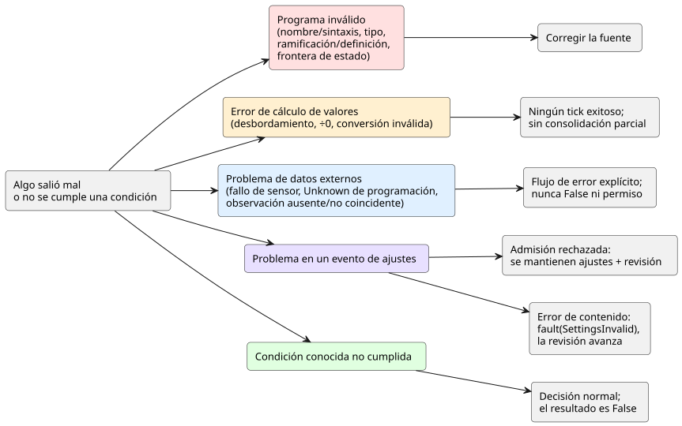

<!-- translation-source: docs/reference/07-semantic-rules-and-index.en.md -->
[Original en inglés](07-semantic-rules-and-index.en.md)

# 7. Reglas de preservación semántica e índice de sintaxis

[Referencia del lenguaje](../LANGUAGE-REFERENCE.es.md) · [Anterior: Composición y reproducción](06-composition-and-replay.es.md) · [Siguiente: Responsabilidades de las capas](08-language-runtime-and-device-boundaries.es.md)

**En este capítulo**

- [7.2](#72-programas-inválidos-y-fallos-externos): cómo distinguir un programa defectuoso de un fallo en campo.
- [7.3](#73-falso-ausente-e-incierto-son-distintos): por qué `false`, "ausente" y `Unknown` nunca son intercambiables.
- [7.4](#74-transformaciones-que-preservan-el-significado): qué debe conservar cualquier reescritura de un programa.
- [7.5](#75-índice-de-declaraciones-y-notación)–[7.7](#77-términos): tablas de consulta de notación, símbolos y términos.
- [7.8](#78-de-los-documentos-originales-a-la-referencia): dónde queda establecido cada documento de diseño en esta Referencia.

## 7.1 Propósito de este capítulo

Conocer la sintaxis de una función del lenguaje no equivale a conservar su significado cuando se combina con otras. Este capítulo ofrece dos cosas:

- **Reglas de preservación semántica** que se aplican a todo el lenguaje.
- **Tablas de índice** para encontrar dónde se define cada notación o concepto.

El índice mezcla palabras clave, claves de ajustes, operaciones integradas y conceptos de diseño. La lista completa no es un conjunto de palabras reservadas. Para conocer la sintaxis exacta de un elemento y dónde puede aparecer, siga el enlace a su capítulo.

## 7.2 Programas inválidos y fallos externos

**Por qué.** Una expresión de control incorrecta y un sensor averiado son problemas distintos. El primero requiere corregir el programa; el segundo requiere una respuesta en campo. Si se tratan igual, ya no es posible saber cuál de los dos se tiene.

El diagrama siguiente agrupa las categorías de la tabla según lo que ocurre después. Los errores de programa le devuelven a la fuente. Los errores de cálculo de valores impiden que el tick tenga éxito. Los problemas de datos externos pasan por un flujo de error explícito. Los problemas de ajustes se dividen en rechazo y errores de contenido (payload). Una condición conocida que no se cumple no es un error en absoluto.

| Categoría | Ejemplo | Significado en el lenguaje |
|---|---|---|
| Error de nombre/sintaxis | Nombre no definido, declaración ambigua, enlace de intención aislado | La regla no puede interpretarse de una única manera. |
| Error de tipo | Mezclar implícitamente variables Int y Number; confundir una Duration con un conteo | Se trataron como iguales valores con significados distintos. |
| Error de ramificación/definición | Falta un caso de enum; dos conexiones a la misma salida | El resultado no está definido de forma completa o única. |
| Error de frontera de estado | Leer otro estado siguiente dentro de una expresión de estado siguiente; ciclo combinacional | El programa creó un orden oculto o una dependencia infinita dentro de una sola decisión. |
| Error de cálculo de valores | Operación entera fuera de rango, división entre cero, conversión numérica inválida | No se puede producir un resultado normal. No lo consolide parcialmente como un tick exitoso. |
| Fallo de sensor | Disconnected, Invalid, Stale, NotReady | La entrada no cumple las condiciones de una medición normal. Trátelo mediante un flujo de error explícito. |
| Unknown de programación | Falta información de hora, ubicación, predicción o calendario | No hay evidencia de si una ocurrencia sucede o no. No lo disfrace de False ni de permiso. |
| Condición conocida no cumplida | Una lectura normal de humedad no satisface la condición de riego | La decisión terminó con normalidad; el resultado de la condición es False. |
| Rechazo en la admisión de ajustes | Envoltura mal formada, destino desconocido, Program distinto, revisión base obsoleta o fallo de permisos | Rechace el evento. Mantenga sin cambios las observaciones de ajustes y la revisión existentes. |
| Error en el contenido de los ajustes | Una violación de tipo, rango o incremento en un paquete que ya fue identificado y autorizado | Emita `fault(SettingsInvalid)` para todos los destinos a la vez y avance la revisión y la posición efectiva. Los ajustes fuera del conjunto de destinos no cambian. Siga las reglas del evento atómico en vivo de [§5.2](05-settings-and-observation.en.md#atomic-live-event). |
| Observación ausente o no coincidente | No hay valor; una instantánea de otra revisión de la fuente o de otra ejecución | No la combine como una observación normal del programa actual. |

Reglas que se derivan de esta tabla:

- Nunca introduzca un fallo de sensor en una operación aritmética o lógica como si fuera un valor normal.
- Una expresión que elige un valor sustituto debe hacer visible el significado de esa elección.
- Un sustituto no borra el error original ni su origen.
- Rechazar una solicitud de ajustes y fallar el cálculo de un tick de control son eventos distintos.

## 7.3 Falso, ausente e incierto son distintos

**Por qué.** El permiso para operar necesita evidencia. Negar la *ausencia* de un valor no puede crear un permiso.

| Valor o estado | Interpretación |
|---|---|
| `false` | Un valor Bool normal |
| `0` | Un valor de ese tipo representado con normalidad |
| Capacidad opcional ausente | La instalación no proporciona esa capacidad |
| Fallo de sensor | Un sensor instalado no puede leerse con normalidad |
| `Unknown(reason)` | No hay información suficiente para decidir |
| Lista de observaciones vacía | El programa no tiene elementos de observación internos que exponer |

Mantenga separados el cálculo Bool, el tratamiento de la calidad y las comprobaciones de presencia. Por ejemplo, estas son tres condiciones distintas:

1. "No hay sensor de humedad".
2. "El sensor de humedad ha fallado".
3. "La humedad es 0 %".

No interprete `!Unknown` como permiso para operar.

## 7.4 Transformaciones que preservan el significado

**Por qué.** Acortar expresiones o fusionar cálculos comunes solo es seguro si los resultados de control no cambian. De lo contrario, el programa que se ejecuta ya no es el programa que revisó su autor.

Siempre que cambie la representación, debe preservarse todo lo siguiente a la vez:

1. Los tipos de las entradas y los valores, y la frontera entre el estado anterior y el siguiente.
2. El significado de las transiciones de estado exitosas y de las salidas solicitadas/seguras.
3. Las condiciones de error, y la regla de que un error impide una decisión exitosa.
4. El orden en que el tiempo, las ocurrencias de programación y los eventos de ajustes afectan a las decisiones.
5. Los enlaces de traza hacia las declaraciones y explicaciones originales.

Que los valores sean iguales no basta para justificar una reescritura, ni siquiera para reemplazar `a * 0` por `0`. También debe comprobarse si la reescritura elimina un error que la expresión original podía producir, o una dependencia que esta requiere. Una lista estática de dependencias significa "entradas que *pueden* leerse". No es el conjunto de rutas que realmente respaldaron un resultado durante la ejecución.

Fusionar o eliminar expresiones no elimina sus enlaces con la intención de diseño, los comentarios o la revisión de la fuente originales. La representación transformada nunca se convierte en una nueva fuente canónica independiente. Fundamento: [Diseño del lenguaje](../LANGUAGE.es.md), [Fuente original y observación de seguridad](../SOURCE-SAFETY-TRACE.es.md), [#42 decisiones sobre equivalencia semántica y preservación de la fuente original](https://github.com/callin2/ghostflow-language/issues/42).

## 7.5 Índice de declaraciones y notación

| Notación/concepto | Capítulo |
|---|---|
| `.ghost.md`, bloque `ghost`, comentarios, párrafos, varios bloques de código | [1. Fuente y sintaxis](01-source-and-syntax.es.md) |
| `ghostflow:anchor`, `ghostflow:link`, intención/premisa/supuesto | [1. Fuente y sintaxis](01-source-and-syntax.es.md) |
| `control`, identificadores, ámbito, resolución de nombres, punto y coma | [1. Fuente y sintaxis](01-source-and-syntax.es.md) |
| `input`, `output`, `state`, `config`, `let` | [2. Tipos, expresiones y estado](02-types-expressions-state.es.md), [5. Ajustes](05-settings-and-observation.es.md) |
| `fn`, tipos de argumentos/resultado, funciones puras | [2. Tipos, expresiones y estado](02-types-expressions-state.es.md) |
| `type`, `case`, `in` | [2. Tipos, expresiones y estado](02-types-expressions-state.es.md) |
| `Bool`, `Int`, `Number`, `Percent`, `Duration` | [2. Tipos, expresiones y estado](02-types-expressions-state.es.md) |
| Magnitudes físicas, unidades, dimensiones, unidades de visualización, significado de control | [2. Tipos, expresiones y estado](02-types-expressions-state.es.md) |
| `if ... then ... else`, evaluación y errores | [2. Tipos, expresiones y estado](02-types-expressions-state.es.md) |
| `x'`, `<-`, tick | [2. Tipos, expresiones y estado](02-types-expressions-state.es.md) |
| `+`, `-`, `*`, `/`, `div`, `%`, comparaciones, `!`, `&&`, `\|\|` | [2. Tipos, expresiones y estado](02-types-expressions-state.es.md) |
| `number`, `int_exact`, `int_floor`, `int_ceil`, `int_trunc`, `int_nearest_even` | [2. Tipos, expresiones y estado](02-types-expressions-state.es.md) |
| Composición de funciones, encadenamiento de valores, `>>`, `\|>`, `map`, `and_then`, `recover` | [2. Tipos, expresiones y estado](02-types-expressions-state.es.md), [4. Sensores y control](04-sensors-constraints-control.es.md) |
| `Date`, `TimeOfDay`, `DateTime`, reloj de pared, tiempo monotónico, tiempo lógico | [3. Tiempo y programaciones](03-time-and-schedules.es.md) |
| `timer`, `elapsed`, antigüedad de fase, tiempo continuo de un Bool | [3. Tiempo y programaciones](03-time-and-schedules.es.md) |
| `schedule`, `DailySlots`, `TimeSlots`, `timezone`, `selected`, `.due`, `.missed` | [3. Tiempo y programaciones](03-time-and-schedules.es.md) |
| `Solar`, amanecer, atardecer, luna, mareas, contexto de ubicación/predicción | [3. Tiempo y programaciones](03-time-and-schedules.es.md) |
| `Schedule`, TriggerRule, DayRule, Pulse, Window, Run, Range | [3. Tiempo y programaciones](03-time-and-schedules.es.md) |
| Cron, Periodic, días laborables, días festivos, días excluidos, DST | [3. Tiempo y programaciones](03-time-and-schedules.es.md) |
| fallback, Unknown, inicios tardíos, brechas de observación, ocurrencias duplicadas | [3. Tiempo y programaciones](03-time-and-schedules.es.md) |
| `sensor`, `sensor?`, `signal`, `ok`, `fault`, Result/Option | [4. Sensores y control](04-sensors-constraints-control.es.md) |
| `sample`, `valid`, `filter`, `stale_after`, `recover_after`, `samples` | [4. Sensores y control](04-sensors-constraints-control.es.md) |
| mediana, media móvil, EMA, histéresis, on_below, off_above, initial | [4. Sensores y control](04-sensors-constraints-control.es.md) |
| `adapt`, capacidad (capability), selección de estrategia | [4. Sensores y control](04-sensors-constraints-control.es.md) |
| `match`, `where`, `strategy`, `priority` de la consulta de dispositivos | [4. Sensores y control](04-sensors-constraints-control.es.md) |
| `require`, `mutex`, `constraints`, `exclusive`, `allow` | [4. Sensores y control](04-sensors-constraints-control.es.md) |
| `check`, `limit`, `once ... per occurrence`; `warn` (diseño, no admitido por el parser) | [4. Sensores y control](04-sensors-constraints-control.es.md) |
| count_on, any_on, recursos compartidos, modos, arbitraje | [4. Sensores y control](04-sensors-constraints-control.es.md) |
| Tiempo de encendido diario, presupuesto en ventana móvil | [4. Sensores y control](04-sensors-constraints-control.es.md) |
| objective, PI/PID, retroalimentación de actuadores continuos | [4. Sensores y control](04-sensors-constraints-control.es.md) |
| evidencia temporal, fallback, adaptación acotada | [4. Sensores y control](04-sensors-constraints-control.es.md) |
| min/max/step, access, label, valores predeterminados/efectivos | [5. Ajustes y observación](05-settings-and-observation.es.md) |
| ajuste en vivo atómico, revisión de ajustes, valores temporales, vencimiento, retorno | [5. Ajustes y observación](05-settings-and-observation.es.md) |
| Contrato de observación: contador, descriptor, instantánea, evento, resultado del comando, alarma | [5. Ajustes y observación](05-settings-and-observation.es.md) |
| explicación, evaluated/value/supportsResult, procedencia | [5. Ajustes y observación](05-settings-and-observation.es.md) |
| Composición de comportamientos, import, instance, puertos lógicos, vinculación (binding) | [6. Composición y reproducción](06-composition-and-replay.es.md) |
| DAG semántico, retardos explícitos, fronteras de estado, aislamiento de la ejecución | [6. Composición y reproducción](06-composition-and-replay.es.md) |
| syntax/quote/splice, extensiones sintácticas higiénicas | [6. Composición y reproducción](06-composition-and-replay.es.md) |
| punto de control (checkpoint), reproducción (replay), ghost, rama, reemplazo del programa | [6. Composición y reproducción](06-composition-and-replay.es.md) |

Cómo usar este índice:

- Dónde puede aparecer una notación y qué campos requiere se define en la sección del cuerpo enlazada.
- Los alias eliminados se tratan con las reglas de rechazo de §1.6.
- No deduzca palabras clave de la fuente a partir de los conceptos generales que se enumeran aquí.

## 7.6 Índice de símbolos

El significado de la mayoría de los símbolos depende del contexto. Esta tabla enumera cada papel que puede desempeñar un símbolo.

| Símbolo | Papel según el contexto |
|---|---|
| `{ }` | Ámbito, función, case, bloque de ajustes o el conjunto finito después de `in` |
| `( )` | Argumentos de llamada o agrupación de expresiones |
| `[ ]` | Listas que permite una declaración, como las horas seleccionadas de una programación |
| `:` | Declaración de tipo o argumento con nombre |
| `;` | Fin de una declaración o de la definición de una expresión |
| `,` | Separa nombres, argumentos y elementos de un conjunto |
| `=` | Definición, valor inicial, entrada de ajustes |
| `'` | Estado siguiente |
| `<-` | Conexión de salida |
| `->` | Tipo de resultado de una función |
| `=>` | Rama de case o relación de restricción; no es un operador de uso general en expresiones |
| `\|` | Alternativas de un enum |
| `?` | Sensor opcional |
| `.` | Referencia a un miembro o a un espacio de nombres, según defina el contexto |
| `..` | Rango válido de un sensor |
| `_` | Vinculación no utilizada en un patrón de fallo |
| `//` | Comentario de código de una sola línea |

## 7.7 Términos

| Término | Definición |
|---|---|
| Fuente canónica | El documento original que mantiene juntos la explicación, la intención y las reglas ejecutables |
| Programa (Program) | Un programa identificado por sus reglas ejecutables |
| Ejecución (run) | La identidad de una ejecución de ese programa, desde su inicio en adelante |
| Tick / escaneo | La unidad que recibe entradas y consolida una decisión lógica. Léala junto con la frontera de observación de su contexto. |
| Estado anterior / candidato | El estado consolidado antes de una decisión / el estado siguiente calculado durante esta decisión |
| Intención solicitada / segura | La salida que pide una expresión de control / la intención de salida después de aplicar las restricciones |
| Ajuste | Un valor ajustable que el programa declara como modificable |
| Ocurrencia | Un evento identificable producido por una regla de programación |
| Procedencia (provenance) | Enlaces que muestran de qué fuente e intención originales provienen un valor, una decisión o una explicación |
| Puerto lógico / vinculación física | Un punto de conexión de control con significado / la relación que lo conecta con la instalación real |
| DAG semántico | Un grafo del significado de control y de sus dependencias. No es un grafo de disposición en pantalla. |
| Driver | El papel de entrada que convierte señales físicas en entradas lógicas |
| Renderizador (renderer) | El papel de salida que aplica la intención lógica de salida a efectos reales, como relés, motores, lámparas y pantallas |
| Cabinet-view | La interfaz de usuario del operador que consume descriptores y observaciones; `@ghostflow/cabinet-view` |

## 7.8 De los documentos originales a la referencia

Use esta tabla para encontrar dónde queda establecido cada elemento de diseño en la Referencia. **No** muestra el estado de los issues ni el avance del trabajo.

| Fundamento de diseño | Ubicación en la Referencia |
|---|---|
| [DESIGN-NOTES](../DESIGN-NOTES.es.md), [LANGUAGE](../LANGUAGE.es.md) §1–2 | [1.1 Por qué un solo documento es la fuente](01-source-and-syntax.es.md#11-por-qué-un-solo-documento-es-la-fuente), [2.8 Tick e instantáneas de estado](02-types-expressions-state.es.md#28-tick-e-instantánea-de-estado) |
| LANGUAGE §3–4, [LANGUAGE-SURFACE](../LANGUAGE-SURFACE.es.md), [Programming in GhostFlow](../ProgrammingInGhostflow.es.md) §2·5·9·Apéndices A/B | [Capítulo 1: fuente y sintaxis](01-source-and-syntax.es.md#11-por-qué-un-solo-documento-es-la-fuente), [Capítulo 2: tipos, expresiones y estado](02-types-expressions-state.es.md#21-tipos-de-valor) |
| [LITERATE](../LITERATE.es.md), [INTENT-ANCHOR-MAP](../INTENT-ANCHOR-MAP.es.md), [#31](https://github.com/callin2/ghostflow-language/issues/31), [#60](https://github.com/callin2/ghostflow-language/issues/60) | [1.1 Por qué un solo documento es la fuente](01-source-and-syntax.es.md#11-por-qué-un-solo-documento-es-la-fuente), [1.2 Fuente original, ubicaciones y enlaces de intención](01-source-and-syntax.es.md#12-fuente-original-ubicaciones-y-enlaces-de-intención) |
| [Contrato de enteros](../EXACT-INTEGER-CONTRACT.es.md), [#22](https://github.com/callin2/ghostflow-language/issues/22), [#93](https://github.com/callin2/ghostflow-language/issues/93) | [2.3 Diseño de enteros exactos](02-types-expressions-state.es.md#23-diseño-de-enteros-exactos), [2.9 Magnitudes físicas y unidades](02-types-expressions-state.es.md#29-magnitudes-físicas-y-unidades) |
| [Contrato de tiempo](../TIME-AND-SCHEDULE-CONTRACT.es.md), [Temporizadores continuos](../CONTINUOUS-BOOL-TIMER-CONTRACT.es.md), [Solar](../SOLAR-SCHEDULE.es.md), [#23](https://github.com/callin2/ghostflow-language/issues/23), [#46](https://github.com/callin2/ghostflow-language/issues/46), [#90](https://github.com/callin2/ghostflow-language/issues/90) | [Capítulo 3: tiempo y programaciones](03-time-and-schedules.es.md#31-valores-de-tiempo-y-dominios-de-reloj) |
| [CONSTRAINTS](../CONSTRAINTS.es.md), LANGUAGE §5–8, [#3](https://github.com/callin2/ghostflow-language/issues/3) | [4.1 Sensores y calidad de Result](04-sensors-constraints-control.es.md#41-sensor-y-calidad-de-result), [4.7 Requested, safe, applied, confirmed](04-sensors-constraints-control.es.md#47-requested-safe-applied-confirmed), [4.8 Notación y operaciones comunes de restricciones](04-sensors-constraints-control.es.md#48-notación-y-operaciones-comunes-de-restricciones) |
| [#94](https://github.com/callin2/ghostflow-language/issues/94), [#95](https://github.com/callin2/ghostflow-language/issues/95), [#96](https://github.com/callin2/ghostflow-language/issues/96) | [4.11 Contabilización de uso y presupuestos](04-sensors-constraints-control.es.md#411-contabilización-de-uso-y-presupuestos), [4.12 Objetivos de control continuo](04-sensors-constraints-control.es.md#412-objetivos-de-control-continuo), [4.14 Adaptación acotada](04-sensors-constraints-control.es.md#414-adaptación-acotada) |
| [#68](https://github.com/callin2/ghostflow-language/issues/68), [#70](https://github.com/callin2/ghostflow-language/issues/70), [#73](https://github.com/callin2/ghostflow-language/issues/73), [#74](https://github.com/callin2/ghostflow-language/issues/74), [#88](https://github.com/callin2/ghostflow-language/issues/88), [contrato de interacción](../../contracts/interaction-v0/README.es.md) | [5.1 Declaraciones `config`](05-settings-and-observation.en.md#51-config-declarations), [5.3 Modelo de observación independiente de Cabinet-view](05-settings-and-observation.en.md#53-cabinet-view-independent-observation-model), [5.4 Fronteras de la identidad y de los hechos físicos](05-settings-and-observation.en.md#54-identity-and-physical-fact-boundaries) |
| [#89](https://github.com/callin2/ghostflow-language/issues/89), [#105](https://github.com/callin2/ghostflow-language/issues/105), [#110](https://github.com/callin2/ghostflow-language/issues/110) | [5.2 Cambios de la fuente y cambios de ajustes operativos](05-settings-and-observation.en.md#52-source-changes-and-operating-settings-changes) |
| [#99](https://github.com/callin2/ghostflow-language/issues/99) y los registros de diseño vinculados #100–108 | [6.1 Un modelo semántico y varios grafos](06-composition-and-replay.en.md#61-one-semantic-model-and-multiple-graphs), [6.3 Parámetros, ajustes, dependencias y vinculaciones](06-composition-and-replay.en.md#63-parameters-settings-dependencies-and-bindings), [5.2 Cambios de la fuente y cambios de ajustes operativos](05-settings-and-observation.en.md#52-source-changes-and-operating-settings-changes) |
| LANGUAGE §9–12, [Extensiones sintácticas en la comparación de sintaxis](../LANGUAGE-EXAMPLES.es.md), Programming in GhostFlow §10–12 | [1.6 Notación canónica, alias de referencia y alternativas históricas](01-source-and-syntax.es.md#16-notación-representativa-alias-de-referencia-y-alternativas-históricas), [6.8 Reproducción, ghost y ramas](06-composition-and-replay.en.md#68-replay-ghost-and-branches), [6.10 Sintaxis de syntax, quote y splice](06-composition-and-replay.en.md#610-syntax-quote-and-splice-syntax) |
| [SOURCE-SAFETY-TRACE](../SOURCE-SAFETY-TRACE.es.md), [#42](https://github.com/callin2/ghostflow-language/issues/42) | [5.3 Modelo de observación independiente de Cabinet-view](05-settings-and-observation.en.md#53-cabinet-view-independent-observation-model), [7.4 Transformaciones que preservan el significado](#74-transformaciones-que-preservan-el-significado) |
| [FAQ de programación 1–41](../language_faq.es.md) | [Capítulo 8: tabla completa de responsabilidades](08-language-runtime-and-device-boundaries.es.md#83-tabla-completa-de-responsabilidades-de-las-faq), [Decisiones del lenguaje y políticas del autor](08-language-runtime-and-device-boundaries.es.md#86-decisiones-del-lenguaje-y-políticas-elegidas-por-el-autor) |

Cuando añada una nueva decisión del lenguaje, actualice todo esto a la vez: el texto del cuerpo de la función, su Por qué, sus ejemplos y este índice.

[Índice completo](../LANGUAGE-REFERENCE.es.md) · [Siguiente: Responsabilidades de las capas](08-language-runtime-and-device-boundaries.es.md)
