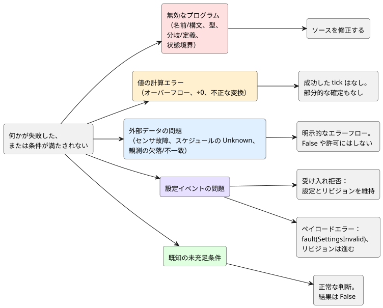

<!-- translation-source: docs/reference/07-semantic-rules-and-index.en.md -->
[英語の原文](07-semantic-rules-and-index.en.md)

# 7. 意味保存の規則と構文索引

[言語リファレンス](../LANGUAGE-REFERENCE.ja.md) · [前へ：合成とリプレイ](06-composition-and-replay.ja.md) · [次へ：層ごとの責任](08-language-runtime-and-device-boundaries.ja.md)

**この章の内容**

- [7.2](#72-無効なプログラムと外部の障害) — 壊れたプログラムと現場での障害を見分ける方法。
- [7.3](#73-false欠落不確実は異なる) — `false`、「欠落」、`Unknown`を決して互いに置き換えられない理由。
- [7.4](#74-意味を保つ変換) — プログラムをどのように書き換えても保たなければならないもの。
- [7.5](#75-宣言と表記の索引)–[7.7](#77-用語) — 表記、記号、用語の検索用の表。
- [7.8](#78-原文書からリファレンスへ) — 各設計文書がこのリファレンスのどこで確定しているか。

## 7.1 この章の目的

ある機能の構文を知っていることと、それを他の機能と組み合わせたときに意味を保てることは別の話です。この章では次の二つを示します。

- 言語全体に適用される**意味保存の規則**。
- 各表記や概念がどこで定義されているかを探すための**索引表**。

索引には、キーワード、設定キー、組み込み演算、設計上の概念が混在しています。一覧全体が予約語の集合というわけではありません。項目の正確な構文と、それを書ける場所については、リンク先の章を参照してください。

## 7.2 無効なプログラムと外部の障害

**理由。** 誤った制御式と故障したセンサは別の問題です。前者はプログラムの修正が必要で、後者は現場での対応が必要です。両者を同じように扱うと、どちらが起きているのかを区別できなくなります。

次の図は、表のカテゴリを「その後に何が起きるか」でまとめたものです。プログラムのエラーはソースの修正に戻ります。値の計算エラーはtickの成功を妨げます。外部データの問題は明示的なエラーフローを通ります。設定の問題は受け入れ拒否とペイロードエラーに分かれます。既知の未充足条件は、そもそもエラーではありません。

| カテゴリ | 例 | 言語における意味 |
|---|---|---|
| 名前/構文エラー | 未定義の名前、曖昧な宣言、孤立した意図リンク | 規則をただ一通りに解釈できません。 |
| 型エラー | Int変数とNumber変数を暗黙に混在させる、Durationを回数と混同する | 意味の異なる値を同じものとして扱いました。 |
| 分岐/定義エラー | 列挙型のcaseの欠落、同じ出力への二つの接続 | 結果が完全に、または一意に定義されていません。 |
| 状態境界エラー | 次状態の式の中で別の次状態を読む、組み合わせ回路の循環 | プログラムが一回の判断の中に、隠れた順序や無限の依存関係を作りました。 |
| 値の計算エラー | 範囲外の整数演算、ゼロ除算、不正な数値変換 | 正常な結果を生成できません。成功したtickとして部分的に確定してはいけません。 |
| センサ故障 | Disconnected、Invalid、Stale、NotReady | 入力が正常な測定の条件を満たしていません。明示的なエラーフローで処理してください。 |
| スケジュールのUnknown | 時刻、位置、予測、カレンダー情報の欠落 | 発生（オカレンス）が起きるかどうかの証拠がありません。Falseや許可に見せかけてはいけません。 |
| 既知の未充足条件 | 正常な水分測定値が灌水条件を満たさない | 判断は正常に完了しました。条件の結果はFalseです。 |
| 設定の受け入れ拒否 | 不正な形式のエンベロープ、未知の対象、別のProgram、古いベースリビジョン、権限エラー | イベントを拒否します。既存の設定の観測とリビジョンは変更しません。 |
| 設定ペイロードエラー | 識別と認可が済んだバンドル内の型、範囲、刻み幅の違反 | すべての対象についてまとめて`fault(SettingsInvalid)`を出し、リビジョンと有効位置を進めます。対象集合に含まれない設定は変わりません。[§5.2](05-settings-and-observation.ja.md)のアトミックなライブイベントの規則に従ってください。 |
| 観測の欠落/不一致 | 値がない、別のソースリビジョンや別の実行のスナップショット | 現在のプログラムの正常な観測として統合してはいけません。 |

この表から導かれる規則は次のとおりです。

- センサ故障を、正常なペイロードであるかのように算術や論理に渡してはいけません。
- 代替値を選ぶ式は、その選択の意味を見えるようにしなければなりません。
- 代替値は、元のエラーやその発生元を消しません。
- 設定要求の拒否と、制御tickの計算失敗は別のイベントです。

## 7.3 false、欠落、不確実は異なる

**理由。** 動作の許可には証拠が必要です。値の*欠落*を否定しても許可は生まれません。

| 値または状態 | 解釈 |
|---|---|
| `false` | 正常なBool値 |
| `0` | その型で正常に表現された値 |
| オプションのケイパビリティの欠落 | 設備がそのケイパビリティを提供していない |
| センサ故障 | 設置済みのセンサを正常に読めない |
| `Unknown(reason)` | 判断に十分な情報がない |
| 空の観測リスト | プログラムに公開する内部観測項目がない |

Boolの計算、品質の処理、存在の確認は分けておいてください。たとえば、次の三つは異なる条件です。

1. 「水分センサがない。」
2. 「水分センサが故障している。」
3. 「水分が0%である。」

`!Unknown`を動作の許可として読んではいけません。

## 7.4 意味を保つ変換

**理由。** 式を短くしたり共通の計算をまとめたりするのが安全なのは、制御結果が変わらない場合だけです。そうでなければ、実行されるプログラムはもはや作成者がレビューしたプログラムではありません。

表現が変わるときは、次のすべてをあわせて保たなければなりません。

1. 入力と値の型、および前状態と次状態の境界。
2. 成功した状態遷移の意味と、要求/安全な出力の意味。
3. エラー条件、およびエラーが成功した判断を妨げるという規則。
4. 時間、スケジュールの発生、設定イベントが判断に影響する順序。
5. 元の宣言や説明へ戻るトレースのリンク。

値が等しいというだけでは、書き換えの根拠になりません。`a * 0`を`0`に置き換えることでさえそうです。その書き換えが、元の式が起こし得たエラーや、元の式が必要とする依存関係を取り除いていないかも確認しなければなりません。静的な依存関係リストは「読まれる*可能性がある*入力」を意味します。実行中に実際に結果を支えた経路の集合ではありません。

式をまとめたり取り除いたりしても、元の意図、コメント、ソースリビジョンへのリンクは消えません。変換後の表現が、新しい独立した正本ソースになることは決してありません。根拠：[言語設計](../LANGUAGE.ja.md)、[原文と安全性の観測](../SOURCE-SAFETY-TRACE.ja.md)、[#42 意味の等価性と原文保存に関する決定](https://github.com/callin2/ghostflow-language/issues/42)。

## 7.5 宣言と表記の索引

| 表記/概念 | 章 |
|---|---|
| `.ghost.md`、`ghost`フェンス、コメント、段落、複数のコードブロック | [1. ソースと構文](01-source-and-syntax.ja.md) |
| `ghostflow:anchor`、`ghostflow:link`、意図/前提/仮定 | [1. ソースと構文](01-source-and-syntax.ja.md) |
| `control`、識別子、スコープ、名前解決、セミコロン | [1. ソースと構文](01-source-and-syntax.ja.md) |
| `input`、`output`、`state`、`config`、`let` | [2. 型、式、状態](02-types-expressions-state.ja.md)、[5. 設定](05-settings-and-observation.ja.md) |
| `fn`、引数/結果の型、純粋関数 | [2. 型、式、状態](02-types-expressions-state.ja.md) |
| `type`、`case`、`in` | [2. 型、式、状態](02-types-expressions-state.ja.md) |
| `Bool`、`Int`、`Number`、`Percent`、`Duration` | [2. 型、式、状態](02-types-expressions-state.ja.md) |
| 物理量、単位、次元、表示単位、制御上の意味 | [2. 型、式、状態](02-types-expressions-state.ja.md) |
| `if ... then ... else`、評価とエラー | [2. 型、式、状態](02-types-expressions-state.ja.md) |
| `x'`、`<-`、tick | [2. 型、式、状態](02-types-expressions-state.ja.md) |
| `+`、`-`、`*`、`/`、`div`、`%`、比較、`!`、`&&`、`\|\|` | [2. 型、式、状態](02-types-expressions-state.ja.md) |
| `number`、`int_exact`、`int_floor`、`int_ceil`、`int_trunc`、`int_nearest_even` | [2. 型、式、状態](02-types-expressions-state.ja.md) |
| 関数合成、値のパイプ、`>>`、`\|>`、`map`、`and_then`、`recover` | [2. 型、式、状態](02-types-expressions-state.ja.md)、[4. センサと制御](04-sensors-constraints-control.ja.md) |
| `Date`、`TimeOfDay`、`DateTime`、壁時計、単調時間、論理時間 | [3. 時間とスケジュール](03-time-and-schedules.ja.md) |
| `timer`、`elapsed`、フェーズの経過時間、Boolの連続時間 | [3. 時間とスケジュール](03-time-and-schedules.ja.md) |
| `schedule`、`DailySlots`、`TimeSlots`、`timezone`、`selected`、`.due`、`.missed` | [3. 時間とスケジュール](03-time-and-schedules.ja.md) |
| `Solar`、日の出、日の入り、月、潮汐、位置/予測のコンテキスト | [3. 時間とスケジュール](03-time-and-schedules.ja.md) |
| `Schedule`、TriggerRule、DayRule、Pulse、Window、Run、Range | [3. 時間とスケジュール](03-time-and-schedules.ja.md) |
| Cron、Periodic、稼働日、祝日、除外日、DST | [3. 時間とスケジュール](03-time-and-schedules.ja.md) |
| フォールバック、Unknown、遅延開始、観測ギャップ、重複した発生 | [3. 時間とスケジュール](03-time-and-schedules.ja.md) |
| `sensor`、`sensor?`、`signal`、`ok`、`fault`、Result/Option | [4. センサと制御](04-sensors-constraints-control.ja.md) |
| `sample`、`valid`、`filter`、`stale_after`、`recover_after`、`samples` | [4. センサと制御](04-sensors-constraints-control.ja.md) |
| 中央値、移動平均、EMA、ヒステリシス、on_below、off_above、initial | [4. センサと制御](04-sensors-constraints-control.ja.md) |
| `adapt`、ケイパビリティ、戦略選択 | [4. センサと制御](04-sensors-constraints-control.ja.md) |
| デバイス照会の`match`、`where`、`strategy`、`priority` | [4. センサと制御](04-sensors-constraints-control.ja.md) |
| `require`、`mutex`、`constraints`、`exclusive`、`allow` | [4. センサと制御](04-sensors-constraints-control.ja.md) |
| `check`、`limit`、`once ... per occurrence`、`warn`（設計段階、パーサ未対応） | [4. センサと制御](04-sensors-constraints-control.ja.md) |
| count_on、any_on、共有リソース、モード、調停 | [4. センサと制御](04-sensors-constraints-control.ja.md) |
| 1日のON時間、ローリングウィンドウの予算 | [4. センサと制御](04-sensors-constraints-control.ja.md) |
| objective、PI/PID、連続アクチュエータのフィードバック | [4. センサと制御](04-sensors-constraints-control.ja.md) |
| 時間的証拠（temporal evidence）、フォールバック、有界適応 | [4. センサと制御](04-sensors-constraints-control.ja.md) |
| min/max/step、access、label、既定値/有効値 | [5. 設定と観測](05-settings-and-observation.ja.md) |
| アトミックなライブ設定、設定リビジョン、一時値、期限切れ、復帰 | [5. 設定と観測](05-settings-and-observation.ja.md) |
| 観測契約：カウンタ、ディスクリプタ、スナップショット、イベント、コマンド結果、アラーム | [5. 設定と観測](05-settings-and-observation.ja.md) |
| 説明、evaluated/value/supportsResult、来歴 | [5. 設定と観測](05-settings-and-observation.ja.md) |
| 振る舞いの合成、import、instance、論理ポート、バインディング | [6. 合成とリプレイ](06-composition-and-replay.ja.md) |
| 意味DAG、明示的な遅延、状態境界、実行の分離 | [6. 合成とリプレイ](06-composition-and-replay.ja.md) |
| syntax/quote/splice、衛生的構文拡張 | [6. 合成とリプレイ](06-composition-and-replay.ja.md) |
| チェックポイント、リプレイ、ゴースト、ブランチ、プログラムの置換 | [6. 合成とリプレイ](06-composition-and-replay.ja.md) |

この索引の使い方：

- 表記を書ける場所と、それが必要とするフィールドは、リンク先の本文の節で定義されています。
- 削除された別名（エイリアス）は、§1.6の拒否規則で扱われます。
- ここに挙げた一般的な概念からソースのキーワードを推測しないでください。

## 7.6 記号の索引

ほとんどの記号の意味は文脈に依存します。この表は、各記号が果たし得る役割を挙げています。

| 記号 | 文脈上の役割 |
|---|---|
| `{ }` | スコープ、関数、case、設定ブロック、または`in`の後の有限集合 |
| `( )` | 呼び出しの引数、または式のグループ化 |
| `[ ]` | スケジュールの選定時刻など、宣言が許可するリスト |
| `:` | 型宣言または名前付き引数 |
| `;` | 宣言または式定義の終わり |
| `,` | 名前、引数、集合の要素の区切り |
| `=` | 定義、初期値、設定エントリ |
| `'` | 次状態 |
| `<-` | 出力接続 |
| `->` | 関数の結果型 |
| `=>` | caseの分岐または制約関係。式の中の汎用演算子ではない |
| `\|` | 列挙型の選択肢 |
| `?` | オプションのセンサ |
| `.` | 文脈で定まるメンバーまたは名前空間の参照 |
| `..` | センサの有効範囲 |
| `_` | faultパターン内の未使用の束縛 |
| `//` | 1行のコードコメント |

## 7.7 用語

| 用語 | 定義 |
|---|---|
| 正本ソース | 説明、意図、実行可能な規則をまとめて保持する元の文書 |
| プログラム | 実行可能な規則によって識別されるプログラム |
| 実行（run） | そのプログラムの一回の実行の、開始以降の同一性 |
| tick / スキャン | 入力を受け取り、一つの論理的な判断を確定する単位。そのコンテキストの観測境界とあわせて読む。 |
| 前状態 / 候補状態 | 判断の前に確定していた状態 / この判断の中で計算された次状態 |
| 要求意図 / 安全意図 | 制御式が求める出力 / 制約を適用した後の出力意図 |
| 設定 | プログラムが変更可能と宣言する調整可能な値 |
| 発生（オカレンス） | スケジュール規則が生み出す、識別可能な一回の発火 |
| 来歴 | 値、判断、説明がどの原文と意図から来たかを示すリンク |
| 論理ポート / 物理バインディング | 意味のある制御上の接続点 / それを実際の設備に結び付ける関係 |
| 意味DAG | 制御の意味と依存関係のグラフ。画面レイアウトのグラフではない。 |
| ドライバ | 物理信号を論理入力に変換する入力側の役割 |
| レンダラー | 論理的な出力意図を、リレー、モーター、ランプ、画面などの実際の効果に適用する出力側の役割 |
| Cabinet-view | ディスクリプタと観測を利用するオペレーター向けUI。`@ghostflow/cabinet-view` |

## 7.8 原文書からリファレンスへ

この表は、各設計項目がリファレンスのどこで確定しているかを探すためのものです。issueの状態や作業の進捗は示し**ません**。

| 設計の根拠 | リファレンスの位置 |
|---|---|
| [DESIGN-NOTES](../DESIGN-NOTES.ja.md)、[LANGUAGE](../LANGUAGE.ja.md) §1–2 | [1.1 1つの文書をソースとする理由](01-source-and-syntax.ja.md)、[2.8 tickと状態スナップショット](02-types-expressions-state.ja.md) |
| LANGUAGE §3–4、[LANGUAGE-SURFACE](../LANGUAGE-SURFACE.ja.md)、[Programming in GhostFlow](../ProgrammingInGhostflow.ja.md) §2·5·9·付録A/B | [第1章 ソースと構文](01-source-and-syntax.ja.md)、[第2章 型、式、状態](02-types-expressions-state.ja.md) |
| [LITERATE](../LITERATE.ja.md)、[INTENT-ANCHOR-MAP](../INTENT-ANCHOR-MAP.ja.md)、[#31](https://github.com/callin2/ghostflow-language/issues/31)、[#60](https://github.com/callin2/ghostflow-language/issues/60) | [1.1 1つの文書をソースとする理由](01-source-and-syntax.ja.md)、[1.2 原文、位置、意図のリンク](01-source-and-syntax.ja.md) |
| [整数契約](../EXACT-INTEGER-CONTRACT.ja.md)、[#22](https://github.com/callin2/ghostflow-language/issues/22)、[#93](https://github.com/callin2/ghostflow-language/issues/93) | [2.3 厳密な整数の設計](02-types-expressions-state.ja.md)、[2.9 物理量と単位](02-types-expressions-state.ja.md) |
| [時間契約](../TIME-AND-SCHEDULE-CONTRACT.ja.md)、[連続タイマー](../CONTINUOUS-BOOL-TIMER-CONTRACT.ja.md)、[Solar](../SOLAR-SCHEDULE.ja.md)、[#23](https://github.com/callin2/ghostflow-language/issues/23)、[#46](https://github.com/callin2/ghostflow-language/issues/46)、[#90](https://github.com/callin2/ghostflow-language/issues/90) | [第3章 時間とスケジュール](03-time-and-schedules.ja.md) |
| [CONSTRAINTS](../CONSTRAINTS.ja.md)、LANGUAGE §5–8、[#3](https://github.com/callin2/ghostflow-language/issues/3) | [4.1 センサとResultの品質](04-sensors-constraints-control.ja.md)、[4.7 requested、safe、applied、confirmed](04-sensors-constraints-control.ja.md)、[4.8 制約の共通表記と演算](04-sensors-constraints-control.ja.md) |
| [#94](https://github.com/callin2/ghostflow-language/issues/94)、[#95](https://github.com/callin2/ghostflow-language/issues/95)、[#96](https://github.com/callin2/ghostflow-language/issues/96) | [4.11 使用量計上と予算](04-sensors-constraints-control.ja.md)、[4.12 連続制御目標](04-sensors-constraints-control.ja.md)、[4.14 有界適応](04-sensors-constraints-control.ja.md) |
| [#68](https://github.com/callin2/ghostflow-language/issues/68)、[#70](https://github.com/callin2/ghostflow-language/issues/70)、[#73](https://github.com/callin2/ghostflow-language/issues/73)、[#74](https://github.com/callin2/ghostflow-language/issues/74)、[#88](https://github.com/callin2/ghostflow-language/issues/88)、[インタラクション契約](../../contracts/interaction-v0/README.ja.md) | [5.1 `config`宣言](05-settings-and-observation.ja.md)、[5.3 Cabinet-viewに依存しない観測モデル](05-settings-and-observation.ja.md)、[5.4 同一性と物理的事実の境界](05-settings-and-observation.ja.md) |
| [#89](https://github.com/callin2/ghostflow-language/issues/89)、[#105](https://github.com/callin2/ghostflow-language/issues/105)、[#110](https://github.com/callin2/ghostflow-language/issues/110) | [5.2 ソースの変更と運用設定の変更](05-settings-and-observation.ja.md) |
| [#99](https://github.com/callin2/ghostflow-language/issues/99)と、リンクされた#100–108の設計記録 | [6.1 一つの意味モデルと複数のグラフ](06-composition-and-replay.ja.md)、[6.3 パラメータ、設定、依存関係、バインディング](06-composition-and-replay.ja.md)、[5.2 ソースの変更と運用設定の変更](05-settings-and-observation.ja.md) |
| LANGUAGE §9–12、[構文比較における構文拡張](../LANGUAGE-EXAMPLES.ja.md)、Programming in GhostFlow §10–12 | [1.6 代表的な記法、参照用の別名、過去の代替案](01-source-and-syntax.ja.md)、[6.8 リプレイ、ゴースト、ブランチ](06-composition-and-replay.ja.md)、[6.10 syntax、quote、spliceの構文](06-composition-and-replay.ja.md) |
| [SOURCE-SAFETY-TRACE](../SOURCE-SAFETY-TRACE.ja.md)、[#42](https://github.com/callin2/ghostflow-language/issues/42) | [5.3 Cabinet-viewに依存しない観測モデル](05-settings-and-observation.ja.md)、[7.4 意味を保つ変換](#74-意味を保つ変換) |
| [コーディングFAQ 1–41](../language_faq.ja.md) | [第8章 FAQ全体の責任表](08-language-runtime-and-device-boundaries.ja.md)、[言語の決定と作成者が選ぶポリシー](08-language-runtime-and-device-boundaries.ja.md) |

新しい言語上の決定を追加するときは、その機能の本文、理由（Why）、例、そしてこの索引をあわせて更新してください。

[全体の目次](../LANGUAGE-REFERENCE.ja.md) · [次へ：層ごとの責任](08-language-runtime-and-device-boundaries.ja.md)
