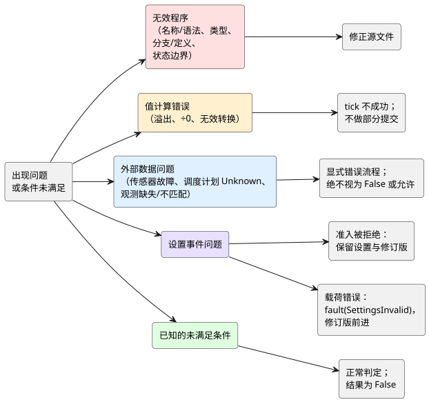

<!-- translation-source: docs/reference/07-semantic-rules-and-index.en.md -->
[英文原文](07-semantic-rules-and-index.en.md)

# 7. 语义保持规则与语法索引

[语言参考](../LANGUAGE-REFERENCE.zh.md) · [上一章：组合与重放](06-composition-and-replay.zh.md) · [下一章：各层职责](08-language-runtime-and-device-boundaries.zh.md)

**本章内容**

- [7.2](#72-无效程序与外部故障) —— 如何区分有缺陷的程序与现场发生的故障。
- [7.3](#73-false缺失与不确定是不同的) —— 为什么 `false`、“缺失”和 `Unknown` 绝不能互换。
- [7.4](#74-保持语义的变换) —— 对程序的任何改写都必须保留什么。
- [7.5](#75-声明与写法索引)–[7.7](#77-术语) —— 写法、符号和术语的查找表。
- [7.8](#78-从原始文档到参考) —— 每份设计文档在本参考中的定论位置。

## 7.1 本章目的

了解某个功能的语法，并不等于在与其他功能组合时仍能保持其语义。本章提供两部分内容：

- 适用于整个语言的**语义保持规则**。
- 用于查找各写法或概念定义位置的**索引表**。

索引中混合了关键字、设置键、内置操作和设计概念。整个列表并不是一组保留字。某一项的确切语法及其可出现的位置，请参阅其链接的章节。

## 7.2 无效程序与外部故障

**原因。** 错误的控制表达式和失效的传感器是两类不同的问题。前者需要修正程序；后者需要在现场处理。如果将二者同等对待，就再也无法分辨遇到的是哪一种。

下图按照“接下来会发生什么”对表中的类别进行分组。程序错误需要回到源文件修正。值计算错误使该 tick 无法成功。外部数据问题经过显式的错误流程。设置问题分为拒绝和载荷错误两类。已知的未满足条件根本不是错误。

| 类别 | 示例 | 在语言中的含义 |
|---|---|---|
| 名称/语法错误 | 未定义的名称、有歧义的声明、孤立的意图链接 | 规则无法以唯一的方式解释。 |
| 类型错误 | 隐式混用 Int 与 Number 变量；将 Duration 与计数混淆 | 含义不同的值被当作相同的值处理。 |
| 分支/定义错误 | 缺少枚举分支；同一输出有两个连接 | 结果没有被完整或唯一地定义。 |
| 状态边界错误 | 在下一状态表达式中读取另一个下一状态；组合环路 | 程序在一次判定内部制造了隐藏的顺序或无限依赖。 |
| 值计算错误 | 超出范围的整数运算、除以零、无效的数值转换 | 无法产生正常结果。不得将其作为成功的 tick 部分提交。 |
| 传感器故障 | Disconnected、Invalid、Stale、NotReady | 输入不满足正常测量的条件。须通过显式的错误流程处理。 |
| 调度计划 Unknown | 缺少时间、位置、预测或日历信息 | 没有证据表明某个触发实例是否发生。不得将其伪装成 False 或允许。 |
| 已知的未满足条件 | 正常的湿度读数不满足灌溉条件 | 判定正常完成；该条件的结果为 False。 |
| 设置准入拒绝 | 格式错误的信封、未知目标、不同的 Program、过时的基准修订版或权限失败 | 拒绝该事件。保持现有的设置观测和修订版不变。 |
| 设置载荷错误 | 在已识别且已授权的设置包中出现类型、范围或步长违规 | 对所有目标一并发出 `fault(SettingsInvalid)`，并推进修订版和生效位置。目标集合之外的设置保持不变。遵循 [§5.2](05-settings-and-observation.zh.md) 中的原子实时事件规则。 |
| 观测缺失/不匹配 | 没有值；来自其他源修订版或其他执行的快照 | 不得将其合并为当前程序的正常观测。 |

由此表得出的规则：

- 绝不要把传感器故障当作正常载荷送入算术或逻辑运算。
- 选择替代值的表达式必须让该选择的含义清晰可见。
- 替代值不会抹去原始错误及其来源。
- 拒绝设置请求与控制 tick 计算失败是两种不同的事件。

## 7.3 false、缺失与不确定是不同的

**原因。** 允许运行需要证据。对某个值的*缺失*取反，无法产生允许。

| 值或状态 | 解释 |
|---|---|
| `false` | 正常的 Bool 值 |
| `0` | 该类型正常表示的值 |
| 缺失的可选能力 | 该设施不提供该能力 |
| 传感器故障 | 已安装的传感器无法正常读取 |
| `Unknown(reason)` | 信息不足，无法判定 |
| 空的观测列表 | 程序没有可公开的内部观测项 |

应将 Bool 计算、质量处理和存在性检查分开。例如，以下是三个不同的条件：

1. “没有湿度传感器。”
2. “湿度传感器已发生故障。”
3. “湿度为 0%。”

不得把 `!Unknown` 解读为允许运行。

## 7.4 保持语义的变换

**原因。** 只有在控制结果保持不变时，缩短表达式或合并公共计算才是安全的。否则，实际运行的程序就不再是作者审查过的那个程序。

每当表示形式发生变化时，必须同时保留以下所有内容：

1. 输入和值的类型，以及前一状态与下一状态之间的边界。
2. 成功的状态转换以及请求/安全输出的含义。
3. 错误条件，以及“错误会阻止成功判定”这一规则。
4. 时间、调度计划触发实例和设置事件影响判定的顺序。
5. 回溯到原始声明和解释的追踪链接。

仅凭值相等并不足以证明改写合理，即使是把 `a * 0` 替换为 `0` 也不例外。还必须检查该改写是否消除了原表达式可能引发的错误，或原表达式所需的依赖。静态依赖列表表示“*可能*被读取的输入”，而不是执行期间实际支撑某个结果的路径集合。

合并或删除表达式不会删除它们与原始意图、注释或源修订版之间的链接。变换后的表示形式绝不会成为新的、独立的规范源。依据：[语言设计](../LANGUAGE.zh.md)、[原始来源与安全观测](../SOURCE-SAFETY-TRACE.zh.md)、[#42 关于语义等价与原始来源保留的决定](https://github.com/callin2/ghostflow-language/issues/42)。

## 7.5 声明与写法索引

| 写法/概念 | 章节 |
|---|---|
| `.ghost.md`、`ghost` 围栏、注释、段落、多个代码块 | [1. 源文件与语法](01-source-and-syntax.zh.md) |
| `ghostflow:anchor`、`ghostflow:link`、意图/前提/假设 | [1. 源文件与语法](01-source-and-syntax.zh.md) |
| `control`、标识符、作用域、名称解析、分号 | [1. 源文件与语法](01-source-and-syntax.zh.md) |
| `input`、`output`、`state`、`config`、`let` | [2. 类型、表达式与状态](02-types-expressions-state.zh.md)、[5. 设置](05-settings-and-observation.zh.md) |
| `fn`、参数/结果类型、纯函数 | [2. 类型、表达式与状态](02-types-expressions-state.zh.md) |
| `type`、`case`、`in` | [2. 类型、表达式与状态](02-types-expressions-state.zh.md) |
| `Bool`、`Int`、`Number`、`Percent`、`Duration` | [2. 类型、表达式与状态](02-types-expressions-state.zh.md) |
| 物理量、单位、量纲、显示单位、控制含义 | [2. 类型、表达式与状态](02-types-expressions-state.zh.md) |
| `if ... then ... else`、求值与错误 | [2. 类型、表达式与状态](02-types-expressions-state.zh.md) |
| `x'`、`<-`、tick | [2. 类型、表达式与状态](02-types-expressions-state.zh.md) |
| `+`、`-`、`*`、`/`、`div`、`%`、比较、`!`、`&&`、`\|\|` | [2. 类型、表达式与状态](02-types-expressions-state.zh.md) |
| `number`、`int_exact`、`int_floor`、`int_ceil`、`int_trunc`、`int_nearest_even` | [2. 类型、表达式与状态](02-types-expressions-state.zh.md) |
| 函数组合、值管道、`>>`、`\|>`、`map`、`and_then`、`recover` | [2. 类型、表达式与状态](02-types-expressions-state.zh.md)、[4. 传感器与控制](04-sensors-constraints-control.zh.md) |
| `Date`、`TimeOfDay`、`DateTime`、墙钟、单调时间、逻辑时间 | [3. 时间与调度计划](03-time-and-schedules.zh.md) |
| `timer`、`elapsed`、阶段时长、Bool 连续时间 | [3. 时间与调度计划](03-time-and-schedules.zh.md) |
| `schedule`、`DailySlots`、`TimeSlots`、`timezone`、`selected`、`.due`、`.missed` | [3. 时间与调度计划](03-time-and-schedules.zh.md) |
| `Solar`、日出、日落、月亮、潮汐、位置/预测上下文 | [3. 时间与调度计划](03-time-and-schedules.zh.md) |
| `Schedule`、TriggerRule、DayRule、Pulse、Window、Run、Range | [3. 时间与调度计划](03-time-and-schedules.zh.md) |
| Cron、Periodic、工作日、节假日、排除日、DST | [3. 时间与调度计划](03-time-and-schedules.zh.md) |
| fallback、Unknown、延迟启动、观测间隙、重复触发实例 | [3. 时间与调度计划](03-time-and-schedules.zh.md) |
| `sensor`、`sensor?`、`signal`、`ok`、`fault`、Result/Option | [4. 传感器与控制](04-sensors-constraints-control.zh.md) |
| `sample`、`valid`、`filter`、`stale_after`、`recover_after`、`samples` | [4. 传感器与控制](04-sensors-constraints-control.zh.md) |
| 中值、移动平均、EMA、迟滞、on_below、off_above、initial | [4. 传感器与控制](04-sensors-constraints-control.zh.md) |
| `adapt`、能力（capability）、策略选择 | [4. 传感器与控制](04-sensors-constraints-control.zh.md) |
| 设备查询 `match`、`where`、`strategy`、`priority` | [4. 传感器与控制](04-sensors-constraints-control.zh.md) |
| `require`、`mutex`、`constraints`、`exclusive`、`allow` | [4. 传感器与控制](04-sensors-constraints-control.zh.md) |
| `check`、`limit`、`once ... per occurrence`；`warn`（设计中，解析器不支持） | [4. 传感器与控制](04-sensors-constraints-control.zh.md) |
| count_on、any_on、共享资源、模式、仲裁 | [4. 传感器与控制](04-sensors-constraints-control.zh.md) |
| 每日 ON 时间、滚动窗口预算 | [4. 传感器与控制](04-sensors-constraints-control.zh.md) |
| objective、PI/PID、连续执行器反馈 | [4. 传感器与控制](04-sensors-constraints-control.zh.md) |
| 时间证据、fallback、有界自适应 | [4. 传感器与控制](04-sensors-constraints-control.zh.md) |
| min/max/step、access、label、默认值/生效值 | [5. 设置与观测](05-settings-and-observation.zh.md) |
| 原子实时设置、设置修订版、临时值、过期、恢复原值 | [5. 设置与观测](05-settings-and-observation.zh.md) |
| 观测契约：计数器、描述符、快照、事件、命令结果、报警 | [5. 设置与观测](05-settings-and-observation.zh.md) |
| 解释、evaluated/value/supportsResult、来源 | [5. 设置与观测](05-settings-and-observation.zh.md) |
| 行为组合、import、instance、逻辑端口、绑定 | [6. 组合与重放](06-composition-and-replay.zh.md) |
| 语义 DAG、显式延迟、状态边界、执行隔离 | [6. 组合与重放](06-composition-and-replay.zh.md) |
| syntax/quote/splice、卫生语法扩展 | [6. 组合与重放](06-composition-and-replay.zh.md) |
| 检查点、重放、ghost、分支、程序替换 | [6. 组合与重放](06-composition-and-replay.zh.md) |

本索引的使用方法：

- 某个写法可以出现在哪里、需要哪些字段，由链接到的正文章节定义。
- 已移除的别名按照 §1.6 中的拒绝规则处理。
- 不要从此处列出的一般概念推断源文件关键字。

## 7.6 符号索引

大多数符号的含义取决于上下文。下表列出了每个符号可能承担的各种角色。

| 符号 | 上下文中的角色 |
|---|---|
| `{ }` | 作用域、函数、case、设置块，或 `in` 之后的有限集合 |
| `( )` | 调用参数或表达式分组 |
| `[ ]` | 声明所允许的列表，例如调度计划的选定时刻 |
| `:` | 类型声明或具名参数 |
| `;` | 声明或表达式定义的结尾 |
| `,` | 分隔名称、参数和集合元素 |
| `=` | 定义、初始值、设置条目 |
| `'` | 下一状态 |
| `<-` | 输出连接 |
| `->` | 函数结果类型 |
| `=>` | case 分支或约束关系；在表达式中不是通用运算符 |
| `\|` | 枚举备选项 |
| `?` | 可选传感器 |
| `.` | 成员或命名空间引用，由上下文决定 |
| `..` | 传感器的有效范围 |
| `_` | fault 模式中未使用的绑定 |
| `//` | 单行代码注释 |

## 7.7 术语

| 术语 | 定义 |
|---|---|
| 规范源 | 将解释、意图和可执行规则保存在一起的原始文档 |
| 程序 | 由其可执行规则标识的程序 |
| 运行（run） | 该程序一次执行从启动开始的身份标识 |
| tick / 扫描 | 接收输入并提交一次逻辑判定的单位。应结合其上下文的观测边界来理解。 |
| 前一状态 / 候选状态 | 判定之前已提交的状态 / 本次判定中计算出的下一状态 |
| 请求意图 / 安全意图 | 控制表达式所请求的输出 / 应用约束之后的输出意图 |
| 设置 | 程序声明为可更改的可调值 |
| 触发实例（occurrence） | 由调度计划规则产生的一次可识别的事件 |
| 来源（provenance） | 表明某个值、判定或解释源自哪个原始来源和意图的链接 |
| 逻辑端口 / 物理绑定 | 有意义的控制连接点 / 将其连接到实际设施的关系 |
| 语义 DAG | 表示控制含义和依赖关系的图。它不是画面布局图。 |
| 驱动程序（driver） | 将物理信号转换为逻辑输入的输入角色 |
| 渲染器（renderer） | 将逻辑输出意图施加为实际效果（例如继电器、电机、指示灯和屏幕）的输出角色 |
| Cabinet-view | 消费描述符和观测的操作员 UI；`@ghostflow/cabinet-view` |

## 7.8 从原始文档到参考

通过下表可以查到每个设计项在本参考中的定论位置。它**不**表示 issue 状态或工作进度。

| 设计依据 | 参考位置 |
|---|---|
| [DESIGN-NOTES](../DESIGN-NOTES.zh.md)、[LANGUAGE](../LANGUAGE.zh.md) §1–2 | [1.1 为什么由一份文档作为源](01-source-and-syntax.zh.md)、[2.8 tick 与状态快照](02-types-expressions-state.zh.md) |
| LANGUAGE §3–4、[LANGUAGE-SURFACE](../LANGUAGE-SURFACE.zh.md)、[Programming in GhostFlow](../ProgrammingInGhostflow.zh.md) §2·5·9·附录 A/B | [第 1 章 源文件与语法](01-source-and-syntax.zh.md)、[第 2 章 类型、表达式与状态](02-types-expressions-state.zh.md) |
| [LITERATE](../LITERATE.zh.md)、[INTENT-ANCHOR-MAP](../INTENT-ANCHOR-MAP.zh.md)、[#31](https://github.com/callin2/ghostflow-language/issues/31)、[#60](https://github.com/callin2/ghostflow-language/issues/60) | [1.1 为什么由一份文档作为源](01-source-and-syntax.zh.md)、[1.2 原始来源、位置与意图链接](01-source-and-syntax.zh.md) |
| [整数契约](../EXACT-INTEGER-CONTRACT.zh.md)、[#22](https://github.com/callin2/ghostflow-language/issues/22)、[#93](https://github.com/callin2/ghostflow-language/issues/93) | [2.3 精确整数设计](02-types-expressions-state.zh.md)、[2.9 物理量与单位](02-types-expressions-state.zh.md) |
| [时间契约](../TIME-AND-SCHEDULE-CONTRACT.zh.md)、[连续定时器](../CONTINUOUS-BOOL-TIMER-CONTRACT.zh.md)、[Solar](../SOLAR-SCHEDULE.zh.md)、[#23](https://github.com/callin2/ghostflow-language/issues/23)、[#46](https://github.com/callin2/ghostflow-language/issues/46)、[#90](https://github.com/callin2/ghostflow-language/issues/90) | [第 3 章 时间与调度计划](03-time-and-schedules.zh.md) |
| [CONSTRAINTS](../CONSTRAINTS.zh.md)、LANGUAGE §5–8、[#3](https://github.com/callin2/ghostflow-language/issues/3) | [4.1 传感器与 Result 质量](04-sensors-constraints-control.zh.md)、[4.7 requested、safe、applied、confirmed](04-sensors-constraints-control.zh.md)、[4.8 通用 constraints 写法与运算](04-sensors-constraints-control.zh.md) |
| [#94](https://github.com/callin2/ghostflow-language/issues/94)、[#95](https://github.com/callin2/ghostflow-language/issues/95)、[#96](https://github.com/callin2/ghostflow-language/issues/96) | [4.11 用量核算与预算](04-sensors-constraints-control.zh.md)、[4.12 连续控制目标](04-sensors-constraints-control.zh.md)、[4.14 有界自适应](04-sensors-constraints-control.zh.md) |
| [#68](https://github.com/callin2/ghostflow-language/issues/68)、[#70](https://github.com/callin2/ghostflow-language/issues/70)、[#73](https://github.com/callin2/ghostflow-language/issues/73)、[#74](https://github.com/callin2/ghostflow-language/issues/74)、[#88](https://github.com/callin2/ghostflow-language/issues/88)、[交互契约](../../contracts/interaction-v0/README.zh.md) | [5.1 `config` 声明](05-settings-and-observation.zh.md)、[5.3 独立于 Cabinet-view 的观测模型](05-settings-and-observation.zh.md)、[5.4 身份标识与物理事实的边界](05-settings-and-observation.zh.md) |
| [#89](https://github.com/callin2/ghostflow-language/issues/89)、[#105](https://github.com/callin2/ghostflow-language/issues/105)、[#110](https://github.com/callin2/ghostflow-language/issues/110) | [5.2 源变更与运行设置变更](05-settings-and-observation.zh.md) |
| [#99](https://github.com/callin2/ghostflow-language/issues/99) 及其关联的 #100–108 设计记录 | [6.1 一个语义模型与多个图](06-composition-and-replay.zh.md)、[6.3 参数、设置、依赖与绑定](06-composition-and-replay.zh.md)、[5.2 源变更与运行设置变更](05-settings-and-observation.zh.md) |
| LANGUAGE §9–12、[语法对比中的语法扩展](../LANGUAGE-EXAMPLES.zh.md)、Programming in GhostFlow §10–12 | [1.6 规范写法、参考别名与历史备选方案](01-source-and-syntax.zh.md)、[6.8 重放、ghost 与分支](06-composition-and-replay.zh.md)、[6.10 syntax、quote 与 splice 的语法](06-composition-and-replay.zh.md) |
| [SOURCE-SAFETY-TRACE](../SOURCE-SAFETY-TRACE.zh.md)、[#42](https://github.com/callin2/ghostflow-language/issues/42) | [5.3 独立于 Cabinet-view 的观测模型](05-settings-and-observation.zh.md)、[7.4 保持语义的变换](#74-保持语义的变换) |
| [编码 FAQ 1–41](../language_faq.zh.md) | [第 8 章 完整职责表](08-language-runtime-and-device-boundaries.zh.md)、[语言决定与作者自定的策略](08-language-runtime-and-device-boundaries.zh.md) |

新增语言决定时，请同时更新以下内容：该功能的正文、其“原因”、示例以及本索引。

[完整目录](../LANGUAGE-REFERENCE.zh.md) · [下一章：各层职责](08-language-runtime-and-device-boundaries.zh.md)
