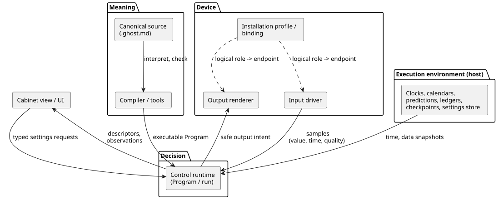
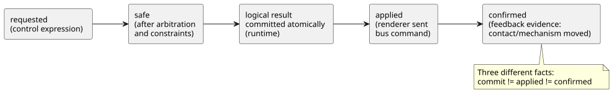

<!-- translation-source: docs/reference/08-language-runtime-and-device-boundaries.md -->
[Korean original](08-language-runtime-and-device-boundaries.md)

# 8. FAQ requirements and language, execution, and device responsibilities

[Complete contents](../LANGUAGE-REFERENCE.en.md) · [Previous: Semantic preservation rules and index](07-semantic-rules-and-index.en.md)

This chapter takes the requirements from the [Coding FAQ](../language_faq.md) and assigns each part to the layer that must own it: the language, tools, runtime, execution environment, Driver, installation connections, or UI.

What this chapter does **not** do:

- It does not report implementation progress.
- It does not say where code lives in any particular repository.

The syntax and semantics of each feature are defined in the linked Reference sections. If an earlier design sketch uses a different notation, use the notation settled in this Reference.

**In this chapter**

- §8.1 — the principle: meaning versus the means of execution.
- §8.2 — what each layer owns, with a boundary diagram.
- §8.3 — every FAQ (1–41) mapped to its responsibilities.
- §8.4 — boundaries that specific features must keep.
- §8.5 — what changes, restarts, and persists, and who owns it.
- §8.6 — which choices the language fixes and which the author makes.
- §8.7 — a checklist for classifying new requirements.

## 8.1 Classification principle: meaning and execution means

**The language defines what a program means. The runtime makes decisions according to that meaning.** Input drivers and the execution environment supply the facts and the time that decisions need. Output renderers apply the output effects. Whether a given operation runs inside a VM or is computed in a host adapter is a separate question from who owns its meaning.

*Example.* "Start once every day at 6 a.m. local time" is a schedule meaning defined by the language. Where the clock and time-zone data come from is the execution environment's job. Even when an adapter supplies the schedule occurrences, deduplication, missed observations, and DST handling must follow the same language contract. Screens and Drivers must not reinterpret whether to start under rules of their own.

FAQ fragments such as `input is_holiday: Bool` and `input used: Duration` show **how to consume a value**. A declaration alone does not create a holiday calculator or a usage record. To fully support such a requirement, you also need a contract for the input's producer: its meaning, validity, timing, and recovery.

Some choices belong to the user, not the language. Examples:

- Which device moves after a cancellation.
- Whether cleaning happens once a day.
- Whether a changed operating duration also applies to work already in progress.

These are choices made in the authored program. None of them needs a new keyword or a built-in control mode.

**Why:** Adding syntax does not make a clock or physical feedback appear. Conversely, a Driver that can read values is not enough: without program semantics for time, errors, and state, consistent control cannot be explained.

## 8.2 Layer responsibilities

Two roles connect the program to the physical world:

- An input **driver** produces logical inputs.
- An output **renderer** applies logical output intent to relays, motors, lamps, or screens.

These are *roles*, not mutually exclusive device classes. A USB force-feedback joystick has both an input driver and an output renderer. An EC11 encoder with a TFT display likewise combines input and output roles. These examples illustrate the boundary; they are not implementations.

Ownership of related code and policy:

- Driver and renderer source belongs in `farm-device-drivers`.
- Device owns host/board integration, bindings, clocks, watchdogs, and boot/failure policy.
- The cabinet operator UI is `@ghostflow/cabinet-view`. It is distinct from an output renderer.
- Existing `ScanDriver`, host ABI identifiers, and profile `driver` fields keep their names and contracts.

The diagram below shows how the layers connect. Meaning flows from the canonical source through the tools to the runtime. Facts and time flow into the runtime from the environment and the input drivers. Safe output intent flows out to renderers. Bindings connect logical roles to actual endpoints. The UI only reads descriptors and observations and submits typed requests.

| Layer | Required responsibilities | Boundary with other layers |
|---|---|---|
| Language specification | Meaning of types, state transitions, time, errors, settings, and output intent; resource bounds and failure rules | Do not turn device addresses, UI appearance, or storage media into control syntax. |
| Compiler/tools | Interpret canonical documents; check types, names, and branches; transform them into executable representations; preserve declarations, intent, and settings descriptions | A static type check alone does not prove physical wiring or actual operation. |
| Control runtime | Evaluate state, expressions, timers, and constraints from input snapshots, and commit the results atomically; keep the execution positions of settings events and observations | Do not add program policy on its own, and do not treat outputs as physical confirmation. |
| Execution environment/data providers | Clocks and their trust; date and natural-event data; execution lifetimes; storing and restoring settings, checkpoints, and installation records | Expose the revision, scope, validity, and failures of supplied data. Do not create a separate control language. |
| Input driver / output renderer | Input driver: device communication, interpreting/normalizing raw signals, sample identity/time/quality. Output renderer: applying logical outputs, and reporting results, under Device boot/failure policy | Do not hide control sequences, interlocks, or date policies outside the source. |
| Installation profile/binding | Connecting logical roles to actual endpoints; compatibility such as capability, polarity, and range; installation revision | Distinguish a connection-only change from a change to source rules. |
| Cabinet view / UI | Edit and display using the described types, labels, ranges, and permissions; submit typed requests; display results and errors | Do not regenerate control meaning with separate timers, aggregation, or constraint decisions. |

Here, the **execution environment (host) is the device or process that runs the control program**. It does not require an Android gateway or a cloud service. A device that has the necessary clocks and valid data locally can fulfill the contract without Internet access. Network disconnection, data expiry, and unknown time are three distinct states.

Rationale: [§1.1 Canonical source](01-source-and-syntax.md#11-왜-문서-하나가-소스인가), [§2.8 Execution semantics](02-types-expressions-state.md#28-tick과-상태-snapshot), [§4.2 Input contracts](04-sensors-constraints-control.md#42-샘플-계약과-sensor-처리-순서), [§5.3 Observation model](05-settings-and-observation.md#53-cabinet-view-독립-관찰-모델), [§6.2 Logical connections](06-composition-and-replay.md#62-definition-instance와-논리-port).

## 8.3 Complete FAQ responsibility table

This table assigns each of FAQ 1–41 to a row. "Requirements" here means contractual responsibility, not implementation status. Responsibilities shared by all drivers, renderers, and UIs follow §8.2; each row lists only the external responsibilities that matter most for that requirement.

| FAQ and requirement | Language/compiler requirements | Runtime requirements | Execution environment/driver/renderer/installation/UI requirements |
|---|---|---|---|
| [1](../language_faq.md#q01), [41](../language_faq.md#q41) Canonical document/compiler tools | Literate interpretation; preserving and checking source and intent locations (§1) | Execute the identified Program | Tools keep and deliver complete documents and revisions; a compile check is distinct from verifying physical behavior |
| [2](../language_faq.md#q02), [3](../language_faq.md#q03), [18](../language_faq.md#q18) Buttons/self-holding | Bool, previous/next state (§2.8) | Evaluate and commit the authored restart conditions from snapshots | Driver supplies the meaning of "pressed"; connect actual buttons or explicitly declared software inputs |
| [4](../language_faq.md#q04)–[6](../language_faq.md#q06) Timed operation/delays | Duration, per-state elapsed (§3.2) | Monotonic time and timer state | Execution environment supplies monotonic time and decision opportunities |
| [8](../language_faq.md#q08), [19](../language_faq.md#q19) Sequential/post-cancellation behavior | enum/case and per-state output expressions (§2.4, §2.8) | Per-tick state transitions following the authored sequence and cancellation priority | Driver supplies stop/home feedback; what happens next is program policy |
| [9](../language_faq.md#q09), [10](../language_faq.md#q10) Sensor conditions/tank control | Result, thresholds, filters, hysteresis, state (§4.1–4.3) | Identify new samples; evaluate freshness, recovery, and filter state | Driver supplies values, units, sample times, and quality |
| [11](../language_faq.md#q11) Counts | Exact integers, previous input state, conditions (§2.3, §2.8) | Keep the authored edge, limit, and initialization expressions and integer-error semantics | Input producer supplies observable events; the ticks of one long pulse are not counted as events |
| [13](../language_faq.md#q13) Alarm holding | Bool state and conditions; the meaning of public alarms is separate (§5.3) | Evaluate authored latch/reset expressions; preserve the raise/clear meaning of explicit alarms | UI displays alarm state; notification and record media are external choices |
| [14](../language_faq.md#q14), [17](../language_faq.md#q17) Interlocks | require/mutual exclusion; state restriction is distinct from output restriction (§4.7) | requested→safe decisions | Output renderer applies effects; input driver supplies feedback; a logical constraint is not a physical emergency-stop device |
| [16](../language_faq.md#q16) Computational reuse | Pure functions, types, name scopes (§2.7) | Same computation for the same inputs | Do not put device access or hidden state in pure functions |
| [7](../language_faq.md#q07), [15](../language_faq.md#q15), [20](../language_faq.md#q20) Clock-time/sunrise schedules | DailySlots/Solar, offsets, occurrence kept separate from operation (§3.5–3.9) | Occurrence handling and deduplication per contract; operating timers | Supply clocks, location, time zones, and natural-event data; preserve occurrence records |
| [21](../language_faq.md#q21), [27](../language_faq.md#q27)–[29](../language_faq.md#q29) Weekdays/holidays/DST | Date filters and conditions; gap/fold and Unknown semantics (§3.8) | Apply the same date decisions and admission policies | Supply calendar and time-zone data with revisions and coverage; display selectable settings in the UI |
| [30](../language_faq.md#q30), [31](../language_faq.md#q31) Tides/moon | Type distinction between timed events and interval conditions; offsets/fallback (§3.9) | Preserve event IDs, revisions, omissions, and the meaning of ongoing operation | Prediction provider supplies station/model, revision, coverage, expiry, and stable event IDs |
| [22](../language_faq.md#q22), [23](../language_faq.md#q23) Accumulated duration/daily cleaning | Aggregation subject and period, exact counts, state/enum (§3.4, §3.10) | Evaluate the authored cleaning conditions and sequence using valid aggregation snapshots | Environment updates, stores, and restores the ledger using a shared installation identity and applied/confirmed evidence; author-chosen policies are in §8.6 |
| [12](../language_faq.md#q12), [24](../language_faq.md#q24), [26](../language_faq.md#q26) Duration/range changes | config type/default/min/max/step/access and descriptor (§5.1–5.2) | Validate the whole request and apply it atomically and live; keep state and timers | UI submits typed requests; the execution boundary checks permission; the environment persists ordinary settings |
| [25](../language_faq.md#q25) Labels/input UI | label and semantic metadata (§5.1, §5.3) | Supply effective values, revisions, and rejection outcomes | Cabinet view chooses time fields, lists, or sliders; every path applies the same validation |
| [32](../language_faq.md#q32) Power-outage recovery | Initial values, state transitions, execution identity (§2.8, §5.2) | New run; the specified initialization/restoration; evaluate the authored resume condition | Environment supplies checkpoints and restart causes; Device output policy and the renderer manage outputs before the first decision |
| [33](../language_faq.md#q33)–[36](../language_faq.md#q36) Sensor replacement/lifecycle/specification | Logical device contracts; the Program stays the same on compatible replacement (§6.2–6.3) | Evaluate contract-compliant inputs with the same rules | Manage Driver changes, installation binding revisions, and compatibility; 36 is the rationale for these principles, not a request for new syntax |
| [37](../language_faq.md#q37)–[40](../language_faq.md#q40) GPIO/relays/expanded I/O | Logical ports independent of device location (§6.2–6.3) | Preserve input and safe-output contracts | Each driver/renderer handles the buses, addresses, channels, polarity, and failures of its role; the binding selects actual endpoints |

A range includes every FAQ in it. For example, 27–29 means 27, 28, and 29. Related chapters: [2](02-types-expressions-state.md), [3](03-time-and-schedules.md), [4](04-sensors-constraints-control.md), [5](05-settings-and-observation.md), [6](06-composition-and-replay.md).

## 8.4 Boundaries each feature must preserve

### Ordinary control composition and built-in features

Self-holding, tank filling, and stage-specific cancellation are built by composing existing features: state, Bool, enum, and case. The runtime provides the state-transition semantics; the author chooses the restart, cancellation, and completion policies. Do not hide a separate self-holding or cancellation sequence inside a Driver.

Some clarifications for the FAQ examples:

- The FAQ's Bool alarm latch does not automatically become an alarm record or an external notification service.
- In FAQ 11, `done` is a Bool value that stays true after the count reaches 3. It is not a one-shot completion pulse.
- The count stops at 3 because of that example's condition expression, not because Int arithmetic saturates.
- An edge counter counts the input changes that the runtime observes. To count physical pulses that rise and fall *between* decisions, you need a capture-and-delivery contract with the Driver or input producer. Exact integer types alone do not guarantee that no physical event is lost.

**Why:** A special instruction for each application would force the same state transitions to be maintained under several meanings. Rationale: [§2.8](02-types-expressions-state.md#28-tick과-상태-snapshot), [§5.3 Events and alarms](05-settings-and-observation.md#event-command-result와-alarm).

### Time decisions and data provision

The language distinguishes monotonic time from local dates and defines DST, fallback, and occurrence identity. The execution environment supplies trusted time, calendars, and predictions. Part of the schedule computation may run in an adapter, but the same data, times, and records must still produce the same results. Do not reduce generated inputs to arbitrary Bool pulses that have lost their cause and revision.

**Why:** Changing how the clock is obtained must not change what duplicate execution, omissions, or operating durations mean. Rationale: [§3.1](03-time-and-schedules.md#31-시간값과-시계-영역), [§3.5](03-time-and-schedules.md#35-schedule의-공통-의미), [§3.9](03-time-and-schedules.md#39-solar-달과-조석).

### Accumulated usage and persistent storage

The language contract specifies:

- what is counted (requested, safe, applied, or confirmed);
- the scope and date boundaries;
- initialization and the unknown status.

An edge counter internal to one control can be computed with ordinary state. A persistent installation ledger that spans several controls and modes is different. Execution-environment providers update, store, and restore it, using a stable installation identity together with application evidence from renderers and confirmation evidence from input drivers. They supply identified aggregation snapshots to the control runtime.

- Pure aggregation computed inside a provider follows the same language contract. The storage medium does not change what an aggregate means.
- One device's usage is not the sum of its automatic and manual control requests.
- Do not substitute accumulated screen-on time for installation usage.

**Why:** Temporary execution memory and installation records that must survive a restart have different lifetimes. Rationale: [§3.4](03-time-and-schedules.md#34-누적-시간과-rolling-budget), [§3.10](03-time-and-schedules.md#310-시간-기반-사용량-제약).

### Settings, validation, and screens

The language declares types, permitted ranges, increments, permissions, and labels, and the tools preserve these descriptions. The execution boundary validates each request as a whole. The runtime then applies the approved values atomically within the same Program and run.

- UI pre-validation alone is not approval. The same conditions apply even when UI components change.
- Whether work in progress reads a new duration or keeps the value it started with is decided by the program's control expressions.

**Why:** Changing a time input field into a slider must not change the permitted values or the execution results. Rationale: [§5.1](05-settings-and-observation.md#51-config-선언), [§5.2](05-settings-and-observation.md#52-소스-변경과-운영-설정-변경).

### Device independence and actual effects

A compiled Program uses logical roles. Direct GPIO, expansion channels, and RS485 device addresses belong to installation bindings and to drivers/renderers.

- A compatible replacement alone does not require editing the source or recompiling.
- Adding a logical port or new control behavior *is* a source change.
- Committing a logical result atomically, applying a bus command, and confirming that a contact or mechanism actually moved are three different facts.

The diagram below shows these facts as successive stages. Each stage is separate evidence; a later stage is never implied by an earlier one.

**Why:** Abstracting device access does not make physical delays or failures disappear. Rationale: [§4.7](04-sensors-constraints-control.md#47-requested-safe-applied-confirmed), [§6.3 Compatible replacement](06-composition-and-replay.md#호환-장치-교체와-재컴파일-독립성).

## 8.5 Change and restart lifecycles

Different kinds of change have different owners and different effects on revisions, runs, and persistence.

| Change or data | Owner of meaning | Revision/execution/persistence boundary |
|---|---|---|
| Control expressions, sensor filters, stale_after, source defaults | Language and canonical source | New source revision; a new Program candidate when executable rules change |
| Effective operator config values | Language live-settings contract | Same Program and run, new settings revision; ordinary settings survive an actual restart |
| Compatible sensor/GPIO/relay/bus channel connections | Installation binding and driver/renderer | The relevant installation/Driver revision changes; the same Program is reused, but uninterrupted operation or the same run is not guaranteed |
| Internal state/timer/filter memory | Language execution semantics | Updated during execution; restoring it after restart requires an explicit policy and a checkpoint contract |
| Schedule deduplication records/installation usage | Language installation-record contract and execution environment | Lifetime independent of ordinary state initialization and source replacement; never initialized without a contract |
| Calendar/tide prediction data | Provider and the consuming temporal contract | Keep data revisions, coverage, expiry, and event identity |
| Label declarations / component appearance | Source metadata / cabinet view | Editing a label in the source changes the document revision; screen appearance does not change control meaning |

This distinction does not prescribe a number of files. The rule that `.ghost.md` is the canonical source is separate from storage formats: each environment decides how to store installation information, settings overrides, and execution records. Do not treat firmware updates, Driver updates, Program replacement, and settings changes as the same kind of update.

By default, sensors, filters, and freshness are reset after a reboot and start again from `NotReady`. Persistently resuming sensor state is an explicit choice, and it requires verifying source and time continuity. Having an ordinary checkpoint is not, on its own, a reason to restore old normal values or filter continuity.

Rationale: [§4.2 Sensor recovery](04-sensors-constraints-control.md#42-샘플-계약과-sensor-처리-순서), [§5.2](05-settings-and-observation.md#52-소스-변경과-운영-설정-변경), [§5.4](05-settings-and-observation.md#54-정체성과-물리적-사실의-경계), [§6.3](06-composition-and-replay.md#63-parameters-settings-dependencies와-bindings).

## 8.6 Language decisions and author-selected policies

The language defines types, syntax, evaluation, and time boundaries. The actual values of the operating policies below are chosen by program authors or installation operators.

- A declaration that omits a required policy value is rejected.
- The UI and runtime must not invent an automatic operating policy on the user's behalf.

| Target FAQ | Settled language contract | Author or execution environment supplies |
|---|---|---|
| 11, 23 Exact counts | §2.3 Int, explicit conversions, error rules | What counts as one occurrence; whether cleaning is included; every N occurrences or once a day |
| 21, 27–29 Weekdays/holidays/DST | §3.8 date/calendar/gap/fold contracts | Site time zone; which calendar and revision; what to do at repeated or missing times |
| 24 Operating durations/schedule times | Duration config and §3 typed slot settings are different types; both are atomic live events | Which settings to expose; their ranges; actual operating durations and schedule times |
| 30–31 Tides/moon | §3.9 events, periods, fallback, occurrence identity | Prediction location and data; spring/neap tide classification; permitted actions when data is missing |
| 22 Accumulated duration | §3.4/§3.10 scope, aggregation, boundaries, persistent records | Evidence basis such as applied or confirmed; limits and handling of unknown intervals; storage medium |
| 23 Daily counts/cleaning | Composed from exact counts, date boundaries, stages, and request memory | Cleaning sequence, devices, interruption conditions, and what counts as a completed cleaning |
| 32 Resumption after power outage | §5.2 new run, initialization, cause input, explicit checkpoint restoration | Resume automatically or wait for a new start; permitted restoration scope; physical outputs at boot |
| 33 Temperature sensors | §2.9 physical-quantity types/units and §4 Result | Devices and Drivers that meet the logical contract, and evidence from the actual installation |
| 34–40 Connections/replacement | §6.2–6.4 logical ports, external bindings, recompilation independence | Installation storage format; actual pins/addresses; how drivers/renderers are deployed |

The operating choices in this table are **not** open language-design questions. Fixing one global answer would change the intent of different installations, so they stay explicit arguments of the source or installation contract. Likewise, storage media, UI components, and communication protocols are not prerequisites for deciding language syntax.

### Items that do not substitute for user judgment

- Whether to restart after a power outage, fault, or cancellation, and which devices actually move.
- Operating durations, counts, cleaning conditions, time zones, calendars, natural-event data, and alternative actions.
- Permitted sensor quality, maximum age, estimation tolerance, and physical feedback criteria.
- Waiting, preemption, and permissions for shared resources; PI/PID targets, gains, output limits, and failure behavior.
- Values and lifetimes of temporary settings; the range, rate, and approval permissions for automatic correction.

When writing a program that needs these values, confirm the user's intent. You do not need to pick site-specific values now in order to define syntax, types, and error rules.

Rationale: [§2.3](02-types-expressions-state.md#23-정확한-정수-설계), [§2.9](02-types-expressions-state.md#29-물리량과-단위), [Chapter 3 time contracts](03-time-and-schedules.md), [§5.2 Lifecycles](05-settings-and-observation.md#생명주기와-임시-설정).

## 8.7 Classifying new requirements

Work through these steps in order:

1. Check whether the requirement is a user policy that can be composed from existing expressions, state, and timers.
2. If it adds meaning that must be identical across execution environments, write down the language contract and its Why explicitly.
3. For every time, sensor, calendar, prediction, and aggregation input, identify its producer, validity, errors, and revisions.
4. Separate runtime memory from records that must be kept after a restart.
5. Connect actual device connections and output effects through driver/renderer and binding contracts.
6. Give the UI descriptors and observations that carry the same meaning, and leave display and input methods to the UI.

**Decision criterion:** Given the same Program, inputs, logical time, settings events, and starting state, you must be able to explain the same control decision. If the kind of device or UI introduces a hidden difference in that decision, the boundary between language semantics and environmental responsibilities is not defined well enough. Rationale: [§6.8 Replay](06-composition-and-replay.md#68-replay-ghost와-branch), [§7 Semantic preservation](07-semantic-rules-and-index.md).

[Complete contents](../LANGUAGE-REFERENCE.md) · [Previous chapter](07-semantic-rules-and-index.md)
