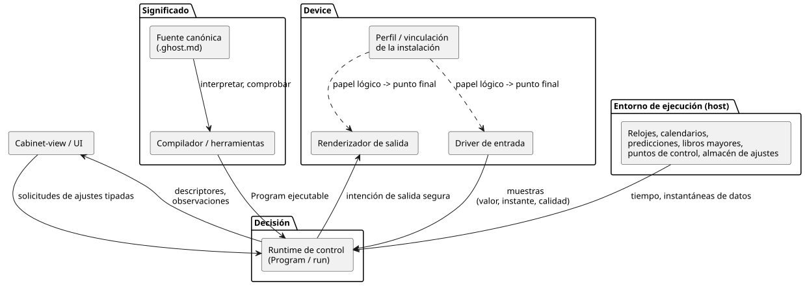
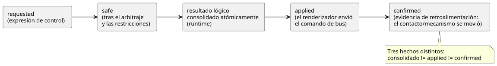

<!-- translation-source: docs/reference/08-language-runtime-and-device-boundaries.en.md -->
[Original en inglés](08-language-runtime-and-device-boundaries.en.md)

# 8. Requisitos de las FAQ y responsabilidades del lenguaje, la ejecución y los dispositivos

[Índice completo](../LANGUAGE-REFERENCE.es.md) · [Anterior: Reglas de preservación semántica e índice](07-semantic-rules-and-index.es.md)

Este capítulo toma los requisitos de las [FAQ de programación](../language_faq.es.md) y asigna cada parte a la capa que debe hacerse cargo de ella: el lenguaje, las herramientas, el runtime, el entorno de ejecución, el driver, las conexiones de la instalación o la interfaz de usuario (UI).

Lo que este capítulo **no** hace:

- No informa sobre el avance de la implementación.
- No indica en qué lugar de un repositorio concreto se encuentra el código.

La sintaxis y la semántica de cada función se definen en las secciones enlazadas de la Referencia. Si un boceto de diseño anterior usa una notación distinta, use la notación establecida en esta Referencia.

**En este capítulo**

- §8.1: el principio, es decir, el significado frente a los medios de ejecución.
- §8.2: de qué se encarga cada capa, con un diagrama de fronteras.
- §8.3: cada FAQ (1–41) asignada a sus responsabilidades.
- §8.4: fronteras que deben respetar funciones concretas.
- §8.5: qué cambia, qué se reinicia y qué persiste, y quién se encarga de ello.
- §8.6: qué decisiones fija el lenguaje y cuáles toma el autor.
- §8.7: una lista de comprobación para clasificar nuevos requisitos.

## 8.1 Principio de clasificación: significado y medios de ejecución

**El lenguaje define qué significa un programa. El runtime toma decisiones de acuerdo con ese significado.** Los drivers de entrada y el entorno de ejecución suministran los hechos y el tiempo que necesitan las decisiones. Los renderizadores (renderers) de salida aplican los efectos de las salidas. Si una operación dada se ejecuta dentro de una VM o se calcula en un adaptador del host es una cuestión distinta de quién es el responsable de su significado.

*Ejemplo.* "Arrancar una vez al día a las 6 a. m., hora local" es un significado de programación definido por el lenguaje. De dónde provienen el reloj y los datos de zona horaria es tarea del entorno de ejecución. Incluso cuando un adaptador suministra las ocurrencias de la programación, la supresión de duplicados, las observaciones omitidas y el tratamiento del DST deben seguir el mismo contrato del lenguaje. Las pantallas y los drivers no deben reinterpretar con reglas propias si se debe arrancar.

Fragmentos de las FAQ como `input is_holiday: Bool` e `input used: Duration` muestran **cómo consumir un valor**. Una declaración por sí sola no crea una calculadora de días festivos ni un registro de uso. Para dar soporte completo a un requisito así, también se necesita un contrato para el productor de la entrada: su significado, validez, temporización y recuperación.

Algunas decisiones corresponden al usuario, no al lenguaje. Por ejemplo:

- Qué dispositivo se mueve después de una cancelación.
- Si la limpieza se realiza una vez al día.
- Si una duración de operación modificada se aplica también al trabajo que ya está en curso.

Estas son decisiones que se toman en el programa escrito. Ninguna necesita una nueva palabra clave ni un modo de control integrado.

**Por qué:** Añadir sintaxis no hace aparecer un reloj ni una retroalimentación física. A la inversa, no basta con un driver capaz de leer valores: sin una semántica del programa para el tiempo, los errores y el estado, no es posible explicar un control coherente.

## 8.2 Responsabilidades de las capas

Dos papeles conectan el programa con el mundo físico:

- Un **driver** de entrada produce entradas lógicas.
- Un **renderizador** (renderer) de salida aplica la intención lógica de salida a relés, motores, lámparas o pantallas.

Son *papeles*, no clases de dispositivo mutuamente excluyentes. Un joystick USB con retroalimentación de fuerza tiene a la vez un driver de entrada y un renderizador de salida. Un codificador EC11 con pantalla TFT combina igualmente papeles de entrada y de salida. Estos ejemplos ilustran la frontera; no son implementaciones.

Responsabilidad sobre el código y las políticas relacionados:

- El código fuente de drivers y renderizadores pertenece a `farm-device-drivers`.
- Device se encarga de la integración con el host/placa, de las vinculaciones (bindings), de los relojes, de los watchdogs y de la política de arranque/fallo.
- La interfaz de operador del gabinete es `@ghostflow/cabinet-view`. Es distinta de un renderizador de salida.
- `ScanDriver`, los identificadores de la ABI del host y los campos `driver` de los perfiles existentes conservan sus nombres y contratos.

El diagrama siguiente muestra cómo se conectan las capas. El significado fluye desde la fuente canónica, a través de las herramientas, hasta el runtime. Los hechos y el tiempo llegan al runtime desde el entorno y los drivers de entrada. La intención de salida segura sale hacia los renderizadores. Las vinculaciones conectan los papeles lógicos con los puntos finales reales. La UI solo lee descriptores y observaciones, y envía solicitudes tipadas.

| Capa | Responsabilidades requeridas | Frontera con otras capas |
|---|---|---|
| Especificación del lenguaje | Significado de los tipos, las transiciones de estado, el tiempo, los errores, los ajustes y la intención de salida; límites de recursos y reglas de fallo | No convierta direcciones de dispositivos, el aspecto de la UI ni los medios de almacenamiento en sintaxis de control. |
| Compilador/herramientas | Interpretar documentos canónicos; comprobar tipos, nombres y ramas; transformarlos en representaciones ejecutables; preservar las declaraciones, la intención y las descripciones de los ajustes | Una comprobación estática de tipos por sí sola no demuestra el cableado físico ni el funcionamiento real. |
| Runtime de control | Evaluar el estado, las expresiones, los temporizadores y las restricciones a partir de instantáneas de entrada, y consolidar los resultados de forma atómica; mantener las posiciones de ejecución de los eventos de ajustes y de las observaciones | No añada políticas del programa por su cuenta ni trate las salidas como confirmación física. |
| Entorno de ejecución/proveedores de datos | Relojes y su fiabilidad; datos de fechas y de eventos naturales; ciclos de vida de la ejecución; almacenamiento y restauración de ajustes, puntos de control (checkpoints) y registros de la instalación | Exponga la revisión, el alcance, la validez y los fallos de los datos suministrados. No cree un lenguaje de control aparte. |
| Driver de entrada / renderizador de salida | Driver de entrada: comunicación con el dispositivo, interpretación/normalización de señales en bruto, identidad/instante/calidad de las muestras. Renderizador de salida: aplicar las salidas lógicas e informar de los resultados, bajo la política de arranque/fallo de Device | No oculte secuencias de control, enclavamientos ni políticas de fechas fuera de la fuente. |
| Perfil/vinculación de la instalación | Conectar papeles lógicos con puntos finales reales; compatibilidad, como capacidad, polaridad y rango; revisión de la instalación | Distinga un cambio que solo afecta a la conexión de un cambio en las reglas de la fuente. |
| Cabinet-view / UI | Editar y mostrar usando los tipos, etiquetas, rangos y permisos descritos; enviar solicitudes tipadas; mostrar resultados y errores | No regenere el significado de control con temporizadores, agregaciones o decisiones de restricciones propias. |

Aquí, el **entorno de ejecución (host) es el dispositivo o proceso que ejecuta el programa de control**. No requiere una pasarela Android ni un servicio en la nube. Un dispositivo que dispone localmente de los relojes y los datos válidos necesarios puede cumplir el contrato sin acceso a Internet. La desconexión de la red, el vencimiento de los datos y la hora desconocida son tres estados distintos.

Fundamento: [§1.1 Fuente canónica](01-source-and-syntax.es.md#11-por-qué-un-solo-documento-es-la-fuente), [§2.8 Semántica de ejecución](02-types-expressions-state.es.md#28-tick-e-instantánea-de-estado), [§4.2 Contratos de entrada](04-sensors-constraints-control.es.md#42-contratos-de-muestreo-y-orden-de-procesamiento-del-sensor), [§5.3 Modelo de observación](05-settings-and-observation.en.md#53-cabinet-view-independent-observation-model), [§6.2 Conexiones lógicas](06-composition-and-replay.en.md#62-definitions-instances-and-logical-ports).

## 8.3 Tabla completa de responsabilidades de las FAQ

Esta tabla asigna cada una de las FAQ 1–41 a una fila. Aquí, "requisitos" significa responsabilidad contractual, no estado de implementación. Las responsabilidades comunes a todos los drivers, renderizadores e interfaces siguen §8.2; cada fila enumera solo las responsabilidades externas más importantes para ese requisito.

| FAQ y requisito | Requisitos del lenguaje/compilador | Requisitos del runtime | Requisitos del entorno de ejecución/driver/renderizador/instalación/UI |
|---|---|---|---|
| [1](../language_faq.es.md#q01), [41](../language_faq.es.md#q41) Documento canónico/herramientas del compilador | Interpretación literate; preservar y comprobar las ubicaciones de la fuente y de la intención (§1) | Ejecutar el Program identificado | Las herramientas conservan y entregan documentos y revisiones completos; una comprobación de compilación es distinta de verificar el comportamiento físico |
| [2](../language_faq.es.md#q02), [3](../language_faq.es.md#q03), [18](../language_faq.es.md#q18) Botones/autorretención | Bool, estado anterior/siguiente (§2.8) | Evaluar y consolidar a partir de instantáneas las condiciones de rearranque escritas | El driver suministra el significado de "pulsado"; conectar botones reales o entradas de software declaradas explícitamente |
| [4](../language_faq.es.md#q04)–[6](../language_faq.es.md#q06) Operación temporizada/retardos | Duration, elapsed por estado (§3.2) | Tiempo monotónico y estado de los temporizadores | El entorno de ejecución suministra tiempo monotónico y oportunidades de decisión |
| [8](../language_faq.es.md#q08), [19](../language_faq.es.md#q19) Comportamiento secuencial/posterior a la cancelación | enum/case y expresiones de salida por estado (§2.4, §2.8) | Transiciones de estado por tick que siguen la secuencia escrita y la prioridad de cancelación | El driver suministra la retroalimentación de parada/posición de origen; lo que ocurre después es política del programa |
| [9](../language_faq.es.md#q09), [10](../language_faq.es.md#q10) Condiciones de sensores/control de tanque | Result, umbrales, filtros, histéresis, estado (§4.1–4.3) | Identificar muestras nuevas; evaluar la frescura, la recuperación y el estado de los filtros | El driver suministra valores, unidades, instantes de muestreo y calidad |
| [11](../language_faq.es.md#q11) Conteos | Enteros exactos, estado anterior de la entrada, condiciones (§2.3, §2.8) | Mantener las expresiones de flanco, límite e inicialización escritas y la semántica de errores de enteros | El productor de la entrada suministra eventos observables; los ticks de un mismo pulso largo no se cuentan como eventos |
| [13](../language_faq.es.md#q13) Retención de alarmas | Estado y condiciones Bool; el significado de las alarmas públicas es aparte (§5.3) | Evaluar las expresiones de latch/reinicio escritas; preservar el significado de activación/desactivación de las alarmas explícitas | La UI muestra el estado de la alarma; los medios de notificación y registro son decisiones externas |
| [14](../language_faq.es.md#q14), [17](../language_faq.es.md#q17) Enclavamientos | require/exclusión mutua; la restricción de estados es distinta de la restricción de salidas (§4.7) | Decisiones requested→safe | El renderizador de salida aplica los efectos; el driver de entrada suministra la retroalimentación; una restricción lógica no es un dispositivo físico de parada de emergencia |
| [16](../language_faq.es.md#q16) Reutilización de cálculos | Funciones puras, tipos, ámbitos de nombres (§2.7) | Mismo cálculo para las mismas entradas | No ponga acceso a dispositivos ni estado oculto en funciones puras |
| [7](../language_faq.es.md#q07), [15](../language_faq.es.md#q15), [20](../language_faq.es.md#q20) Programaciones por hora del reloj/amanecer | DailySlots/Solar, desfases, ocurrencia separada de la operación (§3.5–3.9) | Tratamiento de ocurrencias y supresión de duplicados según el contrato; temporizadores de operación | Suministrar relojes, ubicación, zonas horarias y datos de eventos naturales; preservar los registros de ocurrencias |
| [21](../language_faq.es.md#q21), [27](../language_faq.es.md#q27)–[29](../language_faq.es.md#q29) Días de la semana/festivos/DST | Filtros y condiciones de fecha; semántica de gap/fold y de Unknown (§3.8) | Aplicar las mismas decisiones de fecha y políticas de admisión | Suministrar datos de calendario y de zona horaria con revisiones y cobertura; mostrar los ajustes seleccionables en la UI |
| [30](../language_faq.es.md#q30), [31](../language_faq.es.md#q31) Mareas/luna | Distinción de tipos entre eventos puntuales y condiciones de intervalo; desfases/fallback (§3.9) | Preservar los ID de eventos, las revisiones, las omisiones y el significado de la operación en curso | El proveedor de predicciones suministra estación/modelo, revisión, cobertura, vencimiento e ID de eventos estables |
| [22](../language_faq.es.md#q22), [23](../language_faq.es.md#q23) Duración acumulada/limpieza diaria | Sujeto y periodo de agregación, conteos exactos, estado/enum (§3.4, §3.10) | Evaluar las condiciones y la secuencia de limpieza escritas usando instantáneas de agregación válidas | El entorno actualiza, almacena y restaura el libro mayor (ledger) usando una identidad de instalación compartida y evidencia applied/confirmed; las políticas que elige el autor están en §8.6 |
| [12](../language_faq.es.md#q12), [24](../language_faq.es.md#q24), [26](../language_faq.es.md#q26) Cambios de duración/rango | Tipo/valor predeterminado/min/max/step/access de config y descriptor (§5.1–5.2) | Validar la solicitud completa y aplicarla de forma atómica y en vivo; conservar el estado y los temporizadores | La UI envía solicitudes tipadas; la frontera de ejecución comprueba los permisos; el entorno persiste los ajustes ordinarios |
| [25](../language_faq.es.md#q25) Etiquetas/UI de entrada | label y metadatos semánticos (§5.1, §5.3) | Suministrar valores efectivos, revisiones y resultados de rechazo | Cabinet-view elige campos de hora, listas o deslizadores; todas las rutas aplican la misma validación |
| [32](../language_faq.es.md#q32) Recuperación tras un corte de energía | Valores iniciales, transiciones de estado, identidad de ejecución (§2.8, §5.2) | Nueva ejecución (run); la inicialización/restauración especificada; evaluar la condición de reanudación escrita | El entorno suministra puntos de control y causas de reinicio; la política de salidas de Device y el renderizador gestionan las salidas antes de la primera decisión |
| [33](../language_faq.es.md#q33)–[36](../language_faq.es.md#q36) Reemplazo/ciclo de vida/especificación de sensores | Contratos lógicos de dispositivo; el Program sigue siendo el mismo en un reemplazo compatible (§6.2–6.3) | Evaluar con las mismas reglas las entradas que cumplen el contrato | Gestionar los cambios de driver, las revisiones de vinculación de la instalación y la compatibilidad; la 36 es el fundamento de estos principios, no una solicitud de nueva sintaxis |
| [37](../language_faq.es.md#q37)–[40](../language_faq.es.md#q40) GPIO/relés/E/S ampliadas | Puertos lógicos independientes de la ubicación del dispositivo (§6.2–6.3) | Preservar los contratos de entrada y de salida segura | Cada driver/renderizador gestiona los buses, direcciones, canales, polaridad y fallos de su papel; la vinculación selecciona los puntos finales reales |

Un rango incluye todas las FAQ que abarca. Por ejemplo, 27–29 significa 27, 28 y 29. Capítulos relacionados: [2](02-types-expressions-state.es.md), [3](03-time-and-schedules.es.md), [4](04-sensors-constraints-control.es.md), [5](05-settings-and-observation.es.md), [6](06-composition-and-replay.es.md).

## 8.4 Fronteras que debe preservar cada función

### Composición de control ordinaria y funciones integradas

La autorretención, el llenado de tanques y la cancelación específica de cada etapa se construyen componiendo funciones existentes: estado, Bool, enum y case. El runtime proporciona la semántica de las transiciones de estado; el autor elige las políticas de rearranque, cancelación y finalización. No oculte una secuencia aparte de autorretención o de cancelación dentro de un driver.

Algunas aclaraciones sobre los ejemplos de las FAQ:

- El latch (retención) de alarma Bool de las FAQ no se convierte automáticamente en un registro de alarmas ni en un servicio de notificación externo.
- En la FAQ 11, `done` es un valor Bool que permanece verdadero después de que el conteo llega a 3. No es un pulso de finalización de un solo disparo.
- El conteo se detiene en 3 por la expresión de condición de ese ejemplo, no porque la aritmética de Int se sature.
- Un contador de flancos cuenta los cambios de entrada que observa el runtime. Para contar pulsos físicos que suben y bajan *entre* decisiones, se necesita un contrato de captura y entrega con el driver o el productor de la entrada. Los tipos de entero exacto por sí solos no garantizan que no se pierda ningún evento físico.

**Por qué:** Una instrucción especial para cada aplicación obligaría a mantener las mismas transiciones de estado con varios significados. Fundamento: [§2.8](02-types-expressions-state.es.md#28-tick-e-instantánea-de-estado), [§5.3 Eventos y alarmas](05-settings-and-observation.en.md#events-command-results-and-alarms).

### Decisiones temporales y suministro de datos

El lenguaje distingue el tiempo monotónico de las fechas locales y define el DST, el fallback y la identidad de las ocurrencias. El entorno de ejecución suministra hora, calendarios y predicciones fiables. Parte del cálculo de la programación puede ejecutarse en un adaptador, pero los mismos datos, horas y registros deben seguir produciendo los mismos resultados. No reduzca las entradas generadas a pulsos Bool arbitrarios que hayan perdido su causa y su revisión.

**Por qué:** Cambiar la forma de obtener el reloj no debe cambiar lo que significan la ejecución duplicada, las omisiones o las duraciones de operación. Fundamento: [§3.1](03-time-and-schedules.es.md#31-valores-de-tiempo-y-dominios-de-reloj), [§3.5](03-time-and-schedules.es.md#35-semántica-común-de-schedule), [§3.9](03-time-and-schedules.es.md#39-sol-luna-y-mareas).

### Uso acumulado y almacenamiento persistente

El contrato del lenguaje especifica:

- qué se cuenta (requested, safe, applied o confirmed);
- el alcance y los límites de fecha;
- la inicialización y el estado desconocido.

Un contador de flancos interno de un control puede calcularse con estado ordinario. Un libro mayor (ledger) persistente de la instalación que abarca varios controles y modos es distinto. Los proveedores del entorno de ejecución lo actualizan, almacenan y restauran usando una identidad de instalación estable junto con la evidencia de aplicación de los renderizadores y la evidencia de confirmación de los drivers de entrada. Suministran al runtime de control instantáneas de agregación identificadas.

- La agregación pura calculada dentro de un proveedor sigue el mismo contrato del lenguaje. El medio de almacenamiento no cambia lo que significa un agregado.
- El uso de un dispositivo no es la suma de sus solicitudes de control automático y manual.
- No sustituya el uso de la instalación por el tiempo acumulado de pantalla encendida.

**Por qué:** La memoria temporal de ejecución y los registros de la instalación que deben sobrevivir a un reinicio tienen ciclos de vida distintos. Fundamento: [§3.4](03-time-and-schedules.es.md#34-tiempo-acumulado-y-presupuesto-en-ventana-móvil), [§3.10](03-time-and-schedules.es.md#310-restricciones-de-uso-basadas-en-el-tiempo).

### Ajustes, validación y pantallas

El lenguaje declara los tipos, los rangos permitidos, los incrementos, los permisos y las etiquetas, y las herramientas preservan estas descripciones. La frontera de ejecución valida cada solicitud en su totalidad. Después, el runtime aplica los valores aprobados de forma atómica dentro del mismo Program y de la misma ejecución (run).

- La validación previa en la UI por sí sola no constituye una aprobación. Se aplican las mismas condiciones aunque cambien los componentes de la UI.
- Si el trabajo en curso lee una nueva duración o conserva el valor con el que empezó lo deciden las expresiones de control del programa.

**Por qué:** Cambiar un campo de entrada de hora por un deslizador no debe cambiar los valores permitidos ni los resultados de la ejecución. Fundamento: [§5.1](05-settings-and-observation.en.md#51-config-declarations), [§5.2](05-settings-and-observation.en.md#52-source-changes-and-operating-settings-changes).

### Independencia del dispositivo y efectos reales

Un Program compilado usa papeles lógicos. Las GPIO directas, los canales de expansión y las direcciones de dispositivos RS485 pertenecen a las vinculaciones de la instalación y a los drivers/renderizadores.

- Un reemplazo compatible por sí solo no requiere editar la fuente ni recompilar.
- Añadir un puerto lógico o un nuevo comportamiento de control *sí* es un cambio de la fuente.
- Consolidar un resultado lógico de forma atómica, aplicar un comando de bus y confirmar que un contacto o mecanismo se movió realmente son tres hechos distintos.

El diagrama siguiente muestra estos hechos como etapas sucesivas. Cada etapa es una evidencia separada; una etapa posterior nunca se deduce de una anterior.

**Por qué:** Abstraer el acceso a los dispositivos no hace desaparecer los retardos ni los fallos físicos. Fundamento: [§4.7](04-sensors-constraints-control.es.md#47-requested-safe-applied-confirmed), [§6.3 Reemplazo compatible](06-composition-and-replay.en.md#compatible-device-replacement-and-independence-from-recompilation).

## 8.5 Ciclos de vida de los cambios y los reinicios

Los distintos tipos de cambio tienen responsables distintos y efectos distintos sobre las revisiones, las ejecuciones y la persistencia.

| Cambio o dato | Responsable del significado | Frontera de revisión/ejecución/persistencia |
|---|---|---|
| Expresiones de control, filtros de sensores, stale_after, valores predeterminados de la fuente | El lenguaje y la fuente canónica | Nueva revisión de la fuente; un nuevo candidato a Program cuando cambian las reglas ejecutables |
| Valores de config efectivos del operador | Contrato de ajustes en vivo del lenguaje | Mismo Program y misma ejecución, nueva revisión de ajustes; los ajustes ordinarios sobreviven a un reinicio real |
| Conexiones compatibles de sensores/GPIO/relés/canales de bus | Vinculación de la instalación y driver/renderizador | Cambia la revisión correspondiente de la instalación/del driver; se reutiliza el mismo Program, pero no se garantiza una operación ininterrumpida ni la misma ejecución |
| Memoria interna de estado/temporizadores/filtros | Semántica de ejecución del lenguaje | Se actualiza durante la ejecución; restaurarla tras un reinicio requiere una política explícita y un contrato de puntos de control |
| Registros de supresión de duplicados de la programación/uso de la instalación | Contrato de registros de la instalación del lenguaje y entorno de ejecución | Ciclo de vida independiente de la inicialización del estado ordinario y del reemplazo de la fuente; nunca se inicializan sin un contrato |
| Datos de calendario/predicción de mareas | El proveedor y el contrato temporal que los consume | Conservar las revisiones de los datos, la cobertura, el vencimiento y la identidad de los eventos |
| Declaraciones de etiquetas / aspecto de los componentes | Metadatos de la fuente / Cabinet-view | Editar una etiqueta en la fuente cambia la revisión del documento; el aspecto de la pantalla no cambia el significado de control |

Esta distinción no prescribe un número de archivos. La regla de que `.ghost.md` es la fuente canónica es independiente de los formatos de almacenamiento: cada entorno decide cómo almacenar la información de la instalación, las sobrescrituras de ajustes y los registros de ejecución. No trate como el mismo tipo de actualización las actualizaciones de firmware, las de drivers, el reemplazo del Program y los cambios de ajustes.

De forma predeterminada, los sensores, los filtros y la frescura se reinician tras un rearranque y vuelven a empezar desde `NotReady`. Reanudar de forma persistente el estado de los sensores es una elección explícita y requiere verificar la continuidad de la fuente y del tiempo. Disponer de un punto de control ordinario no es, por sí solo, motivo para restaurar valores normales antiguos ni la continuidad de los filtros.

Fundamento: [§4.2 Recuperación de sensores](04-sensors-constraints-control.es.md#42-contratos-de-muestreo-y-orden-de-procesamiento-del-sensor), [§5.2](05-settings-and-observation.en.md#52-source-changes-and-operating-settings-changes), [§5.4](05-settings-and-observation.en.md#54-identity-and-physical-fact-boundaries), [§6.3](06-composition-and-replay.en.md#63-parameters-settings-dependencies-and-bindings).

## 8.6 Decisiones del lenguaje y políticas elegidas por el autor

El lenguaje define los tipos, la sintaxis, la evaluación y las fronteras temporales. Los valores concretos de las políticas de operación siguientes los eligen los autores de programas o los operadores de la instalación.

- Una declaración que omite un valor de política requerido se rechaza.
- La UI y el runtime no deben inventar una política de operación automática en nombre del usuario.

| FAQ de destino | Contrato del lenguaje establecido | Lo que suministra el autor o el entorno de ejecución |
|---|---|---|
| 11, 23 Conteos exactos | §2.3 Int, conversiones explícitas, reglas de error | Qué cuenta como una ocurrencia; si se incluye la limpieza; cada N ocurrencias o una vez al día |
| 21, 27–29 Días de la semana/festivos/DST | §3.8 contratos de fecha/calendario/gap/fold | Zona horaria del sitio; qué calendario y qué revisión; qué hacer en horas repetidas u omitidas |
| 24 Duraciones de operación/horas de programación | La config de Duration y los ajustes de franjas tipados de §3 son tipos distintos; ambos son eventos atómicos en vivo | Qué ajustes exponer; sus rangos; duraciones de operación y horas de programación reales |
| 30–31 Mareas/luna | §3.9 eventos, periodos, fallback, identidad de las ocurrencias | Ubicación y datos de predicción; clasificación de mareas vivas/muertas; acciones permitidas cuando faltan datos |
| 22 Duración acumulada | §3.4/§3.10 alcance, agregación, límites, registros persistentes | Base de evidencia, como applied o confirmed; límites y tratamiento de los intervalos desconocidos; medio de almacenamiento |
| 23 Conteos diarios/limpieza | Se compone a partir de conteos exactos, límites de fecha, etapas y memoria de solicitudes | Secuencia de limpieza, dispositivos, condiciones de interrupción y qué cuenta como una limpieza completada |
| 32 Reanudación tras un corte de energía | §5.2 nueva ejecución, inicialización, entrada de causa, restauración explícita de puntos de control | Reanudar automáticamente o esperar un nuevo arranque; alcance de restauración permitido; salidas físicas en el arranque |
| 33 Sensores de temperatura | §2.9 tipos de magnitudes físicas/unidades y Result de §4 | Dispositivos y drivers que cumplen el contrato lógico, y evidencia de la instalación real |
| 34–40 Conexiones/reemplazo | §6.2–6.4 puertos lógicos, vinculaciones externas, independencia de la recompilación | Formato de almacenamiento de la instalación; pines/direcciones reales; cómo se despliegan los drivers/renderizadores |

Las decisiones de operación de esta tabla **no** son cuestiones abiertas del diseño del lenguaje. Fijar una única respuesta global cambiaría la intención de distintas instalaciones, por lo que siguen siendo argumentos explícitos de la fuente o del contrato de la instalación. Del mismo modo, los medios de almacenamiento, los componentes de la UI y los protocolos de comunicación no son requisitos previos para decidir la sintaxis del lenguaje.

### Elementos que no sustituyen el criterio del usuario

- Si se rearranca tras un corte de energía, un fallo o una cancelación, y qué dispositivos se mueven realmente.
- Duraciones de operación, conteos, condiciones de limpieza, zonas horarias, calendarios, datos de eventos naturales y acciones alternativas.
- Calidad de sensor permitida, antigüedad máxima, tolerancia de estimación y criterios de retroalimentación física.
- Espera, preferencia (preemption) y permisos para los recursos compartidos; consignas, ganancias, límites de salida y comportamiento ante fallos de PI/PID.
- Valores y ciclos de vida de los ajustes temporales; rango, velocidad y permisos de aprobación de la corrección automática.

Al escribir un programa que necesite estos valores, confirme la intención del usuario. No es necesario elegir ahora valores específicos del sitio para definir la sintaxis, los tipos y las reglas de error.

Fundamento: [§2.3](02-types-expressions-state.es.md#23-diseño-de-enteros-exactos), [§2.9](02-types-expressions-state.es.md#29-magnitudes-físicas-y-unidades), [Contratos de tiempo del capítulo 3](03-time-and-schedules.es.md), [§5.2 Ciclos de vida](05-settings-and-observation.en.md#lifecycle-and-temporary-settings).

## 8.7 Clasificación de nuevos requisitos

Siga estos pasos en orden:

1. Compruebe si el requisito es una política del usuario que puede componerse a partir de expresiones, estado y temporizadores existentes.
2. Si añade un significado que debe ser idéntico en todos los entornos de ejecución, escriba explícitamente el contrato del lenguaje y su Por qué.
3. Para cada entrada de tiempo, sensor, calendario, predicción y agregación, identifique su productor, su validez, sus errores y sus revisiones.
4. Separe la memoria del runtime de los registros que deben conservarse tras un reinicio.
5. Conecte las conexiones reales de los dispositivos y los efectos de salida mediante contratos de driver/renderizador y de vinculación.
6. Proporcione a la UI descriptores y observaciones con el mismo significado, y deje a la UI los métodos de visualización y de entrada.

**Criterio de decisión:** Dados el mismo Program, las mismas entradas, el mismo tiempo lógico, los mismos eventos de ajustes y el mismo estado inicial, debe poder explicarse la misma decisión de control. Si el tipo de dispositivo o de UI introduce una diferencia oculta en esa decisión, la frontera entre la semántica del lenguaje y las responsabilidades del entorno no está suficientemente definida. Fundamento: [§6.8 Reproducción (replay)](06-composition-and-replay.en.md#68-replay-ghost-and-branches), [§7 Preservación semántica](07-semantic-rules-and-index.es.md).

[Índice completo](../LANGUAGE-REFERENCE.es.md) · [Capítulo anterior](07-semantic-rules-and-index.es.md)
