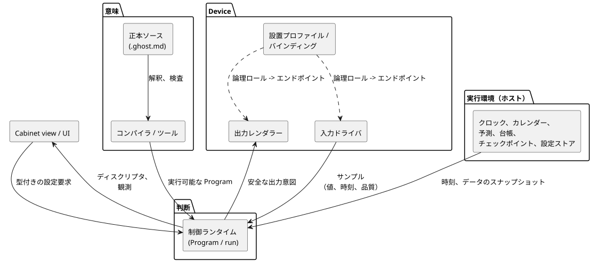
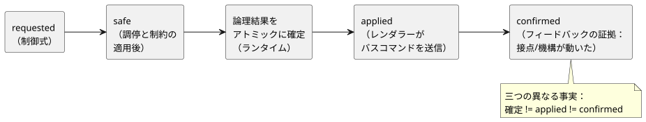

<!-- translation-source: docs/reference/08-language-runtime-and-device-boundaries.en.md -->
[英語の原文](08-language-runtime-and-device-boundaries.en.md)

# 8. FAQの要件と、言語・実行・デバイスの責任

[全体の目次](../LANGUAGE-REFERENCE.ja.md) · [前へ：意味保存の規則と索引](07-semantic-rules-and-index.ja.md)

この章では、[コーディングFAQ](../language_faq.ja.md)の要件を取り上げ、その各部分を、それを担うべき層に割り当てます。層とは、言語、ツール、ランタイム、実行環境、Driver、設備の接続、UIです。

この章で扱わ**ない**こと：

- 実装の進捗は報告しません。
- 特定のリポジトリのどこにコードがあるかは示しません。

各機能の構文と意味論は、リンク先のリファレンスの節で定義されています。以前の設計スケッチが異なる表記を使っている場合は、このリファレンスで確定した表記を使ってください。

**この章の内容**

- §8.1 — 原則：意味と実行手段。
- §8.2 — 各層が担うもの（境界の図つき）。
- §8.3 — すべてのFAQ（1–41）と、その責任の対応。
- §8.4 — 特定の機能が守らなければならない境界。
- §8.5 — 何が変わり、何が再起動し、何が永続するか、そしてそれを誰が担うか。
- §8.6 — 言語が固定する選択と、作成者が行う選択。
- §8.7 — 新しい要件を分類するためのチェックリスト。

## 8.1 分類の原則：意味と実行手段

**言語はプログラムが何を意味するかを定義します。ランタイムはその意味に従って判断します。** 入力ドライバと実行環境は、判断に必要な事実と時刻を供給します。出力レンダラーは出力の効果を適用します。ある演算がVMの中で実行されるか、ホストアダプタで計算されるかは、その意味を誰が担うかとは別の問題です。

*例。*「毎日現地時刻の午前6時に1回開始する」は、言語が定義するスケジュールの意味です。クロックとタイムゾーンのデータをどこから得るかは、実行環境の仕事です。アダプタがスケジュールの発生（オカレンス）を供給する場合でも、重複抑止、取りこぼした観測、DSTの処理は同じ言語契約に従わなければなりません。画面やDriverが、独自の規則で開始するかどうかを解釈し直してはいけません。

`input is_holiday: Bool`や`input used: Duration`のようなFAQの断片は、**値をどう利用するか**を示しています。宣言だけでは、祝日の計算器や使用量の記録は生まれません。このような要件を完全に支えるには、その入力の生成元についての契約、つまり意味、有効性、タイミング、復旧も必要です。

一部の選択は言語ではなくユーザーに属します。例：

- キャンセルの後にどのデバイスが動くか。
- 清掃を1日1回行うかどうか。
- 変更した運転時間を、進行中の作業にも適用するかどうか。

これらは作成されたプログラムの中で行う選択です。どれも新しいキーワードや組み込みの制御モードを必要としません。

**理由：** 構文を追加してもクロックや物理的なフィードバックが現れるわけではありません。逆に、値を読めるDriverがあるだけでは足りません。時間、エラー、状態についてのプログラムの意味論がなければ、一貫した制御を説明できません。

## 8.2 層ごとの責任

プログラムを物理世界につなぐ役割は二つあります。

- 入力**ドライバ**は論理入力を生成します。
- 出力**レンダラー**は論理的な出力意図を、リレー、モーター、ランプ、画面に適用します。

これらは*役割*であり、互いに排他的なデバイスの分類ではありません。USBのフォースフィードバック・ジョイスティックは、入力ドライバと出力レンダラーの両方を持ちます。TFTディスプレイ付きのEC11エンコーダも同様に、入力と出力の役割を兼ねます。これらの例は境界を説明するためのもので、実装ではありません。

関連するコードとポリシーの所有：

- Driverとレンダラーのソースは`farm-device-drivers`に置きます。
- Deviceは、ホスト/ボードの統合、バインディング、クロック、ウォッチドッグ、起動/故障時のポリシーを担います。
- キャビネットのオペレーター向けUIは`@ghostflow/cabinet-view`です。これは出力レンダラーとは別物です。
- 既存の`ScanDriver`、ホストABIの識別子、プロファイルの`driver`フィールドは、名前と契約をそのまま保ちます。

次の図は、層どうしのつながりを示しています。意味は正本ソースからツールを通ってランタイムへ流れます。事実と時刻は、環境と入力ドライバからランタイムへ流れ込みます。安全な出力意図はレンダラーへ流れ出ます。バインディングは論理的な役割を実際のエンドポイントに結び付けます。UIはディスクリプタと観測を読み、型付きの要求を送信するだけです。

| 層 | 必須の責任 | 他の層との境界 |
|---|---|---|
| 言語仕様 | 型、状態遷移、時間、エラー、設定、出力意図の意味。リソースの上限と故障時の規則 | デバイスのアドレス、UIの見た目、記憶媒体を制御構文にしてはいけません。 |
| コンパイラ/ツール | 正本文書を解釈する。型、名前、分岐を検査する。実行可能な表現に変換する。宣言、意図、設定の説明を保持する | 静的な型検査だけでは、物理的な配線や実際の動作は証明されません。 |
| 制御ランタイム | 入力スナップショットから状態、式、タイマー、制約を評価し、結果をアトミックに確定する。設定イベントと観測の実行位置を保持する | 独自にプログラムのポリシーを加えてはいけません。出力を物理的な確認として扱ってはいけません。 |
| 実行環境/データプロバイダ | クロックとその信頼性。日付と自然現象のデータ。実行の寿命。設定、チェックポイント、設置記録の保存と復元 | 供給するデータのリビジョン、範囲、有効性、故障を公開します。別の制御言語を作ってはいけません。 |
| 入力ドライバ / 出力レンダラー | 入力ドライバ：デバイスとの通信、生の信号の解釈/正規化、サンプルの同一性/時刻/品質。出力レンダラー：Deviceの起動/故障時のポリシーのもとでの論理出力の適用と結果の報告 | 制御シーケンス、インターロック、日付のポリシーをソースの外に隠してはいけません。 |
| 設置プロファイル/バインディング | 論理的な役割を実際のエンドポイントに接続する。ケイパビリティ、極性、範囲などの互換性。設置リビジョン | 接続だけの変更と、ソースの規則の変更を区別します。 |
| Cabinet view / UI | 記述された型、ラベル、範囲、権限に従って編集と表示を行う。型付きの要求を送信する。結果とエラーを表示する | 独自のタイマー、集計、制約判断で制御の意味を作り直してはいけません。 |

ここでいう**実行環境（ホスト）は、制御プログラムを実行するデバイスまたはプロセス**です。Androidゲートウェイやクラウドサービスを必要とはしません。必要なクロックと有効なデータをローカルに持つデバイスであれば、インターネット接続なしで契約を満たせます。ネットワークの切断、データの期限切れ、時刻不明は、それぞれ異なる三つの状態です。

根拠：[§1.1 正本ソース](01-source-and-syntax.ja.md)、[§2.8 実行の意味論](02-types-expressions-state.ja.md)、[§4.2 入力契約](04-sensors-constraints-control.ja.md)、[§5.3 観測モデル](05-settings-and-observation.ja.md)、[§6.2 論理的な接続](06-composition-and-replay.ja.md)。

## 8.3 FAQ全体の責任表

この表は、FAQ 1–41のそれぞれをいずれかの行に割り当てます。ここでいう「要件」は契約上の責任であり、実装状況ではありません。すべてのドライバ、レンダラー、UIに共通する責任は§8.2に従います。各行には、その要件にとって最も重要な外部の責任だけを挙げています。

| FAQと要件 | 言語/コンパイラの要件 | ランタイムの要件 | 実行環境/ドライバ/レンダラー/設備/UIの要件 |
|---|---|---|---|
| [1](../language_faq.ja.md#q01)、[41](../language_faq.ja.md#q41) 正本文書/コンパイラツール | 文芸的（literate）な解釈。ソースと意図の位置の保持と検査（§1） | 識別されたProgramを実行する | ツールは完全な文書とリビジョンを保持して届ける。コンパイルの検査は物理的な動作の検証とは別 |
| [2](../language_faq.ja.md#q02)、[3](../language_faq.ja.md#q03)、[18](../language_faq.ja.md#q18) ボタン/自己保持 | Bool、前状態/次状態（§2.8） | 作成された再起動条件をスナップショットから評価して確定する | Driverが「押された」の意味を供給する。実際のボタン、または明示的に宣言したソフトウェア入力を接続する |
| [4](../language_faq.ja.md#q04)–[6](../language_faq.ja.md#q06) 時間付きの動作/遅延 | Duration、状態ごとのelapsed（§3.2） | 単調時間とタイマーの状態 | 実行環境が単調時間と判断の機会を供給する |
| [8](../language_faq.ja.md#q08)、[19](../language_faq.ja.md#q19) 順次動作/キャンセル後の動作 | enum/caseと状態ごとの出力式（§2.4、§2.8） | 作成された順序とキャンセルの優先度に従った、tickごとの状態遷移 | Driverが停止/原点のフィードバックを供給する。次に何が起きるかはプログラムのポリシー |
| [9](../language_faq.ja.md#q09)、[10](../language_faq.ja.md#q10) センサ条件/タンク制御 | Result、しきい値、フィルタ、ヒステリシス、状態（§4.1–4.3） | 新しいサンプルを識別する。鮮度、復旧、フィルタの状態を評価する | Driverが値、単位、サンプル時刻、品質を供給する |
| [11](../language_faq.ja.md#q11) 回数 | 厳密な整数、前回の入力状態、条件（§2.3、§2.8） | 作成されたエッジ、上限、初期化の式と、整数エラーの意味論を保つ | 入力の生成元が観測可能なイベントを供給する。一つの長いパルスにまたがる複数のtickはイベントとして数えない |
| [13](../language_faq.ja.md#q13) アラームの保持 | Boolの状態と条件。公開アラームの意味は別（§5.3） | 作成されたラッチ/リセットの式を評価する。明示的なアラームの発生/解除の意味を保つ | UIがアラームの状態を表示する。通知や記録の媒体は外部の選択 |
| [14](../language_faq.ja.md#q14)、[17](../language_faq.ja.md#q17) インターロック | require/相互排他。状態の制限は出力の制限とは別（§4.7） | requested→safeの判断 | 出力レンダラーが効果を適用する。入力ドライバがフィードバックを供給する。論理的な制約は物理的な非常停止装置ではない |
| [16](../language_faq.ja.md#q16) 計算の再利用 | 純粋関数、型、名前のスコープ（§2.7） | 同じ入力には同じ計算 | 純粋関数の中にデバイスへのアクセスや隠れた状態を置かない |
| [7](../language_faq.ja.md#q07)、[15](../language_faq.ja.md#q15)、[20](../language_faq.ja.md#q20) 時刻/日の出のスケジュール | DailySlots/Solar、オフセット、発生と動作の分離（§3.5–3.9） | 契約に従った発生の処理と重複抑止。運転タイマー | クロック、位置、タイムゾーン、自然現象のデータを供給する。発生の記録を保持する |
| [21](../language_faq.ja.md#q21)、[27](../language_faq.ja.md#q27)–[29](../language_faq.ja.md#q29) 曜日/祝日/DST | 日付のフィルタと条件。gap/foldとUnknownの意味論（§3.8） | 同じ日付判断と受け入れポリシーを適用する | カレンダーとタイムゾーンのデータをリビジョンと範囲つきで供給する。選択可能な設定をUIに表示する |
| [30](../language_faq.ja.md#q30)、[31](../language_faq.ja.md#q31) 潮汐/月 | 時刻付きイベントと区間条件の型の区別。オフセット/フォールバック（§3.9） | イベントID、リビジョン、欠落、進行中の動作の意味を保つ | 予測プロバイダが観測点/モデル、リビジョン、範囲、有効期限、安定したイベントIDを供給する |
| [22](../language_faq.ja.md#q22)、[23](../language_faq.ja.md#q23) 累積時間/毎日の清掃 | 集計の対象と期間、厳密な回数、状態/enum（§3.4、§3.10） | 有効な集計スナップショットを使い、作成された清掃の条件と手順を評価する | 環境が、共通の設置同一性とapplied/confirmedの証拠を使って台帳を更新、保存、復元する。作成者が選ぶポリシーは§8.6 |
| [12](../language_faq.ja.md#q12)、[24](../language_faq.ja.md#q24)、[26](../language_faq.ja.md#q26) 時間/範囲の変更 | configの型/既定値/min/max/step/accessとディスクリプタ（§5.1–5.2） | 要求全体を検証し、アトミックかつライブに適用する。状態とタイマーを保つ | UIが型付きの要求を送信する。実行境界が権限を確認する。環境が通常の設定を永続化する |
| [25](../language_faq.ja.md#q25) ラベル/入力UI | labelと意味のメタデータ（§5.1、§5.3） | 有効値、リビジョン、拒否の結果を供給する | Cabinet viewが時刻フィールド、リスト、スライダーのいずれかを選ぶ。どの経路でも同じ検証を適用する |
| [32](../language_faq.ja.md#q32) 停電からの復旧 | 初期値、状態遷移、実行の同一性（§2.8、§5.2） | 新しいrun。指定された初期化/復元。作成された再開条件を評価する | 環境がチェックポイントと再起動の原因を供給する。最初の判断より前の出力は、Deviceの出力ポリシーとレンダラーが管理する |
| [33](../language_faq.ja.md#q33)–[36](../language_faq.ja.md#q36) センサの交換/ライフサイクル/仕様 | 論理的なデバイス契約。互換交換ではProgramは同じまま（§6.2–6.3） | 契約に適合した入力を同じ規則で評価する | Driverの変更、設置バインディングのリビジョン、互換性を管理する。36はこれらの原則の根拠であり、新しい構文の要求ではない |
| [37](../language_faq.ja.md#q37)–[40](../language_faq.ja.md#q40) GPIO/リレー/拡張I/O | デバイスの位置に依存しない論理ポート（§6.2–6.3） | 入力と安全な出力の契約を保つ | 各ドライバ/レンダラーが自分の役割のバス、アドレス、チャネル、極性、故障を扱う。バインディングが実際のエンドポイントを選ぶ |

範囲には、その中のすべてのFAQが含まれます。たとえば27–29は27、28、29を意味します。関連する章：[2](02-types-expressions-state.ja.md)、[3](03-time-and-schedules.ja.md)、[4](04-sensors-constraints-control.ja.md)、[5](05-settings-and-observation.ja.md)、[6](06-composition-and-replay.ja.md)。

## 8.4 各機能が守るべき境界

### 通常の制御の合成と組み込み機能

自己保持、タンクへの給水、段階ごとのキャンセルは、既存の機能である状態、Bool、enum、caseを組み合わせて作ります。ランタイムは状態遷移の意味論を提供し、作成者は再起動、キャンセル、完了のポリシーを選びます。独自の自己保持やキャンセルのシーケンスをDriverの中に隠してはいけません。

FAQの例についての補足：

- FAQのBoolのアラームラッチが、自動的にアラームの記録や外部の通知サービスになるわけではありません。
- FAQ 11の`done`は、回数が3に達した後もtrueのままのBool値です。一度だけの完了パルスではありません。
- 回数が3で止まるのはその例の条件式によるもので、Intの算術が飽和するからではありません。
- エッジカウンタは、ランタイムが観測した入力の変化を数えます。判断と判断の*間*に立ち上がって立ち下がる物理パルスを数えるには、Driverまたは入力の生成元との間に、捕捉と受け渡しの契約が必要です。厳密な整数型だけでは、物理イベントが失われないことは保証されません。

**理由：** アプリケーションごとに特別な命令を設けると、同じ状態遷移を複数の意味のもとで保守しなければならなくなります。根拠：[§2.8](02-types-expressions-state.ja.md)、[§5.3 イベントとアラーム](05-settings-and-observation.ja.md)。

### 時間の判断とデータの供給

言語は単調時間と現地の日付を区別し、DST、フォールバック、発生の同一性を定義します。実行環境は、信頼できる時刻、カレンダー、予測を供給します。スケジュール計算の一部をアダプタで実行してもかまいませんが、同じデータ、時刻、記録からは同じ結果が得られなければなりません。生成された入力を、原因とリビジョンを失った任意のBoolパルスに切り詰めてはいけません。

**理由：** クロックの取得方法を変えても、重複実行、取りこぼし、運転時間の意味が変わってはいけません。根拠：[§3.1](03-time-and-schedules.ja.md)、[§3.5](03-time-and-schedules.ja.md)、[§3.9](03-time-and-schedules.ja.md)。

### 累積使用量と永続ストレージ

言語の契約は次のことを規定します。

- 何を数えるか（requested、safe、applied、confirmedのいずれか）。
- 範囲と日付の境界。
- 初期化と不明の状態。

一つの制御の内部にあるエッジカウンタは、通常の状態で計算できます。複数の制御やモードにまたがる、設備の永続的な台帳は別物です。実行環境のプロバイダが、安定した設置同一性と、レンダラーからの適用の証拠、入力ドライバからの確認の証拠を使ってそれを更新、保存、復元します。そして、識別された集計スナップショットを制御ランタイムに供給します。

- プロバイダの内部で計算される純粋な集計も、同じ言語契約に従います。記憶媒体によって集計値の意味が変わることはありません。
- 一つのデバイスの使用量は、自動制御の要求と手動制御の要求の合計ではありません。
- 画面の点灯時間の累積を、設備の使用量の代わりにしてはいけません。

**理由：** 一時的な実行メモリと、再起動を越えて残らなければならない設置記録とでは、寿命が異なります。根拠：[§3.4](03-time-and-schedules.ja.md)、[§3.10](03-time-and-schedules.ja.md)。

### 設定、検証、画面

言語は型、許可範囲、刻み幅、権限、ラベルを宣言し、ツールはこれらの記述を保持します。実行境界は各要求を全体として検証します。その後、ランタイムが承認された値を、同じProgramとrunの中でアトミックに適用します。

- UIでの事前検証だけでは承認になりません。UIの部品が変わっても同じ条件が適用されます。
- 進行中の作業が新しい時間を読むか、開始時の値を保つかは、プログラムの制御式が決めます。

**理由：** 時刻の入力フィールドをスライダーに変えても、許可される値や実行結果が変わってはいけません。根拠：[§5.1](05-settings-and-observation.ja.md)、[§5.2](05-settings-and-observation.ja.md)。

### デバイス独立性と実際の効果

コンパイルされたProgramは論理的な役割を使います。直接のGPIO、拡張チャネル、RS485のデバイスアドレスは、設置バインディングとドライバ/レンダラーに属します。

- 互換交換だけなら、ソースの編集や再コンパイルは必要ありません。
- 論理ポートや新しい制御の振る舞いを追加することは、ソースの変更*です*。
- 論理結果をアトミックに確定すること、バスコマンドを適用すること、接点や機構が実際に動いたことを確認することは、三つの異なる事実です。

次の図は、これらの事実を連続する段階として示しています。各段階は別々の証拠であり、前の段階から後の段階が暗黙に導かれることは決してありません。

**理由：** デバイスへのアクセスを抽象化しても、物理的な遅延や故障は消えません。根拠：[§4.7](04-sensors-constraints-control.ja.md)、[§6.3 互換交換](06-composition-and-replay.ja.md)。

## 8.5 変更と再起動のライフサイクル

変更の種類によって、担い手も、リビジョン、run、永続化への影響も異なります。

| 変更またはデータ | 意味の担い手 | リビジョン/実行/永続化の境界 |
|---|---|---|
| 制御式、センサフィルタ、stale_after、ソースの既定値 | 言語と正本ソース | 新しいソースリビジョン。実行可能な規則が変わる場合は新しいProgramの候補 |
| オペレーターのconfigの有効値 | 言語のライブ設定契約 | 同じProgramとrunで、新しい設定リビジョン。通常の設定は実際の再起動後も残る |
| 互換のセンサ/GPIO/リレー/バスチャネルの接続 | 設置バインディングとドライバ/レンダラー | 該当する設置/Driverのリビジョンが変わる。同じProgramを再利用するが、中断のない動作や同じrunは保証されない |
| 内部の状態/タイマー/フィルタのメモリ | 言語の実行の意味論 | 実行中に更新される。再起動後に復元するには、明示的なポリシーとチェックポイント契約が必要 |
| スケジュールの重複抑止の記録/設備の使用量 | 言語の設置記録契約と実行環境 | 通常の状態の初期化やソースの置換とは独立した寿命。契約なしに初期化されることはない |
| カレンダー/潮汐予測のデータ | プロバイダと、それを利用する時間契約 | データのリビジョン、範囲、有効期限、イベントの同一性を保つ |
| ラベルの宣言 / 部品の見た目 | ソースのメタデータ / Cabinet view | ソース内のラベルを編集すると文書のリビジョンが変わる。画面の見た目は制御の意味を変えない |

この区別は、ファイルの数を規定するものではありません。`.ghost.md`が正本ソースであるという規則は、保存形式とは別の話です。設置情報、設定の上書き、実行記録をどう保存するかは、各環境が決めます。ファームウェアの更新、Driverの更新、Programの置換、設定の変更を同じ種類の更新として扱ってはいけません。

既定では、再起動後にセンサ、フィルタ、鮮度はリセットされ、`NotReady`から再び始まります。センサの状態を永続的に再開するのは明示的な選択であり、ソースと時間の連続性の検証が必要です。通常のチェックポイントがあるというだけでは、古い正常値やフィルタの連続性を復元する理由になりません。

根拠：[§4.2 センサの復旧](04-sensors-constraints-control.ja.md)、[§5.2](05-settings-and-observation.ja.md)、[§5.4](05-settings-and-observation.ja.md)、[§6.3](06-composition-and-replay.ja.md)。

## 8.6 言語の決定と作成者が選ぶポリシー

言語は型、構文、評価、時間の境界を定義します。以下の運用ポリシーの実際の値は、プログラムの作成者または設備のオペレーターが選びます。

- 必須のポリシー値を省略した宣言は拒否されます。
- UIとランタイムが、ユーザーに代わって自動的な運用ポリシーを作り出してはいけません。

| 対象のFAQ | 確定した言語契約 | 作成者または実行環境が供給するもの |
|---|---|---|
| 11、23 厳密な回数 | §2.3 Int、明示的な変換、エラー規則 | 何を1回と数えるか。清掃を含めるか。N回ごとか1日1回か |
| 21、27–29 曜日/祝日/DST | §3.8 日付/カレンダー/gap/foldの契約 | 現場のタイムゾーン。どのカレンダーとリビジョンか。重複する時刻や存在しない時刻に何をするか |
| 24 運転時間/スケジュール時刻 | Durationのconfigと§3の型付きスロット設定は異なる型。どちらもアトミックなライブイベント | どの設定を公開するか。その範囲。実際の運転時間とスケジュール時刻 |
| 30–31 潮汐/月 | §3.9 イベント、期間、フォールバック、発生の同一性 | 予測の地点とデータ。大潮/小潮の分類。データ欠落時に許可される動作 |
| 22 累積時間 | §3.4/§3.10 範囲、集計、境界、永続的な記録 | appliedやconfirmedなどの証拠の基準。上限と不明な区間の扱い。記憶媒体 |
| 23 毎日の回数/清掃 | 厳密な回数、日付の境界、段階、要求の記憶から合成する | 清掃の手順、デバイス、中断条件、何をもって清掃完了とするか |
| 32 停電後の再開 | §5.2 新しいrun、初期化、原因の入力、明示的なチェックポイントの復元 | 自動で再開するか新しい開始を待つか。許可される復元の範囲。起動時の物理出力 |
| 33 温度センサ | §2.9 物理量の型/単位と§4のResult | 論理契約を満たすデバイスとDriver、および実際の設備からの証拠 |
| 34–40 接続/交換 | §6.2–6.4 論理ポート、外部バインディング、再コンパイル独立性 | 設置情報の保存形式。実際のピン/アドレス。ドライバ/レンダラーの配備方法 |

この表の運用上の選択は、言語設計の未解決の問題では**ありません**。一つの全体的な答えに固定すると、さまざまな設備の意図が変わってしまうため、これらはソースまたは設置契約の明示的な引数として残します。同様に、記憶媒体、UI部品、通信プロトコルは、言語の構文を決めるための前提条件ではありません。

### ユーザーの判断の代わりにならない項目

- 停電、故障、キャンセルの後に再起動するかどうか、そして実際にどのデバイスが動くか。
- 運転時間、回数、清掃の条件、タイムゾーン、カレンダー、自然現象のデータ、代替動作。
- 許容するセンサの品質、最大経過時間、推定の許容度、物理的なフィードバックの基準。
- 共有リソースの待機、横取り、権限。PI/PIDの目標値、ゲイン、出力の上限、故障時の振る舞い。
- 一時設定の値と寿命。自動補正の範囲、速度、承認の権限。

これらの値を必要とするプログラムを書くときは、ユーザーの意図を確認してください。構文、型、エラー規則を定義するために、現場固有の値をいま選ぶ必要はありません。

根拠：[§2.3](02-types-expressions-state.ja.md)、[§2.9](02-types-expressions-state.ja.md)、[第3章 時間契約](03-time-and-schedules.ja.md)、[§5.2 ライフサイクル](05-settings-and-observation.ja.md)。

## 8.7 新しい要件の分類

次の手順を順番に進めてください。

1. その要件が、既存の式、状態、タイマーから合成できるユーザーのポリシーかどうかを確認します。
2. 実行環境をまたいで同一でなければならない意味を加えるものであれば、言語契約とその理由（Why）を明示的に書き出します。
3. 時刻、センサ、カレンダー、予測、集計のすべての入力について、その生成元、有効性、エラー、リビジョンを特定します。
4. ランタイムのメモリと、再起動後も保持しなければならない記録とを分けます。
5. 実際のデバイスの接続と出力の効果は、ドライバ/レンダラーとバインディングの契約を通してつなぎます。
6. UIには同じ意味を持つディスクリプタと観測を渡し、表示と入力の方法はUIに任せます。

**判断基準：** 同じProgram、入力、論理時間、設定イベント、開始状態が与えられたら、同じ制御判断を説明できなければなりません。デバイスやUIの種類によってその判断に隠れた違いが生じるなら、言語の意味論と環境の責任との境界が十分に定義されていません。根拠：[§6.8 リプレイ](06-composition-and-replay.ja.md)、[§7 意味保存](07-semantic-rules-and-index.ja.md)。

[全体の目次](../LANGUAGE-REFERENCE.ja.md) · [前の章](07-semantic-rules-and-index.ja.md)
