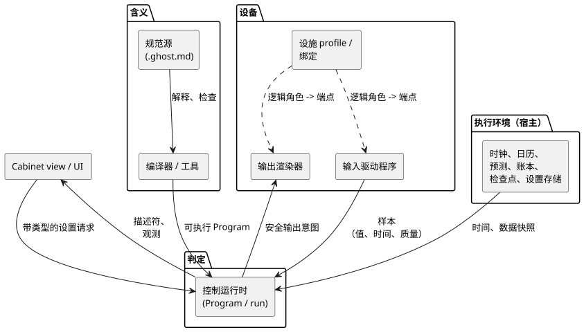
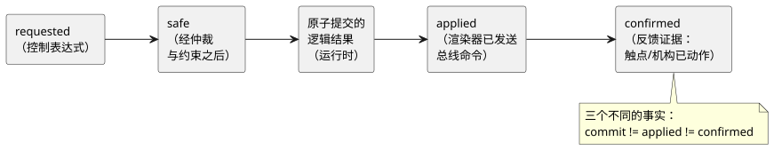

<!-- translation-source: docs/reference/08-language-runtime-and-device-boundaries.en.md -->
[英文原文](08-language-runtime-and-device-boundaries.en.md)

# 8. FAQ 需求与语言、执行和设备的职责

[完整目录](../LANGUAGE-REFERENCE.zh.md) · [上一章：语义保持规则与索引](07-semantic-rules-and-index.zh.md)

本章从[编码 FAQ](../language_faq.zh.md) 中提取需求，并把每一部分分配给必须负责它的层：语言、工具、运行时、执行环境、Driver、设施连接或 UI。

本章**不**涉及以下内容：

- 不报告实现进度。
- 不说明代码位于哪个具体仓库中。

各功能的语法和语义由链接到的参考章节定义。如果早期的设计草案使用了不同的写法，请以本参考中确定的写法为准。

**本章内容**

- §8.1 —— 原则：含义与执行手段。
- §8.2 —— 各层负责什么，附边界图。
- §8.3 —— 每条 FAQ（1–41）与其职责的对应关系。
- §8.4 —— 特定功能必须保持的边界。
- §8.5 —— 什么会变更、重启和持久保存，以及由谁负责。
- §8.6 —— 哪些选择由语言确定，哪些由作者决定。
- §8.7 —— 对新需求进行分类的检查清单。

## 8.1 分类原则：含义与执行手段

**语言定义程序的含义。运行时按照该含义作出判定。** 输入驱动程序和执行环境提供判定所需的事实和时间。输出渲染器施加输出效果。某个操作是在 VM 内部运行还是在宿主适配器中计算，与谁拥有其含义是两个独立的问题。

*示例。* “每天当地时间早上 6 点启动一次”是由语言定义的调度计划含义。时钟和时区数据从哪里来，是执行环境的工作。即使由适配器提供调度计划的触发实例，重复抑制、错过的观测和 DST 处理也必须遵循同一份语言契约。画面和 Driver 不得按照自己的规则重新解释是否启动。

`input is_holiday: Bool` 和 `input used: Duration` 这类 FAQ 片段展示的是**如何使用一个值**。仅凭声明并不会产生节假日计算器或用量记录。要完整支持这类需求，还需要一份关于该输入生产者的契约：其含义、有效性、时机和恢复。

有些选择属于用户，而不属于语言。例如：

- 取消之后哪台设备动作。
- 清洗是否每天进行一次。
- 修改后的运行时长是否也适用于正在进行的工作。

这些都是在编写的程序中作出的选择。它们都不需要新的关键字或内置控制模式。

**原因：** 增加语法并不会凭空产生时钟或物理反馈。反之，仅有能读取值的 Driver 也不够：缺少关于时间、错误和状态的程序语义，就无法解释一致的控制。

## 8.2 各层职责

有两个角色把程序与物理世界连接起来：

- 输入**驱动程序（driver）**产生逻辑输入。
- 输出**渲染器（renderer）**把逻辑输出意图施加到继电器、电机、指示灯或屏幕上。

这些是*角色*，而不是互斥的设备类别。USB 力反馈摇杆同时具有输入驱动程序和输出渲染器。带 TFT 显示屏的 EC11 编码器同样兼具输入和输出角色。这些示例用于说明边界，并非实现。

相关代码和策略的归属：

- 驱动程序和渲染器的源代码属于 `farm-device-drivers`。
- Device 负责宿主/板卡集成、绑定、时钟、看门狗以及启动/故障策略。
- 机柜操作员 UI 是 `@ghostflow/cabinet-view`。它与输出渲染器是不同的东西。
- 现有的 `ScanDriver`、宿主 ABI 标识符和 profile 的 `driver` 字段保持原有的名称和契约。

下图展示了各层如何连接。含义从规范源经由工具流向运行时。事实和时间从环境和输入驱动程序流入运行时。安全输出意图流向渲染器。绑定把逻辑角色连接到实际端点。UI 只读取描述符和观测，并提交带类型的请求。

| 层 | 必需的职责 | 与其他层的边界 |
|---|---|---|
| 语言规范 | 类型、状态转换、时间、错误、设置和输出意图的含义；资源上限和故障规则 | 不得把设备地址、UI 外观或存储介质变成控制语法。 |
| 编译器/工具 | 解释规范文档；检查类型、名称和分支；将其转换为可执行表示；保留声明、意图和设置描述 | 仅靠静态类型检查无法证明物理接线或实际运行。 |
| 控制运行时 | 基于输入快照对状态、表达式、定时器和约束求值，并以原子方式提交结果；保持设置事件和观测的执行位置 | 不得自行添加程序策略，也不得把输出当作物理确认。 |
| 执行环境/数据提供者 | 时钟及其可信度；日期和自然事件数据；执行生命周期；设置、检查点和设施记录的存储与恢复 | 公开所提供数据的修订版、范围、有效性和故障。不得另造一套控制语言。 |
| 输入驱动程序 / 输出渲染器 | 输入驱动程序：设备通信、解释/规范化原始信号、样本的身份标识/时间/质量。输出渲染器：在 Device 启动/故障策略下施加逻辑输出并报告结果 | 不得在源文件之外隐藏控制顺序、互锁或日期策略。 |
| 设施 profile/绑定 | 把逻辑角色连接到实际端点；能力、极性和范围等兼容性；设施修订版 | 区分仅涉及连接的变更与对源文件规则的变更。 |
| Cabinet view / UI | 使用所描述的类型、标签、范围和权限进行编辑和显示；提交带类型的请求；显示结果和错误 | 不得用单独的定时器、聚合或约束判定重新生成控制含义。 |

这里的**执行环境（宿主）是运行控制程序的设备或进程**。它不需要 Android 网关或云服务。在本地具备所需时钟和有效数据的设备，无需联网即可履行该契约。网络断开、数据过期和时间未知是三种不同的状态。

依据：[§1.1 规范源](01-source-and-syntax.zh.md)、[§2.8 执行语义](02-types-expressions-state.zh.md)、[§4.2 输入契约](04-sensors-constraints-control.zh.md)、[§5.3 观测模型](05-settings-and-observation.zh.md)、[§6.2 逻辑连接](06-composition-and-replay.zh.md)。

## 8.3 完整的 FAQ 职责表

本表把 FAQ 1–41 的每一条分配到某一行。这里的“要求”指契约上的职责，而不是实现状态。所有驱动程序、渲染器和 UI 共有的职责遵循 §8.2；每一行只列出对该需求最重要的外部职责。

| FAQ 与需求 | 语言/编译器要求 | 运行时要求 | 执行环境/驱动程序/渲染器/设施/UI 要求 |
|---|---|---|---|
| [1](../language_faq.zh.md#q01)、[41](../language_faq.zh.md#q41) 规范文档/编译工具 | 文学式解释；保留并检查源和意图的位置（§1） | 执行已标识的 Program | 工具保存并交付完整的文档和修订版；编译检查不同于验证物理行为 |
| [2](../language_faq.zh.md#q02)、[3](../language_faq.zh.md#q03)、[18](../language_faq.zh.md#q18) 按钮/自锁 | Bool、前一/下一状态（§2.8） | 基于快照对所编写的重启条件求值并提交 | Driver 提供“按下”的含义；连接实际按钮或显式声明的软件输入 |
| [4](../language_faq.zh.md#q04)–[6](../language_faq.zh.md#q06) 定时运行/延时 | Duration、按状态的 elapsed（§3.2） | 单调时间和定时器状态 | 执行环境提供单调时间和判定时机 |
| [8](../language_faq.zh.md#q08)、[19](../language_faq.zh.md#q19) 顺序/取消后的行为 | enum/case 和按状态的输出表达式（§2.4、§2.8） | 按照所编写的顺序和取消优先级进行每个 tick 的状态转换 | Driver 提供停止/原点反馈；接下来发生什么属于程序策略 |
| [9](../language_faq.zh.md#q09)、[10](../language_faq.zh.md#q10) 传感器条件/水箱控制 | Result、阈值、滤波、迟滞、状态（§4.1–4.3） | 识别新样本；对新鲜度、恢复和滤波状态求值 | Driver 提供值、单位、采样时间和质量 |
| [11](../language_faq.zh.md#q11) 计数 | 精确整数、前一输入状态、条件（§2.3、§2.8） | 保持所编写的沿、上限和初始化表达式以及整数错误语义 | 输入生产者提供可观测的事件；一个长脉冲跨越的多个 tick 不计为多个事件 |
| [13](../language_faq.zh.md#q13) 报警保持 | Bool 状态和条件；公开报警的含义是独立的（§5.3） | 对所编写的锁存/复位表达式求值；保持显式报警的触发/解除含义 | UI 显示报警状态；通知和记录介质是外部选择 |
| [14](../language_faq.zh.md#q14)、[17](../language_faq.zh.md#q17) 互锁 | require/互斥；状态限制不同于输出限制（§4.7） | requested→safe 判定 | 输出渲染器施加效果；输入驱动程序提供反馈；逻辑约束不是物理急停装置 |
| [16](../language_faq.zh.md#q16) 计算复用 | 纯函数、类型、名称作用域（§2.7） | 相同输入得到相同计算 | 不得在纯函数中放入设备访问或隐藏状态 |
| [7](../language_faq.zh.md#q07)、[15](../language_faq.zh.md#q15)、[20](../language_faq.zh.md#q20) 时刻/日出调度计划 | DailySlots/Solar、偏移量、触发实例与运行分开（§3.5–3.9） | 按契约处理触发实例并重复抑制；运行定时器 | 提供时钟、位置、时区和自然事件数据；保留触发实例记录 |
| [21](../language_faq.zh.md#q21)、[27](../language_faq.zh.md#q27)–[29](../language_faq.zh.md#q29) 星期/节假日/DST | 日期过滤与条件；gap/fold 与 Unknown 语义（§3.8） | 应用相同的日期判定和准入策略 | 提供带修订版和覆盖范围的日历与时区数据；在 UI 中显示可选设置 |
| [30](../language_faq.zh.md#q30)、[31](../language_faq.zh.md#q31) 潮汐/月亮 | 定时事件与区间条件之间的类型区分；偏移量/fallback（§3.9） | 保持事件 ID、修订版、遗漏以及进行中运行的含义 | 预测提供者提供站点/模型、修订版、覆盖范围、过期时间和稳定的事件 ID |
| [22](../language_faq.zh.md#q22)、[23](../language_faq.zh.md#q23) 累计时长/每日清洗 | 聚合对象和周期、精确计数、状态/enum（§3.4、§3.10） | 使用有效的聚合快照对所编写的清洗条件和顺序求值 | 环境使用共享的设施身份标识和 applied/confirmed 证据更新、存储和恢复账本；作者选择的策略见 §8.6 |
| [12](../language_faq.zh.md#q12)、[24](../language_faq.zh.md#q24)、[26](../language_faq.zh.md#q26) 时长/范围变更 | config 的类型/默认值/min/max/step/access 和描述符（§5.1–5.2） | 校验整个请求，并以原子方式实时应用；保持状态和定时器 | UI 提交带类型的请求；执行边界检查权限；环境持久保存普通设置 |
| [25](../language_faq.zh.md#q25) 标签/输入 UI | label 和语义元数据（§5.1、§5.3） | 提供生效值、修订版和拒绝结果 | Cabinet view 选择时间字段、列表或滑块；所有路径都应用相同的校验 |
| [32](../language_faq.zh.md#q32) 停电恢复 | 初始值、状态转换、执行身份标识（§2.8、§5.2） | 新的运行；按规定初始化/恢复；对所编写的恢复运行条件求值 | 环境提供检查点和重启原因；Device 输出策略和渲染器管理首次判定之前的输出 |
| [33](../language_faq.zh.md#q33)–[36](../language_faq.zh.md#q36) 传感器更换/生命周期/规格 | 逻辑设备契约；兼容替换时 Program 保持不变（§6.2–6.3） | 用相同规则对符合契约的输入求值 | 管理 Driver 变更、设施绑定修订版和兼容性；36 是这些原则的依据，而不是对新语法的请求 |
| [37](../language_faq.zh.md#q37)–[40](../language_faq.zh.md#q40) GPIO/继电器/扩展 I/O | 与设备位置无关的逻辑端口（§6.2–6.3） | 保持输入和安全输出契约 | 每个驱动程序/渲染器处理其角色的总线、地址、通道、极性和故障；绑定选择实际端点 |

范围包含其中的每一条 FAQ。例如，27–29 表示 27、28 和 29。相关章节：[2](02-types-expressions-state.zh.md)、[3](03-time-and-schedules.zh.md)、[4](04-sensors-constraints-control.zh.md)、[5](05-settings-and-observation.zh.md)、[6](06-composition-and-replay.zh.md)。

## 8.4 各功能必须保持的边界

### 普通控制组合与内置功能

自锁、水箱注水和按阶段取消，都是通过组合现有功能（状态、Bool、enum 和 case）构建的。运行时提供状态转换语义；作者选择重启、取消和完成策略。不得在 Driver 内部隐藏单独的自锁或取消顺序。

关于 FAQ 示例的几点说明：

- FAQ 中的 Bool 报警锁存不会自动变成报警记录或外部通知服务。
- 在 FAQ 11 中，`done` 是一个在计数到达 3 之后保持为 true 的 Bool 值。它不是一次性的完成脉冲。
- 计数停在 3，是由该示例的条件表达式决定的，而不是因为 Int 运算会饱和。
- 沿计数器统计的是运行时观测到的输入变化。要统计在两次判定*之间*上升又下降的物理脉冲，需要与 Driver 或输入生产者之间有一份捕获与交付契约。仅靠精确整数类型并不能保证不丢失任何物理事件。

**原因：** 为每个应用设置专用指令，会迫使同一套状态转换在多种含义下分别维护。依据：[§2.8](02-types-expressions-state.zh.md)、[§5.3 事件与报警](05-settings-and-observation.zh.md)。

### 时间判定与数据提供

语言区分单调时间与本地日期，并定义 DST、fallback 和触发实例的身份标识。执行环境提供可信的时间、日历和预测。调度计划计算的一部分可以在适配器中运行，但相同的数据、时间和记录仍必须产生相同的结果。不得把生成的输入简化为丢失了原因和修订版的任意 Bool 脉冲。

**原因：** 改变获取时钟的方式，不得改变重复执行、遗漏或运行时长的含义。依据：[§3.1](03-time-and-schedules.zh.md)、[§3.5](03-time-and-schedules.zh.md)、[§3.9](03-time-and-schedules.zh.md)。

### 累计用量与持久存储

语言契约规定：

- 统计的对象（requested、safe、applied 或 confirmed）；
- 范围和日期边界；
- 初始化和未知状态。

单个控制内部的沿计数器可以用普通状态计算。跨越多个控制和模式的持久设施账本则不同。执行环境的提供者使用稳定的设施身份标识，结合来自渲染器的应用证据和来自输入驱动程序的确认证据来更新、存储和恢复它，并向控制运行时提供已标识的聚合快照。

- 在提供者内部计算的纯聚合遵循同一份语言契约。存储介质不会改变聚合值的含义。
- 一台设备的用量不是其自动控制请求与手动控制请求之和。
- 不得用屏幕点亮的累计时间代替设施用量。

**原因：** 临时的执行内存与必须在重启后保留的设施记录具有不同的生命周期。依据：[§3.4](03-time-and-schedules.zh.md)、[§3.10](03-time-and-schedules.zh.md)。

### 设置、校验与画面

语言声明类型、允许范围、步长、权限和标签，工具保留这些描述。执行边界把每个请求作为整体进行校验。随后，运行时在同一 Program 和运行内以原子方式应用已批准的值。

- 仅有 UI 的预校验并不构成批准。即使 UI 组件发生变化，也适用相同的条件。
- 进行中的工作是读取新的时长，还是保持开始时的值，由程序的控制表达式决定。

**原因：** 把时间输入字段改成滑块，不得改变允许的值或执行结果。依据：[§5.1](05-settings-and-observation.zh.md)、[§5.2](05-settings-and-observation.zh.md)。

### 设备无关性与实际效果

编译后的 Program 使用逻辑角色。直接 GPIO、扩展通道和 RS485 设备地址属于设施绑定和驱动程序/渲染器。

- 仅仅是兼容替换，不需要编辑源文件或重新编译。
- 增加逻辑端口或新的控制行为*属于*源文件变更。
- 以原子方式提交逻辑结果、施加总线命令、确认触点或机构实际动作，是三个不同的事实。

下图把这些事实表示为先后相继的阶段。每个阶段都是独立的证据；后一阶段绝不能由前一阶段推定。

**原因：** 对设备访问进行抽象，并不会让物理延迟或故障消失。依据：[§4.7](04-sensors-constraints-control.zh.md)、[§6.3 兼容替换](06-composition-and-replay.zh.md)。

## 8.5 变更与重启的生命周期

不同类型的变更有不同的负责方，对修订版、运行和持久化的影响也不同。

| 变更或数据 | 含义的负责方 | 修订版/执行/持久化边界 |
|---|---|---|
| 控制表达式、传感器滤波、stale_after、源文件默认值 | 语言和规范源 | 新的源修订版；可执行规则变化时产生新的 Program 候选 |
| operator config 的生效值 | 语言的实时设置契约 | 同一 Program 和运行，新的设置修订版；普通设置在实际重启后仍保留 |
| 兼容的传感器/GPIO/继电器/总线通道连接 | 设施绑定和驱动程序/渲染器 | 相关的设施/Driver 修订版发生变化；复用同一 Program，但不保证不间断运行或同一运行 |
| 内部状态/定时器/滤波内存 | 语言的执行语义 | 在执行期间更新；重启后要恢复它，需要显式策略和检查点契约 |
| 调度计划重复抑制记录/设施用量 | 语言的设施记录契约和执行环境 | 生命周期独立于普通状态初始化和源文件替换；没有契约时绝不初始化 |
| 日历/潮汐预测数据 | 提供者以及使用它的时间契约 | 保持数据修订版、覆盖范围、过期时间和事件身份标识 |
| 标签声明 / 组件外观 | 源文件元数据 / cabinet view | 在源文件中编辑标签会改变文档修订版；画面外观不会改变控制含义 |

这种区分并不规定文件的数量。“`.ghost.md` 是规范源”这一规则与存储格式无关：设施信息、设置覆盖值和执行记录如何存储，由各环境自行决定。不得把固件更新、Driver 更新、Program 替换和设置变更视为同一类更新。

默认情况下，传感器、滤波和新鲜度在重新启动后会被重置，并从 `NotReady` 重新开始。持久地恢复传感器状态是一项显式选择，并且需要验证来源和时间的连续性。仅仅拥有普通检查点，本身并不构成恢复旧的正常值或滤波连续性的理由。

依据：[§4.2 传感器恢复](04-sensors-constraints-control.zh.md)、[§5.2](05-settings-and-observation.zh.md)、[§5.4](05-settings-and-observation.zh.md)、[§6.3](06-composition-and-replay.zh.md)。

## 8.6 语言决定与作者选择的策略

语言定义类型、语法、求值和时间边界。下列运行策略的实际值由程序作者或设施操作员选择。

- 省略了必需策略值的声明会被拒绝。
- UI 和运行时不得代替用户自行发明自动运行策略。

| 对应 FAQ | 已确定的语言契约 | 由作者或执行环境提供 |
|---|---|---|
| 11、23 精确计数 | §2.3 Int、显式转换、错误规则 | 什么算作一次触发实例；是否包含清洗；每 N 次还是每天一次 |
| 21、27–29 星期/节假日/DST | §3.8 日期/日历/gap/fold 契约 | 现场时区；使用哪个日历及其修订版；在重复或缺失的时刻如何处理 |
| 24 运行时长/调度时刻 | Duration config 与 §3 带类型的时段设置是不同的类型；两者都是原子实时事件 | 公开哪些设置；其范围；实际运行时长和调度时刻 |
| 30–31 潮汐/月亮 | §3.9 事件、周期、fallback、触发实例身份标识 | 预测位置和数据；大潮/小潮的分类；数据缺失时允许的动作 |
| 22 累计时长 | §3.4/§3.10 范围、聚合、边界、持久记录 | 证据基准（如 applied 或 confirmed）；上限及未知区间的处理；存储介质 |
| 23 每日次数/清洗 | 由精确计数、日期边界、阶段和请求记忆组合而成 | 清洗顺序、设备、中断条件，以及什么算作完成一次清洗 |
| 32 停电后恢复运行 | §5.2 新的运行、初始化、原因输入、显式检查点恢复 | 自动恢复运行还是等待新的启动；允许的恢复范围；启动时的物理输出 |
| 33 温度传感器 | §2.9 物理量类型/单位和 §4 Result | 满足逻辑契约的设备和 Driver，以及来自实际设施的证据 |
| 34–40 连接/替换 | §6.2–6.4 逻辑端口、外部绑定、与重新编译无关 | 设施存储格式；实际引脚/地址；驱动程序/渲染器的部署方式 |

本表中的运行选择**不是**尚未解决的语言设计问题。固定一个全局答案会改变不同设施的意图，因此它们仍作为源文件或设施契约的显式参数。同样，存储介质、UI 组件和通信协议也不是确定语言语法的前提条件。

### 不能代替用户判断的事项

- 停电、故障或取消之后是否重新启动，以及哪些设备实际动作。
- 运行时长、次数、清洗条件、时区、日历、自然事件数据和替代动作。
- 允许的传感器质量、最大时效、估计容差和物理反馈判据。
- 共享资源的等待、抢占和权限；PI/PID 的目标、增益、输出上限和故障行为。
- 临时设置的值和生命周期；自动修正的范围、速率和批准权限。

编写需要这些值的程序时，应确认用户的意图。为了定义语法、类型和错误规则，现在无需选定现场特有的值。

依据：[§2.3](02-types-expressions-state.zh.md)、[§2.9](02-types-expressions-state.zh.md)、[第 3 章 时间契约](03-time-and-schedules.zh.md)、[§5.2 生命周期](05-settings-and-observation.zh.md)。

## 8.7 对新需求进行分类

按顺序完成以下步骤：

1. 检查该需求是否是可以由现有表达式、状态和定时器组合而成的用户策略。
2. 如果它增加了在各执行环境中必须一致的含义，请明确写下语言契约及其“原因”。
3. 对于每个时间、传感器、日历、预测和聚合输入，确定其生产者、有效性、错误和修订版。
4. 把运行时内存与重启后必须保留的记录分开。
5. 通过驱动程序/渲染器和绑定契约连接实际的设备连接和输出效果。
6. 为 UI 提供承载相同含义的描述符和观测，并把显示和输入方式交给 UI 决定。

**判定标准：** 给定相同的 Program、输入、逻辑时间、设置事件和初始状态，必须能够解释出相同的控制判定。如果设备或 UI 的种类在该判定中引入了隐藏的差异，就说明语言语义与环境职责之间的边界定义得还不够清楚。依据：[§6.8 重放](06-composition-and-replay.zh.md)、[§7 语义保持](07-semantic-rules-and-index.zh.md)。

[完整目录](../LANGUAGE-REFERENCE.zh.md) · [上一章](07-semantic-rules-and-index.zh.md)
