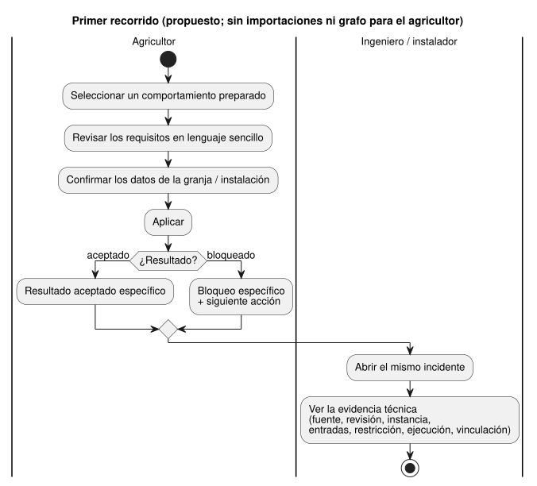

<!-- translation-source: docs/research/GF-COMPOSE-R1-USER-OUTCOMES.md -->
[Original en inglés](GF-COMPOSE-R1-USER-OUTCOMES.md)

# GF-COMPOSE R1: resultados para los usuarios y protocolo de medición

Padre: [#99](https://github.com/callin2/ghostflow-language/issues/99)
Issue: [#100](https://github.com/callin2/ghostflow-language/issues/100)
Revisión de evidencia examinada: `ffdbc96461eca67908252507fb851fa4dabd9a2c`
Estado: investigación/diseño. No se ha completado ninguna sesión con participantes ni ninguna línea base numérica.

Esta nota define qué debe lograr la composición de comportamientos para sus
usuarios y cómo medirlo. Abarca:

- el problema del usuario y el primer recorrido de extremo a extremo;
- lo que ya ofrece la revisión examinada (y lo que solo está propuesto);
- cinco escenarios, una hoja de medición y un recorrido en papel que separa la
  automatización del conocimiento humano;
- la recomendación, las preguntas abiertas con sus responsables y cómo se
  verificó esta nota.

## Problema del usuario

Tres grupos de personas necesitan respuestas distintas del mismo sistema:

| Quién | Qué necesita |
|---|---|
| Agricultores | Aplicar un comportamiento preparado con pocas decisiones técnicas. Saber qué se requiere en su granja y qué hacer cuando una acción queda bloqueada. |
| Ingenieros de software y autores de comportamientos | La definición, revisión, instancia, entradas, estado y decisión de restricción exactos que hay detrás de un resultado. |
| Ingenieros de hardware e instaladores | La vinculación (binding) de la instalación, el resultado de la aplicación y la retroalimentación física disponible. |

Los resultados de producto buscados son **menos esfuerzo**, **más
explicabilidad** y **más trazabilidad**.

El primer recorrido es:

1. Seleccionar un comportamiento preparado.
2. Revisar los requisitos expresados en lenguaje sencillo.
3. Confirmar los datos de la granja/instalación.
4. Aplicar.
5. Recibir un resultado aceptado específico o un bloqueo específico.
6. Abrir el mismo incidente para ver la evidencia técnica.

Ningún paso del agricultor requiere importaciones ni un grafo. El siguiente
diagrama muestra el mismo recorrido, con los pasos del agricultor y la vista
compartida del incidente separados.

## Evidencia en la revisión examinada

Los siguientes hechos provienen de la revisión examinada. Todo lo relativo a la
composición en sí sigue siendo una propuesta.

- **Entrada del compilador.** `compileSource` acepta un único documento
  literario (literate) canónico `.ghost.md` y conserva la identidad de la
  fuente. Por lo tanto, la composición de producto y la procedencia de las
  fuentes importadas son propuestas, no el comportamiento actual del
  compilador. Véase [`tools/compile-source.mjs`](../../tools/compile-source.mjs).
- **Contrato de interacción.** Define descriptores estáticos y observaciones de
  runtime completadas. Exige uniones exactas de esquema, módulo, fuente y
  ejecución; el estado `stale` lo deriva el consumidor que valida. Actualmente
  solo permite descriptores `state` y `timer` de solo lectura. Véase
  [`contracts/interaction-v0/README.md`](../../contracts/interaction-v0/README.md).
- **Contrato de integración.** Mantiene separadas las identidades de fuente,
  módulo, dispositivo, perfil e instalación. Que el host pase no establece el
  éxito del hardware ni el éxito físico, y la evidencia faltante sigue siendo
  desconocida. Véase
  [`contracts/integration-v1/README.md`](../../contracts/integration-v1/README.md).
- **Resumen de composición local.** Propone un único evento con vistas
  específicas para cada participante. Es una recomendación de diseño, no un
  comportamiento implementado. El frontend, la API y Device siguen siendo los
  responsables indicados en [`AGENTS.md`](../../AGENTS.es.md).

## Tablas y ejemplos

Lea las tablas teniendo en cuenta dos salvedades:

- Las celdas de «esfuerzo actual» son flujos de trabajo explícitamente **hipotéticos**.
- El recorrido está **elaborado a mano**; no es evidencia de ejecución ni de participantes.

| Escenario | Participante | Desencadenante | Esfuerzo actual / hipótesis | Decisiones necesarias del usuario | Respuesta visible propuesta | Evidencia de respaldo | Medida de éxito |
|---|---|---|---|---|---|---|---|
| Aplicar riego | Agricultor | Quiere aplicar un comportamiento de riego preparado | Hipótesis: lee requisitos técnicos y consulta a un ingeniero cuando la idoneidad o la vinculación no están claras | Confirmar el sitio, la fuente de agua y cualquier dato de instalación requerido | «El riego se puede aplicar aquí»; mostrar los datos requeridos, la vinculación confirmada y la revisión | Identidad de fuente/módulo; vinculaciones lógicas tipadas; identidad de la instalación | Se registran los pasos de configuración, las decisiones técnicas, las correcciones y las solicitudes de ayuda; el agricultor puede indicar qué se confirmó |
| Añadir ventilación | Agricultor, instalador | Añade un comportamiento de ventilación de cuatro ventiladores después del riego | Hipótesis: comprueba manualmente si el cableado del riego existente cambiará | Confirmar el número de ventiladores, las salidas disponibles y los datos de la instalación física | «La ventilación es compatible» o un desconocido/bloqueo con nombre; mostrar que las vinculaciones del riego existente no cambian | Vinculaciones de integración; revisiones exactas de perfil e instalación; resultado de compatibilidad de composición propuesto | Ninguna revinculación sin explicar; el usuario identifica cada decisión requerida y cada desconocido |
| Rechazar un conflicto de titularidad de la bomba | Agricultor, ingeniero de software | Dos instancias de comportamiento reclaman la titularidad exclusiva de una misma bomba | Hipótesis: el conflicto se descubre tarde o solo se explica en un registro de ingeniería | Elegir un único titular o quitar/cambiar el comportamiento en conflicto | «No se puede aplicar: la bomba X la reclaman el comportamiento A y el comportamiento B»; mostrar ambas identidades de puerto lógico | Identidades de salida/puerto declaradas; regla de titularidad exclusiva propuesta para el primer perfil | El conflicto se rechaza antes del despliegue; ambos usuarios pueden identificar las reclamaciones en conflicto |
| Explicar el bloqueo por nivel bajo de agua | Agricultor, ingeniero de software | `low_water=true` mientras se solicita la bomba en ON | Hipótesis: el agricultor solo ve «el riego no empezó»; el ingeniero reconstruye la entrada y la regla por separado | El agricultor revisa el tanque o la instalación de nivel bajo de agua; el ingeniero verifica la ejecución y la regla exactas | Agricultor: «El riego fue bloqueado por la señal de nivel bajo de agua; revise el tanque.» Ingeniero: el mismo incidente enlaza con `low_water`, la restricción, la salida solicitada, la salida segura y la ejecución | Identidad del escaneo completado; procedencia de la entrada/restricción; salida solicitada frente a salida segura resuelta | El agricultor nombra la señal y la siguiente acción sin afirmar que el tanque está vacío; el ingeniero llega a la entrada y la restricción de respaldo |
| Investigar un fallo de comando o una retroalimentación ausente | Agricultor, ingeniero de software, instalador | Se emite un comando, pero falla la aplicación del renderizador o no hay retroalimentación | Hipótesis: se confunden el comando, el fallo del dispositivo y el resultado físico | El ingeniero/instalador identifica qué evidencia está disponible y solicita la observación que falta | «Comando solicitado; la aplicación falló» o «resultado del comando desconocido: retroalimentación ausente»; mostrar las últimas identidades conocidas y la brecha | Puertas de ejecución de integración; observación del dispositivo cuando está disponible; la evidencia física se mantiene aparte | Disminuyen el esfuerzo de diagnóstico y el de navegación por la evidencia; ninguna afirmación de éxito físico sin respaldo |

### Hoja de medición

Recoja los datos en dos etapas:

1. Un recorrido guionizado de los cinco escenarios, todos con el mismo fixture.
2. Más adelante, sesiones moderadas con agricultores, autores de comportamientos
   e instaladores.

Para cada respuesta, registre la marca de tiempo, el actor, el escenario, la
revisión de la fuente, la revisión de la instalación y si la respuesta provino
de un recorrido heurístico o de un participante real. No combine esas dos
clases de evidencia.

| Medida | Método de recolección | Estado de la línea base | Interpretación deseada |
|---|---|---|---|
| Pasos de configuración | Contar las acciones ordenadas desde la selección del comportamiento hasta el resultado aplicado/rechazado | Sin medir; contar en el primer recorrido heurístico | Menos pasos sin ocultar una decisión necesaria de la granja |
| Decisiones técnicas | Contar las decisiones que requieren conocer tipos, puertos, dependencias, titularidad o revisiones | Sin medir; primero un conteo heurístico | Los agricultores solo ven las elecciones necesarias; los ingenieros conservan las elecciones precisas |
| Correcciones | Contar las vinculaciones, ajustes o selecciones erróneos/cambiados antes de obtener un resultado válido | Sin medir | Una retroalimentación temprana y específica reduce el retrabajo |
| Solicitudes de ayuda | Contar las solicitudes de ayuda al ingeniero/instalador y su motivo | Sin medir | Las solicitudes se vuelven más acotadas y vinculadas a la evidencia |
| Corrección de la explicación | Pedir al participante que parafrasee el bloqueo, el efecto y la siguiente acción; puntuar frente a la evidencia que lo respalda | Sin evidencia de participantes; solo una clave de respuestas heurística | Ninguna inferencia más allá de la señal; la respuesta de nivel bajo de agua no debe decir que el tanque está vacío |
| Esfuerzo de navegación por la evidencia | Contar pantallas/registros y el tiempo transcurrido hasta llegar a la fuente, la entrada, la restricción, la ejecución, la vinculación y la retroalimentación disponible | Sin medir; solo un recorrido elaborado a mano | El mismo incidente sirve a las vistas del agricultor y del ingeniero |
| Casos no resueltos | Contar los casos de evidencia desconocida/faltante/obsoleta (stale) y si se nombra a un responsable | Sin medir | Lo desconocido permanece visible en lugar de convertirse en aprobado o éxito |

### Recorrido en papel y frontera de la automatización

En cada escenario, la primera oración dice qué puede comprobar el software; el
resto dice qué sigue necesitando a una persona con conocimiento de la granja o
de la instalación.

1. **Aplicar riego:** automatizar las comprobaciones de descriptores y de
   vinculación. La idoneidad de la granja/sitio y la confirmación de la fuente
   de agua requieren conocimiento de la granja.
2. **Añadir ventilación:** automatizar las comprobaciones de tipo/capacidad y
   de preservación una vez que exista un contrato de composición. La ubicación
   de los ventiladores y la capacidad física requieren conocimiento del
   instalador. El resultado actual de cuatro ventiladores es un fixture
   propuesto, no un resultado probado.
3. **Conflicto de titularidad:** automatizar la detección y el rechazo de dos
   titulares lógicos exclusivos. Elegir el titular deseado es una decisión
   humana.
4. **Nivel bajo de agua:** automatizar la unión del escaneo completado con la
   entrada, la restricción, la salida solicitada, la salida segura y la
   ejecución. Revisar el tanque y decidir la respuesta operativa requieren
   conocimiento de la granja. La respuesta invariante es:
   **«El riego fue bloqueado por la señal de nivel bajo de agua; revise el
   tanque.»** La señal no prueba que el tanque esté vacío.
5. **Fallo de comando/retroalimentación ausente:** automatizar las uniones de
   identidad y la distinción entre los estados solicitado, aplicado y observado
   cuando exista evidencia. Decidir si inspeccionar el cableado, reintentar o
   llamar a un instalador es conocimiento humano/de la instalación. La
   retroalimentación ausente sigue siendo desconocida.

Quedan tres preguntas para una validación posterior con participantes. Son
preguntas abiertas, no resultados de entrevistas:

1. ¿Qué redacción mínima de los requisitos permite a los agricultores decidir
   la idoneidad sin entender términos del compilador? Responsable:
   frontend/producto, con sesiones con agricultores.
2. ¿Qué secuencia de navegación por la evidencia es la más rápida y sigue
   siendo comprensible para ingenieros de software e instaladores?
   Responsable: frontend/API, con sesiones de usabilidad y de diagnóstico.
3. ¿Qué estados de aplicación de comandos y de retroalimentación física están
   disponibles en una instalación real, y quién registra cada uno?
   Responsable: API/Device, con una revisión de la evidencia de puesta en
   marcha.

## Recomendación

- **Adoptar** el recorrido de cinco escenarios y la hoja de medición como
  protocolo de aceptación para la investigación sobre composición.
- **Priorizar** un registro de resultado pequeño que una la redacción para el
  participante con las identidades exactas de fuente/módulo/instancia/ejecución
  e instalación que ya representan los contratos.
- **Reutilizar** las reglas de identidad de interacción e integración.
- **No añadir** en este issue un editor de grafos, una canalización de
  telemetría ni un nuevo sistema de almacenamiento.

El primer requisito orientado a la implementación debería ser un resultado
legible para el agricultor, con un bloqueo o un resultado aceptado específico,
más una vista para el ingeniero del mismo evento.

La titularidad permanece donde está:

- La semántica de las explicaciones y de los eventos sigue correspondiendo a #88/#74.
- La observación física sigue siendo responsabilidad de Device.
- Los descriptores de comando/explicación que faltan son trabajo de contrato no
  resuelto, no evidencia de que existan hoy.

## Preguntas no resueltas y responsables

| Responsable | Pregunta abierta |
|---|---|
| #70 / responsable de interacción | Si los descriptores de comando, entrada, evento y explicación amplían interaction-v0, y cómo, manteniendo las uniones exactas. |
| #88 / responsable de explicaciones y #74 / responsable de eventos | Campos canónicos del incidente para la salida solicitada, la salida segura, el resultado de la aplicación y la retroalimentación ausente. |
| Responsables de API/Device | Retención y transporte de la evidencia de instalación/aplicación/física. El repositorio del lenguaje no debe elegirlos de forma implícita. |

## Verificación

- Se comprobaron las cinco filas frente a los criterios de aceptación: cada una
  tiene un participante, una carga, un resultado visible y una fuente de
  evidencia; ninguna requiere importaciones ni grafos.
- Se comprobó la hoja de medición: cada línea base está explícitamente sin
  medir o es heurística; no se afirma ningún porcentaje de éxito, resultado de
  entrevista ni prueba de runtime/física.
- Se comprobó el recorrido en papel: la automatización y el conocimiento de la
  granja/instalación están separados; se enumeran exactamente tres preguntas de
  validación posterior; cada capacidad se asocia a esfuerzo, explicación o
  trazabilidad.
- Se inspeccionó el commit `ffdbc96461eca67908252507fb851fa4dabd9a2c`. No se
  ejecutaron pruebas de runtime. Este documento es una recomendación y un
  análisis elaborado a mano, no evidencia de ejecución.
- `git diff --check` y la inspección de enlaces relativos son comprobaciones
  obligatorias de traspaso al coordinador una vez que este archivo sea visible
  en el árbol de trabajo compartido.
