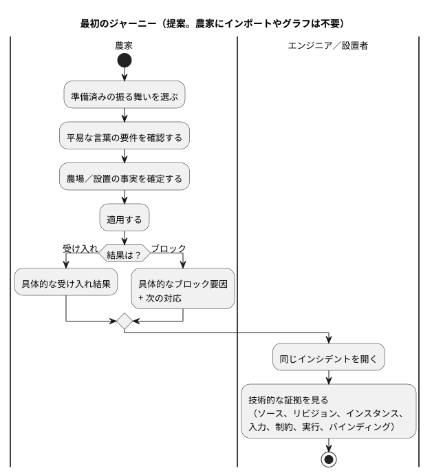

<!-- translation-source: docs/research/GF-COMPOSE-R1-USER-OUTCOMES.md -->
[英語の原文](GF-COMPOSE-R1-USER-OUTCOMES.md)

# GF-COMPOSE R1：ユーザーの成果と測定プロトコル

親 issue：[#99](https://github.com/callin2/ghostflow-language/issues/99)
Issue：[#100](https://github.com/callin2/ghostflow-language/issues/100)
調査対象リビジョン：`ffdbc96461eca67908252507fb851fa4dabd9a2c`
ステータス：調査／設計。参加者セッションも数値のベースラインもまだ完了していません。

このノートは、振る舞いの合成（behavior composition）がユーザーのために何を達成しなければならないか、そしてそれをどう測定するかを定義します。扱う内容は次のとおりです。

- ユーザーの課題と、最初のエンドツーエンドのジャーニー
- 調査対象リビジョンがすでに提供しているもの（および提案にとどまるもの）
- 5 つのシナリオ、測定シート、そして自動化と人間の知識を切り分けるペーパーウォークスルー
- 推奨事項、担当者付きの未解決の問い、このノートの検証方法

## ユーザーの課題

3 つのグループが、同じシステムからそれぞれ異なる答えを必要としています。

| 誰が | 必要としているもの |
|---|---|
| 農家 | 技術的な判断をほとんどせずに、準備済みの振る舞いを適用すること。自分の農場で何が必要か、そして操作がブロックされたときに何をすればよいかを知ること。 |
| ソフトウェアエンジニアと振る舞いの作成者 | 結果の背後にある正確な定義、リビジョン、インスタンス、入力、状態、制約の判断。 |
| ハードウェアエンジニアと設置者 | 設置のバインディング、適用結果、利用可能な物理フィードバック。 |

製品として目指す成果は、**手間の削減**、**説明可能性の向上**、**トレーサビリティの向上**です。

最初のジャーニーは次のとおりです。

1. 準備済みの振る舞いを選ぶ。
2. 平易な言葉で書かれた要件を確認する。
3. 農場／設置に関する事実を確定する。
4. 適用する。
5. 具体的な受け入れ結果、または具体的なブロック要因のどちらかを受け取る。
6. 同じインシデントを開いて技術的な証拠を見る。

農家のどのステップにも、インポートやグラフは必要ありません。次の図は同じジャーニーを示したもので、農家のステップと共有のインシデントビューを分けています。

## 調査対象リビジョンでの証拠

以下の事実は調査対象リビジョンから得たものです。合成そのものに関する内容は、まだ提案にすぎません。

- **コンパイラ入力。** `compileSource` は正本（canonical）の `.ghost.md` 文芸的ソース（literate）ドキュメントを 1 つ受け取り、ソースの同一性を保持します。したがって、製品としての合成やインポートしたソースの来歴は提案であり、現在のコンパイラの動作ではありません。[`tools/compile-source.mjs`](../../tools/compile-source.mjs) を参照してください。
- **インタラクション契約。** 静的なディスクリプタと、完了したランタイム観測を定義します。スキーマ、モジュール、ソース、実行（run）の厳密な結合を要求し、`stale` は検証する側の利用者が導出します。現在は読み取り専用の `state` と `timer` のディスクリプタだけを許可しています。[`contracts/interaction-v0/README.md`](../../contracts/interaction-v0/README.ja.md) を参照してください。
- **インテグレーション契約。** ソース／モジュール／デバイス／プロファイル／設置の各同一性を区別して保ちます。ホストでの合格はハードウェアや物理的な成功を確立せず、欠けている証拠は不明のままです。[`contracts/integration-v1/README.md`](../../contracts/integration-v1/README.ja.md) を参照してください。
- **ローカルの合成サマリー。** 参加者ごとのビューを持つ 1 つのイベントを提案しています。これは設計上の推奨であり、実装済みの動作ではありません。フロントエンド、API、Device は、[`AGENTS.md`](../../AGENTS.ja.md) に記載された所有者のままです。

## 表と例

表を読む際は、次の 2 つの注意点に留意してください。

- 「現在の手間」の欄は、明示的に**仮説上の**ワークフローです。
- ウォークスルーは**手作業で行ったもの**であり、実行や参加者による証拠ではありません。

| シナリオ | 参加者 | きっかけ | 現在の手間／仮説 | 必要なユーザー判断 | 提案する表示内容 | 裏付けとなる証拠 | 成功の尺度 |
|---|---|---|---|---|---|---|---|
| 灌水を適用する | 農家 | 準備済みの給水の振る舞いを適用したい | 仮説：技術的な要件を読み、適合性やバインディングが不明なときはエンジニアに尋ねる | 現場、水源、必要な設置上の事実を確定する | 「ここでは灌水を適用できます」と表示し、必要な事実、確定したバインディング、リビジョンを示す | ソース／モジュールの同一性、型付きの論理バインディング、設置の同一性 | セットアップのステップ、技術的な判断、修正、支援依頼を記録する。農家が何を確定したかを説明できる |
| 換気を追加する | 農家、設置者 | 灌水の後に 4 台のファンを使う換気の振る舞いを追加する | 仮説：既存の灌水の配線が変わるかどうかを手作業で確認する | ファンの台数、利用可能な出力、物理的な設置の事実を確定する | 「換気は互換性があります」または名前付きの不明点／ブロック要因を示し、既存の灌水のバインディングが変わらないことを示す | インテグレーションのバインディング、厳密なプロファイルと設置のリビジョン、提案中の合成互換性の結果 | 説明のない再バインドがない。ユーザーが必要な判断と不明点をそれぞれ特定できる |
| ポンプの所有権の競合を拒否する | 農家、ソフトウェアエンジニア | 2 つの振る舞いインスタンスが 1 台のポンプの排他的な所有権を主張する | 仮説：競合が遅れて発見されるか、エンジニアリングログでしか説明されない | 所有者を 1 つ選ぶか、競合する振る舞いを削除／変更する | 「適用できません：ポンプ X を振る舞い A と振る舞い B の両方が要求しています」と表示し、両方の論理ポートの同一性を示す | 宣言された出力／ポートの同一性、提案中の最初のプロファイルでの排他的所有権ルール | 競合がデプロイ前に拒否される。両方のユーザーが競合する主張を特定できる |
| 低水位によるブロックを説明する | 農家、ソフトウェアエンジニア | ポンプ ON が要求されている間に `low_water=true` | 仮説：農家には「給水が始まらなかった」としか見えず、エンジニアは入力とルールを別々に再構成する | 農家はタンクまたは低水位の設置を確認し、エンジニアは厳密な実行とルールを検証する | 農家：「低水位信号によって給水がブロックされました。タンクを確認してください。」エンジニア：同じインシデントから `low_water`、制約、要求された出力、安全な出力、実行にリンクする | 完了したスキャンの同一性、入力／制約の来歴、要求出力と解決された安全出力の対比 | 農家がタンクが空だと断定せずに、信号と次の対応を言える。エンジニアが裏付けとなる入力と制約にたどり着ける |
| コマンドの失敗やフィードバックの欠落を調査する | 農家、ソフトウェアエンジニア、設置者 | コマンドは発行されたが、レンダラーでの適用が失敗したか、フィードバックがない | 仮説：コマンド、デバイスの故障、物理的な結果が混同される | エンジニア／設置者が利用可能な証拠を特定し、欠けている観測を依頼する | 「コマンドは要求されましたが、適用に失敗しました」または「コマンドの結果は不明です：フィードバックがありません」と表示し、最後に判明している同一性とギャップを示す | インテグレーションの実行ゲート、利用可能な場合はデバイスの観測。物理的な証拠は別に保つ | 診断の手間と証拠をたどる手間が減る。裏付けのない物理的成功を主張しない |

### 測定シート

データは 2 段階で収集します。

1. 同じフィクスチャを使い、5 つのシナリオすべてを台本どおりにウォークスルーする。
2. 後日、農家、振る舞いの作成者、設置者とモデレーター付きのセッションを行う。

すべての回答について、タイムスタンプ、行為者、シナリオ、ソースリビジョン、設置リビジョン、そして回答がヒューリスティックなウォークスルーと実際の参加者のどちらから得られたかを記録してください。この 2 種類の証拠を混ぜて集計してはなりません。

| 尺度 | 収集方法 | ベースラインの状況 | 望ましい解釈 |
|---|---|---|---|
| セットアップのステップ | 振る舞いの選択から適用／拒否の結果までの順序付きの操作を数える | 未測定。最初のヒューリスティックなウォークスルーで数える | 必要な農場の判断を隠さずにステップ数を減らす |
| 技術的な判断 | 型、ポート、依存関係、所有権、リビジョンの知識を必要とする判断を数える | 未測定。まずヒューリスティックに数える | 農家には必要な選択だけを見せ、エンジニアには正確な選択を残す |
| 修正 | 有効な結果に至るまでに誤った／変更したバインディング、設定、選択を数える | 未測定 | 早い段階の具体的なフィードバックで手戻りを減らす |
| 支援依頼 | エンジニア／設置者への支援依頼とその理由を数える | 未測定 | 依頼の範囲が狭まり、証拠と結び付くようになる |
| 説明の正確さ | 参加者にブロック要因、影響、次の対応を言い換えてもらい、裏付けのある証拠と照らして採点する | 参加者の証拠はなし。ヒューリスティックな解答キーのみ | 信号を超えた推論をしない。低水位の回答でタンクが空だと言ってはならない |
| 証拠をたどる手間 | ソース、入力、制約、実行、バインディング、利用可能なフィードバックにたどり着くまでの画面／記録の数と経過時間を数える | 未測定。手作業でたどった経路のみ | 同じインシデントが農家とエンジニアの両方のビューに役立つ |
| 未解決のケース | 不明／欠落／古い（stale）証拠のケースと、所有者が指名されているかを数える | 未測定 | 不明が合格や成功に変わらず、見える状態のまま残る |

### ペーパーウォークスルーと自動化の境界

各シナリオについて、最初の文はソフトウェアが確認できることを、残りは農場や設置の知識を持つ人がまだ必要なことを述べています。

1. **灌水を適用する：** ディスクリプタとバインディングの確認を自動化します。農場／現場の適合性と水源の確認には農場の知識が必要です。
2. **換気を追加する：** 合成の契約ができた時点で、型／容量の確認と既存部分の保持の確認を自動化します。ファンの配置と物理的な容量には設置者の知識が必要です。現在の 4 台のファンの結果は提案中のフィクスチャであり、テスト済みの結果ではありません。
3. **所有権の競合：** 2 つの排他的な論理所有者の検出と拒否を自動化します。どちらを所有者にするかは人間の判断です。
4. **低水位：** 完了したスキャンを、入力、制約、要求された出力、安全な出力、実行に結合する処理を自動化します。タンクの確認と運用上の対応の判断には農場の知識が必要です。不変の回答は **「低水位信号によって給水がブロックされました。タンクを確認してください。」** です。この信号はタンクが空であることを証明しません。
5. **コマンドの失敗／フィードバックの欠落：** 証拠がある場合に、同一性の結合と、要求済み・適用済み・観測済みの状態の区別を自動化します。配線を点検するか、再試行するか、設置者を呼ぶかの判断は人間／設置の知識です。欠けているフィードバックは不明のままです。

後の参加者による検証のために、3 つの問いが残っています。これらは未解決の問いであり、インタビューの結果ではありません。

1. 農家がコンパイラの用語を理解しなくても適合性を判断できる、最小限の要件の言い回しは何か。所有者：フロントエンド／プロダクト。農家とのセッションを伴う。
2. ソフトウェアエンジニアと設置者にとって、最も速くかつ理解しやすい証拠のたどり方の順序は何か。所有者：フロントエンド／API。ユーザビリティと診断のセッションを伴う。
3. 実際の設置で利用できるコマンド適用と物理フィードバックの状態はどれか、そしてそれぞれを誰が記録するか。所有者：API／Device。コミッショニングの証拠レビューを伴う。

## 推奨事項

- 5 つのシナリオのジャーニーと測定シートを、合成の調査の受け入れプロトコルとして**採用します**。
- 参加者向けの文言を、契約ですでに表現されている厳密なソース／モジュール／インスタンス／実行および設置の同一性に結び付ける、小さな結果レコードを**優先します**。
- インタラクションとインテグレーションの同一性ルールを**再利用します**。
- この issue では、グラフエディタ、テレメトリパイプライン、新しいストレージシステムを**追加しません**。

実装に向けた最初の要件は、具体的なブロック要因または受け入れ結果を示す農家が読める結果と、同じイベントのエンジニア向けビューであるべきです。

所有権は現状のままです。

- 説明とイベントのセマンティクスは引き続き #88/#74 が担当します。
- 物理的な観測は引き続き Device が所有します。
- 欠けているコマンド／説明のディスクリプタは未解決の契約作業であり、それらが現在存在する証拠ではありません。

## 未解決の問いと担当者

| 担当者 | 未解決の問い |
|---|---|
| #70 / インタラクションの所有者 | 厳密な結合を保ちながら、コマンド、入力、イベント、説明のディスクリプタで interaction-v0 を拡張するかどうか、またどのように拡張するか。 |
| #88 / 説明の所有者と #74 / イベントの所有者 | 要求された出力、安全な出力、適用結果、欠けているフィードバックに関する、インシデントの正準なフィールド。 |
| API／Device の所有者 | 設置／適用／物理的な証拠の保持と転送。言語リポジトリがそれらを黙って決めてはなりません。 |

## 検証

- 5 つの行を受け入れ基準と照合しました。各行に参加者、負担、表示される結果、証拠の出所があり、インポートやグラフを必要とする行はありません。
- 測定シートを確認しました。すべてのベースラインは明示的に未測定またはヒューリスティックであり、成功率、インタビュー結果、ランタイム／物理テストを主張していません。
- ペーパーウォークスルーを確認しました。自動化と農場／設置の知識が分けられており、後の検証の問いはちょうど 3 つで、すべての機能が手間、説明、トレーサビリティのいずれかに対応しています。
- コミット `ffdbc96461eca67908252507fb851fa4dabd9a2c` を調査しました。ランタイムテストは実行していません。このドキュメントは推奨と手作業の分析であり、実行による証拠ではありません。
- `git diff --check` と相対リンクの検査は、このファイルが共有ワークツリーで見えるようになった後の、コーディネーターへの引き継ぎ時に必要なチェックです。
