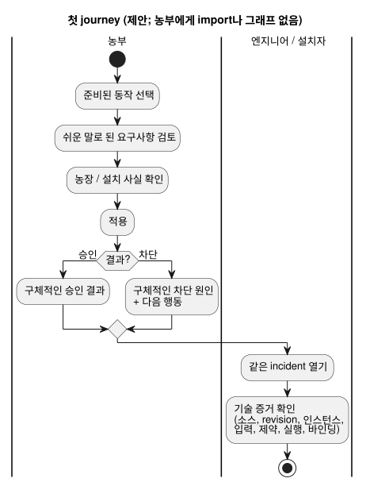

<!-- translation-source: docs/research/GF-COMPOSE-R1-USER-OUTCOMES.md -->
[영문 원문](GF-COMPOSE-R1-USER-OUTCOMES.md)

# GF-COMPOSE R1: 사용자 결과와 측정 프로토콜

상위 항목: [#99](https://github.com/callin2/ghostflow-language/issues/99)
이슈: [#100](https://github.com/callin2/ghostflow-language/issues/100)
조사한 증거 revision: `ffdbc96461eca67908252507fb851fa4dabd9a2c`
상태: 연구/설계. 참여자 세션이나 수치 기준선(baseline)은 아직 완료되지 않았습니다.

이 문서는 behavior 조합(composition)이 사용자를 위해 무엇을 달성해야 하는지,
그리고 그것을 어떻게 측정할지 정의합니다. 다루는 내용은 다음과 같습니다.

- 사용자 문제와 첫 번째 end-to-end 여정(journey)
- 조사한 revision이 이미 제공하는 것(그리고 제안에 불과한 것)
- 다섯 가지 시나리오, 측정 시트, 그리고 자동화와 사람의 지식을 구분하는 서면
  walkthrough
- 권고안, 소유자가 지정된 열린 질문, 그리고 이 문서를 어떻게 검증했는지

## 사용자 문제

세 집단은 같은 시스템에서 서로 다른 답을 필요로 합니다.

| 누구 | 필요한 것 |
|---|---|
| 농부 | 기술적 결정을 최소화하면서 준비된 동작(behavior)을 적용합니다. 자기 농장에 무엇이 필요한지, 동작이 차단되면 무엇을 해야 하는지 알아야 합니다. |
| 소프트웨어 엔지니어와 동작 작성자 | 결과 뒤에 있는 정확한 정의, revision, 인스턴스, 입력, 상태, 제약 판단 |
| 하드웨어 엔지니어와 설치자 | 설치 바인딩, 적용 결과, 이용 가능한 물리 피드백 |

제품 결과는 **노력 감소**, **설명 가능성 향상**, **추적 가능성 향상**입니다.

첫 번째 여정은 다음과 같습니다.

1. 준비된 동작을 선택합니다.
2. 쉬운 말로 된 요구사항을 검토합니다.
3. 농장/설치 사실을 확인합니다.
4. 적용합니다.
5. 구체적인 승인 결과 또는 구체적인 차단 원인을 받습니다.
6. 같은 incident(사고)를 열어 기술 증거를 확인합니다.

농부의 어떤 단계도 import나 그래프를 요구하지 않습니다. 아래 다이어그램은 같은
여정을 농부의 단계와 공유되는 incident 보기로 나누어 보여 줍니다.

## 조사한 revision의 증거

다음 사실은 조사한 revision에서 나온 것입니다. 조합 자체에 관한 내용은 모두 아직
제안입니다.

- **컴파일러 입력.** `compileSource`는 하나의 정본 `.ghost.md` 문서형 소스(literate
  source)를 받아 소스 identity를 보존합니다. 따라서 제품 조합과 import된 소스의
  provenance(출처)는 제안이며 현재 컴파일러 동작이 아닙니다.
  [`tools/compile-source.mjs`](../../tools/compile-source.mjs)를 참조하세요.
- **상호작용(interaction) 계약.** 정적 descriptor와 완료된 런타임 관측을
  정의합니다. 정확한 schema, module, source, run join을 요구하며, `stale`은 검증하는
  소비자가 도출합니다. 현재는 읽기 전용 `state`와 `timer` descriptor만 허용합니다.
  [`contracts/interaction-v0/README.ko.md`](../../contracts/interaction-v0/README.ko.md)를
  참조하세요.
- **통합(integration) 계약.** source/module/device/profile/installation identity를
  서로 구분합니다. 호스트 통과가 하드웨어나 물리적 성공을 입증하지 않으며, 없는
  증거는 알 수 없음(unknown)으로 남습니다.
  [`contracts/integration-v1/README.ko.md`](../../contracts/integration-v1/README.ko.md)를
  참조하세요.
- **로컬 조합 요약.** 참여자별 보기를 갖는 하나의 event를 제안합니다. 이것은 설계
  권고이며 구현된 동작이 아닙니다. 프런트엔드, API, Device는
  [`AGENTS.md`](../../AGENTS.ko.md)에 명시된 소유자로 남습니다.

## 표와 예

표를 읽을 때 두 가지를 주의하세요.

- “현재 노력” 칸은 명시적으로 **가상의** workflow입니다.
- walkthrough는 **손으로 분석한** 것이며, 실행 증거나 참여자 증거가 아닙니다.

| 시나리오 | 참여자 | 계기 | 현재 노력 / 가설 | 필요한 사용자 결정 | 제안하는 표시 답변 | 뒷받침하는 증거 | 성공 기준 |
|---|---|---|---|---|---|---|---|
| 관수 적용 | 농부 | 준비된 관수 동작을 적용하려 함 | 가설: 기술 요구사항을 읽고, 적합성이나 바인딩이 불분명하면 엔지니어에게 문의함 | 현장, 수원, 필요한 설치 사실 확인 | “여기에 관수를 적용할 수 있습니다.” 필요한 사실, 확인된 바인딩, revision 표시 | 소스/모듈 identity, 타입이 있는 논리 바인딩, 설치 identity | 설정 단계, 기술적 결정, 정정, 도움 요청을 기록함. 농부가 무엇이 확인되었는지 말할 수 있음 |
| 환기 추가 | 농부, 설치자 | 관수 이후 팬 4대 환기 동작을 추가함 | 가설: 기존 관수 배선이 바뀌는지 수동으로 확인함 | 팬 수, 이용 가능한 출력, 물리 설치 사실 확인 | “환기는 호환됩니다.” 또는 이름이 붙은 unknown/차단 원인. 기존 관수 바인딩이 그대로임을 표시 | 통합 바인딩, 정확한 profile 및 설치 revision, 제안된 조합 호환성 결과 | 설명 없는 재바인딩이 없음. 사용자가 필요한 각 결정과 unknown을 식별함 |
| 펌프 소유권 충돌 거부 | 농부, 소프트웨어 엔지니어 | 두 동작 인스턴스가 한 펌프의 배타적 소유권을 주장함 | 가설: 충돌을 늦게 발견하거나 엔지니어 로그에서만 설명함 | 소유자 하나를 선택하거나 충돌하는 동작을 제거/변경 | “적용할 수 없습니다: 펌프 X를 동작 A와 동작 B가 함께 소유하려 합니다.” 두 논리 포트 identity 표시 | 선언된 출력/포트 identity, 제안된 첫 프로필의 배타적 소유권 규칙 | 배포 전에 충돌을 거부함. 두 사용자 모두 충돌하는 주장을 식별할 수 있음 |
| 저수위 차단 설명 | 농부, 소프트웨어 엔지니어 | 펌프 ON이 요청된 상태에서 `low_water=true` | 가설: 농부는 “관수가 시작되지 않음”만 보고, 엔지니어는 입력과 규칙을 따로 재구성함 | 농부는 탱크나 저수위 설비를 점검. 엔지니어는 정확한 실행과 규칙을 검증 | 농부: “저수위 신호 때문에 관수가 차단되었습니다. 탱크를 확인하세요.” 엔지니어: 같은 incident가 `low_water`, 제약, 요청 출력, 안전 출력, 실행에 연결됨 | 완료된 스캔 identity, 입력/제약 provenance, 요청 출력과 해석된 안전 출력의 구분 | 농부가 탱크가 비었다고 주장하지 않고 신호와 다음 행동을 말함. 엔지니어가 뒷받침하는 입력과 제약에 도달함 |
| 명령 실패 또는 피드백 부재 조사 | 농부, 소프트웨어 엔지니어, 설치자 | 명령은 발행되었지만 렌더러 적용이 실패하거나 피드백이 없음 | 가설: 명령, 장치 실패, 물리 결과가 뒤섞임 | 엔지니어/설치자가 이용 가능한 증거를 파악하고 없는 관측을 요청 | “명령이 요청되었지만 적용에 실패했습니다.” 또는 “명령 결과 알 수 없음: 피드백 없음.” 마지막으로 알려진 identity와 공백 표시 | 통합 실행 게이트, 가능할 때 장치 관측. 물리 증거는 별도로 유지 | 진단 노력과 증거 탐색 노력이 줄어듦. 근거 없는 물리적 성공 주장이 없음 |

### 측정 시트

데이터는 두 단계로 수집합니다.

1. 같은 fixture를 사용하는 다섯 시나리오의 스크립트 walkthrough
2. 이후 농부, 동작 작성자, 설치자와 진행자가 있는 세션

모든 답변마다 타임스탬프, 행위자, 시나리오, 소스 revision, 설치 revision, 그리고
답변이 휴리스틱 walkthrough에서 나왔는지 실제 참여자에게서 나왔는지 기록합니다. 이
두 증거 종류를 합쳐서 집계하지 마세요.

| 측정 항목 | 수집 방법 | 기준선 상태 | 바라는 해석 |
|---|---|---|---|
| 설정 단계 | 동작 선택부터 적용/거부 결과까지의 순서 있는 행동 수를 셈 | 미측정. 첫 휴리스틱 walkthrough에서 셈 | 필요한 농장 결정을 숨기지 않으면서 단계가 줄어듦 |
| 기술적 결정 | 타입, 포트, 의존성, 소유권, revision 지식이 필요한 결정 수를 셈 | 미측정. 먼저 휴리스틱으로 셈 | 농부는 필요한 선택만 보고, 엔지니어는 정밀한 선택을 유지함 |
| 정정 | 유효한 결과 전에 잘못되었거나 바뀐 바인딩, 설정, 선택의 수를 셈 | 미측정 | 구체적이고 이른 피드백이 재작업을 줄임 |
| 도움 요청 | 엔지니어/설치자 도움 요청 수와 이유를 셈 | 미측정 | 요청 범위가 좁아지고 증거에 연결됨 |
| 설명 정확성 | 참여자에게 차단 원인, 영향, 다음 행동을 자기 말로 설명하게 하고, 뒷받침되는 증거를 기준으로 채점함 | 참여자 증거 없음. 휴리스틱 정답 기준만 있음 | 신호를 넘어서는 추론이 없음. 저수위 답변은 탱크가 비었다고 말해서는 안 됨 |
| 증거 탐색 노력 | 소스, 입력, 제약, 실행, 바인딩, 이용 가능한 피드백에 도달하기까지의 화면/기록 수와 경과 시간을 셈 | 미측정. 손으로 분석한 경로만 있음 | 같은 incident가 농부 보기와 엔지니어 보기 모두에 쓰임 |
| 미해결 사례 | unknown/누락/stale 증거 사례 수와 소유자가 명시되었는지를 셈 | 미측정 | unknown이 통과나 성공으로 바뀌지 않고 계속 드러남 |

### 서면 walkthrough와 자동화 경계

각 시나리오에서 첫 문장은 소프트웨어가 검사할 수 있는 것을, 나머지는 여전히 농장이나
설치 지식을 가진 사람이 필요한 것을 말합니다.

1. **관수 적용:** descriptor와 바인딩 검사를 자동화합니다. 농장/현장 적합성과 수원
   확인에는 농장 지식이 필요합니다.
2. **환기 추가:** 조합 계약이 생기면 타입/용량 검사와 기존 상태 보존 검사를
   자동화합니다. 팬 배치와 물리적 용량에는 설치자 지식이 필요합니다. 현재의 팬 4대
   결과는 제안된 fixture이며 테스트된 결과가 아닙니다.
3. **소유권 충돌:** 두 배타적 논리 소유자의 탐지와 거부를 자동화합니다. 원하는
   소유자를 고르는 것은 사람의 결정입니다.
4. **저수위:** 완료된 스캔을 입력, 제약, 요청 출력, 안전 출력, 실행에 join하는 것을
   자동화합니다. 탱크 점검과 운영 대응 결정에는 농장 지식이 필요합니다. 변하지 않는
   답은 **“저수위 신호 때문에 관수가 차단되었습니다. 탱크를 확인하세요.”**입니다. 이
   신호는 탱크가 비었다는 것을 증명하지 않습니다.
5. **명령 실패/피드백 부재:** 증거가 있을 때 identity join과, 요청됨·적용됨·관측됨
   상태의 구분을 자동화합니다. 배선 점검, 재시도, 설치자 호출 중 무엇을 할지는
   사람/설치 지식의 영역입니다. 없는 피드백은 unknown으로 남습니다.

이후 참여자 검증을 위해 세 가지 질문이 남아 있습니다. 이것은 열린 질문이며 인터뷰
결과가 아닙니다.

1. 농부가 컴파일러 용어를 몰라도 적합성을 판단할 수 있게 하는 최소한의 요구사항
   문구는 무엇인가? 소유자: 프런트엔드/제품, 농부 세션과 함께.
2. 소프트웨어 엔지니어와 설치자가 이해할 수 있으면서 가장 빠른 증거 탐색 순서는
   무엇인가? 소유자: 프런트엔드/API, 사용성 및 진단 세션과 함께.
3. 실제 설치 환경에서 어떤 명령 적용 상태와 물리 피드백 상태를 얻을 수 있으며, 각각
   누가 기록하는가? 소유자: API/Device, 시운전(commissioning) 증거 검토와 함께.

## 권고

- 다섯 시나리오 여정과 측정 시트를 조합 연구의 승인 프로토콜로 **채택**합니다.
- 참여자 문구를 계약에 이미 표현된 정확한 source/module/instance/run 및 설치
  identity에 join하는 작은 결과 레코드를 **우선**합니다.
- interaction 및 integration identity 규칙을 **재사용**합니다.
- 이 이슈에서는 그래프 편집기, 텔레메트리 파이프라인, 새 저장 시스템을 **추가하지
  않습니다**.

첫 번째 구현 측 요구사항은 구체적인 차단 원인이나 승인 결과를 담은 농부가 읽을 수
있는 결과와, 같은 event에 대한 엔지니어 보기여야 합니다.

소유권은 지금 있는 곳에 그대로 둡니다.

- 설명과 event 의미는 #88/#74에 남습니다.
- 물리 관측은 Device가 소유합니다.
- 빠져 있는 명령/설명 descriptor는 해결되지 않은 계약 작업이며, 오늘 존재한다는
  증거가 아닙니다.

## 해결되지 않은 질문과 소유자

| 소유자 | 열린 질문 |
|---|---|
| #70 / interaction 소유자 | 명령, 입력, event, 설명 descriptor가 정확한 join을 유지하면서 interaction-v0을 확장할지, 한다면 어떻게 할지 |
| #88 / 설명 소유자와 #74 / event 소유자 | 요청 출력, 안전 출력, 적용 결과, 피드백 부재를 위한 정본 incident 필드 |
| API/Device 소유자 | 설치/적용/물리 증거의 보존과 전송. 언어 저장소가 이를 암묵적으로 정해서는 안 됩니다. |

## 검증

- 다섯 행을 승인 기준과 대조했습니다. 각 행에는 참여자, 부담, 보이는 결과, 증거
  출처가 있으며 어느 행도 import나 그래프를 요구하지 않습니다.
- 측정 시트를 확인했습니다. 모든 기준선은 명시적으로 미측정이거나 휴리스틱이며,
  성공률, 인터뷰 결과, 런타임/물리 테스트를 주장하지 않습니다.
- 서면 walkthrough를 확인했습니다. 자동화와 농장/설치 지식이 구분되어 있고, 이후
  검증 질문이 정확히 세 개 나열되어 있으며, 모든 기능이 노력, 설명, 추적 가능성 중
  하나에 대응합니다.
- 커밋 `ffdbc96461eca67908252507fb851fa4dabd9a2c`를 조사했습니다. 런타임 테스트는
  실행하지 않았습니다. 이 문서는 권고와 손으로 한 분석이며 실행 증거가 아닙니다.
- `git diff --check`와 상대 링크 점검은 이 파일이 공유 worktree에 보인 뒤 코디네이터가
  수행해야 하는 인수인계 검사입니다.
