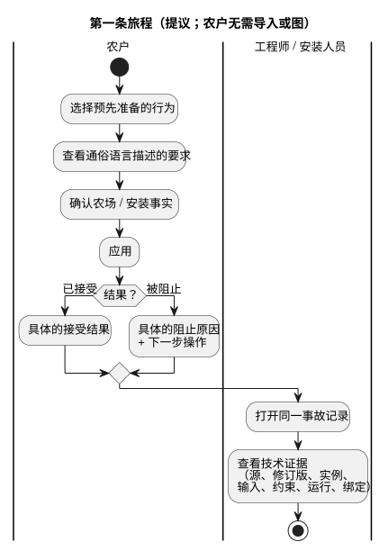

<!-- translation-source: docs/research/GF-COMPOSE-R1-USER-OUTCOMES.md -->
[英文原文](GF-COMPOSE-R1-USER-OUTCOMES.md)

# GF-COMPOSE R1：用户成果与测量协议

父 issue：[#99](https://github.com/callin2/ghostflow-language/issues/99)
Issue：[#100](https://github.com/callin2/ghostflow-language/issues/100)
所检查的证据修订版：`ffdbc96461eca67908252507fb851fa4dabd9a2c`
状态：研究/设计。尚未完成任何参与者会话，也没有数值基线。

本文定义行为组合必须为用户实现什么，以及如何测量。内容包括：

- 用户问题和第一条端到端旅程；
- 所检查的修订版已经提供了什么（以及哪些仅为提议）；
- 五个场景、一张测量表，以及一次将自动化与人类知识区分开的纸面走查；
- 建议、带负责人的未决问题，以及本文的检查方式。

## 用户问题

三类人需要从同一系统中得到不同的答案：

| 谁 | 他们需要什么 |
|---|---|
| 农户 | 以很少的技术决策应用一个预先准备的行为。了解自己的农场需要什么，以及某个动作被阻止时应该做什么。 |
| 软件工程师和行为作者 | 某个结果背后确切的定义、修订版、实例、输入、状态和约束判定。 |
| 硬件工程师和安装人员 | 安装绑定、应用结果，以及可用的物理反馈。 |

产品成果是**减少工作量**、**提高可解释性**和**提高可追溯性**。

第一条旅程如下：

1. 选择一个预先准备的行为。
2. 查看用通俗语言描述的要求。
3. 确认农场/安装事实。
4. 应用。
5. 得到一个具体的接受结果，或一个具体的阻止原因。
6. 打开同一事故（incident）记录，查看技术证据。

农户的任何步骤都不需要导入（import）或图。下图展示同一旅程，并将农户的步骤与共享的事故视图分开。

## 所检查修订版中的证据

以下事实来自所检查的修订版。凡是关于组合本身的内容，仍然只是提议。

- **编译器输入。** `compileSource` 接受一个规范的 `.ghost.md` 文学式源文件（literate），并保留源的身份标识。因此，产品组合和导入源的来源（provenance）属于提议，而不是当前编译器的行为。见 [`tools/compile-source.mjs`](../../tools/compile-source.mjs)。
- **交互契约。** 它定义静态描述符（descriptor）和已完成的运行时观测。它要求 schema、模块、源和运行之间精确关联；`stale` 由进行验证的消费方推导。目前它只允许只读的 `state` 和 `timer` 描述符。见 [`contracts/interaction-v0/README.md`](../../contracts/interaction-v0/README.zh.md)。
- **集成契约。** 它让源/模块/设备/profile/安装的身份标识彼此区分。宿主（host）测试通过并不能证明硬件或物理层面的成功，缺失的证据仍为未知。见 [`contracts/integration-v1/README.md`](../../contracts/integration-v1/README.zh.md)。
- **本地组合摘要。** 它提议使用一个事件，并为不同参与者提供各自的视图。这是设计建议，而不是已实现的行为。前端、API 和 Device 仍是 [`AGENTS.md`](../../AGENTS.zh.md) 中所述的负责方。

## 表格与示例

阅读这些表格时请注意两点：

- “当前工作量”单元格明确是**假设性**的工作流程。
- 走查是**人工推演**的；它不是执行证据，也不是参与者证据。

| 场景 | 参与者 | 触发条件 | 当前工作量 / 假设 | 必要的用户决策 | 提议的可见答案 | 支撑证据 | 成功衡量标准 |
|---|---|---|---|---|---|---|---|
| 应用灌溉 | 农户 | 想要应用一个预先准备的浇水行为 | 假设：阅读技术要求，在适用性或绑定不明确时询问工程师 | 确认场地、水源以及所需的安装事实 | “此处可以应用灌溉”；显示所需事实、已确认的绑定和修订版 | 源/模块身份标识；带类型的逻辑绑定；安装身份标识 | 记录设置步骤、技术决策、纠正和求助请求；农户能说出确认了什么 |
| 添加通风 | 农户、安装人员 | 在灌溉之后添加一个四风机通风行为 | 假设：手动检查现有灌溉接线是否会改变 | 确认风机数量、可用输出和物理安装事实 | “通风兼容”，或一个具名的未知项/阻止原因；显示现有灌溉绑定保持不变 | 集成绑定；确切的 profile 和安装修订版；提议的组合兼容性结果 | 没有无法解释的重新绑定；用户能识别每个所需决策和每个未知项 |
| 拒绝水泵所有权冲突 | 农户、软件工程师 | 两个行为实例声称独占同一台水泵 | 假设：冲突发现得晚，或只在工程日志中得到解释 | 选择一个所有者，或移除/修改冲突的行为 | “无法应用：水泵 X 被行为 A 和行为 B 同时声明”；显示两者的逻辑端口身份标识 | 已声明的输出/端口身份标识；提议的第一版 profile 独占所有权规则 | 冲突在部署前被拒绝；两类用户都能识别冲突的声明 |
| 解释低水位阻止 | 农户、软件工程师 | 请求水泵 ON 时 `low_water=true` | 假设：农户只看到“浇水没有开始”；工程师需分别重建输入和规则 | 农户检查水箱或低水位装置；工程师核实确切的运行和规则 | 农户：“浇水被低水位信号阻止；请检查水箱。”工程师：同一事故链接到 `low_water`、约束、请求的输出、安全输出和运行 | 已完成扫描的身份标识；输入/约束的来源；请求输出与解析后安全输出的对比 | 农户能说出信号和下一步操作，而不声称水箱是空的；工程师能找到支撑该结论的输入和约束 |
| 调查命令失败或反馈缺失 | 农户、软件工程师、安装人员 | 命令已发出，但渲染器（renderer）应用失败或缺少反馈 | 假设：命令、设备故障和物理结果被混为一谈 | 工程师/安装人员识别哪些证据可用，并请求缺失的观测 | “已请求命令；应用失败”或“命令结果未知：缺少反馈”；显示最后已知的身份标识和缺口 | 集成运行关卡；可用时的设备观测；物理证据保持独立 | 诊断工作量和证据导航工作量降低；没有缺乏支撑的物理成功声明 |

### 测量表

分两个阶段收集数据：

1. 对五个场景进行脚本化走查，全部使用同一个测试夹具（fixture）。
2. 之后，与农户、行为作者和安装人员进行有主持人的会话。

对于每个答案，记录时间戳、执行者、场景、源修订版、安装修订版，以及该答案来自启发式走查还是真实参与者。不要将这两类证据合并。

| 指标 | 收集方法 | 基线状态 | 期望的解读 |
|---|---|---|---|
| 设置步骤 | 统计从选择行为到得到已应用/已拒绝结果的有序动作数 | 未测量；在第一次启发式走查中计数 | 步骤更少，同时不隐藏必要的农场决策 |
| 技术决策 | 统计需要类型、端口、依赖、所有权或修订版知识的决策数 | 未测量；先进行启发式计数 | 农户只看到必要的选择；工程师保留精确的选择 |
| 纠正 | 统计得到有效结果之前错误/更改的绑定、设置或选择数 | 未测量 | 具体的早期反馈减少返工 |
| 求助请求 | 统计请求工程师/安装人员帮助的次数及原因 | 未测量 | 请求变得更窄，并与证据关联 |
| 解释正确性 | 请参与者复述阻止原因、影响和下一步操作；对照所支撑的证据评分 | 无参与者证据；只有启发式答案要点 | 不超出信号本身做推断；低水位的回答不得说水箱是空的 |
| 证据导航工作量 | 统计到达源、输入、约束、运行、绑定和可用反馈所需的屏幕/记录数和耗时 | 未测量；只有人工推演的路径 | 同一事故同时服务农户视图和工程师视图 |
| 未解决的情况 | 统计未知/缺失/陈旧（stale）证据的情况数，以及是否指明了负责人 | 未测量 | 未知保持可见，而不是变成通过或成功 |

### 纸面走查与自动化边界

对每个场景，第一句话说明软件可以检查什么；其余部分说明哪些仍需要具备农场或安装知识的人来完成。

1. **应用灌溉**：自动进行描述符和绑定检查。农场/场地的适用性和水源确认需要农场知识。
2. **添加通风**：一旦存在组合契约，就自动进行类型/容量检查和保持不变检查。风机布置和物理容量需要安装人员的知识。当前的四风机结果是提议的测试夹具，而不是经过测试的结果。
3. **所有权冲突**：自动检测并拒绝两个独占的逻辑所有者。选择期望的所有者是人的决策。
4. **低水位**：自动将已完成的扫描与输入、约束、请求的输出、安全输出和运行关联起来。检查水箱和决定运行上的应对措施需要农场知识。不变的答案是**：“浇水被低水位信号阻止；请检查水箱。”** 该信号并不能证明水箱是空的。
5. **命令失败/反馈缺失**：在有证据时，自动进行身份标识关联，并区分请求、应用和观测这几种状态。决定是检查接线、重试还是联系安装人员，属于人/安装方面的知识。缺失的反馈仍为未知。

还有三个问题留待之后的参与者验证。它们是未决问题，而不是访谈结果：

1. 什么样的最低要求措辞能让农户在不理解编译器术语的情况下判断适用性？负责人：前端/产品，配合农户会话。
2. 什么样的证据导航顺序最快，同时仍能让软件工程师和安装人员理解？负责人：前端/API，配合可用性和诊断会话。
3. 在真实安装中，哪些命令应用状态和物理反馈状态是可用的，各由谁记录？负责人：API/Device，配合调试投运证据评审。

## 建议

- **采用**五场景旅程和测量表，作为组合研究的验收协议。
- **优先**实现一个小型结果记录，将参与者措辞与契约中已表示的确切源/模块/实例/运行和安装身份标识关联起来。
- **复用**交互契约和集成契约的身份标识规则。
- **不要在**本 issue 中添加图编辑器、遥测管道或新的存储系统。

第一个面向实现的需求应当是：一个农户可读的结果（带有具体的阻止原因或接受结果），外加同一事件的工程师视图。

所有权保持不变：

- 解释和事件语义仍归 #88/#74 负责。
- 物理观测仍归 Device 负责。
- 缺失的命令/解释描述符是尚未解决的契约工作，不能当作它们今天已经存在的证据。

## 未解决的问题与负责人

| 负责人 | 未决问题 |
|---|---|
| #70 / 交互负责人 | 命令、输入、事件和解释描述符是否以及如何扩展 interaction-v0，同时保留精确关联。 |
| #88 / 解释负责人和 #74 / 事件负责人 | 请求的输出、安全输出、应用结果和缺失反馈的规范事故字段。 |
| API/Device 负责人 | 安装/应用/物理证据的保留与传输。语言仓库不得擅自替它们做出选择。 |

## 验证

- 对照验收标准检查了五行：每行都有参与者、负担、可见结果和证据来源；没有一行需要导入或图。
- 检查了测量表：每个基线都明确标为未测量或启发式；没有声称任何成功百分比、访谈结果或运行时/物理测试。
- 检查了纸面走查：自动化与农场/安装知识已分开；恰好列出了三个之后的验证问题；每项能力都对应到工作量、解释或可追溯性。
- 检查了提交 `ffdbc96461eca67908252507fb851fa4dabd9a2c`。没有运行任何运行时测试。本文是建议和人工推演的分析，而不是执行证据。
- 本文件在共享工作树中可见后，`git diff --check` 和相对链接检查是协调者交接时必需的检查。
