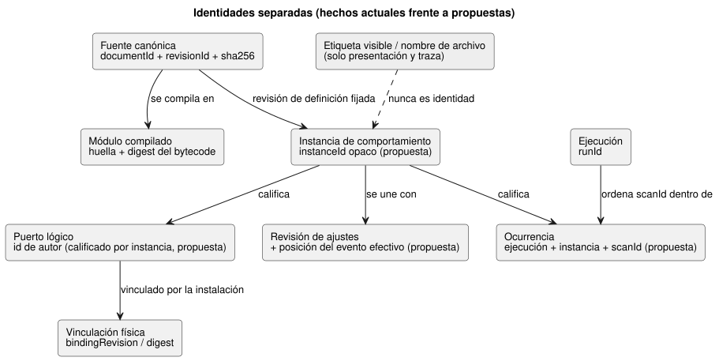
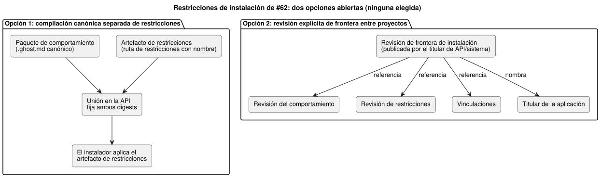

<!-- translation-source: docs/research/GF-COMPOSE-R2-AUTHORITY-IDENTITY.md -->
[Original en inglés](GF-COMPOSE-R2-AUTHORITY-IDENTITY.md)

# GF-COMPOSE R2: autoridad e identidad

Esta nota decide quién tiene la autoridad sobre cada concepto de composición y
qué identidades deben mantenerse separadas. Abarca la evidencia actual, una
matriz de autoridad, las reglas de cambio de identidad, la política de grafos y
ciclos por proyección, el conflicto abierto sobre las restricciones de
instalación (#62) con el contexto de memoria operativa (#68), y la
recomendación resultante con sus responsables.

## Problema del usuario

Una bomba mostrada en pantalla, la traza de un ingeniero y una instalación
física no deben tratarse en silencio como si fueran lo mismo. La composición
necesita identidades **vinculadas** sin convertir una vista de grafo en una
segunda fuente ejecutable.

La recomendación que sigue:

- mantiene la autoridad de las reglas canónicas `.ghost.md`;
- mantiene la ejecución en el núcleo de Rust;
- hace explícitas las responsabilidades de la API, Device y el frontend.

## Evidencia en la revisión examinada

La evidencia se examinó en `ffdbc96461eca67908252507fb851fa4dabd9a2c` (el
`HEAD` del árbol de trabajo). Todo lo que aparece en esta sección es un hecho
implementado en el código o en un contrato, no una propuesta de composición.

**Compilador.** `compileSource` acepta una única fuente literaria (literate)
canónica y almacena `sourceDocument` (`format`, `kind`, `filename`, `text`,
`sha256`). Puede emitir una identidad de interacción que contiene `documentId`
y `revisionId`. El compilador también emite la procedencia de la huella
(fingerprint) del módulo y del bytecode, así como mapas de fuente. El nombre de
archivo y las ubicaciones en la fuente son coordenadas de traza, no identidad
pública.

**Contrato de interacción.** Actualmente une los descriptores estáticos y las
instantáneas completadas mediante:

- documento/revisión de la fuente;
- ID/huella del módulo/digest del bytecode;
- digest del esquema;
- `runId`.

`scanId` solo está ordenado dentro de una ejecución. Un reinicio o una nueva
ejecución debe cambiar `runId`; por lo tanto, `scanId=0` en dos ejecuciones no
es una misma ocurrencia.

**Anclas de intención y restricciones.** El mapa de anclas de intención indica
que la procedencia generada no es fuente editable y que no infiere ni aprueba
la intención. `docs/CONSTRAINTS.md` describe una ruta acotada de restricciones
con nombre, propiedad del host, y establece que las vinculaciones de
instalación son externas a la fuente de control. El parser de control actual
rechaza la construcción `constraints`, y el parser independiente de
restricciones está limitado deliberadamente. Este documento no afirma que
exista un runtime unificado de restricciones.

## Tablas y ejemplos

### Matriz de autoridad

Cada fila nombra un concepto, quién es su titular hoy, qué campos de identidad
ya existen y qué añadiría la composición (solo como propuesta).

| Concepto | Titular con autoridad actual | Campos de identidad existentes | Adición de composición propuesta | Referencia de evidencia |
|---|---|---|---|---|
| Fuente canónica | Almacenamiento de revisiones de fuente del lenguaje/API | `documentId`, `revisionId`, `sha256` de la fuente, `kind=literate` | Conservar el cierre exacto de la fuente y cada revisión importada; nunca usar el nombre de archivo ni la etiqueta | [`compile-source.mjs`](../../tools/compile-source.mjs); [`interaction-v0`](../../contracts/interaction-v0/README.md) |
| Revisión de definición importada | Orquestación de paquetes/revisiones de la API, con validación del lenguaje | Identidades del documento/revisión de la fuente y del módulo compilado | Añadir una arista de importación inmutable fijada a la revisión exacta; no importar por nombre visible | [`interaction-v0`](../../contracts/interaction-v0/README.md); [`PORTABLE-PACKAGE.md`](../PORTABLE-PACKAGE.es.md) |
| Instancia de comportamiento | Registro de composición/despliegue de la API; el núcleo de Rust la ejecuta | No hay establecido ningún campo público de instancia actual | Añadir un `instanceId` opaco y vincularlo a la revisión de la definición; el estado/la procedencia de la instancia deben estar aislados | El contrato de interacción tiene identidad de ejecución pero ningún campo de instancia de composición; propuesta |
| Puerto lógico | Declaración del manifiesto del lenguaje/compilador | `id`/`name` del descriptor escrito por el autor, tipo de elemento, tipo, procedencia del mapa de fuente | Conservar un ID de puerto estable escrito por el autor; añadir calificación por instancia, no una ruta visible renombrada | [`interaction-v0`](../../contracts/interaction-v0/README.md); [`integration-v1`](../../contracts/integration-v1/README.md) |
| Equipo/vinculación física | Perfil de Device y contexto de instalación de la API | `bindingRevision`, placa/perfil y mapeo explícito de nombre lógico a endpoint | Añadir la revisión/digest de la vinculación a la unión compuesta; el ID físico no es el ID del puerto lógico | [`integration-v1`](../../contracts/integration-v1/README.md); [`PORTABLE-PACKAGE.md`](../PORTABLE-PACKAGE.es.md) |
| Ajustes | Contexto de instalación de la API/del operador; los valores predeterminados ejecutables siguen perteneciendo a la fuente | Aquí no se implementa ninguna identidad general de ajustes de composición | Unir las propiedades de runtime por revisión de ajustes y posición del evento efectivo, distintas de la identidad de fuente/programa/ejecución; los parámetros de importación se mantienen separados | [`CONSTRAINTS.md`](../CONSTRAINTS.es.md); #89/#90 |
| Ocurrencia de runtime | Productor de instantáneas del host/runtime | `runId`, `scanId` de finalización, tiempo lógico | Añadir una clave de ocurrencia calificada por instancia derivada de ejecución + instancia + escaneo; no reemplazar `runId` ni redefinir `scanId` | [`interaction-v0`](../../contracts/interaction-v0/README.md) |

Los campos propuestos son solo recomendaciones de diseño. Esta investigación no
autoriza ningún nuevo generador de identificadores, esquema de transmisión ni
ABI.

El diagrama resume cómo se relacionan estas identidades. Los recuadros marcados
como «propuesta» no existen en ningún contrato actual.

**Nota de corrección (2026-09-20).** Las uniones de identidad deben distinguir
la identidad de programa/ejecución de una revisión de ajustes en vivo y de la
posición del evento efectivo. Se trata de una enmienda de diseño acordada,
**no** de un comportamiento implementado:

- Las propiedades ajustables en runtime son eventos en vivo aprobados. Una
  acción sobre varias propiedades se valida de forma atómica y cambia todas
  las propiedades o ninguna.
- Los cambios aceptados se aplican cuando se procesan, incluso durante la
  lógica activa. No requieren recompilar, ni un nuevo programa/ejecución, ni
  detener todo el controlador.
- Las propiedades persisten a través de reinicios reales del ESP, mientras que
  un reinicio físico crea una nueva identidad de ejecución.
- El requisito anterior de configurar con el sistema detenido (Configure) en
  [`CONSTRAINTS.md`](../CONSTRAINTS.es.md) y [`LANGUAGE.md`](../LANGUAGE.es.md)
  debe conciliarse en #89/#90.
- El auxiliar actual de reescritura de fuente/recompilación no es esta ruta en
  vivo.
- No se implica ningún reinicio implícito ni ninguna reinterpretación de
  uniones con programas obsoletos.
- La durabilidad, el orden, la ABI y la verificación siguen siendo lagunas de
  diseño.

### Matriz de cambios de identidad

Para cada evento, la columna central indica qué permanece igual y la columna
derecha indica qué cambia.

| Evento | Identidad lógica estable | Efecto sobre la revisión exacta / la ocurrencia |
|---|---|---|
| Cambio del nombre visible | Sin cambios en la definición, la instancia, el puerto lógico ni la vinculación | Solo cambia la etiqueta de la interfaz; no se autoriza ninguna nueva vinculación física |
| Mover la ubicación de la fuente | La identidad del documento no cambia si se mueve el mismo documento almacenado | La revisión/el digest de la fuente pueden no cambiar; las coordenadas de la fuente pueden cambiar. Una nueva revisión escrita por el autor debe llevar un nuevo `revisionId` y un nuevo digest |
| Dos instancias de una definición | Misma revisión de definición; `instanceId` distintos y estado/temporizadores/procedencia aislados | Cada instancia recibe su propia unión de vinculación/ajustes y su propio espacio de nombres de ocurrencias de runtime |
| Actualización de la fuente | Misma definición lógica solo si la API declara explícitamente la continuidad | Nuevo `revisionId`, nuevo digest de la fuente y, normalmente, nuevas identidades de módulo/artefacto; el despliegue debe seleccionar explícitamente la nueva revisión |
| Cambio de vinculación | El puerto lógico y la instancia de comportamiento se mantienen estables | Nueva revisión/digest de la vinculación y una nueva decisión de instalación/despliegue; cambia la identidad del endpoint físico |
| Reinicio | La definición, la instancia y la vinculación pueden mantenerse estables | Nuevo `runId`; `scanId` puede volver a cero. Una ocurrencia de runtime nunca se identifica solo por `scanId` |

**Ejemplo desarrollado** (elaborado a mano, no es evidencia de ejecución):

- `east-irrigation` y `west-irrigation` hacen referencia a una misma revisión
  inmutable de la definición.
- Tienen ID de instancia, almacenes de estado/temporizadores, uniones de
  ajustes y procedencia distintos.
- Cambiar el nombre visible de la bomba este no cambia ni su vinculación ni su
  puerto lógico.
- Después de un reinicio, `run-A/scanId=0` y `run-B/scanId=0` son ocurrencias
  distintas.

### Proyecciones de grafo y política de ciclos

Debería haber varias proyecciones tipadas, no una ontología universal. Cada
proyección tiene su propio significado de arista y su propia regla de ciclos:

| Proyección | Significado de arista permitido | Política de ciclos |
|---|---|---|
| Dependencias de importación | Una revisión de definición importa una revisión de definición exacta | Recomendación: rechazar los ciclos de dependencia antes de la compilación; un ciclo de visualización/referencia no es un ciclo de importación ejecutable |
| Evaluación dentro de un escaneo | Arista de lectura/dependencia entre expresiones, puertos y salidas | Invariante existente: rechazar los ciclos de dependencia instantáneos. La retroalimentación de estado solo es legal mediante la semántica existente de estado anterior/estado siguiente entre escaneos |
| Explicación | Un resultado/decisión apunta al nodo de la fuente, al ancla, a la decisión de restricción y al contexto exacto | Recomendación: permitir referencias convergentes y evidencia repetida; los ciclos son errores de datos, no retroalimentación de runtime |
| Relaciones entre equipos | Un puerto lógico está vinculado a un endpoint/equipo, o varios equipos comparten un recurso | Recomendación: permitir grafos de equipos con tipos de relación explícitos; no inferir el orden de ejecución a partir de la topología; rechazar la titularidad ambigua |
| Historia a lo largo del tiempo | Una ocurrencia sigue a una ocurrencia anterior en la misma ejecución, instancia y orden temporal | Recomendación: permitir los ciclos temporales como eventos repetidos, pero exigir una coordenada de ocurrencia ordenada; nunca colapsar los reinicios en una sola historia |

Estos significados de arista son recomendaciones acotadas. No definen una base
de datos de grafos universal, una serialización ni una ontología entre
proyectos.

Los eventos de propiedades en vivo aprobados solo cambian valores de datos.
Estos eventos:

- dejan sin cambios el grafo ejecutable validado y preservan todas las
  restricciones existentes de ciclos y de fases;
- no pueden crear un atajo que eluda la validación de dependencias ni alterar
  qué expresiones pueden leer valores del estado siguiente;
- no reinterpretan en silencio las uniones con programas obsoletos.

### Conflicto de restricciones de instalación

**Antecedentes: #62.** El issue de instalación del sistema #62 propone
restricciones de instalación aplicadas de forma independiente y que no se
pueden debilitar.

**Antecedentes: #68.** El issue de memoria operativa #68 aporta ahora un
contexto de arquitectura respaldado. Es evidencia de una propuesta de
sistema/API, no un contrato de lenguaje implementado en este repositorio:

- La conversación sin procesar y las afirmaciones de memoria estructurada están
  separadas y vinculadas mediante tramos exactos de la fuente y su procedencia.
- El estado de confirmación distingue la información observada, inferida,
  confirmada por el agricultor, rechazada y reemplazada.
- La memoria no se convierte automáticamente en la verdad actual. La memoria
  puede explicar por qué existe una decisión, pero la conversación no es fuente
  ejecutable, y se requiere una decisión confirmada antes de cambiar una
  revisión de GhostFlow.

El issue #68 también exige:

- trazabilidad a lo largo de memoria → decisión → fuente →
  contrato de programa/ajustes/instalación → ejecución/resultado;
- una recuperación acotada y consciente de la procedencia, en lugar de enviar
  toda la conversación;
- aislamiento de fallos, de modo que un fallo de la recuperación o del LLM no
  pueda dañar un programa válido ni el control local;
- exportación/eliminación/archivo local de la memoria sin procesar y
  estructurada, y un consentimiento separado para el entrenamiento de IA.

Estos requisitos añaden vínculos de procedencia y fronteras de
privacidad/retención; no otorgan autoridad a la memoria, a las etiquetas ni a
un grafo del frontend.

**El conflicto.** Este repositorio establece que el `.ghost.md` canónico es el
titular de las reglas ejecutables, mientras que las restricciones de
instalación deben poder aplicarse en la frontera de la instalación. Quedan dos
opciones:

1. **Compilación canónica separada de restricciones.** Mantener las
   restricciones de instalación en su ruta de fuente existente de restricciones
   con nombre. La API une un artefacto de restricciones compilado por separado
   con el paquete canónico del comportamiento, fija ambos digests, y el
   instalador aplica el artefacto de restricciones.
   Consecuencia: dos artefactos ejecutables requieren un contrato explícito de
   unión, ciclo de vida, confianza y fallos; ninguno puede anular al otro en
   silencio.
2. **Revisión explícita de frontera entre proyectos.** Hacer que el titular de
   la API/del sistema publique una revisión de la frontera de instalación que
   haga referencia a la revisión canónica del comportamiento, a la revisión de
   las restricciones, a las vinculaciones y al titular de la aplicación.
   Consecuencia: este repositorio sigue siendo el titular de la semántica de
   los comportamientos, pero la aceptación depende de un contrato entre
   proyectos y de un artefacto de frontera con revisiones.

El diagrama contrasta las dos formas. No se ha elegido ninguna.

Aquí no se elige ninguna de las dos opciones. El titular de la arquitectura del
sistema para #62, junto con el titular del lenguaje y el titular de la
API/del despliegue, debe decidir si las restricciones son artefactos compilados
por separado o referencias bajo una revisión de frontera explícita. No debe
adoptarse una superposición JSON como segunda fuente no aprobada.

La cadena de memoria de #68 no resuelve esa elección. Sea cual sea la opción
elegida:

- El artefacto de restricciones o la revisión de frontera seleccionados deben
  estar referenciados por una decisión confirmada y conservar la procedencia
  de la memoria de origen, preservando a la vez la regla canónica `.ghost.md`.
- Los titulares de la API/del sistema también deben definir si una referencia
  a la memoria se conserva, se redacta o se elimina cuando un usuario ejerce
  los controles de privacidad o de retención.
- Las identidades de fuente y de runtime deben seguir siendo válidas sin tratar
  en silencio la memoria eliminada como evidencia actual.

## Recomendación

Adoptar la matriz de autoridad y las reglas de cambio de identidad como línea
base para revisar la composición. La composición debería:

- fijar revisiones inmutables de las definiciones;
- añadir una identidad de instancia opaca;
- preservar los ID de puertos lógicos escritos por el autor;
- unir las identidades de instalación, ajustes, módulo, esquema, fuente y
  ejecución sin confundirlas;
- usar aristas y reglas de ciclos específicas de cada proyección;
- mantener las etiquetas y los nombres de archivo como datos de
  presentación/traza.

Iniciar la implementación solo después de la decisión sobre la frontera de #62
y de una extensión explícita del contrato para la identidad de instancia.

## Preguntas no resueltas y responsables

- Titular de la API/del despliegue: definir el ciclo de vida de las
  instancias, la continuidad en las actualizaciones de la fuente y la
  representación de la revisión de ajustes y de la posición del evento
  efectivo. Esto es diseño del mecanismo, no una decisión pendiente sobre si
  deben existir los ajustes en vivo.
- Titulares del lenguaje + la API: decidir cómo se fija y representa el cierre
  de las fuentes importadas sin una segunda fuente editable.
- Titular de la instalación/del sistema para #62, junto con los titulares del
  lenguaje/la API: elegir la opción 1 o la 2 anteriores y definir las uniones
  de aplicación, confianza y fallos.
- Titular de Device: definir la identidad del equipo físico, las revisiones de
  vinculación y qué evidencia constituye una vinculación aplicada; este
  repositorio no debe inferirlo.
- Titular del contrato: decidir la futura representación de transmisión para
  las ocurrencias de runtime calificadas por instancia. La v0 actual no tiene
  ese campo.
- Titular de la memoria operativa de la API/del sistema para #68: definir la
  identidad de los registros de memoria, la procedencia exacta de tramo sin
  procesar/afirmación estructurada, las uniones de confirmación y reemplazo, el
  comportamiento de retención/exportación/eliminación y el vínculo entre
  memoria y decisión.
- Titulares de la API/del sistema + el lenguaje: decidir si la
  eliminación/redacción conserva una lápida (tombstone) y un digest
  suficientes para la procedencia de la fuente sin retener contenido sensible.

### Implicaciones para la investigación adyacente

- **R3:** comparar las identidades de ejecución compuesta con una decisión
  confirmada y una revisión de la fuente. La recuperación de memoria o la
  interpretación de un LLM es contexto previo a la ejecución, nunca una
  entrada de runtime; el reinicio y el aislamiento de instancias siguen siendo
  cuestiones centrales de la ejecución.
- **R4:** mantener la evidencia de puertos lógicos y de vinculaciones físicas
  separada de las afirmaciones de memoria. Un dato o una excepción de equipo
  recordados no pueden autorizar un cambio de vinculación sin el contrato de
  instalación y la evidencia actual del dispositivo.
- **R6:** modelar las decisiones derivadas de la memoria, los parámetros de
  importación, los ajustes de runtime y las revisiones de instalación como
  ciclos de vida distintos. Los cambios de fuente/ajustes deben hacer
  referencia a la decisión confirmada y preservar la procedencia sin
  procesar/estructurada; la memoria obsoleta o reemplazada no debe actualizar
  en silencio los ajustes activos.

## Verificación

- [x] Commit examinado registrado: `ffdbc96461eca67908252507fb851fa4dabd9a2c`.
- [x] Las tablas de autoridad e identidad cubren cada concepto y evento
  nombrados; las etiquetas y los nombres de archivo no se usan como identidad.
- [x] Las políticas de grafos están acotadas por proyección; la
  retroalimentación de estado y los ciclos de dependencia instantáneos son
  distintos.
- [x] El conflicto de restricciones tiene dos opciones concretas,
  consecuencias y titulares nombrados. No se eligió ninguna nueva autoridad,
  esquema de transmisión, ABI ni runtime.
- [x] Las afirmaciones procedentes del código/los contratos están separadas de
  las propuestas, del texto de issues no resueltos y del ejemplo elaborado a
  mano.
- [x] Los hallazgos aportados por el issue #68 se registran como contexto de
  propuesta de sistema/API, no como comportamiento implementado del lenguaje;
  sus cuestiones genuinas de titularidad y privacidad siguen sin resolverse.
- [x] Se preservó el alcance exclusivamente documental. No se ejecutaron ni se
  afirmaron suites de runtime. `git diff --check` y la inspección de
  enlaces/fuentes son las comprobaciones finales de aceptación del
  coordinador; este documento no contiene ninguna afirmación de
  implementación.
