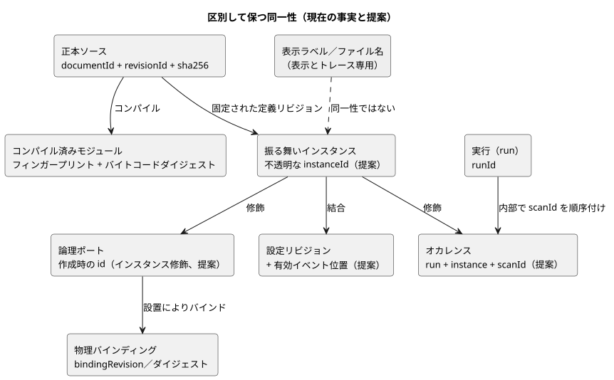
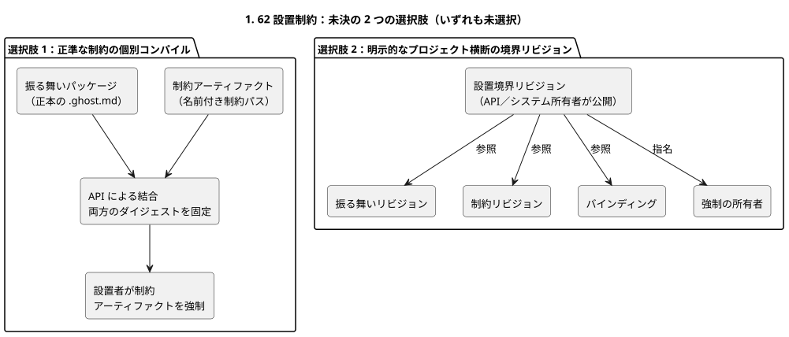

<!-- translation-source: docs/research/GF-COMPOSE-R2-AUTHORITY-IDENTITY.md -->
[英語の原文](GF-COMPOSE-R2-AUTHORITY-IDENTITY.md)

# GF-COMPOSE R2：権限と同一性

このノートは、合成の各概念について誰が権限を持つか、そしてどの同一性（identity）を区別したまま保たなければならないかを決めます。扱う内容は、現在の証拠、権限マトリクス、同一性の変更ルール、投影ごとのグラフと循環のポリシー、運用メモリの文脈（#68）を含む未解決の設置制約の対立（#62）、そしてそこから導かれる推奨事項と担当者です。

## ユーザーの課題

画面に表示されたポンプ、エンジニアのトレース、物理的な設置を、黙って同じものとして扱ってはなりません。合成には、グラフビューを 2 つ目の実行可能なソースにすることなく、**結び付けられた**同一性が必要です。

以下の推奨事項は次のことを行います。

- 正本の `.ghost.md` ルールを権限のあるものとして保つ。
- 実行を Rust コアに保つ。
- API、Device、フロントエンドの責任を明示する。

## 調査対象リビジョンでの証拠

証拠は `ffdbc96461eca67908252507fb851fa4dabd9a2c`（ワークツリーの `HEAD`）で調査しました。この節の内容はすべて実装済みのコードまたは契約の事実であり、合成に関する提案ではありません。

**コンパイラ。** `compileSource` は正本の文芸的ソースを 1 つ受け取り、`sourceDocument`（`format`、`kind`、`filename`、`text`、`sha256`）を保存します。`documentId` と `revisionId` を含むインタラクションの同一性を出力できます。コンパイラはモジュールのフィンガープリント／バイトコードの来歴とソースマップも出力します。ファイル名とソース位置はトレース用の座標であり、公開された同一性ではありません。

**インタラクション契約。** 現在、静的なディスクリプタと完了したスナップショットを次の項目で結合します。

- ソースドキュメント／リビジョン
- モジュール ID／フィンガープリント／バイトコードダイジェスト
- スキーマダイジェスト
- `runId`

`scanId` は 1 つの実行（run）の中でのみ順序付けられます。リセットや新しい実行では `runId` を変えなければなりません。したがって、2 つの実行における `scanId=0` は 1 つのオカレンスではありません。

**意図アンカーと制約。** 意図アンカーのマップには、生成された来歴は編集可能なソースではなく、意図を推論したり承認したりしないと書かれています。`docs/CONSTRAINTS.md` は、範囲が限定されたホスト所有の名前付き制約の経路を説明し、設置のバインディングは制御ソースの外部にあると述べています。現在の制御パーサは `constraints` 構文を拒否し、単独の制約パーサは意図的に機能を限定しています。このドキュメントは、統一された制約ランタイムがあるとは主張しません。

## 表と例

### 権限マトリクス

各行は 1 つの概念について、現在誰が所有しているか、どの同一性フィールドがすでに存在するか、合成によって何を追加するか（提案のみ）を示します。

| 概念 | 現在の権限のある所有者 | 既存の同一性フィールド | 合成で提案する追加 | 証拠の参照先 |
|---|---|---|---|---|
| 正本ソース | 言語／API のソースリビジョン保存 | `documentId`、`revisionId`、ソースの `sha256`、`kind=literate` | ソースの厳密な閉包と、インポートした各リビジョンを保つ。ファイル名やラベルは決して使わない | [`compile-source.mjs`](../../tools/compile-source.mjs)、[`interaction-v0`](../../contracts/interaction-v0/README.ja.md) |
| インポートした定義のリビジョン | API のパッケージ／リビジョンのオーケストレーション。言語側で検証 | ソースドキュメント／リビジョンと、コンパイル済みモジュールの同一性 | 厳密なリビジョンに固定した不変のインポートエッジを追加する。表示名でインポートしない | [`interaction-v0`](../../contracts/interaction-v0/README.ja.md)、[`PORTABLE-PACKAGE.md`](../PORTABLE-PACKAGE.ja.md) |
| 振る舞いインスタンス | API の合成／デプロイの記録。実行は Rust コア | 現在、公開されたインスタンスフィールドは確立されていない | 不透明な `instanceId` を追加し、定義のリビジョンに結び付ける。インスタンスの状態／来歴は分離しなければならない | インタラクション契約には実行の同一性はあるが、合成インスタンスのフィールドはない。提案 |
| 論理ポート | 言語のマニフェスト／コンパイラの宣言 | 作成時のディスクリプタ `id`/`name`、種類、型、ソースマップの来歴 | 作成時の安定したポート ID を保つ。名前を変えた表示パスではなく、インスタンスによる修飾を追加する | [`interaction-v0`](../../contracts/interaction-v0/README.ja.md)、[`integration-v1`](../../contracts/integration-v1/README.ja.md) |
| 物理機器／バインディング | Device のプロファイルと API の設置コンテキスト | `bindingRevision`、ボード／プロファイル、論理名からエンドポイントへの明示的なマッピング | 合成の結合にバインディングのリビジョン／ダイジェストを追加する。物理 ID は論理ポート ID ではない | [`integration-v1`](../../contracts/integration-v1/README.ja.md)、[`PORTABLE-PACKAGE.md`](../PORTABLE-PACKAGE.ja.md) |
| 設定 | API／オペレーターの設置コンテキスト。実行可能な既定値はソースが所有 | 合成全般の設定の同一性はここでは実装されていない | ランタイムのプロパティを、設定リビジョンと有効イベント位置で結合する。これはソース／プログラム／実行の同一性とは別。インポートのパラメータも別のまま | [`CONSTRAINTS.md`](../CONSTRAINTS.ja.md)、#89/#90 |
| ランタイムのオカレンス | ホスト／ランタイムのスナップショット生成側 | `runId`、完了時の `scanId`、論理時間 | 実行 + インスタンス + スキャンから導くインスタンス修飾のオカレンスキーを追加する。`runId` を置き換えたり `scanId` を再定義したりしない | [`interaction-v0`](../../contracts/interaction-v0/README.ja.md) |

提案したフィールドは設計上の推奨にすぎません。この調査は、新しい識別子の生成器、ワイヤースキーマ、ABI を一切承認しません。

次の図は、これらの同一性がどう関係するかをまとめたものです。「提案」と記した箱は、現在のどの契約にも存在しません。

**訂正ノート（2026-09-20）。** 同一性の結合では、プログラム／実行の同一性と、ライブの設定リビジョンおよび有効イベント位置を区別しなければなりません。これは合意済みの設計修正であり、実装済みの動作では**ありません**。

- ランタイムで調整可能なプロパティは、承認されたライブイベントです。複数のプロパティを扱う 1 つの操作はアトミックに検証され、すべてのプロパティを変更するか、まったく変更しないかのどちらかです。
- 受け入れられた変更は、処理された時点で適用されます。これはロジックの実行中も含みます。再コンパイル、新しいプログラム／実行、コントローラ全体の停止は必要ありません。
- プロパティは実際の ESP の再起動をまたいで保持されますが、物理的な再起動では新しい実行の同一性が作られます。
- [`CONSTRAINTS.md`](../CONSTRAINTS.ja.md) と [`LANGUAGE.md`](../LANGUAGE.ja.md) にある、停止して Configure するという古い要件は、#89/#90 で整合させなければなりません。
- 現在のソース書き換え／再コンパイルのヘルパーは、このライブ経路ではありません。
- 暗黙のリセットや、古いプログラムとの結合の再解釈は意味しません。
- 永続性、順序付け、ABI、検証は設計上のギャップのままです。

### 同一性変更マトリクス

各イベントについて、中央の列は変わらないものを、右の列は変わるものを示します。

| イベント | 安定した論理的同一性 | 厳密なリビジョン／オカレンスへの影響 |
|---|---|---|
| 表示名の変更 | 定義、インスタンス、論理ポート、バインディングは変わらない | UI のラベルだけが変わる。新しい物理バインディングは承認されない |
| ソースの場所の移動 | 同じ保存済みドキュメントを移動した場合、ドキュメントの同一性は変わらない | リビジョン／ソースダイジェストは変わらない場合がある。ソース座標は変わりうる。新しく作成したリビジョンには新しい `revisionId` とダイジェストが必要 |
| 1 つの定義の 2 つのインスタンス | 定義のリビジョンは同じ。`instanceId` は別々で、状態／タイマー／来歴は分離される | 各インスタンスが独自のバインディング／設定の結合と、ランタイムのオカレンスの名前空間を持つ |
| ソースのアップグレード | API が継続性を明示的に宣言した場合に限り、同じ論理定義 | 新しい `revisionId`、ソースダイジェスト、通常はモジュール／アーティファクトの同一性も新しくなる。デプロイでは新しいリビジョンを明示的に選択しなければならない |
| バインディングの変更 | 論理ポートと振る舞いインスタンスは安定したまま | 新しいバインディングのリビジョン／ダイジェストと、新しい設置／デプロイの判断。物理エンドポイントの同一性が変わる |
| 再起動 | 定義、インスタンス、バインディングは安定したままでよい | 新しい `runId`。`scanId` はゼロに戻ることがある。ランタイムのオカレンスを `scanId` だけで識別することは決してない |

**具体例**（手作業で作成したもので、実行による証拠ではありません）：

- `east-irrigation` と `west-irrigation` は、1 つの不変な定義リビジョンを参照します。
- それぞれ別のインスタンス ID、状態／タイマーのストア、設定の結合、来歴を持ちます。
- 表示上の east のポンプの名前を変えても、そのバインディングも論理ポートも変わりません。
- 再起動後、`run-A/scanId=0` と `run-B/scanId=0` は別々のオカレンスです。

### グラフの投影と循環ポリシー

汎用のオントロジーではなく、型付きの投影を複数持つべきです。各投影は独自のエッジの意味と独自の循環ルールを持ちます。

| 投影 | 許されるエッジの意味 | 循環ポリシー |
|---|---|---|
| インポートの依存関係 | 定義リビジョンが厳密な定義リビジョンをインポートする | 推奨：依存関係の循環はコンパイル前に拒否する。表示／参照の循環は実行可能なインポートの循環ではない |
| スキャン内の評価 | 式、ポート、出力の間の読み取り／依存エッジ | 既存の不変条件：瞬時の依存循環を拒否する。状態のフィードバックは、スキャンをまたぐ既存の前状態／次状態のセマンティクスを通じてのみ合法 |
| 説明 | 結果／判断が、ソースノード、アンカー、制約の判断、厳密なコンテキストを指す | 推奨：収束する参照と繰り返される証拠を許す。循環はデータエラーであり、ランタイムのフィードバックではない |
| 機器の関係 | 論理ポートがエンドポイント／機器にバインドされる、または機器がリソースを共有する | 推奨：明示的な関係型を持つ機器グラフを許す。トポロジーから実行順序を推論しない。曖昧な所有権は拒否する |
| 時間をまたぐ履歴 | オカレンスが、同じ実行、インスタンス、時間順の中で前のオカレンスに続く | 推奨：時間的な循環は繰り返しイベントとして許すが、順序付きのオカレンス座標を必須とする。再起動をまたいだ履歴を 1 つにまとめることは決してしない |

これらのエッジの意味は、範囲を限定した推奨です。汎用のグラフデータベース、シリアライズ形式、プロジェクト横断のオントロジーを定義するものではありません。

承認されたライブのプロパティイベントは、データの値だけを変更します。これらのイベントは次のとおりです。

- 検証済みの実行可能グラフを変えず、既存のすべての循環とフェーズの制限を保ちます。
- 依存関係の検証を迂回する手段を作ったり、どの式が次状態の値を読めるかを変えたりできません。
- 古いプログラムとの結合を黙って再解釈しません。

### 設置制約の対立

**背景：#62。** システム設置の issue #62 は、独立して強制され、弱めることのできない設置制約を提案しています。

**背景：#68。** 運用メモリの issue #68 は、現在、裏付けのあるアーキテクチャの文脈を提供しています。これはシステム／API の提案に関する証拠であり、このリポジトリで実装された言語の契約ではありません。

- 生の会話と構造化されたメモリの主張は別々であり、厳密なソース範囲と来歴で結び付けられます。
- 確認状態は、観測された情報、推論された情報、農家が確認した情報、却下された情報、置き換えられた情報を区別します。
- メモリは自動的に現在の事実にはなりません。メモリは判断が存在する理由を説明できますが、会話は実行可能なソースではなく、GhostFlow のリビジョンを変更する前には確定した判断が必要です。

Issue #68 は次のことも要求しています。

- メモリ → 判断 → ソース → プログラム／設定／設置の契約 → 実行／結果、という流れ全体のトレーサビリティ
- 会話全体を送るのではなく、範囲が限定され来歴を意識した取得
- 障害の分離。取得や LLM の障害が、有効なプログラムやローカル制御を損なえないようにする
- 生のメモリと構造化されたメモリのエクスポート／削除／ローカルアーカイブ、および AI 学習に関する個別の同意

これらの要件は来歴のリンクとプライバシー／保持の境界を追加しますが、メモリ、ラベル、フロントエンドのグラフに権限を追加するものではありません。

**対立点。** このリポジトリでは、正本の `.ghost.md` が実行可能なルールを所有するとしていますが、設置制約は設置の境界で強制できなければなりません。選択肢は 2 つ残っています。

1. **正準な制約の個別コンパイル。** 設置制約を既存の名前付き制約のソース経路に置いたままにします。API は個別にコンパイルされた制約アーティファクトを正準な振る舞いパッケージに結合し、両方のダイジェストを固定し、設置者が制約アーティファクトを強制します。
   結果：2 つの実行可能アーティファクトには、明示的な結合、ライフサイクル、信頼、障害の契約が必要です。どちらも他方を黙って上書きしてはなりません。
2. **明示的なプロジェクト横断の境界リビジョン。** API／システムの所有者に、正準な振る舞いリビジョン、制約リビジョン、バインディング、強制の所有者を参照する設置境界リビジョンを公開してもらいます。
   結果：このリポジトリは引き続き振る舞いのセマンティクスを所有しますが、受け入れはプロジェクト横断の契約とリビジョン付きの境界アーティファクトに依存します。

次の図は 2 つの形を対比しています。どちらも選択されていません。

ここではどちらの選択肢も選びません。#62 のシステムアーキテクチャの所有者が、言語の所有者および API／デプロイの所有者とともに、制約を個別にコンパイルされたアーティファクトにするか、明示的な境界リビジョンの下での参照にするかを決めなければなりません。JSON のオーバーレイを、承認されていない 2 つ目のソースとして採用してはなりません。

#68 のメモリの連鎖は、この選択を解決しません。どちらを選ぶにしても、次のことが必要です。

- 選ばれた制約アーティファクトまたは境界リビジョンは、確定した判断から参照され、元のメモリの来歴を保持しなければなりません。同時に、正本の `.ghost.md` ルールを保たなければなりません。
- API／システムの所有者は、ユーザーがプライバシーや保持の制御を行使したときに、メモリへの参照を保持するのか、編集で伏せるのか、削除するのかも定義しなければなりません。
- ソースとランタイムの同一性は、削除されたメモリを黙って現在の証拠として扱うことなく、有効なままでなければなりません。

## 推奨事項

権限マトリクスと同一性変更ルールを、合成のレビューのベースラインとして採用してください。合成は次のことを行うべきです。

- 不変な定義リビジョンを固定する。
- 不透明なインスタンスの同一性を追加する。
- 作成時の論理ポート ID を保つ。
- 設置、設定、モジュール、スキーマ、ソース、実行の同一性を、混同せずに結合する。
- 投影ごとのエッジと循環ルールを使う。
- ラベルとファイル名は表示／トレース用のデータとして扱う。

実装は、#62 の境界の判断と、インスタンスの同一性に関する明示的な契約拡張の後にのみ開始してください。

## 未解決の問いと担当者

- API／デプロイの所有者：インスタンスのライフサイクル、ソースのアップグレード時の継続性、設定リビジョン／有効イベント位置の表現を定義する。これは仕組みの設計であり、ライブ設定を設けるべきかどうかという保留中の判断ではありません。
- 言語 + API の所有者：2 つ目の編集可能なソースを作らずに、インポートしたソースの閉包をどう固定し表現するかを決める。
- #62 の設置／システムの所有者（言語／API の所有者とともに）：上記の選択肢 1 または 2 を選び、強制、信頼、障害の結合を定義する。
- Device の所有者：物理機器の同一性、バインディングのリビジョン、どの証拠が適用済みのバインディングを構成するかを定義する。このリポジトリがそれを推論してはなりません。
- 契約の所有者：インスタンス修飾のランタイムオカレンスの将来のワイヤー表現を決める。現在の v0 にはそのようなフィールドはありません。
- #68 の API／システムの運用メモリの所有者：メモリレコードの同一性、生の範囲／構造化された主張の厳密な来歴、確認と置き換えの結合、保持／エクスポート／削除の動作、メモリから判断へのリンクを定義する。
- API／システム + 言語の所有者：削除／編集で伏せる処理において、機微な内容を保持せずにソースの来歴に十分なトゥームストーンとダイジェストを残すかどうかを決める。

### 隣接する調査への影響

- **R3：** 合成された実行の同一性を、確定した判断およびソースリビジョンと比較します。メモリの取得や LLM による解釈は実行前の文脈であり、決してランタイムの入力ではありません。再起動とインスタンスの分離は、引き続きコアの実行に関する問いです。
- **R4：** 論理ポートと物理バインディングの証拠を、メモリの主張と分けて保ちます。記憶された機器の事実や例外は、設置の契約と現在のデバイスの証拠なしには、バインディングの変更を承認できません。
- **R6：** メモリから導かれた判断、インポートのパラメータ、ランタイムの設定、設置のリビジョンを、別々のライフサイクルとしてモデル化します。ソース／設定の変更は確定した判断を参照し、生の／構造化された来歴を保たなければなりません。古いメモリや置き換えられたメモリが、有効な設定を黙って更新してはなりません。

## 検証

- [x] 調査対象のコミットを記録しました：`ffdbc96461eca67908252507fb851fa4dabd9a2c`。
- [x] 権限と同一性の表は、名前を挙げたすべての概念とイベントを網羅しています。ラベルとファイル名は同一性として使っていません。
- [x] グラフのポリシーは投影ごとに範囲を限定しています。状態のフィードバックと瞬時の依存循環は区別されています。
- [x] 制約の対立には、2 つの具体的な選択肢、その結果、指名された所有者があります。新しい権限、ワイヤースキーマ、ABI、ランタイムは選択していません。
- [x] コード／契約からの主張を、提案、未解決の issue の記述、手作業の例と分けています。
- [x] Issue #68 から提供された知見は、システム／API の提案の文脈として記録しており、実装済みの言語の動作としては扱っていません。その所有権とプライバシーに関する本来の問いは未解決のままです。
- [x] ドキュメントのみという範囲を守りました。ランタイムのテストスイートは実行しておらず、実行したとも主張していません。`git diff --check` とリンク／ソースの検査は、コーディネーターによる最終受け入れチェックです。このドキュメントには実装に関する主張は含まれていません。
