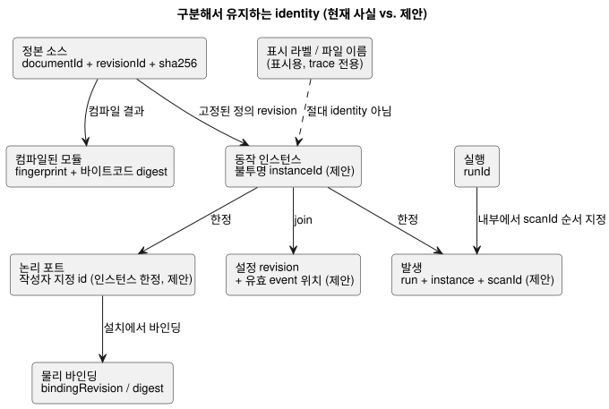
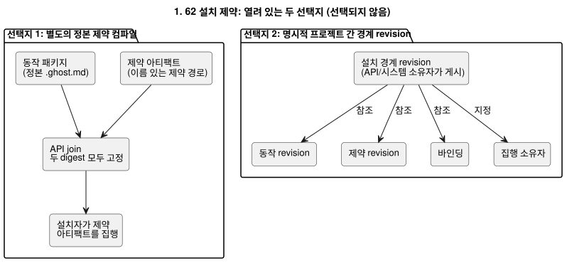

<!-- translation-source: docs/research/GF-COMPOSE-R2-AUTHORITY-IDENTITY.md -->
[영문 원문](GF-COMPOSE-R2-AUTHORITY-IDENTITY.md)

# GF-COMPOSE R2: 권한과 identity

이 문서는 조합(composition)의 각 개념에 대해 누가 권한(authority)을 갖는지, 그리고
어떤 identity를 서로 분리해 유지해야 하는지 결정합니다. 현재 증거, 권한 매트릭스,
identity 변경 규칙, 투영(projection)별 그래프·순환 정책, 운영 기억(#68) 맥락을 포함한
열린 설치 제약 충돌(#62), 그리고 그에 따른 권고와 소유자를 다룹니다.

## 사용자 문제

화면에 표시된 펌프, 엔지니어의 trace, 물리 설치를 암묵적으로 같은 것으로 취급해서는
안 됩니다. 조합에는 그래프 보기를 두 번째 실행 소스로 만들지 않으면서도 서로 **연결된**
identity가 필요합니다.

아래 권고는 다음을 따릅니다.

- 정본 `.ghost.md` 규칙의 권한을 유지합니다.
- 실행은 Rust core에 둡니다.
- API, Device, 프런트엔드의 책임을 명시합니다.

## 조사한 revision의 증거

증거는 `ffdbc96461eca67908252507fb851fa4dabd9a2c`(작업 트리 `HEAD`)에서
조사했습니다. 이 절의 내용은 모두 구현된 코드나 계약의 사실이며, 조합 제안이 아닙니다.

**컴파일러.** `compileSource`는 하나의 정본 문서형 소스를 받아 `sourceDocument`
(`format`, `kind`, `filename`, `text`, `sha256`)를 저장합니다. `documentId`와
`revisionId`를 담은 interaction identity를 내보낼 수 있습니다. 컴파일러는 모듈
fingerprint/바이트코드 provenance(출처)와 소스 맵도 내보냅니다. 파일 이름과 소스 위치는
trace 좌표이며 공개 identity가 아닙니다.

**상호작용(interaction) 계약.** 현재 정적 descriptor와 완료된 snapshot을 다음으로
join합니다.

- 소스 문서/revision
- 모듈 ID/fingerprint/바이트코드 digest
- schema digest
- `runId`

`scanId`는 하나의 실행(run) 안에서만 순서를 가집니다. 리셋이나 새 실행은 `runId`를
바꿔야 합니다. 따라서 두 실행의 `scanId=0`은 하나의 발생(occurrence)이 아닙니다.

**의도 앵커와 제약.** 의도 앵커 맵은 생성된 provenance가 편집 가능한 소스가 아니며
의도를 추론하거나 승인하지 않는다고 말합니다. `docs/CONSTRAINTS.md`는 제한된,
호스트 소유의 이름 있는 제약 경로를 설명하고, 설치 바인딩이 제어 소스 외부에 있다고
명시합니다. 현재 제어 파서는 `constraints` 구문을 거부하며, 독립 constraints 파서는
의도적으로 제한되어 있습니다. 이 문서는 통합된 제약 런타임을 주장하지 않습니다.

## 표와 예

### 권한 매트릭스

각 행은 하나의 개념, 오늘 그것을 소유한 주체, 이미 존재하는 identity 필드, 그리고
조합이 추가할 내용(제안일 뿐)을 나타냅니다.

| 개념 | 현재 권한을 가진 소유자 | 기존 identity 필드 | 제안하는 조합 추가 사항 | 증거 참조 |
|---|---|---|---|---|
| 정본 소스 | 언어/API 소스 revision 저장소 | `documentId`, `revisionId`, 소스 `sha256`, `kind=literate` | 정확한 소스 폐포(closure)와 import된 각 revision을 유지. 파일 이름이나 라벨은 절대 사용하지 않음 | [`compile-source.mjs`](../../tools/compile-source.mjs); [`interaction-v0`](../../contracts/interaction-v0/README.ko.md) |
| import된 정의 revision | API 패키지/revision 오케스트레이션, 언어 측 검증 포함 | 소스 문서/revision과 컴파일된 모듈 identity | 정확한 revision에 고정된 불변 import 간선을 추가. 표시 이름으로 import하지 않음 | [`interaction-v0`](../../contracts/interaction-v0/README.ko.md); [`PORTABLE-PACKAGE.md`](../PORTABLE-PACKAGE.ko.md) |
| 동작 인스턴스 | API 조합/배포 레코드. Rust core가 실행 | 확립된 공개 인스턴스 필드 없음 | 불투명 `instanceId`를 추가하고 정의 revision에 연결. 인스턴스 상태/provenance는 격리되어야 함 | interaction 계약에는 실행 identity는 있지만 조합 인스턴스 필드는 없음. 제안 |
| 논리 포트 | 언어 manifest/컴파일러 선언 | 작성자가 지정한 descriptor `id`/`name`, 종류, 타입, 소스 맵 provenance | 안정적인 작성자 지정 포트 ID를 유지. 이름을 바꾼 표시 경로가 아니라 인스턴스 한정을 추가 | [`interaction-v0`](../../contracts/interaction-v0/README.ko.md); [`integration-v1`](../../contracts/integration-v1/README.ko.md) |
| 물리 장비/바인딩 | Device 프로필과 API 설치 맥락 | `bindingRevision`, 보드/프로필, 논리 이름에서 엔드포인트로의 명시적 매핑 | 조합 join에 바인딩 revision/digest를 추가. 물리 ID는 논리 포트 ID가 아님 | [`integration-v1`](../../contracts/integration-v1/README.ko.md); [`PORTABLE-PACKAGE.md`](../PORTABLE-PACKAGE.ko.md) |
| 설정 | API/운영자 설치 맥락. 실행 기본값은 소스가 소유 | 일반적인 조합 설정 identity는 여기서 구현되지 않음 | 런타임 속성을 설정 revision과 유효 event 위치로 join하되, 소스/프로그램/실행 identity와 구분. import 파라미터는 별개로 유지 | [`CONSTRAINTS.md`](../CONSTRAINTS.md); #89/#90 |
| 런타임 발생 | 호스트/런타임 snapshot 생산자 | `runId`, 완료 `scanId`, 논리 시간 | 실행 + 인스턴스 + 스캔에서 도출한 인스턴스 한정 발생 키를 추가. `runId`를 대체하거나 `scanId`를 재정의하지 않음 | [`interaction-v0`](../../contracts/interaction-v0/README.ko.md) |

제안된 필드는 설계 권고일 뿐입니다. 이 연구는 새로운 식별자 생성기, wire schema,
ABI를 승인하지 않습니다.

다이어그램은 이 identity들이 어떻게 연결되는지 요약합니다. “제안”으로 표시된 상자는
현재 어떤 계약에도 존재하지 않습니다.

**정정 메모(2026-09-20).** identity join은 프로그램/실행 identity를 live 설정
revision 및 유효 event 위치와 구분해야 합니다. 이것은 합의된 설계 수정이며, 구현된
동작이 **아닙니다**.

- 런타임에 조정 가능한 속성은 승인된 live event입니다. 여러 속성을 바꾸는 하나의
  조작은 원자적으로 검증되며, 모든 속성을 바꾸거나 하나도 바꾸지 않습니다.
- 수락된 변경은 처리되는 시점에 적용되며, 로직이 동작 중일 때도 마찬가지입니다.
  재컴파일, 새 프로그램/실행, 컨트롤러 전체 정지가 필요하지 않습니다.
- 속성은 실제 ESP 재시작 후에도 유지되지만, 물리적 재시작은 새 실행 identity를
  만듭니다.
- [`CONSTRAINTS.md`](../CONSTRAINTS.md)와 [`LANGUAGE.md`](../LANGUAGE.md)에 있는
  이전의 “정지 상태에서 Configure” 요구사항은 #89/#90에서 조정되어야 합니다.
- 현재의 소스 재작성/재컴파일 helper는 이 live 경로가 아닙니다.
- 암묵적 리셋이나 오래된(stale) 프로그램 join의 재해석은 의미하지 않습니다.
- 내구성, 순서, ABI, 검증은 여전히 설계 공백입니다.

### identity 변경 매트릭스

각 사건에 대해 가운데 열은 무엇이 그대로인지, 오른쪽 열은 무엇이 바뀌는지 말합니다.

| 사건 | 안정적인 논리 identity | 정확한 revision / 발생에 미치는 영향 |
|---|---|---|
| 표시 이름 변경 | 정의, 인스턴스, 논리 포트, 바인딩은 변하지 않음 | UI 라벨만 바뀜. 새로운 물리 바인딩을 승인하지 않음 |
| 소스 위치 이동 | 같은 저장 문서를 옮긴 것이라면 문서 identity는 변하지 않음 | revision/소스 digest는 그대로일 수 있고 소스 좌표는 바뀔 수 있음. 새로 작성한 revision은 새 `revisionId`와 digest를 가져야 함 |
| 한 정의의 인스턴스 두 개 | 같은 정의 revision. 서로 다른 `instanceId`와 격리된 상태/타이머/provenance | 각 인스턴스는 자기만의 바인딩/설정 join과 런타임 발생 네임스페이스를 받음 |
| 소스 업그레이드 | API가 연속성을 명시적으로 선언한 경우에만 같은 논리 정의 | 새 `revisionId`, 소스 digest, 보통은 모듈/아티팩트 identity도 새로 생김. 배포는 새 revision을 명시적으로 선택해야 함 |
| 바인딩 변경 | 논리 포트와 동작 인스턴스는 안정적으로 유지 | 새 바인딩 revision/digest와 새 설치/배포 결정. 물리 엔드포인트 identity가 바뀜 |
| 재시작 | 정의, 인스턴스, 바인딩은 안정적으로 유지될 수 있음 | 새 `runId`. `scanId`는 0으로 돌아갈 수 있음. 런타임 발생은 절대 `scanId`만으로 식별하지 않음 |

**풀이 예제**(손으로 분석한 것이며 실행 증거가 아님):

- `east-irrigation`과 `west-irrigation`은 하나의 불변 정의 revision을 참조합니다.
- 둘은 서로 다른 인스턴스 ID, 상태/타이머 저장소, 설정 join, provenance를 가집니다.
- 표시된 동쪽 펌프의 이름을 바꿔도 그 바인딩이나 논리 포트는 바뀌지 않습니다.
- 재시작 후 `run-A/scanId=0`과 `run-B/scanId=0`은 서로 다른 발생입니다.

### 그래프 투영과 순환 정책

하나의 범용 온톨로지가 아니라 타입이 있는 여러 투영이 있어야 합니다. 각 투영은 자기만의
간선 의미와 순환 규칙을 가집니다.

| 투영 | 허용되는 간선 의미 | 순환 정책 |
|---|---|---|
| import 의존성 | 정의 revision이 정확한 정의 revision을 import함 | 권고: 컴파일 전에 의존성 순환을 거부. 표시/참조 순환은 실행 가능한 import 순환이 아님 |
| 스캔 내 평가 | 식, 포트, 출력 사이의 읽기/의존성 간선 | 기존 불변식: 즉시 의존성 순환은 거부. 상태 피드백은 스캔에 걸친 기존 이전 상태/다음 상태 의미를 통해서만 허용 |
| 설명 | 결과/판단이 소스 노드, 앵커, 제약 판단, 정확한 맥락을 가리킴 | 권고: 수렴하는 참조와 반복되는 증거는 허용. 순환은 데이터 오류이며 런타임 피드백이 아님 |
| 장비 관계 | 논리 포트가 엔드포인트/장비에 바인딩되거나, 장비들이 자원을 공유함 | 권고: 명시적 관계 타입을 가진 장비 그래프를 허용. 위상에서 실행 순서를 추론하지 않음. 모호한 소유권은 거부 |
| 시간에 걸친 이력 | 발생이 같은 실행, 인스턴스, 시간 순서 안의 이전 발생을 뒤따름 | 권고: 시간적 순환은 반복 event로 허용하되 순서가 있는 발생 좌표를 요구. 재시작을 하나의 이력으로 합치지 않음 |

이 간선 의미들은 범위가 한정된 권고입니다. 범용 그래프 데이터베이스, 직렬화, 프로젝트
간 온톨로지를 정의하지 않습니다.

승인된 live 속성 event는 데이터 값만 바꿉니다. 이 event는 다음과 같습니다.

- 검증된 실행 그래프를 바꾸지 않고, 기존의 모든 순환 및 단계(phase) 제한을 유지합니다.
- 의존성 검증을 우회하는 경로를 만들거나 어떤 식이 다음 상태 값을 읽을 수 있는지
  바꿀 수 없습니다.
- 오래된(stale) 프로그램 join을 암묵적으로 재해석하지 않습니다.

### 설치 제약 충돌

**배경: #62.** 시스템 설치 이슈 #62는 독립적으로 집행되며 약화할 수 없는 설치 제약을
제안합니다.

**배경: #68.** 운영 기억 이슈 #68은 이제 뒷받침되는 아키텍처 맥락을 제공합니다. 이것은
시스템/API 제안 증거이며, 이 저장소에 구현된 언어 계약이 아닙니다.

- 원본 대화와 구조화된 기억 주장(claim)은 분리되어 있으며, 정확한 소스 구간과
  provenance로 연결됩니다.
- 확인 상태는 관측됨, 추론됨, 농부가 확인함, 거부됨, 대체됨을 구분합니다.
- 기억이 자동으로 현재의 사실이 되지는 않습니다. 기억은 왜 어떤 결정이 존재하는지
  설명할 수 있지만, 대화는 실행 가능한 소스가 아니며 GhostFlow revision을 바꾸려면
  확인된 결정이 필요합니다.

이슈 #68은 다음도 요구합니다.

- 기억 → 결정 → 소스 → 프로그램/설정/설치 계약 → 실행/결과에 걸친 추적 가능성
- 대화 전체를 보내는 대신 제한되고 provenance를 고려한 검색
- 장애 격리. 검색이나 LLM 실패가 유효한 프로그램이나 로컬 제어를 손상시킬 수 없어야
  합니다.
- 원본 및 구조화된 기억의 내보내기/삭제/로컬 보관, 그리고 별도의 AI 학습 동의

이 요구사항은 provenance 연결과 개인정보/보존 경계를 추가할 뿐, 기억, 라벨, 프런트엔드
그래프에 권한을 추가하지 않습니다.

**충돌.** 이 저장소는 정본 `.ghost.md`가 실행 규칙을 소유한다고 말하는 반면, 설치
제약은 설치 경계에서 집행 가능해야 합니다. 두 가지 선택지가 남아 있습니다.

1. **별도의 정본 제약 컴파일.** 설치 제약을 기존의 이름 있는 제약 소스 경로에
   유지합니다. API는 별도로 컴파일된 제약 아티팩트를 정본 동작 패키지에 join하고 두
   digest를 모두 고정하며, 설치자는 제약 아티팩트를 집행합니다. 결과: 두 실행
   아티팩트에는 명시적인 join, 수명 주기, 신뢰, 실패 계약이 필요합니다. 어느 쪽도
   다른 쪽을 암묵적으로 덮어써서는 안 됩니다.
2. **명시적 프로젝트 간 경계 revision.** API/시스템 소유자가 정본 동작 revision, 제약
   revision, 바인딩, 집행 소유자를 참조하는 설치 경계 revision을 게시합니다. 결과: 이
   저장소는 여전히 동작 의미를 소유하지만, 승인은 프로젝트 간 계약과 revision이 붙은
   경계 아티팩트에 의존합니다.

다이어그램은 두 형태를 대조합니다. 어느 쪽도 선택되지 않았습니다.

여기서는 어느 선택지도 고르지 않습니다. #62의 시스템 아키텍처 소유자가 언어 소유자 및
API/배포 소유자와 함께, 제약을 별도로 컴파일된 아티팩트로 할지 명시적 경계 revision
아래의 참조로 할지 결정해야 합니다. JSON 오버레이를 승인되지 않은 두 번째 소스로
채택해서는 안 됩니다.

#68의 기억 체인은 이 선택을 해결하지 않습니다. 무엇을 선택하든 다음을 지켜야 합니다.

- 선택된 제약 아티팩트나 경계 revision은 확인된 결정이 참조해야 하고, 원래의 기억
  provenance를 유지해야 하며, 정본 `.ghost.md` 규칙을 보존해야 합니다.
- API/시스템 소유자는 사용자가 개인정보나 보존 통제를 행사할 때 기억 참조를 유지할지,
  가릴지(redact), 삭제할지도 정의해야 합니다.
- 소스와 런타임 identity는 삭제된 기억을 현재 증거로 암묵적으로 취급하지 않으면서
  유효하게 유지되어야 합니다.

## 권고

권한 매트릭스와 identity 변경 규칙을 조합 검토의 기준선으로 채택합니다. 조합은 다음을
해야 합니다.

- 불변 정의 revision을 고정합니다.
- 불투명한 인스턴스 identity를 추가합니다.
- 작성자가 지정한 논리 포트 ID를 보존합니다.
- 설치, 설정, 모듈, schema, 소스, 실행 identity를 뒤섞지 않고 join합니다.
- 투영별 간선과 순환 규칙을 사용합니다.
- 라벨과 파일 이름은 표시/trace 데이터로 유지합니다.

구현은 #62 경계 결정과 인스턴스 identity에 대한 명시적 계약 확장이 나온 뒤에만
시작합니다.

## 해결되지 않은 질문과 소유자

- API/배포 소유자: 인스턴스 수명 주기, 소스 업그레이드 시의 연속성, 설정 revision/유효
  event 위치의 표현을 정의합니다. 이것은 메커니즘 설계이며, live 설정이 존재해야
  하는지에 대한 보류 중인 결정이 아닙니다.
- 언어 + API 소유자: 두 번째 편집 가능 소스 없이 import된 소스 폐포를 어떻게 고정하고
  표현할지 결정합니다.
- #62 설치/시스템 소유자, 언어/API 소유자와 함께: 위 선택지 1 또는 2를 고르고 집행,
  신뢰, 실패 join을 정의합니다.
- Device 소유자: 물리 장비 identity, 바인딩 revision, 그리고 어떤 증거가 적용된
  바인딩을 구성하는지 정의합니다. 이 저장소가 이를 추론해서는 안 됩니다.
- 계약 소유자: 인스턴스 한정 런타임 발생의 향후 wire 표현을 결정합니다. 현재 v0에는
  그런 필드가 없습니다.
- #68 API/시스템 운영 기억 소유자: 기억 레코드 identity, 정확한 원본 구간/구조화 주장
  provenance, 확인 및 대체 join, 보존/내보내기/삭제 동작, 기억에서 결정으로의 연결을
  정의합니다.
- API/시스템 + 언어 소유자: 삭제/가림 처리가 민감한 내용을 보관하지 않으면서도 소스
  provenance에 충분한 tombstone과 digest를 보존할지 결정합니다.

### 인접 연구에 대한 함의

- **R3:** 조합된 실행 identity를 확인된 결정 및 소스 revision과 비교합니다. 기억
  검색이나 LLM 해석은 실행 전 맥락이며 결코 런타임 입력이 아닙니다. 재시작과 인스턴스
  격리는 여전히 core 실행의 문제입니다.
- **R4:** 논리 포트와 물리 바인딩 증거를 기억 주장과 분리합니다. 기억된 장비 사실이나
  예외는 설치 계약과 현재 장치 증거 없이 바인딩 변경을 승인할 수 없습니다.
- **R6:** 기억에서 도출된 결정, import 파라미터, 런타임 설정, 설치 revision을 서로 다른
  수명 주기로 모델링합니다. 소스/설정 변경은 확인된 결정을 참조하고 원본/구조화
  provenance를 보존해야 합니다. 오래되었거나 대체된 기억이 활성 설정을 암묵적으로
  갱신해서는 안 됩니다.

## 검증

- [x] 조사한 커밋을 기록했습니다: `ffdbc96461eca67908252507fb851fa4dabd9a2c`.
- [x] 권한 표와 identity 표가 이름 붙은 모든 개념과 사건을 다룹니다. 라벨과 파일 이름은
  identity로 사용하지 않습니다.
- [x] 그래프 정책은 투영별로 범위가 정해져 있습니다. 상태 피드백과 즉시 의존성 순환은
  구분됩니다.
- [x] 제약 충돌에는 구체적인 두 선택지, 결과, 이름이 붙은 소유자가 있습니다. 새로운
  권한, wire schema, ABI, 런타임은 선택하지 않았습니다.
- [x] 코드/계약에서 나온 주장을 제안, 해결되지 않은 이슈 본문, 손으로 분석한 예제와
  구분했습니다.
- [x] 이슈 #68이 제공한 발견 사항은 구현된 언어 동작이 아니라 시스템/API 제안 맥락으로
  기록했습니다. 실제 소유권과 개인정보 관련 질문은 여전히 해결되지 않았습니다.
- [x] 문서 전용 범위를 지켰습니다. 런타임 테스트 묶음은 실행하거나 주장하지
  않았습니다. `git diff --check`와 링크/소스 점검은 코디네이터의 최종 승인 검사이며, 이
  문서에는 구현 주장이 없습니다.
