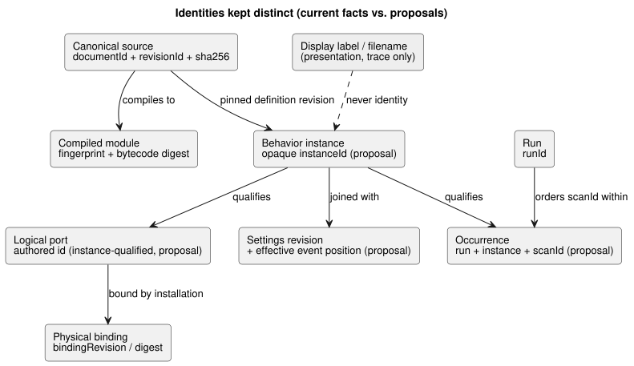
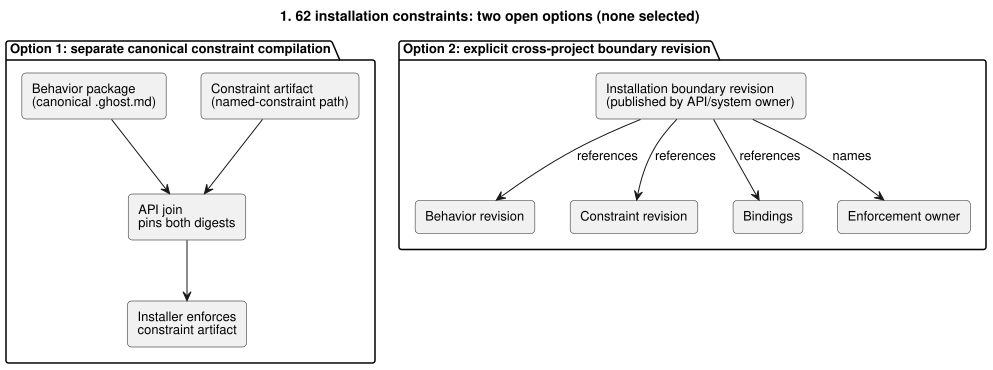

# GF-COMPOSE R2: authority and identity

This note decides who is authoritative for each composition concept and which
identities must stay separate. It covers the current evidence, an authority
matrix, identity-change rules, per-projection graph and cycle policy, the open
installation-constraint conflict (#62) with operational-memory context (#68),
and the resulting recommendation and owners.

## User problem

A displayed pump, an engineer's trace, and a physical installation must not be
silently treated as the same thing. Composition needs **linked** identities
without turning a graph view into a second executable source.

The recommendation below:

- keeps canonical `.ghost.md` rules authoritative;
- keeps execution in the Rust core;
- makes API, Device, and frontend responsibilities explicit.

## Evidence at examined revision

Evidence was examined at `ffdbc96461eca67908252507fb851fa4dabd9a2c` (the
working-tree `HEAD`). Everything in this section is an implemented code or
contract fact, not a composition proposal.

**Compiler.** `compileSource` accepts one canonical literate source and stores
`sourceDocument` (`format`, `kind`, `filename`, `text`, `sha256`). It can emit
an interaction identity containing `documentId` and `revisionId`. The compiler
also emits module fingerprint/bytecode provenance and source maps. Filename and
source locations are trace coordinates, not public identity.

**Interaction contract.** It currently joins static descriptors and completed
snapshots by:

- source document/revision;
- module ID/fingerprint/bytecode digest;
- schema digest;
- `runId`.

`scanId` is only ordered within a run. A reset or new run must change `runId`;
therefore `scanId=0` in two runs is not one occurrence.

**Intent anchors and constraints.** The intent-anchor map says generated
provenance is not editable source and does not infer or approve intent.
`docs/CONSTRAINTS.md` describes a bounded, host-owned named-constraint path and
states that installation bindings are external to the control source. The
current control parser rejects the `constraints` construct, and the standalone
constraints parser is deliberately limited. This document does not claim a
unified constraint runtime.

## Tables and examples

### Authority matrix

Each row names one concept, who owns it today, which identity fields already
exist, and what composition would add (proposal only).

| Concept | Current authoritative owner | Existing identity fields | Proposed composition addition | Evidence reference |
|---|---|---|---|---|
| Canonical source | Language/API source revision storage | `documentId`, `revisionId`, source `sha256`, `kind=literate` | Keep exact source closure and each imported revision; never use filename or label | [`compile-source.mjs`](../../tools/compile-source.mjs); [`interaction-v0`](../../contracts/interaction-v0/README.md) |
| Imported definition revision | API package/revision orchestration, with language validation | Source document/revision and compiled module identities | Add an immutable import edge pinned to exact revision; do not import by display name | [`interaction-v0`](../../contracts/interaction-v0/README.md); [`PORTABLE-PACKAGE.md`](../PORTABLE-PACKAGE.md) |
| Behavior instance | API composition/deployment record; Rust core executes it | No current public instance field is established | Add opaque `instanceId` and link it to definition revision; instance state/provenance must be isolated | Interaction contract has run identity but no composition instance field; proposal |
| Logical port | Language manifest/compiler declaration | Authored descriptor `id`/`name`, kind, type, source-map provenance | Keep stable authored port ID; add instance qualification, not a renamed display path | [`interaction-v0`](../../contracts/interaction-v0/README.md); [`integration-v1`](../../contracts/integration-v1/README.md) |
| Physical equipment/binding | Device profile and API installation context | `bindingRevision`, board/profile and explicit logical-name-to-endpoint mapping | Add binding revision/digest to the composed join; physical ID is not logical port ID | [`integration-v1`](../../contracts/integration-v1/README.md); [`PORTABLE-PACKAGE.md`](../PORTABLE-PACKAGE.md) |
| Settings | API/operator installation context; executable defaults remain source-owned | No general composition settings identity is implemented here | Join runtime properties by settings revision and effective event position, distinct from source/program/run identity; import parameters remain distinct | [`CONSTRAINTS.md`](../CONSTRAINTS.md); #89/#90 |
| Runtime occurrence | Host/runtime snapshot producer | `runId`, completion `scanId`, logical time | Add instance-qualified occurrence key derived from run + instance + scan; do not replace `runId` or redefine `scanId` | [`interaction-v0`](../../contracts/interaction-v0/README.md) |

The proposed fields are design recommendations only. No new identifier
generator, wire schema, or ABI is authorized by this research.

The diagram summarizes how these identities relate. Boxes marked “proposal”
do not exist in any current contract.

**Correction note (2026-09-20).** Identity joins must distinguish
program/run identity from a live settings revision and effective event
position. This is an agreed design amendment, **not** implemented behavior:

- Runtime-adjustable properties are approved live events. One multi-property
  action validates atomically and changes all properties or none.
- Accepted changes apply when processed, including during active logic. They
  require no recompile, new program/run, or controller-wide stop.
- Properties persist across real ESP restarts, while a physical restart creates
  a new run identity.
- The older stopped Configure requirement in [`CONSTRAINTS.md`](../CONSTRAINTS.md)
  and [`LANGUAGE.md`](../LANGUAGE.md) must be reconciled under #89/#90.
- The current source-rewrite/recompile helper is not this live path.
- No implicit reset or stale-program join reinterpretation is implied.
- Durability, ordering, ABI, and verification remain design gaps.

### Identity-change matrix

For each event, the middle column says what stays the same and the right
column says what changes.

| Event | Stable logical identity | Exact revision / occurrence effect |
|---|---|---|
| Display rename | Unchanged definition, instance, logical port, and binding | UI label changes only; no new physical binding is authorized |
| Move source location | Unchanged document identity if the same stored document is moved | Revision/source digest may remain unchanged; source coordinates can change. A new authored revision must carry a new `revisionId` and digest |
| Two instances of one definition | Same definition revision; distinct `instanceId`s and isolated state/timers/provenance | Each instance receives its own binding/settings join and runtime occurrence namespace |
| Source upgrade | Same logical definition only if API explicitly declares continuity | New `revisionId`, source digest, and normally module/artifact identities; deployment must select the new revision explicitly |
| Binding change | Logical port and behavior instance stay stable | New binding revision/digest and a new installation/deployment decision; physical endpoint identity changes |
| Restart | Definition, instance, and binding can remain stable | New `runId`; `scanId` may return to zero. A runtime occurrence is never identified by `scanId` alone |

**Worked example** (hand-worked, not execution evidence):

- `east-irrigation` and `west-irrigation` reference one immutable definition
  revision.
- They have distinct instance IDs, state/timer stores, settings joins, and
  provenance.
- Renaming the displayed east pump changes neither its binding nor its logical
  port.
- After restart, `run-A/scanId=0` and `run-B/scanId=0` are different
  occurrences.

### Graph projections and cycle policy

There should be several typed projections, not a universal ontology. Each
projection has its own edge meaning and its own cycle rule:

| Projection | Allowed edge meaning | Cycle policy |
|---|---|---|
| Import dependencies | Definition revision imports exact definition revision | Recommendation: reject dependency cycles before compilation; a display/reference cycle is not an executable import cycle |
| Within-scan evaluation | Read/dependency edge between expressions, ports, and outputs | Existing invariant: reject instantaneous dependency cycles. State feedback is legal only through the existing prior-state/next-state semantics across scans |
| Explanation | Result/decision points to source node, anchor, constraint decision, and exact context | Recommendation: allow convergent references and repeated evidence; cycles are data errors, not runtime feedback |
| Equipment relations | Logical port is bound to an endpoint/equipment, or equipment shares a resource | Recommendation: permit equipment graphs with explicit relation types; do not infer execution order from topology; reject ambiguous ownership |
| History across time | Occurrence follows a prior occurrence in the same run, instance, and time order | Recommendation: allow temporal cycles as repeated events, but require an ordered occurrence coordinate; never collapse restarts into one history |

These edge meanings are scoped recommendations. They do not define a universal
graph database, serialization, or cross-project ontology.

Approved live property events change data values only. They:

- leave the validated executable graph unchanged and preserve every existing
  cycle and phase restriction;
- cannot create a bypass for dependency validation or alter which expressions
  may read next-state values;
- do not silently reinterpret stale-program joins.

### Installation-constraint conflict

**Background: #62.** System installation issue #62 proposes independently
enforced, non-weakenable installation constraints.

**Background: #68.** Operational-memory issue #68 now provides supported
architecture context. This is system/API proposal evidence, not an implemented
language contract in this repository:

- Raw conversation and structured memory claims are separate, linked by exact
  source spans and provenance.
- Confirmation state distinguishes observed, inferred, farmer-confirmed,
  rejected, and superseded information.
- Memory does not automatically become current truth. Memory can explain why a
  decision exists, but conversation is not executable source, and a confirmed
  decision is required before changing a GhostFlow revision.

Issue #68 also requires:

- traceability across memory → decision → source →
  program/settings/installation contract → execution/outcome;
- bounded, provenance-aware retrieval instead of sending the whole conversation;
- failure isolation, so retrieval or LLM failure cannot damage a valid program
  or local control;
- export/delete/local archive for raw and structured memory, and separate
  AI-training consent.

These requirements add provenance links and privacy/retention boundaries; they
do not add authority to memory, labels, or a frontend graph.

**The conflict.** This repository says canonical `.ghost.md` owns executable
rules, while installation constraints must be enforceable at the installation
boundary. Two options remain:

1. **Separate canonical constraint compilation.** Keep installation
   constraints in their existing named-constraint source path. The API joins a
   separately compiled constraint artifact to the canonical behavior package,
   pins both digests, and the installer enforces the constraint artifact.
   Consequence: two executable artifacts require an explicit join, lifecycle,
   trust, and failure contract; neither may silently override the other.
2. **Explicit cross-project boundary revision.** Have the API/system owner
   publish an installation boundary revision that references the canonical
   behavior revision, constraint revision, bindings, and enforcement owner.
   Consequence: this repository still owns behavior semantics, but acceptance
   depends on a cross-project contract and revisioned boundary artifact.

The diagram contrasts the two shapes. Neither is selected.

Neither option is selected here. The system architecture owner for #62, with
the language owner and API/deployment owner, must decide whether constraints
are separately compiled artifacts or references under an explicit boundary
revision. A JSON overlay must not be adopted as an unapproved second source.

The #68 memory chain does not resolve that choice. Whatever is chosen:

- The selected constraint artifact or boundary revision must be referenced by a
  confirmed decision and retain the originating memory provenance, while
  preserving the canonical `.ghost.md` rule.
- The API/system owners must also define whether a memory reference is
  retained, redacted, or deleted when a user exercises privacy or retention
  controls.
- Source and runtime identities must remain valid without silently treating
  deleted memory as current evidence.

## Recommendation

Adopt the authority matrix and identity-change rules as the composition review
baseline. Composition should:

- pin immutable definition revisions;
- add an opaque instance identity;
- preserve authored logical port IDs;
- join installation, settings, module, schema, source, and run identities
  without conflating them;
- use projection-specific edges and cycle rules;
- keep labels and filenames as presentation/trace data.

Start implementation only after the #62 boundary decision and an explicit
contract extension for instance identity.

## Unresolved questions and owners

- API/deployment owner: define instance lifecycle, continuity on source
  upgrades, and settings revision/effective-event-position representation.
  This is mechanism design, not a pending decision whether live settings
  should exist.
- Language + API owners: decide how imported source closure is pinned and
  represented without a second editable source.
- Installation/system owner for #62, with language/API owners: choose option 1
  or 2 above and define enforcement, trust, and failure joins.
- Device owner: define physical equipment identity, binding revisions, and what
  evidence constitutes an applied binding; this repository must not infer it.
- Contract owner: decide the future wire representation for instance-qualified
  runtime occurrences. Current v0 has no such field.
- API/system operational-memory owner for #68: define memory-record identity,
  exact raw-span/structured-claim provenance, confirmation and supersession
  joins, retention/export/delete behavior, and the memory-to-decision link.
- API/system + language owners: decide whether deletion/redaction preserves a
  tombstone and digest sufficient for source provenance without retaining
  sensitive content.

### Implications for adjacent research

- **R3:** compare composed execution identities with a confirmed decision and
  source revision. Memory retrieval or LLM interpretation is pre-execution
  context, never a runtime input; restart and instance isolation remain core
  execution questions.
- **R4:** keep logical-port and physical-binding evidence separate from memory
  claims. A remembered equipment fact or exception cannot authorize a binding
  change without the installation contract and current device evidence.
- **R6:** model memory-derived decisions, import parameters, runtime settings,
  and installation revisions as distinct lifecycles. Source/settings changes
  must reference the confirmed decision and preserve raw/structured provenance;
  stale or superseded memory must not silently update active settings.

## Verification

- [x] Examined commit recorded: `ffdbc96461eca67908252507fb851fa4dabd9a2c`.
- [x] Authority and identity tables cover every named concept and event; labels
  and filenames are not used as identity.
- [x] Graph policies are scoped per projection; state feedback and instantaneous
  dependency cycles are distinct.
- [x] Constraint conflict has two concrete options, consequences, and named
  owners. No new authority, wire schema, ABI, or runtime was selected.
- [x] Claims from code/contracts are separated from proposals, unresolved issue
  text, and the hand-worked example.
- [x] Issue #68 supplied findings are recorded as system/API proposal context,
  not as implemented language behavior; its genuine ownership and privacy
  questions remain unresolved.
- [x] Documentation-only scope preserved. Runtime suites were not run or
  claimed. `git diff --check` and link/source inspection are the coordinator's
  final acceptance checks; this document contains no implementation claim.
