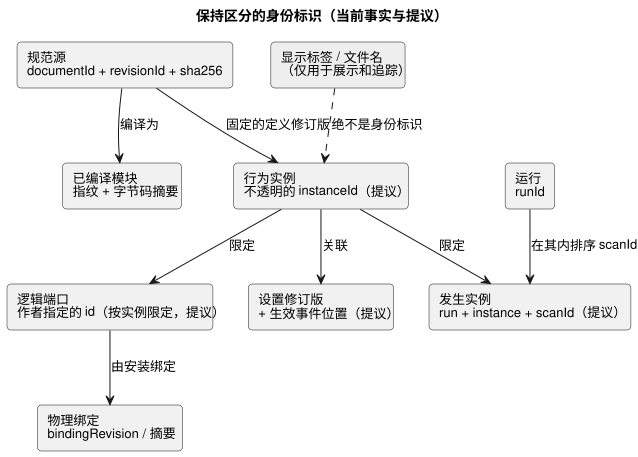
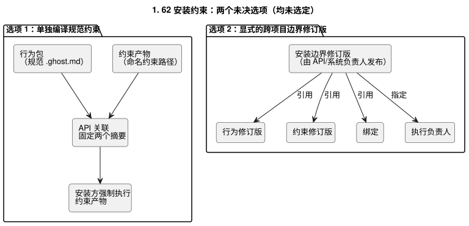

<!-- translation-source: docs/research/GF-COMPOSE-R2-AUTHORITY-IDENTITY.md -->
[英文原文](GF-COMPOSE-R2-AUTHORITY-IDENTITY.md)

# GF-COMPOSE R2：权威与身份标识

本文确定每个组合概念由谁作为权威来源，以及哪些身份标识必须保持区分。内容包括：当前证据、权威矩阵、身份标识变更规则、按投影划分的图与环策略、尚未解决的安装约束冲突（#62）及运营记忆背景（#68），以及由此得出的建议和负责人。

## 用户问题

显示出来的水泵、工程师的追踪记录和物理安装，绝不能被悄悄当作同一个东西。组合需要**相互关联**的身份标识，但不能把图视图变成第二个可执行源。

下面的建议：

- 让规范 `.ghost.md` 规则保持权威地位；
- 让执行保留在 Rust 核心中；
- 明确 API、Device 和前端各自的职责。

## 所检查修订版中的证据

证据检查于 `ffdbc96461eca67908252507fb851fa4dabd9a2c`（工作树的 `HEAD`）。本节中的所有内容都是已实现的代码或契约事实，而不是组合提议。

**编译器。** `compileSource` 接受一个规范的文学式源文件（literate），并存储 `sourceDocument`（`format`、`kind`、`filename`、`text`、`sha256`）。它可以输出包含 `documentId` 和 `revisionId` 的交互身份标识。编译器还会输出模块指纹/字节码来源（provenance）和源映射。文件名和源位置是追踪坐标，而不是公开的身份标识。

**交互契约。** 它目前通过以下各项关联静态描述符（descriptor）和已完成的快照：

- 源文档/修订版；
- 模块 ID/指纹/字节码摘要；
- schema 摘要；
- `runId`。

`scanId` 只在一次运行内有序。重置或新的运行必须改变 `runId`；因此，两次运行中的 `scanId=0` 并不是同一个发生实例（occurrence）。

**意图锚点与约束。** 意图锚点映射指出，生成的来源信息不是可编辑的源，也不会推断或批准设计意图。`docs/CONSTRAINTS.md` 描述了一条有界的、由宿主负责的命名约束路径，并说明安装绑定位于控制源之外。当前的控制解析器拒绝 `constraints` 结构，而独立的约束解析器则被刻意加以限制。本文不声称存在统一的约束运行时。

## 表格与示例

### 权威矩阵

每一行列出一个概念、它目前由谁负责、已存在哪些身份标识字段，以及组合将增加什么（仅为提议）。

| 概念 | 当前的权威负责方 | 现有身份标识字段 | 提议的组合新增内容 | 证据参考 |
|---|---|---|---|---|
| 规范源 | 语言/API 源修订版存储 | `documentId`、`revisionId`、源 `sha256`、`kind=literate` | 保留确切的源闭包以及每个导入的修订版；绝不使用文件名或标签 | [`compile-source.mjs`](../../tools/compile-source.mjs)；[`interaction-v0`](../../contracts/interaction-v0/README.zh.md) |
| 导入的定义修订版 | API 包/修订版编排，配合语言验证 | 源文档/修订版和已编译模块的身份标识 | 添加一条固定到确切修订版的不可变导入边；不按显示名称导入 | [`interaction-v0`](../../contracts/interaction-v0/README.zh.md)；[`PORTABLE-PACKAGE.md`](../PORTABLE-PACKAGE.zh.md) |
| 行为实例 | API 组合/部署记录；由 Rust 核心执行 | 尚未确立任何公开的实例字段 | 添加不透明的 `instanceId` 并将其链接到定义修订版；实例的状态/来源必须相互隔离 | 交互契约有运行身份标识，但没有组合实例字段；提议 |
| 逻辑端口 | 语言清单（manifest）/编译器声明 | 作者编写的描述符 `id`/`name`、种类、类型、源映射来源 | 保留稳定的作者编写端口 ID；添加实例限定，而不是改名后的显示路径 | [`interaction-v0`](../../contracts/interaction-v0/README.zh.md)；[`integration-v1`](../../contracts/integration-v1/README.zh.md) |
| 物理设备/绑定 | Device profile 和 API 安装上下文 | `bindingRevision`、板卡/profile，以及显式的逻辑名称到端点的映射 | 将绑定修订版/摘要加入组合关联；物理 ID 不是逻辑端口 ID | [`integration-v1`](../../contracts/integration-v1/README.zh.md)；[`PORTABLE-PACKAGE.md`](../PORTABLE-PACKAGE.zh.md) |
| 设置 | API/操作员安装上下文；可执行的默认值仍由源负责 | 此处尚未实现通用的组合设置身份标识 | 按设置修订版和生效事件位置关联运行时属性，与源/程序/运行身份标识相区分；导入参数也保持区分 | [`CONSTRAINTS.md`](../CONSTRAINTS.zh.md)；#89/#90 |
| 运行时发生实例 | 宿主/运行时快照生产方 | `runId`、完成时的 `scanId`、逻辑时间 | 添加由运行 + 实例 + 扫描派生的、按实例限定的发生实例键；不替换 `runId`，也不重新定义 `scanId` | [`interaction-v0`](../../contracts/interaction-v0/README.zh.md) |

提议的字段仅为设计建议。本研究不授权任何新的标识符生成器、线上传输 schema 或 ABI。

下图总结了这些身份标识之间的关系。标为“提议”的方框在任何当前契约中都不存在。

**更正说明（2026-09-20）。** 身份标识关联必须将程序/运行身份标识与实时设置修订版及生效事件位置区分开。这是一项已达成一致的设计修订，**并非**已实现的行为：

- 运行时可调整的属性是经批准的实时事件。一次多属性操作以原子方式验证，要么修改全部属性，要么一个都不修改。
- 被接受的更改在处理时生效，包括在逻辑运行期间。它们不需要重新编译、新的程序/运行，也不需要停止整个控制器。
- 属性在真实的 ESP 重启后保持不变，而物理重启会产生新的运行身份标识。
- [`CONSTRAINTS.md`](../CONSTRAINTS.zh.md) 和 [`LANGUAGE.md`](../LANGUAGE.zh.md) 中旧的“停止后配置”要求必须在 #89/#90 中加以协调。
- 当前的源重写/重新编译辅助工具不是这条实时路径。
- 不意味着任何隐式重置，也不意味着对陈旧程序关联的重新解释。
- 持久性、顺序、ABI 和验证仍是设计上的空白。

### 身份标识变更矩阵

对每个事件，中间一列说明哪些保持不变，右侧一列说明哪些发生变化。

| 事件 | 稳定的逻辑身份标识 | 确切修订版 / 发生实例上的影响 |
|---|---|---|
| 显示名称更改 | 定义、实例、逻辑端口和绑定不变 | 只有 UI 标签变化；不授权任何新的物理绑定 |
| 移动源位置 | 如果移动的是同一个已存储文档，则文档身份标识不变 | 修订版/源摘要可以保持不变；源坐标可能变化。新的作者修订版必须带有新的 `revisionId` 和摘要 |
| 一个定义的两个实例 | 同一定义修订版；不同的 `instanceId`，以及相互隔离的状态/定时器/来源 | 每个实例获得各自的绑定/设置关联和运行时发生实例命名空间 |
| 源升级 | 只有当 API 显式声明连续性时，才是同一个逻辑定义 | 新的 `revisionId`、源摘要，通常还有新的模块/产物身份标识；部署必须显式选择新的修订版 |
| 绑定更改 | 逻辑端口和行为实例保持稳定 | 新的绑定修订版/摘要，以及新的安装/部署决策；物理端点身份标识发生变化 |
| 重启 | 定义、实例和绑定可以保持稳定 | 新的 `runId`；`scanId` 可能归零。运行时发生实例绝不单凭 `scanId` 识别 |

**推演示例**（人工推演，不是执行证据）：

- `east-irrigation` 和 `west-irrigation` 引用同一个不可变的定义修订版。
- 它们有不同的实例 ID、状态/定时器存储、设置关联和来源。
- 更改东侧水泵的显示名称，既不改变它的绑定，也不改变它的逻辑端口。
- 重启后，`run-A/scanId=0` 和 `run-B/scanId=0` 是不同的发生实例。

### 图投影与环策略

应当存在若干个带类型的投影，而不是一个通用本体。每个投影有各自的边含义和环规则：

| 投影 | 允许的边含义 | 环策略 |
|---|---|---|
| 导入依赖 | 定义修订版导入确切的定义修订版 | 建议：在编译前拒绝依赖环；显示/引用上的环不是可执行的导入环 |
| 扫描内求值 | 表达式、端口和输出之间的读取/依赖边 | 现有不变量：拒绝瞬时依赖环。状态反馈只有通过现有的跨扫描前一状态/下一状态语义才合法 |
| 解释 | 结果/判定指向源节点、锚点、约束判定和确切上下文 | 建议：允许汇聚的引用和重复的证据；环是数据错误，而不是运行时反馈 |
| 设备关系 | 逻辑端口绑定到端点/设备，或设备之间共享资源 | 建议：允许带有显式关系类型的设备图；不从拓扑推断执行顺序；拒绝含糊的所有权 |
| 跨时间历史 | 发生实例在同一运行、实例和时间顺序中跟随前一个发生实例 | 建议：允许时间上的环作为重复事件，但要求有序的发生实例坐标；绝不把多次重启合并成一条历史 |

这些边含义是限定范围的建议。它们不定义通用图数据库、序列化格式或跨项目本体。

经批准的实时属性事件只改变数据值。它们：

- 不改变已验证的可执行图，并保留现有的每一条环限制和阶段限制；
- 不能为依赖验证开辟绕行路径，也不能改变哪些表达式可以读取下一状态值；
- 不会悄悄地重新解释陈旧程序关联。

### 安装约束冲突

**背景：#62。** 系统安装 issue #62 提议采用独立强制执行、不可削弱的安装约束。

**背景：#68。** 运营记忆 issue #68 现在提供了有依据的架构背景。这是系统/API 的提议证据，而不是本仓库中已实现的语言契约：

- 原始对话和结构化记忆声明相互分离，通过确切的源片段和来源相互链接。
- 确认状态区分观测到的、推断的、经农户确认的、被拒绝的和已被取代的信息。
- 记忆不会自动成为当前事实。记忆可以解释某个决策为何存在，但对话不是可执行源；在更改 GhostFlow 修订版之前，需要一个已确认的决策。

Issue #68 还要求：

- 在 记忆 → 决策 → 源 → 程序/设置/安装契约 → 执行/结果 的整条链路上可追溯；
- 有界的、感知来源的检索，而不是发送整个对话；
- 故障隔离，使检索或 LLM 故障不会损坏有效的程序或本地控制；
- 原始记忆和结构化记忆的导出/删除/本地归档，以及单独的 AI 训练同意。

这些要求增加了来源链接以及隐私/保留边界；它们并不赋予记忆、标签或前端图任何权威。

**冲突所在。** 本仓库规定由规范 `.ghost.md` 负责可执行规则，而安装约束必须能在安装边界上强制执行。还剩两个选项：

1. **单独编译规范约束。** 将安装约束保留在现有的命名约束源路径中。API 将单独编译的约束产物与规范行为包关联起来，固定两者的摘要，由安装方强制执行约束产物。后果：两个可执行产物需要显式的关联、生命周期、信任和故障契约；任何一方都不得悄悄覆盖另一方。
2. **显式的跨项目边界修订版。** 由 API/系统负责人发布一个安装边界修订版，引用规范行为修订版、约束修订版、绑定和执行负责人。后果：本仓库仍负责行为语义，但验收依赖一个跨项目契约和一个带修订版的边界产物。

下图对比了这两种形态。两者都未被选定。

此处没有选定任何一个选项。#62 的系统架构负责人必须与语言负责人和 API/部署负责人一起，决定约束是单独编译的产物，还是显式边界修订版下的引用。不得将 JSON 覆盖层作为未经批准的第二个源来采用。

#68 的记忆链并不能解决这一选择。无论选择哪一个：

- 所选的约束产物或边界修订版必须被一个已确认的决策引用，并保留其最初的记忆来源，同时保留规范 `.ghost.md` 规则。
- API/系统负责人还必须定义：当用户行使隐私或保留控制时，记忆引用是保留、脱敏还是删除。
- 源和运行时身份标识必须保持有效，而不能悄悄地把已删除的记忆当作当前证据。

## 建议

采用权威矩阵和身份标识变更规则，作为组合评审的基线。组合应当：

- 固定不可变的定义修订版；
- 添加不透明的实例身份标识；
- 保留作者编写的逻辑端口 ID；
- 关联安装、设置、模块、schema、源和运行身份标识，但不将它们混为一谈；
- 使用特定于投影的边和环规则；
- 将标签和文件名作为展示/追踪数据。

只有在 #62 的边界决策和实例身份标识的显式契约扩展完成之后，才开始实现。

## 未解决的问题与负责人

- API/部署负责人：定义实例生命周期、源升级时的连续性，以及设置修订版/生效事件位置的表示方式。这是机制设计，而不是关于是否应当存在实时设置的待定决策。
- 语言 + API 负责人：决定如何固定和表示导入的源闭包，而不产生第二个可编辑源。
- #62 的安装/系统负责人，与语言/API 负责人一起：在上述选项 1 和 2 中做出选择，并定义强制执行、信任和故障关联。
- Device 负责人：定义物理设备身份标识、绑定修订版，以及什么证据构成一个已应用的绑定；本仓库不得自行推断。
- 契约负责人：决定按实例限定的运行时发生实例在未来的线上传输表示。当前 v0 没有这样的字段。
- #68 的 API/系统运营记忆负责人：定义记忆记录身份标识、确切的原始片段/结构化声明来源、确认与取代关联、保留/导出/删除行为，以及记忆到决策的链接。
- API/系统 + 语言负责人：决定删除/脱敏是否保留一个足以支撑源来源的墓碑记录和摘要，同时不保留敏感内容。

### 对相邻研究的影响

- **R3**：将组合执行的身份标识与已确认的决策和源修订版进行比较。记忆检索或 LLM 解读是执行前的上下文，绝不是运行时输入；重启和实例隔离仍是核心执行问题。
- **R4**：将逻辑端口和物理绑定证据与记忆声明分开。一条被记住的设备事实或例外，如果没有安装契约和当前设备证据，就不能授权绑定更改。
- **R6**：将源自记忆的决策、导入参数、运行时设置和安装修订版建模为不同的生命周期。源/设置的更改必须引用已确认的决策，并保留原始/结构化来源；陈旧或已被取代的记忆不得悄悄更新正在生效的设置。

## 验证

- [x] 记录了所检查的提交：`ffdbc96461eca67908252507fb851fa4dabd9a2c`。
- [x] 权威表和身份标识表覆盖了每个已命名的概念和事件；标签和文件名没有被用作身份标识。
- [x] 图策略按投影划定范围；状态反馈与瞬时依赖环相互区分。
- [x] 约束冲突有两个具体选项、各自的后果和指名的负责人。没有选定任何新的权威、线上传输 schema、ABI 或运行时。
- [x] 来自代码/契约的声明与提议、未解决的 issue 文本以及人工推演示例相互区分。
- [x] Issue #68 提供的发现被记录为系统/API 的提议背景，而不是已实现的语言行为；其中真正的所有权和隐私问题仍未解决。
- [x] 保持了仅限文档的范围。没有运行也没有声称运行时测试套件。`git diff --check` 和链接/源检查是协调者的最终验收检查；本文不包含任何实现方面的声明。
