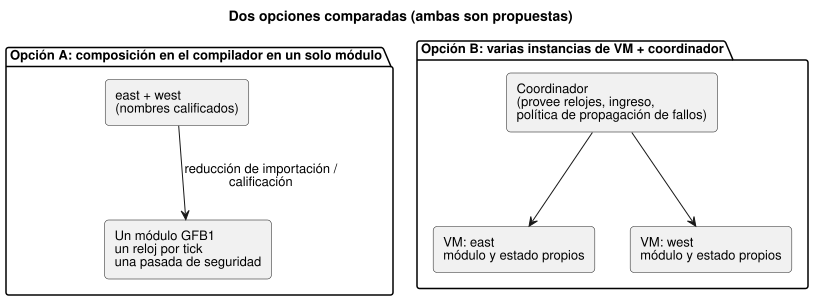
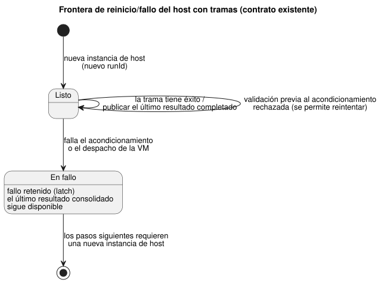

<!-- translation-source: docs/research/GF-COMPOSE-R3-EXECUTION.md -->
[Original en inglés](GF-COMPOSE-R3-EXECUTION.md)

# GF-COMPOSE R3: composición de la ejecución

Esta nota compara cómo dos o más comportamientos podrían ejecutarse juntos sin
interferir entre sí. Registra los hechos actuales sobre el tick, el host con
tramas (framed host) y la estación; compara exactamente dos opciones de
composición; desarrolla a mano tablas de escaneo (aislamiento, orden de
declaración, un comportamiento que consume a otro, un ciclo rechazado,
reinicio/fallo); y termina con una recomendación y sus responsables.

## Problema del usuario

Añadir un comportamiento no debe alterar un comportamiento existente mediante
un orden oculto, estado compartido, relojes o el manejo de fallos. El diseño
debe preservar los objetivos de menos esfuerzo, explicabilidad y trazabilidad.

Este documento compara solo dos opciones:

1. composición en el compilador en un único módulo ejecutable;
2. varias instancias de VM con coordinación explícita.

## Evidencia en la revisión examinada

La revisión del lenguaje examinada es `ffdbc96461eca67908252507fb851fa4dabd9a2c`.
El árbol de trabajo no se modificó antes de este documento.

**Compilador.** `compileSource` acepta un único `.ghost.md` canónico, lo reduce
mediante `compileControl`, emite una secuencia de bytes GFB1 y registra los
digests de la fuente/del bytecode y los metadatos de traza
([`tools/compile-source.mjs`](../../tools/compile-source.mjs)). `compileControl`
reduce un control a un `module` GFB1. Las transiciones de estado se evalúan a
partir del estado actual; después, las intenciones pueden leer `next.*`
([`tools/control.mjs`](../../tools/control.mjs)).

**Tick del núcleo.** `Runtime::tick`, en este orden:

1. exige todas las entradas declaradas;
2. valida un `__gf_now_ms` explícito opcional;
3. calcula todo el estado siguiente antes de las intenciones;
4. aplica la seguridad;
5. consolida el estado y las intenciones seguras de forma atómica;
6. borra las entradas;
7. añade un registro acotado al journal.

`tick_at` proporciona el reloj explícito; la VM no lee ningún reloj de pared
([`crates/ghostflow-core/src/lib.rs`](../../crates/ghostflow-core/src/lib.rs)).

**Instalación y reemplazo en caliente.**

- `install` reinicia las entradas, las intenciones seguras, la estrategia
  activa y el reloj; puede preservar el estado con el mismo nombre y el mismo
  tipo.
- `hot_swap` preserva el estado con nombre compatible, pero borra las
  intenciones seguras y rechaza los cambios del nombre del módulo o del tipo
  de estado.

**Lo que estos hechos no cubren.** Describen el tick del núcleo y el adaptador
de tramas completas del host con tramas. No especifican el ingreso asíncrono
de CEP ni la entrega de ocurrencias. El requisito de entrega acordado es:

- Las ocurrencias deben seguir siendo significativas de forma individual.
- Las observaciones de valores son independientes de la captura por
  interrupción/escaneo.
- De forma predeterminada, las observaciones se preservan dentro de la
  capacidad admitida.
- El reemplazo por el último valor pendiente solo se permite cuando se activa
  explícitamente para cada entrada.
- La pérdida/el desbordamiento debe rechazarse o notificarse, nunca aceptarse
  en silencio.

Este requisito no implica un historial persistente ilimitado. El orden de
ingreso, el mapeo de eventos a ticks, el agrupamiento por fuente declarada, los
límites y la recuperación siguen sin resolverse. No se ha proporcionado ningún
plazo estricto ni ningún planificador por prioridades. Véanse
[`LANGUAGE-SURFACE.md`](../LANGUAGE-SURFACE.es.md) e
[`IMPLEMENTATION.md`](../IMPLEMENTATION.es.md).

**Host con tramas.** El host con tramas captura una trama de entrada completa,
despacha una vez, publica el último resultado aceptado y retiene (latch) un
fallo tras un fallo de acondicionamiento o de despacho. Los pasos siguientes
requieren una nueva instancia de host; una validación previa al
acondicionamiento rechazada todavía puede reintentarse
([`docs/FRAMED-CONTROL-HOST.md`](../FRAMED-CONTROL-HOST.es.md)). Así, «último
resultado completado» y «nueva ejecución» son hechos del contrato de host
existente.

**Módulo de estación.** El módulo de estación está dirigido por el host y es
acotado. `prepare_start_batch` elige una solicitud a partir de una instantánea
del mismo tick, mientras que `authorize_output` comprueba una reserva
duradera, el titular/la sesión, los límites de las válvulas y la salida segura
([`crates/ghostflow-core/src/station.rs`](../../crates/ghostflow-core/src/station.rs)).
Es un árbitro físico de estación de bombeo, no evidencia de una composición
universal de comportamientos.

**Límites de GFB1.** 128 entradas, 128 estados, 32 estrategias, 128
restricciones, profundidad/nodos de expresión de 128/4096, y tamaños acotados
de expresiones y consultas
([`tools/gfb1.mjs`](../../tools/gfb1.mjs)).

**Desde R2.** Tal como se desarrolla en [R2: autoridad e identidad](GF-COMPOSE-R2-AUTHORITY-IDENTITY.es.md):

- La distinción entre fuente e instancia mantiene la autoridad de la fuente
  canónica, y una instancia necesita una identidad opaca con estado y
  procedencia aislados.
- La memoria conversacional es procedencia y contexto de autoría, no una
  autoridad automática sobre reglas de ejecución ni sobre vinculaciones
  físicas. El vínculo memoria → decisión → fuente, la retención y el
  comportamiento de las lápidas (tombstones) siguen siendo cuestiones de R2 y
  del sistema/API.
- La frontera de las restricciones de instalación sigue sin resolverse. Este
  documento no selecciona ningún artefacto de restricciones, superposición ni
  titular de la aplicación.

Véase también [R5: contratos de composición y diagnósticos](GF-COMPOSE-R5-CONTRACTS.es.md)
para la propuesta relacionada de compatibilidad y evidencia.

## Tablas y ejemplos

### Comparación de opciones

Ambas filas son propuestas. Cada columna es una propiedad que la composición
debe resolver.

| Opción | Muestreo de entradas | Reloj | Visibilidad del estado anterior/siguiente | Alcance del reinicio/fallo | Resolución de salidas | Procedencia | Límites existentes | Nueva maquinaria |
|---|---|---|---|---|---|---|---|---|
| Composición en el compilador en un único módulo ejecutable *(propuesta)* | Existe el comportamiento de tick con trama completa; el ingreso asíncrono de ocurrencias/valores sigue sin especificarse; los nombres compartidos deben calificarse | Un reloj lógico proporcionado por tick | Todas las transiciones leen la misma instantánea de entradas/estado anterior; las referencias a next solo en expresiones de salida, no en otras transiciones next ni en lets | Una sola frontera de módulo/runtime; un fallo afecta al escaneo compuesto | Una única pasada de seguridad sobre un único banco de intenciones solicitadas; las definiciones autoritativas de salida duplicadas son errores de compilación, nunca una política de «gana el último escritor» | Una huella de módulo/cierre de fuente, con traza calificada por instancia propuesta por R2 | Un único presupuesto combinado de entradas/estados/estrategias/restricciones | Reducción de importación/calificación, validación de dependencias, mapeo de ingreso y representación de traza en la ABI |
| Varias instancias de VM con coordinación explícita *(propuesta)* | El ingreso de cada instancia debe preservar las ocurrencias/observaciones de valores según la regla de entrega establecida; el adaptador de instantáneas de trama completa no resuelve el agrupamiento ni el orden | El coordinador proporciona cada reloj; la política de reloj compartido debe ser explícita | Cada instancia conserva el aislamiento anterior/siguiente; el cableado entre instancias no puede redefinir las referencias a next; el uso compartido no admitido es un error de compilación | Fallos de VM por instancia más la política del coordinador/de propagación; debe definirse la frontera de fallo con tramas | Los escritores directos duplicados siguen siendo errores de compilación; solo las solicitudes de estación modeladas explícitamente pueden usar el arbitraje de estación existente | Huella de módulo por instancia más la unión instancia/ejecución/escaneo | Los límites se aplican por módulo, pero los límites del coordinador y de los recursos totales no están especificados | Coordinador, mapeo de ingreso a tick, unión independiente del orden e integración con la estación cuando corresponda |

### Instancias aisladas: east y west

Lo siguiente es un ejemplo elaborado a mano, no evidencia de ejecución:

- Ambas instancias usan la misma definición.
- Cada una tiene su propio estado `running` y su propia salida `pump`.
- `start` es verdadero solo para east en el escaneo 1.
- `t` se proporciona por igual.

| Escaneo/momento de lectura | Instancia | Entradas | Estado antes | Estado después | Salida solicitada / segura | Momento de lectura |
|---|---|---|---|---|---|---|
| 1, misma trama completa | east | `start=true`, `t=1000` | `running=false` | `running=true` | `pump=true` / `pump=true` | Lee las entradas de east y el estado anterior de east |
| 1, misma trama completa | west | `start=false`, `t=1000` | `running=false` | `running=false` | `pump=false` / `pump=false` | Lee las entradas de west y el estado anterior de west |
| 2, misma trama completa | east | `start=false`, `t=2000` | `running=true` | `running=true` | `pump=true` / `pump=true` | Lee el estado consolidado previo de east |
| 2, misma trama completa | west | `start=false`, `t=2000` | `running=false` | `running=false` | `pump=false` / `pump=false` | Lee el estado consolidado previo de west |

**Invariante:** el arranque de east no arranca west. Esta es una propuesta para
un contrato de ejecución compuesta, no un hecho de la ABI multiinstancia
actual.

### Orden de declaración invertido, identidades sin cambios

Propuesta elaborada a mano. Se usan los mismos ID de instancia, entradas y
tramas de east y west; solo cambia el orden de declaración. «Traza» significa
la secuencia indexada por identidad, no por posición en un arreglo.

| Orden de declaración | Instancia | Entradas | Estado antes → después | Solicitada / segura | Momento de lectura |
|---|---|---|---|---|---|
| east, west | east | `start=true` | `false → true` | `true / true` | trama 1, estado anterior de east |
| east, west | west | `start=false` | `false → false` | `false / false` | trama 1, estado anterior de west |
| west, east | east | `start=true` | `false → true` | `true / true` | trama 1, estado anterior de east |
| west, east | west | `start=false` | `false → false` | `false / false` | trama 1, estado anterior de west |

Las trazas indexadas por identidad son iguales. Reordenar las declaraciones no
debe convertirse en un planificador implícito. Esto no implica que intercambiar
dependencias cableadas sea equivalente.

### Un comportamiento que consume el resultado de otro

Semántica hipotética elaborada a mano para un par coordinado por separado (no
un tick atómico de módulo compuesto):

- `producer.ok` es un resultado de east.
- `consumer` solicita `valve=producer.ok` y tiene el estado inicial
  `running=false`.
- La tabla hace explícita la fase de lectura porque el compilador actual no
  tiene ninguna referencia a resultados entre módulos ni ninguna regla de
  reducción para ello.
- Las etiquetas de «paso» indican el orden del escenario, no ID de escaneo
  nativos por instancia.
- La fila 1 muestra un avance hipotético del productor junto con el rechazo
  del consumidor. Esto no adopta una política de avance parcial; no existe un
  resultado compuesto completo para ese paso.

| Paso del escenario | Entradas | Estado antes → después | Salida solicitada / segura | Momento de lectura |
|---|---|---|---|---|
| 1 | entrada del productor `sensor=1`; entrada del consumidor completa en lo demás | productor `false→true`; el consumidor no tiene una evaluación válida porque el valor requerido del productor no está disponible | productor `ok=true`; el consumidor no tiene resultado solicitado/seguro | El consumidor no lee ningún resultado del productor del mismo escaneo; la dependencia faltante no toma false como valor predeterminado |
| 2 | entrada del productor `sensor=0`; trama del consumidor completa | productor `true→false`; consumidor `false→true` | productor `ok=false`; consumidor `valve=true / true` | El consumidor lee el último resultado completado del productor, del escaneo 1 |

Esta comparación hipotética no describe el comportamiento ejecutable actual:

- El compilador/runtime no tiene referencias a valores entre módulos.
- Un valor requerido faltante no produce una evaluación válida, no un respaldo
  inventado.
- El cableado entre instancias en el mismo escaneo no puede hacer disponible
  el valor `next` de otra instancia ni redefinir las reglas de referencia a
  next.
- El uso compartido entre instancias no admitido es un error de compilación.

Los ejemplos contrastan valores en las fronteras admitidas de escaneo
completado; no adoptan un ingreso FIFO, una reducción en el mismo escaneo ni un
planificador.

### Ciclo rechazado y reinicio/fallo

**Ciclo rechazado** *(dependencia no válida elaborada a mano; notación de
dependencias, no sintaxis de la fuente)*:
`east.pump[n] <- west.pump[n]` y `west.pump[n] <- east.pump[n]`, donde `n`
identifica el mismo escaneo. El resultado de east requiere el resultado de
west, y el resultado de west requiere el resultado de east. Estas dos aristas
cierran el ciclo; ninguno de los dos resultados puede evaluarse primero según
el orden de dependencias. Este ciclo instantáneo se rechaza antes de la
ejecución. Los ciclos de expresiones instantáneos y las definiciones de salida
duplicadas son entradas no válidas para el compilador, no cuestiones de
política abiertas.

En cambio, una lectura del estado consolidado del escaneo previo usa un valor
fijado antes del escaneo `n`. Reemplazar una de estas dependencias por una
lectura así rompe este ciclo del mismo escaneo. La VM actual evalúa las
transiciones a partir del estado previo antes de consolidar el estado
siguiente. Esta distinción no define ninguna nueva semántica de lectura entre
instancias ni de valores iniciales.

**Reinicio/fallo** *(restringido por el contrato)*:

- Tras una trama exitosa, el host con tramas expone su último resultado
  completado.
- Si falla el acondicionamiento o el despacho de la VM, ese resultado
  consolidado sigue disponible, el host retiene (latch) un fallo, y otro paso
  requiere una nueva instancia de host.
- Una nueva ejecución debe usar un nuevo `runId`; `scanId=0` en la nueva
  ejecución no es la ocurrencia anterior.

El diagrama muestra esta frontera existente de un solo host.

La composición debe preservar esta frontera. No debe reiniciar parcialmente
una instancia mientras presenta un resultado compuesto como completo. La
propagación exacta de fallos entre varias instancias sigue sin resolverse.

## Recomendación

La composición estática en el compilador sigue siendo la hipótesis preferida,
no una reducción ni una ABI seleccionadas. Debe preservar las invariantes de
tick existentes:

- cada transición lee la misma instantánea de entradas/estado anterior;
- las referencias a next solo son legales en expresiones de salida, no en
  otras transiciones next ni en lets;
- el estado lógico y la salida se consolidan simultáneamente;
- se rechazan los ciclos y las definiciones de salida duplicadas.

Cada canal de salida tiene una única definición autoritativa. Los escritores
directos en competencia hacen fallar la compilación y no pueden desplegarse.
Esto no elimina el arbitraje explícito de recursos de un solo escritor de la
estación: las solicitudes de estación no son escrituras directas en
competencia. La composición no autoriza cableado entre instancias en el mismo
escaneo que cambie la semántica de las referencias a next. La planificación por
tramas completas no resuelve el ingreso de eventos, el orden, el agrupamiento
ni el desbordamiento.

No generalice la reutilización de la estación. Su selección en el mismo tick y
su autorización duradera de salidas pueden arbitrar una bomba compartida una
vez que existen los resultados de los comportamientos, pero su política de
bombas/válvulas no es un resolvedor universal de composición. La semántica más
amplia de arbitraje y de respaldo (fallback) sigue correspondiendo a #95.

## Preguntas no resueltas y responsables

- Titular del compilador del lenguaje: definir si la composición reduce los
  controles importados a un único módulo GFB1, y cómo se califican los
  nombres, el estado, las entradas, las salidas y los mapas de fuente.
  Preservar las reglas de anterior/siguiente y de ciclos anteriores; no
  presentarlas como elecciones semánticas abiertas.
- Titular de la ABI del lenguaje/runtime: definir el manifiesto compuesto, los
  campos de traza calificados por instancia, la visibilidad de los resultados
  y si un único TickRecord sigue siendo canónico. Ningún campo actual de la ABI
  define resultados entre instancias.
- Titulares del lenguaje/runtime: definir el orden de ingreso, el mapeo de
  eventos a ticks, el agrupamiento por fuente declarada, la capacidad y el
  mapeo de relojes. El tick del núcleo y el host con tramas no resuelven el
  ingreso asíncrono. No se supone ningún plazo ni planificador por
  prioridades.
- Titulares del lenguaje/runtime: definir la aplicación de la seguridad
  compuesta conservando la invariante de que las definiciones de salida
  directas duplicadas son errores de compilación; el arbitraje de recursos de
  la estación sigue siendo un concepto admitido distinto.
- Titular de la API/del despliegue junto con los titulares de R2: preservar la
  frontera no resuelta de las restricciones de instalación. No inferir que la
  composición resuelve la elección entre la compilación separada de
  restricciones y una revisión explícita de frontera entre proyectos.
- Titular de la memoria operativa de la API/del sistema: mantener la
  recuperación de memoria y la interpretación de un LLM fuera de las entradas
  de runtime. R2 es titular del linaje, la retención/las lápidas y el vínculo
  con las decisiones; este documento de ejecución no define esos ciclos de
  vida.
- Titular de #95/de la estación: decidir cómo interactúan los recursos físicos
  compartidos con los resultados de los comportamientos. La política existente
  de la estación no debe tratarse como universal.
- Titular del host con tramas: definir la propagación de fallos compuesta, la
  publicación del último resultado completado y el comportamiento de nueva
  ejecución. El texto actual sobre tramas especifica una instancia de host, no
  un grafo compuesto.

## Verificación

- [x] Revisión examinada registrada como `ffdbc96461eca67908252507fb851fa4dabd9a2c`.
- [x] Se comparan exactamente dos opciones en todas las columnas solicitadas,
  con los hechos actuales separados de las propuestas.
- [x] Tres tablas de escaneo elaboradas a mano incluyen entradas, estado
  antes, estado después, salidas solicitadas/seguras y momento de lectura; las
  invariantes de aislamiento y de orden de declaración son explícitas.
- [x] Se incluyen los casos de ciclo en el mismo escaneo y de reinicio/fallo.
  Se preservan las fronteras de último resultado y de nueva ejecución del host
  con tramas.
- [x] Se nombran los límites actuales, las fronteras de reutilización de la
  estación y las preguntas exactas sin respuesta sobre reducción/ABI. No se
  introduce ningún planificador ni ABI.
- [x] Los ejemplos están etiquetados como elaborados a mano y no se afirma
  ninguna ejecución de runtime.
- [x] No se ejecutaron suites de pruebas de runtime, como se exige para esta
  tarea exclusivamente documental. El coordinador debería ejecutar
  `git diff --check` e inspeccionar los enlaces relativos.
