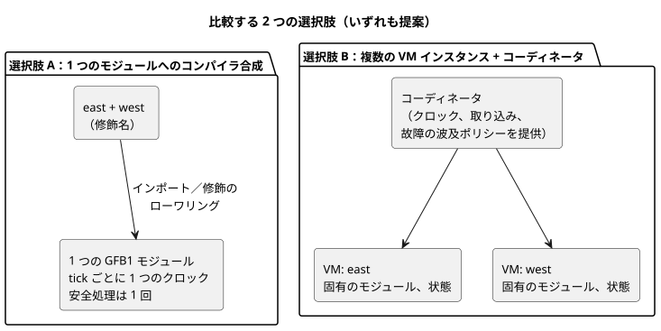
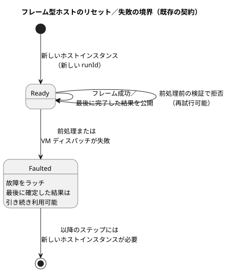

<!-- translation-source: docs/research/GF-COMPOSE-R3-EXECUTION.md -->
[英語の原文](GF-COMPOSE-R3-EXECUTION.md)

# GF-COMPOSE R3：実行の合成

このノートは、2 つ以上の振る舞いを互いに干渉させずに一緒に実行する方法を比較します。現在の tick、フレーム型ホスト（framed host）、ステーションに関する事実を記録し、ちょうど 2 つの合成の選択肢を比較し、手作業で作成したスキャン表（分離、宣言順、ある振る舞いが別の振る舞いの結果を使う場合、拒否される循環、リセット／失敗）を順に検討し、最後に推奨事項と担当者を示します。

## ユーザーの課題

振る舞いを追加しても、隠れた順序付け、共有された状態、クロック、故障処理を通じて既存の振る舞いが変わってはなりません。設計では、手間の削減、説明可能性、トレーサビリティという目標を守らなければなりません。

このドキュメントでは、次の 2 つの選択肢だけを比較します。

1. 1 つの実行可能モジュールへのコンパイラによる合成
2. 明示的な調整を伴う複数の VM インスタンス

## 調査対象リビジョンでの証拠

調査対象の言語リビジョンは `ffdbc96461eca67908252507fb851fa4dabd9a2c` です。このドキュメントの作成前に、ワークツリーは変更されていませんでした。

**コンパイラ。** `compileSource` は正本の `.ghost.md` を 1 つ受け取り、`compileControl` を通じてローワリングし、GFB1 のバイト列を 1 つ出力し、ソース／バイトコードのダイジェストとトレースのメタデータを記録します（[`tools/compile-source.mjs`](../../tools/compile-source.mjs)）。`compileControl` は 1 つの control を 1 つの GFB1 `module` にローワリングします。状態遷移は現在の状態から評価され、その後で意図が `next.*` を読めます（[`tools/control.mjs`](../../tools/control.mjs)）。

**コアの tick。** `Runtime::tick` は次の順序で処理します。

1. 宣言されたすべての入力を要求する。
2. 省略可能な明示的な `__gf_now_ms` を検証する。
3. 意図より前に、すべての次状態を計算する。
4. 安全処理を適用する。
5. 状態と安全な意図をアトミックに確定する。
6. 入力をクリアする。
7. 範囲が限定されたジャーナルレコードを追加する。

`tick_at` は明示的なクロックを提供します。VM は壁時計を読みません（[`crates/ghostflow-core/src/lib.rs`](../../crates/ghostflow-core/src/lib.rs)）。

**インストールとホットスワップ。**

- `install` は入力、安全な意図、アクティブな戦略、クロックをリセットします。同じ名前・同じ型の状態は保持してもかまいません。
- `hot_swap` は互換性のある名前付きの状態を保持しますが、安全な意図をクリアし、モジュール名や状態の型の変更を拒否します。

**これらの事実が扱わないこと。** これらはコアの tick と、フレーム型の完全フレームアダプタを説明しています。非同期の CEP の取り込み（ingress）やオカレンスの配信は規定していません。合意済みの配信要件は次のとおりです。

- オカレンスは個々に意味を持ち続けなければなりません。
- 値の観測は、割り込み／スキャンによる取得とは独立しています。
- 既定では、観測はサポートされる容量の範囲内で保持されます。
- 最新の保留値で置き換えることは、入力ごとに明示的にオプトインした場合にのみ許されます。
- 損失／オーバーフローは拒否または報告しなければならず、黙って受け入れてはなりません。

この要件は、無制限の永続的な履歴を意味するものではありません。取り込みの順序付け、イベントから tick へのマッピング、宣言されたソースのバッチ化、上限、復旧は未解決です。厳密なデッドラインや優先度スケジューラは提供されていません。[`LANGUAGE-SURFACE.md`](../LANGUAGE-SURFACE.ja.md) と [`IMPLEMENTATION.md`](../IMPLEMENTATION.ja.md) を参照してください。

**フレーム型ホスト。** フレーム型ホストは完全な入力フレームを 1 つ取得し、1 回ディスパッチし、最後に受け入れた結果を公開し、前処理（conditioning）またはディスパッチの失敗後には故障をラッチします。以降のステップには新しいホストインスタンスが必要です。ただし、前処理の前の検証で拒否された場合は再試行できます（[`docs/FRAMED-CONTROL-HOST.md`](../FRAMED-CONTROL-HOST.ja.md)）。したがって、「最後に完了した結果」と「新しい実行」は、既存のホスト契約上の事実です。

**ステーションモジュール。** ステーションモジュールはホスト駆動で、範囲が限定されています。`prepare_start_batch` は同じ tick のスナップショットから要求を 1 つ選び、`authorize_output` は永続的な予約、所有者／セッション、バルブの制限、安全な出力を確認します（[`crates/ghostflow-core/src/station.rs`](../../crates/ghostflow-core/src/station.rs)）。これは物理的なポンプステーションの調停役であり、汎用的な振る舞いの合成の証拠ではありません。

**GFB1 の上限。** 入力 128、状態 128、戦略 32、制約 128、式の深さ／ノード数 128/4096、そして範囲が限定された式とクエリのサイズです（[`tools/gfb1.mjs`](../../tools/gfb1.mjs)）。

**R2 から。** [R2：権限と同一性](GF-COMPOSE-R2-AUTHORITY-IDENTITY.ja.md)で展開したとおりです。

- ソースとインスタンスを区別することで正本ソースが権限を保ちます。また、インスタンスには、分離された状態と来歴を持つ不透明な同一性が必要です。
- 会話のメモリは来歴と作成時の文脈であり、実行ルールや物理バインディングに関する自動的な権限ではありません。メモリから判断、ソースへの結び付け、保持、トゥームストーンの動作は、引き続き R2／API システムの問いです。
- 設置制約の境界は未解決のままです。このドキュメントは、制約アーティファクト、オーバーレイ、強制の所有者のいずれも選びません。

関連する互換性と証拠の提案については、[R5：合成の契約と診断](GF-COMPOSE-R5-CONTRACTS.ja.md)も参照してください。

## 表と例

### 選択肢の比較

どちらの行も提案です。各列は、合成で決めなければならない性質を 1 つずつ表しています。

| 選択肢 | 入力のサンプリング | クロック | 旧状態／次状態の可視性 | リセット／故障の範囲 | 出力の解決 | 来歴 | 既存の上限 | 新たに必要な仕組み |
|---|---|---|---|---|---|---|---|---|
| 1 つの実行可能モジュールへのコンパイラ合成 *（提案）* | 完全フレームの tick の動作は存在する。非同期のオカレンス／値の取り込みは未規定。共有される名前は修飾しなければならない | tick ごとに 1 つの供給された論理クロック | すべての遷移が同じ入力／旧状態のスナップショットを読む。next 参照は出力式でのみ可能で、他の next 遷移や let では不可 | 1 つのモジュール／ランタイムの境界。失敗は合成されたスキャン全体に影響する | 1 つの要求意図のバンクに対して安全処理は 1 回。権限のある出力定義の重複はコンパイルエラーであり、決して後勝ちのポリシーにはしない | 1 つのモジュールのフィンガープリント／ソースの閉包。R2 が提案するインスタンス修飾のトレースを伴う | 入力／状態／戦略／制約の予算を合算して 1 つ | インポート／修飾のローワリング、依存関係の検証、取り込みのマッピング、ABI でのトレース表現 |
| 明示的な調整を伴う複数の VM インスタンス *（提案）* | 各インスタンスの取り込みは、定められた配信ルールでオカレンス／値の観測を保たなければならない。完全フレームのスナップショットアダプタはバッチ化や順序を決めない | コーディネータが各クロックを供給する。共有クロックのポリシーは明示しなければならない | 各インスタンスは旧／次の分離を保つ。インスタンス間の配線で next 参照を再定義できない。サポートされない共有はコンパイルエラー | インスタンスごとの VM の故障と、コーディネータ／波及のポリシー。フレーム型の失敗の境界を定義しなければならない | 重複する直接の書き手は引き続きコンパイルエラー。明示的にモデル化されたステーションの要求だけが既存のステーション調停を使える | インスタンスごとのモジュールフィンガープリントと、インスタンス／実行／スキャンの結合 | 上限はモジュールごとに適用されるが、コーディネータとリソース全体の上限は未規定 | コーディネータ、取り込みから tick へのマッピング、順序に依存しない結合、必要に応じてステーションとの統合 |

### 分離されたインスタンス：east と west

以下は手作業で作成した例であり、実行による証拠ではありません。

- 両方のインスタンスが同じ定義を使います。
- それぞれが独立した `running` 状態と出力 `pump` を持ちます。
- `start` はスキャン 1 の east でのみ true です。
- `t` は両方に同じ値が供給されます。

| スキャン／読み取りタイミング | インスタンス | 入力 | 前の状態 | 後の状態 | 要求／安全な出力 | 読み取りタイミング |
|---|---|---|---|---|---|---|
| 1、同じ完全フレーム | east | `start=true`、`t=1000` | `running=false` | `running=true` | `pump=true` / `pump=true` | east の入力と east の旧状態を読む |
| 1、同じ完全フレーム | west | `start=false`、`t=1000` | `running=false` | `running=false` | `pump=false` / `pump=false` | west の入力と west の旧状態を読む |
| 2、同じ完全フレーム | east | `start=false`、`t=2000` | `running=true` | `running=true` | `pump=true` / `pump=true` | east の以前に確定した状態を読む |
| 2、同じ完全フレーム | west | `start=false`、`t=2000` | `running=false` | `running=false` | `pump=false` / `pump=false` | west の以前に確定した状態を読む |

**不変条件：** east の起動は west を起動しません。これは合成された実行の契約に対する提案であり、現在の複数インスタンス ABI の事実ではありません。

### 宣言順を逆にしても同一性は変わらない

手作業で作成した提案です。同じ east と west のインスタンス ID、入力、フレームを使い、宣言順だけを変えます。「トレース」とは、配列の位置ではなく同一性をキーとした並びを意味します。

| 宣言順 | インスタンス | 入力 | 前の状態 → 後の状態 | 要求 / 安全 | 読み取りタイミング |
|---|---|---|---|---|---|
| east, west | east | `start=true` | `false → true` | `true / true` | フレーム 1、east の旧状態 |
| east, west | west | `start=false` | `false → false` | `false / false` | フレーム 1、west の旧状態 |
| west, east | east | `start=true` | `false → true` | `true / true` | フレーム 1、east の旧状態 |
| west, east | west | `start=false` | `false → false` | `false / false` | フレーム 1、west の旧状態 |

同一性をキーとしたトレースは等しくなります。宣言の並べ替えが暗黙のスケジューラになってはなりません。これは、配線された依存関係を入れ替えても等価であることを意味するものではありません。

### ある振る舞いが別の振る舞いの結果を使う場合

個別に調整されるペアについて、手作業で作成した仮説上のセマンティクスです（アトミックに合成されたモジュールの tick ではありません）。

- `producer.ok` は east の結果です。
- `consumer` は `valve=producer.ok` を要求し、初期状態は `running=false` です。
- 現在のコンパイラにはモジュールをまたぐ結果の参照やローワリングのルールがないため、この表では読み取りフェーズを明示しています。
- 「ステップ」のラベルはシナリオ上の順序であり、インスタンスごとのネイティブなスキャン ID ではありません。
- 行 1 は、仮説上の producer の進行と consumer の拒否を並べて示しています。これは部分的な進行のポリシーを採用するものではありません。そのステップには、合成された完全な結果はありません。

| シナリオのステップ | 入力 | 前の状態 → 後の状態 | 要求／安全な出力 | 読み取りタイミング |
|---|---|---|---|---|
| 1 | producer の入力 `sensor=1`。consumer の入力はそれ以外は揃っている | producer `false→true`。必要な producer の値が利用できないため、consumer には有効な評価がない | producer `ok=true`。consumer には要求／安全な結果がない | consumer は同じスキャンの producer の結果を読まない。欠けている依存関係を false で既定値補完しない |
| 2 | producer の入力 `sensor=0`。consumer のフレームは完全 | producer `true→false`。consumer `false→true` | producer `ok=false`。consumer `valve=true / true` | consumer は producer の最後に完了したスキャン 1 の結果を読む |

この仮説上の比較は、現在実行可能な動作を説明するものではありません。

- コンパイラ／ランタイムには、モジュールをまたぐ値の参照がありません。
- 必要な値が欠けている場合は有効な評価が得られず、作り出したフォールバックは使われません。
- 同じスキャンでのインスタンス間の配線によって、別のインスタンスの `next` の値を利用可能にしたり、next 参照のルールを再定義したりはできません。
- サポートされないインスタンス間の共有はコンパイルエラーです。

これらの例は、サポートされる完了済みスキャンの境界での値を対比するものであり、FIFO の取り込み、同じスキャン内でのローワリング、スケジューラを採用するものではありません。

### 拒否される循環とリセット／失敗

**拒否される循環**（*手作業で作成した無効な依存関係。依存関係の表記であり、ソースの構文ではありません*）：
`east.pump[n] <- west.pump[n]` と `west.pump[n] <- east.pump[n]`。ここで `n` は同じスキャンを表します。east の結果には west の結果が必要で、west の結果には east の結果が必要です。この 2 つのエッジが循環を閉じるため、依存関係の順序ではどちらの結果も先に評価できません。この瞬時の循環は実行前に拒否してください。瞬時の式の循環と出力定義の重複は無効なコンパイラ入力であり、未解決のポリシーの問題ではありません。

これに対して、確定済みの前スキャンの状態からの読み取りは、スキャン `n` より前に確定した値を使います。これらの依存関係の一方をそのような読み取りに置き換えると、この同じスキャン内の循環は解消されます。現在の VM は、次状態を確定する前に、前状態から遷移を評価します。この区別は、インスタンスをまたぐ新しい読み取りや初期値のセマンティクスを定義するものではありません。

**リセット／失敗**（*契約による制約あり*）：

- フレームが成功すると、フレーム型ホストは最後に完了した結果を公開します。
- 前処理または VM のディスパッチが失敗した場合、確定済みの結果は引き続き利用でき、ホストは故障をラッチし、次のステップには新しいホストインスタンスが必要です。
- 新しい実行では新しい `runId` を使わなければなりません。新しい実行での `scanId=0` は以前のオカレンスではありません。

次の図は、この既存の単一ホストの境界を示しています。

合成はこの境界を保たなければなりません。合成された結果を完全なものとして示しながら、1 つのインスタンスだけを部分的にリセットしてはなりません。複数インスタンスでの故障の波及の詳細は未解決です。

## 推奨事項

静的なコンパイラ合成は引き続き有力な仮説ですが、ローワリングや ABI として選択されたものではありません。既存の tick の不変条件を保たなければなりません。

- すべての遷移が同じ入力／旧状態のスナップショットを読む。
- next 参照は出力式でのみ合法であり、他の next 遷移や let では使えない。
- 論理的な状態と出力の確定は同時に行われる。
- 循環と出力定義の重複は拒否される。

各出力チャネルには、権限のある定義が 1 つだけあります。競合する直接の書き手はコンパイルに失敗し、デプロイできません。これは、明示的なステーションの単一書き手によるリソース調停を取り除くものではありません。ステーションの要求は、競合する直接の書き込みではないからです。合成は、next 参照のセマンティクスを変えるような同じスキャン内のインスタンス間の配線を認めません。完全フレームのスケジューリングは、イベントの取り込み、順序付け、バッチ化、オーバーフローを決めるものではありません。

ステーションの再利用を一般化しないでください。その同じ tick での選択と永続的な出力の認可は、振る舞いの結果が出た後に共有ポンプを調停できますが、そのポンプ／バルブのポリシーは汎用的な合成の解決手段ではありません。より広い調停とフォールバックのセマンティクスは、引き続き #95 が担当します。

## 未解決の問いと担当者

- 言語コンパイラの所有者：合成がインポートした control を 1 つの GFB1 モジュールにローワリングするかどうか、また名前、状態、入力、出力、ソースマップをどう修飾するかを定義する。上記の旧／次と循環のルールを保ち、それらを未解決のセマンティクスの選択肢として扱わないこと。
- 言語／ランタイム ABI の所有者：合成のマニフェスト、インスタンス修飾のトレースフィールド、結果の可視性、そして 1 つの TickRecord が正準のままかどうかを定義する。現在の ABI には、インスタンスをまたぐ結果を定義するフィールドはありません。
- 言語／ランタイムの所有者：取り込みの順序付け、イベントから tick へのマッピング、宣言されたソースのバッチ化、容量、クロックのマッピングを定義する。コアの tick とフレーム型ホストは、非同期の取り込みを決めていません。デッドラインや優先度スケジューラは前提としません。
- 言語／ランタイムの所有者：出力定義の直接の重複はコンパイルエラーであるという不変条件を保ちながら、合成された安全処理の適用を定義する。ステーションのリソース調停は、別個のサポートされた概念のままです。
- API／デプロイの所有者（R2 の所有者とともに）：未解決の設置制約の境界を保つ。合成によって、制約の個別コンパイルと明示的なプロジェクト横断の境界リビジョンのどちらにするかが決まると推論しないこと。
- API／システムの運用メモリの所有者：メモリの取得と LLM による解釈をランタイムの入力の外に置く。系譜、保持／トゥームストーン、判断との結び付けは R2 が担当し、この実行に関するドキュメントはそれらのライフサイクルを定義しません。
- #95／ステーションの所有者：共有される物理リソースが振る舞いの結果とどう相互作用するかを決める。既存のステーションのポリシーを汎用的なものとして扱ってはなりません。
- フレーム型ホストの所有者：合成時の故障の波及、最後に完了した結果の公開、新しい実行の動作を定義する。現在のフレーム型ホストの記述は 1 つのホストインスタンスを規定するもので、合成されたグラフを規定するものではありません。

## 検証

- [x] 調査対象のリビジョンを `ffdbc96461eca67908252507fb851fa4dabd9a2c` として記録しました。
- [x] ちょうど 2 つの選択肢を、要求されたすべての列で比較し、現在の事実と提案を分けています。
- [x] 手作業による 3 つのスキャン表に、入力、前の状態、後の状態、要求／安全な出力、読み取りタイミングを含めています。分離と宣言順の不変条件を明示しています。
- [x] 同じスキャン内の循環とリセット／失敗のケースを含めています。フレーム型の「最後の結果」と新しい実行の境界を保っています。
- [x] 現在の上限、ステーション再利用の境界、未回答のローワリング／ABI の厳密な問いを挙げています。スケジューラや ABI は導入していません。
- [x] 例は手作業で作成したものと明記しており、ランタイムでの実行は主張していません。
- [x] このドキュメントのみのタスクで求められているとおり、ランタイムのテストスイートは実行していません。コーディネーターが `git diff --check` を実行し、相対リンクを検査してください。
