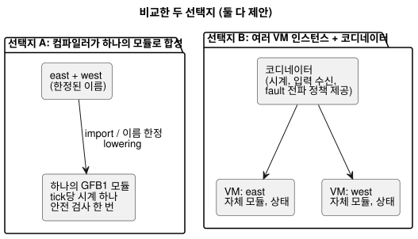
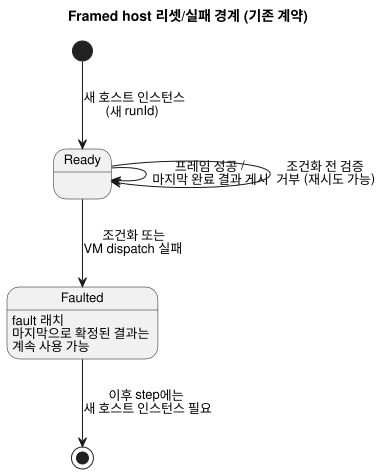

<!-- translation-source: docs/research/GF-COMPOSE-R3-EXECUTION.md -->
[영문 원문](GF-COMPOSE-R3-EXECUTION.md)

# GF-COMPOSE R3: 실행 조합

이 문서는 둘 이상의 동작(behavior)이 서로 간섭하지 않고 함께 실행될 수 있는 방법을
비교합니다. 현재의 tick, framed host, station에 관한 사실을 기록하고, 정확히 두 가지
조합 선택지를 비교하며, 손으로 만든 스캔 표(격리, 선언 순서, 한 동작이 다른 동작의
결과를 소비하는 경우, 거부되는 순환, 리셋/실패)를 풀어 본 뒤 권고와 소유자로
마무리합니다.

## 사용자 문제

동작을 추가할 때 숨겨진 순서, 공유 상태, 시계, fault 처리 때문에 기존 동작이 바뀌어서는
안 됩니다. 설계는 노력 감소, 설명 가능성, 추적 가능성이라는 목표를 지켜야 합니다.

이 문서는 다음 두 선택지만 비교합니다.

1. 컴파일러가 하나의 실행 모듈로 합성하는 방식
2. 명시적 조정을 갖춘 여러 VM 인스턴스 방식

## 조사한 revision의 증거

조사한 언어 revision은 `ffdbc96461eca67908252507fb851fa4dabd9a2c`입니다. 이 문서를
작성하기 전에는 작업 트리를 변경하지 않았습니다.

**컴파일러.** `compileSource`는 하나의 정본 `.ghost.md`를 받아 `compileControl`을 통해
lowering하고, 하나의 GFB1 바이트 시퀀스를 내보내며, 소스/바이트코드 digest와 trace
메타데이터를 기록합니다([`tools/compile-source.mjs`](../../tools/compile-source.mjs)).
`compileControl`은 하나의 control을 하나의 GFB1 `module`로 lowering합니다. 상태 전이는
현재 상태에서 평가되며, 그다음 의도(intent)가 `next.*`를 읽을 수 있습니다
([`tools/control.mjs`](../../tools/control.mjs)).

**Core tick.** `Runtime::tick`은 다음 순서로 동작합니다.

1. 선언된 모든 입력을 요구합니다.
2. 선택적인 명시적 `__gf_now_ms`를 검증합니다.
3. 의도보다 먼저 모든 다음 상태를 계산합니다.
4. 안전 처리를 적용합니다.
5. 상태와 안전 의도를 원자적으로 확정합니다.
6. 입력을 비웁니다.
7. 크기가 제한된 journal(저널) 레코드를 추가합니다.

`tick_at`은 명시적 시계를 공급하며, VM은 벽시계를 읽지 않습니다
([`crates/ghostflow-core/src/lib.rs`](../../crates/ghostflow-core/src/lib.rs)).

**설치와 hot swap.**

- `install`은 입력, 안전 의도, 활성 전략, 시계를 리셋합니다. 이름과 타입이 같은 상태는
  보존할 수 있습니다.
- `hot_swap`은 호환되는 이름 있는 상태를 보존하지만 안전 의도는 비우며, 모듈 이름이나
  상태 타입 변경은 거부합니다.

**이 사실들이 다루지 않는 것.** 이 사실들은 core tick과 framed 완전 프레임 어댑터를
설명합니다. 비동기 CEP 입력 수신(ingress)이나 발생(occurrence) 전달은 규정하지
않습니다. 합의된 전달 요구사항은 다음과 같습니다.

- 발생은 각각 개별적으로 의미가 유지되어야 합니다.
- 값 관측은 인터럽트/스캔 캡처와 독립적입니다.
- 기본적으로 관측은 지원되는 용량 안에서 보존됩니다.
- 최신 대기 값으로 교체하는 방식은 입력별로 명시적으로 선택(opt-in)한 경우에만
  허용됩니다.
- 손실/오버플로는 거부되거나 보고되어야 하며, 결코 조용히 받아들여서는 안 됩니다.

이 요구사항은 무제한의 영구 이력을 의미하지 않습니다. 입력 수신 순서, event에서
tick으로의 매핑, 선언된 소스별 일괄 처리, 한도, 복구는 해결되지 않았습니다. 하드
마감 시한이나 우선순위 스케줄러는 제공되지 않았습니다.
[`LANGUAGE-SURFACE.md`](../LANGUAGE-SURFACE.md)와
[`IMPLEMENTATION.md`](../IMPLEMENTATION.ko.md)를 참조하세요.

**Framed host.** Framed host는 하나의 완전한 입력 프레임을 캡처하고, 한 번 dispatch하며,
마지막으로 수락된 결과를 게시하고, 조건화(conditioning)나 dispatch 실패 후에는 fault를
래치합니다. 이후 step에는 새 호스트 인스턴스가 필요합니다. 조건화 전 검증에서 거부된
경우에는 다시 시도할 수 있습니다
([`docs/FRAMED-CONTROL-HOST.md`](../FRAMED-CONTROL-HOST.ko.md)). 따라서 “마지막 완료
결과”와 “새 실행”은 기존 호스트 계약의 사실입니다.

**Station 모듈.** Station 모듈은 호스트가 구동하며 범위가 제한되어 있습니다.
`prepare_start_batch`는 같은 tick의 snapshot에서 요청 하나를 고르고,
`authorize_output`은 영속 예약, 소유자/세션, 밸브 한도, 안전 출력을 검사합니다
([`crates/ghostflow-core/src/station.rs`](../../crates/ghostflow-core/src/station.rs)).
이것은 물리 펌프 station의 중재기이며, 범용 동작 조합의 증거가 아닙니다.

**GFB1 한도.** 입력 128개, 상태 128개, 전략 32개, 제약 128개, 식 깊이/노드 수
128/4096, 그리고 제한된 식 및 질의 크기([`tools/gfb1.mjs`](../../tools/gfb1.mjs)).

**R2에서 이어지는 내용.** [R2: 권한과 identity](GF-COMPOSE-R2-AUTHORITY-IDENTITY.ko.md)에서
다룬 것처럼:

- 소스/인스턴스 구분은 정본 소스의 권한을 유지하며, 인스턴스에는 격리된 상태와
  provenance(출처)를 가진 불투명 identity가 필요합니다.
- 대화 기억은 provenance이자 작성 맥락이며, 실행 규칙이나 물리 바인딩에 대한 자동
  권한이 아닙니다. 기억→결정→소스 연결, 보존, tombstone 동작은 여전히 R2/API-시스템의
  질문입니다.
- 설치 제약 경계는 해결되지 않았습니다. 이 문서는 제약 아티팩트, 오버레이, 집행
  소유자를 선택하지 않습니다.

관련된 호환성 및 증거 제안은 [R5: 조합 계약과 진단](GF-COMPOSE-R5-CONTRACTS.ko.md)도
참조하세요.

## 표와 예

### 선택지 비교

두 행 모두 제안입니다. 각 열은 조합이 결정해야 하는 속성 하나입니다.

| 선택지 | 입력 샘플링 | 시계 | 이전/다음 상태 가시성 | 리셋/fault 범위 | 출력 해석 | Provenance | 기존 한도 | 새로 필요한 장치 |
|---|---|---|---|---|---|---|---|---|
| 컴파일러가 하나의 실행 모듈로 합성 *(제안)* | 완전 프레임 tick 동작은 존재함. 비동기 발생/값 입력 수신은 규정되지 않음. 공유 이름은 한정되어야 함 | tick당 공급되는 논리 시계 하나 | 모든 전이가 같은 입력/이전 상태 snapshot을 읽음. next 참조는 출력 식에서만 허용되며 다른 next 전이나 let에서는 불가 | 하나의 모듈/런타임 경계. 실패는 합성된 스캔 전체에 영향 | 하나의 요청 의도 묶음에 대해 안전 처리 한 번. 중복된 권한 있는 출력 정의는 컴파일 오류이며, 결코 마지막 작성자 우선 정책이 아님 | 모듈 fingerprint/소스 폐포 하나, R2가 제안한 인스턴스 한정 trace 포함 | 입력/상태/전략/제약 예산을 합쳐서 하나 | import/이름 한정 lowering, 의존성 검증, 입력 수신 매핑, ABI trace 표현 |
| 명시적 조정을 갖춘 여러 VM 인스턴스 *(제안)* | 각 인스턴스의 입력 수신은 명시된 전달 규칙에 따라 발생/값 관측을 보존해야 함. 완전 프레임 snapshot 어댑터는 일괄 처리나 순서를 결정하지 않음 | 코디네이터가 각 시계를 공급. 공유 시계 정책은 명시적이어야 함 | 각 인스턴스가 이전/다음 격리를 유지. 인스턴스 간 배선은 next 참조를 재정의할 수 없음. 지원되지 않는 공유는 컴파일 오류 | 인스턴스별 VM fault와 코디네이터/전파 정책. framed 실패 경계를 정의해야 함 | 중복된 직접 작성자는 여전히 컴파일 오류. 명시적으로 모델링된 station 요청만 기존 station 중재를 사용할 수 있음 | 인스턴스별 모듈 fingerprint와 인스턴스/실행/스캔 join | 한도는 모듈별로 적용되지만, 코디네이터와 전체 자원 한도는 규정되지 않음 | 코디네이터, 입력 수신→tick 매핑, 순서에 독립적인 join, 해당하는 경우 station 통합 |

### 격리된 인스턴스: east와 west

다음은 손으로 분석한 예제이며 실행 증거가 아닙니다.

- 두 인스턴스는 같은 정의를 사용합니다.
- 각각 독립적인 `running` 상태와 출력 `pump`를 가집니다.
- `start`는 스캔 1에서 east에만 true입니다.
- `t`는 양쪽에 똑같이 공급됩니다.

| 스캔/읽기 시점 | 인스턴스 | 입력 | 이전 상태 | 이후 상태 | 요청 / 안전 출력 | 읽기 시점 |
|---|---|---|---|---|---|---|
| 1, 같은 완전 프레임 | east | `start=true`, `t=1000` | `running=false` | `running=true` | `pump=true` / `pump=true` | east 입력과 east 이전 상태를 읽음 |
| 1, 같은 완전 프레임 | west | `start=false`, `t=1000` | `running=false` | `running=false` | `pump=false` / `pump=false` | west 입력과 west 이전 상태를 읽음 |
| 2, 같은 완전 프레임 | east | `start=false`, `t=2000` | `running=true` | `running=true` | `pump=true` / `pump=true` | east의 이전에 확정된 상태를 읽음 |
| 2, 같은 완전 프레임 | west | `start=false`, `t=2000` | `running=false` | `running=false` | `pump=false` / `pump=false` | west의 이전에 확정된 상태를 읽음 |

**불변식:** east의 시작은 west를 시작시키지 않습니다. 이것은 조합된 실행 계약에 대한
제안이며, 현재의 다중 인스턴스 ABI 사실이 아닙니다.

### 선언 순서를 뒤집어도 identity는 그대로

손으로 분석한 제안입니다. 같은 east와 west 인스턴스 ID, 입력, 프레임을 사용하고 선언
순서만 바꿉니다. “Trace”는 배열 위치가 아니라 identity를 키로 하는 시퀀스를 뜻합니다.

| 선언 순서 | 인스턴스 | 입력 | 이전 → 이후 상태 | 요청 / 안전 | 읽기 시점 |
|---|---|---|---|---|---|
| east, west | east | `start=true` | `false → true` | `true / true` | 프레임 1, east 이전 상태 |
| east, west | west | `start=false` | `false → false` | `false / false` | 프레임 1, west 이전 상태 |
| west, east | east | `start=true` | `false → true` | `true / true` | 프레임 1, east 이전 상태 |
| west, east | west | `start=false` | `false → false` | `false / false` | 프레임 1, west 이전 상태 |

identity를 키로 한 trace는 같습니다. 선언 순서 변경이 암묵적 스케줄러가 되어서는 안
됩니다. 그렇다고 배선된 의존성을 서로 바꾸는 것이 동등하다는 뜻은 아닙니다.

### 한 동작이 다른 동작의 결과를 소비하는 경우

별도로 조정되는 한 쌍에 대해 손으로 분석한 가상의 의미입니다(원자적으로 합성된 모듈
tick이 아님).

- `producer.ok`는 east의 결과입니다.
- `consumer`는 `valve=producer.ok`를 요청하며 초기 상태는 `running=false`입니다.
- 현재 컴파일러에는 모듈 간 결과 참조나 lowering 규칙이 없으므로, 표는 읽기 단계를
  명시적으로 보여 줍니다.
- “단계” 라벨은 시나리오 순서이며, 인스턴스별 고유 스캔 ID가 아닙니다.
- 1행은 consumer 거부와 함께 producer의 가상 진행을 보여 줍니다. 이것은 부분 진행
  정책을 채택하는 것이 아닙니다. 그 단계에는 완전한 합성 결과가 없습니다.

| 시나리오 단계 | 입력 | 이전 → 이후 상태 | 요청 / 안전 출력 | 읽기 시점 |
|---|---|---|---|---|
| 1 | producer 입력 `sensor=1`. consumer 입력은 그 외에는 완전함 | producer `false→true`. 필요한 producer 값이 없으므로 consumer에는 유효한 평가가 없음 | producer `ok=true`. consumer에는 요청/안전 결과가 없음 | consumer는 같은 스캔의 producer 결과를 읽지 않음. 없는 의존성을 false로 기본 처리하지 않음 |
| 2 | producer 입력 `sensor=0`. consumer 프레임 완전함 | producer `true→false`. consumer `false→true` | producer `ok=false`. consumer `valve=true / true` | consumer는 producer의 마지막 완료된 스캔 1 결과를 읽음 |

이 가상 비교는 현재 실행 가능한 동작을 설명하지 않습니다.

- 컴파일러/런타임에는 모듈 간 값 참조가 없습니다.
- 필요한 값이 없으면 유효한 평가가 없으며, 만들어 낸 fallback 값이 생기지 않습니다.
- 같은 스캔 안의 인스턴스 간 배선으로 다른 인스턴스의 `next` 값을 사용할 수 있게
  하거나 next 참조 규칙을 재정의할 수 없습니다.
- 지원되지 않는 인스턴스 간 공유는 컴파일 오류입니다.

예제는 지원되는 완료 스캔 경계에서의 값을 대조할 뿐이며, FIFO 입력 수신, 같은 스캔
lowering, 스케줄러를 채택하지 않습니다.

### 거부되는 순환과 리셋/실패

**거부되는 순환** *(손으로 분석한 잘못된 의존성. 소스 구문이 아니라 의존성
표기)*:
`east.pump[n] <- west.pump[n]`과 `west.pump[n] <- east.pump[n]`, 여기서 `n`은 같은
스캔을 나타냅니다. east의 결과는 west의 결과를 필요로 하고, west의 결과는 east의
결과를 필요로 합니다. 이 두 간선이 순환을 닫으며, 의존성 순서상 어느 결과도 먼저
평가될 수 없습니다. 이 즉시 순환은 실행 전에 거부합니다. 즉시 식 순환과 중복 출력
정의는 잘못된 컴파일러 입력이며, 열린 정책 질문이 아닙니다.

반면 이전 스캔에서 확정된 상태를 읽는 것은 스캔 `n` 이전에 고정된 값을 사용합니다.
이 의존성 중 하나를 그런 읽기로 바꾸면 같은 스캔의 순환이 끊어집니다. 현재 VM은 다음
상태를 확정하기 전에 이전 상태로부터 전이를 평가합니다. 이 구분은 새로운 인스턴스 간
읽기나 초기값 의미를 정의하지 않습니다.

**리셋/실패** *(계약으로 제약됨)*:

- 프레임이 성공하면 framed host는 마지막 완료 결과를 노출합니다.
- 조건화나 VM dispatch가 실패하면 확정된 결과는 계속 사용할 수 있고, 호스트는 fault를
  래치하며, 다음 step에는 새 호스트 인스턴스가 필요합니다.
- 새 실행은 새 `runId`를 사용해야 합니다. 새 실행의 `scanId=0`은 이전 발생이
  아닙니다.

다이어그램은 이 기존 단일 호스트 경계를 보여 줍니다.

조합은 이 경계를 지켜야 합니다. 한 인스턴스만 부분적으로 리셋하면서 합성된 결과를
완전한 것처럼 제시해서는 안 됩니다. 정확한 다중 인스턴스 fault 전파는 해결되지
않았습니다.

## 권고

정적 컴파일러 합성은 여전히 선호되는 가설이며, 선택된 lowering이나 ABI가 아닙니다. 이
방식은 기존 tick 불변식을 지켜야 합니다.

- 모든 전이는 같은 입력/이전 상태 snapshot을 읽습니다.
- next 참조는 출력 식에서만 허용되며, 다른 next 전이나 let에서는 허용되지 않습니다.
- 논리 상태와 출력은 동시에 확정됩니다.
- 순환과 중복 출력 정의는 거부됩니다.

각 출력 채널에는 권한 있는 정의가 하나만 있습니다. 경쟁하는 직접 작성자는 컴파일에
실패하며 배포할 수 없습니다. 그렇다고 명시적인 station 단일 작성자 자원 중재가
없어지는 것은 아닙니다. station 요청은 경쟁하는 직접 쓰기가 아니기 때문입니다. 조합은
next 참조 의미를 바꾸는 같은 스캔 안의 인스턴스 간 배선을 허용하지 않습니다. 완전
프레임 스케줄링은 event 입력 수신, 순서, 일괄 처리, 오버플로를 결정하지 않습니다.

station 재사용을 일반화하지 마세요. station의 같은 tick 선택과 영속 출력 승인은 동작
결과가 나온 뒤 공유 펌프를 중재할 수 있지만, 그 펌프/밸브 정책은 범용 조합 해석기가
아닙니다. 더 넓은 중재 및 fallback 의미는 #95에 남습니다.

## 해결되지 않은 질문과 소유자

- 언어 컴파일러 소유자: 조합이 import된 control들을 하나의 GFB1 모듈로 lowering할지,
  그리고 이름, 상태, 입력, 출력, 소스 맵을 어떻게 한정할지 정의합니다. 위의
  이전/다음 및 순환 규칙을 지키며, 이를 열린 의미 선택으로 다루지 않습니다.
- 언어/런타임 ABI 소유자: 합성된 manifest, 인스턴스 한정 trace 필드, 결과 가시성,
  그리고 하나의 TickRecord가 정본으로 남는지를 정의합니다. 현재 어떤 ABI 필드도
  인스턴스 간 결과를 정의하지 않습니다.
- 언어/런타임 소유자: 입력 수신 순서, event→tick 매핑, 선언된 소스별 일괄 처리, 용량,
  시계 매핑을 정의합니다. core tick과 framed host는 비동기 입력 수신을 결정하지
  않습니다. 마감 시한이나 우선순위 스케줄러를 가정하지 않습니다.
- 언어/런타임 소유자: 중복 직접 출력 정의는 컴파일 오류라는 불변식을 유지하면서
  합성된 안전 처리 적용을 정의합니다. station 자원 중재는 별개로 지원되는 개념으로
  남습니다.
- API/배포 소유자, R2 소유자와 함께: 해결되지 않은 설치 제약 경계를 유지합니다. 조합이
  별도 제약 컴파일과 명시적 프로젝트 간 경계 revision 사이의 선택을 결정한다고 추론하지
  않습니다.
- API/시스템 운영 기억 소유자: 기억 검색과 LLM 해석을 런타임 입력 밖에 둡니다. 계보,
  보존/tombstone, 결정 연결은 R2가 소유하며, 이 실행 문서는 그 수명 주기를 정의하지
  않습니다.
- #95/station 소유자: 공유 물리 자원이 동작 결과와 어떻게 상호작용할지 결정합니다.
  기존 station 정책을 범용으로 취급해서는 안 됩니다.
- Framed host 소유자: 합성된 fault 전파, 마지막 완료 결과 게시, 새 실행 동작을
  정의합니다. 현재 framed 문서는 합성된 그래프가 아니라 하나의 호스트 인스턴스를
  규정합니다.

## 검증

- [x] 조사한 revision을 `ffdbc96461eca67908252507fb851fa4dabd9a2c`로 기록했습니다.
- [x] 정확히 두 선택지를 요청된 모든 열에 걸쳐 비교했으며, 현재 사실과 제안을
  구분했습니다.
- [x] 손으로 분석한 스캔 표 세 개에 입력, 이전 상태, 이후 상태, 요청/안전 출력, 읽기
  시점이 들어 있으며, 격리 및 선언 순서 불변식이 명시되어 있습니다.
- [x] 같은 스캔 순환과 리셋/실패 사례가 포함되어 있습니다. framed의 마지막 결과 및 새
  실행 경계를 지켰습니다.
- [x] 현재 한도, station 재사용 경계, 답이 없는 정확한 lowering/ABI 질문을
  명시했습니다. 스케줄러나 ABI를 도입하지 않았습니다.
- [x] 예제에는 손으로 분석했다는 표시가 있으며, 런타임 실행을 주장하지 않습니다.
- [x] 이 문서 전용 작업의 요구에 따라 런타임 테스트 묶음은 실행하지 않았습니다.
  코디네이터는 `git diff --check`를 실행하고 상대 링크를 점검해야 합니다.
