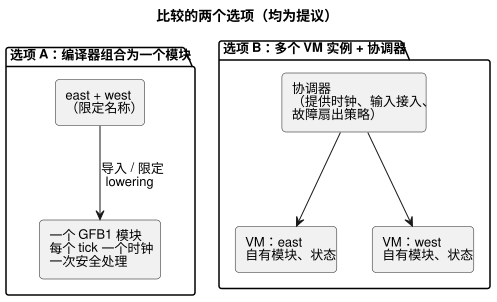
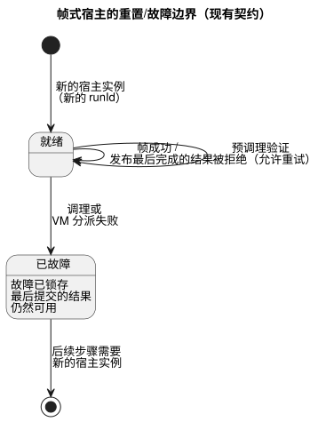

<!-- translation-source: docs/research/GF-COMPOSE-R3-EXECUTION.md -->
[英文原文](GF-COMPOSE-R3-EXECUTION.md)

# GF-COMPOSE R3：执行组合

本文比较两个或多个行为如何在互不干扰的前提下一起执行。它记录当前关于 tick、帧式宿主（framed host）和泵站（station）的事实；只比较两个组合选项；通过人工编写的扫描表进行推演（隔离、声明顺序、一个行为使用另一个行为的结果、被拒绝的环、重置/故障）；最后给出建议和负责人。

## 用户问题

添加一个行为，绝不能通过隐藏的顺序、共享状态、时钟或故障处理来改变已有的行为。设计必须保持降低工作量、可解释性和可追溯性这几个目标。

本文只比较两个选项：

1. 由编译器组合成一个可执行模块；
2. 多个 VM 实例加显式协调。

## 所检查修订版中的证据

所检查的语言修订版是 `ffdbc96461eca67908252507fb851fa4dabd9a2c`。在编写本文之前，工作树没有被修改。

**编译器。** `compileSource` 接受一个规范的 `.ghost.md`，通过 `compileControl` 对其进行 lowering（降级编译为底层表示），输出一个 GFB1 字节序列，并记录源/字节码摘要和追踪元数据（[`tools/compile-source.mjs`](../../tools/compile-source.mjs)）。`compileControl` 将一个 control lowering 为一个 GFB1 `module`。状态转移根据当前状态求值；之后，意图可以读取 `next.*`（[`tools/control.mjs`](../../tools/control.mjs)）。

**核心 tick。** `Runtime::tick` 依次执行：

1. 要求提供每一个已声明的输入；
2. 验证可选的显式 `__gf_now_ms`；
3. 在计算意图之前计算所有下一状态；
4. 应用安全处理；
5. 以原子方式提交状态和安全意图；
6. 清空输入；
7. 追加一条有界的日志（journal）记录。

`tick_at` 提供显式时钟；VM 不读取任何墙钟（[`crates/ghostflow-core/src/lib.rs`](../../crates/ghostflow-core/src/lib.rs)）。

**安装与热替换。**

- `install` 重置输入、安全意图、当前策略和时钟；它可以保留同名、同类型的状态。
- `hot_swap` 保留兼容的命名状态，但会清空安全意图，并拒绝模块名称或状态类型的更改。

**这些事实未涵盖的内容。** 它们描述的是核心 tick 和帧式完整帧适配器。它们没有规定异步 CEP 输入接入（ingress）或发生实例（occurrence）的投递。已达成一致的投递要求是：

- 发生实例必须各自保持有意义。
- 值观测与中断/扫描捕获相互独立。
- 默认情况下，在支持的容量范围内保留观测。
- 只有在按输入显式选择启用时，才允许用最新待处理值进行替换。
- 丢失/溢出必须被拒绝或报告，绝不能被悄悄接受。

该要求并不意味着无限的持久历史。输入接入的顺序、事件到 tick 的映射、按声明源的批处理、边界和恢复都尚未解决。目前没有提供任何硬截止时间或优先级调度器。见 [`LANGUAGE-SURFACE.md`](../LANGUAGE-SURFACE.zh.md) 和 [`IMPLEMENTATION.md`](../IMPLEMENTATION.zh.md)。

**帧式宿主。** 帧式宿主捕获一个完整的输入帧，分派一次，发布最后被接受的结果，并在调理（conditioning）或分派失败后锁存一个故障。后续步骤需要新的宿主实例；被拒绝的预调理验证仍然可以重试（[`docs/FRAMED-CONTROL-HOST.md`](../FRAMED-CONTROL-HOST.zh.md)）。因此，“最后完成的结果”和“新的运行”是现有宿主契约中的事实。

**泵站模块。** 泵站模块由宿主驱动，并且是有界的。`prepare_start_batch` 从同一 tick 的快照中选择一个请求，而 `authorize_output` 检查持久预留、所有者/会话、阀门限制和安全输出（[`crates/ghostflow-core/src/station.rs`](../../crates/ghostflow-core/src/station.rs)）。这是一个物理泵站仲裁器，而不是通用行为组合的证据。

**GFB1 限制。** 128 个输入、128 个状态、32 个策略、128 个约束，表达式深度/节点数分别为 128/4096，表达式和查询的大小也有界（[`tools/gfb1.mjs`](../../tools/gfb1.mjs)）。

**来自 R2。** 如 [R2：权威与身份标识](GF-COMPOSE-R2-AUTHORITY-IDENTITY.zh.md) 所述：

- 源与实例的区分使规范源保持权威地位，而实例需要一个不透明的身份标识，并具有相互隔离的状态和来源（provenance）。
- 对话记忆是来源和编写上下文，而不是自动的执行规则权威或物理绑定权威。记忆到决策再到源的链接、保留以及墓碑记录行为，仍是 R2/API 系统层面的问题。
- 安装约束边界仍未解决。本文不选定任何约束产物、覆盖层或执行负责人。

相关的兼容性和证据提议，另见 [R5：组合契约与诊断](GF-COMPOSE-R5-CONTRACTS.zh.md)。

## 表格与示例

### 选项比较

两行都是提议。每一列都是组合必须确定的一项属性。

| 选项 | 输入采样 | 时钟 | 旧状态/下一状态的可见性 | 重置/故障范围 | 输出解析 | 来源 | 现有限制 | 新增机制 |
|---|---|---|---|---|---|---|---|---|
| 由编译器组合成一个可执行模块 *（提议）* | 已有完整帧 tick 行为；异步的发生实例/值输入接入仍未规定；共享名称必须加以限定 | 每个 tick 提供一个逻辑时钟 | 所有转移读取同一个输入/旧状态快照；next 引用只出现在输出表达式中，不出现在其他 next 转移或 let 中 | 一个模块/运行时边界；故障影响整个组合扫描 | 对一组请求意图做一次安全处理；重复的权威输出定义是编译错误，绝不采用“最后写入者”策略 | 一个模块指纹/源闭包，并采用 R2 提议的按实例限定的追踪 | 输入/状态/策略/约束共用一个预算 | 导入/限定的 lowering、依赖验证、输入接入映射，以及 ABI 追踪表示 |
| 多个 VM 实例加显式协调 *（提议）* | 每个实例的输入接入必须按规定的投递规则保留发生实例/值观测；完整帧快照适配器不能确定批处理或顺序 | 协调器为每个实例提供时钟；共享时钟策略必须显式规定 | 每个实例保持旧状态/下一状态隔离；跨实例连线不能重新定义 next 引用；不支持的共享是编译错误 | 按实例的 VM 故障，加上协调器/扇出策略；帧式故障边界必须加以定义 | 重复的直接写入者仍是编译错误；只有显式建模的泵站请求才能使用现有的泵站仲裁 | 按实例的模块指纹，加上实例/运行/扫描的关联 | 限制按模块适用，但协调器和总资源的边界尚未规定 | 协调器、输入接入到 tick 的映射、与顺序无关的关联，以及适用时的泵站集成 |

### 隔离的实例：east 与 west

以下是人工推演的示例，而不是执行证据：

- 两个实例使用同一个定义。
- 每个实例都有独立的 `running` 状态和输出 `pump`。
- `start` 只在扫描 1 中对 east 为 true。
- 两者获得相同的 `t`。

| 扫描/读取时机 | 实例 | 输入 | 之前的状态 | 之后的状态 | 请求 / 安全输出 | 读取时机 |
|---|---|---|---|---|---|---|
| 1，同一完整帧 | east | `start=true`, `t=1000` | `running=false` | `running=true` | `pump=true` / `pump=true` | 读取 east 的输入和 east 的旧状态 |
| 1，同一完整帧 | west | `start=false`, `t=1000` | `running=false` | `running=false` | `pump=false` / `pump=false` | 读取 west 的输入和 west 的旧状态 |
| 2，同一完整帧 | east | `start=false`, `t=2000` | `running=true` | `running=true` | `pump=true` / `pump=true` | 读取 east 之前已提交的状态 |
| 2，同一完整帧 | west | `start=false`, `t=2000` | `running=false` | `running=false` | `pump=false` / `pump=false` | 读取 west 之前已提交的状态 |

**不变量**： east 的启动不会启动 west。这是对组合执行契约的提议，而不是当前多实例 ABI 的事实。

### 反转声明顺序，身份标识不变

人工推演的提议。使用相同的 east 和 west 实例 ID、输入和帧；只改变声明顺序。“追踪”指按身份标识键控的序列，而不是数组位置。

| 声明顺序 | 实例 | 输入 | 状态 之前 → 之后 | 请求 / 安全 | 读取时机 |
|---|---|---|---|---|---|
| east, west | east | `start=true` | `false → true` | `true / true` | 帧 1，east 旧状态 |
| east, west | west | `start=false` | `false → false` | `false / false` | 帧 1，west 旧状态 |
| west, east | east | `start=true` | `false → true` | `true / true` | 帧 1，east 旧状态 |
| west, east | west | `start=false` | `false → false` | `false / false` | 帧 1，west 旧状态 |

按身份标识键控的追踪是相等的。重新排列声明绝不能变成隐式调度器。这并不意味着交换已连线的依赖也是等价的。

### 一个行为使用另一个行为的结果

以下是针对一对单独协调的行为（不是原子的组合模块 tick）人工推演的假设语义：

- `producer.ok` 是 east 的一个结果。
- `consumer` 请求 `valve=producer.ok`，初始状态为 `running=false`。
- 由于当前编译器没有跨模块结果引用或相应的 lowering 规则，表格显式标出读取阶段。
- “步骤”标签是场景顺序，而不是各实例原生的扫描 ID。
- 第 1 行在展示 consumer 被拒绝的同时，也展示了假设中的 producer 进展。这并不采纳部分进展策略；该步骤没有完整的组合结果。

| 场景步骤 | 输入 | 状态 之前 → 之后 | 请求 / 安全输出 | 读取时机 |
|---|---|---|---|---|
| 1 | producer 输入 `sensor=1`；consumer 的其余输入完整 | producer `false→true`；由于所需的 producer 值不可用，consumer 没有有效的求值 | producer `ok=true`；consumer 没有请求/安全结果 | consumer 不读取同一扫描中 producer 的结果；缺失的依赖不会默认为 false |
| 2 | producer 输入 `sensor=0`；consumer 帧完整 | producer `true→false`；consumer `false→true` | producer `ok=false`；consumer `valve=true / true` | consumer 读取 producer 最后完成的扫描 1 结果 |

这一假设性比较并不描述当前可执行的行为：

- 编译器/运行时没有跨模块值引用。
- 缺少必需的值时，不产生有效求值，也不会凭空产生回退（fallback）值。
- 同一扫描中的跨实例连线不能让另一个实例的 `next` 值变为可用，也不能重新定义 next 引用规则。
- 不支持的跨实例共享是编译错误。

这些示例对比的是在受支持的已完成扫描边界上的值；它们并不采纳 FIFO 输入接入、同一扫描内的 lowering 或调度器。

### 被拒绝的环与重置/故障

**被拒绝的环** *（人工推演的无效依赖；使用依赖记法，而不是源语法）*：
`east.pump[n] <- west.pump[n]` 和 `west.pump[n] <- east.pump[n]`，其中 `n` 标识同一次扫描。east 的结果需要 west 的结果，而 west 的结果又需要 east 的结果。这两条边构成了闭环；按依赖顺序，两个结果都无法先被求值。应在执行前拒绝这种瞬时环。瞬时表达式环和重复的输出定义是无效的编译器输入，而不是悬而未决的策略问题。

如果改为读取已提交的前一次扫描状态，所用的值在扫描 `n` 之前就已固定。将其中一个依赖替换为这样的读取，就能打破这个同一扫描内的环。当前 VM 在提交下一状态之前，根据前一状态对转移求值。这一区分并不定义任何新的跨实例读取或初始值语义。

**重置/故障** *（受契约约束）*：

- 一帧成功之后，帧式宿主公开其最后完成的结果。
- 如果调理或 VM 分派失败，已提交的结果仍然可用，宿主锁存一个故障，后续步骤需要新的宿主实例。
- 新的运行必须使用新的 `runId`；新运行中的 `scanId=0` 不是之前的发生实例。

下图展示了这一现有的单宿主边界。

组合必须保留这一边界。它不得在把组合结果呈现为完整结果的同时，只部分重置某一个实例。确切的多实例故障扇出尚未解决。

## 建议

静态编译器组合仍是首选假设，但并不是已选定的 lowering 或 ABI。它必须保留现有的 tick 不变量：

- 每个转移都读取同一个输入/旧状态快照；
- next 引用只在输出表达式中合法，而不能出现在其他 next 转移或 let 中；
- 逻辑状态和输出同时提交；
- 环和重复的输出定义被拒绝。

每个输出通道只有一个权威定义。相互竞争的直接写入者会导致编译失败，无法部署。这并不取消显式的泵站单写入者资源仲裁：泵站请求不是相互竞争的直接写入。组合不授权会改变 next 引用语义的同一扫描跨实例连线。完整帧调度并不能确定事件输入接入、顺序、批处理或溢出。

不要泛化泵站的复用。它的同一 tick 选择和持久输出授权，可以在行为结果产生之后对共享水泵进行仲裁，但它的水泵/阀门策略不是通用的组合解析器。更广泛的仲裁和回退语义仍由 #95 负责。

## 未解决的问题与负责人

- 语言编译器负责人：定义组合是否将导入的 control lowering 为一个 GFB1 模块，以及名称、状态、输入、输出和源映射如何加以限定。保留上述旧状态/下一状态规则和环规则；不要把它们表述为悬而未决的语义选择。
- 语言/运行时 ABI 负责人：定义组合清单（manifest）、按实例限定的追踪字段、结果可见性，以及是否仍以一个 TickRecord 为规范。当前没有任何 ABI 字段定义跨实例结果。
- 语言/运行时负责人：定义输入接入顺序、事件到 tick 的映射、按声明源的批处理、容量和时钟映射。核心 tick 和帧式宿主并不能确定异步输入接入。不假设任何截止时间或优先级调度器。
- 语言/运行时负责人：定义组合后的安全处理应用方式，同时保持“重复的直接输出定义是编译错误”这一不变量；泵站资源仲裁仍是一个独立的、受支持的概念。
- API/部署负责人与 R2 负责人：保留尚未解决的安装约束边界。不要推断组合已经在“单独编译约束”与“显式的跨项目边界修订版”之间做出了选择。
- API/系统运营记忆负责人：让记忆检索和 LLM 解读处于运行时输入之外。R2 负责谱系、保留/墓碑记录和决策链接；本执行文档不定义这些生命周期。
- #95/泵站负责人：决定共享物理资源如何与行为结果相互作用。现有的泵站策略不得被视为通用策略。
- 帧式宿主负责人：定义组合后的故障扇出、最后完成结果的发布以及新运行的行为。当前帧式宿主文本规定的是一个宿主实例，而不是组合图。

## 验证

- [x] 所检查的修订版记录为 `ffdbc96461eca67908252507fb851fa4dabd9a2c`。
- [x] 恰好比较了两个选项，覆盖所有要求的列，并将当前事实与提议区分开。
- [x] 三张人工推演的扫描表包含输入、之前的状态、之后的状态、请求/安全输出和读取时机；隔离和声明顺序的不变量都已明确。
- [x] 包含了同一扫描内的环和重置/故障情形。帧式宿主的最后结果边界和新运行边界得到保留。
- [x] 指明了当前限制、泵站复用的边界，以及确切的尚未回答的 lowering/ABI 问题。没有引入任何调度器或 ABI。
- [x] 示例都标注为人工推演，没有声称任何运行时执行。
- [x] 按照这项仅限文档的任务的要求，没有运行运行时测试套件。协调者应运行 `git diff --check` 并检查相对链接。
