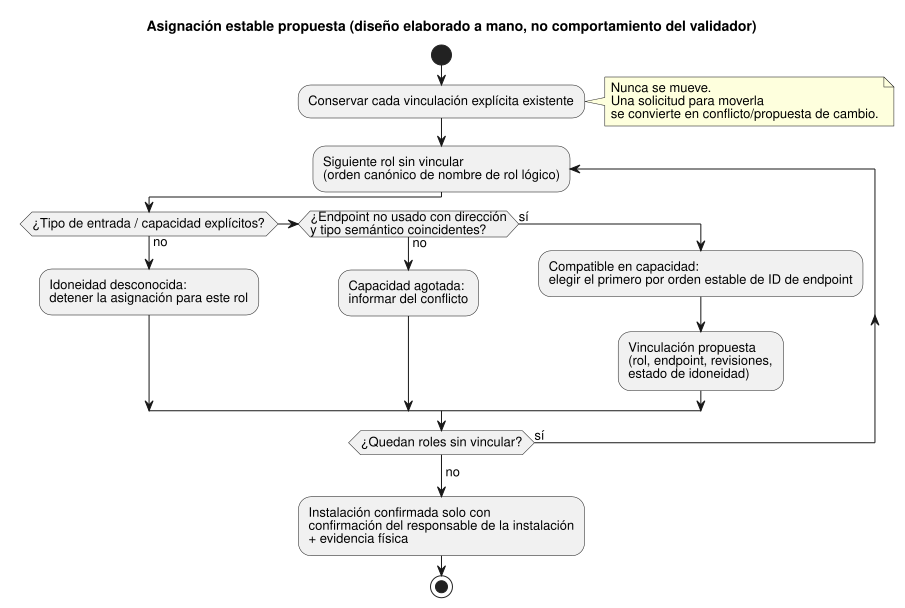

<!-- translation-source: docs/research/GF-COMPOSE-R4-PORTS-BINDINGS.md -->
[Original en inglés](GF-COMPOSE-R4-PORTS-BINDINGS.md)

# GF-COMPOSE R4: puertos y vinculaciones

Esta nota de investigación estudia cómo los comportamientos compuestos deberían
reclamar entradas y salidas en una placa sin mover el cableado existente. Trata
los puertos lógicos tipados, las revisiones de vinculación (binding), la
contabilidad de capacidad y los diagnósticos que distinguen una propuesta de un
hecho instalado.

En este documento:

- **Problema del usuario**: lo que necesitan el agricultor y el ingeniero.
- **Evidencia en la revisión examinada**: lo que ya establecen los contratos y
  el código actuales.
- **Tablas y ejemplos**: el contrato de propuesta, los libros de recursos, un
  orden de asignación estable y los casos de fallo.
- **Recomendación**, **Preguntas abiertas y responsables** y
  **Verificación**.

Términos usados a lo largo del documento:

| Término | Significado |
| --- | --- |
| Rol lógico (puerto) | Una entrada o salida con nombre y tipo que necesita un comportamiento, por ejemplo la salida `irrigation.pump` / `Bool`. |
| Endpoint (punto final) | Una entrada del perfil de placa con dirección, tipo semántico, driver, dirección de acceso (address), nivel activo y nivel seguro. |
| Vinculación (binding) | Un mapa explícito de un nombre lógico a un ID de endpoint, versionado mediante un `bindingRevision`. |
| DI / RO | Canales físicos de entrada digital / salida de relé de la placa. |

## Problema del usuario

Un agricultor debería poder aplicar un comportamiento preparado sin calcular
asignaciones de canales. Añadir otro comportamiento no debe mover en silencio
el cableado existente.

Por eso, la frontera de composición necesita cuatro cosas:

- puertos lógicos tipados;
- revisiones de vinculación explícitas;
- contabilidad de capacidad; y
- diagnósticos que distingan una propuesta de un hecho instalado.

Alcance: este documento es investigación y diseño acotados. No autoriza el
descubrimiento, el cableado, el despliegue ni un nuevo esquema de transmisión
(wire schema).

## Evidencia en la revisión examinada

La evidencia se examinó en el commit del lenguaje
`ffdbc96461eca67908252507fb851fa4dabd9a2c`, la línea base solicitada.

**Contrato de integración.** El README de integración define un endpoint de
placa con dirección, tipo semántico, driver, dirección de acceso, nivel activo
y nivel seguro. Una vinculación es un diccionario explícito de nombre lógico a
ID de endpoint. Los nombres de entrada/salida del manifiesto requieren
vinculaciones exactas con dirección y tipo coincidentes. El orden de
declaración no tiene efecto. v1 rechaza que un mismo endpoint se use como alias
bajo varios nombres lógicos.

**Entradas de software.** El mismo contrato permite explícitamente un endpoint
de entrada de software. Su driver/address `software-input` identifica una
entrada lógica; no consume una DI física. Los adaptadores del runtime
suministran esa entrada. Esto es evidencia del contrato, no la afirmación de
que una instalación concreta tenga ese endpoint.

**Verificador.** `tools/integration-contract.mjs` comprueba:

- endpoints desconocidos;
- pares driver/address de endpoint duplicados;
- vinculaciones duplicadas;
- vinculaciones faltantes;
- discrepancias de dirección; y
- discrepancias de tipo.

Calcula el hash del perfil de placa y del mapeo de instalación suministrados y
los compara con identidades de versión fijadas. El verificador puro no contacta
ningún dispositivo ni establece la verdad eléctrica o física.

**Documentación de paquete e implementación.** `docs/PORTABLE-PACKAGE.md` exige
la correspondencia de capacidades y lleva un `bindingRevision` exacto. Indica
que los responsables de API y de Device deben validar el mapa DI/RO real.
`docs/IMPLEMENTATION.md` indica que los registros de instalación aportan
nombres, capacidades, vinculaciones y datos del sitio, mientras que los
registros de vinculación no pueden anular la semántica del programa. El
arranque, el comportamiento a prueba de fallos (fail-safe), la aplicación de
salidas y el comportamiento ante la desconexión del driver siguen siendo
política del consumidor.

**Frontera del driver.** La separación Source/Intent del driver es una frontera
existente:

- El respaldo del driver puede ser software, hardware especializado o ambos.
- La medición de precisión, el manejo de protocolos, la elección entre captura
  en ISR o en el escaneo y la captura física se quedan en esa frontera. El
  núcleo ve eventos y mediciones tipados con significado.
- La política agrícola no debe ocultarse en un driver.
- El tiempo de captura, el tiempo de recepción/evaluación y la calidad se
  mantienen distintos.
- El acuse de recibo de un comando no es prueba de un efecto físico.

Consulte [`LANGUAGE.md`](../LANGUAGE.es.md), sección 2, «프로그램 모델» (modelo
de programa), y [`IMPLEMENTATION.md`](../IMPLEMENTATION.es.md), sección
«Executable path».

**Dependencia de R2: fuente frente a instancia.** R2 fija la distinción entre
fuente e instancia y establece que las vinculaciones de instalación permanecen
fuera de la fuente de control ejecutable. Su frontera de restricciones de
instalación de #62 sigue sin resolverse. Este documento no decide si las
restricciones son un artefacto separado o una revisión explícita de frontera
entre proyectos. Esa decisión corresponde al responsable de sistema de #62 y a
los responsables de lenguaje/API.

**Dependencia de R2: memoria (#68).** La versión actualizada de R2 también
registra la incidencia de sistema/API #68: la memoria conversacional es
procedencia y contexto de autoría. No es fuente ejecutable, ni autoridad
automática sobre reglas de ejecución, ni autoridad sobre vinculaciones físicas.
Un dato recordado sobre un equipo o una excepción no puede autorizar un cambio
de vinculación sin una decisión confirmada, el contrato de instalación y
evidencia actual del dispositivo. El linaje, la retención y las lápidas
(tombstones), y el enlace entre memoria y decisión siguen siendo preguntas
abiertas del responsable de #68; no cambian este análisis de puertos y
capacidad.

## Tablas y ejemplos

### Contrato de propuesta

Lo siguiente es una propuesta para la revisión de la composición. Nombra a
propósito solo campos conceptuales; no es un esquema de transmisión definitivo.

| Rol lógico/tipo requerido | Capacidad física o de software requerida | Perfil/revisión de vinculación suministrados | Evidencia de idoneidad | Resultado | Sujeto del diagnóstico |
| --- | --- | --- | --- | --- | --- |
| Salida `irrigation.pump` / `Bool` | Endpoint RO compatible no usado | Perfil de placa fijado más `bindingRevision` de la instalación | Coinciden dirección/tipo; la revisión del perfil y la aceptación física se exigen por separado | Compatible en capacidad; proponer la vinculación y luego confirmar la instalación | Rol de la bomba, endpoint candidato, revisiones de perfil y de vinculación |
| Entrada `irrigation.low_water` / `Bool` | Capacidad DI compatible, o capacidad explícita de entrada de software | Mismo contexto fijado de perfil/mapeo | Coinciden dirección/tipo; DI frente a driver de software es explícito | Compatible en capacidad solo cuando se conoce el tipo de capacidad | Rol de nivel bajo de agua, tipo de entrada, endpoint/driver |
| Entrada `irrigation.manual_start` / `Bool` | DI compatible, o entrada de software explícita | Mismo contexto fijado de perfil/mapeo | La entrada de software no consume DI; no hay sustitución implícita | Vinculación propuesta solo cuando el tipo suministrado es explícito | Rol de arranque manual y evidencia faltante del tipo de entrada |
| Salidas `ventilation.fan_1..4` / `Bool` | Cuatro endpoints RO compatibles, distintos y no usados | Perfil fijado y revisión de mapeo nueva o ampliada | Coinciden dirección/tipo; titularidad única de cada endpoint | Proponer en orden estable; confirmar solo tras la evidencia de instalación | Rol del ventilador, endpoint, titularidad y capacidad |
| Cualquier rol requerido / tipo declarado | Endpoint con dirección o tipo incorrectos | Las revisiones suministradas pueden seguir fijadas internamente | La discrepancia del validador es evidencia concreta de incompatibilidad | Rechazar; no forzar ni cambiar el tipo | Rol lógico, endpoint, dirección/tipo esperados y reales |

La columna de resultado usa cuatro estados distintos. Ningún estado implica uno
posterior:

| Estado | Qué significa | Advertencia |
| --- | --- | --- |
| Compatible en capacidad | Solo que en el perfil suministrado parece haber disponible un endpoint distinto con la dirección y el tipo semántico requeridos. | No demuestra el cableado, la polaridad, la idoneidad fail-safe, la compatibilidad de carga ni el funcionamiento físico. |
| Idoneidad desconocida | Faltan los datos anteriores (cableado, polaridad, idoneidad fail-safe, compatibilidad de carga, funcionamiento físico). | No afirme un funcionamiento seguro. Si el dato que falta es el propio tipo de entrada o la capacidad, la asignación se detiene para ese rol. |
| Vinculación propuesta | Un resultado de asignación. | No es un hecho instalado. |
| Instalación confirmada | Requiere la confirmación de vinculación del responsable existente y evidencia física. | **Nunca** se infiere de que un validador del host haya pasado. |

### Libros de recursos

Estos son libros (ledgers) elaborados a mano, no evidencia de ejecución. El
caso de prueba supone:

- TwoZoneIrrigation tiene una salida de bomba, dos salidas de válvula, una
  entrada de nivel bajo de agua y una entrada de arranque manual.
- FourFanVentilation tiene cuatro salidas de ventilador.
- El ejemplo general fija los recuentos físicos combinados en DI 2 y RO 7.

| Caso de composición y supuesto de entradas | DI físicas consumidas | Entradas de software | RO físicas consumidas | Total de roles solicitados |
| --- | ---: | ---: | ---: | ---: |
| Riego + ventilación; ambas entradas de riego son entradas digitales cableadas | 2 | 0 | 7 (3 + 4) | 9 (2 entradas + 7 salidas) |
| Riego + ventilación; el arranque manual es una entrada de software explícita y solo el nivel bajo de agua es DI cableada | 1 | 1 | 7 (3 + 4) | 9 (2 entradas + 7 salidas) |

La segunda fila no es, a propósito, «dos DI». Una declaración `Bool` describe
el tipo semántico, no el consumo eléctrico. La entrada de software sigue
requiriendo un endpoint lógico explícito y una vinculación. Si no se declara el
tipo de entrada, o el perfil no suministra la capacidad correspondiente, la
idoneidad es desconocida y la asignación debe detenerse para ese rol.

### Decisión de asignación estable

**Propuesta.** Este orden estable es una recomendación, no un comportamiento
existente del validador:

1. Conservar primero cada vinculación explícita existente.
2. Para cada rol sin vincular, considerar solo los endpoints con dirección y
   tipo semántico coincidentes que aún no tengan titular.
3. Ordenar los roles por su nombre de rol lógico canónico.
4. Ordenar los endpoints candidatos por el ID de endpoint estable del perfil,
   en orden lexicográfico.
5. Emitir un conflicto en lugar de mover una vinculación explícita.

El flujo siguiente resume la asignación propuesta para cada rol y dónde surge
cada uno de los cuatro estados.



No deben mezclarse dos cuestiones separadas:

- **Autoridad lógica sobre las salidas.** Cada canal de salida tiene una única
  definición autoritativa, y los escritores directos duplicados son errores de
  compilación. El arbitraje explícito de recursos de estación se mantiene; las
  solicitudes de estación no son escrituras directas de canal en competencia.
- **Contabilidad física de endpoints/recursos.** Es lo que hace el asignador.
  Las comprobaciones de alias de endpoint siguen siendo una validación de
  vinculación aparte.

| Paso | Rol existente o solicitado | Decisión | Evidencia/diagnóstico |
| ---: | --- | --- | --- |
| 1 | `pump -> RO3` | Conservar la vinculación explícita | El mapeo existente es una entrada autoritativa; no hay reasignación |
| 2 | `valve_a -> RO1`, `valve_b -> RO2` | Conservar ambas vinculaciones explícitas | Los mapeos existentes siguen teniendo titular y son distintos |
| 3 | `fan_1..fan_4` | Seleccionar cuatro RO compatibles no usadas en orden estable de ID de endpoint | Cada propuesta registra el rol, el endpoint, las revisiones y el estado de idoneidad |
| 4 | Cualquier solicitud que requiera `pump -> RO4` | Informar de un conflicto explícito/propuesta de cambio | El `pump -> RO3` existente no puede moverse en silencio |

Ejemplo de antes/después (elaborado a mano, no evidencia de ejecución):

```text
Antes del riego: pump -> RO3, valve_a -> RO1, valve_b -> RO2
Tras añadir la ventilación: pump -> RO3, valve_a -> RO1, valve_b -> RO2,
  fan_1..fan_4 -> cuatro RO compatibles no usadas en orden estable de ID de endpoint
```

El invariante es exacto: añadir la ventilación deja sin cambios las tres
asignaciones de riego. De él se derivan dos casos límite:

- Si existen menos de cuatro RO compatibles no usadas, el resultado es
  capacidad agotada.
- Si un ventilador solicitado solo es compatible con RO3, el resultado es un
  conflicto/propuesta de cambio, no una reubicación automática.

### Casos de fallo y desconocidos

| Caso | Roles afectados | Evidencia faltante o en conflicto | Resultado requerido y responsable |
| --- | --- | --- | --- |
| Dirección o tipo semántico incorrectos | El rol vinculado a ese endpoint | El endpoint del perfil no coincide con la dirección/tipo del manifiesto; el verificador informa de la discrepancia | Rechazar la vinculación. El responsable de perfil/integración corrige el perfil o el rol suministrado; sin conversión forzada |
| Capacidad agotada | Cada rol sin vincular que requiere la dirección/tipo agotados | No queda ningún endpoint compatible no usado tras conservar las vinculaciones explícitas | Informar del conflicto de capacidad con los titulares conservados y el conjunto de candidatos. El responsable de API/composición elige una instalación revisada o rechaza la composición |
| Polaridad o evidencia fail-safe desconocidas | El rol de entrada/salida digital afectado | `activeLevel`/`safeLevel` pueden ser metadatos, pero este verificador no establece la idoneidad ni la aceptación física | Marcar la idoneidad como desconocida. El responsable de placa/perfil aporta la evidencia del perfil; el responsable de Device/físico aporta la aceptación. No afirme un funcionamiento seguro |
| Titularidad de salida duplicada | Ambos roles lógicos de salida y el endpoint compartido | v1 rechaza la vinculación duplicada a un endpoint; los duplicados de driver/address de endpoint también son inválidos | Rechazar e identificar ambos roles más el endpoint. El responsable del sitio/instalación resuelve el mapeo; Device confirma la vinculación aplicada |

Titularidad fuera de este contrato:

- El sistema #62 es responsable de la decisión sobre la frontera de
  restricciones de instalación.
- El sistema #74 es responsable de Device Query y, por tanto, de la ruta de
  consulta/observación del lado del dispositivo.

Este contrato del lenguaje puede informar de las identidades fijadas de
perfil/mapeo y de los resultados de validación. No puede asignar las
responsabilidades de aceptación física ni de descubrimiento de ninguno de esos
responsables.

## Recomendación

Adoptar un planificador de composición con cuatro estados explícitos:
compatible en capacidad, idoneidad desconocida, vinculación propuesta e
instalación confirmada. En ese planificador:

- Conservar las vinculaciones explícitas antes de considerar endpoints no
  usados.
- Usar un orden estable y documentado de roles y endpoints para las propuestas.
- Mantener los nombres lógicos y los tipos semánticos separados de los ID de
  endpoint físicos.
- Modelar las entradas de software como capacidades lógicas explícitas para que
  no consuman capacidad de DI.

La asignación y la contabilidad de recursos de R4 están separadas de la
semántica de captura del driver. Este documento no afirma que Device haya
implementado ni verificado físicamente estas fronteras.

Cada propuesta debe llevar la identidad del perfil suministrado y la revisión
de vinculación, el rol afectado, el endpoint candidato y el estado del
diagnóstico. La confirmación debe llevar la evidencia del responsable de la
instalación existente. Nunca se debe:

- reescribir en silencio una vinculación explícita;
- inferir la polaridad/idoneidad fail-safe; ni
- convertir el paso de un validador en una aceptación física.

## Preguntas abiertas y responsables

- Responsable de API/composición: definir el registro final de
  propuesta/confirmación y cómo se aprueba un mapeo de instalación revisado.
  Este documento no declara intencionadamente su esquema de transmisión.
- Responsable de placa/perfil: definir el orden estable autoritativo de los
  endpoints y aportar evidencia revisada de capacidad, polaridad, nivel seguro,
  driver y dirección de acceso.
- Responsable del sitio/instalación: confirmar el mapeo de nombre lógico a
  endpoint y la revisión de vinculación realmente seleccionados para una
  instalación.
- Responsable de Device, con el sistema #74 para Device Query: definir qué
  observación puede confirmar una vinculación aplicada y qué sigue siendo
  evidencia de aceptación física.
- Responsable de Device/Driver: definir la representación y la evidencia de los
  eventos/mediciones de la captura al núcleo; mantener distintos el tiempo de
  captura, el tiempo de recepción/evaluación y la calidad. Esto sigue separado
  de la contabilidad de vinculaciones/recursos.
- Responsable del sistema #62 con los responsables de lenguaje/API: resolver la
  frontera de restricciones de instalación identificada por R2. Este documento
  conserva esa decisión abierta y no coloca las restricciones en el
  planificador de vinculaciones.
- Responsable de sistema/API de #68: definir el linaje de la memoria, el
  comportamiento de retención/lápidas y el enlace entre memoria y decisión.
  Este planificador no debe tratar la recuperación de memoria como evidencia de
  vinculación ni como autoridad automática de vinculación.
- Responsable de composición: decidir si un perfil puede exponer varios tipos
  de capacidad candidatos para un mismo rol lógico. Hasta que se decida, exigir
  un único tipo de capacidad compatible explícito e informar de la ambigüedad
  como idoneidad desconocida.

## Verificación

- [x] Commit examinado registrado: `ffdbc96461eca67908252507fb851fa4dabd9a2c`.
- [x] Se leyeron secciones específicas de `contracts/integration-v1/README.md`,
  `docs/PORTABLE-PACKAGE.md`, `docs/IMPLEMENTATION.md` y
  `tools/integration-contract.mjs`, además del borrador de dependencia R2.
- [x] Ambos libros tienen totales exactos de DI 2 / RO 7 y de DI 1 / RO 7 más
  una entrada de software, con sus supuestos de tipo de entrada indicados.
- [x] El ejemplo de antes/después conserva pump -> RO3, valve_a -> RO1 y
  valve_b -> RO2, y explica el orden estable y el comportamiento de
  anulación/conflicto.
- [x] El tipo incorrecto, la capacidad agotada, la polaridad/evidencia
  fail-safe desconocida y la titularidad de salida duplicada nombran los roles
  afectados y la evidencia faltante o en conflicto. Se asignan los
  responsables del perfil, de la confirmación de vinculación y de la aceptación
  física.
- [x] Las afirmaciones procedentes de contratos/código, las propuestas, las
  decisiones abiertas y el ejemplo elaborado a mano se etiquetan de forma
  distinta. No se ejecutó ni se afirma ninguna prueba de runtime ni física.
- [x] Se conserva la frontera actualizada de R2: la memoria es
  procedencia/contexto de autoría, no autoridad sobre reglas de ejecución ni
  sobre vinculaciones físicas; el linaje, la retención/lápidas y el enlace con
  las decisiones siguen sin resolverse bajo #68.
