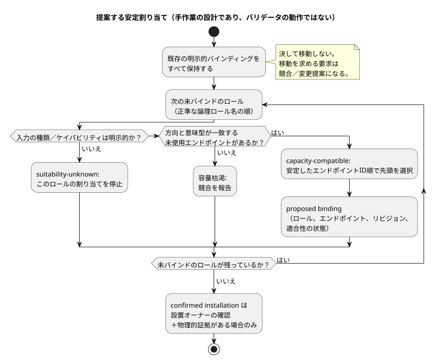

<!-- translation-source: docs/research/GF-COMPOSE-R4-PORTS-BINDINGS.md -->
[英語の原文](GF-COMPOSE-R4-PORTS-BINDINGS.md)

# GF-COMPOSE R4：ポートとバインディング

この調査ノートでは、合成された振る舞いが既存の配線を動かさずに、ボード上の入力と出力をどのように確保すべきかを検討します。型付きの論理ポート、バインディングのリビジョン、容量の計上、そして提案と設置済みの事実を区別する診断を扱います。

この文書の内容：

- **ユーザーの課題** — 農家とエンジニアが必要としていること。
- **調査したリビジョンでの証拠** — 現在の契約とコードがすでに確立していること。
- **表と例** — 提案の契約、リソース台帳、安定した割り当て順序、失敗ケース。
- **推奨事項**、**未解決の問題と担当オーナー**、**検証**。

本文で使う用語：

| 用語 | 意味 |
| --- | --- |
| 論理ロール（ポート） | 振る舞いが必要とする、名前と型を持つ入力または出力。例：`irrigation.pump` / `Bool` 出力。 |
| エンドポイント | 方向、意味型、ドライバ、アドレス、アクティブレベル、安全レベルを持つボードプロファイルの項目。 |
| バインディング | 論理名からエンドポイント ID への明示的な対応表。`bindingRevision` でバージョン管理されます。 |
| DI / RO | ボード上の物理的なデジタル入力／リレー出力チャネル。 |

## ユーザーの課題

農家は、チャネルの割り当てを計算しなくても、用意された振る舞いを適用できるべきです。別の振る舞いを追加しても、既存の配線を黙って移動してはなりません。

したがって、合成の境界には次の 4 つが必要です。

- 型付きの論理ポート
- 明示的なバインディングリビジョン
- 容量の計上
- 提案と設置済みの事実を区別する診断

範囲：この文書は範囲を限定した調査／設計です。探索（discovery）、配線、デプロイ、新しいワイヤスキーマを認可するものではありません。

## 調査したリビジョンでの証拠

証拠は、要求されたベースラインである言語コミット `ffdbc96461eca67908252507fb851fa4dabd9a2c` で調査しました。

**統合契約。** 統合 README は、方向、意味型、ドライバ、アドレス、アクティブレベル、安全レベルを持つボードエンドポイントを定義しています。バインディングは、論理名からエンドポイント ID への明示的な辞書です。マニフェストの入力／出力名には、方向と型が一致する厳密なバインディングが必要です。宣言の順序は影響しません。v1 は、1 つのエンドポイントを複数の論理名で別名化することを拒否します。

**ソフトウェア入力。** 同じ契約は、ソフトウェア入力エンドポイントを明示的に許可しています。その `software-input` ドライバ／アドレスは論理入力を識別するもので、物理 DI を消費しません。その入力はランタイムアダプタが供給します。これは契約上の証拠であり、特定の設備がそのようなエンドポイントを持つという主張ではありません。

**チェッカー。** `tools/integration-contract.mjs` は次の項目を検査します。

- 未知のエンドポイント
- エンドポイントのドライバ／アドレスの組の重複
- バインディングの重複
- バインディングの欠落
- 方向の不一致
- 型の不一致

チェッカーは、与えられたボードプロファイルと設置マッピングのハッシュを計算し、固定されたリリースの同一性と比較します。この純粋なチェッカーはデバイスと通信せず、電気的・物理的な真実を確立しません。

**パッケージと実装の文書。** `docs/PORTABLE-PACKAGE.md` はケイパビリティの照合を要求し、厳密な `bindingRevision` を保持します。実際の DI/RO マップは API と Device のオーナーが検証しなければならないと述べています。`docs/IMPLEMENTATION.md` は、設置レコードが名前、ケイパビリティ、バインディング、現場の事実を提供する一方で、バインディングレコードはプログラムの意味を上書きできないと述べています。起動、フェイルセーフの振る舞い、出力の適用、ドライバ切断時の振る舞いは、引き続き利用側のポリシーです。

**ドライバの境界。** ドライバの Source/Intent の分離は既存の境界です。

- ドライバの実体は、ソフトウェア、専用ハードウェア、またはその両方でもかまいません。
- 精密測定、プロトコル処理、生の ISR かスキャンかという取得方式の選択、物理的な取得はその境界にとどまります。コアは意味のある型付きのイベント／測定値を受け取ります。
- 農場のポリシーをドライバの中に隠してはなりません。
- 取得時刻、受信／評価時刻、品質は区別されたままです。
- コマンドの応答（acknowledgement）は物理的な効果の証明ではありません。

[`LANGUAGE.md`](../LANGUAGE.ja.md) の第 2 節「프로그램 모델」（プログラムモデル）と、[`IMPLEMENTATION.md`](../IMPLEMENTATION.ja.md) の「Executable path」の節を参照してください。

**R2 への依存：ソースとインスタンス。** R2 はソースとインスタンスの区別を確定し、設置のバインディングは実行可能な制御ソースの外部にとどまると述べています。#62 の設置制約の境界は未解決です。この文書は、制約を別個の成果物にするのか、プロジェクトをまたぐ明示的な境界リビジョンにするのかを決定しません。その決定は #62 のシステムオーナーと言語／API オーナーに残ります。

**R2 への依存：メモリ（#68）。** 更新された R2 は、システム／API の issue #68 も記録しています。会話のメモリは来歴とオーサリングの文脈です。実行可能なソースでも、実行規則の自動的な権限でも、物理バインディングの権限でもありません。記憶された設備の事実や例外は、確認済みの決定、設置契約、現在のデバイスの証拠がなければ、バインディングの変更を認可できません。系譜、保持とトゥームストーン、メモリと決定の結び付けは #68 のオーナーの未解決の問題として残りますが、このポート／容量の分析は変わりません。

## 表と例

### 提案の契約

以下は合成レビューのための提案です。意図的に概念的なフィールドだけを示しており、最終的なワイヤスキーマではありません。

| 必要な論理ロール／型 | 必要な物理またはソフトウェアのケイパビリティ | 与えられたプロファイル／バインディングリビジョン | 適合性の証拠 | 結果 | 診断の対象 |
| --- | --- | --- | --- | --- | --- |
| `irrigation.pump` / `Bool` 出力 | 互換性のある未使用の RO エンドポイント | 固定されたボードプロファイルと設置の `bindingRevision` | 方向／型が一致。プロファイルのレビューと物理的な受け入れは別途必要 | 容量互換（capacity-compatible）。バインディングを提案し、その後に設置を確認 | ポンプのロール、候補エンドポイント、プロファイルとバインディングのリビジョン |
| `irrigation.low_water` / `Bool` 入力 | 互換性のある DI ケイパビリティ、または明示的なソフトウェア入力ケイパビリティ | 同じ固定プロファイル／マッピングの文脈 | 方向／型が一致。DI かソフトウェアドライバかが明示的 | ケイパビリティの種類が判明した後にのみ容量互換 | 低水位のロール、入力の種類、エンドポイント／ドライバ |
| `irrigation.manual_start` / `Bool` 入力 | 互換性のある DI、または明示的なソフトウェア入力 | 同じ固定プロファイル／マッピングの文脈 | ソフトウェア入力は DI を消費しない。暗黙の代替はしない | 与えられた種類が明示的な場合にのみバインディングを提案 | 手動開始のロールと、欠けている入力種類の証拠 |
| `ventilation.fan_1..4` / `Bool` 出力 | 互換性のある別個の未使用 RO エンドポイント 4 つ | 固定プロファイルと、新規または拡張したマッピングリビジョン | 方向／型が一致。エンドポイントの所有は一意 | 安定した順序で提案。設置の証拠が得られた後にのみ確認 | ファンのロール、エンドポイント、所有権と容量 |
| 任意の必要なロール／宣言された型 | 方向または型が誤っているエンドポイント | 与えられたリビジョン自体は内部的に固定されている場合もある | バリデータの不一致は非互換性の具体的な証拠 | 拒否。強制変換や型の付け替えはしない | 論理ロール、エンドポイント、期待／実際の方向／型 |

結果の列では、4 つの区別された状態を使います。どの状態も、それ以降の状態を意味しません。

| 状態 | 意味 | 注意 |
| --- | --- | --- |
| 容量互換（capacity-compatible） | 与えられたプロファイルに、必要な方向と意味型を持つ別個のエンドポイントが利用可能に見える、ということだけを意味します。 | 配線、極性、フェイルセーフとしての適合性、負荷の互換性、物理的な動作は証明しません。 |
| 適合性不明（suitability-unknown） | 上記の事実（配線、極性、フェイルセーフとしての適合性、負荷の互換性、物理的な動作）が欠けています。 | 安全な動作を主張してはなりません。欠けている事実が入力の種類やケイパビリティそのものである場合、そのロールの割り当ては停止します。 |
| 提案されたバインディング（proposed binding） | 割り当ての結果です。 | 設置済みの事実ではありません。 |
| 確認済みの設置（confirmed installation） | 既存のオーナーによるバインディングの確認と物理的な証拠が必要です。 | ホストのバリデータの合格から推論することは**決して**ありません。 |

### リソース台帳

これらは手作業で作成した台帳であり、実行の証拠ではありません。このフィクスチャは次を前提とします。

- TwoZoneIrrigation は、ポンプ出力 1 つ、バルブ出力 2 つ、低水位入力 1 つ、手動開始入力 1 つを持ちます。
- FourFanVentilation は、ファン出力 4 つを持ちます。
- 包括的な例では、合計の物理数を DI 2 と RO 7 に固定します。

| 合成フィクスチャと入力の前提 | 消費する物理 DI | ソフトウェア入力 | 消費する物理 RO | 要求ロールの合計 |
| --- | ---: | ---: | ---: | ---: |
| 灌水 + 換気。灌水の入力はどちらも配線されたデジタル入力 | 2 | 0 | 7 (3 + 4) | 9（入力 2 + 出力 7） |
| 灌水 + 換気。手動開始は明示的なソフトウェア入力で、低水位だけが配線された DI | 1 | 1 | 7 (3 + 4) | 9（入力 2 + 出力 7） |

2 行目は意図的に「DI 2 つ」になっていません。`Bool` 宣言は意味型を表すもので、電気的な消費を表すものではありません。ソフトウェア入力にも、明示的な論理エンドポイントとバインディングが必要です。入力の種類が宣言されていない場合や、プロファイルが対応するケイパビリティを提供していない場合、適合性は不明であり、そのロールの割り当ては停止しなければなりません。

### 安定した割り当ての決定

**提案。** この安定した順序は推奨事項であり、既存のバリデータの振る舞いではありません。

1. まず、既存の明示的なバインディングをすべて保持します。
2. 未バインドの各ロールについて、方向と意味型が一致し、まだ所有されていないエンドポイントだけを検討します。
3. ロールは正準な論理ロール名の順に並べます。
4. 候補エンドポイントは、プロファイルの安定したエンドポイント ID の辞書順に並べます。
5. 明示的なバインディングを移動する代わりに、競合を出力します。

以下のフローは、各ロールに対して提案する割り当てと、4 つの状態がそれぞれどこで生じるかをまとめたものです。



次の 2 つの関心事を混同してはなりません。

- **論理的な出力の権限。** 各出力チャネルには権威ある定義が 1 つだけあり、重複する直接の書き込み元はコンパイルエラーになります。明示的なステーションのリソース調停は残ります。ステーションの要求は、競合する直接のチャネル書き込みではありません。
- **物理エンドポイント／リソースの計上。** これがアロケータの役割です。エンドポイントの別名チェックは、別個のバインディング検証として残ります。

| ステップ | 既存または要求されたロール | 決定 | 証拠／診断 |
| ---: | --- | --- | --- |
| 1 | `pump -> RO3` | 明示的なバインディングを保持 | 既存のマッピングが権威ある入力。再割り当てはしない |
| 2 | `valve_a -> RO1`, `valve_b -> RO2` | 両方の明示的なバインディングを保持 | 既存のマッピングは所有されたまま、互いに区別される |
| 3 | `fan_1..fan_4` | 互換性のある未使用の RO を、安定したエンドポイント ID 順に 4 つ選ぶ | 各提案は、ロール、エンドポイント、リビジョン、適合性の状態を記録する |
| 4 | `pump -> RO4` を必要とする任意の要求 | 明示的な競合／変更提案を報告 | 既存の `pump -> RO3` を黙って移動することはできない |

前後の比較例（手作業の例であり、実行の証拠ではありません）：

```text
灌水の前: pump -> RO3, valve_a -> RO1, valve_b -> RO2
換気の追加後: pump -> RO3, valve_a -> RO1, valve_b -> RO2,
  fan_1..fan_4 -> 互換性のある未使用の RO 4 つ（安定したエンドポイント ID 順）
```

不変条件は厳密です。換気を追加しても、灌水の 3 つの割り当てはすべて変わりません。そこから 2 つの境界ケースが導かれます。

- 互換性のある未使用の RO が 4 つ未満しかない場合、結果は容量枯渇です。
- 要求されたファンが RO3 としか互換性がない場合、結果は競合／変更提案であり、自動的な再配置ではありません。

### 失敗と不明のケース

| ケース | 影響を受けるロール | 欠けている、または矛盾する証拠 | 必要な結果とオーナー |
| --- | --- | --- | --- |
| 方向または意味型の誤り | そのエンドポイントにバインドされたロール | プロファイルのエンドポイントがマニフェストの方向／型と一致しない。チェッカーが不一致を報告 | バインディングを拒否。プロファイル／統合オーナーがプロファイルまたは与えられたロールを修正する。強制変換はしない |
| 容量枯渇 | 枯渇した方向／型を必要とする、未バインドのすべてのロール | 明示的なバインディングを保持した後、互換性のある未使用エンドポイントが残っていない | 保持されたオーナーと候補集合を添えて容量の競合を報告。API／合成オーナーが改訂した設置を選ぶか、合成を拒否する |
| 極性またはフェイルセーフの証拠が不明 | 影響を受けるデジタル入力／出力のロール | `activeLevel`/`safeLevel` はメタデータとして存在しうるが、適合性や物理的な受け入れはこのチェッカーでは確立されない | 適合性不明とする。ボード／プロファイルオーナーがプロファイルの証拠を、Device／物理オーナーが受け入れを提供する。安全な動作を主張しない |
| 出力所有権の重複 | 両方の論理出力ロールと共有エンドポイント | v1 は 1 つのエンドポイントへの重複バインディングを拒否する。エンドポイントのドライバ／アドレスの重複も無効 | 拒否し、両方のロールとエンドポイントを特定する。現場／設置オーナーがマッピングを解決し、Device が適用されたバインディングを確認する |

この契約の外にある所有権：

- 設置制約の境界の決定は、システム #62 が所有します。
- Device Query、したがってデバイス側の照会／観測経路は、システム #74 が所有します。

この言語契約は、固定されたプロファイル／マッピングの同一性と検証結果を報告できます。どちらのオーナーの物理的な受け入れや探索の責任も割り当てることはできません。

## 推奨事項

容量互換、適合性不明、提案されたバインディング、確認済みの設置という 4 つの明示的な状態を持つ合成プランナーを採用します。そのプランナーでは次のようにします。

- 未使用エンドポイントを検討する前に、明示的なバインディングを保持します。
- 提案には、文書化された安定したロールとエンドポイントの順序を使います。
- 論理名と意味型を物理エンドポイント ID から分離しておきます。
- ソフトウェア入力は明示的な論理ケイパビリティとしてモデル化し、DI の容量を消費しないようにします。

R4 の割り当てとリソースの計上は、ドライバの取得セマンティクスとは別のものです。この文書は、Device がこれらの境界を実装した、または物理的に検証したとは主張しません。

すべての提案は、与えられたプロファイルの同一性とバインディングリビジョン、影響を受けるロール、候補エンドポイント、診断の状態を保持しなければなりません。確認には、既存の設置オーナーの証拠が伴わなければなりません。次のことは決して行いません。

- 明示的なバインディングを黙って書き換えること
- 極性／フェイルセーフとしての適合性を推論すること
- バリデータの合格を物理的な受け入れに変えること

## 未解決の問題と担当オーナー

- API／合成オーナー：最終的な提案／確認のレコードと、改訂した設置マッピングを承認する方法を定義します。この文書は意図的にそのワイヤスキーマを宣言しません。
- ボード／プロファイルオーナー：権威ある安定したエンドポイントの順序を定義し、レビュー済みの容量、極性、安全レベル、ドライバ、アドレスの証拠を提供します。
- 現場／設置オーナー：ある設備で実際に選ばれた、論理名からエンドポイントへのマッピングとバインディングリビジョンを確認します。
- Device オーナー（Device Query についてはシステム #74 と共同）：どの観測が適用されたバインディングを確認でき、何が物理的な受け入れの証拠として残るのかを定義します。
- Device／Driver オーナー：取得からコアへのイベント／測定値の表現と証拠を定義し、取得時刻、受信／評価時刻、品質を区別しておきます。これはバインディング／リソースの計上とは別のままです。
- システム #62 のオーナー（言語／API オーナーと共同）：R2 で特定された設置制約の境界を解決します。この文書はその未解決の決定を保持し、制約をバインディングプランナーに置きません。
- システム／API #68 のオーナー：メモリの系譜、保持／トゥームストーンの振る舞い、メモリと決定の結び付けを定義します。このプランナーは、メモリの検索結果をバインディングの証拠や自動的なバインディング権限として扱ってはなりません。
- 合成オーナー：1 つの論理ロールに対して、プロファイルが複数の候補ケイパビリティ種類を公開してよいかを決定します。決定されるまでは、互換性のあるケイパビリティ種類を 1 つ明示的に要求し、曖昧さは適合性不明として報告します。

## 検証

- [x] 調査したコミットを記録：`ffdbc96461eca67908252507fb851fa4dabd9a2c`。
- [x] `contracts/integration-v1/README.md`、`docs/PORTABLE-PACKAGE.md`、`docs/IMPLEMENTATION.md`、`tools/integration-contract.mjs` の該当箇所と、依存するドラフト R2 を読みました。
- [x] 2 つの台帳は、入力種類の前提を明記したうえで、それぞれ DI 2 / RO 7、および DI 1 / RO 7 とソフトウェア入力 1 つという厳密な合計を持ちます。
- [x] 前後の比較例は pump -> RO3、valve_a -> RO1、valve_b -> RO2 を保持し、安定した順序と上書き／競合の振る舞いを説明しています。
- [x] 型の誤り、容量枯渇、極性／フェイルセーフの証拠の不明、出力所有権の重複について、影響を受けるロールと欠けている／矛盾する証拠を明示しています。プロファイル、バインディングの確認、物理的な受け入れのオーナーを割り当てています。
- [x] 契約／コードに基づく主張、提案、未解決の決定、手作業の例を区別して表示しています。ランタイムや物理的なテストは実行しておらず、実行したとも主張していません。
- [x] 更新された R2 の境界を保持：メモリは来歴／オーサリングの文脈であり、実行規則や物理バインディングの権限ではありません。系譜、保持／トゥームストーン、決定の結び付けは #68 のもとで未解決のままです。
