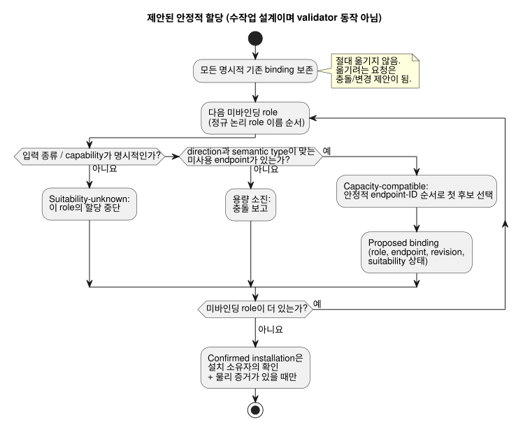

<!-- translation-source: docs/research/GF-COMPOSE-R4-PORTS-BINDINGS.md -->
[영문 원문](GF-COMPOSE-R4-PORTS-BINDINGS.md)

# GF-COMPOSE R4: 포트와 바인딩

이 연구 노트는 조합된 동작(behavior)이 기존 배선을 옮기지 않고 보드의 입력과 출력을
어떻게 확보해야 하는지 다룹니다. 타입이 있는 논리 포트, 바인딩 revision, 용량 집계,
그리고 제안과 설치된 사실을 구분하는 진단을 설명합니다.

이 문서의 구성:

- **사용자 문제** — 농부와 엔지니어에게 필요한 것.
- **조사한 revision의 증거** — 현재 계약과 코드가 이미 확립한 것.
- **표와 예** — 제안 계약, 자원 ledger(원장), 안정적인 할당 순서, 실패 사례.
- **권고**, **미해결 질문과 소유자**, **검증**.

문서 전체에서 쓰는 용어:

| 용어 | 의미 |
| --- | --- |
| 논리 역할(포트) | 동작에 필요한, 이름과 타입이 있는 입력 또는 출력. 예: `irrigation.pump` / `Bool` 출력. |
| Endpoint | direction, semantic type, driver, address, active level, safe level을 가진 보드 프로필 항목. |
| 바인딩 | 논리 이름에서 endpoint ID로 가는 명시적 매핑. `bindingRevision`으로 버전이 매겨집니다. |
| DI / RO | 보드의 물리 디지털 입력 / 릴레이 출력 채널. |

## 사용자 문제

농부는 채널 할당을 계산하지 않고도 준비된 동작을 적용할 수 있어야 합니다. 다른 동작을
추가할 때 기존 배선이 조용히 옮겨져서는 안 됩니다.

따라서 조합 경계에는 다음 네 가지가 필요합니다.

- 타입이 있는 논리 포트
- 명시적인 바인딩 revision
- 용량 집계(capacity accounting)
- 제안과 설치된 사실을 구분하는 진단

범위: 이 문서는 범위가 한정된 연구/설계입니다. discovery, 배선, 배포, 새 wire schema를
승인하지 않습니다.

## 조사한 revision의 증거

증거는 요청된 기준선인 언어 commit `ffdbc96461eca67908252507fb851fa4dabd9a2c`에서
조사했습니다.

**통합 계약.** 통합 README는 direction, semantic type, driver, address, active level,
safe level을 가진 보드 endpoint를 정의합니다. 바인딩은 논리 이름에서 endpoint ID로 가는
명시적 딕셔너리입니다. manifest의 입력/출력 이름에는 direction과 타입이 일치하는 정확한
바인딩이 있어야 합니다. 선언 순서는 영향이 없습니다. v1은 하나의 endpoint를 여러 논리
이름으로 별칭(alias) 처리하는 것을 거부합니다.

**소프트웨어 입력.** 같은 계약은 소프트웨어 입력 endpoint를 명시적으로 허용합니다.
`software-input` driver/address는 논리 입력을 식별하며 물리 DI를 소비하지 않습니다.
런타임 어댑터가 그 입력을 공급합니다. 이것은 계약상의 증거이며, 특정 설치에 그런
endpoint가 있다는 주장이 아닙니다.

**검사기.** `tools/integration-contract.mjs`는 다음을 검사합니다.

- 알 수 없는 endpoint
- 중복된 endpoint driver/address 쌍
- 중복 바인딩
- 누락된 바인딩
- direction 불일치
- 타입 불일치

검사기는 제공된 보드 프로필과 설치 매핑을 해시하고 고정된 릴리스 identity와
비교합니다. 순수 검사기는 장치에 접속하지 않으며 전기적·물리적 사실을 확립하지
않습니다.

**패키지와 구현 문서.** `docs/PORTABLE-PACKAGE.md`는 capability 일치를 요구하고 정확한
`bindingRevision`을 담습니다. 실제 DI/RO 맵은 API와 Device 소유자가 검증해야 한다고
명시합니다. `docs/IMPLEMENTATION.md`는 설치 기록이 이름, capability, 바인딩, 현장
사실을 제공하지만 바인딩 기록이 프로그램 의미를 override할 수는 없다고 말합니다. 시작,
페일세이프 동작, 출력 적용, 드라이버 연결 끊김 시 동작은 소비자 정책으로 남습니다.

**드라이버 경계.** 드라이버의 Source/Intent 분리는 이미 존재하는 경계입니다.

- 드라이버의 기반은 소프트웨어, 특수 하드웨어, 또는 둘 다일 수 있습니다.
- 정밀 측정, 프로토콜 처리, raw ISR과 스캔 중 어느 쪽에서 포착할지의 선택, 물리적
  포착은 그 경계에 남습니다. 코어는 의미 있는 타입이 붙은 이벤트/측정값만 봅니다.
- 농장 정책을 드라이버 안에 숨겨서는 안 됩니다.
- 포착 시각, 수신/평가 시각, 품질은 서로 구분됩니다.
- 명령 acknowledgement는 물리적 효과의 증거가 아닙니다.

[`LANGUAGE.md`](../LANGUAGE.md) 2절 “프로그램 모델”과
[`IMPLEMENTATION.md`](../IMPLEMENTATION.ko.md)의 “Executable path” 절을 참고하십시오.

**R2 의존성: 소스와 인스턴스.** R2는 소스/인스턴스 구분을 확정하고, 설치 바인딩은 실행
가능한 제어 소스 밖에 남는다고 명시합니다. R2의 #62 설치 제약 경계는 미해결입니다. 이
문서는 제약이 별도 아티팩트인지, 아니면 명시적인 프로젝트 간 경계 revision인지 결정하지
않습니다. 그 결정은 #62 시스템 소유자와 언어/API 소유자에게 남습니다.

**R2 의존성: memory(#68).** 갱신된 R2는 시스템/API 이슈 #68도 기록합니다. 대화
memory는 provenance(출처)이자 작성 문맥입니다. 실행 가능한 소스도, 자동 실행 규칙의
권한도, 물리 바인딩의 권한도 아닙니다. 기억된 설비 사실이나 예외는 확인된 결정, 설치
계약, 현재 장치 증거 없이 바인딩 변경을 승인할 수 없습니다. lineage, 보존과
tombstone, memory와 결정의 연결은 #68 소유자의 열린 질문으로 남으며, 이 포트/용량
분석을 바꾸지 않습니다.

## 표와 예

### 제안 계약

다음은 조합 검토를 위한 제안입니다. 의도적으로 개념적 필드만 명시하며, 최종 wire
schema가 아닙니다.

| 필요한 논리 역할/타입 | 필요한 물리 또는 소프트웨어 capability | 제공된 프로필/바인딩 revision | 적합성(suitability) 증거 | 결과 | 진단 대상 |
| --- | --- | --- | --- | --- | --- |
| `irrigation.pump` / `Bool` 출력 | 사용되지 않은 호환 RO endpoint | 고정된 보드 프로필과 설치 `bindingRevision` | direction/타입 일치. 프로필 검토와 물리적 인수는 별도로 필요 | Capacity-compatible. 바인딩을 제안한 뒤 설치 확인 | 펌프 역할, 후보 endpoint, 프로필과 바인딩 revision |
| `irrigation.low_water` / `Bool` 입력 | 호환 DI capability 또는 명시적 software-input capability | 같은 고정 프로필/매핑 문맥 | direction/타입 일치. DI인지 소프트웨어 드라이버인지 명시됨 | 입력 종류(capability kind)가 알려진 뒤에만 capacity-compatible | 저수위 역할, 입력 종류, endpoint/드라이버 |
| `irrigation.manual_start` / `Bool` 입력 | 호환 DI 또는 명시적 소프트웨어 입력 | 같은 고정 프로필/매핑 문맥 | 소프트웨어 입력은 DI를 소비하지 않음. 암묵적 대체 없음 | 제공된 종류가 명시적일 때만 바인딩 제안 | 수동 시작 역할과 누락된 입력 종류 증거 |
| `ventilation.fan_1..4` / `Bool` 출력 | 서로 다른 미사용 호환 RO endpoint 네 개 | 고정 프로필과 새로운 또는 확장된 매핑 revision | direction/타입 일치. endpoint 소유권이 고유함 | 안정적인 순서로 제안. 설치 증거가 있은 뒤에만 확인 | 팬 역할, endpoint, 소유권과 용량 |
| 모든 필수 역할 / 선언된 타입 | direction 또는 타입이 잘못된 endpoint | 제공된 revision 자체는 내부적으로 고정되어 있을 수 있음 | validator의 불일치는 비호환성의 구체적 증거 | 거부. 강제 변환이나 타입 재지정 없음 | 논리 역할, endpoint, 기대/실제 direction/타입 |

결과 열은 서로 다른 네 가지 상태를 사용합니다. 어떤 상태도 다음 상태를 함축하지
않습니다.

| 상태 | 의미 | 주의 |
| --- | --- | --- |
| Capacity-compatible | 필요한 direction과 semantic type을 가진 별도 endpoint가 제공된 프로필에서 사용 가능해 보인다는 뜻일 뿐입니다. | 배선, 극성, 페일세이프 적합성, 부하 호환성, 물리적 동작을 증명하지 않습니다. |
| Suitability-unknown | 위의 사실(배선, 극성, 페일세이프 적합성, 부하 호환성, 물리적 동작)이 없습니다. | 안전한 운전을 주장하지 마십시오. 누락된 사실이 입력 종류나 capability 자체라면 그 역할의 할당이 중단됩니다. |
| Proposed binding | 할당의 결과입니다. | 설치된 사실이 아닙니다. |
| Confirmed installation | 기존 소유자의 바인딩 확인과 물리적 증거가 필요합니다. | host validator 통과로부터 **절대** 추론하지 않습니다. |

### 자원 ledger

다음은 수작업으로 계산한 ledger이며 실행 증거가 아닙니다. fixture는 다음을 가정합니다.

- TwoZoneIrrigation에는 펌프 출력 하나, 밸브 출력 두 개, 저수위 입력 하나, 수동 시작
  입력 하나가 있습니다.
- FourFanVentilation에는 팬 출력 네 개가 있습니다.
- 상위(umbrella) 예는 합산 물리 수량을 DI 2, RO 7로 고정합니다.

| 조합 fixture와 입력 가정 | 소비되는 물리 DI | 소프트웨어 입력 | 소비되는 물리 RO | 요청된 역할 합계 |
| --- | ---: | ---: | ---: | ---: |
| 관수 + 환기. 관수 입력 두 개 모두 배선된 디지털 입력 | 2 | 0 | 7 (3 + 4) | 9 (입력 2 + 출력 7) |
| 관수 + 환기. 수동 시작은 명시적 소프트웨어 입력이고 저수위만 배선된 DI | 1 | 1 | 7 (3 + 4) | 9 (입력 2 + 출력 7) |

두 번째 행은 의도적으로 “DI 두 개”가 아닙니다. `Bool` 선언은 의미상의 타입을 설명할 뿐
전기적 소비를 설명하지 않습니다. 소프트웨어 입력도 명시적인 논리 endpoint와 바인딩이
필요합니다. 입력 종류가 선언되지 않았거나 프로필이 대응하는 capability를 제공하지 않으면
적합성은 알 수 없으며, 그 역할의 할당을 중단해야 합니다.

### 안정적인 할당 결정

**제안.** 이 안정적인 순서는 권고이며 기존 validator의 동작이 아닙니다.

1. 모든 명시적 기존 바인딩을 먼저 보존합니다.
2. 바인딩되지 않은 각 역할에 대해 direction과 semantic type이 일치하고 아직 소유되지
   않은 endpoint만 고려합니다.
3. 역할은 정규(canonical) 논리 역할 이름 순서로 정렬합니다.
4. 후보 endpoint는 프로필의 안정적인 endpoint ID를 사전 순서로 정렬합니다.
5. 명시적 바인딩을 옮기는 대신 충돌을 보고합니다.

아래 흐름은 역할마다 제안된 할당 과정과 네 가지 상태가 각각 어디서 생기는지를
요약합니다.



다음 두 관심사를 섞어서는 안 됩니다.

- **논리 출력 권한.** 각 출력 채널에는 권위 있는 정의가 하나만 있으며, 중복된 직접
  작성자는 컴파일 오류입니다. 명시적인 station 자원 중재는 그대로 유지됩니다. station
  요청은 서로 경쟁하는 직접 채널 쓰기가 아닙니다.
- **물리 endpoint/자원 집계.** 할당기(allocator)가 하는 일입니다. endpoint 별칭 검사는
  별도의 바인딩 검증으로 남습니다.

| 단계 | 기존 또는 요청된 역할 | 결정 | 증거/진단 |
| ---: | --- | --- | --- |
| 1 | `pump -> RO3` | 명시적 바인딩 보존 | 기존 매핑은 권위 있는 입력. 재할당 없음 |
| 2 | `valve_a -> RO1`, `valve_b -> RO2` | 두 명시적 바인딩 모두 보존 | 기존 매핑은 소유권을 유지하며 서로 구분됨 |
| 3 | `fan_1..fan_4` | 안정적인 endpoint-ID 순서로 미사용 호환 RO 네 개 선택 | 각 제안은 역할, endpoint, revision, 적합성 상태를 기록 |
| 4 | `pump -> RO4`를 요구하는 모든 요청 | 명시적 충돌/변경 제안 보고 | 기존 `pump -> RO3`는 조용히 옮길 수 없음 |

변경 전/후 풀이 예(수작업이며 실행 증거가 아님):

```text
관수 적용 전: pump -> RO3, valve_a -> RO1, valve_b -> RO2
환기 추가 후: pump -> RO3, valve_a -> RO1, valve_b -> RO2,
  fan_1..fan_4 -> 안정적인 endpoint-ID 순서의 미사용 호환 RO 네 개
```

불변조건은 정확합니다. 환기를 추가해도 관수 할당 세 개는 모두 그대로입니다. 여기서 두
가지 경계 사례가 따라 나옵니다.

- 호환되는 미사용 RO가 네 개보다 적으면 결과는 용량 소진입니다.
- 요청된 팬이 RO3에만 호환된다면 결과는 충돌/변경 제안이며, 자동 재배치가 아닙니다.

### 실패와 unknown 사례

| 사례 | 영향받는 역할 | 누락되거나 충돌하는 증거 | 필요한 결과와 소유자 |
| --- | --- | --- | --- |
| 잘못된 direction 또는 semantic type | 그 endpoint에 바인딩된 역할 | 프로필 endpoint가 manifest의 direction/타입과 맞지 않음. 검사기가 불일치를 보고 | 바인딩 거부. 프로필/통합 소유자가 프로필 또는 제공된 역할을 수정. 강제 변환 없음 |
| 용량 소진 | 소진된 direction/타입이 필요한 모든 미바인딩 역할 | 명시적 바인딩을 보존한 뒤 남은 미사용 호환 endpoint가 없음 | 보존된 소유자와 후보 집합을 포함해 용량 충돌을 보고. API/조합 소유자가 수정된 설치를 선택하거나 조합을 거부 |
| 극성 또는 페일세이프 증거 불명 | 해당 디지털 입력/출력 역할 | `activeLevel`/`safeLevel`은 메타데이터일 수 있지만, 이 검사기는 적합성이나 물리적 인수를 확립하지 않음 | 적합성 unknown으로 표시. 보드/프로필 소유자가 프로필 증거를 제공하고 Device/물리 소유자가 인수 증거를 제공. 안전 운전을 주장하지 않음 |
| 중복 출력 소유권 | 두 논리 출력 역할과 공유 endpoint | v1은 한 endpoint에 대한 중복 바인딩을 거부. endpoint driver/address 중복도 무효 | 거부하고 두 역할과 endpoint를 식별. 현장/설치 소유자가 매핑을 해결하고 Device가 적용된 바인딩을 확인 |

이 계약 밖의 소유권:

- 설치 제약 경계의 결정은 System #62가 소유합니다.
- Device Query는 System #74가 소유하므로, 장치 측 질의/관측 경로도 #74가 소유합니다.

이 언어 계약은 고정된 프로필/매핑 identity와 검증 결과를 보고할 수 있습니다. 그러나 어느
소유자의 물리적 인수나 discovery 책임도 배정할 수 없습니다.

## 권고

capacity-compatible, suitability-unknown, proposed binding, confirmed installation이라는
명시적인 네 가지 상태를 가진 조합 planner를 채택합니다. 그 planner에서는 다음을 따릅니다.

- 미사용 endpoint를 고려하기 전에 명시적 바인딩을 보존합니다.
- 제안에는 문서화된 안정적인 역할 및 endpoint 순서를 사용합니다.
- 논리 이름과 semantic type을 물리 endpoint ID와 분리합니다.
- 소프트웨어 입력을 명시적인 논리 capability로 모델링하여 DI 용량을 소비하지 않게
  합니다.

R4의 할당과 자원 집계는 드라이버의 포착 의미와 별개입니다. 이 문서는 Device가 이 경계를
구현했거나 물리적으로 검증했다고 주장하지 않습니다.

모든 제안에는 제공된 프로필 identity와 바인딩 revision, 영향받는 역할, 후보 endpoint,
진단 상태가 담겨야 합니다. 확인에는 기존 설치 소유자의 증거가 담겨야 합니다. 다음은
절대 해서는 안 됩니다.

- 명시적 바인딩을 조용히 다시 쓰는 것
- 극성/페일세이프 적합성을 추론하는 것
- validator 통과를 물리적 인수로 바꾸는 것

## 미해결 질문과 소유자

- API/조합 소유자: 최종 제안/확인 기록과, 수정된 설치 매핑을 승인하는 방법을
  정의합니다. 이 문서는 의도적으로 그 wire schema를 선언하지 않습니다.
- 보드/프로필 소유자: 권위 있는 안정적 endpoint 순서를 정의하고, 검토된 용량, 극성,
  safe level, 드라이버, address 증거를 제공합니다.
- 현장/설치 소유자: 설치에 실제로 선택된 논리 이름-endpoint 매핑과 바인딩 revision을
  확인합니다.
- Device 소유자(Device Query는 system #74와 함께): 어떤 관측이 적용된 바인딩을 확인할 수
  있는지, 무엇이 물리적 인수 증거로 남는지 정의합니다.
- Device/드라이버 소유자: 포착에서 코어로 가는 이벤트/측정값 표현과 증거를 정의합니다.
  포착 시각, 수신/평가 시각, 품질을 구분합니다. 이것은 바인딩/자원 집계와 별개로
  유지됩니다.
- System #62 소유자와 언어/API 소유자: R2가 식별한 설치 제약 경계를 해결합니다. 이
  문서는 그 열린 결정을 보존하며 제약을 바인딩 planner에 넣지 않습니다.
- System/API #68 소유자: memory lineage, 보존/tombstone 동작, memory와 결정의 연결을
  정의합니다. 이 planner는 memory 검색 결과를 바인딩 증거나 자동 바인딩 권한으로
  취급해서는 안 됩니다.
- 조합 소유자: 하나의 논리 역할에 대해 프로필이 여러 후보 capability 종류를 노출할 수
  있는지 결정합니다. 결정 전까지는 명시적인 호환 capability 종류 하나를 요구하고,
  모호함은 suitability-unknown으로 보고합니다.

## 검증

- [x] 조사한 commit 기록: `ffdbc96461eca67908252507fb851fa4dabd9a2c`.
- [x] `contracts/integration-v1/README.md`, `docs/PORTABLE-PACKAGE.md`,
  `docs/IMPLEMENTATION.md`, `tools/integration-contract.mjs`의 해당 절과 의존성 초안
  R2를 읽었습니다.
- [x] 두 ledger 모두 정확한 합계(DI 2 / RO 7, 그리고 DI 1 / RO 7 + 소프트웨어 입력
  하나)를 가지며 입력 종류 가정을 명시합니다.
- [x] 전/후 예는 pump -> RO3, valve_a -> RO1, valve_b -> RO2를 보존하며, 안정적 순서와
  override/충돌 동작을 설명합니다.
- [x] 잘못된 타입, 용량 소진, 극성/페일세이프 증거 불명, 중복 출력 소유권 사례가 영향받는
  역할과 누락/충돌 증거를 명시합니다. 프로필, 바인딩 확인, 물리적 인수의 소유자가
  배정되어 있습니다.
- [x] 계약/코드에서 나온 주장, 제안, 미해결 결정, 수작업 예를 구분해 표시했습니다.
  런타임 또는 물리 테스트를 실행하거나 주장하지 않았습니다.
- [x] 갱신된 R2 경계를 보존했습니다. memory는 provenance/작성 문맥이며 실행 규칙이나 물리
  바인딩의 권한이 아닙니다. lineage, 보존/tombstone, 결정 연결은 #68에서 미해결로
  남습니다.
